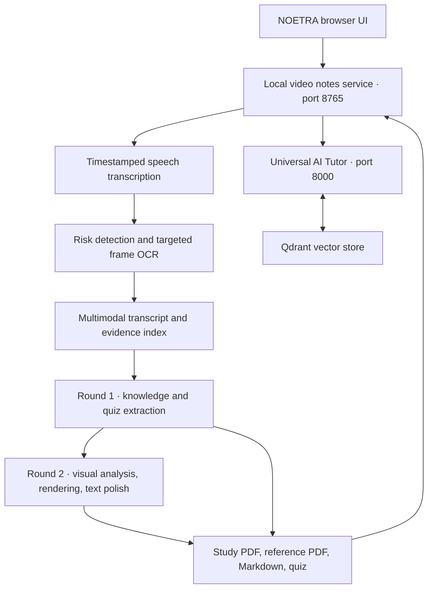
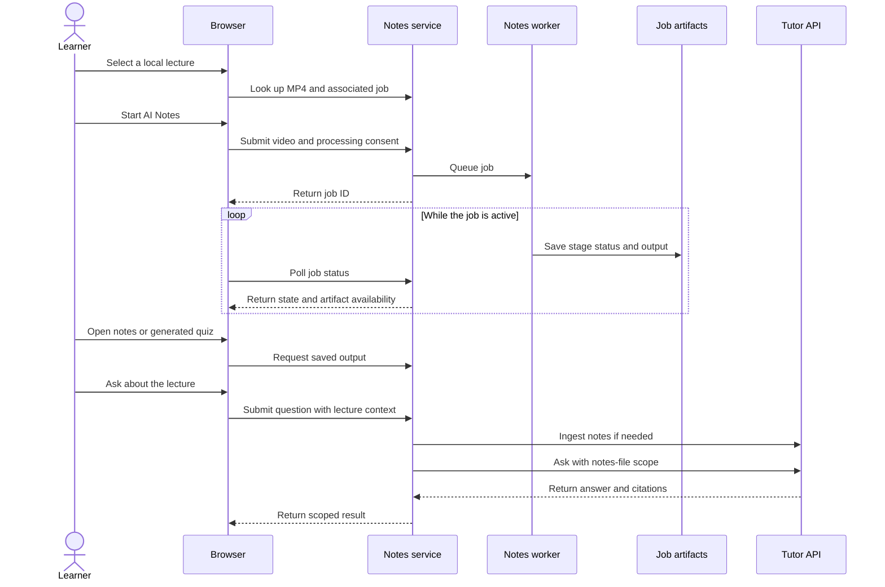
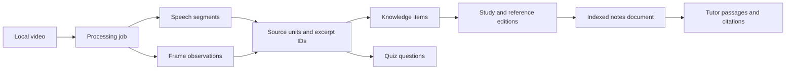

# NOETRA — Adaptive Notes and Source-Grounded AI Tutoring

**Project report**  
**Author:** [Your name and student ID]  
**Institution and programme:** [Your institution and programme]  
**Supervisor:** [Supervisor's name]  
**Submission date:** [Submission date]

## Contents

1. Introduction and problem statement
2. Aim, objectives, and scope
3. Requirements and acceptance criteria
4. System architecture and design decisions
5. Methodology and implementation
6. Data, storage, and interfaces
7. Frontend features and integration status
8. Running and demonstrating the project
9. Testing, results, and evaluation design
10. Limitations and future scope
11. Conclusion
12. Appendices on traceability, demonstration records, and source references

## Abstract

NOETRA is an educational software project that turns recorded lectures into study material. Its main workflow takes a local MP4 lecture, transcribes the speech, checks intervals where speech alone may miss instructional content, and extracts evidence from selected video frames. A two-pass pipeline then extracts structured knowledge, generates quiz questions, adds suitable visuals, and prepares readable study notes and a reference edition. A separate retrieval-augmented generation (RAG) tutor indexes generated notes and answers questions with citations. The React frontend brings lecture playback, job progress, downloads, quizzes, and tutoring into one workspace. The project demonstrates how the same lecture can support several study activities through a shared processing pipeline. Its current evidence supports describing it as a local prototype. Production deployment, learning outcomes, and overall accuracy require further evaluation.

## 1. Introduction and problem statement

A recorded lecture is useful for reviewing an explanation, but finding a particular definition, code example, or calculation can require replaying several parts. A transcript makes speech easier to search, while screen content may contain details that the speaker assumes the learner can see. Examples include a Java string literal, a mathematical formula, or values in a table. Notes, self-assessment questions, and answers generated from a lecture are more useful when the learner can identify where the material came from.

NOETRA addresses this problem by processing speech and selected visual evidence together and preserving links to lecture excerpts where the pipeline can establish them. A learner can review condensed notes, consult source-linked material, practice questions, and ask a tutor about the lecture. Here, **adaptive** refers to choosing a representation suited to the material, such as a code block for a programming example or a diagram for a process, and to choosing a study activity. A personalized curriculum or a measured learner model remains outside the implemented scope.

## 2. Aim, objectives, and scope

The aim is to build a lecture-to-study workflow that produces useful learning material and makes its source evidence inspectable.

1. Convert lecture speech into timestamped text.
2. Identify intervals where important information may be visible on screen or where transcription may be unreliable.
3. Combine speech and selected visual observations while preserving source identities, timestamps, and uncertainty.
4. Extract typed educational items and generate practice questions from eligible chunks.
5. Arrange the extracted material into readable notes and add visuals where the evidence supports them.
6. Deliver study and reference editions, and expose generated quizzes through the frontend.
7. Answer questions using retrieved notes, with citation checks and an insufficient-evidence path.
8. Record job state, errors, source gaps, and intermediate artifacts for review.

The primary browser workflow uses local MP4 files. Separate backend ingestion code handles TXT transcripts, a designated multimodal JSON format, and PDF, DOCX, PPTX, and supported image formats. Those additional formats have backend entry points. The browser library is specifically wired to the local MP4 workflow.

### 2.1 Project contributions and evidence boundaries

The first contribution is a processing workflow that links several kinds of learning material to one source lecture. The learner can use an indexed note to ask a question, consult the reference edition to find a source excerpt, and return to an associated lecture interval to inspect it. These are related interactions with different storage and validation requirements. The project brings them together without requiring the lecture player to run extraction synchronously or the tutor to decode video on demand.

The second contribution is preserving intermediate observations and evidence so generated material can be inspected. A transcript is speech evidence. A frame observation is a reading of an image at a known time. An extracted claim is model output that can refer to one or both. A polished paragraph can reorganize several claims for reading. Keeping these distinctions makes it possible to review a result without assuming that every later artifact is an exact transcription of the lecture.

The third contribution is engineering for incomplete processing. The application records stage progress, uses bounded requests, handles several distinct failure states, and retains outputs for inspection. The existence of a partial artifact can be useful to a learner or evaluator. A partial quiz can still contain sound questions, while an unresolved source gap matters for coverage. The contribution is the ability to expose and diagnose those states in the supported paths. Recovery under concurrent workloads and process failure remains an evaluation subject.

The report is based on executable source, repository documentation, and saved results. It describes the observable implementation separately from research questions and optional extensions. Fresh evidence from the initial report review consists of a frontend build, linting, and the focused quiz tests. No new live model calls, fresh end-to-end measurements, learner study, or independent manual evaluation of model answers were performed to expand the report. Literature review requirements, if imposed by an institution, would need a separately sourced section with the required citation style.

## 3. Requirements and acceptance criteria

| Area | Behavior supported or expected |
| --- | --- |
| Lecture access | List local videos, play them in the browser, and seek to relevant positions. |
| Background processing | Submit a notes job, show its status, and provide outputs when available. |
| Evidence handling | Preserve timestamps, excerpt identifiers, provenance, and unresolved source gaps. |
| Notes | Produce a readable study edition and a reference edition with source-linked notes and an evidence appendix. |
| Assessment | Produce questions, answers, explanations, Bloom levels, and evidence references. Show incomplete quiz output explicitly. |
| Tutoring | Index generated notes, retrieve relevant passages, and scope lecture questions to the selected notes where the video bridge is used. |
| Reliability | Record failures and support bounded retries or artifact reuse where the relevant stage implements them. |
| Data handling | Keep provider credentials in backend configuration and require authorization for Groq text processing when submitting a local video job. |
| Usability | Show loading, empty, progress, and error states so the learner can tell what material is available. |

### 3.1 Actors and use cases

The **learner** chooses a lecture, requests generation, reviews a study edition, checks an excerpt in the reference edition, attempts quiz questions, and asks follow-up questions. The **local operator** prepares the video directory, Python environments, models, provider configuration, and Qdrant instance. In a student project demonstration, the same person may act in both roles. The **evaluator** samples notes and questions, compares them with lecture evidence, and records errors. The codebase describes these responsibilities through its interfaces and tooling. It does not define distinct logged-in roles for these actors.

| Use case | Precondition | Main success path | Visible exception or alternative |
| --- | --- | --- | --- |
| Open a lecture | The local service can list a supported file. | Select the item and play or seek within the lecture. | The interface shows an empty library or a load error when it cannot retrieve the item. |
| Generate study material | The video is available, the worker is running, and the required settings and models are ready. | Submit a job, observe its stages, then retrieve the available artifacts. | The response can be failed, partial, or interrupted. The stage and log help distinguish these cases. |
| Inspect an extracted claim | A reference edition exists and its source entry has an excerpt. | Find the claim or item ID, check the excerpt, and compare it with the recording. | Incomplete evidence is recorded as an unresolved source gap or an unavailable timestamp where applicable. |
| Practice with a quiz | A generated quiz is associated with the lecture. | Read a question, attempt an answer, reveal the expected answer, and review the explanation. | An incomplete quiz can still contain questions from successful source chunks. |
| Ask a lecture question | The scoped notes are available and the tutor and vector store are reachable. | Index or reuse the notes, retrieve evidence, and return an answer with source links. | The workflow may report insufficient evidence. Unavailable services and missing artifacts have separate error paths. |

### 3.2 Non-functional requirements and acceptance criteria

These criteria turn broad project objectives into checks that an evaluator can observe. Each criterion needs evidence from the same source snapshot for a release claim.

| ID | Requirement | Acceptance criterion |
| --- | --- | --- |
| NFR-01 | Source traceability | A sampled reference item can be followed through its knowledge ID and stored quote to the input evidence. The check records whether a video timestamp is present. |
| NFR-02 | Status visibility | A learner can distinguish processing, available output, partial output, and interrupted or failed processing in the frontend or the status API. |
| NFR-03 | Repeatability | The evaluator can identify the input artifact, configuration, model, and output directory used in the run. A repeat run can be compared at the source-unit level. |
| NFR-04 | Resource visibility | For a test lecture, the operator can report media duration, time spent in each stage, number of provider attempts, and job outcome. |
| NFR-05 | Evidence-limited answers | A scoped tutor question retrieves material from the selected notes. A question without adequate evidence has a test case with an expected insufficient-evidence response. |
| NFR-06 | Local data handling | Demonstration material is permitted for the selected processing path. Credentials stay out of screenshots and submitted artifacts. |
| NFR-07 | Usability | A first-time user can find a lecture, understand generation status, and identify the difference between study and reference editions without opening the terminal. |

Availability, throughput, and supported lecture duration have no project-wide acceptance thresholds in the available evidence. A future evaluation should set these thresholds before measuring the system.

## 4. System architecture and design decisions



| Component | Technology and role |
| --- | --- |
| Browser interface | React and TypeScript implement the pages. Vite handles development and builds, React Router handles navigation, TanStack Query manages fetched state, and Tailwind CSS and Radix underpin the interface. |
| Video notes service | Python's threaded HTTP server lists and streams local MP4s using byte ranges, accepts notes jobs, returns status and artifacts, and relays tutor requests. A single worker processes video jobs. |
| Speech and visuals | Faster-Whisper produces speech segments with timing. The visual recovery workflow selects frames based on risk intervals. Standalone PDF OCR uses RapidOCR and ONNX Runtime, and general structured ingestion uses Docling where applicable. |
| Extraction model and scheduling | The authorized combined video extraction workflow uses Groq, with `openai/gpt-oss-120b` in its scheduler configuration. SQLite supports claim, reservation, quota, and dispatch bookkeeping. The repository includes additional provider and experimental paths. |
| Notes rendering | Markdown and programmatic visual rendering produce the notes. The frontend also contains renderers for code, math, tables, and diagrams. The video job PDF exporter prints HTML through headless Microsoft Edge. |
| Tutor | FastAPI serves ingestion and questions. Qdrant stores indexed passages, sentence-transformer models support embedding and reranking, and LangGraph coordinates retrieval, generation, and citation verification. The declared answer model is Groq `llama-3.3-70b-versatile`. |

The frontend uses the Vite development proxy for `/api/videos` and `/api/video-notes`. The notes service writes artifacts on the local filesystem. The tutor has a separate ingestion and indexing lifecycle. Model names above describe configured defaults or constraints in source. The effective model depends on the entry point and runtime settings.

### 4.1 Design decisions and their effects

| Decision | Reason and consequence |
| --- | --- |
| Store intermediate results | A log and per-stage artifacts allow inspection of failures before the final PDF is created. They also make some outputs reusable. File retention and cleanup become operator responsibilities. |
| Perform targeted OCR | Language cues and ASR diagnostics narrow visual inspection to useful intervals. Less footage enters OCR, while instructional content displayed without a recognized speech cue can be missed. |
| Keep two processing passes | Typed extraction provides a stable input for visual analysis. Visual selection, rendering, and polish can each be examined for errors independently of model extraction. The separation adds handoffs and intermediate formats. |
| Publish two note editions | The study version offers a concise flow. The reference version gives an evaluator a place to inspect quotes and times. The two must stay tied to the same job so an excerpt can be checked against the correct source. |
| Use a separate tutor service | Notes can be generated without running the tutor. The tutoring subsystem can be exercised against an existing corpus. Starting or changing the tutor adds configuration and index dependencies. |
| Apply lecture scope to retrieval | Programming lectures can use the same words for different examples. Filtering by notes document reduces the chance that the tutor quotes another lecture in a lecture-specific answer. |

### 4.2 Job interaction sequence



The job status and retrieval request have separate lifecycles. A notes document can exist before the first tutoring question. A tutor connection failure can therefore be diagnosed independently of a successful notes job.

## 5. Methodology and implementation

### 5.1 Lecture selection and job lifecycle

The library queries the video notes service for available MP4s from `backend/video/`. Opening a video gives the learner a playback workspace. The AI Notes panel checks for an existing job, submits a new one when authorized, and polls the status endpoint. A job can be queued, running, complete, partial, or failed. The service records a stage name and writes a worker log. Generation can reuse artifacts from earlier stages where the job path and processing conditions permit. If a saved job is queued or running but absent from the process-local worker set, the status API reports it as interrupted and directs the learner to resume from AI Notes.

### 5.2 Speech transcription and targeted visual recovery

Faster-Whisper converts lecture audio into timed speech segments. Source configuration includes a local English model path and word timestamps. The default transcription configuration favors CUDA and has a CPU fallback when initialization requires it. Segment and word times support alignment and later source navigation.

The risk detector identifies intervals that merit visual inspection. In the integrated video path, high-priority events drive frame recovery using local GLM-OCR through Ollama. The workflow checks the frame manifest against these events and verifies that the expected frame and task combinations have OCR records. Text recognition is expected for selected frames. Formula or table recognition can also be requested according to the event category. An OCR attempt may be present even when its reading is uncertain or unusable.

The multimodal transcript aligns visual observations using actual frame timestamps and preserves the speech records and visual provenance. Evidence that falls in a speech gap remains unassigned to speech. Ambiguous OCR and conflicting readings can be recorded as unresolved rather than silently turned into canonical text. This is particularly relevant for code, where one character can change meaning.

### 5.3 Round 1 — extraction, grounding, and quiz generation

The extraction phase groups source units into bounded chunks and sends eligible requests to the configured model. The returned structures can contain concepts, definitions, explanations, examples, facts, formulas, procedures, and relationships. The pipeline validates the response format and resolves cited excerpts against source material. Evidence checks establish that a reference points to the supplied source text. Whether a claim follows from that text requires semantic evaluation or human review.

The authorized runner binds requests to source and configuration information. Its scheduler tracks work claims, quota reservations, attempts, and outcomes. Certain failures can be retried or handled with a smaller source-boundary split, depending on the runner, the authorized inputs, and the error. Video jobs run one at a time in the HTTP worker, while the extraction runner can use multiple configured worker slots within a job.

Quiz-enabled Round 1 requests include four short-answer questions per successful work item alongside the notes. A question includes an answer, explanation, Bloom level, and excerpt references. The six levels are Remember, Understand, Apply, Analyze, Evaluate, and Create. Validation checks conditions such as question count, duplicate questions, and references to eligible evidence. Quiz output is assembled in source order with stable question IDs. An unsuccessful chunk can leave the quiz incomplete. The records distinguish evidence linkage from semantic verification.

### 5.4 Round 2 — visual refinement and reading edition

Round 2 reads the extracted notes and looks for opportunities to use visuals. It checks candidate visual payloads before rendering and integrates successful visuals into the notes. Renderer errors are captured in stage reports. A separate polish pass creates the reading edition. The program uses Round 1 completion, Round 2 analysis and render results, and polish errors to decide whether to mark an exported job complete or partial.

The **study PDF** emphasizes readability. The **reference PDF** includes the polished notes, a source-linked notes section, and an appendix with evidence quotes and video times. The companion source-linked section is important because polished paragraphs can combine claims. Intermediate Markdown and quiz exports can also be retrieved through the job service.

### 5.5 Retrieval-augmented tutoring

The tutor ingests allowed notes and indexes passages for retrieval. For a lecture-scoped question, the bridge selects the notes for the job and names the indexed Markdown file using the job ID and a hash derived from its contents. It submits an ingest call when the marker for that document is missing or differs, then asks the tutor to restrict retrieval to that notes file. The bridge checks that any returned citation paths point to the selected document.

The retrieval layer supports hybrid dense and keyword search, reranking, and context expansion. Dense retrieval finds passages with similar meaning, while keyword retrieval helps recover exact terms such as method names. The tutoring workflow checks whether evidence is adequate, can retry retrieval, and can return an insufficient-evidence answer. When it generates an answer, a citation verification step checks the resulting references. The answer is grounded in indexed notes. Its accuracy still depends on the quality of those notes, the retrieved context, and the verification steps.

### 5.6 Speech output, diagnostics, and recovery

The transcription stage is independently runnable with its own dependency lockfile. It uses PyAV decoding in the documented Windows setup. The declared defaults use `small.en`, English, beam size 3, a deterministic temperature setting, and word-level timestamps. Voice activity detection is configured with a minimum silence interval of 2,000 milliseconds and a 400-millisecond speech pad. These are settings declared in the source and documentation. A job supplies its selected local model directory.

On initialization, the transcription path attempts the configured hardware and compute type. CUDA initialization errors can lead to CPU `int8` fallback. An inference failure after initialization is handled differently. The stage can write partial artifacts and exit nonzero, and the integrated worker requires a complete transcript before advancing. This distinction prevents an incomplete recording from silently entering later stages with a successful status. JSON preserves fractional times and available diagnostics, while TXT and SRT display time at millisecond resolution.

To evaluate alignment, select clear words at the beginning, middle, and end of a lecture and compare their timestamps against the original audio. For a technical lecture, sample identifiers, quoted strings, numeric values, and spoken punctuation separately. An acceptable average word error rate can coexist with serious mistakes on a small number of meaning-bearing tokens.

### 5.7 Risk scoring and interval selection

The risk detector uses deterministic rules. It first validates that the transcript has a positive audio duration and ordered, in-range segment timestamps. It reads the current segment with bounded temporal context and detects terms associated with code, formulas, output, diagrams, tables, slide text, corrections, and ambiguous visual references. A phrase split between adjacent segments can also be recognized. Technical vocabulary combined with weak word probabilities, zero-duration alignments, or a low segment log probability can add an ASR risk signal.

The baseline heuristic starts at 2, adds 2 for an explicit visual cue, and adds up to 2 for additional categories. Formula and correction signals each add 2, and technical ASR risk adds 1. A lone ambiguous visual reference is assigned 2. The default thresholds are 7 for high and 4 for medium. This score prioritizes inspection and has no probabilistic interpretation.

For each detection, the algorithm pads the interval by 2 seconds before and 3 after, clamped to the media duration. Nearby detections can merge when their direct categories overlap, the gap is within 2 seconds, and the merged span stays within 45 seconds. An event contains its trigger text, categories, source segments, recommended recovery types, and a deterministic identifier derived from source and configuration information. The video workflow sends high-priority events to the OCR stage. Evaluating this gate requires measuring the important screen content it misses as well as the unnecessary frames it selects.

### 5.8 Multimodal evidence and ambiguity

For an OCR observation, the frame's actual presentation timestamp is compared with the corresponding half-open speech interval. A frame at a segment boundary belongs to an interval only if it satisfies that interval's start-inclusive, end-exclusive rule. An observation outside speech intervals still appears on the timeline at its original position. This avoids implying that an instructor spoke about a frame during silence.

The integration stage can display repeated observations by pointing to the first matching reading, while retaining all occurrences in JSON. A visual observation stores the task and the derived image identity so an evaluator can inspect the correct frame or crop. Conflicting same-frame readings can be retained as unresolved. A later reading of changed code may represent a genuine edit, so observations at different times are preserved separately. The system avoids treating visual text as a fully reconstructed program. In particular, a plausible string literal reconstructed from several different screen states could differ from every string the instructor displayed.

### 5.9 Source ingestion and extraction validation

The ingestion router dispatches by the input format and parser options. TXT input is segmented into source units with timestamp detection. Structured formats use Docling, and Stage 4 JSON uses the multimodal adapter. Parser and router version metadata help identify how a document was converted. The standalone PDF OCR workflow has a separate use case for extracting text from pages and should be described independently of video-frame OCR.

An extraction request has a content budget and a response reserve. Keeping coherent source boundaries improves the chances that an entire explanation or example reaches the model together, while bounded input and output sizes protect processing limits. Smaller requests can improve recovery after truncation or malformed output, at the cost of losing some neighboring context. The quiz-enabled response reserves extra output capacity because the model must return questions as well as typed claims.

Three checks answer different questions about a generated item:

| Check | What the checker can establish | Example |
| --- | --- | --- |
| Wire format | The response parses and has the required structure and field types. | A question's evidence references are present as a supported field. |
| Source grounding | Identifiers and quote references resolve against the supplied source catalog. | The quote appears in a real input excerpt used for that request. |
| Semantic support | The source actually justifies the claim, answer, or diagram. | A reference to `indexOf` supports the specific statement about its return behavior, rather than merely containing the method name. |

Source inspection should proceed from the highest-level output to the most direct evidence available. If a generated example seems wrong, compare the reading edition with the source-linked edition, check which evidence IDs were attached, and compare the excerpt against speech or the screen at that time. This can show where a specific error entered the chain.

### 5.10 Visual representation and reading quality

The second pass evaluates how a note would read with a visual. A comparison can benefit from a table when the source supplies aligned categories and comparable values. A flowchart can show order or branching when those transitions are grounded in the lecture. Code and formula examples depend on precise text, so a polished paraphrase may require a companion exact excerpt. Round 2 validates candidate payloads before passing them to rendering and records rendering errors for inspection.

The polished reading edition improves continuity across individual notes. This introduces an evaluation concern when multiple claims are paraphrased into a single paragraph. The reference PDF includes the source-linked companion text and the evidence appendix so reviewers can walk from the readable result back to the underlying note. A useful review sample includes both a prose explanation and a notation-sensitive example.

### 5.11 Search ranking and the tutor decision path

The tutor indexes smaller child passages with references to larger parent passages. Children give search a narrow target. The surrounding parent can recover information lost when a definition or explanation crosses a child boundary. The source defaults declare parent size 1,200 with overlap 100 and child size 400 with overlap 50. These are configuration targets. Actual passage sizes depend on the input and the chunker.

For a question, the retrieval pipeline embeds its text and searches both dense and keyword candidates. The hybrid stage combines rankings with reciprocal rank fusion, which gives a passage more credit when it ranks highly in the retrieval lists. A cross-encoder can score the query and each candidate together before the workflow keeps the best results. A document filter limits candidates to the chosen notes when the lecture scope is supplied. This filtering occurs before the evidence check and generation. The local bridge also checks returned citation paths after generation.

The workflow evaluates retrieval using properties such as passage count, score, and query coverage. Sufficient evidence leads to generation. When evidence is insufficient, the implementation permits two retries before admitting that it lacks support. The general tutor supports strict and teaching modes. The local video bridge explicitly requests strict mode with up to four results. The declared tutor provider setting defaults to mock; the presence of a configured Groq model name alone does not show that live generation ran.

### 5.12 Worked example from input to review

Consider an illustrative Java lecture in which the speaker says “look at this line” while the screen shows an escaped character in a string. This walkthrough explains the behavior to inspect during a demonstration. No run statistics are attributed to it.

1. The speech transcript records the phrase and its time range. The nearby discussion of code provides context for the visual reference.
2. If the interval reaches high priority, the frame worker produces an OCR observation. It records the original frame time and the task. A conflicting reading is retained for inspection.
3. The multimodal transcript presents the speech and frame evidence together where the times align. Their source identities remain available separately.
4. Round 1 can extract an explanation and a quiz question if the material and its evidence support them. A valid quote reference establishes where each was grounded.
5. The reference edition lets the learner inspect the excerpt and return to the recording. A reviewer comparing escape sequences should check the underlying visual frame when there is uncertainty.
6. A question in the tutor searches the notes for the selected lecture. The resulting citation is to those notes. The reference edition can then help follow the material back to the original video.

The example highlights how evidence can be lost at different stages. A missing transcript cue affects risk selection. A weak visual reading affects extraction. A correctly extracted explanation can still be missed by retrieval. Recording stage-specific evidence helps distinguish those outcomes.

### 5.13 Frame selection from decoded video

The frame recovery stage constructs a sampling schedule within each chosen interval. It includes the interval start, midpoint, a point near the end, and periodically spaced points. Seeking in a compressed stream can land at a keyframe earlier than the requested point. The implementation decodes forward until it finds a frame whose presentation time meets the requested time, then checks that the frame falls within the interval. The manifest keeps requested and actual times, which lets an evaluator distinguish a sampling decision from the frame the decoder returned.

The program converts each candidate to RGB pixels and hashes their bytes. Identical pixel data within that event can be recorded as a duplicate. This addresses a common screen-recording pattern in which a slide is displayed for many seconds and repeated frames would otherwise result in repeated OCR. Deduplication is exact. Small cursor changes, blinking text, or changes in a video overlay can leave perceptually similar frames with different byte hashes. Conversely, matching hashes represent the same pixel content even when the positions in the recording differ. Those positions remain relevant to the historical sequence.

Frame scoring estimates horizontal text-edge changes. The implementation derives a grayscale array, computes horizontal differences, samples the resulting edge map, and estimates how much that map differs from the preceding retained frame. It also records an edge-based sharpness measure. If the number of retained candidates exceeds the frame budget, the algorithm favors the first, middle, and final candidates and considers the largest local text-edge changes. This makes edits in a small code region easier to notice than a single whole-screen average would. A high edge-change score can also reflect a transition or a moving pointer. It is a ranking signal for frame selection, and its value as an indicator of instructional change needs labeled examples.

The selected frame has an original PNG and a separately prepared inference PNG. The inference image can be resized within the configured resolution bound, while the original preserves the full decoded image. The manifest records dimensions and hashes for both. When a reviewer cannot confirm a character in the OCR text, the original image can show whether the problem came from the recording, downscaling, or the recognition step. The stage preserves recorded reasons for rejected or budget-limited candidates. A repository of only successful readings would conceal these distinctions.

| Manifest outcome | Meaning for later stages | Example review question |
| --- | --- | --- |
| No frame inside interval | Seeking and decoding did not produce a frame within the desired bounds. | Is the source timeline correct, and does the inspected portion contain actual video frames? |
| Exact pixel duplicate | The candidate images match at the pixel level. | Was the same slide retained at another time in this event? |
| Preserved but outside OCR budget | The frame is saved, but it does not receive a scheduled OCR task. | Did an educational change occur in an omitted candidate? |
| Retained | The frame can be assigned the OCR tasks appropriate to the event. | Are both original and inference images legible enough to validate the resulting observation? |

A task result represents a specific reading of a specific inference image. Formula and table readings can coexist with a general text reading. A label such as `Formula Recognition:` indicates what was requested. It cannot establish that the selected frame contained a formula, and it cannot establish that every token returned by the model is visible. Review should compare the result with the recorded frame and record disagreements without replacing the source pixels. This is why the integration keeps reading status and provenance with the text.

### 5.14 Structured document and standalone PDF processing

The repository contains two related document routes beyond the video workflow. The canonical ingestion router uses Docling for supported structured documents and images. Its purpose is to convert heterogeneous inputs into source units suitable for later analysis, extraction, and traceability. The standalone PDF OCR script has a narrower goal. It extracts text from each PDF page, records the status of each attempt, and exports combined text while preserving page-level details. A report describing PDF support needs to identify which route was exercised.

The canonical path begins with the file type and parser settings. Plain text transcripts use a transcript parser, with configuration for minimum and maximum segment words and timestamp detection. A valid timestamp in a lecture transcript can provide navigation context for later evidence. Structured conversion can produce text and retained structure from a document. Two renderings of a PDF can differ in how they recover reading order, whitespace, tables, or footnotes. The parser version and input identity help explain such differences during a comparison.

Standalone PDF OCR processes each page even when an embedded text layer exists. Native extraction and OCR are recorded separately. The native view can retain exact strings when the document has a useful text layer; the image view can recover text in scans and figures that the native layer omits. The two readings can disagree because of reading order, font encoding, raster resolution, or recognition quality. Keeping both gives a reviewer a way to investigate. It also prevents a damaged native layer from making an apparently populated page bypass visual extraction.

The PDF pipeline opens the document with pypdfium2, extracts native text, renders a page image at the configured DPI, and uses RapidOCR for recognition. A higher DPI produces a larger image. At fixed page dimensions, doubling DPI doubles both pixel dimensions and roughly quadruples the pixel count. The cost is more memory and OCR work. Testing DPI requires measuring results for representative text sizes instead of assuming that a larger image always improves text. In a mixed document, large diagrams and small footnotes may have different optimal settings. The operator can also require a GPU backend or allow the documented CPU route, depending on the runtime setup.

Page-level persistence makes an interruption easier to diagnose. A completed page should have its saved output and manifest entry. A failed or partial page remains visible and can be retried. Combined files can regroup per-page results in JSON, Markdown, and text. Aggregate readiness needs to consider both the visible combined file and whether required pages were successfully processed. Per-page history and error details are more useful than file existence when one page of a many-page scan failed.

| Document scenario | Appropriate comparison |
| --- | --- |
| Born-digital PDF with selectable text | Compare native extraction and OCR on text, spacing, and reading order. |
| Scanned page with no useful text layer | Compare OCR against a reviewed transcription and report page-level failure if it cannot read the page. |
| Document with diagrams and captions | Score caption recall separately from main paragraph text. |
| Page containing tabs, columns, or a table | Inspect order and cell relationships, since a text transcript can contain all words in an unusable sequence. |
| Interrupted run | Compare which pages had durable results before restart and whether incomplete pages are retried. |

The report treats scanned-document support as an additional backend capability. A learner using My Lectures currently selects an MP4. Demonstrating the PDF branch requires its own command, input, and evidence record. The browser's proposed upload and structured notes routes do not establish an end-to-end PDF user workflow.

### 5.15 Request manifests, provider admission, and quota bookkeeping

Large source documents are processed as multiple requests. The authorized extraction route creates a plan that links content chunks, request IDs, the source, and processing configuration. The request preparation step assembles model messages and a response schema, evaluates whether the request fits its token budget, and records information needed for a later dispatch. This gives the runner a consistent unit of work. If a new prompt changes which excerpt is visible to the model, the resulting request binding can differ even when its topic looks the same to a human reader.

The scheduler uses SQLite to coordinate work claims, reserve estimated input and output capacity, and record outcomes. A claim associates a request with an eligible organization slot and prevents ordinary duplicate assignment within the scheduler's transaction model. Before dispatch, the bound task and its admission are checked again. Request and configuration fingerprints support these checks. An operator-reviewed identity describes which configuration or organization a slot represents, while credentials come from environment values. These have different purposes. A slot label identifies the scheduling context, and a secret authorizes communication with the provider.

Capacity has multiple dimensions. Requests per minute limit bursts. Request and token counts can also have a daily window, and tokens per minute make a large request materially different from a short one. The scheduler considers estimated capacity before making the call and records provider usage when returned. The provider maintains its own counters and can still rate-limit the call. Treat scheduler records as local accounting evidence and provider metadata as separate evidence about the external outcome.

Timing determines which recovery action is appropriate. A worker can fail before sending a request. An explicit pre-dispatch closure can document that the provider was never called. A transient network issue can occur after submission, in which case the software may lack confirmation about acceptance and billing. Keeping an uncertain reservation visible is more accurate than treating missing metrics as zero. An attempt rejected for invalid output structure has reached a different point in the lifecycle and may already have consumed capacity. A retry that changes the request or splits source must respect the authorization and source boundaries for that recovery route.

| Event in request handling | Why its record matters |
| --- | --- |
| Request planned | Binds a model call to the selected source and processing configuration. |
| Capacity reserved | Identifies expected use before the provider reports an actual count. |
| Pre-dispatch check passed | Shows that the worker rechecked the request and admission at the point of sending. |
| Response received | Captures HTTP or completion details and usage when available. |
| Response validation failed | Distinguishes successful communication with unusable content from an unavailable API. |
| Undispatched closure | Documents a termination before sending, where the runner has evidence for that state. |
| Outcome uncertain | Preserves the unresolved state when a crash or timeout obscures the provider result. |

Concurrency is layered. The HTTP service may handle different requests for playback, polling, and downloads while a single executor worker processes the notes queue. Within one extraction phase, a set of configured worker slots can process separate chunks. Increasing the number of waiting video jobs affects queue delay. Increasing concurrent chunk dispatch affects quota demand and scheduling contention for one job. A production throughput claim would require testing both effects under controlled input sizes and accounting for repeated work after interruption.

### 5.16 Representation selection and visual refinement

The repository contains an earlier or separate representation pipeline as well as the live Round 2 path. It classifies extracted knowledge, chooses a representation, assembles a structured document, and renders notes. The available representation enum includes standard text, a definition box, a comparison table, a flowchart, a timeline, a cause-effect diagram, a hierarchy tree, an example callout, and formula display. These formats express relationships already present in the content. A choice that suggests unsupported relationships can make well-grounded individual statements misleading when combined.

For example, two manually extracted definitions can be placed next to each other, but turning them into a comparison table implies the attributes in each column are comparable. A hierarchy diagram implies an ordering or containment relationship, and a timeline implies that order and timing are known. A causal diagram has the strongest relational claim among these examples. Sequence and correlation in a transcript do not on their own support a causal arrow. The safest fallback for a vague relationship is source-linked prose.

The current combined video workflow reads extraction artifacts from Round 1 and sends candidate note context to Round 2. The refinement stage has typed validation for its proposed visuals. It checks payload structure and allowed evidence references and can preserve source notes if a candidate fails. Comparison recovery can build a restricted table from saved excerpts where the source is structured enough. The renderer takes accepted payloads and produces visual assets that the Markdown can reference. The per-stage report helps identify whether a missing visual comes from no proposal, validation failure, or renderer failure.

Text polish runs separately and chooses eligible Markdown paragraphs and lists with a bounded request budget. It skips structural elements outside those eligible groups and preserves visual anchors. Its validator requires the expected Markdown wrapper, checks for introduced visual or external references, and compares the timestamp sequence with the original. This validates selected structural properties. A subtle change to the meaning of a sentence can pass those checks, so a semantic audit samples high-risk areas such as equations and code explanations.

Generated visuals should be checked in the final medium. A diagram may be legible in the browser while its text is too small in the PDF. Conversely, a print layout can keep a table readable while a narrow browser panel needs horizontal scrolling. The exporter converts Markdown into HTML, embeds relevant local visual images as data, and prints the page through headless Edge. It verifies a PDF signature. Visual assessment still needs representative pages that exercise text wrapping, headings, wide tables, and multi-page output.

## 6. Data, storage, and interfaces

| Data | Contents |
| --- | --- |
| Video | Local MP4 filename and streamed media bytes. |
| Transcript | Segment IDs, text, start and end times, and word timing where available. |
| Visual evidence | Risk event, frame timestamp, source and image fingerprints, task, raw observation, and status. |
| Extracted knowledge | Stable item ID, content type and fields, evidence references, and available timing. |
| Quiz | Stable question ID, question, answer, explanation, Bloom level, evidence, and completeness information. |
| Job artifacts | Status JSON, worker log, stage summaries, Markdown, visual assets, and PDF outputs under `backend/data/output/video_jobs/`. |
| Tutor data | Indexed passages and source metadata in Qdrant, with a local marker recording which generated notes were indexed. |

| API | Purpose |
| --- | --- |
| `GET /api/videos` | List local lectures. |
| `GET /api/videos/{filename}` | Stream an MP4 with support for byte ranges. |
| `GET /api/videos/{filename}/notes-job` | Look up the associated notes job. |
| `GET /api/videos/{filename}/quiz` | Fetch a generated quiz for a lecture. |
| `POST /api/video-notes` | Submit a local lecture job. |
| `GET /api/video-notes/{job_id}` | Read job status. |
| `GET /api/video-notes/{job_id}/{edition}` | Retrieve an output such as `study`, `reference`, `markdown`, `quiz`, or `quiz-json`. |
| `GET /api/video-notes/quizzes` | List generated quizzes. |
| `POST /api/video-notes/ask` | Relay a question to the tutor, with lecture scope when supplied. |
| Tutor `GET /health`, `POST /api/v1/ingest`, `POST /api/v1/ask` | Check service health, index documents, and request answers. |

### 6.1 Artifact relationships

The video filename identifies a lecture in the local library. A job identifies processing artifacts for that lecture. An excerpt belongs to a source unit within the job's input. An extracted item or quiz question can cite several excerpts. Conversely, one excerpt may support several items. Keeping a many-to-many relationship matters when an explanation combines a definition and a worked example or when a single passage supports multiple practice questions.



The tutor index provides fast passage retrieval. The saved notes and source artifacts provide the evidence for a review. Application state also appears in the browser. For example, the frontend saves the selected video job ID in local storage. The notes service persists job artifacts independently of this browser value, and the UI can ask the service for the associated job. A user clearing browser storage can lose browser preferences and some demo state while files remain on the backend.

### 6.2 Error semantics for local integrations

The notes service expects a valid JSON object and bounds request sizes for the video notes routes. It checks that a requested video is in the local library and uses a restricted job identifier format before locating job files. A malformed request receives a client error. A missing lecture, job, or artifact follows a separate lookup failure path. The bridge reports a tutor connection failure differently from a response rejected by the tutor. The player uses byte ranges so it can request the segment needed for seeking without reading the entire MP4 into the browser at once.

The relevant health question depends on the activity. An available video endpoint establishes only that the local HTTP service can answer that request. It gives no evidence about model availability or tutor indexing. A complete notes job confirms the worker reached its completion conditions for that job. Tutor health and a scoped question must be checked separately.

### 6.3 Data handling through the processing stages

Video bytes are served from the local library. Speech transcription and frame OCR work on local files and locally available model dependencies in the documented path. The authorized live extraction stage sends selected teaching content to the configured Groq workflow. If live tutoring is enabled, a user question and selected note context can also reach the configured provider. Saved job outputs and the tutor store can contain excerpts of the original lecture. Any report submitted outside the project should use material that can be shared and avoid raw credentials and private local paths.

The design includes local request validation, a notes-directory boundary in the tutor, and document-level retrieval filtering. Evaluation of a shared service would require separate evidence for access by different users, secure deployment configuration, log privacy, and assumptions about retention. The available project evidence covers a local prototype.

## 7. Frontend features and integration status

| Feature | Current source implementation |
| --- | --- |
| My Lectures and lecture playback | The library and local lecture route connect to the MP4 service. |
| AI Notes tab | Submits and polls jobs, displays generated material, and links to study and reference downloads. |
| Generated Quizzes | Uses saved job output. The dialog displays model answers and explanations, allows self-grading, supports option checking when an appropriate option payload is present, and can link review back to video time. |
| AI Tutor | The lecture-scoped path calls the video notes bridge. The tutor has a separate service and API. |
| Notes Studio | Contains a structured notes renderer, editor, outline, search, and export controls. Some operations rely on demo data or proposed endpoints. |
| Quiz Studio | A separate configurable quiz interface has demo logic and proposed API contracts for features such as grading and history. The generated local quiz library has its own implemented route. |
| Knowledge Map and other learning panels | The source contains interactive graph and lecture panel components. Full live integration for their proposed endpoints was not established. |

### 7.1 What the learner sees at each step

| Screen or action | Information to look for in a demonstration |
| --- | --- |
| My Lectures | The selected file appears and opens the expected workspace. |
| Video workspace | Playback and seeking work. Time links should open the same lecture and reach the intended point. |
| AI Notes before generation | The generation action and processing consent are visible. |
| AI Notes in progress | The latest reported stage is shown, and the user can identify the video being processed. |
| AI Notes after generation | Study and reference output links are distinguishable. Incomplete or failed work has a visible explanation. |
| Generated Quizzes | The question count and incomplete marker, if applicable, are visible. A learner can reveal answers and revisit source time where available. |
| Tutor | The question and answer are connected to the appropriate lecture. A citation can be inspected. |

For screen capture, use a consistent lecture name across screenshots and record its duration. Capturing the finished output for one lecture and the progress screen for another may confuse the sequence unless the captions identify both.

### 7.2 Playback state and navigation

The playback layer exposes a common adapter contract so components can ask for time, duration, playback state, and seeking without depending on the implementation of a specific player. The HTML5 adapter handles media events and buffered media information. The source also has a YouTube iframe adapter, which has its own API loading and polling behavior. This demonstrates a design for multiple player implementations. It does not by itself confirm that importing a remote lecture will create the local source file that the notes worker requires.

During playback, time can change many times per second. The frontend has a separate video time store with a declared default update interval, which lets playback-aware components subscribe to changes without using high-frequency updates as the mechanism for fetching lecture data. Important interactions are asynchronous. A seek link can be launched when the player is still loading, and a video duration may be unknown until metadata arrives. These cases should be exercised while testing a deep link from a quiz question, especially when opening it in a new workspace.

One successful seek test should validate three things. First, the navigation route must identify the intended lecture. Second, its requested time must be within the bounds of the media. Third, the displayed player must actually move to that position. A URL that changes while the player remains at the beginning is only partial evidence of the intended interaction. When comparing two lecture files with similar filenames, include the expected duration in the test record so a wrong-file issue can be distinguished from a time parsing issue.

The local stream route implements ordinary and partial responses for reading media. A complete request can return the full file, while an eligible byte range returns a partial response. Invalid ranges receive an error status. Time-based seeking in the player uses the browser's knowledge of media metadata and the file layout to make byte-based requests. An annotated screenshot of the player alone does not prove the server's range handling. A browser network record or a focused HTTP check can demonstrate that behavior.

### 7.3 Structured notes, block rendering, and editing

The Notes Studio interface models notes as sections and typed blocks. Textual blocks include headings, paragraphs, lists, and Markdown. Other block types cover code, math, tables, flowcharts, diagrams, images, quotes, and callouts. A block can carry metadata, and notes can have a status such as demo, generated, or stale. This richer frontend representation allows the UI to render different artifact types according to their structure and derive section and block anchors for navigation.

A typed table can retain its column definitions and row values. A flowchart can retain node and edge data. A math block can render notation separately from surrounding prose when the expression is supported. A code block can apply language-aware highlighting while preserving the underlying text. The plain-text conversion helper supports functionality such as search across structured content. The presence of an unknown-block type lets the document model represent unfamiliar content rather than forcing it into a misleading type.

Rendering and editing have separate requirements. The renderer needs enough data to show an existing block. An editor must know which fields the user can change and how to preserve all other information when saving. A source-linked block may need to keep its original generation provenance even if the user changes the wording. The local PDF flow writes files using backend Markdown and visuals. The proposed Notes Studio contract defines structured document saves and version interfaces, and these should be evaluated independently of the job artifacts. A successful Markdown download does not exercise those save interfaces.

An important test case is updating one block while preserving its position and neighboring content. Use a note document with a heading, prose, a table, and a linked example. Edit the prose, return to the outline, and check that the section and evidence remain reachable. In demo mode, verify the behaviors that the demo promises. A live persistence claim requires saving through the real backend, reloading in a separate session, and checking the expected version and data.

### 7.4 Generated quizzes, answer review, and interpretation

The generated quiz library is wired to job artifacts. Its route obtains lecture names and question counts and shows incomplete entries where reported. Opening a quiz loads its question rows. Each can offer the expected answer and explanation. When the payload carries four options and a correct option index, the dialog can compare the selected option in the browser. The short-answer flow offers self-grading. These mechanisms support personal practice. Reporting them as assessment results would require validated questions and an explicit grading method.

Consider a self-graded question about a program's output. The learner might give a correct explanation using different wording, or an answer that predicts the output but misses the cause. Self-grading gives the learner latitude to make that judgment from the supplied answer and explanation. The system's automatic checks for the generated payload primarily concern structure and source references. A reviewer still needs to check the expected answer, distinguish alternative valid responses, and verify any Bloom level used in analysis.

Quiz completeness and quiz performance answer different questions. A quiz can be incomplete because one source chunk failed even if a learner answers every question that is available. The UI can show that outcome without silently assuming missing areas were mastered. Likewise, “ungraded” can mean a user has not selected an answer or self-grade for a visible question. A defensible demonstration records both content completeness and user interaction state rather than inferring one from the other.

The Quiz Studio is a different route, with controls for configuration, answering, navigation, timing, results, and history. Its API client supports mock behavior and declares capability flags for live features such as configurable counts and context filtering. Present it as a separate interface whose live backend contract requires confirmation. The strongest current demonstration uses the generated results for a known job and follows a question's source time back to the lecture.

### 7.5 Knowledge Map, context selection, and tutor presentation

The Knowledge Map code lays out a graph from concept nodes and edges and can display related concepts and details. The typed graph and layout logic show a way to visualize prerequisite or application relationships when such data are available. A valid experimental connection between extraction and the map would need to define how extracted relationships become graph edges, how conflicting or duplicate relationships are handled, and whether a source can be opened for a selected edge. The code for a graph view is evidence of a presentation capability. The project should only describe live graph generation when that pipeline is connected and exercised.

The tutor frontend manages messages and offers scope and preference interfaces. The current client turns local lecture context into a video name and may use the saved job ID when available. It sends a question to the notes bridge and normalizes the response and citations for display. The outgoing bridge call does not forward the set of UI explanation preferences or chat history fields listed in the type. The stream entry point reports that streaming is unconfigured. Consequently, visible conversation UI is evidence of an interactive question-and-answer session, while effective context retention across multiple questions requires a separate test.

A useful tutor demo pairs a properly scoped question with a follow-up using a pronoun such as “why does that happen?” The first question checks lecture retrieval and source links. The second probes whether the question is meaningful without previous-turn context. If the follow-up fails to retrieve the intended concept, the result can be explained by the actual request contract. A fully specified follow-up question avoids ambiguity during the main walkthrough, while the pronoun case belongs in the limitations or evaluation section.

### 7.6 Accessibility and usability inspection

The frontend includes example status, alert, and empty states. These visible feedback paths are important because notes generation and tutoring are asynchronous. Accessibility needs a task-based inspection to establish whether a learner can find the active state, operate playback controls, open a quiz dialog, reveal an answer, and return to lecture time using a keyboard. Check focus order and focus return after closing a modal. For an error, test that the document structure and state messaging explain the failure without reliance on color alone.

The layout is designed to show multiple learning activities around playback. A small viewport can expose different problems from a wide one. Long filenames, technical symbols, wide tables, and multiline code can overflow in places where ordinary sentences fit. Suggested evaluation fixtures include a long lecture title, code with very long identifiers, an equation, a wide comparison table, and an answer with several citations. A usability evaluation should record both task completion and places where the learner had to scroll, switch panels, or ask for help.

## 8. Running and demonstrating the project

The development setup consists of the frontend, the local notes service, and the tutor with its vector store. Use separate terminals with the matching Python environments. Set up the backend dependencies and provider settings from the templates, supply the local transcription model and video, and make the configured GLM-OCR model available to Ollama for jobs that require frame recovery. Check the Edge executable path used by the PDF exporter. Docker Compose for the tutor starts Qdrant. The FastAPI application is in `src/api/main.py`.

```powershell
# From NOETRA
npm run dev

# From backend
.\.venv\Scripts\python.exe video_notes_jobs.py

# From backend/Universal-AI-Tutor, with its Python environment active
docker compose up -d
python -m uvicorn src.api.main:app --host 127.0.0.1 --port 8000
```

1. Place a permitted MP4 in `backend/video/` and select it in My Lectures.
2. Open AI Notes and start generation with the provider configuration in place.
3. Follow the stage status. Record the job result and any reported gaps.
4. Open the study notes and reference editions. Pick an excerpt in the evidence appendix and compare it with the lecture at the cited time.
5. Open the generated quiz, reveal an answer, and use its lecture link where timing is available.
6. Ask a lecture-specific question in the tutor, inspect a citation, then ask an outside-scope question to observe the response when evidence is insufficient.

For a submission, capture screenshots from the actual demonstration and record the fixture, settings, date, and observed result. The commands above are based on the source layout. The report review did not start either service or generate a new lecture.

### 8.1 Diagnosing a demonstration failure

| Symptom | Check in sequence |
| --- | --- |
| My Lectures cannot load | Check that the notes service is listening on port 8765, then confirm the frontend proxy and local video directory. |
| Video is listed but will not play | Check that the selected filename exists, the browser can decode the MP4, and seeking receives the expected ranged response. |
| Transcription stops | Read the job log and transcript metadata. Check the local transcription environment, model directory, and whether a partial transcript was written. |
| Work stops in OCR | Read the frame manifest and OCR result. Check whether the local Ollama model is available and whether all expected observation tasks were attempted. |
| Round 1 stops or is incomplete | Check its run summary and error records for quota, malformed responses, or missing chunks. Compare quiz completeness with the corresponding extraction output. |
| PDF stage fails | Inspect the export log, Edge executable location, and references to visual assets. A valid Markdown file can exist before PDF export succeeds. |
| Tutor cannot answer | Check service health, the selected notes job, the ingest result, and the availability of Qdrant. If indexing appears successful but retrieval is empty, inspect whether the store and the local index marker agree. |

Where coursework requires a reproducible run, retain the status JSON and stage summaries as part of the demonstration record. A screenshot explains what the learner saw. Stage artifacts allow the evaluator to verify the result.

### 8.2 Local deployment topology and dependency inventory

The workspace contains separate JavaScript and Python dependency sets. The frontend uses its Node dependencies to start Vite or build static output. The main backend environment runs the notes service and orchestration scripts. The separate transcription environment isolates the speech stack and its platform dependencies. The tutor has its own Python package declaration and a Compose definition for Qdrant. Model caches, Ollama, and Microsoft Edge are runtime dependencies even when their files are outside the application package.

| Resource | Responsible component | Check before a demonstration |
| --- | --- | --- |
| Node and installed frontend dependencies | Browser application build and Vite development server | Confirm the build starts and the proxy reaches the local service. |
| Main Python environment | Notes service, extraction, enhancement, and export | Confirm the worker launches under the expected interpreter. |
| Transcription environment and cached model | Local audio decoding and speech recognition | Confirm the job resolves its configured interpreter and model. |
| Ollama and GLM-OCR | Targeted frame recovery | Confirm the model is available for an input likely to trigger high-priority OCR. |
| Round 2 renderer bundle and browser | Visual rendering and printable exports | Confirm the required renderer assets and executable match the deployment. |
| Authorized extraction provider configuration | Live extraction and applicable refinement | Confirm configuration and access through the prepared workflow. |
| Tutor Python environment and Qdrant | Indexing and source-grounded question answering | Confirm tutor health, effective provider mode, and a scoped query. |

A Vite production build verifies compilation and bundling. A static deployment still needs routing for browser deep links and an equivalent path to the local APIs. The Vite development proxy is part of the development server configuration, so copying static files to a web server does not recreate the proxy. The JavaScript build warning in the saved check gives a concrete frontend improvement target. Reducing the initial chunk should be measured with bundle output and page loading rather than inferred from total file count.

The local HTTP service also serves its own lightweight page at its root. This is a second entry point for demonstrating the job service when the React interface is unavailable. Record which entry point was used. A screenshot from the service page can verify job submission or artifact access, while it does not demonstrate the React lecture workspace, structured notes screens, or quiz dialog.

### 8.3 Repeatable observation and artifact retention

Start a demonstration with a small, representative lecture and identify the selected file in the report. Record its checksum, duration, expected technical examples, and whether those examples are spoken or displayed. Keep the output record linked to that input. If a longer fixture is used for evaluation, separate the short demonstration and the long experiment so runtime comparisons do not mix them.

Record the effective service setup rather than only the intended configuration. The tutor can run with a mock answer provider, an explicit choice relevant to interpreting its replies. CPU fallback changes transcription timing. Artifact reuse may skip costly steps. A restart can mark an old job interrupted, so do not infer from an old status file alone that a worker is active. Include the service response used to make the observation.

A useful artifact set contains the input identity record, status transitions, stage summaries, and sanitized report screenshots. It should include examples of an accepted evidence link and an unresolved gap if the chosen fixture exposes one. Preserve raw provider metadata only where needed and permitted. Avoid bundling local configuration files, secret values, full course material, or third-party content that cannot be shared. Keep a link between the artifact and the claim so a reviewer can reproduce the relevant check without guessing which run you used.

## 9. Testing, results, and evaluation design

| Evidence | Result and interpretation |
| --- | --- |
| Current focused quiz tests | `tests/test_round1_quiz.py` passed all 11 tests during this review. This verifies the assertions in that file for the local execution. |
| Frontend checks during the initial report review | The TypeScript and Vite build and the lint command succeeded. Vite warned that the minified main JavaScript chunk was about 1.99 MB before compression and exceeded the configured 1.2 MB threshold. |
| Saved tutor test output | `test_run_output.txt` records 224 passing tests and one warning. A separate historical integration log records one context-expansion failure with 77 passes. Another run shows that case passing. The run-to-source relationship could not be established. |
| Saved Java transcript validation | The November 1 report lists 17 of 18 chunks completed, 47 of 50 source units covered, and 407 of 460 claims classified as supported. The exact fractions are more useful than the report's inconsistent completeness and coverage percentages. This was a reported run on one transcript. |
| Saved multimodal transcript documentation | The Stage 4 report describes 2,181 preserved speech segments and 501 visual records for its named run. Those counts describe what was stored and give no accuracy estimate. |
| Saved local job records | At inspection, nine status files showed three complete, two partial, three failed, and one recorded as running. The sample includes historical attempts and does not establish a success rate or prove an active worker. |

The repository has targeted tests for extraction, quote grounding, scheduling, OCR completeness, quiz validation, rendering, and tutor retrieval and citations. For a formal evaluation, use a fixed set of lectures with manually reviewed reference transcripts and evidence. Record source hashes, model settings, and the evaluation date before collecting measurements.

| Evaluation question | Suggested measurement |
| --- | --- |
| How much speech did transcription capture? | Word error rate against a reviewed transcript, plus timestamp alignment error for selected segments. |
| Did visual recovery capture meaningful educational content? | Character error rate for text, accuracy on code or formulas, and coverage of annotated screen-only examples. |
| How trustworthy are the notes? | Source-unit coverage and the proportion of manually sampled claims judged supported, unsupported, or contradicted. |
| How useful are the quizzes? | Reviewer scores for answer correctness, question clarity, evidence relevance, and Bloom label agreement. |
| Did the tutor retrieve and cite the right material? | Recall at a chosen cutoff, citation correctness, and behavior on unanswerable and out-of-scope questions. |
| Where does processing fail or slow down? | Per-stage time, retries, failed or partial jobs, and recovery after an interrupted run. |
| Do students learn more effectively? | A separate learner study with an appropriate comparison condition and predefined outcome measures. |

### 9.1 Evaluation questions and quantitative definitions

Use a reviewed transcript and a consistent scoring policy for case, punctuation, and spoken code before calculating word error rate. The standard calculation is `(substitutions + deletions + insertions) / reference words`. Report the reference word count with the result. Character error rate uses the corresponding counts at the character level. For notation-sensitive examples, report exact-match item accuracy separately so that an incorrect character in an expression remains visible.

Source-unit coverage is `units with eligible, successfully processed output / eligible source units`. Count every eligible unit, including units left unprocessed after an exhausted retry. Describe how the unit is associated with an output when chunks overlap. If sampling claims for support, use `supported sampled claims / sampled claims` and present separate counts for contradicted, unsupported, and inconclusive judgments. Keep automatic verifier labels distinct from human judgments where both are available.

Retrieval recall at a specified cutoff is the proportion of labeled relevant passages found within the first results up to that cutoff. Citation correctness asks a different question, whether a returned citation actually supports the claim it accompanies. A source filter can be correct even when the quote it admits is irrelevant. For insufficient-evidence cases, report how often the tutor refrains from making an unsupported substantive answer. Assess scope using different lecture files that contain similar terms.

Measure real-time factor as `processing time / media duration`. Record stage times separately because a fast ASR run can be followed by slow provider processing or rendering. Compare latency on the same hardware and source fixture. If retries or reused artifacts affect the timing, identify them in the run record. Present denominators for every rate and retain the counts behind each aggregate.

### 9.2 Fixture and test case matrix

The following cases are a proposed evaluation design. They are distinct from the focused tests and saved results listed above.

| Case | Fixture or action | Expected observation | Evidence to retain |
| --- | --- | --- | --- |
| E01 | Short lecture with clear narration | The transcript is complete and retained timestamps are usable. | Reference transcript, ASR JSON, timing worksheet. |
| E02 | Code lecture with identifiers and escape sequences | A reviewed sample exposes character-level differences in speech or OCR. | Original time, screenshot, OCR observation, answer key. |
| E03 | Lecture containing a diagram or formula with a spoken cue | The selected event and frame can be traced to the same source interval. | Risk JSON, frame manifest, visual record. |
| E04 | Notation visible during silence or with a weak cue | The reviewer can quantify whether the visual-only material was missed. | Annotated time list and selected event list. |
| E05 | Reviewed contrast between a supported claim and a similarly worded unsupported claim | Format, grounding, and semantic support are evaluated independently. | Source excerpt, claim labels, verifier output. |
| E06 | Well-formed quiz and quiz with missing or malformed questions | Counts, evidence validation, and incomplete output are visible. | Quiz JSON, request ID, summary, test result. |
| E07 | Two lectures using the same technical expression | A scoped question stays within the selected lecture notes. | Question, notes-file identifier, returned citations. |
| E08 | Clearly answerable and unanswerable questions | Supported answers use relevant evidence. Insufficient-evidence cases have a recorded outcome. | Question set, expected passages, response and review sheet. |
| E09 | Interrupted job using an isolated fixture | The previous job is reported as interrupted and artifact reuse can be checked after resumption. | State transitions, worker log, before and after artifact hashes. |
| E10 | Notes with one missing visual asset | The export error points to the affected output stage. | Export log and availability of earlier artifacts. |
| E11 | First-time learner completes the demo sequence | Observe tasks completed, points of confusion, and time needed. | Anonymized observations, task list, hardware and environment notes. |

### 9.3 Comparing design choices with controlled runs

To measure the contribution of OCR, compare speech-only and speech-plus-visual processing for the same lecture. Keep the extraction model and content review rubric fixed. Annotate examples in advance as speech-supported, screen-only, or supported by both. Relevant results include source coverage and changes in semantic support, alongside the extra time spent in visual recovery.

To measure retrieval choices, run the same labeled questions with dense and hybrid retrieval where the test harness permits. Record candidate counts and relevance before and after reranking. Include exact-name questions and paraphrased questions. Context expansion can be tested with a reference answer that needs an adjacent paragraph, which directly exercises the behavior implicated by the historical integration failure.

To compare note editions, ask blinded reviewers to check readability and traceability independently. A reading edition may have a clearer structure while reference material can be easier to validate. Use a predefined rubric for organization, explanation clarity, citation traceability, and preservation of code or mathematical notation. Ratings alone do not establish improvements in learner performance.

### 9.4 Limits of the observed evidence

The fresh quiz tests and frontend checks are narrow verification of code paths and buildability. The Java transcript report provides a concrete example of missing chunks and verifier disagreements. Its data are suitable for a historical case study. The tutor logs contain runs with different outcomes for context expansion, so the result should be reported with its run identity and date where available. The workspace did not expose a Git revision, which prevents linking those logs to a verified checkout.

To report a complete experiment, identify the input file and checksum, local dependency versions, model identity, device, stage statuses, source coverage, and review method. Store failed runs as well as successful runs if estimating reliability. Comparisons based only on completed jobs omit work that stopped before final export.

### 9.5 Java transcript case study

The saved Java transcript validation is a case study in the strengths and failure modes of structured extraction on technical content. It reports attempting 18 chunks, with 17 completing, and covering 47 of 50 source units. The missing units were identified as T0016, T0017, and T0018. The report attributes the failed chunk to JSON validation around Java escape sequences. Its explanation describes a backend output-serialization problem, which is distinct from an error in the original lecture. A backslash can be significant at several levels simultaneously. It may be a character in the instructor's example, part of a programming language escape, and a character requiring escaping in the JSON transport. Checking the source, the parsed value, and the rendered code separately allows the evaluator to identify which level changed.

The run reports 460 extracted knowledge items across eight categories. It lists 138 concepts, 48 definitions, 115 explanations, 126 examples, 9 facts, 2 formulas, 19 procedures, and 3 relationships. These counts add to 460. The distribution indicates what kinds of items the system emitted for one programming transcript. It cannot show that the categories reflect the instructor's emphasis or that similarly sized lectures would have a similar distribution. The same passage can contain both a concept and a supporting example. A single number such as total knowledge items is therefore an output volume measure, and semantic coverage needs a separate metric.

The same report classifies 407 claims as supported, 23 as contradicted, 23 as unsupported, and 7 as inconclusive. The 407 supported claims represent approximately 88.5 percent of that run's 460 claims. The report discusses false contradiction flags involving examples and technical terminology. A sentence that explains a possible behavior and a code example that illustrates only one execution can be difficult to compare with a numeric or entity-sensitive verifier. A robust review should label the scope of each claim, preserve all the evidence used, and document how uncertain or disputed judgments were resolved. A change in automatic flags alone cannot establish an increase in source fidelity.

Other saved project records describe a later set containing 475 items, then a 473-item set after two items were removed. The file titled Final Production Readiness Decision names a byte-range claim and a casting example in its corrections and reports structural checks on the resulting set. It also documents remaining missing source material. The separately saved NO-GO record identifies incomplete recovery, entry-point validation, output coverage, and full regression evidence as release concerns in its own reviewed state. These documents describe different review decisions and evidence conditions. Keep their figures attached to their respective runs rather than combining them into one percentage or treating a file title as the current release status.

Three interpretations can be made responsibly from this case. The transcript was processed far enough to produce a substantial set of typed results. Some source was lost at a stage triggered by response validation, so complete output for most chunks does not imply complete coverage of the lecture. Finally, the evaluation needed artifact-level review because both generated output and automatic verification could be wrong. A future repeat on the same fixture should report which source units reached each stage and should store escaped text in a representation that allows reviewers to compare the original and decoded values without relying on screenshots of raw JSON.

### 9.6 Multimodal provenance case study

The saved Stage 4 documentation provides a separate case study about keeping source records intact. It describes 2,181 speech segments and 501 visual records in its named run, with 26 visual records in gaps between speech intervals. It also reports 188 repeated readings using display references. These numbers refer to observations and preservation decisions. A model can misread a frame and the pipeline can still correctly preserve the misreading, its image identity, and its uncertainty. This separation is useful because it gives later reviewers the data needed to find and correct errors.

The documentation records that visual observations can include historical failed attempts, changed-task retries, raw output, and inference image identity. The existence of a later successful attempt does not erase earlier attempts. A reviewer can ask whether the later result used a new crop, task, or image, and can compare results at the same time. If both attempts were retained without this lineage, identical timestamps could give a false impression that the same request produced conflicting answers in otherwise identical conditions.

The report also describes unresolved readings of Java text and provides a rationale for preserving differently timed observations. If a code value changes between two frames, there are several plausible explanations. The instructor may have edited the file, a partially visible line may have scrolled, or the recognizer may have changed its interpretation. Without extra evidence, replacing both observations with one reconstructed program makes the audit harder. Keeping both with exact times permits a human to inspect the change directly. This is particularly important for proof of behavior around character escapes, identifiers, and numeric literals.

To reproduce the provenance case on a smaller fixture, select a recording with a visible screen edit and one gap in speech. Annotate the intended positions independently before running the pipeline. After processing, sample a speech record with word timing, an observation aligned to speech, and one observation outside a segment if present. Record whether the image paths and hashes resolve, whether duplicate readings preserve their occurrence times, and whether the corresponding notes make a stronger assertion than the annotation allows. If the detector misses the event, retain that result as part of coverage rather than substituting a fixture after seeing the outcome.

### 9.7 Tutor, provider, and frontend evidence

The tutor logs provide evidence at more than one validation level. A unit test can exercise decision logic in isolation using fixed data. An API integration test can establish that the expected request and response shapes work in its environment. A source fidelity test can check specific retrieved examples and citation behavior. A full live demonstration adds actual service configuration and runtime dependencies. The saved 224-pass output and the separate integration failure belong to the first groups according to the cases they contain. Neither a full suite count nor an API health response gives a general estimate of answer accuracy on typical learner questions.

The Phase 1 tutor acceptance report describes real retrieval and indexing components alongside limitations of mocked or incomplete components. The configured provider can be mock even when embedding, retrieval, or storage is real. This hybrid test arrangement can be appropriate when the objective is to verify that relevant context reaches the answer workflow. It can also hide failures specific to a live generator, such as unsupported answers, provider latency, or incomplete output. A live-provider claim requires identifying the true provider mode for that run and reviewing the generated response against the stored evidence.

The source also includes a Gemini provider path and saved experiments. The Gemini validation report records a manual sample of eight items judged faithful and separate regression tests in its own workflow. The sample is small, and the result applies to the described experiment. It should not be used as evidence that the local MP4 path dispatches to Gemini or that all answers produced by another provider have the same quality. For any provider comparison, use the same reviewed input excerpts, comparable prompts and response formats, and consistent rules for counting incomplete output.

The frontend build and lint checks show that the TypeScript and JavaScript code could be built and passed its configured lint command in the initial review. They do not inspect runtime behavior across browser widths or prove that proposed endpoints exist. A build can succeed even when the application receives a 404 for a feature the current backend has not implemented. Tests should include the real local paths, the distinct demo paths, and route transitions such as opening a quiz directly from the library and returning to the correct video timestamp.

### 9.8 Evidence review rubric and quality gates

A reviewer should score an item against the evidence before seeing any automatic classification that may anchor their judgment. A second reviewer can label a subset for agreement. Disagreements should identify whether the problem is ambiguous evidence, an imprecise rubric, or a true source conflict. Keep an “inconclusive” option whenever the available text or image is insufficient. A forced binary decision can overstate either supported coverage or error rates.

| Review area | Strong evidence | Partial evidence | Missing or adverse evidence |
| --- | --- | --- | --- |
| Claim and quote | The quote resolves and justifies the complete claim in context. | The quote supports a narrower claim or requires an adjacent passage. | The quote cannot be located or the source contradicts the claim. |
| Lecture timing | The time opens the expected example in the correct lecture. | The time points to a broad interval with the content nearby. | The reported time opens the wrong interval or the wrong video. |
| Visual fidelity | All important labels, values, and relations can be checked against source evidence. | The visual is readable but leaves some relation or label unverified. | A visual adds an unsupported value, relation, or step. |
| Question and answer | The question is clear and the expected answer follows from the source. | The question is reasonable but ambiguous or missing accepted alternatives. | The expected answer is inconsistent with the lecture or cannot be checked. |
| Tutor citation | Each substantive claim can be checked against relevant cited passages. | Some answer content has support, but context is missing for a material assertion. | The answer asserts an unsupported fact or cites a different lecture under scope. |
| Recovery | The state explains the interruption and reuses only valid artifacts. | The state reports an interruption without enough detail to determine what was reused. | The workflow silently reports completeness, loses evidence, or runs duplicate work. |

The rubric supports specific release gates when combined with a defined test set. A source-scope failure is qualitatively different from a readability issue. A gate for a scoped tutor should require evaluating similar lecture pairs, because unrelated lectures would make leakage unlikely even when no genuine filter is applied. A gate for incomplete artifacts should include an intentionally missing or invalid chunk. Reporting output coverage requires a fixture that contains important material represented only on screen. The current report proposes these gates without assigning institutional thresholds or claiming they were completed.

### 9.9 Threats to validity and interpretation

**Input selection.** Repeated use of a Java tutorial gives useful characterization of code and terminology, but that fixture cannot stand in for lectures on other subjects. The way an instructor speaks, the shape of their screen recording, and the kind of visual material they use all affect the pipeline. A diverse set should include explanatory speech, screen-only material, equations, diagrams, and slides. Include examples that fail cleanly as well as successful outputs.

**Measurement.** Word error rate and claim support measure different aspects of quality. A small transcription error can make an important programming example wrong while having little effect on average word error. High citation path correctness can coexist with weak relevance. A complete notes status represents the job's stage conditions and is separate from semantic review. These differences are why no single score is used to summarize the system.

**Environment.** Model revision, provider mode, hardware acceleration, file cache, and renderer environment can change the outcome or timing. Reproducible records should capture effective settings. Running the same nominal command after a model cache or dependency update can produce different output. A baseline captured on a later date is most useful when the previous input and artifacts still exist for comparison.

**Review bias.** An evaluator who wrote the prompts or tuned the verifier may remember expected answers and inadvertently judge uncertain cases favorably. Fix the rubric before judging, record original labels, and review a sample independently. If the output is rewritten after review, keep the earlier record and report both versions so that improvements can be distinguished from differences in what was sampled.

**Generalization to learning.** Good-looking notes, correct quizzes, and grounded tutor responses are prerequisites for a learner study, but they do not quantify learning gain. A study of learning would need a defined participant population, appropriate permissions, a comparable study task, a baseline and follow-up assessment, and an analysis plan. The repository does not provide that evidence.

### 9.10 Operational audit and governance evidence

The workspace baseline audit evaluates operational and governance dimensions under the project's E-OMAF headings. It distinguishes source implementation, historical runner output, and reports that summarize individual experiments. Its verdicts are for the reviewed snapshot, which did not have verifiable revision linkage to saved results. That limitation matters when a successful external test is used to argue about a changed pipeline, dependency environment, or model. A result can establish that a specific test passed at a specific time without verifying every later deployment with the same feature name.

| Audit dimension | Evidence in the implementation | What a qualifying experiment would add |
| --- | --- | --- |
| Functional validity | Separate stages and source reports connect inputs to outputs. | A controlled end-to-end fixture with labeled evidence confirms each output meets its criteria. |
| Observability | Status files, job logs, scheduler records, and tutor health expose different parts of the system. | A run identifier or correlation record links observations across the user request, worker, provider attempt, and tutor index. |
| Fault recovery | ASR initialization fallback, page retry, and interrupted job status cover specific failures. | A controlled interruption identifies exactly what is reused, rerun, and retained. |
| Traceability | Source fingerprints, timestamps, evidence references, and citation checks support inspection. | A sampled audit follows claims and quiz answers from final presentation through the actual source and records gaps. |
| Accountability | Operator configuration and audit records document selected actions. | A release record attributes approvals, evidence reviews, unresolved issues, and final decisions to named roles. |
| Authority enforcement | File boundaries, local checks, and dispatch authorization are visible in source. | Authorized and unauthorized scenarios exercise the expected decisions across supported entry points. |
| Human oversight | Review artifacts can preserve labels, corrections, and disputed cases. | An independent sample documents reviewer agreement and a method for resolving disagreements. |
| Change control | Source and configuration bindings and retained history help explain differences. | A revision or manifest ties source, settings, test outcomes, and artifacts to the same reviewed state. |

A practical coursework release record can be small. It can state the workspace revision or file manifest, which demonstration inputs were used, which checks were performed, who reviewed the sampled outputs, and which issues remain open. If a test result comes from another revision or an unknown date, label it in the evidence table. Preserving that context is more informative than accumulating test totals from overlapping suites. It also makes a later comparison possible when the application gains new endpoints or changes how artifact recovery works.

## 10. Limitations and future scope

- Speech recognition and OCR can misread technical terms, punctuation, or notation. Targeted frame selection can miss material shown outside flagged intervals. Evaluation should include different recording conditions and content types.
- An exact evidence match checks the reference. Expert review is still needed to judge whether a claim, quiz answer, or diagram is semantically correct.
- Model errors, usage limits, and incomplete chunks can delay jobs or leave gaps. A durable job queue with restart reconciliation would improve recovery across process failures.
- The PDF exporter relies on a hard-coded Windows Edge path, and the video worker references a Windows transcription interpreter. Configurable paths and repeatable setup would improve portability.
- The tutor index marker can become out of sync with the vector store. Index reconciliation and lecture-scope integration tests would provide stronger assurance.
- The prototype binds the video service to loopback. Authentication, user isolation, deployment access controls, and independent production-readiness validation remain future work.
- Structured note editing, knowledge maps, and configurable quiz history need confirmed live integrations before they can be described as part of the complete local workflow.
- Personalized revision plans, durable learner progress, and adaptive recommendations are possible extensions. They would need an explicit learner model and evaluation.

### 10.1 Development priorities

| Workstream | Proposed change | Evidence of completion |
| --- | --- | --- |
| Reliability | Add a persistent execution queue and an explicit restart policy for work already dispatched to providers. | Controlled interruption and restart tests show consistent job state and account for uncertain attempts. |
| Source quality | Build a reusable corpus of annotated speech, frames, claims, and quiz questions from permitted lectures. | A held-out evaluation reports all denominators, gaps, and reviewer disagreements. |
| Tutor quality | Add index reconciliation and repeatable scope, retrieval, and citation checks. | Deleting or changing a scoped document triggers an observable repair or a specific error. Similar lectures remain distinguishable under test. |
| Portability | Move Windows-specific runtime and browser paths into documented configuration and document model setup. | A new environment can run the same input and produce the expected artifacts using the setup instructions. |
| Frontend integration | Reconcile proposed endpoints with the features actually served, including lecture metadata, notes editing, and quiz history. | Browser integration tests exercise each enabled feature through the published route. |
| Learner adaptation | Define a learner profile and a policy for revising topic order or question difficulty. | A separate evaluation compares learner outcomes under a fixed and an adaptive study flow. |

### 10.2 Prioritizing operational and research work

A first priority is dependable recovery of source material and accurate release status. When output is incomplete, the learner needs to know which artifact exists and which stage stopped. A durable queue would need to reconcile saved job status with the executing worker and the provider ledger. The recovery rule should identify which saved results can be safely reused and which work requires confirmation before repeating a dispatch. A useful evaluation is to interrupt a representative job at several stage boundaries and compare the resulting state against documented expectations.

The next priority is testing the full evidence chain. A note containing a technically correct statement still needs an inspectable source link if provenance is a project objective. Use an annotation set with evidence coordinates, including timestamps or page references when available. Audit the chain from those coordinates through extraction, visual refinement, formatted output, and tutor citation. Record whether each change in representation preserved or weakened the ability to verify the original material. This provides a practical measure of traceability across module boundaries.

Broader product integration can follow evidence of reliability and quality. Live Notes Studio editing requires a persistence contract that specifies versions and behavior for stale updates. Live quiz attempts require a clear grading and storage model. Knowledge Map generation needs source-aware relationships and a policy for resolving ambiguity. These are distinct integrations. Tracking them separately makes it possible to test each feature without confusing the working generated quiz and PDF path with a larger planned platform.

Finally, learner adaptation requires a research question about what should vary for each learner. A system could choose exercise difficulty, recommend review topics, or adjust when to show a worked example. Each would use different signals and have different risks of misclassifying a learner's needs. The present interface offers multiple ways to review content. Individualized adaptation would require data and controlled evaluation that the current source does not contain.

## 11. Conclusion

NOETRA implements a local workflow that moves from a lecture recording to timestamped speech, selected visual evidence, structured notes, and practice questions. The second processing pass prepares visual and reading editions, while the tutor uses indexed notes for question answering. Provenance is carried across the pipeline through timestamps, source IDs, quotes, and saved artifacts. The implementation and available test evidence are sufficient to describe the prototype and its design decisions. Claims about consistent accuracy, deployment readiness, or learning benefit require separately measured results.

## Appendix A — requirements traceability

| Requirement | Main source modules | Evidence or next verification step |
| --- | --- | --- |
| Lecture access | `NOETRA/src/pages/LibraryPage.tsx`, `backend/video_notes_jobs.py` | Verify listing, playback, and a timestamp seek in the browser. |
| Timed speech | `backend/transcribe_video.py`, `backend/transcription.py` | Check transcript status and sample timed words against the media. |
| Visual recovery | `backend/transcription_risk.py`, `backend/visual_recovery.py`, `backend/multimodal_transcript.py` | Verify the path from event to frame to evidence, including a case in a speech gap. |
| Extraction and provenance | `backend/run_video3_notes.py`, `backend/app/extraction/canonical_grounding.py` | Sample generated claims with valid source references and manually assess semantic support. |
| Readable notes and reference output | `backend/app/round2/pipeline.py`, `backend/export_video3_notes.py` | Review one visual, compare both editions, and verify a reference excerpt. |
| Quiz generation and review | `backend/tests/test_round1_quiz.py`, `NOETRA/src/components/quiz/VideoQuizDialog.tsx` | Eleven current quiz tests passed. Browser behavior and pedagogical correctness can be assessed separately. |
| Scoped tutoring | `backend/video_notes_jobs.py`, `backend/Universal-AI-Tutor/src/services/tutoring/workflow.py` | Compare queries against overlapping lecture topics and check an unanswerable question. |

## Appendix B — demonstration record

Complete one row or record per lecture. The brackets mark information to collect from your actual demonstration.

| Field | Entry |
| --- | --- |
| Lecture and duration | [Name, subject, minutes and seconds] |
| Run identity | [Date, source revision or file manifest, fixture checksum] |
| Environment | [OS, Python and Node versions, CPU/GPU, effective models] |
| Job outcome | [Complete, partial, failed, or interrupted, with stage] |
| Speech and visual output | [Segment count, selected event and frame counts, known gaps] |
| Extraction and quizzes | [Successful and attempted chunks, question count, completeness] |
| Notes and tutor example | [Artifact names, sampled item and timestamp, question and verified citation] |
| Timing | [Media duration and wall-clock time by stage] |
| Screenshots | [Library, workspace, notes job, PDFs, quiz review, and tutor citation] |

## Appendix C — glossary

| Term | Meaning in NOETRA |
| --- | --- |
| ASR | Automatic speech recognition. It turns spoken audio into timestamped text. |
| OCR | Optical character recognition. Here it is used to read text or notation from selected lecture frames or document pages. |
| Provenance | Information that identifies a source and the processing path from which an output was derived. |
| Source unit | A bounded portion of the ingested lecture or document with an identity used by extraction. |
| Frame presentation timestamp | The time at which a video frame appears on the media timeline. |
| Grounding | Associating generated material with an identifiable excerpt or other stored evidence. |
| Semantic support | A judgment that evidence justifies the meaning of a claim or answer. |
| RAG | Retrieval-augmented generation. It retrieves context before generating an answer. |
| Reranking | Rescoring retrieved passages to select the most relevant candidates for the query. |
| Bloom level | A category describing the cognitive task asked by a quiz question. |

## Appendix D — source references

- Frontend dependencies, routes, proxy, and proposed contracts. [package.json](NOETRA/package.json), [router.tsx](NOETRA/src/app/router.tsx), [vite.config.ts](NOETRA/vite.config.ts), [endpoints.ts](NOETRA/src/config/endpoints.ts)
- Local job submission, processing, and tutor bridge. [video_notes_jobs.py](backend/video_notes_jobs.py), [VideoNotesJob.tsx](NOETRA/src/components/video/VideoNotesJob.tsx)
- Speech, visual evidence, and ingestion. [transcribe_video.py](backend/transcribe_video.py), [transcription settings and outputs](backend/TRANSCRIPTION_STAGE1.md), [risk scoring](backend/transcription_risk.py), [visual_recovery.py](backend/visual_recovery.py), [TRANSCRIPTION_STAGE4.md](backend/TRANSCRIPTION_STAGE4.md), [ingestion router](backend/app/ingestion/router.py), [PDF OCR implementation](backend/pdf_ocr_pipeline.py), [PDF OCR README](backend/PDF_OCR_README.md)
- Extraction, refinement, and export. [run_video3_notes.py](backend/run_video3_notes.py), [organization scheduler](backend/app/extraction/organization_scheduler.py), [Round 2 pipeline](backend/app/round2/pipeline.py), [PDF exporter](backend/export_video3_notes.py)
- Quiz generation and learner review. [ROUND1_QUIZ.md](backend/ROUND1_QUIZ.md), [GeneratedQuizzesPage.tsx](NOETRA/src/pages/GeneratedQuizzesPage.tsx), [VideoQuizDialog.tsx](NOETRA/src/components/quiz/VideoQuizDialog.tsx)
- Tutor endpoints, retrieval, and workflow. [FastAPI app](backend/Universal-AI-Tutor/src/api/main.py), [tutor settings](backend/Universal-AI-Tutor/src/config.py), [retrieval pipeline](backend/Universal-AI-Tutor/src/core/retrieval_pipeline.py), [tutoring workflow](backend/Universal-AI-Tutor/src/services/tutoring/workflow.py)
- Evaluation records. [Baseline audit](EOMAF_BASELINE_AUDIT.md), [Java transcript validation](backend/FINAL_JAVA_VALIDATION_REPORT.md), [saved tutor test run](backend/Universal-AI-Tutor/test_run_output.txt)
- Detailed processing references. [Document authorization](backend/app/extraction/document_authorization.py), [request preparation](backend/app/extraction/organization_extraction.py), [representation formats](backend/app/representation/formats.py), [Round 2 workflow](backend/ROUND2.md), [polish validator](backend/app/round2/polish.py)
- Frontend component contracts. [Playback adapter](NOETRA/src/lib/playback-adapter.ts), [YouTube adapter](NOETRA/src/lib/youtube-adapter.ts), [video time store](NOETRA/src/lib/video-time-store.ts), [notes types](NOETRA/src/types/notes.ts), [graph layout](NOETRA/src/lib/knowledge/graph-layout.ts), [tutor API client](NOETRA/src/services/api/tutor.ts)
- Historical case-study records. [Java production decision](backend/FINAL_PRODUCTION_DECISION.md), [NO-GO release gate](backend/NO_GO_RELEASE_GATE.md), [Gemini validation](backend/GEMINI_VALIDATION_REPORT.md), [tutor acceptance report](backend/Universal-AI-Tutor/PHASE1_ACCEPTANCE_REPORT.md)
