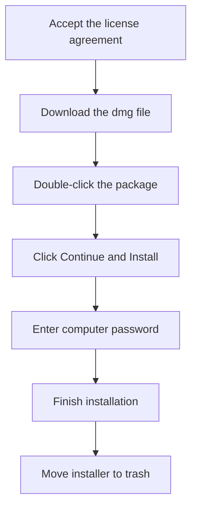
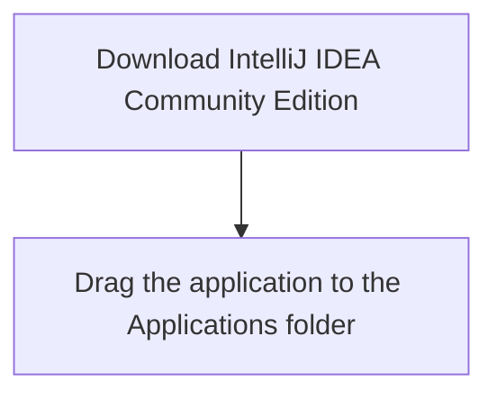
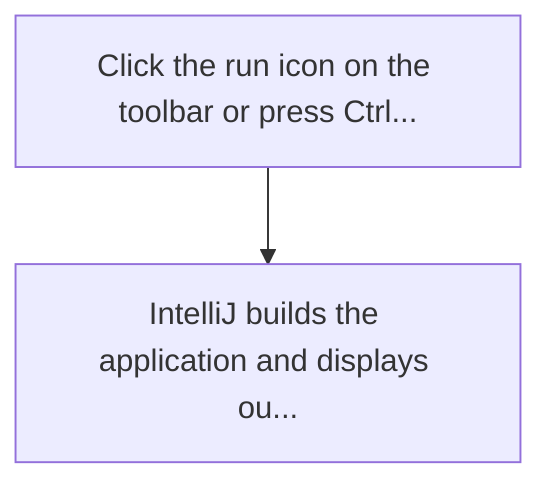
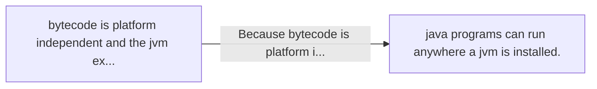
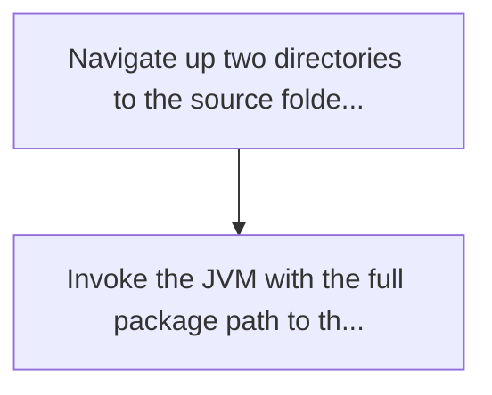
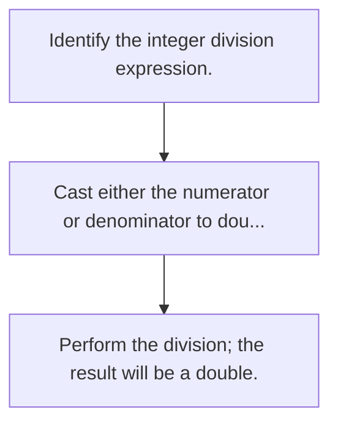
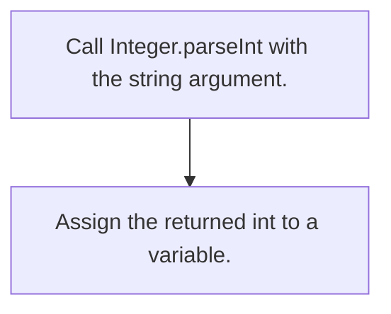
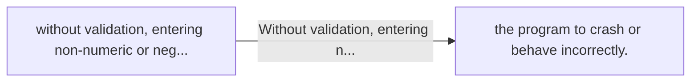
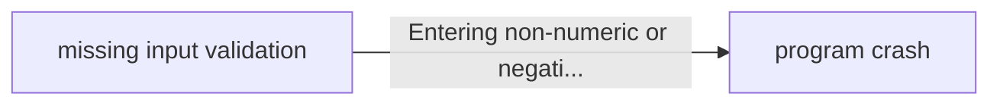
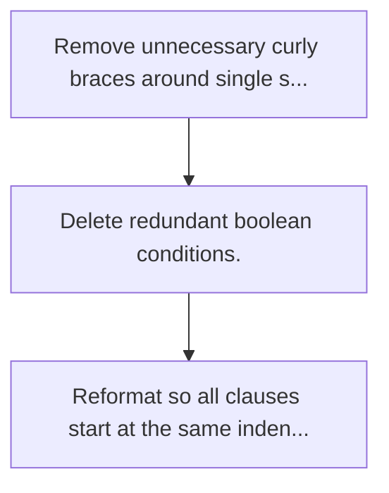

# java.txt

*Generated from assembled notes*

---

## Main Content

### Java Development Kit (JDK)

Software development environment for building Java applications; includes a compiler, reusable code, and a Java Runtime Environment.

*[Knowledge ID: CON_0001 | Sources: T0001]*

### Java Standard Edition (Java SE)

Standard edition of Java referenced on the Oracle website.

*[Knowledge ID: CON_0002 | Sources: T0001]*

Smallest building block in Java programs; a block of code that performs a task.

*[Knowledge ID: CON_0004 | Sources: T0001, T0002]*

Reserved keyword in Java indicating a function returns no value.

*[Knowledge ID: CON_0005 | Sources: T0001, T0002]*

### Java Development Kit (JDK)

Software development environment for building Java applications; includes a compiler, reusable code, and a Java Runtime Environment.

*[Knowledge ID: DEF_0006 | Sources: T0001]*

### void

Reserved keyword in Java used as the return type for functions that do not return a value.

*[Knowledge ID: DEF_0007 | Sources: T0001]*

### function

A block of code that performs a task; the smallest building block in Java programs.

*[Knowledge ID: DEF_0008 | Sources: T0001, T0002]*

A function starts with a return type (e.g., void), followed by a descriptive name, parentheses for parameters, and curly braces containing the code.

*[Knowledge ID: EXP_0009 | Sources: T0001, T0002]*

> **Example: function usage**
> 
> Functions can be written to send emails, convert weight from pounds to kilograms, or validate user input.

*[Knowledge ID: EXM_0012 | Sources: T0001]*

Mosh has two decades of software engineering experience and has taught over 3 million people how to code.

*[Knowledge ID: FCT_0013 | Sources: T0001]*

Dashlane is a password manager and VPN recommended by Apple and Google, offering a free tier for the first device.

*[Knowledge ID: FCT_0014 | Sources: T0001]*

JDK includes a compiler.

*[Knowledge ID: REL_0017 | Sources: T0001]*

JDK includes a Java Runtime Environment.

*[Knowledge ID: REL_0018 | Sources: T0001]*

#### Hierarchy: void

- void
  - keyword

*[Knowledge ID: REL_0019 | Sources: T0001, T0002]*

#### Hierarchy: function

- function
  - building block of Java programs

*[Knowledge ID: REL_0020 | Sources: T0001, T0002]*

### IntelliJ IDEA (Community Edition)

Free code editor used in the course; installed by dragging to the Applications folder.

*[Knowledge ID: CON_0003 | Sources: T0002]*

#### Timeline

1. **Event**: After accepting the license, double‑click the dmg, follow the wizard, enter the computer password, finish installation, then delete the installer.

*[Knowledge ID: EXP_0010 | Sources: T0002]*

**Procedure:**

- Download the installer, then drag the application into the Applications folder.

*[Knowledge ID: EXP_0011 | Sources: T0002]*

#### Flowchart: Install JDK on macOS



*[Knowledge ID: PRC_0015 | Sources: T0002]*

#### Flowchart: Install IntelliJ IDEA Community Edition



*[Knowledge ID: PRC_0016 | Sources: T0002]*

A container for one or more related functions (methods) used to organize code.

*[Knowledge ID: CON_0021 | Sources: T0003]*

A function that is part of a class.

*[Knowledge ID: CON_0022 | Sources: T0003]*

A special keyword that determines if other classes and methods can access a class or method.

*[Knowledge ID: CON_0023 | Sources: T0003]*

### main function

The entry point of a Java program; called when the program is executed.

*[Knowledge ID: CON_0024 | Sources: T0003]*

Classes use PascalCase (first letter of each word uppercase); methods use camelCase (first word lowercase).

*[Knowledge ID: CON_0025 | Sources: T0003]*

### access modifier

A special keyword that determines if other classes and methods in this program can access these classes and methods.

*Context: Java class and method declarations*

*[Knowledge ID: DEF_0033 | Sources: T0003]*

### main function

The entry point to a Java program; when the program is executed, the main function gets called and its code runs.

*Context: Java program execution*

*[Knowledge ID: DEF_0034 | Sources: T0003]*

In Java the left brace is placed on the same line as the function definition, unlike C# where it is often on a new line.

*[Knowledge ID: EXP_0036 | Sources: T0003]*

Classes use PascalCase, so the first letter of each word, including the first, is uppercase.

*[Knowledge ID: EXP_0037 | Sources: T0003]*

Every Java program must have at least one class that contains the main function.

*[Knowledge ID: FCT_0043 | Sources: T0003]*

A class contains one or more methods.

*[Knowledge ID: REL_0048 | Sources: T0003]*

#### Hierarchy: method

- method
  - function

*[Knowledge ID: REL_0049 | Sources: T0003]*

A namespace that groups related classes.

*[Knowledge ID: CON_0026 | Sources: T0004]*

The base package is the reversed domain name of the organization.

*[Knowledge ID: CON_0027 | Sources: T0004]*

An application that runs from the command line and has no graphical user interface.

*[Knowledge ID: CON_0028 | Sources: T0004]*

### package

A namespace used to group related classes.

*Context: Java project organization*

*[Knowledge ID: DEF_0035 | Sources: T0004]*

Command line applications are simpler than GUI applications, making them suitable for learning Java fundamentals.

*[Knowledge ID: EXP_0038 | Sources: T0004]*

JDK version 12 is selected for the project in the tutorial.

*[Knowledge ID: FCT_0044 | Sources: T0004]*

IntelliJ IDEA is used to create the Java project.

*[Knowledge ID: FCT_0045 | Sources: T0004]*

#### Flowchart: Create new Java project in IntelliJ IDEA

```mermaid
flowchart TD
    A[Open IntelliJ IDEA and select Java on the left ...]
    B[Ensure the Project SDK is set (e.g., JDK 12).]
    C[Click Next, choose 'Create project from templat...]
    D[Click Next, enter a project name (e.g., HelloWo...]
    E[Set the base package (e.g., com.codewithmarsh).]
    F[Finish the wizard to generate the project.]
    A --> B
    B --> C
    C --> D
    D --> E
    E --> F
```

*[Knowledge ID: PRC_0047 | Sources: T0004]*

A package groups related classes.

*[Knowledge ID: REL_0050 | Sources: T0004]*

The base package is formed by reversing the company's domain name.

*[Knowledge ID: REL_0051 | Sources: T0004]*

All Java source files should have the .java file extension.

*[Knowledge ID: CON_0029 | Sources: T0005]*

A statement that specifies the package a class belongs to; terminated by a semicolon.

*[Knowledge ID: CON_0030 | Sources: T0005]*

Two slashes (//) start a comment that is ignored during execution.

*[Knowledge ID: CON_0031 | Sources: T0005]*

A class defined in the java.lang package used for system operations such as printing to the terminal.

*[Knowledge ID: CON_0032 | Sources: T0005]*

Every Java statement must end with a semicolon, similar to C# and C++.

*[Knowledge ID: EXP_0039 | Sources: T0005]*

The main method should always be declared static so the JVM can invoke it without creating an instance.

*[Knowledge ID: EXP_0040 | Sources: T0005]*

The System class, located in java.lang, provides utilities such as printing to the terminal.

*[Knowledge ID: EXP_0041 | Sources: T0005]*

> **Example: class definition**
> 
> public class Main { ... }

*[Knowledge ID: EXM_0042 | Sources: T0005]*

All Java source files should have the .java extension.

*[Knowledge ID: FCT_0046 | Sources: T0005]*

Used to access members (fields or methods) of a class.

*[Knowledge ID: CON_0052 | Sources: T0006]*

### field

A class member that stores data, indicated by the icon F.

*[Knowledge ID: CON_0053 | Sources: T0006]*

### method

A class member that represents executable code, indicated by the icon M.

*[Knowledge ID: CON_0054 | Sources: T0006]*

A Java class that provides the print and println methods.

*[Knowledge ID: CON_0055 | Sources: T0006]*

A sequence of characters; textual data must be surrounded by double quotes.

*[Knowledge ID: CON_0056 | Sources: T0006]*

Runs a Java program in IntelliJ on macOS.

*[Knowledge ID: CON_0063 | Sources: T0006]*

### String

A string is a sequence of characters.

*Context: Java textual data*

*[Knowledge ID: DEF_0064 | Sources: T0006]*

The dot operator lets you view and access members defined in a class, such as fields and methods.

*[Knowledge ID: EXP_0065 | Sources: T0006]*

> **Example: printing to console**
> 
> System.out.println("hello world"); prints the text hello world in the terminal.

*[Knowledge ID: EXM_0069 | Sources: T0006]*

On macOS the shortcut to run a program in IntelliJ is Ctrl+R.

*[Knowledge ID: FCT_0070 | Sources: T0006]*

#### Flowchart: Run Java program in IntelliJ



*[Knowledge ID: PRC_0077 | Sources: T0006]*

#### Hierarchy: System.out

- System.out
  - PrintStream class

*[Knowledge ID: REL_0078 | Sources: T0006]*

println is a method of the PrintStream class.

*[Knowledge ID: REL_0079 | Sources: T0006]*

Platform‑independent representation of compiled Java code.

*[Knowledge ID: CON_0057 | Sources: T0007]*

### Java compiler

Compiles .java source files into .class bytecode files; part of the JDK.

*[Knowledge ID: CON_0058 | Sources: T0007]*

Software bundle that includes the Java compiler.

*[Knowledge ID: CON_0059 | Sources: T0007]*

Provides the Java Virtual Machine needed to run Java bytecode.

*[Knowledge ID: CON_0060 | Sources: T0007]*

Translates Java bytecode into native code for the underlying operating system.

*[Knowledge ID: CON_0061 | Sources: T0007]*

Ability of Java bytecode to run on any OS that has a JVM.

*[Knowledge ID: CON_0062 | Sources: T0007]*

**Procedure:**

- IntelliJ invokes the Java compiler, which translates source code into Java bytecode stored in a .class file.

*[Knowledge ID: EXP_0066 | Sources: T0007]*

The JVM reads Java bytecode and converts it to native code for the operating system, enabling execution.

*[Knowledge ID: EXP_0067 | Sources: T0007]*

#### Cause and Effect



*[Knowledge ID: EXP_0068 | Sources: T0007]*

The Java compiler is invoked with the command "javac Main.java".

*[Knowledge ID: FCT_0071 | Sources: T0007]*

Compilation creates a .class file (e.g., Main.class) that contains Java bytecode.

*[Knowledge ID: FCT_0072 | Sources: T0007]*

The compiled .class file is stored in the out/production/... folder of the project.

*[Knowledge ID: FCT_0073 | Sources: T0007]*

Java bytecode can run on Windows, macOS, and Linux systems that have a JRE.

*[Knowledge ID: FCT_0074 | Sources: T0007]*

C# and Python also use a compile‑to‑bytecode‑then‑VM architecture, making them platform independent.

*[Knowledge ID: FCT_0075 | Sources: T0007]*

#### Flowchart: Compile Java source file via terminal

```mermaid
flowchart TD
    A[Open terminal (or command prompt) in the folder...]
    B[Run the command 'javac Main.java' (case‑sensiti...]
    A --> B
```

*[Knowledge ID: PRC_0076 | Sources: T0007]*

Bytecode is executed by the Java Virtual Machine.

*[Knowledge ID: REL_0080 | Sources: T0007]*

#### Hierarchy: JVM

- JVM
  - JRE

*[Knowledge ID: REL_0081 | Sources: T0007]*

The runtime that loads Java bytecode and converts it to native code for the operating system.

*[Knowledge ID: CON_0082 | Sources: T0008]*

### Java Standard Edition (SE)

The core Java platform containing the libraries every Java developer must learn; the edition used in this course.

*[Knowledge ID: CON_0083 | Sources: T0008]*

### Java Enterprise Edition (EE)

A Java edition built on top of Java SE for building large‑scale, distributed, fault‑tolerant multi‑tiered software.

*[Knowledge ID: CON_0084 | Sources: T0008]*

A subset of Java SE designed for mobile devices with specific libraries for that environment.

*[Knowledge ID: CON_0085 | Sources: T0008]*

A Java edition used in smart cards.

*[Knowledge ID: CON_0086 | Sources: T0008]*

A namespace (e.g., com.codewithmarsh) that groups related Java classes; the main class belongs to this package.

*[Knowledge ID: CON_0087 | Sources: T0008]*

#### Timeline

1. **Event**: Java searches the specified folder hierarchy for the class, loads its bytecode, and converts it to native code before executing the program.

*[Knowledge ID: EXP_0092 | Sources: T0008]*

#### Cause and Effect

```mermaid
flowchart LR
    A[java runs on billions of devices (mobile phones] -->|Because Java runs on billions ...| B[tvs, blu‑ray players) and has a large developer...]
```

*[Knowledge ID: EXP_0093 | Sources: T0008]*

> **Example: program output**
> 
> Running the main class prints "hello world" to the console.

*[Knowledge ID: EXM_0095 | Sources: T0008]*

Java was developed by James Gosling in 1995 at Sun Microsystems.

*[Knowledge ID: FCT_0097 | Sources: T0008]*

Sun Microsystems was acquired by Oracle in 2010.

*[Knowledge ID: FCT_0098 | Sources: T0008]*

Java was originally called Oak, then Green, and finally Java, inspired by Java coffee.

*[Knowledge ID: FCT_0099 | Sources: T0008]*

The latest version of Java SE is 12, released in March 2019.

*[Knowledge ID: FCT_0100 | Sources: T0008]*

There are close to 9 million Java developers worldwide.

*[Knowledge ID: FCT_0101 | Sources: T0008]*

About 3 billion mobile phones run Java.

*[Knowledge ID: FCT_0102 | Sources: T0008]*

Approximately 120 million TV sets and every Blu‑ray player run Java.

*[Knowledge ID: FCT_0103 | Sources: T0008]*

The average salary of a Java developer in the US is just over $100,000 per year.

*[Knowledge ID: FCT_0104 | Sources: T0008]*

#### Flowchart: Running a Java class from the command line



*[Knowledge ID: PRC_0105 | Sources: T0008]*

#### Hierarchy: Java Enterprise Edition

- Java Enterprise Edition
  - Java Standard Edition

*[Knowledge ID: REL_0106 | Sources: T0008]*

Java ME is a subset of Java SE designed for mobile devices.

*[Knowledge ID: REL_0107 | Sources: T0008]*

Java Card is the edition used in smart cards.

*[Knowledge ID: REL_0108 | Sources: T0008]*

#### Hierarchy: package com.codewithmarsh.main

- package com.codewithmarsh.main
  - full class path

*[Knowledge ID: REL_0109 | Sources: T0008]*

The first Java project built in the course, expanded incrementally through the sections.

*[Knowledge ID: CON_0088 | Sources: T0009]*

Conditional statements and loops used to build algorithms and add data validation to programs.

*[Knowledge ID: CON_0089 | Sources: T0009]*

Techniques for writing code that is clean, expressive, and maintainable.

*[Knowledge ID: CON_0090 | Sources: T0009]*

### Object‑oriented programming (OOP)

A programming style used in most Java applications, essential for web, mobile, and desktop development.

*[Knowledge ID: CON_0091 | Sources: T0009]*

The course is divided into four parts covering fundamentals, OOP, core APIs, and advanced features, each lasting 3–4 hours.

*[Knowledge ID: EXP_0094 | Sources: T0009]*

> **Example: project assignment**
> 
> Students will build a mortgage calculator as their first Java project.

*[Knowledge ID: EXM_0096 | Sources: T0009]*

A variable temporarily stores data in a computer's memory.

*[Knowledge ID: CON_0110 | Sources: T0010]*

The name or label used to identify a variable.

*[Knowledge ID: CON_0111 | Sources: T0010]*

The "=" sign that assigns a value to a variable.

*[Knowledge ID: CON_0112 | Sources: T0010]*

Naming convention where the first word is lowercase and each subsequent word starts with a capital letter.

*[Knowledge ID: CON_0115 | Sources: T0010]*

### variable

Variables are used to temporarily store data in a computer's memory.

*[Knowledge ID: DEF_0118 | Sources: T0010]*

### identifier

An identifier is the name or label of a variable.

*[Knowledge ID: DEF_0119 | Sources: T0010]*

### assignment operator

The assignment operator is the equal sign used to assign a value to a variable.

*[Knowledge ID: DEF_0120 | Sources: T0010]*

### initialization

Initializing a variable means giving it an initial value before it is read.

*[Knowledge ID: DEF_0121 | Sources: T0010]*

#### Timeline

1. **Event**: Variables must be initialized before they are read.

*[Knowledge ID: EXP_0123 | Sources: T0010]*

Declaring one variable per line improves code readability compared to multiple declarations on the same line.

*[Knowledge ID: EXP_0127 | Sources: T0010]*

> **Example: declaring and initializing an int variable**
> 
> int age = 30;

*[Knowledge ID: EXM_0128 | Sources: T0010]*

> **Example: changing a variable's value**
> 
> age = 35;

*[Knowledge ID: EXM_0129 | Sources: T0010]*

> **Example: multiple variable declaration on one line (not recommended)**
> 
> int age = 30, temperature = 20;

*[Knowledge ID: EXM_0130 | Sources: T0010]*

A type for storing simple values such as numbers, booleans, or single characters.

*[Knowledge ID: CON_0113 | Sources: T0011]*

### reference type

A type for storing complex objects.

*[Knowledge ID: CON_0114 | Sources: T0011]*

Using "_" within numeric literals to separate groups of digits for readability.

*[Knowledge ID: CON_0116 | Sources: T0011]*

### primitive type

Primitive types store simple values such as numbers, boolean values, or single characters.

*[Knowledge ID: DEF_0122 | Sources: T0011]*

Using descriptive names helps understand what the code does.

*[Knowledge ID: EXP_0126 | Sources: T0011]*

> **Example: using a byte for age**
> 
> byte age = 30;

*[Knowledge ID: EXM_0131 | Sources: T0011]*

byte occupies 1 byte of memory and stores values from -128 to 127.

*[Knowledge ID: FCT_0133 | Sources: T0011]*

short occupies 2 bytes of memory and stores values up to 32,000.

*[Knowledge ID: FCT_0134 | Sources: T0011]*

int occupies 4 bytes of memory and stores values up to two billion.

*[Knowledge ID: FCT_0135 | Sources: T0011]*

long occupies 8 bytes of memory and stores larger numbers than int.

*[Knowledge ID: FCT_0136 | Sources: T0011]*

float occupies 4 bytes of memory.

*[Knowledge ID: FCT_0137 | Sources: T0011]*

double occupies 8 bytes of memory.

*[Knowledge ID: FCT_0138 | Sources: T0011]*

char occupies 2 bytes and stores a single character.

*[Knowledge ID: FCT_0139 | Sources: T0011]*

#### Comparison

| Dimension | primitive types | reference types |
|---|---|---|
| Property | Subject | Object |

*[Knowledge ID: REL_0141 | Sources: T0011, T0012]*

Words like public, static, void, class, package that cannot be used as identifiers.

*[Knowledge ID: CON_0117 | Sources: T0012]*

Java treats integer literals as int by default; adding an L suffix forces them to be long.

*[Knowledge ID: EXP_0124 | Sources: T0012]*

Java treats decimal literals as double by default; adding an F suffix forces them to be float.

*[Knowledge ID: EXP_0125 | Sources: T0012]*

> **Example: large integer with underscore and L suffix**
> 
> long viewsCount = 3_000_000_000L;

*[Knowledge ID: EXM_0132 | Sources: T0012]*

boolean stores true or false values.

*[Knowledge ID: FCT_0140 | Sources: T0012]*

Simple value types in Java (e.g., int) that store the actual value directly.

*[Knowledge ID: CON_0142 | Sources: T0013, T0014]*

Types that refer to objects; variables hold a reference (address) to the object and require the new operator for allocation.

*[Knowledge ID: CON_0143 | Sources: T0013, T0015]*

A namespace that groups classes, preventing name conflicts across different packages.

*[Knowledge ID: CON_0144 | Sources: T0013]*

A line (e.g., import java.util.Date;) that allows a class from another package to be used in the current file.

*[Knowledge ID: CON_0145 | Sources: T0013]*

A template or blueprint used to create objects (instances).

*[Knowledge ID: CON_0146 | Sources: T0013, T0015]*

An instance of a class.

*[Knowledge ID: CON_0147 | Sources: T0013, T0015]*

Fields or methods of a class/object accessed with the dot operator.

*[Knowledge ID: CON_0148 | Sources: T0013]*

Syntax (.) used to access members of a class or object.

*[Knowledge ID: CON_0149 | Sources: T0013, T0014]*

### Class

A defined template or blueprint for creating new objects (new instances).

*Context: Java programming*

*[Knowledge ID: DEF_0150 | Sources: T0013]*

### Object

An instance of a class.

*Context: Java programming*

*[Knowledge ID: DEF_0151 | Sources: T0013]*

### Package

Creates a namespace for classes, allowing the same class name in different packages without conflict.

*Context: Java programming*

*[Knowledge ID: DEF_0152 | Sources: T0013]*

Primitive variables store their value directly in memory allocated by the JVM; reference variables store the address of an object, which is allocated with the new operator, and the JVM later frees it automatically.

*[Knowledge ID: EXP_0153 | Sources: T0013, T0015]*

Packages group classes so that identical class names can exist in different packages without conflict, providing a namespace.

*[Knowledge ID: EXP_0154 | Sources: T0013]*

> **Example: Primitive variable declaration**
> 
> int age = 30;

*[Knowledge ID: EXM_0156 | Sources: T0013]*

> **Example: Reference variable declaration with import**
> 
> import java.util.Date; Date date = new Date();

*[Knowledge ID: EXM_0157 | Sources: T0013]*

Java has eight primitive types.

*[Knowledge ID: FCT_0159 | Sources: T0013]*

Both java.util and java.sql packages contain a Date class.

*[Knowledge ID: FCT_0160 | Sources: T0013]*

#### Timeline: Declare and use a reference type

1. **Step 1**: Select the desired class (e.g., Date) from IntelliSense suggestions.
2. **Step 2**: Press Enter or Tab; the IDE adds the appropriate import statement.
3. **Step 3**: Use the new operator with the class name to allocate memory (e.g., new Date()).
4. **Step 4**: Assign the created object to a variable.

*[Knowledge ID: PRC_0162 | Sources: T0013]*

#### Hierarchy: Object

- Object
  - Class

*[Knowledge ID: REL_0163 | Sources: T0013]*

#### Comparison

| Dimension | Primitive type | Reference type |
|---|---|---|
| Property | Subject | Object |

*[Knowledge ID: REL_0164 | Sources: T0014, T0015]*

When a reference variable is assigned to another, both variables hold the same address; modifying the object through one variable is visible through the other.

*[Knowledge ID: EXP_0155 | Sources: T0015]*

> **Example: Reference sharing with Point class**
> 
> Point point1 = new Point(1,1); Point point2 = point1; point1.x = 2; // point2.x is now 2

*[Knowledge ID: EXM_0158 | Sources: T0015]*

The Point class is defined in the java.awt package.

*[Knowledge ID: FCT_0161 | Sources: T0015]*

A string literal is a string value written directly in code.

*[Knowledge ID: CON_0001 | Sources: T0016]*

### java.lang.String class

The String class is defined in the java.lang package.

*[Knowledge ID: CON_0002 | Sources: T0016]*

In Java, a reference type holds a reference to an object rather than the object itself.

*[Knowledge ID: CON_0003 | Sources: T0016]*

Strings can be concatenated using the + operator.

*[Knowledge ID: CON_0004 | Sources: T0016]*

The dot operator accesses members (methods, fields) of a class.

*[Knowledge ID: CON_0005 | Sources: T0016]*

The new operator creates a new object instance.

*[Knowledge ID: CON_0006 | Sources: T0016]*

### String literal

A string literal is a string value written directly in code.

*[Knowledge ID: DEF_0007 | Sources: T0016]*

### endsWith method

endsWith checks whether a string ends with a given character or sequence and returns a boolean.

*[Knowledge ID: DEF_0008 | Sources: T0016]*

### startsWith method

startsWith checks whether a string starts with a given character or sequence and returns a boolean.

*[Knowledge ID: DEF_0009 | Sources: T0016]*

### length method

length returns the number of characters in the string.

*[Knowledge ID: DEF_0010 | Sources: T0016]*

> **Example: Printing a string**
> 
> System.out.println("hello world"); prints the hello world message.

*[Knowledge ID: EXM_0015 | Sources: T0016]*

> **Example: String concatenation**
> 
> "Hello" + "!!" results in "Hello!!".

*[Knowledge ID: EXM_0016 | Sources: T0016]*

> **Example: endsWith usage**
> 
> message.endsWith("!!") returns true.

*[Knowledge ID: EXM_0017 | Sources: T0016]*

> **Example: startsWith usage**
> 
> message.startsWith("!!") returns false.

*[Knowledge ID: EXM_0018 | Sources: T0016]*

> **Example: length usage**
> 
> message.length() returns 13.

*[Knowledge ID: EXM_0019 | Sources: T0016]*

A data structure in Java used to store a fixed-size list of items such as numbers, people, or messages.

*[Knowledge ID: CON_0165 | Sources: T0019]*

Arrays are reference types, meaning they store references to objects in memory.

*[Knowledge ID: CON_0166 | Sources: T0019]*

Array elements are accessed with an index that starts at 0.

*[Knowledge ID: CON_0167 | Sources: T0019]*

Java's mechanism for reporting runtime errors; an invalid array index raises an exception and crashes the program.

*[Knowledge ID: CON_0168 | Sources: T0019]*

A utility class providing static methods like toString, deepToString, and sort for array manipulation.

*[Knowledge ID: CON_0169 | Sources: T0019, T0020]*

#### Timeline

1. **Event**: An array requires the new operator and a repeated type declaration; storing a single number without these causes a compile‑time error.

*[Knowledge ID: EXP_0176 | Sources: T0019]*

Printing an array directly yields a string based on the object's memory address, not its contents.

*[Knowledge ID: EXP_0177 | Sources: T0019]*

> **Example: Array creation and element assignment**
> 
> int\[\] numbers = new int\[5\]; numbers\[0\] = 1; numbers\[1\] = 2;

*[Knowledge ID: EXM_0181 | Sources: T0019]*

> **Example: Invalid index causing exception**
> 
> numbers\[10\] = 3; // throws an exception because array length is 5

*[Knowledge ID: EXM_0182 | Sources: T0019]*

Arrays in Java are reference types.

*[Knowledge ID: FCT_0187 | Sources: T0019]*

#### Flowchart: Create an integer array with explicit size

```mermaid
flowchart TD
    A[Declare the variable with type int() and a name.]
    B[Use the new operator followed by the type and s...]
    C[Optionally assign values to individual indexes.]
    A --> B
    B --> C
```

*[Knowledge ID: PRC_0190 | Sources: T0019]*

#### Hierarchy: Array

- Array
  - Reference type

*[Knowledge ID: REL_0194 | Sources: T0019]*

Having multiple methods with the same name but different parameter types.

*[Knowledge ID: CON_0170 | Sources: T0020]*

Once created, an array's length cannot be changed; items cannot be added or removed.

*[Knowledge ID: CON_0171 | Sources: T0020]*

### Method overloading

The same method name implemented multiple times with different parameter types.

*Context: java.util.Arrays class methods*

*[Knowledge ID: DEF_0174 | Sources: T0020]*

Integer arrays default to 0, boolean arrays to false, and string arrays to an empty string.

*[Knowledge ID: EXP_0178 | Sources: T0020]*

Java arrays are allocated with a fixed length at creation; their size cannot be altered later.

*[Knowledge ID: EXP_0179 | Sources: T0020]*

> **Example: Using Arrays.toString for readable output**
> 
> System.out.println(Arrays.toString(numbers));

*[Knowledge ID: EXM_0183 | Sources: T0020]*

> **Example: Array literal initialization**
> 
> int\[\] numbers = {2, 3, 5, 1, 4};

*[Knowledge ID: EXM_0184 | Sources: T0020]*

> **Example: Sorting an array**
> 
> Arrays.sort(numbers); // array becomes \[1,2,3,4,5\]

*[Knowledge ID: EXM_0185 | Sources: T0020]*

Java arrays have a fixed length that cannot be changed after creation.

*[Knowledge ID: FCT_0188 | Sources: T0020]*

Method overloading allows the same method name to be implemented for different parameter types.

*[Knowledge ID: FCT_0189 | Sources: T0020]*

#### Flowchart: Print array contents readably

```mermaid
flowchart TD
    A[Import java.util.Arrays if not already imported.]
    B[Call Arrays.toString(array) for one‑dimensional...]
    C[Pass the resulting string to System.out.println.]
    A --> B
    B --> C
```

*[Knowledge ID: PRC_0191 | Sources: T0020, T0021]*

#### Flowchart: Sort an integer array

```mermaid
flowchart TD
    A[Import java.util.Arrays.]
    B[Call Arrays.sort(array).]
    A --> B
```

*[Knowledge ID: PRC_0192 | Sources: T0020]*

Both methods share the name toString but accept different parameter types.

*[Knowledge ID: REL_0196 | Sources: T0020]*

An array whose elements are themselves arrays, e.g., two‑dimensional matrix or three‑dimensional cube.

*[Knowledge ID: CON_0172 | Sources: T0021]*

#### Timeline

1. **Event**: A variable declared with the final keyword; its value cannot be changed after initialization.

*[Knowledge ID: CON_0173 | Sources: T0021]*

### Constant

A variable declared with final; once initialized it cannot be reassigned.

*Context: Java variable declaration*

*[Knowledge ID: DEF_0175 | Sources: T0021]*

**Procedure:**

- Use Arrays.deepToString to obtain a readable string for nested arrays.

*[Knowledge ID: EXP_0180 | Sources: T0021]*

> **Example: Two‑dimensional array creation and printing**
> 
> int\[\]\[\] matrix = {{1,2,3},{4,5,6}}; System.out.println(Arrays.deepToString(matrix));

*[Knowledge ID: EXM_0186 | Sources: T0021]*

#### Flowchart: Create a two‑dimensional array

```mermaid
flowchart TD
    A[Declare variable with type int()() and a name.]
    B[Use new int(rows)(columns) to allocate space.]
    C[Assign values using two indexes, e.g., matrix(0...]
    A --> B
    B --> C
```

*[Knowledge ID: PRC_0193 | Sources: T0021]*

Declaring a variable with final makes it a constant.

*[Knowledge ID: REL_0195 | Sources: T0021]*

### final variable

A variable declared with the final keyword cannot be assigned a new value after initialization; by convention its name is written in all capital letters (e.g., PI).

*[Knowledge ID: CON_0197 | Sources: T0022]*

Operators for addition (+), subtraction (-), multiplication (*), division (/), and modulus (%) used in Java expressions.

*[Knowledge ID: CON_0198 | Sources: T0022]*

A piece of code that produces a value.

*[Knowledge ID: CON_0199 | Sources: T0022]*

Values (such as numbers) that operators act upon in an expression.

*[Knowledge ID: CON_0200 | Sources: T0022]*

### increment operator

Unary operator that adds 1 to a variable; can be used as prefix (++x) or postfix (x++).

*[Knowledge ID: CON_0201 | Sources: T0022, T0023]*

### final variable

A variable that cannot be reassigned after its initial assignment.

*Context: used to define constants*

*[Knowledge ID: DEF_0207 | Sources: T0022]*

Dividing two integer values yields an integer result; to obtain a floating‑point result, at least one operand must be cast to double or float.

*[Knowledge ID: EXP_0210 | Sources: T0022]*

> **Example: addition operator**
> 
> int result = 10 + 3; // result is 13

*[Knowledge ID: EXM_0214 | Sources: T0022]*

#### Flowchart: Obtain floating‑point result from integer division



*[Knowledge ID: PRC_0226 | Sources: T0022]*

#### Hierarchy: final variable

- final variable
  - constant

*[Knowledge ID: REL_0228 | Sources: T0022]*

### augmented assignment operator

Operators that combine an arithmetic operation with assignment, e.g., +=, -=, *=, /=; X += 2 is equivalent to X = X + 2.

*[Knowledge ID: CON_0202 | Sources: T0023]*

Order in which operators are evaluated: parentheses first, then multiplication/division, then addition/subtraction.

*[Knowledge ID: CON_0203 | Sources: T0023, T0024]*

Postfix (x++) copies the original value before incrementing; prefix (++x) increments first then copies the new value.

*[Knowledge ID: EXP_0211 | Sources: T0023]*

Multiplication and division are evaluated before addition and subtraction unless parentheses override the order.

*[Knowledge ID: EXP_0212 | Sources: T0023, T0024]*

> **Example: postfix increment in assignment**
> 
> int X = 1; int Y = X++; // Y=1, X=2

*[Knowledge ID: EXM_0216 | Sources: T0023]*

> **Example: prefix increment in assignment**
> 
> int X = 1; int Y = ++X; // Y=2, X=2

*[Knowledge ID: EXM_0217 | Sources: T0023]*

> **Example: augmented assignment**
> 
> X += 2; // equivalent to X = X + 2

*[Knowledge ID: EXM_0218 | Sources: T0023]*

> **Example: operator precedence without parentheses**
> 
> int result = 10 + 3 * 2; // result is 16

*[Knowledge ID: EXM_0219 | Sources: T0023]*

> **Example: operator precedence with parentheses**
> 
> int result = (10 + 3) * 2; // result is 26

*[Knowledge ID: EXM_0220 | Sources: T0023]*

#### Formula

```
result = 10 + 3 * 2
```

**Variables:**
- `result`: int variable storing the computed value

*Conditions: Multiplication evaluated before addition*

*[Knowledge ID: FRM_0224 | Sources: T0023]*

#### Timeline: Use prefix increment in assignment

1. **Step 1**: Write ++variable before the variable name in the assignment.
2. **Step 2**: The variable is incremented first, then its new value is assigned.

*[Knowledge ID: PRC_0227 | Sources: T0023]*

The augmented assignment operator performs the same operation as the explicit assignment.

*[Knowledge ID: REL_0229 | Sources: T0023]*

### implicit casting

Automatic conversion of a value to a larger data type (e.g., short to int) performed by the Java compiler.

*[Knowledge ID: CON_0204 | Sources: T0024]*

### explicit casting

Manual conversion of a value to a different type using a cast syntax, e.g., (double) 5.

*[Knowledge ID: CON_0205 | Sources: T0024]*

A short occupies 2 bytes; an int occupies 4 bytes.

*[Knowledge ID: CON_0206 | Sources: T0024]*

### implicit casting

Automatic conversion of a value to a larger primitive type by the compiler.

*Context: e.g., short to int*

*[Knowledge ID: DEF_0208 | Sources: T0024]*

### explicit casting

Manual conversion of a value to a specified type using a cast operator.

*Context: e.g., (double) value*

*[Knowledge ID: DEF_0209 | Sources: T0024]*

#### Timeline

1. **Event**: When a short is used with an int, Java creates an anonymous int variable, copies the short value into it, and performs the operation as int.

*[Knowledge ID: EXP_0213 | Sources: T0024]*

> **Example: implicit casting of short to int**
> 
> short X = 1; int Y = X + 2; // Y is 3

*[Knowledge ID: EXM_0221 | Sources: T0024]*

A short variable occupies 2 bytes.

*[Knowledge ID: FCT_0222 | Sources: T0024]*

An int variable occupies 4 bytes.

*[Knowledge ID: FCT_0223 | Sources: T0024]*

#### Formula

```
(double) value
```

**Variables:**
- `value`: numeric expression to be cast

*Conditions: Used to convert an integer expression to double*

*[Knowledge ID: FRM_0225 | Sources: T0024]*

Automatic conversion of a numeric primitive to a larger type when no data loss can occur.

*[Knowledge ID: CON_0230 | Sources: T0025]*

Manual conversion of a value to a different primitive type using a cast operator, required when data loss might occur.

*[Knowledge ID: CON_0231 | Sources: T0025]*

Reference type that corresponds to a primitive type, e.g., Integer for int, providing utility methods like parseInt.

*[Knowledge ID: CON_0232 | Sources: T0025]*

### Integer.parseInt

Method that takes a String and returns its int value.

*Context: Wrapper class Integer*

*[Knowledge ID: DEF_0235 | Sources: T0025]*

It occurs only when converting to a type that can represent all possible values of the original, so no data loss is possible.

*[Knowledge ID: EXP_0240 | Sources: T0025]*

Strings are not compatible with numeric primitives; they must be parsed using wrapper class methods before arithmetic.

*[Knowledge ID: EXP_0241 | Sources: T0025]*

> **Example: explicit casting from float to int**
> 
> int y = (int) x; // x = 1.1 becomes y = 1

*[Knowledge ID: EXM_0244 | Sources: T0025]*

> **Example: parsing a numeric string to int**
> 
> int x = Integer.parseInt("1");

*[Knowledge ID: EXM_0245 | Sources: T0025]*

All numeric primitive types are compatible for casting between each other.

*[Knowledge ID: FCT_0249 | Sources: T0025]*

User interface frameworks deliver form input values as strings.

*[Knowledge ID: FCT_0250 | Sources: T0025]*

#### Flowchart: Convert a numeric string to an int



*[Knowledge ID: PRC_0252 | Sources: T0025]*

#### Hierarchy: Integer

- Integer
  - wrapper class

*[Knowledge ID: REL_0254 | Sources: T0025]*

#### Hierarchy: parseInt method

- parseInt method
  - Integer class

*[Knowledge ID: REL_0255 | Sources: T0025]*

Explicit casting can only be performed between compatible numeric types.

*[Knowledge ID: REL_0256 | Sources: T0025]*

Utility class in java.lang that offers static methods for common mathematical operations; no import required.

*[Knowledge ID: CON_0233 | Sources: T0026]*

### Math.round

Overloaded method: round(float) returns int, round(double) returns long; rounds a floating‑point number to the nearest whole number.

*Context: Math class*

*[Knowledge ID: DEF_0236 | Sources: T0026]*

### Math.ceil

Method that returns the smallest integer greater than or equal to the argument (as a double).

*Context: Math class*

*[Knowledge ID: DEF_0237 | Sources: T0026]*

### Math.floor

Method that returns the largest integer less than or equal to the argument (as a double).

*Context: Math class*

*[Knowledge ID: DEF_0238 | Sources: T0026]*

### Math.random

Method that returns a double value uniformly distributed between 0.0 (inclusive) and 1.0 (exclusive).

*Context: Math class*

*[Knowledge ID: DEF_0239 | Sources: T0026]*

> **Example: Math.round usage**
> 
> int r = Math.round(1.1f); // r = 1

*[Knowledge ID: EXM_0246 | Sources: T0026]*

> **Example: Math.ceil usage**
> 
> int c = (int) Math.ceil(1.1); // c = 2

*[Knowledge ID: EXM_0247 | Sources: T0026]*

The Math class resides in java.lang and does not require an explicit import.

*[Knowledge ID: FCT_0251 | Sources: T0026]*

Math.round has two overloads: one for float returning int, another for double returning long.

*[Knowledge ID: REL_0257 | Sources: T0026]*

Class in java.text used for formatting numbers as currency, percentages, etc.

*[Knowledge ID: CON_0234 | Sources: T0027]*

Casting occurs before multiplication, truncating the fractional part (always 0), then multiplying by 100 still yields 0.

*[Knowledge ID: EXP_0242 | Sources: T0027]*

**Procedure:**

- Parentheses ensure the multiplication is performed first, then the resulting double is cast to int, preserving the scaled range.

*[Knowledge ID: EXP_0243 | Sources: T0027]*

> **Example: generating integer 0‑100 with Math.random**
> 
> int n = (int) (Math.random() * 100);

*[Knowledge ID: EXM_0248 | Sources: T0027]*

#### Flowchart: Generate a random integer between 0 and 100

```mermaid
flowchart TD
    A[Call Math.random() to obtain a double in (0,1).]
    B[Multiply the result by 100.]
    C[Cast the final expression to int.]
    A --> B
    B --> C
```

*[Knowledge ID: PRC_0253 | Sources: T0027]*

A class declared abstract cannot be instantiated with the new operator.

*[Knowledge ID: CON_0258 | Sources: T0028]*

A method that creates and returns new objects, acting like a factory.

*[Knowledge ID: CON_0259 | Sources: T0028]*

Calling multiple methods in a single expression by using the returned object for the next call.

*[Knowledge ID: CON_0260 | Sources: T0028]*

### abstract class

A class that is declared abstract and therefore cannot be instantiated directly.

*Context: NumberFormat is an example of an abstract class.*

*[Knowledge ID: DEF_0263 | Sources: T0028]*

### factory method

A method that creates and returns a new object, such as getCurrencyInstance returning a NumberFormat instance.

*[Knowledge ID: DEF_0264 | Sources: T0028]*

### method chaining

A technique where multiple method calls are linked together in one statement.

*[Knowledge ID: DEF_0265 | Sources: T0028]*

NumberFormat is abstract, so the new operator cannot be used; a factory method must be used instead.

*[Knowledge ID: EXP_0266 | Sources: T0028]*

It returns a NumberFormat object whose format method produces a string with a dollar sign, commas every three digits, and two decimal places.

*[Knowledge ID: EXP_0267 | Sources: T0028]*

> **Example: currency formatting**
> 
> Formatting 1234567.891 with getCurrencyInstance().format(...) yields "$1,234,567.89".

*[Knowledge ID: EXM_0270 | Sources: T0028]*

> **Example: percent formatting**
> 
> Formatting 0.1 with getPercentInstance().format(...) yields "10%".

*[Knowledge ID: EXM_0271 | Sources: T0028]*

NumberFormat is an abstract class.

*[Knowledge ID: FCT_0274 | Sources: T0028]*

getCurrencyInstance returns a NumberFormat object.

*[Knowledge ID: FCT_0275 | Sources: T0028]*

getPercentInstance returns a NumberFormat object specialized for percent formatting.

*[Knowledge ID: FCT_0276 | Sources: T0028]*

#### Flowchart: Method chaining for formatting

```mermaid
flowchart TD
    A[Call NumberFormat.getCurrencyInstance() to obta...]
    B[Immediately call .format(value) on the returned...]
    C[Assign the resulting string to a variable or pr...]
    A --> B
    B --> C
```

*[Knowledge ID: PRC_0280 | Sources: T0028]*

#### Hierarchy: NumberFormat

- NumberFormat
  - abstract class

*[Knowledge ID: REL_0281 | Sources: T0028]*

Because NumberFormat is abstract, you must use a factory method like getCurrencyInstance to obtain an instance.

*[Knowledge ID: REL_0282 | Sources: T0028]*

getCurrencyInstance creates and returns a NumberFormat object, illustrating a factory method.

*[Knowledge ID: REL_0283 | Sources: T0028]*

A class in java.util used to read input from sources such as the terminal.

*[Knowledge ID: CON_0261 | Sources: T0029, T0030]*

Fields in the System class representing the standard input and output streams.

*[Knowledge ID: CON_0262 | Sources: T0029]*

#### Timeline: Rename variable in IntelliJ

1. **Step 1**: Right‑click the variable and choose Refactor → Rename (or press Shift+F6).
2. **Step 2**: Type the new name; references update automatically.
3. **Step 3**: Press Enter to confirm.

*[Knowledge ID: PRC_0278 | Sources: T0029]*

#### Flowchart: Read input with Scanner

```mermaid
flowchart TD
    A[Import java.util.Scanner.]
    B[Create a Scanner object: new Scanner(System.in).]
    C[Call the appropriate next... method (e.g., next...]
    D[Store the returned value in a variable.]
    E[Use System.out.println to display results.]
    A --> B
    B --> C
    C --> D
    D --> E
```

*[Knowledge ID: PRC_0279 | Sources: T0029, T0030]*

next() reads a single token up to whitespace, while nextLine() reads the entire line including spaces.

*[Knowledge ID: EXP_0268 | Sources: T0030]*

When a string is concatenated with a byte, Java automatically converts the byte to a string.

*[Knowledge ID: EXP_0269 | Sources: T0030]*

> **Example: reading age with Scanner**
> 
> Scanner reads a byte value 20, which is printed as "Your 20" after implicit casting.

*[Knowledge ID: EXM_0272 | Sources: T0030]*

> **Example: reading name with next()**
> 
> Calling next() twice on input "Marsh Hamid" returns "Marsh" then "Hamid".

*[Knowledge ID: EXM_0273 | Sources: T0030]*

All Scanner input methods start with the prefix "next".

*[Knowledge ID: FCT_0277 | Sources: T0030]*

#### Hierarchy: next() method

- next() method
  - Scanner class

*[Knowledge ID: REL_0284 | Sources: T0030]*

#### Hierarchy: nextLine() method

- nextLine() method
  - Scanner class

*[Knowledge ID: REL_0285 | Sources: T0030]*

Reads an entire line of input from the user, preserving spaces and tabs.

*[Knowledge ID: CON_0286 | Sources: T0031]*

Removes leading and trailing whitespace from a string.

*[Knowledge ID: CON_0287 | Sources: T0031]*

Calling multiple methods sequentially on the same object using the dot operator.

*[Knowledge ID: CON_0288 | Sources: T0031]*

Removes all whitespace characters before and after a string, producing a clean value.

*[Knowledge ID: EXP_0300 | Sources: T0031]*

#### Timeline

1. **Event**: Divide the annual interest percent by 100 to get a decimal, then divide by 12 to convert to a monthly rate.

*[Knowledge ID: EXP_0301 | Sources: T0031]*

> **Example: trim method**
> 
> User types spaces before a name; trim removes those spaces resulting in a clean output.

*[Knowledge ID: EXM_0306 | Sources: T0031]*

> **Example: mortgage calculator input**
> 
> Principal = $100,000; annual interest = 3.92%; period = 30 years.

*[Knowledge ID: EXM_0307 | Sources: T0031]*

#### Formula

```
monthlyInterestRate = (annualInterestRate / 100) / 12
```

**Variables:**
- `annualInterestRate`: annual interest rate as a percent
- `monthlyInterestRate`: interest rate per month as a decimal

*[Knowledge ID: FRM_0314 | Sources: T0031]*

#### Timeline: Calculate monthly mortgage payment

1. **Step 1**: Read principal as int.
2. **Step 2**: Read annual interest rate as float.
3. **Step 3**: Read loan period in years as byte.
4. **Step 4**: Compute monthly interest rate using (annualRate/100)/12.
5. **Step 5**: Compute number of payments as years*12.
6. **Step 6**: Apply mortgage formula (principal * monthlyRate * (1+monthlyRate)^n) / ((1+monthlyRate)^n - 1).
7. **Step 7**: Format result with NumberFormat as currency and display.

*[Knowledge ID: PRC_0316 | Sources: T0031, T0032, T0033]*

trim is called on a string instance to remove whitespace.

*[Knowledge ID: REL_0318 | Sources: T0031]*

Hard‑coded numeric literals in code; should be replaced with named constants for readability.

*[Knowledge ID: CON_0289 | Sources: T0032]*

Variables declared as final to hold fixed values like months in a year (12) and percent (100).

*[Knowledge ID: CON_0290 | Sources: T0032]*

Used to read user input from the terminal.

*[Knowledge ID: CON_0291 | Sources: T0032]*

### magic numbers

Hard‑coded numeric literals in code that lack descriptive names.

*Context: Programming best practices*

*[Knowledge ID: DEF_0298 | Sources: T0032]*

Defining final variables like MONTHS_IN_YEAR = 12 makes code self‑explanatory and easier to maintain.

*[Knowledge ID: EXP_0302 | Sources: T0032]*

int is used for principal because short's max (32,000) is insufficient; float suffices for interest rates; byte is enough for a period up to 30 years.

*[Knowledge ID: EXP_0303 | Sources: T0032, T0033]*

short can store a maximum of $32,000.

*[Knowledge ID: FCT_0309 | Sources: T0032]*

int can store values up to about two billion.

*[Knowledge ID: FCT_0310 | Sources: T0032]*

There are 12 months in a year.

*[Knowledge ID: FCT_0311 | Sources: T0032]*

Percent conversion factor is 100.

*[Knowledge ID: FCT_0312 | Sources: T0032]*

#### Formula

```
numberOfPayments = years * 12
```

**Variables:**
- `years`: loan period in years
- `numberOfPayments`: total monthly payments

*[Knowledge ID: FRM_0315 | Sources: T0032]*

#### Timeline: Avoid magic numbers

1. **Step 1**: Declare final variable MONTHS_IN_YEAR = 12.
2. **Step 2**: Declare final variable PERCENT = 100.
3. **Step 3**: Use these constants in calculations instead of literal numbers.

*[Knowledge ID: PRC_0317 | Sources: T0032]*

#### Hierarchy: Math.pow method

- Math.pow method
  - Math class

*[Knowledge ID: REL_0319 | Sources: T0032]*

Using final variables MONTHS_IN_YEAR and PERCENT demonstrates avoiding magic numbers.

*[Knowledge ID: REL_0321 | Sources: T0032]*

Types that store simple values such as int, float, byte.

*[Knowledge ID: CON_0292 | Sources: T0033]*

Types that hold references to complex objects.

*[Knowledge ID: CON_0293 | Sources: T0033]*

Conversion between types; can be implicit or explicit.

*[Knowledge ID: CON_0294 | Sources: T0033]*

Formats numeric values as currency strings.

*[Knowledge ID: CON_0295 | Sources: T0033]*

#### Timeline

1. **Event**: Checking user input for correctness (e.g., non‑numeric or negative values) before processing.

*[Knowledge ID: CON_0296 | Sources: T0033]*

Code constructs used to validate input and control program flow.

*[Knowledge ID: CON_0297 | Sources: T0033]*

### camel notation

Naming convention where the first word is lowercase and subsequent words start with a capital letter.

*Context: Variable naming*

*[Knowledge ID: DEF_0299 | Sources: T0033]*

NumberFormat class formats the numeric mortgage value into a locale‑specific currency string before printing.

*[Knowledge ID: EXP_0304 | Sources: T0033]*

#### Cause and Effect



*[Knowledge ID: EXP_0305 | Sources: T0033]*

> **Example: input validation failure**
> 
> Entering 'XYZ' as a numeric value causes the program to crash.

*[Knowledge ID: EXM_0308 | Sources: T0033]*

#### Cause and Effect



*[Knowledge ID: REL_0320 | Sources: T0033]*

Controlling the flow of execution of programs using statements like conditionals and loops.

*[Knowledge ID: CON_0322 | Sources: T0034]*

Operators that compare primitive values: ==, !=, >, >=, <, <=.

*[Knowledge ID: CON_0323 | Sources: T0034]*

### Boolean expression

A piece of code that produces a boolean value true or false.

*[Knowledge ID: DEF_0326 | Sources: T0034]*

Refund can be requested within the first 30 days of the course.

*[Knowledge ID: FCT_0336 | Sources: T0034]*

Course provides a certificate of completion to add to a resume.

*[Knowledge ID: FCT_0337 | Sources: T0034]*

The program prints true when comparing equal integer values using ==.

*[Knowledge ID: FCT_0338 | Sources: T0034]*

The program prints false when using != on equal values.

*[Knowledge ID: FCT_0339 | Sources: T0034]*

#### Hierarchy: ==

- ==
  - Equality operator

*[Knowledge ID: REL_0340 | Sources: T0034]*

Operators that combine boolean expressions: && (AND), || (OR), ! (NOT).

*[Knowledge ID: CON_0324 | Sources: T0035, T0036]*

Java evaluates && left to right and stops if the first condition is false, ignoring the rest.

*[Knowledge ID: EXP_0327 | Sources: T0035]*

Java evaluates || left to right and stops if the first condition is true, returning true without evaluating the rest.

*[Knowledge ID: EXP_0328 | Sources: T0035]*

Both conditions must be true for the combined expression to be true.

*[Knowledge ID: EXP_0329 | Sources: T0035]*

If at least one condition is true, the combined expression is true.

*[Knowledge ID: EXP_0330 | Sources: T0035]*

> **Example: Logical AND operator**
> 
> int temperature = 22; boolean isWarm = temperature > 20 && temperature < 30; // evaluates to true

*[Knowledge ID: EXM_0332 | Sources: T0035]*

> **Example: Logical OR operator**
> 
> boolean hasHighIncome = true; boolean hasGoodCredit = true; boolean isEligible = hasHighIncome || hasGoodCredit; // true

*[Knowledge ID: EXM_0333 | Sources: T0035]*

#### Hierarchy: &&

- &&
  - Logical AND operator

*[Knowledge ID: REL_0341 | Sources: T0035]*

#### Hierarchy: ||

- ||
  - Logical OR operator

*[Knowledge ID: REL_0342 | Sources: T0035]*

A conditional statement that executes code blocks based on a boolean expression.

*[Knowledge ID: CON_0325 | Sources: T0036]*

**Procedure:**

- If the boolean condition is true, the following code block (or single statement) is executed.

*[Knowledge ID: EXP_0331 | Sources: T0036]*

> **Example: Logical NOT operator**
> 
> boolean hasCriminalRecord = false; boolean eligible = !hasCriminalRecord; // true

*[Knowledge ID: EXM_0334 | Sources: T0036]*

> **Example: If statement**
> 
> int temperature = 32; if (temperature > 30) { System.out.println("It's a hot day"); }

*[Knowledge ID: EXM_0335 | Sources: T0036]*

#### Hierarchy: !

- !
  - Logical NOT operator

*[Knowledge ID: REL_0343 | Sources: T0036]*

A conditional statement that can contain three clauses: an if clause, an else‑if clause, and an else clause.

*[Knowledge ID: CON_0344 | Sources: T0037]*

A clause that follows an if clause and is part of the same if statement hierarchy.

*[Knowledge ID: CON_0345 | Sources: T0037]*

The final clause of an if statement that executes when previous conditions are false.

*[Knowledge ID: CON_0346 | Sources: T0037]*

An expression that evaluates to true or false and can be used as a condition in if statements.

*[Knowledge ID: CON_0348 | Sources: T0037, T0038]*

Braces are required only when an if (or else) clause contains multiple statements; for a single statement they are optional, though some developers always include them for consistency.

*[Knowledge ID: EXP_0351 | Sources: T0037]*

If the first condition is false, the temperature is already ≤ 30, making the second condition "temperature ≤ 30" redundant and removable.

*[Knowledge ID: EXP_0352 | Sources: T0037]*

#### Flowchart: simplify an if statement



*[Knowledge ID: PRC_0360 | Sources: T0037]*

#### Hierarchy: else‑if clause

- else‑if clause
  - if statement

*[Knowledge ID: REL_0363 | Sources: T0037]*

#### Hierarchy: else clause

- else clause
  - if statement

*[Knowledge ID: REL_0364 | Sources: T0037]*

A section of code delimited by curly braces where variables can be declared and are scoped to that block.

*[Knowledge ID: CON_0347 | Sources: T0038]*

A variable declared inside curly braces is scoped to that block and cannot be accessed outside, leading to a compilation error if referenced later.

*[Knowledge ID: EXP_0353 | Sources: T0038]*

#### Timeline

1. **Event**: Setting the boolean variable to false initially and then assigning true only when the condition holds eliminates the need for an else clause.

*[Knowledge ID: EXP_0354 | Sources: T0038]*

Wrapping a boolean expression in parentheses, even when not required, makes the assignment clearer and more readable.

*[Knowledge ID: EXP_0355 | Sources: T0038]*

> **Example: if statement assigning a boolean based on income**
> 
> if (income > 100000) { hasHighIncome = true; } else { hasHighIncome = false; }

*[Knowledge ID: EXM_0356 | Sources: T0038]*

Attempting to declare a variable inside an if statement without curly braces causes a compilation error "declaration not allowed here".

*[Knowledge ID: FCT_0359 | Sources: T0038]*

#### Timeline: declare a variable with proper scope

1. **Step 1**: Declare the variable before the code block.
2. **Step 2**: Assign a value to the variable inside the block.
3. **Step 3**: Use the variable after the block without redeclaring.

*[Knowledge ID: PRC_0361 | Sources: T0038]*

Declaring a variable inside an if statement requires a surrounding code block.

*[Knowledge ID: REL_0365 | Sources: T0038]*

A conditional operator in Java with three parts: condition ? valueIfTrue : valueIfFalse.

*[Knowledge ID: CON_0349 | Sources: T0039]*

### ternary operator

The ternary operator in Java has three pieces: a condition, a value returned if the condition is true, and a value returned if the condition is false.

*Context: Java conditional expressions*

*[Knowledge ID: DEF_0350 | Sources: T0039]*

> **Example: ternary operator for class assignment**
> 
> String className = (income > 100000) ? "first" : "economy";

*[Knowledge ID: EXM_0357 | Sources: T0039]*

> **Example: switch statement introduction**
> 
> String role = "admin"; // later used in a switch to select behavior based on role

*[Knowledge ID: EXM_0358 | Sources: T0039]*

#### Flowchart: use ternary operator for conditional assignment

```mermaid
flowchart TD
    A[Write the condition inside parentheses.]
    B[Follow with a question mark.]
    C[Provide the value for the true case.]
    D[Add a colon and the value for the false case.]
    A --> B
    B --> C
    C --> D
```

*[Knowledge ID: PRC_0362 | Sources: T0039]*

#### Hierarchy: ternary operator

- ternary operator
  - conditional expression

*[Knowledge ID: REL_0366 | Sources: T0039]*

A conditional construct that executes code blocks based on boolean expressions.

*[Knowledge ID: CON_0367 | Sources: T0040]*

A multi‑way branch that selects a case block based on the value of an expression.

*[Knowledge ID: CON_0368 | Sources: T0040]*

A statement used inside a switch to exit the current case block and prevent fall‑through.

*[Knowledge ID: CON_0369 | Sources: T0040]*

An optional case in a switch that runs when none of the other cases match.

*[Knowledge ID: CON_0370 | Sources: T0040]*

When a break is reached, execution jumps out of the switch block; without it, Java falls through to subsequent cases.

*[Knowledge ID: EXP_0374 | Sources: T0040]*

> **Example: switch statement with role handling**
> 
> case "admin": print "you are an admin"; break; case "moderator": print "you are a moderator"; break; default: print "you are a guest";

*[Knowledge ID: EXM_0379 | Sources: T0040]*

> **Example: switch with integer cases vs string**
> 
> Using int role: case 1: ...; Using String role causes compilation error.

*[Knowledge ID: EXM_0381 | Sources: T0040]*

If a break statement is omitted in a Java switch, execution continues with the next case.

*[Knowledge ID: FCT_0382 | Sources: T0040]*

Switch statements can work with byte, short, int, and long types, but using a String variable caused a compilation error in the example.

*[Knowledge ID: FCT_0383 | Sources: T0040]*

#### Flowchart: Implement role handling with switch

```mermaid
flowchart TD
    A[Write switch(variable)]
    B[Add case 'admin': print message; break;]
    C[Add case 'moderator': print message; break;]
    D[Add default: print guest message]
    A --> B
    B --> C
    C --> D
```

*[Knowledge ID: PRC_0388 | Sources: T0040]*

#### Comparison

| Dimension | switch statement | if statement |
|---|---|---|
| Property | Subject | Object |

*[Knowledge ID: REL_0389 | Sources: T0040]*

Break is needed to exit a case block and avoid fall‑through.

*[Knowledge ID: REL_0390 | Sources: T0040]*

#### Hierarchy: default clause

- default clause
  - switch statement

*[Knowledge ID: REL_0391 | Sources: T0040]*

> **Example: fizzbuzz program behavior**
> 
> Input 5 → fizz; Input 10 → fizz; Input 3 → buzz; Input 15 → fizzbuzz; Input 2 → 2

*[Knowledge ID: EXM_0380 | Sources: T0041, T0042]*

#### Formula

```
number % 5 == 0
```

**Variables:**
- `number`: the integer entered by the user
- `%`: modulus operator returning remainder
- `5`: divisor

*Conditions: True when number is divisible by 5*

*[Knowledge ID: FRM_0384 | Sources: T0041]*

#### Formula

```
number % 3 == 0
```

**Variables:**
- `number`: the integer entered by the user
- `%`: modulus operator
- `3`: divisor

*Conditions: True when number is divisible by 3*

*[Knowledge ID: FRM_0385 | Sources: T0041]*

#### Flowchart: Read integer from terminal using Scanner

```mermaid
flowchart TD
    A[Import java.util.Scanner]
    B[Instantiate Scanner with System.in]
    C[Prompt user with a label]
    D[Call scanner.nextInt() to read the number]
    E[Store the result in a variable]
    A --> B
    B --> C
    C --> D
    D --> E
```

*[Knowledge ID: PRC_0386 | Sources: T0041]*

### DRY principle

A programming guideline that advises against duplicating code.

*[Knowledge ID: CON_0371 | Sources: T0042]*

If‑else constructs placed inside other if‑else blocks, which can reduce readability.

*[Knowledge ID: CON_0372 | Sources: T0042]*

### DRY principle

Don't repeat yourself; avoid duplicated code.

*Context: Discussed while improving the fizzbuzz solution.*

*[Knowledge ID: DEF_0373 | Sources: T0042]*

#### Timeline

1. **Event**: Place the most specific condition (e.g., divisible by both 5 and 3) before more generic ones to ensure correct matching.

*[Knowledge ID: EXP_0375 | Sources: T0042]*

Repeating the same divisibility check in multiple branches duplicates logic, which the DRY principle discourages.

*[Knowledge ID: EXP_0376 | Sources: T0042]*

Deeply nested if‑else statements make code harder to read and understand for others.

*[Knowledge ID: EXP_0377 | Sources: T0042]*

Every solution has strengths and weaknesses; some avoid repetition, others favor flat structure and readability.

*[Knowledge ID: EXP_0378 | Sources: T0042]*

#### Flowchart: FizzBuzz using if‑else

```mermaid
flowchart TD
    A[Check if number % 5 == 0 && number % 3 == 0 → p...]
    B[Else if number % 5 == 0 → print 'fizz']
    C[Else if number % 3 == 0 → print 'buzz']
    D[Else → print the number itself]
    A --> B
    B --> C
    C --> D
```

*[Knowledge ID: PRC_0387 | Sources: T0042]*

Repeated checks in fizzbuzz violate DRY.

*[Knowledge ID: REL_0392 | Sources: T0042]*

#### Timeline

1. **Event**: A loop that uses a counter variable, a boolean condition, and an increment/decrement expression inside parentheses after the for keyword.

*[Knowledge ID: CON_0393 | Sources: T0043]*

**Procedure:**

- Java initializes the counter, checks the condition, executes the body, increments the counter, and repeats until the condition is false.

*[Knowledge ID: EXP_0397 | Sources: T0043]*

> **Example: for loop printing**
> 
> Printing "hello world" inside a for loop with I from 0 to 4 results in five lines of output.

*[Knowledge ID: EXM_0403 | Sources: T0043]*

"hello world" is printed five times on the terminal.

*[Knowledge ID: FCT_0407 | Sources: T0043]*

#### Timeline: write a for loop

1. **Step 1**: Declare a counter variable (e.g., int i = 0).
2. **Step 2**: Add a semicolon.
3. **Step 3**: Write a boolean condition (e.g., i < 5).
4. **Step 4**: Add a semicolon.
5. **Step 5**: Specify the increment/decrement expression (e.g., i++).
6. **Step 6**: Place the loop body after the parentheses.

*[Knowledge ID: PRC_0411 | Sources: T0043]*

#### Hierarchy: for loop

- for loop
  - loop

*[Knowledge ID: REL_0414 | Sources: T0043]*

A loop that repeats a block of code while a boolean condition remains true; syntax differs from for loops.

*[Knowledge ID: CON_0394 | Sources: T0044, T0045]*

Initializing the counter to zero with '<' prints 0‑4; initializing to one with '<=' also prints five iterations.

*[Knowledge ID: EXP_0398 | Sources: T0044]*

#### Timeline

1. **Event**: Initialize the counter to five, loop while greater than zero, and decrement each iteration to print 5‑4‑3‑2‑1.

*[Knowledge ID: EXP_0399 | Sources: T0044]*

Both can achieve the same repetition, but while loops have different syntax and are useful when the iteration count is unknown.

*[Knowledge ID: EXP_0400 | Sources: T0044]*

> **Example: for loop printing numbers 0‑4**
> 
> Using I from 0 with '<5' prints 0 1 2 3 4.

*[Knowledge ID: EXM_0404 | Sources: T0044]*

> **Example: for loop printing numbers 5‑1**
> 
> Initialize I to 5, loop while I>0, decrement I each time to print 5 4 3 2 1.

*[Knowledge ID: EXM_0405 | Sources: T0044]*

For loops are lighter and cleaner when the number of repetitions is known.

*[Knowledge ID: FCT_0409 | Sources: T0044]*

While loops are better when the number of repetitions is unknown.

*[Knowledge ID: FCT_0410 | Sources: T0044]*

#### Hierarchy: while loop

- while loop
  - loop

*[Knowledge ID: REL_0415 | Sources: T0044, T0045]*

#### Timeline

1. **Event**: A loop that executes its body at least once and then checks the condition after the body.

*[Knowledge ID: CON_0395 | Sources: T0045]*

An object used to read input from the terminal (System.in).

*[Knowledge ID: CON_0396 | Sources: T0045]*

Use the equals() method (or !equals()) to compare string values; '==' compares object references.

*[Knowledge ID: EXP_0401 | Sources: T0045]*

The condition is evaluated after the loop body, guaranteeing at least one execution even if the condition is false.

*[Knowledge ID: EXP_0402 | Sources: T0045]*

> **Example: while loop reading user input**
> 
> Loop reads strings until the user types "quit", using input.equals("quit") with a not operator.

*[Knowledge ID: EXM_0406 | Sources: T0045]*

Creating a new Scanner object inside each loop iteration is unnecessary and pollutes memory.

*[Knowledge ID: FCT_0408 | Sources: T0045]*

#### Timeline: read input until "quit" using a while loop

1. **Step 1**: Declare a String variable input and initialize to empty.
2. **Step 2**: Create a Scanner object outside the loop.
3. **Step 3**: While (!input.equals("quit")) {
4. **Step 4**:    Prompt the user and read input with scanner.nextLine().
5. **Step 5**:    Convert input to lowercase if needed.
6. **Step 6**:    Echo the input back.
7. **Step 7**: }

*[Knowledge ID: PRC_0412 | Sources: T0045]*

#### Timeline: write a do‑while loop

1. **Step 1**: Start with the do keyword and an opening brace.
2. **Step 2**: Place the loop body statements inside the braces.
3. **Step 3**: Close the brace and write while(condition);
4. **Step 4**: Ensure the condition uses !input.equals("quit") if checking for quit.

*[Knowledge ID: PRC_0413 | Sources: T0045]*

#### Hierarchy: do-while loop

- do-while loop
  - loop

*[Knowledge ID: REL_0416 | Sources: T0045]*

#### Comparison

| Dimension | while loop | do-while loop |
|---|---|---|
| Property | Subject | Object |

*[Knowledge ID: REL_0417 | Sources: T0045]*

When Java encounters a break statement inside a loop, it terminates the loop immediately, ignoring any remaining statements in that iteration.

*[Knowledge ID: CON_0418 | Sources: T0046]*

#### Cause and Effect

```mermaid
flowchart LR
    A[the continue statement] -->|The continue statement causes ...| B[java to skip the rest of the current loop itera...]
```

*[Knowledge ID: CON_0419 | Sources: T0046]*

A loop whose condition is the constant true, causing it to execute indefinitely until a break statement ends it.

*[Knowledge ID: CON_0420 | Sources: T0046, T0047]*

The break statement stops loop execution immediately, so code after it in the loop body is not run.

*[Knowledge ID: EXP_0422 | Sources: T0046]*

Continue skips the remaining statements of the current iteration and jumps to the loop's next iteration.

*[Knowledge ID: EXP_0423 | Sources: T0046]*

> **Example: using break to exit on "quit"**
> 
> When the user types "quit", the program executes break, ending the loop and not echoing "quit".

*[Knowledge ID: EXM_0427 | Sources: T0046]*

> **Example: using continue to skip "pass"**
> 
> If the user types "pass", the continue statement moves control to the start of the loop, so "pass" is not printed.

*[Knowledge ID: EXM_0428 | Sources: T0046]*

#### Flowchart: exit loop on "quit" using break

```mermaid
flowchart TD
    A[Read user input.]
    B[If input equals 'quit', execute break.]
    C[Otherwise, print the input.]
    A --> B
    B --> C
```

*[Knowledge ID: PRC_0435 | Sources: T0046]*

#### Flowchart: skip iteration on "pass" using continue

```mermaid
flowchart TD
    A[Read user input.]
    B[If input equals 'pass', execute continue.]
    C[Otherwise, print the input.]
    A --> B
    B --> C
```

*[Knowledge ID: PRC_0436 | Sources: T0046]*

#### Cause and Effect

```mermaid
flowchart LR
    A[break statement] -->|Executing break ends the loop ...| B[loop termination]
```

*[Knowledge ID: REL_0439 | Sources: T0046]*

#### Cause and Effect

```mermaid
flowchart LR
    A[continue statement] -->|Continue skips remaining state...| B[jump to next iteration]
```

*[Knowledge ID: REL_0440 | Sources: T0046]*

### for-each loop

A Java loop used to iterate over arrays or collections; it automatically assigns each element to a loop variable in forward order.

*[Knowledge ID: CON_0421 | Sources: T0047, T0048]*

A while‑true loop without a break never terminates, which can consume memory indefinitely.

*[Knowledge ID: EXP_0424 | Sources: T0047]*

> **Example: iterating over a string array with a for loop**
> 
> for (int i = 0; i < fruits.length; i++) { System.out.println(fruits\[i\]); } prints each fruit on a new line.

*[Knowledge ID: EXM_0429 | Sources: T0047]*

> **Example: iterating over a string array with a for‑each loop**
> 
> for (String fruit : fruits) { System.out.println(fruit); } produces the same output without an index variable.

*[Knowledge ID: EXM_0430 | Sources: T0047]*

A while‑true loop without a break creates an infinite loop that never terminates.

*[Knowledge ID: FCT_0432 | Sources: T0047]*

#### Flowchart: iterate over array with for‑each loop

```mermaid
flowchart TD
    A[Declare loop variable of element type.]
    B[Use syntax: for (ElementType var : array) ( ... )]
    C[Inside the body, use the variable to process ea...]
    A --> B
    B --> C
```

*[Knowledge ID: PRC_0437 | Sources: T0047]*

#### Hierarchy: for‑each loop

- for‑each loop
  - loop construct

*[Knowledge ID: REL_0441 | Sources: T0047, T0048]*

The for‑each loop iterates only forward and provides no access to the element index.

*[Knowledge ID: EXP_0425 | Sources: T0048]*

Underscores can be placed between digits in a numeric literal to improve readability.

*[Knowledge ID: EXP_0426 | Sources: T0048]*

> **Example: mortgage calculator input validation**
> 
> An infinite while‑true loop asks for the principal; if the entered value is between 1,000 and 1,000,000, break exits the loop.

*[Knowledge ID: EXM_0431 | Sources: T0048]*

The for‑each loop always iterates forward; it cannot iterate from the end to the beginning.

*[Knowledge ID: FCT_0433 | Sources: T0048]*

The for‑each loop does not provide access to the index of each element.

*[Knowledge ID: FCT_0434 | Sources: T0048]*

#### Timeline: validate mortgage input with infinite loop

1. **Step 1**: Start a while (true) loop.
2. **Step 2**: Prompt for a value.
3. **Step 3**: If the value meets the required range, break the loop.
4. **Step 4**: Otherwise, display an error and repeat.

*[Knowledge ID: PRC_0438 | Sources: T0048]*

A variable is scoped to the block in which it is defined, making it unavailable outside that block.

*[Knowledge ID: CON_0442 | Sources: T0049]*

An infinite loop is used to repeatedly prompt for input until a valid value is entered.

*[Knowledge ID: CON_0443 | Sources: T0049]*

Checking user input against allowed ranges and printing an error message when the input is invalid.

*[Knowledge ID: CON_0444 | Sources: T0049, T0050]*

### variable scope

The region of a program where a declared variable is accessible; it is limited to the block where it is defined.

*Context: Java variable declaration*

*[Knowledge ID: DEF_0451 | Sources: T0049]*

#### Cause and Effect

```mermaid
flowchart LR
    A[the variable was declared inside a while loop] -->|The error occurs because the v...| B[so it is not visible outside that block where i...]
```

*[Knowledge ID: EXP_0452 | Sources: T0049]*

#### Timeline

1. **Event**: Declare the variable before the while loop (e.g., after constants) so it is in scope for the entire method.

*[Knowledge ID: EXP_0453 | Sources: T0049]*

**Procedure:**

- Read input, check if it falls within the allowed range; if valid, compute dependent values and break the loop, otherwise print an error and repeat.

*[Knowledge ID: EXP_0454 | Sources: T0049]*

> **Example: error message for invalid input**
> 
> Enter a value between 1 and 30

*[Knowledge ID: EXM_0455 | Sources: T0049]*

> **Example: compilation error due to unresolved symbol**
> 
> cannot resolve symbol principle

*[Knowledge ID: EXM_0456 | Sources: T0049]*

#### Timeline: add data validation to input

1. **Step 1**: Read the user input inside an infinite loop.
2. **Step 2**: Check if the input is within the required range (e.g., 1–30).
3. **Step 3**: If valid, calculate dependent values (e.g., monthly interest) and break the loop.
4. **Step 4**: If invalid, print an error message and continue looping.

*[Knowledge ID: PRC_0458 | Sources: T0049]*

#### Hierarchy: variable scope

- variable scope
  - block

*[Knowledge ID: REL_0460 | Sources: T0049]*

Operators used for comparing primitive values.

*[Knowledge ID: CON_0445 | Sources: T0050]*

Operators such as AND, OR, and NOT used to implement logical rules.

*[Knowledge ID: CON_0446 | Sources: T0050]*

Statements like if and switch that make decisions in a program.

*[Knowledge ID: CON_0447 | Sources: T0050]*

Control structures that execute code repeatedly; includes for, while, do‑while, and foreach loops.

*[Knowledge ID: CON_0448 | Sources: T0050]*

Statements that exit a loop early (break) or skip to the next iteration (continue).

*[Knowledge ID: CON_0449 | Sources: T0050]*

Code written to be easily understood by humans, emphasizing readability and maintainability.

*[Knowledge ID: CON_0450 | Sources: T0050]*

“Any fool can write code that a computer can understand; good programmers write code that humans can understand.” – Martin Fowler

*[Knowledge ID: FCT_0457 | Sources: T0050]*

#### Flowchart: refactor main method for maintainability

```mermaid
flowchart TD
    A[Identify long sections of code in the main method.]
    B[Extract related statements into separate method...]
    C[Keep each method focused on a single responsibi...]
    D[Use clear naming to improve readability.]
    A --> B
    B --> C
    C --> D
```

*[Knowledge ID: PRC_0459 | Sources: T0050]*

---

*Render complete: 473 items from 1 sections*
