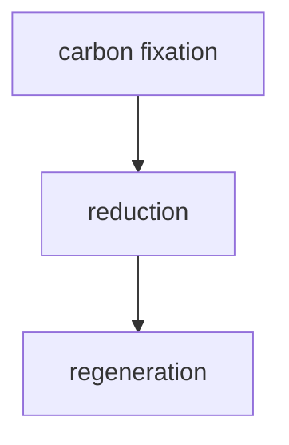

# controlled_test.txt

*Generated from assembled notes*

---

## Main Content

### Photosynthesis

Photosynthesis

*[Knowledge ID: CON_0001 | Sources: S001]*

### Photosynthesis

Photosynthesis

*[Knowledge ID: CON_0010 | Sources: S001]*

### Photosynthesis

Photosynthesis

*[Knowledge ID: CON_0019 | Sources: S001]*

### Photosynthesis

the process by which plants convert sunlight into chemical energy

*Context: in biology*

*[Knowledge ID: DEF_0004 | Sources: S001]*

### Photosynthesis

the process by which plants convert sunlight into chemical energy

*Context: in biology*

*[Knowledge ID: DEF_0013 | Sources: S001]*

### Photosynthesis

the process by which plants convert sunlight into chemical energy

*Context: in biology*

*[Knowledge ID: DEF_0022 | Sources: S001]*

#### Formula

```
6CO2 + 6H2O + light energy → C6H12O6 + 6O2
```

**Variables:**
- `CO2`: carbon dioxide
- `H2O`: water
- `C6H12O6`: glucose
- `O2`: oxygen

*Conditions: in presence of light*

*[Knowledge ID: FRM_0008 | Sources: S002]*

#### Formula

```
6CO2 + 6H2O + light energy → C6H12O6 + 6O2
```

**Variables:**
- `CO2`: carbon dioxide
- `H2O`: water
- `C6H12O6`: glucose
- `O2`: oxygen

*Conditions: in presence of light*

*[Knowledge ID: FRM_0017 | Sources: S002]*

#### Formula

```
6CO2 + 6H2O + light energy → C6H12O6 + 6O2
```

**Variables:**
- `CO2`: carbon dioxide
- `H2O`: water
- `C6H12O6`: glucose
- `O2`: oxygen

*Conditions: in presence of light*

*[Knowledge ID: FRM_0026 | Sources: S002]*

Chlorophyll

*[Knowledge ID: CON_0002 | Sources: S003]*

Chlorophyll

*[Knowledge ID: CON_0011 | Sources: S003]*

Chlorophyll

*[Knowledge ID: CON_0020 | Sources: S003]*

### Chlorophyll

the green pigment found in plants that absorbs light energy

*[Knowledge ID: DEF_0005 | Sources: S003]*

### Chlorophyll

the green pigment found in plants that absorbs light energy

*[Knowledge ID: DEF_0014 | Sources: S003]*

### Chlorophyll

the green pigment found in plants that absorbs light energy

*[Knowledge ID: DEF_0023 | Sources: S003]*

> **Example: Chlorophyll**
> 
> spinach leaves contain high amounts of chlorophyll

*[Knowledge ID: EXM_0006 | Sources: S003]*

> **Example: Chlorophyll**
> 
> spinach leaves contain high amounts of chlorophyll

*[Knowledge ID: EXM_0015 | Sources: S003]*

> **Example: Chlorophyll**
> 
> spinach leaves contain high amounts of chlorophyll

*[Knowledge ID: EXM_0024 | Sources: S003]*

The rate of photosynthesis increases with light intensity up to a saturation point

*[Knowledge ID: FCT_0007 | Sources: S004]*

The rate of photosynthesis increases with light intensity up to a saturation point

*[Knowledge ID: FCT_0016 | Sources: S004]*

The rate of photosynthesis increases with light intensity up to a saturation point

*[Knowledge ID: FCT_0025 | Sources: S004]*

### Calvin cycle

Calvin cycle

*[Knowledge ID: CON_0003 | Sources: S005]*

### Calvin cycle

Calvin cycle

*[Knowledge ID: CON_0012 | Sources: S005]*

### Calvin cycle

Calvin cycle

*[Knowledge ID: CON_0021 | Sources: S005]*

#### Flowchart: Calvin cycle



*[Knowledge ID: PRC_0009 | Sources: S005]*

#### Flowchart: Calvin cycle


*[Knowledge ID: PRC_0018 | Sources: S005]*

#### Flowchart: Calvin cycle


*[Knowledge ID: PRC_0027 | Sources: S005]*

---

*Render complete: 27 items from 1 sections*
