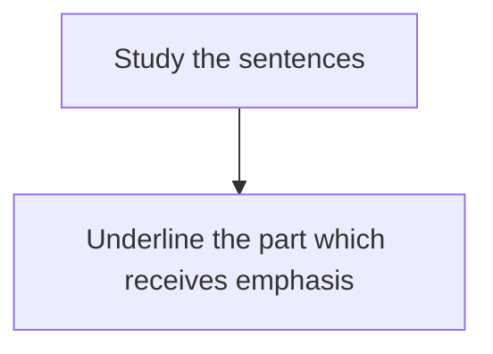

# test.pdf

*Generated from assembled notes*

---

## Main Content

A repeated phrase appearing in the document.

*[Knowledge ID: CON_0001 | Sources: S0002, S0009]*

An alphanumeric code appearing in the document.

*[Knowledge ID: CON_0002 | Sources: S0007]*

Hotel in Havana where a huge wave crashed, embedding a car in its side and causing extensive damage.

*[Knowledge ID: CON_0003 | Sources: S0012]*

The wave leapt over the wide two‑way street between the seawall and the hotel and still had enough force to shatter the entrance window.

*[Knowledge ID: EXP_0013 | Sources: S0012]*

> **Example: destructive power of a tsunami‑like wave**
> 
> A huge wave picked up several cars, embedded one in the side of the Havana Riviera Hotel, and shattered the great entrance window.

*[Knowledge ID: EXM_0015 | Sources: S0012]*

At nine o'clock in the morning a huge wave hit the Havana Riviera Hotel, picking up several cars and embedding one in the hotel wall.

*[Knowledge ID: FCT_0016 | Sources: S0012]*

#### Cause and Effect

*[Knowledge ID: REL_0024 | Sources: S0012]*

Gold ring shaped like a serpent with emerald eyes, worn by the housekeeper of the Portuguese ambassador.

*[Knowledge ID: CON_0005 | Sources: S0013]*

Cuban volunteers and the fire department cleared the debris in less than six hours and sealed off the gate to the sea.

*[Knowledge ID: FCT_0017 | Sources: S0013]*

The woman found in the car was the housekeeper of the new Portuguese ambassador and wore a gold serpent‑shaped ring with emerald eyes.

*[Knowledge ID: FCT_0018 | Sources: S0013]*

The housekeeper of the Portuguese ambassador wore a gold serpent‑shaped ring with emerald eyes.

*[Knowledge ID: REL_0025 | Sources: S0013]*

She was the housekeeper for the new Portuguese ambassador and his wife.

*[Knowledge ID: REL_0028 | Sources: S0013]*

She moved to Austria between the World Wars as a child to study music and voice.

*[Knowledge ID: FCT_0020 | Sources: S0016]*

Nickname given by Latin American students in Vienna to a Colombian woman who earned a living by interpreting dreams.

*[Knowledge ID: CON_0004 | Sources: S0020, S0021, S0022, S0027, S0029]*

Illicit trade activity described as part of Vienna's post‑war atmosphere.

*[Knowledge ID: CON_0008 | Sources: S0020]*

#### Timeline

1. **Event**: Covert intelligence activities mentioned as characteristic of Vienna after World War II.

*[Knowledge ID: CON_0009 | Sources: S0020]*

Latin American students in Vienna gave her the nickname 'Frau Frieda'.

*[Knowledge ID: REL_0027 | Sources: S0020]*

The trade of interpreting and communicating dreams for a fee or as a livelihood.

*[Knowledge ID: CON_0006 | Sources: S0021, S0022]*

### dream selling

Her only trade; she interpreted dreams for a family and was paid a salary that covered minor expenses.

*Context: Frau Frieda's occupation in Vienna.*

*[Knowledge ID: DEF_0010 | Sources: S0021, S0022]*

#### Hierarchy: dream selling

- dream selling
  - her trade

*[Knowledge ID: REL_0029 | Sources: S0021]*

#### Timeline

1. **Event**: The belief that dreams told before breakfast retain their purest prophetic form.

*[Knowledge ID: CON_0007 | Sources: S0022]*

### oracular qualities

Dreams told before breakfast preserve their purest form and are considered prophetic.

*Context: Family tradition described by Frau Frieda.*

*[Knowledge ID: DEF_0011 | Sources: S0022]*

Frau Frieda was the third of eleven children born to a prosperous shopkeeper in old Caldas, Colombia.

*[Knowledge ID: FCT_0019 | Sources: S0022]*

She was hired by a family to interpret their daily dreams for a salary that covered minor expenses, receiving a room and three meals a day.

*[Knowledge ID: FCT_0021 | Sources: S0022, S0023]*

#### Hierarchy: Frau Frieda

- Frau Frieda
  - dream interpreter

*[Knowledge ID: REL_0026 | Sources: S0022, S0023]*

The dream that a brother was carried off by a flood meant the boy should not eat sweets, not that he would drown.

*[Knowledge ID: EXP_0012 | Sources: S0023]*

> **Example: dream interpretation leading to real‑world consequence**
> 
> A boy, warned by a dream not to eat sweets, secretly ate caramel and choked, dying despite his mother's strict enforcement of the warning.

*[Knowledge ID: EXM_0014 | Sources: S0024]*

The master of the house left her part of his estate on the condition that she continue dreaming for the family until her dreams ended.

*[Knowledge ID: FCT_0022 | Sources: S0027]*

Frau Frieda warned the narrator to leave Vienna and not return for five years; he left that night by train to Rome.

*[Knowledge ID: FCT_0023 | Sources: S0029, S0030]*

Language Work

*[Knowledge ID: CON_0030 | Sources: S0077]*

A. Vocabulary

*[Knowledge ID: CON_0031 | Sources: S0079]*

a phrase to be looked up in the dictionary

*[Knowledge ID: CON_0033 | Sources: S0080]*

**Lookup meanings of phrases:**

- Look up the meanings of the following phrases under 'dream' and 'sell' in the dictionary

*[Knowledge ID: PRC_0034 | Sources: S0080]*

a phrase to be looked up in the dictionary

*[Knowledge ID: CON_0032 | Sources: S0081]*

sell

*[Knowledge ID: CON_0035 | Sources: S0082]*

dream on

*[Knowledge ID: CON_0036 | Sources: S0083]*

dream something away (not)

*[Knowledge ID: CON_0037 | Sources: S0083]*

dream of doing something

*[Knowledge ID: CON_0038 | Sources: S0083]*

dream something up

*[Knowledge ID: CON_0039 | Sources: S0083]*

look like a dream

*[Knowledge ID: CON_0040 | Sources: S0083]*

sell-by date

*[Knowledge ID: CON_0041 | Sources: S0083]*

selling-point

*[Knowledge ID: CON_0042 | Sources: S0083]*

sell-out

*[Knowledge ID: CON_0043 | Sources: S0083]*

selling price

*[Knowledge ID: CON_0044 | Sources: S0083]*

seller's market

*[Knowledge ID: CON_0045 | Sources: S0083]*

Grammar: Emphasis

*[Knowledge ID: CON_0046 | Sources: S0084]*

> **Example: original word order and emphasis**
> 
> One morning at nine o'clock, while we were having breakfast on the terrace of the Havana Riviera Hotel under a bright sun, a huge wave picked up several cars that were driving down the avenue along the seawall or parked on the pavement, and embedded one of them in the side of the hotel.

*[Knowledge ID: EXM_0059 | Sources: S0086]*

Emphasis in a sentence is indicated by the position of a word, phrase, or idea.

*[Knowledge ID: CON_0047 | Sources: S0087]*

The location of a linguistic element inside a sentence that influences its emphasis.

*[Knowledge ID: CON_0048 | Sources: S0087]*

The end of a sentence, which receives the greatest emphasis.

*[Knowledge ID: CON_0049 | Sources: S0087]*

The beginning of a sentence, which receives the second‑greatest emphasis.

*[Knowledge ID: CON_0050 | Sources: S0087]*

The middle of a sentence, which receives the least emphasis.

*[Knowledge ID: CON_0051 | Sources: S0087]*

### Emphasis (in grammar)

The emphasis a word, phrase, or idea receives is usually indicated by its position within a sentence.

*Context: Grammar: Emphasis*

*[Knowledge ID: DEF_0052 | Sources: S0087]*

### Most emphatic place

The end of a sentence is the most emphatic position.

*[Knowledge ID: DEF_0053 | Sources: S0087]*

### Next most emphatic place

The beginning of a sentence is the next most emphatic position.

*[Knowledge ID: DEF_0054 | Sources: S0087]*

### Least emphatic place

The middle of a sentence is the least emphatic position.

*[Knowledge ID: DEF_0055 | Sources: S0087]*

The position of a word, phrase or idea within a sentence usually indicates the emphasis it receives; the end is most emphatic, the beginning next, and the middle least.

*[Knowledge ID: EXP_0056 | Sources: S0087]*

#### Cause and Effect

*[Knowledge ID: REL_0064 | Sources: S0087]*

#### Hierarchy: End of a sentence

- End of a sentence
  - Most emphatic place

*[Knowledge ID: REL_0065 | Sources: S0087]*

#### Hierarchy: Beginning of a sentence

- Beginning of a sentence
  - Next most emphatic place

*[Knowledge ID: REL_0066 | Sources: S0087]*

#### Hierarchy: Middle of a sentence

- Middle of a sentence
  - Least emphatic place

*[Knowledge ID: REL_0067 | Sources: S0087]*

The most important fact in the sentence is that the huge wave embedded one of the cars in one side of the hotel.

*[Knowledge ID: FCT_0061 | Sources: S0088]*

Details of time and place are placed at the beginning, while the general statement about the huge wave precedes the particular car that is relevant to the story's theme.

*[Knowledge ID: EXP_0057 | Sources: S0090]*

The other details of time and place are given at the beginning of the sentence.

*[Knowledge ID: FCT_0062 | Sources: S0090]*

The general statement about the wave picking up cars comes before the specific car, supporting the story's theme.

*[Knowledge ID: REL_0068 | Sources: S0090]*

Rewriting the sentence to start with 'a huge wave' shifts the emphasis from the concluding details to the wave action, changing the overall impact of the sentence.

*[Knowledge ID: EXP_0058 | Sources: S0091, S0092]*

#### Timeline: Rewrite sentence to alter emphasis

1. **Step 1**: Identify the original sentence.
2. **Step 2**: Move the phrase 'a huge wave' (or the clause beginning with it) to the start of the sentence.
3. **Step 3**: Place the remaining parts of the original sentence after the moved phrase, preserving grammatical correctness.
4. **Step 4**: Read the new sentence and note the change in emphasis.

*[Knowledge ID: PRC_0063 | Sources: S0091, S0092]*

> **Example: reordered sentence to change emphasis**
> 
> A huge wave picked up several cars that were driving down the avenue along the seawall or parked on the pavement, and embedded one of them in the side of the hotel, one morning at nine o'clock, while we were having breakfast on the terrace of the Havana Riviera Hotel under a bright sun.

*[Knowledge ID: EXM_0060 | Sources: S0092]*

the part of a sentence that receives emphasis

*[Knowledge ID: CON_0069 | Sources: S0096]*

#### Flowchart: Identify emphasis in sentences

*[Knowledge ID: PRC_0071 | Sources: S0096]*

C. Pronunciation

*[Knowledge ID: CON_0070 | Sources: S0098]*

The basic unit of pronunciation; each contains a vowel sound and usually one or more consonants.

*[Knowledge ID: CON_0072 | Sources: S0099]*

The way in which words are spoken; syllable is its basic unit.

*[Knowledge ID: CON_0073 | Sources: S0099]*

A unit of language that may consist of one or more syllables.

*[Knowledge ID: CON_0074 | Sources: S0099]*

A sound produced without significant constriction of the airflow; each syllable contains one.

*[Knowledge ID: CON_0075 | Sources: S0099]*

A speech sound that is articulated with some degree of closure in the vocal tract; syllables usually contain one or more.

*[Knowledge ID: CON_0076 | Sources: S0099]*

### syllable

The basic unit of pronunciation.

*[Knowledge ID: DEF_0077 | Sources: S0099]*

A word may have a single syllable, such as 'will' or 'pen'.

*[Knowledge ID: FCT_0082 | Sources: S0099]*

A word can have more than one syllable, for instance 'willing'.

*[Knowledge ID: FCT_0083 | Sources: S0099]*

Each syllable contains a vowel sound and usually one or more consonants.

*[Knowledge ID: FCT_0084 | Sources: S0099]*

#### Hierarchy: syllable

- syllable
  - word

*[Knowledge ID: REL_0085 | Sources: S0099]*

#### Hierarchy: vowel sound

- vowel sound
  - syllable

*[Knowledge ID: REL_0086 | Sources: S0099]*

#### Hierarchy: consonant

- consonant
  - syllable

*[Knowledge ID: REL_0087 | Sources: S0099]*

#### Hierarchy: syllable

- syllable
  - unit of pronunciation

*[Knowledge ID: REL_0088 | Sources: S0099]*

**Procedure:**

- You can show division of a word into syllables by separating the word at vowel sounds and indicating the number of syllables.

*[Knowledge ID: EXP_0078 | Sources: S0100]*

> **Example: division of a word into syllables**
> 
> fool-ish(2)

*[Knowledge ID: EXM_0079 | Sources: S0101]*

> **Example: division of a word into syllables**
> 
> a-gree-ment(3)

*[Knowledge ID: EXM_0080 | Sources: S0102]*

> **Example: division of a word into syllables**
> 
> a-rith-me-tic(4)

*[Knowledge ID: EXM_0081 | Sources: S0103]*

Title of a novel by Gabriel Garcia Marquez

*[Knowledge ID: CON_0089 | Sources: S0108]*

Title of a novel by Gabriel Garcia Marquez

*[Knowledge ID: CON_0090 | Sources: S0108]*

Author of the listed novels

*[Knowledge ID: CON_0091 | Sources: S0108]*

> **Example: Gabriel Garcia Marquez's works**
> 
> One Hundred Years in Solitude by Gabriel Garcia Marquez

*[Knowledge ID: EXM_0092 | Sources: S0108]*

> **Example: Gabriel Garcia Marquez's works**
> 
> Love in the Time of Cholera by Gabriel Garcia Marquez

*[Knowledge ID: EXM_0093 | Sources: S0108]*

One Hundred Years in Solitude is authored by Gabriel Garcia Marquez

*[Knowledge ID: FCT_0094 | Sources: S0108]*

Love in the Time of Cholera is authored by Gabriel Garcia Marquez

*[Knowledge ID: FCT_0095 | Sources: S0108]*

The novel is a work written by the author

*[Knowledge ID: REL_0096 | Sources: S0108]*

The novel is a work written by the author

*[Knowledge ID: REL_0097 | Sources: S0108]*

---

*Render complete: 97 items from 1 sections*
