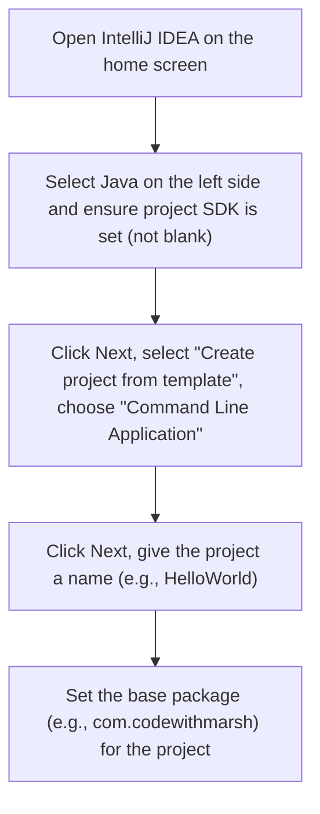
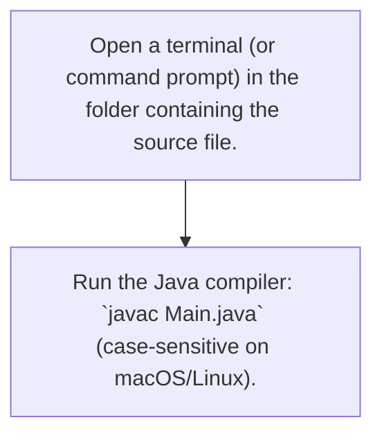
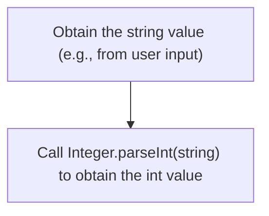
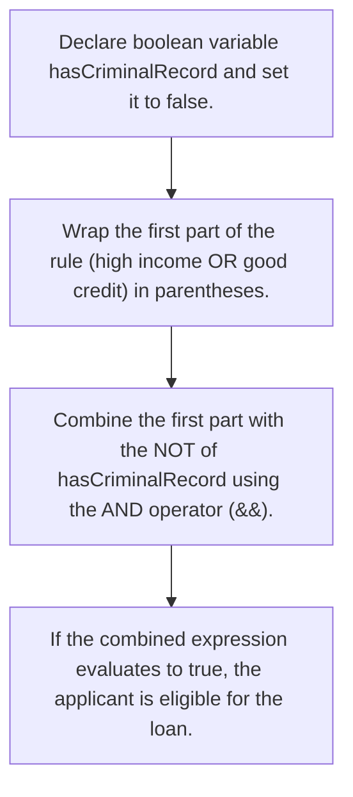
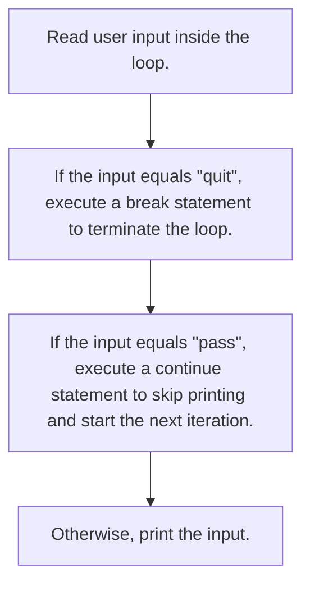

> UNVERIFIED PREVIEW — semantic and educational review required.

# java.txt

*Generated from assembled notes*

---

## Main Content

### function

the smallest building block in java programs are functions if function is a block of code that performs a task as a metaphor think of the buttons on the remote control of your TV each button performs a task functions in programming languages are exactly the same for example we can have a function for sending

*[Knowledge ID: DEF_0001 | Sources: T0002]*

### void

void is a reserved keyword in Java

*[Knowledge ID: DEF_0002 | Sources: T0002]*

IntelliJ IDEA Community Edition is absolutely free and more than enough for this course

*[Knowledge ID: FCT_0003 | Sources: T0002]*

You need to accept the license agreement before downloading the software

*[Knowledge ID: FCT_0004 | Sources: T0002]*

### class

a class is a container for one or more related functions; it is used to organize code similarly to sections in a supermarket that contain related products.

*[Knowledge ID: DEF_0020 | Sources: T0003]*

### method

a method is a function that is part of a class.

*[Knowledge ID: DEF_0021 | Sources: T0003]*

### access modifier

a special keyword that determines if other classes and methods in the program can access the class or method; examples include public and private.

*[Knowledge ID: DEF_0003 | Sources: T0003]*

### Pascal naming convention

a naming convention for classes where the first letter of every word is uppercase.

*[Knowledge ID: DEF_0004 | Sources: T0003]*

### camel naming convention

a naming convention for methods where the first letter of the first word is lowercase and the first letter of each subsequent word is uppercase.

*[Knowledge ID: DEF_0005 | Sources: T0003]*

In Java, the left brace is placed on the same line as the function definition.

*[Knowledge ID: FCT_0006 | Sources: T0003]*

Every Java program must have at least one function called main, which is the entry point of the program.

*[Knowledge ID: FCT_0007 | Sources: T0003]*

Functions in Java must belong to a class; they cannot exist independently.

*[Knowledge ID: FCT_0008 | Sources: T0003]*

A Java program must contain at least one class that includes the main function.

*[Knowledge ID: FCT_0009 | Sources: T0003]*

The public access modifier is most commonly used for class and method declarations in Java.

*[Knowledge ID: FCT_0010 | Sources: T0003]*

### class

class is a container for related methods

*[Knowledge ID: DEF_0022 | Sources: T0004]*

### package

package is used to group related classes

*[Knowledge ID: DEF_0023 | Sources: T0004]*

### command line application

application that we can run from the command line and does not have a graphical user interface

*[Knowledge ID: DEF_0024 | Sources: T0004]*

base package for a Java project is the domain name of your company in reverse

*[Knowledge ID: FCT_0151 | Sources: T0004]*

#### Flowchart: Create a new Java project in IntelliJ IDEA



*[Knowledge ID: PRC_0005 | Sources: T0004]*

### package statement

Specifies the package to which the class belongs; it is terminated by a semicolon.

*[Knowledge ID: DEF_0025 | Sources: T0005]*

### main method

A public static method named main with a void return type and a single parameter; it serves as the entry point of a Java program.

*[Knowledge ID: DEF_0026 | Sources: T0005]*

All Java files should have the .java extension.

*[Knowledge ID: FCT_0152 | Sources: T0005]*

In Java, every statement must be terminated with a semicolon.

*[Knowledge ID: FCT_0153 | Sources: T0005]*

The main method must be declared static and have a void return type.

*[Knowledge ID: FCT_0005 | Sources: T0005]*

Comments in Java start with // and are not executed.

*[Knowledge ID: FCT_0154 | Sources: T0005]*

The System class is defined in the java.lang package.

*[Knowledge ID: FCT_0155 | Sources: T0005]*

The dot operator is used to access members of a class in Java.

*[Knowledge ID: FCT_0001 | Sources: T0006]*

In IntelliJ, the icon "F" indicates a field member.

*[Knowledge ID: FCT_0002 | Sources: T0006]*

In IntelliJ, the icon "M" indicates a method member.

*[Knowledge ID: FCT_0156 | Sources: T0006]*

The class PrintStream (referred to as "print string" in the transcript) provides the method println.

*[Knowledge ID: FCT_0157 | Sources: T0006]*

String literals in Java must be enclosed in double quotes.

*[Knowledge ID: FCT_0158 | Sources: T0006]*

Running a Java program in IntelliJ involves two steps: compilation and execution.

*[Knowledge ID: FCT_0159 | Sources: T0006]*

The Java compiler translates source code into Java bytecode.

*[Knowledge ID: FCT_0160 | Sources: T0006]*

The compiled Java bytecode can run on Windows, macOS, Linux, or any operating system that has a Java Runtime Environment because it is not tied to a specific hardware architecture.

*[Knowledge ID: EXP_0001 | Sources: T0007]*

The JVM takes Java bytecode and converts it into the native code required by the underlying operating system, enabling the same bytecode to execute on different platforms.

*[Knowledge ID: EXP_0002 | Sources: T0007]*

Java bytecode is platform independent and can run on any OS with a Java Runtime Environment.

*[Knowledge ID: FCT_0161 | Sources: T0007]*

The JVM translates Java bytecode into native code for the host operating system.

*[Knowledge ID: FCT_0162 | Sources: T0007]*

#### Flowchart: Compile a Java source file



*[Knowledge ID: PRC_0342 | Sources: T0007]*

**Run a compiled Java program:**

- In the terminal, execute the JVM with the class name: `java Main`.

*[Knowledge ID: PRC_0006 | Sources: T0007]*

Original presentation data (fallback):
```json
{
  "steps": [
    "In the terminal, execute the JVM with the class name: `java Main`."
  ],
  "procedure_name": "Run a compiled Java program"
}
```

**Locate compiled class files:**

- In the project panel, open the `out` folder to see the compiled `.class` files under the package hierarchy.

*[Knowledge ID: PRC_0007 | Sources: T0007]*

Original presentation data (fallback):
```json
{
  "steps": [
    "In the project panel, open the `out` folder to see the compiled `.class` files under the package hierarchy."
  ],
  "procedure_name": "Locate compiled class files"
}
```

Java was developed by James Gosling in 1995 at Sun Microsystems.

*[Knowledge ID: FCT_0163 | Sources: T0008]*

Sun Microsystems was later acquired by Oracle in 2010.

*[Knowledge ID: FCT_0164 | Sources: T0008]*

Java was originally called Oak after an oak tree that stood outside Gosling's office.

*[Knowledge ID: FCT_0165 | Sources: T0008]*

Java was renamed to Green and finally to Java, inspired by Java coffee.

*[Knowledge ID: FCT_0166 | Sources: T0008]*

Java Standard Edition is the core Java platform used in this course.

*[Knowledge ID: FCT_0167 | Sources: T0008]*

Java Enterprise Edition is built on top of Java Standard Edition and provides additional libraries for building fault tolerant distributed multi-tiered software.

*[Knowledge ID: FCT_0168 | Sources: T0008]*

Java Micro Edition is a subset of Java Standard Edition designed for mobile devices.

*[Knowledge ID: FCT_0169 | Sources: T0008]*

Java Card is used in smart cards.

*[Knowledge ID: FCT_0170 | Sources: T0008]*

The latest version of Java is Java Standard Edition 12, released in March 2019.

*[Knowledge ID: FCT_0171 | Sources: T0008]*

Java has close to 9 million developers worldwide.

*[Knowledge ID: FCT_0172 | Sources: T0008]*

About 3 billion mobile phones run Java.

*[Knowledge ID: FCT_0011 | Sources: T0008]*

120 million TV sets and Blu‑ray players run Java.

*[Knowledge ID: FCT_0012 | Sources: T0008]*

The average salary of a Java developer in the US is just over $100,000 per year.

*[Knowledge ID: FCT_0013 | Sources: T0008]*

### object-oriented programming

a style of programming used in most if not all Java applications

*[Knowledge ID: DEF_0027 | Sources: T0009]*

### control flow statements

statements that are used to build algorithms, including various types of conditional statements and loops

*[Knowledge ID: DEF_0028 | Sources: T0009]*

The course is a four-part Java series, each part about three to four hours long.

*[Knowledge ID: FCT_0173 | Sources: T0009]*

The first part teaches the fundamentals of programming with Java.

*[Knowledge ID: FCT_0174 | Sources: T0009]*

The type system in Java includes primitives, strings, booleans, and arrays.

*[Knowledge ID: FCT_0175 | Sources: T0009]*

By the end of the first part, you will build a mortgage calculator.

*[Knowledge ID: FCT_0176 | Sources: T0009]*

The second part covers control flow statements, conditional statements, loops, and adds data validation to the mortgage calculator.

*[Knowledge ID: FCT_0177 | Sources: T0009]*

Clean coding techniques are taught to make code clean and maintainable.

*[Knowledge ID: FCT_0178 | Sources: T0009]*

The course teaches how to find and fix errors in Java programs and how to package them for deployment.

*[Knowledge ID: FCT_0179 | Sources: T0009]*

The third part covers core Java API useful classes in the standard Java library.

*[Knowledge ID: FCT_0180 | Sources: T0009]*

The fourth part covers advanced Java features such as streams, threads, and database programming.

*[Knowledge ID: FCT_0181 | Sources: T0009]*

A final project involves building a mortgage calculator on your own using the learned material.

*[Knowledge ID: FCT_0182 | Sources: T0009]*

### variable

we use variables to temporarily store data in computer's memory

*[Knowledge ID: DEF_0029 | Sources: T0010]*

### type

specify the type of our variable

*[Knowledge ID: DEF_0030 | Sources: T0010]*

### identifier

also called an identifier because we use it to identify our variable

*[Knowledge ID: DEF_0031 | Sources: T0010]*

### assignment operator

this equal sign is called the assignment operator

*[Knowledge ID: DEF_0032 | Sources: T0010]*

### initialization

initializing this variable which means we're giving it an initial value

*[Knowledge ID: DEF_0033 | Sources: T0010]*

> **Example: declaring an integer variable**
> 
> int age = 30

*[Knowledge ID: EXM_0006 | Sources: T0010]*

> **Example: printing the value of a variable**
> 
> System.out.println(age); // prints 30

*[Knowledge ID: EXM_0007 | Sources: T0010]*

> **Example: initializing multiple variables on the same line (not recommended)**
> 
> int temperature = 20, pressure = 1013;

*[Knowledge ID: EXM_0008 | Sources: T0010]*

> **Example: copying the value of one variable into another**
> 
> int myAge = 30; int herAge = myAge;

*[Knowledge ID: EXM_0009 | Sources: T0010]*

int (integer) type stores whole numbers without a decimal point

*[Knowledge ID: FCT_0183 | Sources: T0010]*

variables must be initialized before they are used

*[Knowledge ID: FCT_0184 | Sources: T0010]*

the value of a variable can be changed after initialization

*[Knowledge ID: FCT_0185 | Sources: T0010]*

declaring multiple variables on the same line makes code harder to read and is not recommended

*[Knowledge ID: FCT_0186 | Sources: T0010]*

camelCase naming convention: capitalize the first letter of every word except the first

*[Knowledge ID: FCT_0014 | Sources: T0010]*

Using meaningful and descriptive names for variables improves code readability and comprehension.

*[Knowledge ID: EXP_0094 | Sources: T0011]*

byte takes one byte of memory and stores values from -128 to 127

*[Knowledge ID: FCT_0187 | Sources: T0011]*

short takes two bytes of memory and stores values up to 32,000

*[Knowledge ID: FCT_0188 | Sources: T0011]*

int (integer) takes four bytes of memory and allows storing values up to two billion

*[Knowledge ID: FCT_0189 | Sources: T0011]*

long takes eight bytes of memory and can store even larger numbers

*[Knowledge ID: FCT_0190 | Sources: T0011]*

float takes four bytes for storing decimal numbers

*[Knowledge ID: FCT_0191 | Sources: T0011]*

double takes eight bytes for storing decimal numbers

*[Knowledge ID: FCT_0192 | Sources: T0011]*

char takes two bytes and stores a single character, supporting international letters

*[Knowledge ID: FCT_0193 | Sources: T0011]*

boolean stores true or false values

*[Knowledge ID: FCT_0194 | Sources: T0011]*

Underscores can be used in numeric literals to separate digits for readability

*[Knowledge ID: FCT_0195 | Sources: T0011]*

### long

In Java, integer literals are treated as int by default; to represent a long literal you must append an L or l suffix (preferably capital L) to the number.

*[Knowledge ID: DEF_0034 | Sources: T0012]*

### float

In Java, decimal literals are treated as double by default; to represent a float literal you must append an F or f suffix (preferably capital F) to the number.

*[Knowledge ID: DEF_0035 | Sources: T0012]*

### char

The char primitive type stores a single Unicode character and must be enclosed in single quotes.

*[Knowledge ID: DEF_0036 | Sources: T0012]*

### String

A String stores a sequence of characters and is written with double quotes.

*[Knowledge ID: DEF_0037 | Sources: T0012]*

### boolean

The boolean primitive type represents a truth value and can be either true or false.

*[Knowledge ID: DEF_0038 | Sources: T0012]*

### primitive type

Primitive types in Java store simple values such as numbers, boolean values, or single characters.

*[Knowledge ID: DEF_0006 | Sources: T0012]*

### reference type

Reference types store complex objects such as data objects or mail messages.

*[Knowledge ID: DEF_0007 | Sources: T0012]*

### reserved keyword

Words highlighted in orange (e.g., public, static, void, class, package) are reserved keywords in Java and cannot be used as identifiers for variables, classes, or methods.

*[Knowledge ID: DEF_0008 | Sources: T0012]*

> **Example: whole numbers**
> 
> 3L (long literal) and 1099 (int literal) illustrate whole numbers with and without suffixes.

*[Knowledge ID: EXM_0125 | Sources: T0012]*

> **Example: decimal numbers**
> 
> 1099.0F (float literal) shows a decimal number with an F suffix.

*[Knowledge ID: EXM_0010 | Sources: T0012]*

> **Example: character**
> 
> char letter = 'a';

*[Knowledge ID: EXM_0011 | Sources: T0012]*

> **Example: string**
> 
> String name = "Alice";

*[Knowledge ID: EXM_0012 | Sources: T0012]*

> **Example: boolean**
> 
> boolean isEligible = true;

*[Knowledge ID: EXM_0013 | Sources: T0012]*

Java integer literals are interpreted as int by default, which can store values up to about two billion.

*[Knowledge ID: FCT_0196 | Sources: T0012]*

If an integer literal exceeds the int range, the compiler reports "integer number too large" unless the literal is suffixed with L to indicate a long.

*[Knowledge ID: FCT_0015 | Sources: T0012]*

Java decimal literals are interpreted as double by default.

*[Knowledge ID: FCT_0016 | Sources: T0012]*

Assigning a double literal to a float variable without a suffix causes a compilation error: "incompatible types: required float, found double".

*[Knowledge ID: FCT_0017 | Sources: T0012]*

All primitive type keywords (e.g., int, long, float, double, char, boolean) are reserved and cannot be used as identifiers.

*[Knowledge ID: FCT_0018 | Sources: T0012]*

### primitive type

a basic data type in Java that is stored directly by the Java Runtime Environment without requiring explicit memory allocation by the programmer

*[Knowledge ID: DEF_0039 | Sources: T0013]*

### reference type

a type that refers to an object; memory for the object must be allocated explicitly with the new operator

*[Knowledge ID: DEF_0040 | Sources: T0013]*

### package

a namespace that groups related classes and interfaces, allowing the same class name to exist in different packages without conflict

*[Knowledge ID: DEF_0041 | Sources: T0013]*

### import

a statement that makes a class from another package available in the current source file

*[Knowledge ID: DEF_0042 | Sources: T0013]*

### new operator

an operator used to allocate memory for a new object of a reference type

*[Knowledge ID: DEF_0043 | Sources: T0013]*

### class

a blueprint or template for creating objects (instances)

*[Knowledge ID: DEF_0044 | Sources: T0013]*

### object

an instance of a class; it contains members (fields and methods) that can be accessed via the dot operator

*[Knowledge ID: DEF_0045 | Sources: T0013]*

### dot operator

the '.' symbol used to access members (fields or methods) of an object or class

*[Knowledge ID: DEF_0046 | Sources: T0013]*

Primitive types are allocated and released automatically by the Java Runtime Environment, whereas reference types require explicit memory allocation with the new operator and are automatically reclaimed by the runtime when no longer referenced.

*[Knowledge ID: EXP_0009 | Sources: T0013]*

Packages create separate namespaces, allowing classes with the same name (e.g., Date) to exist in different packages such as java.util and java.sql without conflict.

*[Knowledge ID: EXP_0010 | Sources: T0013]*

Java has eight primitive types.

*[Knowledge ID: FCT_0197 | Sources: T0013]*

When declaring a reference type variable, you must use the new operator to allocate memory for the object.

*[Knowledge ID: FCT_0198 | Sources: T0013]*

The Java Runtime Environment automatically releases memory for objects when they are no longer referenced.

*[Knowledge ID: FCT_0199 | Sources: T0013]*

IntelliJ IDEA can suggest class names and automatically add import statements for classes from other packages.

*[Knowledge ID: FCT_0200 | Sources: T0013]*

### primitive type

a type for storing simple values

*[Knowledge ID: DEF_0047 | Sources: T0014]*

### reference type

a type for storing complex objects

*[Knowledge ID: DEF_0048 | Sources: T0014]*

### dot operator

an operator used to access members of an object or class

*[Knowledge ID: DEF_0049 | Sources: T0014]*

Two primitive variables declared separately occupy different memory locations, so changing the value of one does not affect the other.

*[Knowledge ID: EXP_0004 | Sources: T0014]*

When a variable is of a primitive type, it has no members, so using the dot operator after it shows no suggestions.

*[Knowledge ID: EXP_0005 | Sources: T0014]*

For a variable that is an instance of a class, the dot operator can be used to access its fields and methods, such as calling a print function on a PrintString field.

*[Knowledge ID: EXP_0006 | Sources: T0014]*

Primitive variables store simple values and are not objects.

*[Knowledge ID: FCT_0201 | Sources: T0014]*

Reference variables store complex objects.

*[Knowledge ID: FCT_0202 | Sources: T0014]*

Changing the value of one primitive variable does not affect another primitive variable that was assigned its previous value.

*[Knowledge ID: FCT_0203 | Sources: T0014]*

### reference type

a type whose variable holds the address of an object in memory rather than the actual object itself

*[Knowledge ID: DEF_0050 | Sources: T0015]*

When a reference type variable is assigned to another, the second variable receives the same memory address, so both variables refer to the same object; changing the object through one variable is visible through the other.

*[Knowledge ID: EXP_0095 | Sources: T0015]*

Primitive variables store the actual value in their memory location.

*[Knowledge ID: FCT_0204 | Sources: T0015]*

Reference type variables store a reference (address) to an object in memory.

*[Knowledge ID: FCT_0205 | Sources: T0015]*

Assigning one reference variable to another copies the reference, not the object.

*[Knowledge ID: FCT_0206 | Sources: T0015]*

Two reference variables that reference the same object will reflect changes made through either variable.

*[Knowledge ID: FCT_0207 | Sources: T0015]*

### String literal

a string value written directly in code, e.g., "hello world"

*[Knowledge ID: DEF_0051 | Sources: T0016]*

returns a boolean value indicating whether the string ends with the specified character sequence

*[Knowledge ID: EXP_0096 | Sources: T0016]*

returns a boolean value indicating whether the string starts with the specified character sequence

*[Knowledge ID: EXP_0003 | Sources: T0016]*

returns the number of characters in the string

*[Knowledge ID: EXP_0097 | Sources: T0016]*

> **Example: String concatenation using the plus operator**
> 
> message + "!!"

*[Knowledge ID: EXM_0005 | Sources: T0016]*

> **Example: Using endsWith method**
> 
> message.endsWith("!!") // returns true

*[Knowledge ID: EXM_0126 | Sources: T0016]*

> **Example: Using startsWith method**
> 
> message.startsWith("!!") // returns false

*[Knowledge ID: EXM_0127 | Sources: T0016]*

String class is defined in the java.lang package

*[Knowledge ID: FCT_0208 | Sources: T0016]*

java.lang package is automatically imported, so no import statement is needed

*[Knowledge ID: FCT_0209 | Sources: T0016]*

String is a reference type in Java

*[Knowledge ID: FCT_0210 | Sources: T0016]*

Using the new operator with String is redundant; a string literal can be assigned directly

*[Knowledge ID: FCT_0211 | Sources: T0016]*

String literals provide a shorthand to create String objects

*[Knowledge ID: FCT_0212 | Sources: T0016]*

The length of the string "hello world!!" is 13 characters

*[Knowledge ID: FCT_0213 | Sources: T0016]*

### parameter

Parameters are the placeholders defined in a method signature.

*[Knowledge ID: DEF_0052 | Sources: T0017]*

### argument

Arguments are the actual values passed to a method when it is called.

*[Knowledge ID: DEF_0053 | Sources: T0017]*

> **Example: replace method**
> 
> replace('!', '*') changes all exclamation marks to asterisks and returns a new string, leaving the original string unchanged.

*[Knowledge ID: EXM_0003 | Sources: T0017]*

The length of a string can be checked and an error can be given if it exceeds a specified limit (e.g., 20 characters).

*[Knowledge ID: FCT_0214 | Sources: T0017]*

The indexOf method returns the index of the first occurrence of a character or substring, or -1 if it does not exist.

*[Knowledge ID: FCT_0215 | Sources: T0017]*

The replace method takes two arguments (target and replacement) and returns a new string with all occurrences of the target replaced.

*[Knowledge ID: FCT_0216 | Sources: T0017]*

Java strings are immutable; methods that appear to modify a string actually return a new string object.

*[Knowledge ID: FCT_0217 | Sources: T0017]*

The toLowerCase method returns a new string with all characters converted to lowercase, leaving the original string unchanged.

*[Knowledge ID: FCT_0218 | Sources: T0017]*

The toUpperCase method returns a new string with all characters converted to uppercase, leaving the original string unchanged.

*[Knowledge ID: FCT_0219 | Sources: T0017]*

The trim method removes leading and trailing whitespace from a string and returns a new string.

*[Knowledge ID: FCT_0220 | Sources: T0017]*

### escape sequence

A character combination that starts with a backslash and represents a special character in a string literal.

*[Knowledge ID: DEF_0054 | Sources: T0018]*

In Java string literals, a backslash (\\) is used to introduce escape sequences that allow inclusion of characters such as double quotes, backslashes, newlines, and tabs.

*[Knowledge ID: EXP_0098 | Sources: T0018]*

> **Example: string literal with escaped double quotes**
> 
> Hello \"Marsh\"

*[Knowledge ID: EXM_0128 | Sources: T0018]*

> **Example: Windows file path string**
> 
> C:\\Windows\\...

*[Knowledge ID: EXM_0004 | Sources: T0018]*

> **Example: string with newline escape**
> 
> C:\\Drive\nWindows

*[Knowledge ID: EXM_0129 | Sources: T0018]*

To include a double quote inside a Java string, prefix it with a backslash (\").

*[Knowledge ID: FCT_0221 | Sources: T0018]*

To include a backslash in a Java string, prefix it with another backslash (\\).

*[Knowledge ID: FCT_0222 | Sources: T0018]*

The escape sequence \n inserts a new line in a Java string.

*[Knowledge ID: FCT_0223 | Sources: T0018]*

The escape sequence \t inserts a tab character in a Java string.

*[Knowledge ID: FCT_0224 | Sources: T0018]*

Windows file paths require each backslash to be escaped as \\ in a Java string.

*[Knowledge ID: FCT_0225 | Sources: T0018]*

### array

An array is a reference type in Java used to store a list of items such as numbers, people, or messages.

*[Knowledge ID: DEF_0055 | Sources: T0019]*

### index

The index of an array element starts at zero; the first element is accessed with index 0.

*[Knowledge ID: DEF_0056 | Sources: T0019]*

### ArrayIndexOutOfBoundsException

An exception thrown when an invalid index (e.g., 10 for an array of length 5) is used to access an array.

*[Knowledge ID: DEF_0057 | Sources: T0019]*

### Arrays.toString

A static method in java.util.Arrays that returns a string representation of the actual items in an array.

*[Knowledge ID: DEF_0058 | Sources: T0019]*

To declare an array of integers, place square brackets after the type name (e.g., int\[\]).

*[Knowledge ID: FCT_0226 | Sources: T0019]*

Arrays are reference types; they must be instantiated with the new operator.

*[Knowledge ID: FCT_0227 | Sources: T0019]*

When creating an array, the size (length) is specified in square brackets after the new operator.

*[Knowledge ID: FCT_0228 | Sources: T0019]*

Variable names should reflect that they hold a list of items (e.g., numbers instead of number).

*[Knowledge ID: FCT_0229 | Sources: T0019]*

Array elements are accessed using the variable name followed by the index in square brackets (e.g., numbers\[0\]).

*[Knowledge ID: FCT_0230 | Sources: T0019]*

Printing an array directly yields a string based on the object's memory address, not its contents.

*[Knowledge ID: FCT_0231 | Sources: T0019]*

The java.util.Arrays class provides overloaded toString methods for different primitive array types.

*[Knowledge ID: FCT_0232 | Sources: T0019]*

A newer way to initialize an array in Java is to omit the new operator and use curly braces with the items listed inside, e.g., int\[\] numbers = {2, 3, 5, 1, 4};

*[Knowledge ID: CON_0001 | Sources: T0020]*

In Java, integer array elements default to 0.

*[Knowledge ID: FCT_0233 | Sources: T0020]*

In Java, boolean array elements default to false.

*[Knowledge ID: FCT_0234 | Sources: T0020]*

In Java, String array elements default to an empty string.

*[Knowledge ID: FCT_0235 | Sources: T0020]*

Java arrays have a fixed size; once created, items cannot be added or removed.

*[Knowledge ID: FCT_0236 | Sources: T0020]*

The length of a Java array can be read using the .length field.

*[Knowledge ID: FCT_0237 | Sources: T0020]*

Java arrays can be sorted using the Arrays.sort method, which is overloaded for different parameter types.

*[Knowledge ID: FCT_0238 | Sources: T0020]*

Multi‑dimensional arrays can be created in Java, such as two‑dimensional arrays for matrices and three‑dimensional arrays for cube data.

*[Knowledge ID: FCT_0239 | Sources: T0020]*

### constant

A variable declared with the keyword final, which cannot be changed after it is initialized.

*[Knowledge ID: DEF_0059 | Sources: T0021]*

A two‑dimensional array in Java requires two pairs of square brackets, one for each dimension.

*[Knowledge ID: FCT_0240 | Sources: T0021]*

To access an element in a two‑dimensional array you must supply two indexes: the row index followed by the column index.

*[Knowledge ID: FCT_0241 | Sources: T0021]*

Arrays.deepToString can be used to obtain a readable string representation of a multi‑dimensional array.

*[Knowledge ID: FCT_0242 | Sources: T0021]*

A two‑dimensional array can be initialized with curly‑brace syntax, where each row is itself an array literal.

*[Knowledge ID: FCT_0243 | Sources: T0021]*

In Java, a floating‑point literal must be suffixed with F (or f) to be treated as a float; otherwise it is a double.

*[Knowledge ID: FCT_0244 | Sources: T0021]*

### final variable

a variable declared with the keyword final, meaning its value cannot be changed after initialization

*[Knowledge ID: DEF_0060 | Sources: T0022]*

### constant

a final variable that, by convention, is named using all capital letters

*[Knowledge ID: DEF_0061 | Sources: T0022]*

### arithmetic expression

a piece of code that produces a value

*[Knowledge ID: DEF_0062 | Sources: T0022]*

### operand

a number or variable on which an arithmetic operator acts

*[Knowledge ID: DEF_0063 | Sources: T0022]*

### increment operator

an operator (++) that increases the value of a numeric variable by 1

*[Knowledge ID: DEF_0064 | Sources: T0022]*

### decrement operator

an operator (--) that decreases the value of a numeric variable by 1

*[Knowledge ID: DEF_0065 | Sources: T0022]*

Constants are written in all capital letters to distinguish them from regular variables

*[Knowledge ID: EXP_0007 | Sources: T0022]*

In Java, dividing two whole numbers yields a whole number; the fractional part is discarded

*[Knowledge ID: EXP_0008 | Sources: T0022]*

To obtain a floating‑point result from division, cast one operand to double (or float) before the operation

*[Knowledge ID: EXP_0099 | Sources: T0022]*

> **Example: addition**
> 
> int result = 10 + 3; // result is 13

*[Knowledge ID: EXM_0130 | Sources: T0022]*

> **Example: increment operator**
> 
> int X = 1; X++; // X becomes 2

*[Knowledge ID: EXM_0131 | Sources: T0022]*

pi is a final variable (constant) in the example

*[Knowledge ID: FCT_0245 | Sources: T0022]*

Division of two whole numbers in Java produces a whole number result

*[Knowledge ID: FCT_0246 | Sources: T0022]*

Casting an integer expression to double yields a floating‑point result

*[Knowledge ID: FCT_0247 | Sources: T0022]*

The increment operator can be used as a prefix or postfix

*[Knowledge ID: FCT_0248 | Sources: T0022]*

When using the postfix increment operator (x++) in an assignment, the original value of x is assigned first and then x is incremented.

*[Knowledge ID: FCT_0249 | Sources: T0023]*

When using the prefix increment operator (++x) in an assignment, x is incremented first and then the new value is assigned.

*[Knowledge ID: FCT_0250 | Sources: T0023]*

The augmented assignment operator X += 2 is equivalent to X = X + 2.

*[Knowledge ID: FCT_0251 | Sources: T0023]*

In Java, multiplication and division have higher precedence than addition and subtraction; thus 10 + 3 * 2 evaluates to 16.

*[Knowledge ID: FCT_0252 | Sources: T0023]*

Parentheses override default precedence; (10 + 3) * 2 evaluates to 26.

*[Knowledge ID: FCT_0253 | Sources: T0023]*

Order of operations priority: parentheses first, then multiplication/division, then addition/subtraction.

*[Knowledge ID: FCT_0254 | Sources: T0024]*

Implicit casting automatically converts a short value to an int when assigned to an int variable.

*[Knowledge ID: FCT_0255 | Sources: T0024]*

Assigning a double literal to an int variable without an explicit cast causes a compilation error.

*[Knowledge ID: FCT_0256 | Sources: T0024]*

When an int is used in an expression with a double, the int is automatically cast to double.

*[Knowledge ID: FCT_0257 | Sources: T0024]*

### implicit casting

implicit casting happens whenever you're not gonna lose data; there is no chance for data loss

*[Knowledge ID: DEF_0066 | Sources: T0025]*

### explicit casting

explicit casting converts a value to a specified type using a cast operator, e.g., (int) X, and can only occur between compatible types

*[Knowledge ID: DEF_0067 | Sources: T0025]*

### wrapper class

a reference type that provides methods to convert between strings and primitive types, e.g., Integer for int, Short for short

*[Knowledge ID: DEF_0068 | Sources: T0025]*

### parseInt method

a static method in the Integer wrapper class that takes a string and returns an int

*[Knowledge ID: DEF_0069 | Sources: T0025]*

### parseShort method

a static method in the Short wrapper class that takes a string and returns a short

*[Knowledge ID: DEF_0070 | Sources: T0025]*

### parseFloat method

a static method in the Float wrapper class that takes a string and returns a float

*[Knowledge ID: DEF_0071 | Sources: T0025]*

User interface frameworks deliver input as strings, so converting these strings to numeric representations is necessary to perform arithmetic operations

*[Knowledge ID: EXP_0100 | Sources: T0025]*

> **Example: casting X to an integer**
> 
> cast X to an integer like this (int) X; the result would be 1 without a decimal point, then 1 will be added to 2 and Y would be 3

*[Knowledge ID: EXM_0132 | Sources: T0025]*

> **Example: parsing a string to an integer**
> 
> Integer.parseInt(X) where X is a string "1" returns the integer 1; adding to 2 yields 3

*[Knowledge ID: EXM_0133 | Sources: T0025]*

You cannot cast a string to an integer directly because they are not compatible types

*[Knowledge ID: FCT_0258 | Sources: T0025]*

All primitive numeric types (int, float, double, short, etc.) are compatible for casting among each other

*[Knowledge ID: FCT_0259 | Sources: T0025]*

#### Flowchart: Convert a string to an integer using Integer.parseInt



*[Knowledge ID: PRC_0012 | Sources: T0025]*

### Math class

The Math class is defined in the java.lang package, is always available without explicit import, and provides a collection of static methods for performing mathematical operations.

*[Knowledge ID: DEF_0072 | Sources: T0026]*

### round method

The round method rounds a floating‑point number to the nearest whole number; it is overloaded: one version takes a float and returns an int, another takes a double and returns a long.

*[Knowledge ID: DEF_0073 | Sources: T0026]*

### ceil method

The ceil method returns the smallest integer that is greater than or equal to the given number; it returns a double value.

*[Knowledge ID: DEF_0074 | Sources: T0026]*

### floor method

The floor method returns the largest integer that is less than or equal to the given number; it returns a double value.

*[Knowledge ID: DEF_0075 | Sources: T0026]*

### max method

The max method returns the greater of two values; it is overloaded for int, long, float, and double arguments.

*[Knowledge ID: DEF_0076 | Sources: T0026]*

### min method

The min method returns the smaller of two values; it is overloaded for various primitive numeric types.

*[Knowledge ID: DEF_0077 | Sources: T0026]*

### random method

The random method returns a double value uniformly distributed between 0.0 (inclusive) and 1.0 (exclusive).

*[Knowledge ID: DEF_0078 | Sources: T0026]*

> **Example: round**
> 
> Passing 1.1 as a float to Math.round and storing the result in an int yields 1.

*[Knowledge ID: EXM_0134 | Sources: T0026]*

> **Example: ceil**
> 
> Math.ceil(1.1) returns 2 (after casting to int).

*[Knowledge ID: EXM_0135 | Sources: T0026]*

> **Example: floor**
> 
> Math.floor(1.1) returns 1 (after casting to int).

*[Knowledge ID: EXM_0136 | Sources: T0026]*

> **Example: max**
> 
> Math.max(1, 2) returns 2.

*[Knowledge ID: EXM_0137 | Sources: T0026]*

> **Example: min**
> 
> Math.min(1, 2) returns 1.

*[Knowledge ID: EXM_0138 | Sources: T0026]*

> **Example: random**
> 
> Math.random() returns a double between 0 and 1; multiplying by 100 yields a value between 0 and 100.

*[Knowledge ID: EXM_0139 | Sources: T0026]*

Math class methods are static and can be accessed without creating an instance of Math.

*[Knowledge ID: FCT_0260 | Sources: T0026]*

Attempting to store the result of Math.ceil (which returns double) directly into an int causes a compilation error; explicit casting is required.

*[Knowledge ID: FCT_0261 | Sources: T0026]*

Math.random() returns a double; assigning it to an int without casting causes a compilation error.

*[Knowledge ID: FCT_0262 | Sources: T0026]*

method returns a long but here we have declared an integer

*[Knowledge ID: FCT_0263 | Sources: T0027]*

implicit casting cannot happen when storing an 8-byte value into a 4-byte variable

*[Knowledge ID: FCT_0264 | Sources: T0027]*

explicit casting can be used when the result is known to fit in the target type

*[Knowledge ID: FCT_0265 | Sources: T0027]*

casting the result of Math.random() directly to int yields 0 because the fraction is lost

*[Knowledge ID: FCT_0266 | Sources: T0027]*

wrapping the entire expression in parentheses before casting yields an integer between 0 and 100

*[Knowledge ID: FCT_0267 | Sources: T0027]*

NumberFormat class in java.text can format numbers as currency or percentages

*[Knowledge ID: FCT_0268 | Sources: T0027]*

### abstract class

abstract class is abstract it cannot be instantiated

*[Knowledge ID: DEF_0079 | Sources: T0028]*

### factory method

a method that creates and returns an instance of a class, acting like a factory

*[Knowledge ID: DEF_0080 | Sources: T0028]*

### method overloading

having multiple implementations of a method with different parameter types

*[Knowledge ID: DEF_0081 | Sources: T0028]*

When switching to percent formatting, rename variable to reflect its purpose to avoid confusion

*[Knowledge ID: EXP_0101 | Sources: T0028]*

> **Example: currency formatting**
> 
> call NumberFormat.format with value 1234567.891 to get a string like $1,234,567.89

*[Knowledge ID: EXM_0140 | Sources: T0028]*

NumberFormat class cannot be instantiated directly using new operator

*[Knowledge ID: FCT_0269 | Sources: T0028]*

NumberFormat.getCurrencyInstance() returns an instance of NumberFormat

*[Knowledge ID: FCT_0270 | Sources: T0028]*

NumberFormat.format returns a string representation of the number formatted as currency

*[Knowledge ID: FCT_0271 | Sources: T0028]*

Shift+F6 is the shortcut for the Rename refactor menu on Mac.

*[Knowledge ID: FCT_0272 | Sources: T0029]*

Method chaining allows calling multiple methods in a single statement by using the dot operator on the returned object.

*[Knowledge ID: FCT_0273 | Sources: T0029]*

In Java, System.in is used to read input from the terminal window.

*[Knowledge ID: FCT_0274 | Sources: T0029]*

The Scanner class (java.util.Scanner) is used to read input from the user in Java.

*[Knowledge ID: FCT_0275 | Sources: T0029]*

Methods of the Scanner class for reading data start with the prefix "next" (e.g., nextInt, nextLine).

*[Knowledge ID: FCT_0276 | Sources: T0029]*

The nextByte method returns a byte value which can be stored in a byte variable.

*[Knowledge ID: FCT_0277 | Sources: T0030]*

Concatenating a string with a byte causes implicit casting to string in Java.

*[Knowledge ID: FCT_0278 | Sources: T0030]*

The println method adds a new line after the label.

*[Knowledge ID: FCT_0279 | Sources: T0030]*

The print method does not add a new line.

*[Knowledge ID: FCT_0280 | Sources: T0030]*

The next method reads a token (up to whitespace).

*[Knowledge ID: FCT_0281 | Sources: T0030]*

The nextLine method reads the rest of the line including spaces.

*[Knowledge ID: FCT_0282 | Sources: T0030]*

The nextFloat or nextDouble methods are needed to read floating-point numbers; using nextInt on a float causes an exception.

*[Knowledge ID: FCT_0283 | Sources: T0030]*

Each call to next reads one token; to read a full name with a space you need to call next twice.

*[Knowledge ID: FCT_0284 | Sources: T0030]*

The trim method removes leading and trailing whitespace from a string.

*[Knowledge ID: FCT_0285 | Sources: T0031]*

The nextLine method returns the line of input entered by the user as a string.

*[Knowledge ID: FCT_0286 | Sources: T0031]*

#### Formula

```
Monthly interest rate = (annual interest rate ÷ 100) ÷ 12
```

**Variables:**
- `r`: monthly interest rate
- `annual interest rate`: interest rate expressed as a percent per year

*[Knowledge ID: FRM_0003 | Sources: T0031]*

#### Formula

```
Mortgage payment calculation uses principal P, monthly interest rate r, and number of payments n.
```

**Variables:**
- `P`: principal or amount of loan
- `r`: monthly interest rate
- `n`: total number of monthly payments

*[Knowledge ID: FRM_0004 | Sources: T0031]*

Using constants or final variables instead of literal numbers makes code more understandable for others, as literals like 12 may not be immediately clear.

*[Knowledge ID: EXP_0102 | Sources: T0032]*

Select data types based on the range of values needed; use int for principal amounts up to two billion, and float for small interest rates instead of double.

*[Knowledge ID: EXP_0103 | Sources: T0032]*

Descriptive variable names improve code readability; avoid short or ambiguous names like "MI" for monthly interest.

*[Knowledge ID: EXP_0104 | Sources: T0032]*

Declaring constants for months in a year (12) and percent (100) prevents magic numbers.

*[Knowledge ID: FCT_0287 | Sources: T0032]*

A scanner object can be used to read user input for principal, interest rate, and period.

*[Knowledge ID: FCT_0288 | Sources: T0032]*

### camel notation

capitalizing the first letter of every word except the first word in a variable name

*[Knowledge ID: DEF_0082 | Sources: T0033]*

The maximum number we want to support is 30, so one byte is sufficient to store the number 30 or anything smaller.

*[Knowledge ID: FCT_0289 | Sources: T0033]*

If a non‑numeric value (e.g., "XYZ") is entered, the mortgage calculator program crashes.

*[Knowledge ID: FCT_0290 | Sources: T0033]*

If a negative value is entered, the mortgage calculator program does not behave properly.

*[Knowledge ID: FCT_0291 | Sources: T0033]*

Conditional statements can be used to validate user‑entered values.

*[Knowledge ID: FCT_0292 | Sources: T0033]*

Primitive types store simple values, while reference types hold references to complex objects.

*[Knowledge ID: FCT_0293 | Sources: T0033]*

Two types of casting exist: implicit and explicit.

*[Knowledge ID: FCT_0294 | Sources: T0033]*

### boolean expression

a piece of code that produces a boolean value true or false

*[Knowledge ID: DEF_0083 | Sources: T0034]*

### comparison operators

operators used to compare primitive values such as equality (==), inequality (!=), greater than (&gt;), greater than or equal (&gt;=), less than (&lt;), and less than or equal (&lt;=)

*[Knowledge ID: DEF_0084 | Sources: T0034]*

### logical operators

operators such as logical AND (&amp;&amp;), logical OR (||), and logical NOT (!) used for implementing real‑world rules

*[Knowledge ID: DEF_0085 | Sources: T0034]*

Control flow statements include conditional statements for making decisions, loops for repeated execution, and error handling constructs.

*[Knowledge ID: EXP_0105 | Sources: T0034]*

Logical operators (&amp;&amp;, ||, !) are used to combine or invert boolean expressions to implement complex decision rules.

*[Knowledge ID: EXP_0106 | Sources: T0034]*

> **Example: x == y**
> 
> When x and y have the same value, the expression x == y evaluates to true.

*[Knowledge ID: EXM_0141 | Sources: T0034]*

> **Example: x != y**
> 
> When x and y are equal, the expression x != y evaluates to false.

*[Knowledge ID: EXM_0142 | Sources: T0034]*

> **Example: x &lt;= y**
> 
> If X is less than or equal to Y, the expression evaluates to true.

*[Knowledge ID: EXM_0143 | Sources: T0034]*

The equality operator (==) compares two values and returns true if they are equal, otherwise false.

*[Knowledge ID: FCT_0295 | Sources: T0034]*

The inequality operator (!=) returns false when the two compared values are equal.

*[Knowledge ID: FCT_0296 | Sources: T0034]*

The expression X &lt;= Y evaluates to true when X is less than or equal to Y.

*[Knowledge ID: FCT_0297 | Sources: T0034]*

The &amp;&amp; operator returns true only if both operands are true. Java evaluates the expression from left to right and stops evaluating as soon as it determines the result (short‑circuit). If the first condition is false, the second condition is not evaluated.

*[Knowledge ID: EXP_0107 | Sources: T0035]*

The || operator returns true if at least one operand is true. Java evaluates from left to right and stops as soon as a true operand is found (short‑circuit). If the first operand is true, the second is not evaluated.

*[Knowledge ID: EXP_0108 | Sources: T0035]*

The ! operator reverses the boolean value of its operand; true becomes false and false becomes true.

*[Knowledge ID: EXP_0109 | Sources: T0035]*

> **Example: Temperature range check using &amp;&amp;**
> 
> int temperature = 22; boolean isWarm = temperature &gt; 20 &amp;&amp; temperature &lt; 30; // isWarm is true

*[Knowledge ID: EXM_0144 | Sources: T0035]*

> **Example: Loan eligibility using \|\|**
> 
> boolean hasHighIncome = true; boolean hasGoodCredit = true; boolean isEligible = hasHighIncome || hasGoodCredit; // isEligible is true

*[Knowledge ID: EXM_0145 | Sources: T0035]*

&amp;&amp; returns true only when both conditions are true; otherwise false.

*[Knowledge ID: FCT_0298 | Sources: T0035]*

|| returns true when at least one condition is true; otherwise false.

*[Knowledge ID: FCT_0299 | Sources: T0035]*

Java uses short‑circuit evaluation for both &amp;&amp; and || operators.

*[Knowledge ID: FCT_0300 | Sources: T0035]*

! reverses a boolean value.

*[Knowledge ID: FCT_0301 | Sources: T0035]*

The NOT operator reverses the value of a boolean variable or expression; if the variable is false, applying NOT makes it true.

*[Knowledge ID: EXP_0110 | Sources: T0036]*

Wrap the first condition in parentheses, then use the AND operator (&amp;&amp;) to combine it with the second condition, e.g., (highIncome || goodCredit) &amp;&amp; !hasCriminalRecord.

*[Knowledge ID: EXP_0111 | Sources: T0036]*

> **Example: If temperature is greater than 30, print "it's a hot day" and "drink plenty of water".**
> 
> temperature = 32; if (temperature &gt; 30) { System.out.println("it's a hot day"); System.out.println("drink plenty of water"); }

*[Knowledge ID: EXM_0146 | Sources: T0036]*

A boolean variable "hasCriminalRecord" is initially set to false.

*[Knowledge ID: FCT_0302 | Sources: T0036]*

If the first condition and the second condition are both true, the person is eligible for a new loan.

*[Knowledge ID: FCT_0303 | Sources: T0036]*

#### Flowchart: Implement loan eligibility rule using boolean logic



*[Knowledge ID: PRC_0343 | Sources: T0036]*

The if statement evaluates the temperature condition and executes the code block when true.

*[Knowledge ID: PRC_0344 | Sources: T0036]*

### if statement

we have an if statement and this statement has three clauses or three sections here's the first Clause

*[Knowledge ID: DEF_0086 | Sources: T0037]*

### Clause

the if statement has three clauses or three sections: the first Clause, the second Clause, and the third Clause

*[Knowledge ID: DEF_0087 | Sources: T0037]*

braces are only required if we have multiple statements; some people always add braces, others consider them unnecessary noise for single statements

*[Knowledge ID: FCT_0304 | Sources: T0037]*

removing unnecessary braces and reformatting can simplify the code and make it more readable

*[Knowledge ID: FCT_0305 | Sources: T0037]*

A variable declared inside a code block is scoped to that block and cannot be accessed outside of it, resulting in a compilation error such as "cannot resolve symbol" when referenced elsewhere.

*[Knowledge ID: EXP_0112 | Sources: T0038]*

Variable declarations are only allowed inside code blocks (delimited by curly braces) in Java; attempting to declare a variable outside a block causes a compilation error.

*[Knowledge ID: EXP_0113 | Sources: T0038]*

Instead of using an if‑else statement to set a boolean based on a condition, assign the boolean directly with the condition expression (e.g., `hasHighIncome = income &gt; 100000;`). Wrapping the expression in parentheses can improve readability.

*[Knowledge ID: EXP_0114 | Sources: T0038]*

Declaration not allowed outside of a code block; variables must be declared inside curly‑brace blocks.

*[Knowledge ID: FCT_0306 | Sources: T0038]*

A variable declared inside a code block is not available outside that block.

*[Knowledge ID: FCT_0307 | Sources: T0038]*

Assigning a boolean variable directly with a condition expression eliminates the need for an explicit if‑else statement.

*[Knowledge ID: FCT_0308 | Sources: T0038]*

### ternary operator

the ternary operator in Java has three pieces: a condition, a value if true, and a value if false; it returns one of the two values based on the condition

*[Knowledge ID: DEF_0088 | Sources: T0039]*

### switch statement

a switch statement executes different parts of code depending on the value of an expression, similar to if statements

*[Knowledge ID: DEF_0089 | Sources: T0039]*

> **Example: ternary operator usage for class assignment based on income**
> 
> String className = income &gt; 100000 ? "first" : "economy";

*[Knowledge ID: EXM_0147 | Sources: T0039]*

> **Example: switch statement checking user role**
> 
> switch (role) { case "admin": System.out.println("you are an admin"); break; ... }

*[Knowledge ID: EXM_0148 | Sources: T0039]*

The ternary operator can replace an if‑else statement for assigning a value based on a condition.

*[Knowledge ID: FCT_0309 | Sources: T0039]*

A switch statement selects code to execute based on the value of an expression.

*[Knowledge ID: FCT_0310 | Sources: T0039]*

An if statement can be used to execute different code blocks based on the role of the current user (admin, moderator, guest).

*[Knowledge ID: FCT_0311 | Sources: T0040]*

A switch statement can be used as an alternative to if statements for role‑based branching, requiring case clauses for each role and an optional default clause.

*[Knowledge ID: FCT_0312 | Sources: T0040]*

Each case clause in a switch statement should end with a break statement to exit the switch block after executing its code.

*[Knowledge ID: FCT_0313 | Sources: T0040]*

If a break statement is omitted from a case that is not the last one, execution will fall through to the next case.

*[Knowledge ID: FCT_0314 | Sources: T0040]*

Switch statements can operate on integer types (byte, short, int) as well as strings; using a string variable as the switch expression without proper handling can cause a compilation error.

*[Knowledge ID: FCT_0315 | Sources: T0040]*

When the first condition checks only divisibility by 5, numbers divisible by both 5 and 3 (e.g., 15) satisfy that condition and cause the program to print only "fizz", skipping later else‑if branches that would produce "fizzbuzz".

*[Knowledge ID: EXP_0115 | Sources: T0041]*

If a number is divisible by 5, the program should print "fizz".

*[Knowledge ID: FCT_0316 | Sources: T0041]*

If a number is divisible by 3, the program should print "buzz".

*[Knowledge ID: FCT_0317 | Sources: T0041]*

If a number is divisible by both 5 and 3, the program should print "fizzbuzz".

*[Knowledge ID: FCT_0318 | Sources: T0041]*

If a number is not divisible by 5 or 3, the program should print the number itself.

*[Knowledge ID: FCT_0319 | Sources: T0041]*

### DRY

DRY stands for "don't repeat yourself", a programming concept that advises against repeating code.

*[Knowledge ID: DEF_0090 | Sources: T0042]*

Solutions may trade off repetition for nesting; less repetition can increase nesting complexity, making code harder to read.

*[Knowledge ID: EXP_0116 | Sources: T0042]*

Place the most specific conditions at the top of an if‑else chain and the most generic ones at the bottom.

*[Knowledge ID: FCT_0320 | Sources: T0042]*

Repeating the same expression in multiple places violates the DRY principle.

*[Knowledge ID: FCT_0321 | Sources: T0042]*

Nested if‑else statements can make code harder to read and understand.

*[Knowledge ID: FCT_0322 | Sources: T0042]*

When Java encounters a for loop it first executes the initialization statement (e.g., initializing I to zero), then evaluates the loop condition; if the condition is true the loop body is executed, after which the update expression increments the counter, and the process repeats until the condition becomes false.

*[Knowledge ID: EXP_0117 | Sources: T0043]*

Loop counter variables are commonly named I, J, or K.

*[Knowledge ID: FCT_0323 | Sources: T0043]*

A for loop can be written without braces if it contains a single statement.

*[Knowledge ID: FCT_0324 | Sources: T0043]*

If the loop counter is initialized to zero, using the less‑than operator (&lt;) will execute the loop the desired number of times; alternatively, initializing to one and using less‑than‑or‑equal (≤) works as well.

*[Knowledge ID: FCT_0325 | Sources: T0043]*

A for loop repeats a block of code a specified number of times according to its initialization, condition, and update components.

*[Knowledge ID: PRC_0345 | Sources: T0043]*

> **Example: using a while loop for an unknown number of repetitions based on user input**
> 
> while loop that continues until the user inputs "quit"

*[Knowledge ID: EXM_0001 | Sources: T0044]*

Initializing I to zero and using the less‑than operator in a for loop prints the numbers 0 1 2 3 4

*[Knowledge ID: FCT_0326 | Sources: T0044]*

Initializing I to five and decrementing it in a for loop prints the numbers 5 4 3 2 1

*[Knowledge ID: FCT_0327 | Sources: T0044]*

While loops are functionally similar to for loops but have different syntax

*[Knowledge ID: FCT_0328 | Sources: T0044]*

For loops are preferable when the number of iterations is known ahead of time; while loops are preferable when the number of iterations is unknown

*[Knowledge ID: FCT_0329 | Sources: T0044]*

In Java, using == or != to compare strings compares object references, not their textual values

*[Knowledge ID: FCT_0330 | Sources: T0044]*

A while loop checks its condition before executing the loop body, so if the condition is false the body never runs. A do-while loop checks the condition after executing the body, guaranteeing that the body runs at least once even when the condition is false.

*[Knowledge ID: EXP_0118 | Sources: T0045]*

> **Example: case-insensitive quit detection**
> 
> After reading input, call the toLowerCase() method on the string before comparing it to "quit" so that inputs like "Quit", "QUIT", or "QuIt" are all recognized as the quit command.

*[Knowledge ID: EXM_0002 | Sources: T0045]*

Creating a new Scanner object inside a loop on each iteration creates multiple objects, consumes memory, and is considered bad practice.

*[Knowledge ID: FCT_0331 | Sources: T0045]*

Assuming user input is always lowercase can cause the quit detection logic to fail for uppercase or mixed‑case inputs.

*[Knowledge ID: FCT_0332 | Sources: T0045]*

When Java sees the break statement it will ignore everything else after and it will terminate the loop.

*[Knowledge ID: EXP_0119 | Sources: T0046]*

When Java sees the continue statement it moves control to the beginning of the loop, causing the remaining statements in the current iteration to be ignored.

*[Knowledge ID: EXP_0120 | Sources: T0046]*

The break statement terminates a loop.

*[Knowledge ID: FCT_0333 | Sources: T0046]*

The continue statement moves control to the beginning of a loop.

*[Knowledge ID: FCT_0334 | Sources: T0046]*

Using `true` as the loop condition creates an infinite loop that runs until a break statement terminates it.

*[Knowledge ID: FCT_0335 | Sources: T0046]*

#### Flowchart: Handle special input commands in a loop



*[Knowledge ID: PRC_0346 | Sources: T0046]*

### for each loop

A loop construct in Java used to iterate over arrays or collections without needing an explicit index or counter.

*[Knowledge ID: DEF_0091 | Sources: T0047]*

### infinite loop

A loop that never terminates on its own, typically created with a condition that is always true (e.g., while true) unless a break statement is used.

*[Knowledge ID: DEF_0092 | Sources: T0047, T0048]*

The for each loop can only iterate forward through an array and does not provide access to the index of each element.

*[Knowledge ID: EXP_0121 | Sources: T0047, T0048]*

When using while true, a break statement must be included inside the loop body to prevent an infinite loop that never terminates and can consume memory.

*[Knowledge ID: EXP_0122 | Sources: T0047]*

> **Example: Iterating over a string array named fruits using a for each loop.**
> 
> for (String fruit : fruits) { System.out.println(fruit); }

*[Knowledge ID: EXM_0149 | Sources: T0047]*

A for each loop in Java iterates over arrays or collections without requiring an explicit counter.

*[Knowledge ID: FCT_0336 | Sources: T0047]*

The for each loop iterates only in the forward direction; it cannot iterate from the end to the beginning of an array.

*[Knowledge ID: FCT_0337 | Sources: T0047]*

A while true loop without a break statement results in an infinite loop that never terminates.

*[Knowledge ID: FCT_0339 | Sources: T0047]*

> **Example: Validating user input for a mortgage calculator using an infinite loop with break.**
> 
> while (true) { // read input; if (input valid) { break; } }

*[Knowledge ID: EXM_0150 | Sources: T0048]*

The for each loop does not provide access to the index of each item; only the item value is available.

*[Knowledge ID: FCT_0338 | Sources: T0048]*

Use an infinite loop with a break statement to repeatedly ask the user for a value until it falls within the allowed range.

*[Knowledge ID: PRC_0011 | Sources: T0048]*

Techniques for changing the structure of code to make it clean and beautiful, improving maintainability.

*[Knowledge ID: CON_0019 | Sources: T0050]*

### control flow statements

Statements like if and switch for making decisions in programs, and loops for executing code repeatedly.

*[Knowledge ID: DEF_0093 | Sources: T0050]*

Control flow is managed using comparison operators, logical operators, and three types of control flow statements: conditionals (if, switch) and loops (for, while, do‑while, foreach), as well as break and continue for altering loop execution.

*[Knowledge ID: EXP_0123 | Sources: T0050]*

Long methods reduce maintainability; breaking code into smaller, readable chunks improves understandability and makes it easier for others to work with the code.

*[Knowledge ID: EXP_0124 | Sources: T0050]*

Breaking code into smaller chunks makes it easier to read and understand.

*[Knowledge ID: FCT_0340 | Sources: T0050]*

Clean code is valued because it is understandable by humans, not just computers.

*[Knowledge ID: FCT_0341 | Sources: T0050]*

---

*Render complete: 385 items from 1 sections*

### Preserved details: CON_0001
```json
{
  "content": "A newer way to initialize an array in Java is to omit the new operator and use curly braces with the items listed inside, e.g., int[] numbers = {2, 3, 5, 1, 4};",
  "concept_name": "Array initialization with curly braces"
}
```
Sources: T0020

### Preserved details: CON_0019
```json
{
  "concept_name": "clean coding"
}
```
Sources: T0050

### Preserved details: DEF_0084
```json
{
  "content": "operators used to compare primitive values such as equality (==), inequality (!=), greater than (>), greater than or equal (>=), less than (<), and less than or equal (<=)",
  "definition_text": "operators used to compare primitive values such as equality (==), inequality (!=), greater than (>), greater than or equal (>=), less than (<), and less than or equal (<=)"
}
```
Sources: T0034

### Preserved details: DEF_0085
```json
{
  "content": "operators such as logical AND (&&), logical OR (||), and logical NOT (!) used for implementing real‑world rules",
  "definition_text": "operators such as logical AND (&&), logical OR (||), and logical NOT (!) used for implementing real‑world rules"
}
```
Sources: T0034

### Preserved details: EXP_0002
```json
{
  "topic": "Java Virtual Machine (JVM) translates bytecode to native code"
}
```
Sources: T0007

### Preserved details: EXP_0094
```json
{
  "topic": "meaningful variable names help understand code"
}
```
Sources: T0011

### Preserved details: EXP_0009
```json
{
  "topic": "difference between primitive and reference types"
}
```
Sources: T0013

### Preserved details: EXP_0010
```json
{
  "topic": "use of packages to avoid naming conflicts"
}
```
Sources: T0013

### Preserved details: EXP_0004
```json
{
  "topic": "independence of primitive variables"
}
```
Sources: T0014

### Preserved details: EXP_0005
```json
{
  "topic": "dot operator on primitive variable"
}
```
Sources: T0014

### Preserved details: EXP_0006
```json
{
  "topic": "dot operator on class instance"
}
```
Sources: T0014

### Preserved details: EXP_0095
```json
{
  "topic": "reference vs primitive assignment"
}
```
Sources: T0015

### Preserved details: EXP_0097
```json
{
  "topic": "length method"
}
```
Sources: T0016

### Preserved details: EXP_0098
```json
{
  "topic": "Using backslash to escape special characters in Java strings"
}
```
Sources: T0018

### Preserved details: EXP_0007
```json
{
  "topic": "constant naming convention"
}
```
Sources: T0022

### Preserved details: EXP_0008
```json
{
  "topic": "integer division"
}
```
Sources: T0022

### Preserved details: EXP_0099
```json
{
  "topic": "casting to floating‑point"
}
```
Sources: T0022

### Preserved details: EXP_0100
```json
{
  "topic": "need for parsing user input"
}
```
Sources: T0025

### Preserved details: EXP_0101
```json
{
  "topic": "renaming variable for percent formatting"
}
```
Sources: T0028

### Preserved details: EXP_0102
```json
{
  "topic": "Avoiding magic numbers"
}
```
Sources: T0032

### Preserved details: EXP_0103
```json
{
  "topic": "Choosing appropriate data types"
}
```
Sources: T0032

### Preserved details: EXP_0104
```json
{
  "topic": "Using meaningful variable names"
}
```
Sources: T0032

### Preserved details: EXP_0106
```json
{
  "content": "Logical operators (&&, ||, !) are used to combine or invert boolean expressions to implement complex decision rules.",
  "topic": "logical operators usage",
  "explanation_text": "Logical operators (&&, ||, !) are used to combine or invert boolean expressions to implement complex decision rules."
}
```
Sources: T0034

### Preserved details: EXP_0107
```json
{
  "content": "The && operator returns true only if both operands are true. Java evaluates the expression from left to right and stops evaluating as soon as it determines the result (short‑circuit). If the first condition is false, the second condition is not evaluated.",
  "topic": "Logical AND operator",
  "explanation_text": "The && operator returns true only if both operands are true. Java evaluates the expression from left to right and stops evaluating as soon as it determines the result (short‑circuit). If the first condition is false, the second condition is not evaluated."
}
```
Sources: T0035

### Preserved details: EXP_0108
```json
{
  "topic": "Logical OR operator"
}
```
Sources: T0035

### Preserved details: EXP_0109
```json
{
  "topic": "Logical NOT operator"
}
```
Sources: T0035

### Preserved details: EXP_0110
```json
{
  "topic": "Using the NOT operator to invert a boolean value"
}
```
Sources: T0036

### Preserved details: EXP_0111
```json
{
  "content": "Wrap the first condition in parentheses, then use the AND operator (&&) to combine it with the second condition, e.g., (highIncome || goodCredit) && !hasCriminalRecord.",
  "topic": "Combining conditions with AND operator",
  "explanation_text": "Wrap the first condition in parentheses, then use the AND operator (&&) to combine it with the second condition, e.g., (highIncome || goodCredit) && !hasCriminalRecord."
}
```
Sources: T0036

### Preserved details: EXP_0112
```json
{
  "topic": "Variable scope in Java code blocks"
}
```
Sources: T0038

### Preserved details: EXP_0113
```json
{
  "topic": "Placement of variable declarations"
}
```
Sources: T0038

### Preserved details: EXP_0114
```json
{
  "content": "Instead of using an if‑else statement to set a boolean based on a condition, assign the boolean directly with the condition expression (e.g., `hasHighIncome = income > 100000;`). Wrapping the expression in parentheses can improve readability.",
  "topic": "Improving boolean assignment without an explicit if‑else",
  "explanation_text": "Instead of using an if‑else statement to set a boolean based on a condition, assign the boolean directly with the condition expression (e.g., `hasHighIncome = income > 100000;`). Wrapping the expression in parentheses can improve readability."
}
```
Sources: T0038

### Preserved details: EXP_0115
```json
{
  "topic": "Order of conditional checks in fizzbuzz implementation"
}
```
Sources: T0041

### Preserved details: EXP_0116
```json
{
  "topic": "Trade-offs in code structure"
}
```
Sources: T0042

### Preserved details: EXP_0117
```json
{
  "topic": "Execution of a Java for loop"
}
```
Sources: T0043

### Preserved details: EXP_0118
```json
{
  "topic": "while vs do-while loops in Java"
}
```
Sources: T0045

### Preserved details: EXP_0121
```json
{
  "topic": "Limitations of the for each loop"
}
```
Sources: T0047, T0048

### Preserved details: EXP_0122
```json
{
  "topic": "Need for break statement in while true loops"
}
```
Sources: T0047

### Preserved details: EXP_0123
```json
{
  "topic": "control flow of programs"
}
```
Sources: T0050

### Preserved details: EXP_0124
```json
{
  "topic": "code maintainability"
}
```
Sources: T0050

### Preserved details: EXM_0143
```json
{
  "exemplifies": "x <= y"
}
```
Sources: T0034

### Preserved details: EXM_0144
```json
{
  "content": "int temperature = 22; boolean isWarm = temperature > 20 && temperature < 30; // isWarm is true",
  "exemplifies": "Temperature range check using &&",
  "example_text": "int temperature = 22; boolean isWarm = temperature > 20 && temperature < 30; // isWarm is true"
}
```
Sources: T0035

### Preserved details: EXM_0145
```json
{
  "exemplifies": "Loan eligibility using ||"
}
```
Sources: T0035

### Preserved details: EXM_0146
```json
{
  "content": "temperature = 32; if (temperature > 30) { System.out.println(\"it's a hot day\"); System.out.println(\"drink plenty of water\"); }",
  "example_text": "temperature = 32; if (temperature > 30) { System.out.println(\"it's a hot day\"); System.out.println(\"drink plenty of water\"); }"
}
```
Sources: T0036

### Preserved details: EXM_0147
```json
{
  "content": "String className = income > 100000 ? \"first\" : \"economy\";",
  "example_text": "String className = income > 100000 ? \"first\" : \"economy\";"
}
```
Sources: T0039

### Preserved details: FCT_0226
```json
{
  "content": "To declare an array of integers, place square brackets after the type name (e.g., int[]).",
  "fact_text": "To declare an array of integers, place square brackets after the type name (e.g., int[])."
}
```
Sources: T0019

### Preserved details: FCT_0230
```json
{
  "content": "Array elements are accessed using the variable name followed by the index in square brackets (e.g., numbers[0]).",
  "fact_text": "Array elements are accessed using the variable name followed by the index in square brackets (e.g., numbers[0])."
}
```
Sources: T0019

### Preserved details: FCT_0297
```json
{
  "content": "The expression X <= Y evaluates to true when X is less than or equal to Y.",
  "fact_text": "The expression X <= Y evaluates to true when X is less than or equal to Y."
}
```
Sources: T0034

### Preserved details: FCT_0298
```json
{
  "content": "&& returns true only when both conditions are true; otherwise false.",
  "fact_text": "&& returns true only when both conditions are true; otherwise false."
}
```
Sources: T0035

### Preserved details: FCT_0300
```json
{
  "content": "Java uses short‑circuit evaluation for both && and || operators.",
  "fact_text": "Java uses short‑circuit evaluation for both && and || operators."
}
```
Sources: T0035

### Preserved details: FCT_0325
```json
{
  "content": "If the loop counter is initialized to zero, using the less‑than operator (<) will execute the loop the desired number of times; alternatively, initializing to one and using less‑than‑or‑equal (≤) works as well.",
  "fact_text": "If the loop counter is initialized to zero, using the less‑than operator (<) will execute the loop the desired number of times; alternatively, initializing to one and using less‑than‑or‑equal (≤) works as well."
}
```
Sources: T0043

### Preserved details: FRM_0003
```json
{
  "variables": {
    "r": "monthly interest rate",
    "annual interest rate": "interest rate expressed as a percent per year"
  }
}
```
Sources: T0031

### Preserved details: FRM_0004
```json
{
  "variables": {
    "P": "principal or amount of loan",
    "r": "monthly interest rate",
    "n": "total number of monthly payments"
  }
}
```
Sources: T0031

### Preserved details: PRC_0005
```json
{
  "content": "Steps to create a new Java project in IntelliJ IDEA",
  "steps": [
    "Open IntelliJ IDEA on the home screen",
    "Select Java on the left side and ensure project SDK is set (not blank)",
    "Click Next, select \"Create project from template\", choose \"Command Line Application\"",
    "Click Next, give the project a name (e.g., HelloWorld)",
    "Set the base package (e.g., com.codewithmarsh) for the project"
  ]
}
```
Sources: T0004

### Preserved details: PRC_0342
```json
{
  "content": "Compiling creates a .class file (bytecode) in the output folder.",
  "steps": [
    "Open a terminal (or command prompt) in the folder containing the source file.",
    "Run the Java compiler: `javac Main.java` (case‑sensitive on macOS/Linux)."
  ]
}
```
Sources: T0007

### Preserved details: PRC_0006
```json
{
  "content": "The JVM loads the bytecode and translates it to native code for execution.",
  "steps": [
    "In the terminal, execute the JVM with the class name: `java Main`."
  ]
}
```
Sources: T0007

### Preserved details: PRC_0007
```json
{
  "content": "Compiled class files are stored in the output directory mirroring the source package structure.",
  "steps": [
    "In the project panel, open the `out` folder to see the compiled `.class` files under the package hierarchy."
  ]
}
```
Sources: T0007

### Preserved details: PRC_0012
```json
{
  "content": "Use the Integer wrapper class's parseInt method to convert a numeric string to an int",
  "steps": [
    "Obtain the string value (e.g., from user input)",
    "Call Integer.parseInt(string) to obtain the int value"
  ]
}
```
Sources: T0025

### Preserved details: PRC_0343
```json
{
  "content": "The procedure combines logical operators to enforce loan eligibility criteria.",
  "steps": [
    "Declare boolean variable hasCriminalRecord and set it to false.",
    "Wrap the first part of the rule (high income OR good credit) in parentheses.",
    "Combine the first part with the NOT of hasCriminalRecord using the AND operator (&&).",
    "If the combined expression evaluates to true, the applicant is eligible for the loan."
  ]
}
```
Sources: T0036

### Preserved details: PRC_0344
```json
{
  "procedure_name": "Use if statement to display messages based on temperature",
  "steps": [
    "Declare an integer variable temperature and assign a value (e.g., 32).",
    "Write an if statement with the condition (temperature > 30).",
    "Enclose the statements to execute inside curly braces {}.",
    "Inside the block, print \"it's a hot day\" and \"drink plenty of water\"."
  ]
}
```
Sources: T0036

### Preserved details: PRC_0345
```json
{
  "procedure_name": "Steps of a Java for loop",
  "steps": [
    "Declare and initialize a loop counter variable (e.g., int I = 0).",
    "Write a boolean condition that determines loop continuation (e.g., I < 5).",
    "Provide an update expression to modify the counter after each iteration (e.g., I++).",
    "Place the loop body statements to be repeated.",
    "Execute: initialize counter, evaluate condition, run body, apply update, repeat until condition is false."
  ]
}
```
Sources: T0043

### Preserved details: PRC_0346
```json
{
  "content": "A loop that reads input, uses break to exit on \"quit\", continue to skip on \"pass\", and prints other inputs.",
  "steps": [
    "Read user input inside the loop.",
    "If the input equals \"quit\", execute a break statement to terminate the loop.",
    "If the input equals \"pass\", execute a continue statement to skip printing and start the next iteration.",
    "Otherwise, print the input."
  ]
}
```
Sources: T0046

### Preserved details: PRC_0011
```json
{
  "procedure_name": "Validate numeric input using an infinite loop",
  "steps": [
    "Wrap the input prompt inside a while true loop.",
    "Read the user input.",
    "Check if the input satisfies the required range (e.g., between 1,000 and 1,000,000).",
    "If the input is valid, break out of the loop; otherwise, display an error message and repeat."
  ]
}
```
Sources: T0048
