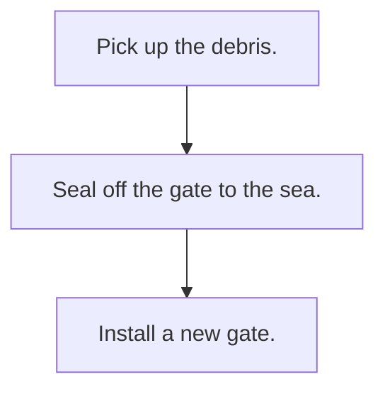

# test.pdf

*Generated from assembled notes*

---

## Main Content

Hotel in Havana where a huge wave embedded a car in its side and caused extensive damage.

*[Knowledge ID: CON_0001 | Sources: S0012]*

The wave must have been immense, because it leaped over the wide two‑way street between the seawall and the hotel and still had enough force to shatter the window.

*[Knowledge ID: EXP_0011 | Sources: S0012]*

> **Example: danger of wave impact on coastal structures**
> 
> A huge wave picked up several cars, embedded one in the side of the Havana Riviera Hotel, and shattered the great entrance window.

*[Knowledge ID: EXM_0014 | Sources: S0012]*

One morning at nine o'clock a huge wave picked up several cars and embedded one of them in the side of the Havana Riviera Hotel.

*[Knowledge ID: FCT_0016 | Sources: S0012]*

The wave leaped over the wide two‑way street between the seawall and the hotel and still had enough force to shatter the entrance window.

*[Knowledge ID: FCT_0017 | Sources: S0012]*

#### Cause and Effect

*[Knowledge ID: REL_0031 | Sources: S0012]*

The new Portuguese ambassador to Cuba; his housekeeper was the woman found dead in the car.

*[Knowledge ID: CON_0002 | Sources: S0013]*

A gold ring shaped like a serpent with emerald eyes worn by the dead housekeeper.

*[Knowledge ID: CON_0008 | Sources: S0013]*

Cuban volunteers and the fire department cleared the debris in less than six hours, sealed off the gate to the sea and installed another gate.

*[Knowledge ID: FCT_0018 | Sources: S0013]*

The woman found in the car was the housekeeper for the new Portuguese ambassador and his wife.

*[Knowledge ID: FCT_0019 | Sources: S0013]*

She wore a gold ring shaped like a serpent with emerald eyes.

*[Knowledge ID: FCT_0020 | Sources: S0013]*

#### Flowchart: cleanup after wave damage

*[Knowledge ID: PRC_0027 | Sources: S0013]*

The gold ring shaped like a serpent had emerald eyes.

*[Knowledge ID: REL_0030 | Sources: S0013]*

They cleared debris, sealed the gate, and installed a new gate within six hours.

*[Knowledge ID: REL_0032 | Sources: S0013]*

Nickname given by Latin American students in Vienna to a Colombian-born dream interpreter who worked for a Viennese family.

*[Knowledge ID: CON_0003 | Sources: S0016, S0020, S0022, S0024, S0027, S0028, S0029]*

One of the activities that made post‑war Vienna a "paradise" according to the narrator.

*[Knowledge ID: CON_0006 | Sources: S0017]*

Another activity prevalent in post‑war Vienna, mentioned alongside black marketeering.

*[Knowledge ID: CON_0007 | Sources: S0017]*

#### Timeline

1. **Event**: Historical event referenced as the period after which Vienna became a hub of black marketeering and espionage.

*[Knowledge ID: CON_0009 | Sources: S0017]*

Vienna after the Second World War was described as a paradise of black marketeering and international espionage.

*[Knowledge ID: FCT_0024 | Sources: S0017]*

The practice of deciphering daily fate through dreams, performed each breakfast by Frau Frieda.

*[Knowledge ID: CON_0004 | Sources: S0022, S0024]*

#### Timeline

1. **Event**: Qualities of dreams that are preserved in their purest form when told before breakfast.

*[Knowledge ID: CON_0005 | Sources: S0022]*

### oracular qualities

Qualities that are preserved in their purest form when dreams are told before breakfast.

*Context: Frau Frieda's family tradition of telling dreams before breakfast.*

*[Knowledge ID: DEF_0010 | Sources: S0022]*

Frau Frieda was the third of eleven children born to a prosperous shopkeeper in old Caldas.

*[Knowledge ID: FCT_0021 | Sources: S0022]*

When she was seven she dreamed that one of her brothers was carried off by a flood.

*[Knowledge ID: FCT_0022 | Sources: S0022]*

#### Hierarchy: Frau Frieda

- Frau Frieda
  - dream interpreter

*[Knowledge ID: REL_0028 | Sources: S0022, S0024]*

What that dream means, she said, isn't that he's going to drown, but that he shouldn't eat sweets.

*[Knowledge ID: EXP_0012 | Sources: S0023]*

She was hired to decipher the family's daily fate through her dreams, deciding at breakfast what each member should do that day and how it should be done.

*[Knowledge ID: EXP_0013 | Sources: S0024]*

Her brother choked on a piece of caramel he was eating in secret and died.

*[Knowledge ID: FCT_0023 | Sources: S0024]*

#### Hierarchy: Frau Frieda

- Frau Frieda
  - family household

*[Knowledge ID: REL_0029 | Sources: S0024]*

The master of the house left a part of his estate to Frau Frieda on the condition that she continue dreaming for the family until her dreams came to an end.

*[Knowledge ID: FCT_0025 | Sources: S0027]*

> **Example: dream interpretation influencing real decisions**
> 
> Frau Frieda told the narrator that she dreamed about him and that he must leave Vienna and not return for five years; he obeyed and never returned.

*[Knowledge ID: EXM_0015 | Sources: S0029, S0030]*

Frau Frieda told the narrator to leave Vienna and not return for five years; he obeyed and never returned.

*[Knowledge ID: FCT_0026 | Sources: S0029, S0030]*

He saw the world as an immense wind-up toy with which life invented itself.

*[Knowledge ID: EXP_0037 | Sources: S0036]*

Pablo Neruda stepped on Spanish soil for the first time since the Civil War on a stopover during a long sea voyage to Valparaiso.

*[Knowledge ID: FCT_0040 | Sources: S0036]*

Neruda bought an old, dried-out volume with a torn binding at Porter, paying an amount equivalent to his two months' salary at the consulate in Rangoon.

*[Knowledge ID: FCT_0041 | Sources: S0036]*

A metaphorical description of a person who is gluttonous, refined, always presides at the table, and displays extravagant eating habits.

*[Knowledge ID: CON_0033 | Sources: S0037]*

> **Example: Renaissance pope concept**
> 
> He ate three whole lobsters, dissecting them with a surgeon's skill, devoured everyone else's plate with his eyes, and tasted clams from Galicia, mussels from Cantabria, prawns from Alicante, sea cucumbers from the Costa Brava.

*[Knowledge ID: EXM_0038 | Sources: S0037]*

Matilde, the wife of the 'Renaissance pope' figure, put a barbershop bib around his neck to keep him from taking a bath in sauce.

*[Knowledge ID: FCT_0046 | Sources: S0037]*

#### Hierarchy: Renaissance pope

- Renaissance pope
  - metaphorical description of a gluttonous and refined person

*[Knowledge ID: REL_0047 | Sources: S0037]*

Frau Frieda wore a snake ring on her index finger.

*[Knowledge ID: FCT_0045 | Sources: S0041]*

Dreams that are believed to predict future events.

*[Knowledge ID: CON_0034 | Sources: S0042]*

He paid no attention to Frau Frieda's dreams because he had announced from the very beginning that he did not believe in prophetic dreams.

*[Knowledge ID: EXP_0036 | Sources: S0042]*

> **Example: prophetic dreams**
> 
> Frau Frieda was encouraged to talk about her dreams to astound the poet, but he paid no attention.

*[Knowledge ID: EXM_0039 | Sources: S0042]*

Frau Frieda traveled from Naples on the same ship as Neruda and his wife, but they had not seen each other on board.

*[Knowledge ID: FCT_0042 | Sources: S0042]*

#### Comparison

| Dimension | Neruda's belief | prophetic dreams |
|---|---|---|
| Property | Subject | Object |

*[Knowledge ID: REL_0049 | Sources: S0042]*

Both were on the same ship traveling from Naples.

*[Knowledge ID: REL_0050 | Sources: S0042]*

A house described as a fake castle on a hill in Oporto, Portugal, with a view across the ocean to the Americas.

*[Knowledge ID: CON_0035 | Sources: S0044]*

Frau Frieda sold her properties in Austria and retired to Oporto, Portugal, living in a house described as a fake castle on a hill with a view across the ocean to the Americas.

*[Knowledge ID: FCT_0043 | Sources: S0044]*

#### Hierarchy: Frau Frieda's dream strategy

- Frau Frieda's dream strategy
  - survival stratagem

*[Knowledge ID: REL_0048 | Sources: S0044]*

Thirteen years had passed since the narrator's first meeting with Frau Frieda.

*[Knowledge ID: FCT_0044 | Sources: S0047]*

---

*Render complete: 50 items from 1 sections*
