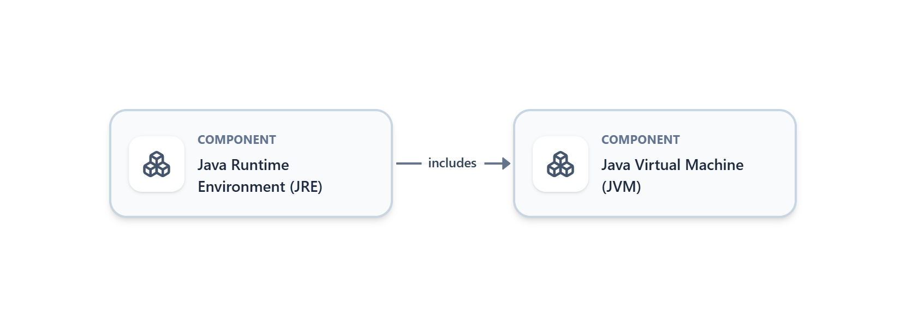
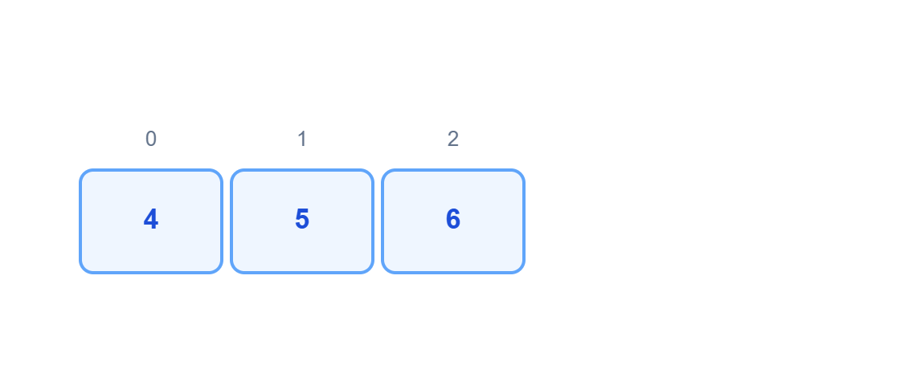
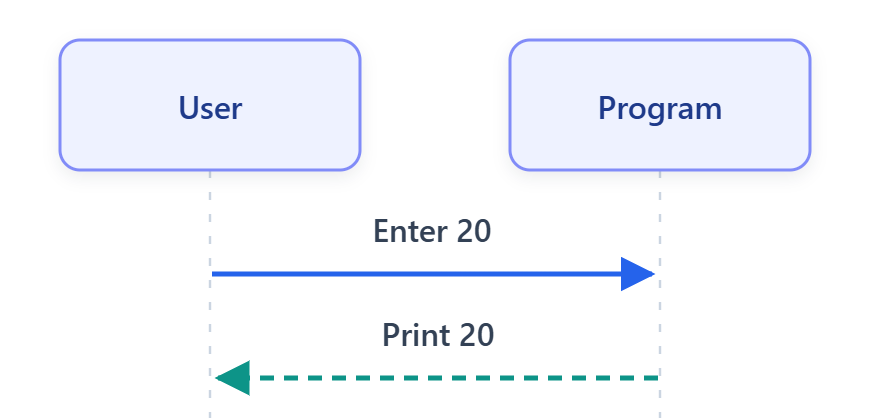
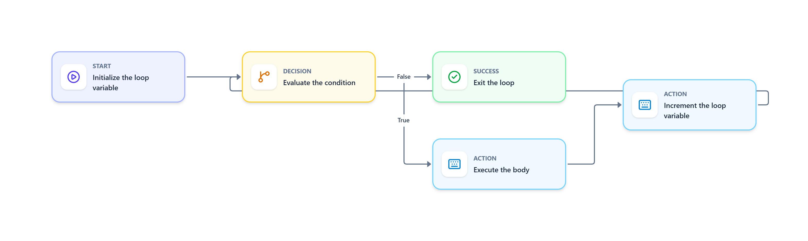

# Java study notes

## Course overview

- The course will teach the basics of Java.
- The course will teach how Java code gets executed.
- The course will teach how to build simple algorithms.
- The course will cover installing all the necessary tools to build Java applications.

## Java setup and tools

- JDK stands for Java Development Kit and is a software development environment for building Java applications.
- The JDK includes a compiler, reusable code libraries, and a Java runtime environment.
- Oracle.com provides the Java SE (Standard Edition) download page for the JDK.
- The JDK can be downloaded for various platforms such as Linux, macOS, and Windows.
- On macOS, the JDK is provided as a .dmg file.
- Installation of the JDK requires accepting the license agreement.
- The JDK installation wizard on macOS guides the user through clicking continue, entering the computer password, and completing the installation.
- Popular code editors for building Java applications are NetBeans, Eclipse, and IntelliJ.
- The instructor’s favorite editor can be used for the course.
- IntelliJ IDEA Community Edition is free and sufficient for the course.
- After downloading, the application should be dragged into the Applications folder.
- The smallest building block in Java programs are functions.
- A function is a block of code that performs a task.
- Each button on a remote control performs a task, analogous to functions in programming.
- Functions in programming languages are analogous to remote control buttons.
- Examples of functions include sending emails, converting weight units, and validating user input.
- The tutorial will demonstrate how to code a function in Java.

## Methods, classes and naming

- The return type of a function is specified first.
- Some functions return a value like a number or a date/time, while other functions do not return anything.
- The return type of functions that do not return a value is void.
- Void is a reserved keyword in Java.
- After the return type, the name of the function appears.
- A function should have a descriptive name, such as send email.
- The function name clearly identifies its purpose.
- After the function name, parentheses contain the parameters for the function.
- Parameters are used to pass values to a function.
- Example parameters for a send email function include the receiver, subject, and content of the email.
- This tutorial will not cover parameters now and will address them later.
- In Java we put the left brace on the same line where we define our function.
- In Java we add a pair of curly braces after the parenthesis and write the actual Java code inside them.
- Every Java program should have at least one function called main, which is the entry point and gets executed when the program runs.
- Functions in Java must belong to a class; they cannot exist on their own.
- A class is a container for one or more related functions (methods) and is used to organize code.
- By analogy, a class is like a supermarket section that contains related products.
- Every Java program should have at least one class that contains the main function.
- The class definition starts with the keyword class, followed by a descriptive name, and a pair of curly braces.
- Functions defined inside a class are called methods.
- A Java program must contain a main class and inside this main class we have the main method.

### Java Naming Conventions

| Item | Description |
| --- | --- |
| class names | Java class names use PascalCase, meaning the first letter of every word is uppercase. |
| method names | Java method names use camelCase, meaning the first letter of the first word is lowercase and the first letter of each subsequent word is uppercase. |

## Projects and packages

- When creating a new Java project in IntelliJ IDEA, you select Java as the language and ensure the project SDK is set (e.g., JDK 12).
- A command‑line Java application is created by selecting the “command line application” template, which produces a program without a graphical user interface.
- The base package for a Java project is conventionally the reverse domain name of the organization.
- A package groups related classes and helps organize code as an application grows.
- The base package name shown in the IDE may be something like com.codewithmosh, but you can use any package name such as com.package.

## Compiling and running Java

- All Java files should have the Java extension.
- In Java, statements should be terminated with a semicolon.
- The main method in a Java program should always be static.
- The return type of the main method is void, meaning it does not return a value.
- The System.out.println method prints a line of text to the terminal.
- A string in Java is a sequence of characters enclosed in double quotes.
- Right‑clicking on a Java source file (e.g., main.java) shows a context‑menu item called “open in terminal”.
- The “open in terminal” command is called “open in terminal” on macOS and “open in command prompt” on Windows.
- Compiling a Java source file produces a `.class` file (e.g., main.class) that contains the bytecode representation of the source.
- When running a Java program from an IDE (e.g., IntelliJ), the generated `.class` files are stored in a separate output folder, not alongside the source files.
- The compiled `.class` file resides in the package directory structure (e.g., `helloWorld/com/codewithmosh/main.class`).
- Java bytecode is platform‑independent; the same `.class` file can run on Windows, macOS, Linux, or any OS with a Java Runtime Environment (JRE).
- The JVM translates Java bytecode to native code for the underlying operating system.

### Java runtime components

- Because the JVM performs this translation at runtime, Java applications are portable across different operating systems.
- To run a Java program you invoke the Java virtual machine (JVM) by typing `java` followed by the full path to the main class file.
- The full path to the main class includes the package name, e.g., `com.codewithmosh.main`, and is case‑sensitive.
- When the `java` command is executed, the JVM searches the folder hierarchy for the specified package and class, loads the bytecode, and converts it to native code for the operating system.
- Running a Java program from an IDE such as IntelliJ hides the compilation and execution steps from the user.

## The Java platform

- Java was developed by James Gosling in 1995 at Sun Microsystems, which was later acquired by Oracle in 2010.
- Java has four main editions: Standard Edition (core platform), Enterprise Edition (large‑scale distributed systems), Micro Edition (mobile devices), and Java Card (smart cards).
- The latest version of Java at the time of the lecture was Java Standard Edition 12, released in March 2019.
- According to indeed.com, the average salary of a Java developer in the US is just over $100,000 per year.

## Variables and primitive types

- Variables are used to temporarily store data in computer's memory.
- In Java, a variable is declared with a type, a name, and an initial value, e.g., int age = 30.
- When declaring a variable, you first specify its type and then give it a name (identifier).
- The equal sign (=) is the assignment operator that assigns a value to a variable.
- Initializing a variable means giving it an initial value.
- Variables must be initialized before they are read.
- Assigning a value stores that value in a memory location associated with the variable's label.
- A variable's value can be changed after initialization by assigning a new value.
- Declaring multiple variables on the same line is technically possible but not recommended because it makes code ugly and hard to read; it is better to declare one variable per line.
- Variable names should follow camel case notation: capitalize the first letter of every word except the first word.
- Whole-number types store numbers without a decimal point.
- Float occupies 4 bytes and double occupies 8 bytes.
- Double can store larger numbers than float.
- Char stores a single character and takes 2 bytes, supporting international letters.
- Boolean stores true/false values.
- An integer occupies 4 bytes and can store values up to about 2 billion.
- A byte occupies 1 byte and can store values up to 127.
- Use meaningful and descriptive variable names.
- In Java you can use underscores to separate groups of three digits in numeric literals.
- Attempting to store a value larger than the integer range (e.g., 3 billion) causes a compile‑time error: "integer number too large".
- Java treats integer literals without a suffix as int, so a numeric literal that exceeds the int range must be suffixed with an L (or l) to be interpreted as long.
- Java treats decimal literals as double by default; assigning a decimal literal to a float variable without a suffix causes a compilation error.
- To represent a float literal, append an f (or F) suffix to the numeric value.
- A char literal must be enclosed in single quotes, while a string literal uses double quotes.
- A boolean variable can hold only the values true or false.
- Java reserved keywords (e.g., public, static, void, class, package) cannot be used as identifiers for variables, classes, or methods.
- Java has eight primitive types (byte, short, int, long, float, double, char, boolean) used for simple values; all other types are reference types.
- Declaring and initializing a primitive variable (e.g., byte h = 30;) differs syntactically from creating an instance of a reference type.

## Objects and references

- Packages create a namespace for classes, allowing the same class name to exist in different packages without conflict.
- To use a class from a different package, you must import it.
- IntelliJ can suggest class names and automatically insert import statements when a class is selected.
- The `new` operator allocates memory for reference type objects; primitive types do not require explicit memory allocation.
- Reference type objects are managed by the Java runtime, which automatically releases memory; programmers do not manually free memory.
- Objects (instances of classes) have members that can be accessed using the dot operator, whereas primitive types have no members.
- Code snippets (live templates) can be triggered by typing shortcuts (e.g., `sout`) and pressing Tab to generate boilerplate code.
- Reference‑type variables store a reference (address) to an object in memory rather than the actual value.
- Assigning a primitive variable copies the actual value into a new memory location; assigning a reference variable copies the address, not the object itself.

## Strings and string methods

- In Java, a string literal is a string value.
- The String class is defined in the java.lang package, which is automatically imported.
- Reference types are copied by reference, whereas primitive types are copied by value.
- When declaring a String variable, you can instantiate it using the new operator.
- Using new String(...) to create a String is redundant because a shorter literal initialization exists.
- A String can be initialized directly with a string literal without using the new operator.
- Strings are reference types in Java.
- String variables can be concatenated using the plus (+) operator.
- Because String is a class, its members can be accessed using the dot (.) operator.
- so we can type message dot, and these are all the methods or functions defined in the string class.
- For example, we have this method here ends with, and with this we can check to see if our string ends with a character or sequence of characters.
- For example, here we can pass your string to see if our message ends with two exclamation marks.
- Now, instead of printing the message, let's print this expression here.
- So, let's run the program, we get true.
- So this method that we have called here returns a boolean value which can be true or false.
- We also have another method starts with, let's take a look, now in this case we get false because our message doesn't start with two exclamation marks.
- Another useful method is length, so we can call that to get the length of a string which is the number of characters, so message dot length, take a look, so in this string we have 13 characters.
- You can check the length of the input provided by the user.
- You can check a username's length and give an error if it exceeds a limit such as 20 characters.
- The indexOf method returns the index of the first occurrence of a character or string passed to it.
- If you pass 'h' to indexOf, it returns 0; if you pass 'e', it returns 1 because those are the positions of the first occurrences in the string.
- The replace method can replace one or more characters with something else.
- For example, you can replace any exclamation marks with the word "store".
- In the replace method, the first and second values are parameters, while the actual values passed (e.g., exclamation mark and asterisk) are arguments.
- Arguments are the actual values that we pass to methods.
- Many programmers do not know the difference between parameters and arguments.
- The replace method does not modify the original string; it returns a new string.
- In Java, strings are immutable; they cannot be mutated.
- The toLowerCase method returns a new string with all characters converted to lower case, leaving the original string unchanged.
- The trim method returns a new string with leading and trailing whitespace removed, without altering the original string.

## Arrays and matrices

- Arrays are used to store a list of items such as numbers, people, or messages.
- To create an array you place square brackets after the type and use the new operator with the type repeated and the size in brackets.
- When creating an array, you must specify the size (number of elements) you want it to hold.
- Variable names should reflect that they hold a collection, e.g., use 'numbers' instead of 'number' for an array.
- When printing an array directly, Java returns a string based on the object's memory address.
- The java.util.Arrays class provides a toString method that can be used to obtain a readable representation of an array.
- If the array type is boolean, all items are initialized to false by default.
- If you have a string array, all items are initialized to an empty string by default.
- The length of a Java array can be obtained via its length field.
- Java arrays have a fixed size; once created, their length cannot be changed.
- Arrays can be sorted using the sort method of the Arrays class.
- Java supports multi‑dimensional arrays; a two‑dimensional array is declared with two pairs of square brackets.
- Accessing an element in a multi‑dimensional array requires providing an index for each dimension.
- Printing a multi‑dimensional array with the default toString method yields a non‑readable string; a deepToString method should be used instead.
- Use this for printing multi-dimensional arrays.
- Now we have this matrix which has two rows, and in each row we have three columns.
- We can also create a three dimensional array, all we have to do is to add another pair of brackets and specify the length of that dimension.
- So, let's back to a two dimensional array, we're going to get rid of the new operator and use curly braces.
- Now, let's say in this matrix we're going to have two rows and three columns.
- So each row is an array itself, because it's a list of items, right?
- add another array here, let's say one, two, three, then comma, now we add the second row, which is another array.

### Second row of the matrix

- Now let's remove this line, we don't need it anymore, and print this array, so, here's the end result.
- You have learned a lot about variables, you have learned that when declaring them, we need to initialize them, and we can always change their value later on throughout the lifetime of our programs.
- However, there are times that we don't want the value of a variable to change.
- For example, let's declare a variable called pi, and set it to 3.14.

## Constants and arithmetic

- Adding an 'f' suffix makes a numeric literal a float because the Java compiler treats decimal numbers as double by default.
- Pi is used to calculate the area of a circle.
- Constants are used to prevent values like pi from being changed unintentionally.
- Attempting to assign a new value to a final variable (e.g., final pi) results in a compilation error.
- By convention, constants are named using all capital letters.
- Java provides the same arithmetic operators as mathematics: addition, subtraction, multiplication, division, and modulus (remainder).
- Example: declaring an integer result and assigning 10 + 3 stores the value 13 in result.
- In Java, the division of two whole numbers yields a whole number.
- Assigning the result of a double expression to an int variable causes a compilation error.
- An expression is a piece of code that produces a value.
- Changing the variable type to double fixes the compilation error and yields a floating‑point result.
- Java supports addition, subtraction, multiplication, and division as arithmetic operators.
- Arithmetic operators work on numbers called operands.

### Prefix and postfix increment

| Form | Order of operations |
| --- | --- |
| postfix (x++) | Use the original value of x in the expression, then increment x. |
| prefix (++x) | Increment x first, then use the new value in the expression. |

- The compound assignment operator (+=) adds a value to a variable and assigns the result to that variable.
- Compound assignment operators exist for subtraction (-=), multiplication (*=), and division (/=) as well.
- Multiplication and division have higher precedence than addition and subtraction.
- In the expression 10 + 3 * 2, the multiplication is evaluated first (3 * 2 = 6) and then added to 10, yielding 16.

## Casting and parsing

- Parentheses always have the highest priority, then multiplication and division, and finally addition and subtraction.
- In this tutorial we're going to talk about casting and type conversion.
- A short variable called x is declared and set to 1.
- An integer variable called y is declared and set to x plus 2.
- In this example, a short is added to an integer.
- Printing y yields 3.
- Because the expression involves a short and an integer, one of the values is converted to the other type so they are compatible.
- A short variable occupies two bytes.
- An int variable occupies four bytes.
- Values that fit in a short can also be stored in an int.
- When a short is used in an expression with an int, Java implicitly casts the short to an int.
- Byte can be automatically converted to short, short to int, int to long, and so on up the numeric hierarchy.
- Implicit casting occurs automatically when converting a value to a larger numeric type without loss of data.
- Changing the variable type to double resolves the compilation error.
- When an int is added to a double, the int is implicitly cast to double before the addition.
- Explicit casting is required when converting from a larger numeric type to a smaller one (e.g., double to int).
- Explicit casting can only be performed between compatible primitive numeric types.
- String values cannot be directly cast to numeric types; they must be parsed using wrapper class methods such as Integer.parseInt.
- parse short takes a string and returns a short.
- Java provides parse methods for float and double, with distinct method names.
- parse float is a method for converting a string to a float.
- To convert a string x to an integer, use Integer.parseInt(x).
- Parsing a non‑integer string with Integer.parseInt throws an exception.
- When the user enters a floating‑point value like 1.1, use Double.parseDouble (or Float.parseFloat) instead of Integer.parseInt.
- Java provides a Math class in java.lang that is always available without import.
- The Math.round method rounds a floating‑point number to the nearest whole number.

## Formatting numbers

- Casting the result of Math.random() * 100 to int without parentheses causes the fractional part to be lost, resulting in zero.
- Wrapping the entire expression (Math.random() * 100) in parentheses before casting yields an integer between 0 and 100.
- NumberFormat can format numbers as currency, adding a dollar sign and commas for thousands.
- NumberFormat is an abstract class in java.text and cannot be instantiated directly with the new operator.
- To obtain a NumberFormat instance, use the static factory method getCurrencyInstance(), which returns a NumberFormat object.

## Reading input

- In java we have this scanner class that is defined in java.util package.
- Let's import this and create a scanner object, so new scanner.
- Now here inside this parenthesis, we need to specify where we're going to read data from.
- Are we going to read it from the terminal window?
- Are we going to read it from a file or what?
- To work with the terminal window, we type system.in.
- This is one of the fields in the system class.
- A field, as I told you before, is like a variable that we in the class.
- So we have system.in, we also have system.out, which we use to print something on the terminal, right?
- Now let's use system.in and terminate this statement with a semicolon.
- Now this object has a bunch of methods for reading data, and all these methods start with next.
- There are methods nextByte, nextLine, nextBoolean for reading a byte, a line, and a boolean respectively.
- Calling the nextByte method returns a byte value that can be stored in a byte variable.
- Concatenating a string with a byte causes implicit casting of the byte to a string.
- The println method adds a new line after the printed label.
- To avoid the extra new line, use the print method instead of println.

### Entering a value and seeing it printed

- The next method returns a string, which can cause a compilation issue if a different type is expected.
- Each call to the next method reads one token; tokens are separated by whitespace.
- To obtain a full name containing a space you must call next twice (once for each token) or use the nextLine method.
- The nextLine method returns the entire line entered by the user, regardless of spaces or tabs.
- The trim method removes leading and trailing whitespace from a string.

## Mortgage calculator walkthrough

- The next line method returns a string that we are storing in this variable.
- Before storing the result in this variable, we can use the dot operator to access the members of this string object, call the trim method, and then store the result in this variable.
- We are chaining multiple methods here.
- Running the program produces output.
- The output includes a few spaces, the word 'mosh', and 'howdy', resulting in a beautiful output.
- The instructor announces that it is time for a project.
- Students are asked to use what they have learned in this section to build a mortgage calculator.
- When the program runs, it asks a few questions.
- The first question asks for the principal, or the amount of loan.
- Example principal value: $100,000.
- The second question asks for the annual interest rate.
- Example interest rate: 3.92%.
- The third question asks for the period in years.
- Example period: 30 years.
- The program calculates monthly payments and displays them as currency.
- We need to multiply this number by 12 (months in a year) to calculate the number of payments.
- To raise a number to the power of n, use the pow method of the Math class.
- The Math class pow (or power) method takes two arguments, a and b.
- Two final variables (constants) are declared: monthsInYear set to 12 and percent set to 100.
- Declaring these constants avoids magic numbers in the code.
- Monthly interest is calculated by taking the annual interest, dividing it by percent, and then dividing by months in a year.
- The number 12 represents the number of months in a year.
- Use int for the principal amount because it can store values up to about 2 billion.
- Read the annual interest rate as a float; float is sufficient because the interest rate is a small number.
- Read the period (years) as a byte because the maximum number of years to support is 30.
- Use meaningful variable names; avoid magic names like "MI" for monthly interest.
- Use camel case notation: capitalize the first letter of each word except the first.
- Mortgage calculation: multiply the principal by one expression and divide by another expression.
- After collecting all input data, compute the mortgage using the formula.
- The NumberFormat class is used to format the mortgage value as a currency.
- The result is stored in the string variable mortgageFormatted and printed.
- A variable can be avoided by inserting the expression directly to increase readability, though this is optional.
- The implementation presented is a mortgage calculator.
- The program has a number of problems.
- The first problem is input validation.
- If a non‑numeric value is entered, the program crashes.
- Conditional statements can be used to rescue the program from these input issues.
- The next section will teach how to use conditional statements to validate user input.

## Control flow and comparisons

- Variables and constants include primitive and reference types; primitive types store simple values while reference types hold references to complex objects.
- There are two types of casting: implicit casting and explicit casting.
- You can work with numbers, strings, and arrays, and read input from the terminal.
- Control flow statements are used to control the flow of execution of programs.
- Comparison operators are used for comparing values.
- Logical operators such as logical AND, logical OR, and logical NOT are used for implementing real‑world rules.
- There are three different types of control‑flow statements.
- Conditional statements are used for making decisions in programs; loops are used for executing code repetitively; error handling can be revisited in a mortgage‑calculator example.
- If the user enters an invalid value, the program can keep asking them to try again.
- The section begins with a discussion of comparison operators.
- Comparison operators are used to compare primitive values.
- Equality can be tested by checking whether two variables, such as x and y, are equal.
- Two integer variables, x and y, can be declared.
- The equality operator (==) compares two values and returns true when they are equal.
- A boolean expression is an expression that evaluates to a true or false value.
- An expression is a piece of code that produces a value.
- A boolean expression produces a boolean value, true or false.
- The inequality operator ( != ) returns false when the two operands are equal.
- The expression x is not equal to y returns false when x and y have the same value.
- Java provides the comparison operators: greater than (&gt;), greater than or equal to (&gt;=), less than (&lt;), and less than or equal to (&lt;=).
- Logical operators can be used to combine multiple boolean expressions.
- In a previous tutorial it was stated that a boolean expression produces a boolean value.
- An integer variable named temperature is declared and initialized to 22.
- A boolean variable can be declared to check if temperature is greater than 20 and less than 30.
- The &amp;&amp; operator represents the logical AND operator in Java.
- If both conditions are true, the result of the boolean expression is true; otherwise it is false.
- Java evaluates a boolean expression from left to right and uses short‑circuit evaluation: if the first condition is false, the second condition is not evaluated.

## short-circuit evaluation

- Java will not evaluate the rest of this expression, it simply returns true.

## Conditional statements

- If the condition in an if statement is true, the statement that follows the if will be executed.
- Curly braces define a code block; code inside the braces is executed when the surrounding condition is true.
- Braces are required only when a block contains multiple statements; a single statement can omit braces.
- A boolean expression such as "temp &gt; 20 &amp;&amp; temp &lt;= 30" can be used in an else if clause to test a range of values.
- An if‑else‑if chain can have three clauses: the initial if, one or more else if, and an optional else.
- When removing unnecessary braces, align else if and else clauses at the same indentation level as the if clause for better readability.
- If the first condition of an if‑else chain is false, the program proceeds to evaluate the next else if condition.
- Underscores can be used between digits in numeric literals to make code more readable.
- A boolean variable called hasHighIncome can be declared.
- If income is greater than $100,000, set hasHighIncome to true; otherwise set it to false.
- An if statement can be written to test a condition and assign a boolean variable.
- A boolean variable can be given an initial value (e.g., false) before the if statement.
- The if statement can be simplified by directly assigning the boolean expression result to the variable.
- Wrapping the boolean expression in parentheses improves readability, though not required.
- you learned there cannot be used here.
- In other words, we cannot add income greater than $100,000 here.
- Because here we have a boolean expression, but on the left side we have declared a string variable.
- So we want to set this to a different string depending on the result of this expression.
- And this is where we use the ternary operator.
- So we start with our condition, then we type a question mark, if this condition is true, we add this value here.
- Otherwise, we add the other value.
- So this question mark and colon is the ternary operator in java, it has three pieces, first we have a condition, if this condition is true, this value will be returned and assigned to our class name variable, otherwise this other value will be returned.
- Now we can completely get rid of this if statement.
- So, put the ternary operator in your toolbox, it's very helpful.
- Next we're going to look at switch statements in java.
- In this tutorial, we're going to look at switch statements in java.

## Switch statements and FizzBuzz

- Switch statements execute different parts of code depending on the value of an expression, kind of similar to if statements.
- An if statement can be used to check the role of the current user and print different messages or give different features depending on the role.
- A switch statement can be used to implement the same role‑checking logic and can look cleaner than an if‑else chain.
- A default clause in a switch statement executes when none of the previous case clauses match.
- A break statement is not required after the last case in a switch block because execution automatically exits the block.
- Switch statements can compare strings or integers; when using integers, case labels are numeric literals.
- A compilation error occurs if the switch variable type does not match the type of the case labels (e.g., using a string variable with integer case labels).
- 10 is also divisible by 5, so we get fizz.
- A number that is divisible by 3 results in buzz.
- Other else clauses are ignored when a previous condition is true.
- Place the most specific conditions at the top and the most generic ones at the bottom.
- If the number is divisible by 5 and 3, print fizzbuzz; this is a very specific condition.
- Otherwise, if the number is only divisible by 5, print fizz; else if divisible by 3, print buzz; otherwise print the number itself.

## Loops and iteration

- Using loops reduces code nesting and improves readability compared to repeated if‑else statements.
- Loops allow repeating statements without duplicating code.
- A for loop in Java consists of three parts: an initialization statement, a boolean condition, and an increment statement.
- A for loop repeats one or more statements a specified number of times.
- If the loop body contains a single statement, braces are optional; multiple statements require a code block.
- When the for loop runs with i initialized to 0 and condition i &lt; 5, the loop body executes five times, printing "hello world" each iteration.

### For loop execution

- A while loop can be written by declaring a loop variable, setting a condition in parentheses, and placing the loop body inside braces; the variable can be decremented each iteration to count down.
- A while loop can be used when the number of iterations is not known in advance, such as reading user input until "quit" is entered.
- One way to solve this problem is to check the input before printing it.
- If the input does not equal quit, then we print it.
- Condition: input does not equal quit.
- If this condition is true, then we print the input.
- We can reverse this condition: if the user types quit, break out of the loop.
- Remove the not operator: if the user types quit, we break.
- Otherwise, continue execution and print this input on the terminal.
- When Java sees the break statement it will ignore everything else after and terminate the loop.
- The continue statement moves control to the beginning of a loop.
- If the user types pass, we don't want to echo that, but also we don't want to terminate the loop.
- the brick statement terminates a loop, and the continuous statement moves control to the beginning of a loop.
- using true as the loop condition simplifies the code.
- a loop with condition true executes forever until the user types quit.
- if you use while true, make sure you have a break statement in your loop.
- So we get each item on a new line.
- Beautiful.
- Now, there is another way to write the same code using the for each loop.
- Here we type for, in parentheses we declare a loop variable, but the type of this variable should be based on the type of items in our array.
- So here we have a string array and that means every item in this array is a string.
- So here we should declare a string variable, we call it fruit here we type a colon and then the name of our array fruits.
- Now in each iteration, fruit will hold the value of one item in this array.
- So here we don't have to declare a numeric counter, we don't have to write a boolean expression like this, we don't have to increment our counter, it's much easier to iterate over an array.
- Now, if we print fruit, we get the exact same result as before.
- Take a look.
- So, the first three items are from our for loop and here's the result of our for each loop.
