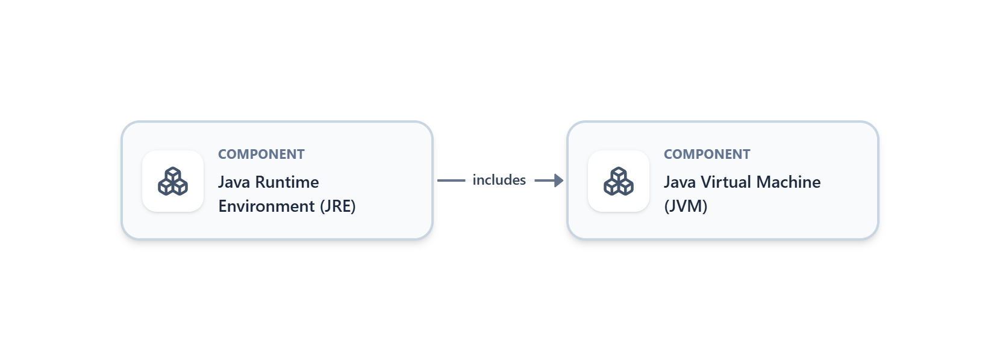
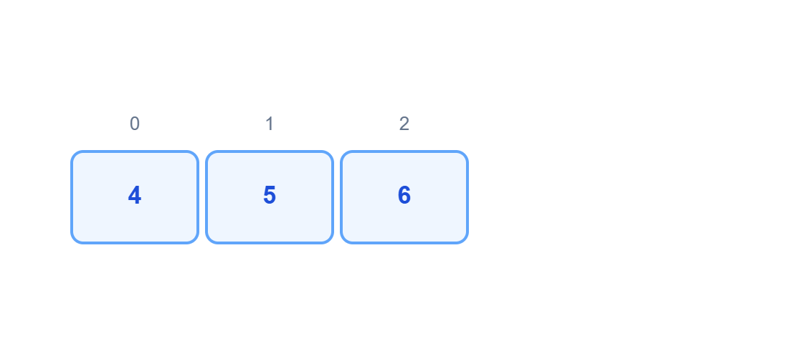
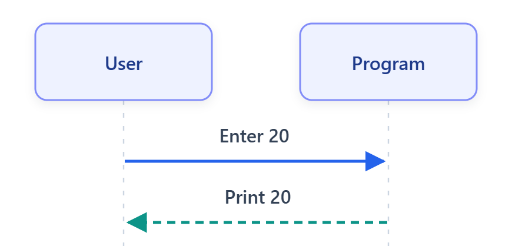
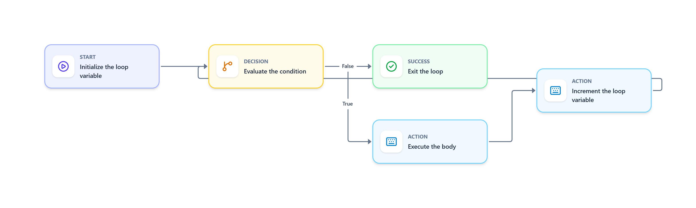

# Java study notes

## Course overview

## Java Fundamentals Course Overview

The course introduces the **basics of Java** and guides you through the entire development workflow.

### What You’ll Learn
1. **Fundamental concepts** of the Java language.
2. How **Java code is executed** by the JVM.
3. Techniques for building **simple algorithms** in Java.
4. Steps to **install all necessary tools** for creating Java applications.

By the end of the course, you will be able to write, run, and debug basic Java programs and understand the underlying execution process.

## Java setup and tools

# Java Development Kit (JDK)

**JDK** stands for *Java Development Kit* and provides a complete software development environment for building Java applications. It includes:
- A **compiler** to translate source code into bytecode.
- Reusable **code libraries** (the Java API).
- A **Java Runtime Environment (JRE)** for executing compiled programs.

## Downloading the JDK
- Oracle’s official download page is the **Java SE (Standard Edition) download** site on *oracle.com*.
- The JDK is available for **Linux, macOS, and Windows**.
- On **macOS**, the distribution is a `.dmg` file.
- Installation requires **accepting the license agreement**.
- The macOS installer guides you through:
  1. Clicking **Continue**.
  2. Entering the computer password when prompted.
  3. Completing the installation.

# Choosing an IDE
Popular editors for Java development include **NetBeans**, **Eclipse**, and **IntelliJ IDEA**.  
- The instructor’s preferred editor can be used for the course.
- **IntelliJ IDEA Community Edition** is free and fully sufficient.
- After downloading IntelliJ, **drag the application into the `Applications` folder** on macOS.

# Functions in Java
- The smallest building block in Java programs is a **function** (also called a *method*).
- A function is a block of code that performs a specific task.
- Analogy: each button on a remote control triggers a distinct action, just as a function executes a defined operation.
- Common examples of functions:
  - Sending an email.
  - Converting weight units.
  - Validating user input.

The tutorial will demonstrate **how to code a function in Java** using these concepts.

## Methods, classes and naming

# Function and Class Basics in Java

## 1. Function (Method) Declaration

1. **Return Type** – The first element in a method signature specifies what the method returns.
   - If the method returns a value (e.g., a number, a `Date`, etc.), the appropriate type is used.
   - If the method does **not** return a value, the return type is `void` (a reserved keyword in Java).
2. **Method Name** – Follows the return type and should be **descriptive** (e.g., `sendEmail`).
   - The name clearly conveys the method’s purpose.
3. **Parameter List** – Enclosed in parentheses `()` and contains zero or more parameters that supply input values to the method.
   - Example parameters for `sendEmail` might be `receiver`, `subject`, and `content`.
   - *Note: Parameter details are covered later in the tutorial.*
4. **Method Body** – In Java, the opening brace `{` is placed on the same line as the method declaration, followed by a closing brace `}` after the code block.
   - The body contains the executable Java statements.

## 2. The `main` Method

- Every Java program must have at least one method named **`main`**.
- `main` serves as the **entry point**; it is executed automatically when the program runs.
- Its typical signature is:
  ```java
  public static void main(String[] args) {
      // program code
  }
  ```

## 3. Classes and Methods

- In Java, **functions cannot exist independently**; they must be defined inside a **class**.
- A **class** is a container that groups related methods (and data) together, helping to organize code.
  - Analogy: a class is like a **supermarket section** that holds related products.
- Class definition syntax:
  ```java
  class ClassName {
      // methods (including main) go here
  }
  ```
- The methods defined within a class are called **methods** (or member functions).
- A complete Java program therefore includes:
  1. **At least one class** that encloses the `main` method.
  2. The **`main` method** inside that class, which launches the program.

---

*All the above points preserve the original order and details while improving clarity and readability.*

### Java Naming Conventions

| Item | Description |
| --- | --- |
| class names | Java class names use PascalCase, meaning the first letter of every word is uppercase. |
| method names | Java method names use camelCase, meaning the first letter of the first word is lowercase and the first letter of each subsequent word is uppercase. |

## Projects and packages

## Creating a New Java Project in IntelliJ IDEA

1. **Select the language** – Choose **Java** when starting a new project.
2. **Set the project SDK** – Ensure the SDK points to the desired JDK version (e.g., `JDK 12`).

### Command‑Line Application Template
- Choose the **"command line application"** template to generate a simple Java program that runs in the console, **without a graphical user interface**.

## Package Structure

- **Base package convention**: Use the reverse domain name of your organization (e.g., `com.example`).
- **Purpose of packages**: A package groups related classes, making the codebase easier to navigate and maintain as the application grows.
- **IDE display**: IntelliJ may suggest a base package such as `com.codewithmosh`; you can replace it with any valid package name, for example `com.package`.

## Compiling and running Java

# Java Basics and Compilation

## File Conventions
- All Java source files must use the **`.java`** extension.
- Statements in Java end with a **semicolon (`;`)**.

## The `main` Method
- The entry point of a Java program is the `main` method, which must be declared as:
  ```java
  public static void main(String[] args)
  ```
- It is **static** and has a return type of **`void`**, meaning it does not return a value.

## Output
- Use `System.out.println` to print a line of text to the terminal.
- A **String** is a sequence of characters enclosed in double quotes, e.g., `"Hello, World!"`.

## Working with Source Files
- Right‑clicking a Java source file (e.g., `main.java`) shows a context‑menu item:
  - **macOS:** *Open in Terminal*
  - **Windows:** *Open in Command Prompt*

## Compilation and Bytecode
1. **Compile** a `.java` file with `javac`. This produces a `.class` file containing **bytecode** (e.g., `main.class`).
2. In an IDE like **IntelliJ**, compiled `.class` files are placed in a separate output directory, not alongside the source files.
3. The `.class` file follows the package directory structure, e.g., `helloWorld/com/codewithmosh/main.class`.

## Execution
- Java bytecode is **platform‑independent**; the same `.class` file runs on Windows, macOS, Linux, or any OS with a **Java Runtime Environment (JRE)**.
- The **JVM** translates bytecode to native code for the underlying operating system at runtime.

### Java runtime components



## Running Java Programs

- **Portability**: Because the JVM performs translation at runtime, Java applications can run on any operating system without modification.

- **Command‑line execution**:
  1. Open a terminal.
  2. Invoke the Java Virtual Machine using the `java` command followed by the **fully‑qualified class name**.
     ```bash
     java com.codewithmosh.main
     ```
  3. The class name includes the package hierarchy and is **case‑sensitive**.
  4. The JVM searches the directory structure for the specified package, loads the corresponding bytecode, and translates it to native code for the host OS.

- **IDE execution**: When you run a program from an IDE such as **IntelliJ IDEA**, the IDE abstracts away the compilation and execution steps, handling them automatically behind the scenes.

## The Java platform

# Java Overview

**Java** was created by **James Gosling** in **1995** while working at **Sun Microsystems** (acquired by **Oracle** in 2010).

## Editions

Java is distributed in four primary editions:

1. **Standard Edition (SE)** – the core platform for general‑purpose programming.
2. **Enterprise Edition (EE)** – designed for large‑scale, distributed systems.
3. **Micro Edition (ME)** – targeted at mobile and embedded devices.
4. **Java Card** – used for smart‑card applications.

## Current Release (as of the lecture)

- The latest version mentioned was **Java Standard Edition 12**, released in **March 2019**.

## Career Outlook

- According to *indeed.com*, the average salary for a **Java developer** in the United States is **just over $100,000 per year**.

## Variables and primitive types

- Variables are used to temporarily store data in computer's memory.
- In Java, a variable is declared with a type, a name, and an initial value, e.g., int age = 30.
- When declaring a variable, you first specify its type and then give it a name (identifier).
- The equal sign (=) is the assignment operator that assigns a value to a variable.
- Initializing a variable means giving it an initial value.
- Variables must be initialized before they are read.
- Assigning a value stores that value in a memory location associated with the variable's label.
- A variable's value can be changed after initialization by assigning a new value.
- Declaring multiple variables on the same line is technically possible but not recommended because it makes code ugly and hard to read; it is better to declare one variable per line.
- Variable names should follow camel case notation: capitalize the first letter of every word except the first word.
- Whole-number types store numbers without a decimal point.
- Float occupies 4 bytes and double occupies 8 bytes.
- Double can store larger numbers than float.
- Char stores a single character and takes 2 bytes, supporting international letters.
- Boolean stores true/false values.
- An integer occupies 4 bytes and can store values up to about 2 billion.
- A byte occupies 1 byte and can store values up to 127.
- Use meaningful and descriptive variable names.
- In Java you can use underscores to separate groups of three digits in numeric literals.
- Attempting to store a value larger than the integer range (e.g., 3 billion) causes a compile‑time error: "integer number too large".
- Java treats integer literals without a suffix as int, so a numeric literal that exceeds the int range must be suffixed with an L (or l) to be interpreted as long.
- Java treats decimal literals as double by default; assigning a decimal literal to a float variable without a suffix causes a compilation error.
- To represent a float literal, append an f (or F) suffix to the numeric value.
- A char literal must be enclosed in single quotes, while a string literal uses double quotes.
- A boolean variable can hold only the values true or false.
- Java reserved keywords (e.g., public, static, void, class, package) cannot be used as identifiers for variables, classes, or methods.
- Java has eight primitive types (byte, short, int, long, float, double, char, boolean) used for simple values; all other types are reference types.
- Declaring and initializing a primitive variable (e.g., byte h = 30;) differs syntactically from creating an instance of a reference type.

## Objects and references

## Packages and Imports

- **Packages** create a *namespace* for classes, allowing the same class name to exist in different packages without conflict.
- To use a class from another package, you must **import** it.
- **IntelliJ IDEA** can suggest class names and automatically insert import statements when a class is selected.

## Object Creation and Memory Management

- The `new` operator allocates memory for **reference‑type objects**; primitive types do not require explicit memory allocation.
- **Reference‑type objects** are managed by the Java runtime, which automatically releases memory—programmers do not manually free memory.
- Objects (instances of classes) have members that can be accessed using the **dot operator** (`.`), whereas primitive types have no members.

## Variables and Assignment

1. **Reference‑type variables** store a *reference* (address) to an object in memory rather than the actual value.
2. Assigning a **primitive variable** copies the actual value into a new memory location.
3. Assigning a **reference variable** copies the address, not the object itself.

## Code Generation with Live Templates

- **Live templates** (code snippets) can be triggered by typing shortcuts (e.g., `sout`) and pressing **Tab** to generate boilerplate code such as `System.out.println();`.

## Strings and string methods

- In Java, a string literal is a string value.
- The String class is defined in the java.lang package, which is automatically imported.
- Reference types are copied by reference, whereas primitive types are copied by value.
- When declaring a String variable, you can instantiate it using the new operator.
- Using new String(...) to create a String is redundant because a shorter literal initialization exists.
- A String can be initialized directly with a string literal without using the new operator.
- Strings are reference types in Java.
- String variables can be concatenated using the plus (+) operator.
- Because String is a class, its members can be accessed using the dot (.) operator.
- so we can type message dot, and these are all the methods or functions defined in the string class.
- For example, we have this method here ends with, and with this we can check to see if our string ends with a character or sequence of characters.
- For example, here we can pass your string to see if our message ends with two exclamation marks.
- Now, instead of printing the message, let's print this expression here.
- So, let's run the program, we get true.
- So this method that we have called here returns a boolean value which can be true or false.
- We also have another method starts with, let's take a look, now in this case we get false because our message doesn't start with two exclamation marks.
- Another useful method is length, so we can call that to get the length of a string which is the number of characters, so message dot length, take a look, so in this string we have 13 characters.
- You can check the length of the input provided by the user.
- You can check a username's length and give an error if it exceeds a limit such as 20 characters.
- The indexOf method returns the index of the first occurrence of a character or string passed to it.
- If you pass 'h' to indexOf, it returns 0; if you pass 'e', it returns 1 because those are the positions of the first occurrences in the string.
- The replace method can replace one or more characters with something else.
- For example, you can replace any exclamation marks with the word "store".
- In the replace method, the first and second values are parameters, while the actual values passed (e.g., exclamation mark and asterisk) are arguments.
- Arguments are the actual values that we pass to methods.
- Many programmers do not know the difference between parameters and arguments.
- The replace method does not modify the original string; it returns a new string.
- In Java, strings are immutable; they cannot be mutated.
- The toLowerCase method returns a new string with all characters converted to lower case, leaving the original string unchanged.
- The trim method returns a new string with leading and trailing whitespace removed, without altering the original string.

## Arrays and matrices

# Arrays in Java

## What Is an Array?
- An **array** stores a list of items—such as numbers, people, or messages—in a single variable.
- The variable name should reflect that it holds a collection, e.g., `numbers` instead of `number`.

## Declaring and Creating Arrays
1. **Syntax**: `type[] name = new type[size];`
   - Place square brackets after the type.
   - Use the `new` operator, repeat the type, and specify the **size** (number of elements) in brackets.
2. The size must be provided at creation time; Java arrays have a **fixed length** that cannot be changed later.

## Default Initialization
- `boolean[]` → all elements default to `false`.
- `String[]` → all elements default to an empty string (`""`).
- Other primitive types default to `0` (or `0.0` for floating‑point).

## Accessing Length
- Retrieve an array’s length with the **`length` field**: `array.length`.

## Printing Arrays
- Printing an array directly yields a string like `[I@1a2b3c4d` (the object's memory address).
- Use `java.util.Arrays.toString(array)` for a readable one‑dimensional representation.
- For multi‑dimensional arrays, use `Arrays.deepToString(matrix)` to obtain a human‑readable format.

## Sorting
- Call `Arrays.sort(array)` to sort the elements in ascending order.

## Multi‑Dimensional Arrays
### Declaration
- Two‑dimensional: `type[][] matrix = new type[rows][cols];`
- Three‑dimensional: add another pair of brackets, e.g., `type[][][] cube = new type[x][y][z];`

### Access
- Provide an index for **each dimension**: `matrix[row][col]`.

### Initialization with Curly Braces
```java
int[][] matrix = {
    {1, 2, 3}, // first row (3 columns)
    {4, 5, 6}  // second row (3 columns)
};
```
- Each row is itself an array, so you list the rows separated by commas.

## Example: Two‑Row, Three‑Column Matrix
```java
int[][] matrix = {
    {1, 2, 3}, // row 0
    {4, 5, 6}  // row 1
};
System.out.println(Arrays.deepToString(matrix)); // prints [[1, 2, 3], [4, 5, 6]]
```

---
*All concepts above retain the original details while improving clarity and structure.*

### Second row of the matrix



## Variable Declaration and Initialization

- When you **declare** a variable, you must also **initialize** it with a value. This initial value can be changed later during the program's execution.

## Immutable Values

- Sometimes you need a value that **must not change** after it is set. In such cases, you should use a constant (or an immutable variable) instead of a regular variable.

## Example: Defining π

```javascript
const pi = 3.14; // π is a constant and cannot be reassigned
```

- Here, `pi` is declared as a constant with the value `3.14`. Attempting to modify `pi` later in the program will result in an error.

## Summary

- Declare and initialize variables.
- Use constants for values that should remain unchanged, such as mathematical constants like `π`.

## Constants and arithmetic

# Java Numeric Types and Arithmetic

## Numeric Literals
- Adding an **`f` suffix** makes a numeric literal a **float** because the Java compiler treats decimal numbers as **double** by default.

## Constants
- **Constants** prevent values like **`PI`** from being changed unintentionally.
- Declaring a constant with `final` (e.g., `final double PI = 3.14159;`) makes any later assignment a **compilation error**.
- By convention, constants are named using **all capital letters**.

## Arithmetic Operators
- Java provides the same arithmetic operators as mathematics:
  - `+` **addition**
  - `-` **subtraction**
  - `*` **multiplication**
  - `/` **division**
  - `%` **modulus** (remainder)
- These operators work on numbers called **operands**.

## Expressions and Types
- An **expression** is a piece of code that produces a value.
- Example:
  ```java
  int result = 10 + 3; // result is 13
  ```
- In Java, dividing two whole numbers yields a **whole number** (integer division).
- Assigning the result of a **double** expression to an `int` variable causes a **compilation error**.
- Changing the variable type to `double` fixes the error and yields a **floating‑point** result.

## Practical Use of Constants
- `PI` is commonly used to calculate the **area of a circle**:
  ```java
  final double PI = 3.14159;
  double radius = 5.0;
  double area = PI * radius * radius;
  ```

### Prefix and postfix increment

| Form | Order of operations |
| --- | --- |
| postfix (x++) | Use the original value of x in the expression, then increment x. |
| prefix (++x) | Increment x first, then use the new value in the expression. |

## Compound Assignment Operators

- **`+=`** adds a value to a variable and assigns the result back to that variable.
- Similar operators exist for other arithmetic operations:
  - **`-=`** (subtraction)
  - **`*=`** (multiplication)
  - **`/=`** (division)

## Operator Precedence

- Multiplication (`*`) and division (`/`) have higher precedence than addition (`+`) and subtraction (`-`).
- Example:
  1. Evaluate the multiplication first: `3 * 2 = 6`.
  2. Then perform the addition: `10 + 6 = 16`.
  
Thus, the expression `10 + 3 * 2` yields **16**.

## Casting and parsing

# Operator Precedence

- **Parentheses** have the highest priority.
- Next come **multiplication** and **division**.
- Finally, **addition** and **subtraction** are evaluated.

---

# Casting and Type Conversion in Java

## Variable Declarations

```java
short x = 1;          // a short variable called x is declared and set to 1
int   y = x + 2;      // an int variable called y is declared and set to x plus 2
```

- In this example a **short** is added to an **int**.
- Printing `y` yields `3`.

## Implicit (Automatic) Casting

- When an expression mixes a `short` and an `int`, Java **implicitly casts** the `short` to an `int` so the types are compatible.
- Size hierarchy:
  - `byte` → `short` → `int` → `long` → `float` → `double`
- Implicit casting occurs automatically when converting to a **larger numeric type** without loss of data.
- Example:
  ```java
  int i = 5;
  double d = i;   // i is implicitly cast to double before the addition
  ```

## Explicit Casting

- Required when converting from a **larger** numeric type to a **smaller** one (e.g., `double` → `int`).
- Syntax:
  ```java
  int i = (int) d;   // explicit cast
  ```
- Can only be performed between **compatible primitive numeric types**.
- Changing a variable’s type to `double` can resolve compilation errors caused by mismatched types.

## Converting Strings to Numbers

- **String** values cannot be directly cast to numeric types.
- Use wrapper‑class parsing methods:
  - `Integer.parseInt(String)` → `int`
  - `Short.parseShort(String)` → `short`
  - `Float.parseFloat(String)` → `float`
  - `Double.parseDouble(String)` → `double`
- Parsing a non‑integer string with `Integer.parseInt` throws a `NumberFormatException`.
- For floating‑point input like `"1.1"`, use `Double.parseDouble` (or `Float.parseFloat`).

## Primitive Sizes

- `short` occupies **2 bytes**.
- `int` occupies **4 bytes**.
- Values that fit in a `short` can also be stored in an `int`.

---

# The `Math` Class

- Provided by `java.lang` and available without an explicit import.
- Common method:
  - `Math.round(double a)` – rounds a floating‑point number to the nearest whole number.

## Formatting numbers

## Casting and Number Formatting in Java

### 1. Casting `Math.random()`
- **Issue**: Casting the result of `Math.random() * 100` directly to `int` **without parentheses** drops the fractional part *before* the multiplication, which always yields `0`.
- **Correct Approach**: Enclose the entire expression in parentheses before casting:
  ```java
  int value = (int) (Math.random() * 100);
  ```
  This produces an integer in the range **0‑99** (inclusive). If you need the upper bound inclusive, add `1` after the cast.

### 2. Formatting Numbers as Currency
- **Purpose**: `NumberFormat` formats numeric values for display, e.g., adding a dollar sign and commas for thousands.
- **Nature of `NumberFormat`**: It is an **abstract class** in `java.text`; you cannot instantiate it with `new`.
- **Obtaining an Instance**:
  1. Use the static factory method `getCurrencyInstance()`:
     ```java
     NumberFormat currencyFormatter = NumberFormat.getCurrencyInstance();
     ```
  2. Apply it to a number:
     ```java
     String formatted = currencyFormatter.format(12345.67); // "$12,345.67"
     ```

These steps ensure correct casting of random numbers and proper currency formatting using the Java API.

## Reading input

## Using the `Scanner` Class in Java

### Importing the Class
- The `Scanner` class resides in the `java.util` package.
- Import it with:
  ```java
  import java.util.Scanner;
  ```

### Creating a `Scanner` Object
- Instantiate a `Scanner` by specifying the input source inside the parentheses:
  ```java
  Scanner scanner = new Scanner(System.in);
  ```
- **Input sources** can be the terminal (`System.in`), a file, or any other readable stream.

### Understanding `System.in` and `System.out`
- `System.in` is a **field** of the `System` class that represents standard input (the terminal).
- `System.out` is the counterpart for standard output, used to print to the terminal.

### Reading Data with `Scanner`
- The `Scanner` object provides several methods that begin with `next`:
  - `nextByte()` – reads a **byte** value.
  - `nextLine()` – reads an entire **line** of text.
  - `nextBoolean()` – reads a **boolean** value.
- Example of reading a byte and storing it:
  ```java
  byte b = scanner.nextByte();
  ```
- When a byte is concatenated with a `String`, Java implicitly converts the byte to a string.

### Printing Output
- `System.out.println()` prints a value **and adds a newline**.
- To avoid the extra newline, use `System.out.print()` instead.

### Summary
1. Import `java.util.Scanner`.
2. Create a `Scanner` with the desired input source (e.g., `System.in`).
3. Use `next...` methods to read different data types.
4. Choose `print` or `println` based on whether you want a trailing newline.

### Entering a value and seeing it printed



## Scanner Input Methods

- **`next()`** returns a **`String`** representing the next token. Since it reads only up to the next whitespace, using it where another type is expected can cause a compilation error.
- Each invocation of **`next()`** consumes **one token**; tokens are delimited by spaces, tabs, or line breaks.
- To capture a **full name** that includes a space, you have two options:
  1. Call **`next()`** twice (once for each part of the name).
  2. Use **`nextLine()`**, which reads the **entire line** regardless of spaces or tabs.
- **`nextLine()`** returns the whole line entered by the user, preserving internal whitespace.
- The **`trim()`** method removes **leading and trailing whitespace** from a `String`, useful for cleaning input before further processing.

## Mortgage calculator walkthrough

# Mortgage Calculator Lecture Notes

## Method Chaining and String Handling
- The `nextLine()` method returns a **string** that we store in a variable.
- Before storing, we can use the **dot operator** to access members of the string object, call the `trim()` method, and then assign the trimmed result.
- This demonstrates **method chaining**.
- Running the program produces output that includes a few spaces, the word `mosh`, and `howdy`, resulting in a clean display.

## Project Introduction
- The instructor announces a project: **build a mortgage calculator** using concepts from this section.

## User Input Requirements
1. **Principal** – the loan amount (e.g., `$100,000`).
2. **Annual interest rate** – expressed as a percentage (e.g., `3.92%`).
3. **Period** – loan term in years (e.g., `30` years).

## Core Calculations
- **Number of payments**: `monthsInYear * periodYears` (multiply the loan term by **12** months).
- **Monthly interest rate**:
  ```java
  monthlyInterest = annualInterest / percent / monthsInYear;
  ```
  where `percent = 100` and `monthsInYear = 12`.
- **Power operation**: use `Math.pow(base, exponent)` to raise a number to the *n*th power.
- **Mortgage formula**:
  ```java
  mortgage = principal * (monthlyInterest * Math.pow(1 + monthlyInterest, numberOfPayments))
             / (Math.pow(1 + monthlyInterest, numberOfPayments) - 1);
  ```
- Format the result as currency with `NumberFormat.getCurrencyInstance()` and store it in `mortgageFormatted` before printing.

## Data Types and Variable Naming
- **Principal**: `int` (supports values up to ~2 billion).
- **Annual interest rate**: `float` (sufficient for small decimal values).
- **Period (years)**: `byte` (max 30 years for this assignment).
- Use **meaningful, camelCase** variable names (e.g., `monthlyInterest`, `principalAmount`).
- Declare constants to avoid magic numbers:
  ```java
  final int MONTHS_IN_YEAR = 12;
  final int PERCENT = 100;
  ```

## Code Readability Tips
- Insert expressions directly in `System.out.println` when it improves clarity, though storing intermediate results in variables is also acceptable.
- Avoid ambiguous names like `MI`; prefer descriptive identifiers.

## Common Issues and Validation
- **Input validation**: non‑numeric entries cause the program to crash.
- Use **conditional statements** (`if`, `try‑catch`) to validate user input and handle errors gracefully.
- The next section will cover how to implement these validation checks.

---
*End of notes.*

## Control flow and comparisons

- Variables and constants include primitive and reference types; primitive types store simple values while reference types hold references to complex objects.
- There are two types of casting: implicit casting and explicit casting.
- You can work with numbers, strings, and arrays, and read input from the terminal.
- Control flow statements are used to control the flow of execution of programs.
- Comparison operators are used for comparing values.
- Logical operators such as logical AND, logical OR, and logical NOT are used for implementing real‑world rules.
- There are three different types of control‑flow statements.
- Conditional statements are used for making decisions in programs; loops are used for executing code repetitively; error handling can be revisited in a mortgage‑calculator example.
- If the user enters an invalid value, the program can keep asking them to try again.
- The section begins with a discussion of comparison operators.
- Comparison operators are used to compare primitive values.
- Equality can be tested by checking whether two variables, such as x and y, are equal.
- Two integer variables, x and y, can be declared.
- The equality operator (==) compares two values and returns true when they are equal.
- A boolean expression is an expression that evaluates to a true or false value.
- An expression is a piece of code that produces a value.
- A boolean expression produces a boolean value, true or false.
- The inequality operator ( != ) returns false when the two operands are equal.
- The expression x is not equal to y returns false when x and y have the same value.
- Java provides the comparison operators: greater than (&gt;), greater than or equal to (&gt;=), less than (&lt;), and less than or equal to (&lt;=).
- Logical operators can be used to combine multiple boolean expressions.
- In a previous tutorial it was stated that a boolean expression produces a boolean value.
- An integer variable named temperature is declared and initialized to 22.
- A boolean variable can be declared to check if temperature is greater than 20 and less than 30.
- The &amp;&amp; operator represents the logical AND operator in Java.
- If both conditions are true, the result of the boolean expression is true; otherwise it is false.
- Java evaluates a boolean expression from left to right and uses short‑circuit evaluation: if the first condition is false, the second condition is not evaluated.

## short-circuit evaluation

## Short‑Circuit Evaluation in Java

- **Behavior**: In a logical expression using the `&&` operator, Java evaluates operands from left to right. If the left‑hand side is `false`, the overall result is already determined, so Java **does not evaluate the rest of the expression** and immediately returns `false`. Conversely, with the `||` operator, if the left‑hand side is `true`, Java skips evaluating the remaining operands and returns `true`.

**Example**:
```java
boolean result = (a > 0) && computeHeavyOperation();
```
If `a > 0` is `false`, `computeHeavyOperation()` is never called.

This short‑circuit mechanism improves performance and prevents side effects from unnecessary evaluations.

## Conditional statements

# Control Flow in Java

## `if` Statements

- **Execution**: If the condition in an `if` statement evaluates to `true`, the statement that follows it is executed.
- **Code blocks**: Curly braces `{}` define a block of code. The code inside the braces runs only when the surrounding condition is `true`.
- **Braces requirement**: Braces are required only when the block contains **multiple statements**. A single statement may omit the braces.
- **`else if` clause**: A boolean expression such as `temp > 20 && temp <= 30` can be used in an `else if` clause to test a range of values.
- **Structure**: An `if‑else‑if` chain consists of:
  1. The initial `if`
  2. Zero or more `else if` clauses
  3. An optional `else`
- **Readability tip**: When removing unnecessary braces, align `else if` and `else` at the same indentation level as the `if`.
- **Evaluation order**: If the first condition of an `if‑else` chain is `false`, the program evaluates the next `else if` condition.

## Boolean Variables

- You can declare a boolean variable, e.g., `boolean hasHighIncome;`.
- Example logic:
  ```java
  if (income > 100_000) {
      hasHighIncome = true;
  } else {
      hasHighIncome = false;
  }
  ```
- **Simplification**: The above can be reduced to a single assignment:
  ```java
  boolean hasHighIncome = (income > 100_000);
  ```
  - Wrapping the expression in parentheses improves readability, though it is not required.
- **Underscores in literals**: Use underscores between digits (e.g., `100_000`) to make large numbers more readable.

## Ternary Operator

- When you need to assign a value based on a condition, the **ternary operator** provides a concise alternative to an `if` statement.
- Syntax:
  ```java
  variable = condition ? valueIfTrue : valueIfFalse;
  ```
- Example:
  ```java
  String className = (income > 100_000) ? "HighIncome" : "RegularIncome";
  ```
  - The `?` separates the condition from the true‑case value, and the `:` separates the true‑case from the false‑case.
- Using the ternary operator eliminates the need for a multi‑line `if` block.

## `switch` Statements

- The next topic to explore is **`switch` statements** in Java, which provide an alternative way to select among multiple possible execution paths based on the value of a variable.

## Switch statements and FizzBuzz

# Switch Statements vs. If Statements

## Overview
- **Switch statements** select a code block to execute based on the value of an expression, similar to an `if` chain but often more readable.
- **If statements** can also be used for role‑checking or other conditional logic, but a switch can make the same logic look cleaner.

## Key Components of a Switch
- **`case` labels**: match specific values (e.g., strings or integer literals).
- **`default` clause**: runs when none of the `case` labels match.
- **`break` statement**: ends the current case; not required after the final case because execution exits the block automatically.

## Type Compatibility
- The type of the **switch variable** must match the type of its `case` labels. A mismatch (e.g., a `string` variable with integer `case` labels) causes a **compilation error**.

## Example: Role‑Checking Logic
```java
switch (userRole) {
    case "admin":
        // grant admin features
        break;
    case "editor":
        // grant editor features
        break;
    default:
        // regular user features
}
```
*The same logic could be written with `if‑else`, but the switch version is more concise.*

# FizzBuzz Logic Using Conditional Statements

## Rules
1. If a number is divisible by **both 3 and 5**, print `fizzbuzz` (most specific condition).
2. Else if divisible by **5**, print `fizz`.
3. Else if divisible by **3**, print `buzz`.
4. Otherwise, print the number itself.

## Implementation Tips
- Place the most specific condition (**divisible by 3 and 5**) at the top.
- Follow with the more generic conditions (**divisible by 5**, then **divisible by 3**).
- Ensure that once a condition is true, subsequent `else` clauses are ignored.

## Sample Code
```java
if (n % 15 == 0) {
    System.out.println("fizzbuzz");
} else if (n % 5 == 0) {
    System.out.println("fizz");
} else if (n % 3 == 0) {
    System.out.println("buzz");
} else {
    System.out.println(n);
}
```
- Note: `10` is divisible by `5`, so the output is `fizz`.
- A number divisible by `3` results in `buzz`.

---

*These notes provide a clear, textbook‑style explanation of switch statements, type requirements, and a classic conditional example (FizzBuzz).*

## Loops and iteration

## Loops in Java

**Loops** help avoid deep nesting and make code more readable compared to repeated `if‑else` statements. They let you execute a block of code multiple times without duplicating it.

### The `for` Loop

A `for` loop in Java has three components:
1. **Initialization statement** – sets the loop variable.
2. **Boolean condition** – evaluated before each iteration; the loop continues while it is `true`.
3. **Increment statement** – updates the loop variable after each iteration.

The syntax is:
```java
for (initialization; condition; increment) {
    // loop body
}
```

- The loop repeats **one or more statements** a specified number of times.
- If the loop body consists of a **single statement**, braces `{}` are optional.
- For **multiple statements**, enclose them in a code block using braces.

### Example
When the loop is defined as:
```java
for (int i = 0; i < 5; i++)
    System.out.println("hello world");
```
- `i` starts at `0`.
- The condition `i < 5` is checked before each iteration.
- The body executes **five times**, printing `"hello world"` on each iteration.
- After each execution, `i` is incremented by `1`.

This demonstrates how a `for` loop efficiently repeats actions without code duplication.

### For loop execution



# Loop Constructs in Java

## `while` Loop

- A `while` loop is created by:
  1. Declaring a **loop variable**.
  2. Specifying a **condition** in parentheses.
  3. Placing the **loop body** inside braces `{}`.
- The loop variable can be **decremented** each iteration to count down.
- Use a `while` loop when the number of iterations is **not known in advance** (e.g., reading user input until the user types `"quit"`).

### Typical Pattern
```java
while (condition) {
    // loop body
}
```

### Example: Echo Until `quit`
```java
Scanner sc = new Scanner(System.in);
while (true) {                     // loop runs forever until we break
    String input = sc.nextLine();
    if (input.equals("quit")) {   // break when the user types quit
        break;
    }
    if (input.equals("pass")) {   // skip echoing "pass" but keep looping
        continue;                  // go to the next iteration
    }
    System.out.println(input);     // echo the input
}
```
- **`break`** terminates the loop immediately; any code after it in the current iteration is ignored.
- **`continue`** skips the remainder of the current iteration and jumps to the beginning of the loop.
- Using `while (true)` simplifies the structure, but **always include a `break`** to avoid an infinite loop.

## `for-each` Loop (Enhanced `for`)

The **for-each** loop provides a concise way to iterate over arrays or collections without managing an index.

### Syntax
```java
for (ElementType element : arrayOrCollection) {
    // use element
}
```
- `ElementType` matches the type of items in the array/collection.
- `element` holds the current item for each iteration.

### Example: Iterating Over a String Array
```java
String[] fruits = {"apple", "banana", "cherry"};
for (String fruit : fruits) {
    System.out.println(fruit);
}
```
- No numeric counter, no explicit boolean condition, and no manual incrementing—**much easier** than a traditional `for` loop.
- The output is identical to using a `while` loop that prints each fruit on a new line.

## Summary
- Use a **`while` loop** when the termination condition depends on runtime data (e.g., user input).
- Use **`break`** to exit a loop early and **`continue`** to skip to the next iteration.
- Prefer the **for-each loop** for straightforward traversal of arrays or collections; it reduces boilerplate and improves readability.

