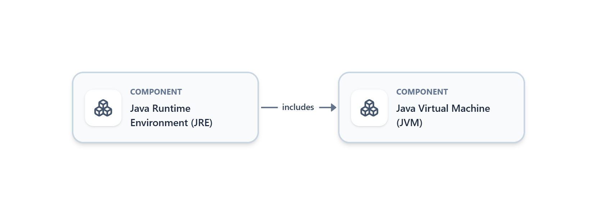
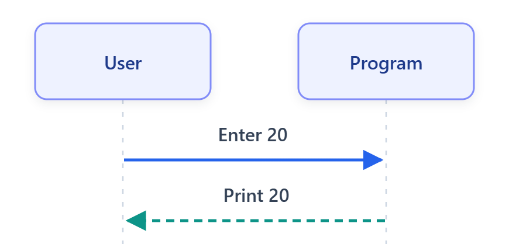
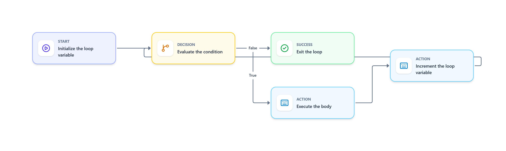

> UNVERIFIED PREVIEW — semantic and educational review required.

# Study notes: multimodal transcript

*Generated from assembled notes*

---

## Source G00001

> Paraphrase candidate: semantic support remains unresolved; this is not a verified factual claim.

The course will teach the basics of Java.

*[Knowledge ID: FCT_0001 | Sources: G00001 | Video: 00:00:12.16–00:00:14.22]*

> Paraphrase candidate: semantic support remains unresolved; this is not a verified factual claim.

The course will teach how Java code gets executed.

*[Knowledge ID: FCT_0002 | Sources: G00001 | Video: 00:00:14.44–00:00:16.60]*

> Paraphrase candidate: semantic support remains unresolved; this is not a verified factual claim.

The course will teach how to build simple algorithms.

*[Knowledge ID: FCT_0003 | Sources: G00001 | Video: 00:00:17.06–00:00:19.14]*

> Paraphrase candidate: semantic support remains unresolved; this is not a verified factual claim.

The course will cover installing all the necessary tools to build Java applications.

*[Knowledge ID: FCT_0004 | Sources: G00001, G00003 | Video: 00:00:07.76–00:00:11.74, 00:01:44.02–00:01:55.69]*

## Source G00003

> Paraphrase candidate: semantic support remains unresolved; this is not a verified factual claim.

JDK stands for Java Development Kit and is a software development environment for building Java applications.

*[Knowledge ID: FCT_0005 | Sources: G00003 | Video: 00:02:00.17–00:02:11.87]*

> Paraphrase candidate: semantic support remains unresolved; this is not a verified factual claim.

The JDK includes a compiler, reusable code libraries, and a Java runtime environment.

*[Knowledge ID: FCT_0006 | Sources: G00003 | Video: 00:02:07.67–00:02:15.91]*

> Paraphrase candidate: semantic support remains unresolved; this is not a verified factual claim.

Oracle.com provides the Java SE (Standard Edition) download page for the JDK.

*[Knowledge ID: FCT_0007 | Sources: G00003 | Video: 00:02:16.45–00:02:19.95, 00:02:20.63–00:02:28.17]*

> Paraphrase candidate: semantic support remains unresolved; this is not a verified factual claim.

The JDK can be downloaded for various platforms such as Linux, macOS, and Windows.

*[Knowledge ID: FCT_0008 | Sources: G00003 | Video: 00:02:23.43–00:02:28.17, 00:02:29.77–00:02:35.51, 00:02:35.89–00:02:39.39]*

> Paraphrase candidate: semantic support remains unresolved; this is not a verified factual claim.

On macOS, the JDK is provided as a .dmg file.

*[Knowledge ID: FCT_0009 | Sources: G00003 | Video: 00:02:35.89–00:02:43.47]*

> Paraphrase candidate: semantic support remains unresolved; this is not a verified factual claim.

Installation of the JDK requires accepting the license agreement.

*[Knowledge ID: FCT_0010 | Sources: G00003 | Video: 00:02:39.39–00:02:47.23]*

> Paraphrase candidate: semantic support remains unresolved; this is not a verified factual claim.

The JDK installation wizard on macOS guides the user through clicking continue, entering the computer password, and completing the installation.

*[Knowledge ID: FCT_0011 | Sources: G00003 | Video: 00:02:43.47–00:02:47.23, 00:02:48.69–00:02:55.71, 00:02:55.93–00:03:02.43, 00:03:04.03–00:03:07.69]*

## Source G00004

> Paraphrase candidate: semantic support remains unresolved; this is not a verified factual claim.

Popular code editors for building Java applications are NetBeans, Eclipse, and IntelliJ.

*[Knowledge ID: FCT_0016 | Sources: G00004 | Video: 00:03:08.59–00:03:21.35]*

> Paraphrase candidate: semantic support remains unresolved; this is not a verified factual claim.

The instructor’s favorite editor can be used for the course.

*[Knowledge ID: FCT_0017 | Sources: G00004 | Video: 00:03:15.39–00:03:25.17]*

> Paraphrase candidate: semantic support remains unresolved; this is not a verified factual claim.

IntelliJ IDEA Community Edition is free and sufficient for the course.

*[Knowledge ID: FCT_0018 | Sources: G00004 | Video: 00:03:29.25–00:03:41.33]*

> Paraphrase candidate: semantic support remains unresolved; this is not a verified factual claim.

After downloading, the application should be dragged into the Applications folder.

*[Knowledge ID: FCT_0019 | Sources: G00004 | Video: 00:03:42.15–00:03:50.98]*

> Paraphrase candidate: semantic support remains unresolved; this is not a verified factual claim.

The smallest building block in Java programs are functions.

*[Knowledge ID: FCT_0020 | Sources: G00004 | Video: 00:04:04.46–00:04:12.44]*

> Paraphrase candidate: semantic support remains unresolved; this is not a verified factual claim.

A function is a block of code that performs a task.

*[Knowledge ID: FCT_0021 | Sources: G00004 | Video: 00:04:08.60–00:04:16.60]*

> Paraphrase candidate: semantic support remains unresolved; this is not a verified factual claim.

Each button on a remote control performs a task, analogous to functions in programming.

*[Knowledge ID: FCT_0022 | Sources: G00004 | Video: 00:04:12.44–00:04:20.34]*

> Paraphrase candidate: semantic support remains unresolved; this is not a verified factual claim.

Functions in programming languages are analogous to remote control buttons.

*[Knowledge ID: FCT_0023 | Sources: G00004 | Video: 00:04:16.60–00:04:24.34]*

> Paraphrase candidate: semantic support remains unresolved; this is not a verified factual claim.

Examples of functions include sending emails, converting weight units, and validating user input.

*[Knowledge ID: FCT_0024 | Sources: G00004 | Video: 00:04:20.34–00:04:36.02]*

> Paraphrase candidate: semantic support remains unresolved; this is not a verified factual claim.

The tutorial will demonstrate how to code a function in Java.

*[Knowledge ID: FCT_0025 | Sources: G00004 | Video: 00:04:32.42–00:04:36.02]*

## Source G00005

> Paraphrase candidate: semantic support remains unresolved; this is not a verified factual claim.

The return type of a function is specified first.

*[Knowledge ID: FCT_0026 | Sources: G00005 | Video: 00:04:36.66–00:04:40.54]*

> Paraphrase candidate: semantic support remains unresolved; this is not a verified factual claim.

Some functions return a value like a number or a date/time, while other functions do not return anything.

*[Knowledge ID: FCT_0027 | Sources: G00005 | Video: 00:04:36.66–00:04:47.98]*

> Paraphrase candidate: semantic support remains unresolved; this is not a verified factual claim.

The return type of functions that do not return a value is void.

*[Knowledge ID: FCT_0028 | Sources: G00005 | Video: 00:04:44.80–00:04:47.98]*

> Paraphrase candidate: semantic support remains unresolved; this is not a verified factual claim.

Void is a reserved keyword in Java.

*[Knowledge ID: FCT_0029 | Sources: G00005 | Video: 00:04:48.68–00:04:52.94]*

> Paraphrase candidate: semantic support remains unresolved; this is not a verified factual claim.

After the return type, the name of the function appears.

*[Knowledge ID: FCT_0030 | Sources: G00005 | Video: 00:04:52.94–00:04:57.56]*

> Paraphrase candidate: semantic support remains unresolved; this is not a verified factual claim.

A function should have a descriptive name, such as send email.

*[Knowledge ID: FCT_0031 | Sources: G00005 | Video: 00:04:52.94–00:05:05.28]*

> Paraphrase candidate: semantic support remains unresolved; this is not a verified factual claim.

The function name clearly identifies its purpose.

*[Knowledge ID: FCT_0032 | Sources: G00005 | Video: 00:05:01.02–00:05:05.28, 00:05:05.94–00:05:09.06]*

> Paraphrase candidate: semantic support remains unresolved; this is not a verified factual claim.

After the function name, parentheses contain the parameters for the function.

*[Knowledge ID: FCT_0033 | Sources: G00005 | Video: 00:05:05.94–00:05:13.36]*

> Paraphrase candidate: semantic support remains unresolved; this is not a verified factual claim.

Parameters are used to pass values to a function.

*[Knowledge ID: FCT_0034 | Sources: G00005 | Video: 00:05:13.92–00:05:16.82]*

> Paraphrase candidate: semantic support remains unresolved; this is not a verified factual claim.

Example parameters for a send email function include the receiver, subject, and content of the email.

*[Knowledge ID: FCT_0035 | Sources: G00005 | Video: 00:05:17.32–00:05:25.20]*

> Paraphrase candidate: semantic support remains unresolved; this is not a verified factual claim.

This tutorial will not cover parameters now and will address them later.

*[Knowledge ID: FCT_0036 | Sources: G00005 | Video: 00:05:25.70–00:05:28.98]*

## Source G00006

> Paraphrase candidate: semantic support remains unresolved; this is not a verified factual claim.

In Java we put the left brace on the same line where we define our function.

*[Knowledge ID: FCT_0037 | Sources: G00006 | Video: 00:05:36.32–00:05:40.54, 00:05:41.02–00:05:44.94]*

> Paraphrase candidate: semantic support remains unresolved; this is not a verified factual claim.

In Java we add a pair of curly braces after the parenthesis and write the actual Java code inside them.

*[Knowledge ID: FCT_0038 | Sources: G00006 | Video: 00:05:30.06–00:05:40.54]*

> Paraphrase candidate: semantic support remains unresolved; this is not a verified factual claim.

Every Java program should have at least one function called main, which is the entry point and gets executed when the program runs.

*[Knowledge ID: FCT_0039 | Sources: G00006 | Video: 00:05:57.90–00:06:01.02, 00:06:01.40–00:06:13.08]*

> Paraphrase candidate: semantic support remains unresolved; this is not a verified factual claim.

Functions in Java must belong to a class; they cannot exist on their own.

*[Knowledge ID: FCT_0040 | Sources: G00006 | Video: 00:06:13.66–00:06:21.50]*

> Paraphrase candidate: semantic support remains unresolved; this is not a verified factual claim.

A class is a container for one or more related functions (methods) and is used to organize code.

*[Knowledge ID: FCT_0041 | Sources: G00006 | Video: 00:06:17.32–00:06:28.94]*

## Source G00007

> Paraphrase candidate: semantic support remains unresolved; this is not a verified factual claim.

By analogy, a class is like a supermarket section that contains related products.

*[Knowledge ID: FCT_0042 | Sources: G00007 | Video: 00:06:29.62–00:06:33.16, 00:06:33.60–00:06:37.64, 00:06:38.18–00:06:45.56]*

> Paraphrase candidate: semantic support remains unresolved; this is not a verified factual claim.

Every Java program should have at least one class that contains the main function.

*[Knowledge ID: FCT_0043 | Sources: G00007 | Video: 00:06:41.44–00:06:49.54]*

> Paraphrase candidate: semantic support remains unresolved; this is not a verified factual claim.

The class definition starts with the keyword class, followed by a descriptive name, and a pair of curly braces.

*[Knowledge ID: FCT_0044 | Sources: G00007 | Video: 00:06:54.26–00:07:01.10]*

> Paraphrase candidate: semantic support remains unresolved; this is not a verified factual claim.

Functions defined inside a class are called methods.

*[Knowledge ID: FCT_0045 | Sources: G00007 | Video: 00:07:01.76–00:07:09.40, 00:07:10.04–00:07:13.60]*

> Unavailable or unresolved source information: PARTIALLY\_SUPPORTED. Original candidates remain in the audit.

Available source excerpt: Now
 in Java, all these classes and methods should have an
 access modifier.

Available source excerpt: An access modifier is a special keyword
 that determines if other classes and methods in this program
 can access these classes and methods.

Available source excerpt: We have various access
 modifiers like public, private, and so on.

Available source excerpt: Now most of the time
 we use the public access modifier, so we put that in front of our
 class and method declarations.

*[Knowledge ID: FCT_0046 | Sources: G00007 | Video: 00:07:22.22–00:07:53.88]*

## Source G00008

> Paraphrase candidate: semantic support remains unresolved; this is not a verified factual claim.

A Java program must contain a main class and inside this main class we have the main method.

*[Knowledge ID: FCT_0047 | Sources: G00008 | Video: 00:07:53.88–00:08:01.86]*

*[Knowledge ID: FCT_0048 | Sources: G00008 | Video: 00:08:05.84–00:08:18.02]*

*[Knowledge ID: FCT_0049 | Sources: G00008 | Video: 00:08:18.58–00:08:30.10]*

### Java Naming Conventions

| Item | Description |
| --- | --- |
| class names | Java class names use PascalCase, meaning the first letter of every word is uppercase. |
| method names | Java method names use camelCase, meaning the first letter of the first word is lowercase and the first letter of each subsequent word is uppercase. |

*Based on Round 1 notes awaiting semantic review.*

*Source: FCT_0048, FCT_0049 · 00:08:05.84–00:08:18.02, 00:08:18.58–00:08:30.10*

## Source G00009

> Paraphrase candidate: semantic support remains unresolved; this is not a verified factual claim.

When creating a new Java project in IntelliJ IDEA, you select Java as the language and ensure the project SDK is set (e.g., JDK 12).

*[Knowledge ID: FCT_0052 | Sources: G00009 | Video: 00:08:57.49–00:08:59.25, 00:08:59.77–00:09:07.23, 00:09:07.69–00:09:15.47]*

> Paraphrase candidate: semantic support remains unresolved; this is not a verified factual claim.

A command‑line Java application is created by selecting the “command line application” template, which produces a program without a graphical user interface.

*[Knowledge ID: FCT_0053 | Sources: G00009 | Video: 00:09:11.75–00:09:32.05]*

## Source G00010

> Paraphrase candidate: semantic support remains unresolved; this is not a verified factual claim.

The base package for a Java project is conventionally the reverse domain name of the organization.

*[Knowledge ID: FCT_0050 | Sources: G00010 | Video: 00:10:39.47–00:10:48.03]*

> Paraphrase candidate: semantic support remains unresolved; this is not a verified factual claim.

A package groups related classes and helps organize code as an application grows.

*[Knowledge ID: FCT_0051 | Sources: G00010 | Video: 00:10:23.77–00:10:44.11]*

> Paraphrase candidate: semantic support remains unresolved; this is not a verified factual claim.

The base package name shown in the IDE may be something like com.codewithmosh, but you can use any package name such as com.package.

*[Knowledge ID: FCT_0054 | Sources: G00010 | Video: 00:10:00.57–00:10:15.75]*

## Source G00011

> Paraphrase candidate: semantic support remains unresolved; this is not a verified factual claim.

All Java files should have the Java extension.

*[Knowledge ID: FCT_0055 | Sources: G00011 | Video: 00:12:01.72–00:12:06.20]*

## Source G00012

> Paraphrase candidate: semantic support remains unresolved; this is not a verified factual claim.

In Java, statements should be terminated with a semicolon.

*[Knowledge ID: FCT_0056 | Sources: G00012 | Video: 00:12:26.12–00:12:37.92]*

> Paraphrase candidate: semantic support remains unresolved; this is not a verified factual claim.

The main method in a Java program should always be static.

*[Knowledge ID: FCT_0057 | Sources: G00012 | Video: 00:12:58.54–00:13:06.64]*

> Paraphrase candidate: semantic support remains unresolved; this is not a verified factual claim.

The return type of the main method is void, meaning it does not return a value.

*[Knowledge ID: FCT_0058 | Sources: G00012 | Video: 00:13:02.80–00:13:10.16, 00:13:10.66–00:13:13.96]*

## Source G00014

> Paraphrase candidate: semantic support remains unresolved; this is not a verified factual claim.

The System.out.println method prints a line of text to the terminal.

*[Knowledge ID: FCT_0059 | Sources: G00014 | Video: 00:14:39.42–00:14:42.50, 00:14:43.24–00:14:50.48, 00:14:55.20–00:15:10.06, 00:15:10.98–00:15:14.64]*

> Paraphrase candidate: semantic support remains unresolved; this is not a verified factual claim.

A string in Java is a sequence of characters enclosed in double quotes.

*[Knowledge ID: FCT_0060 | Sources: G00014 | Video: 00:15:10.98–00:15:28.36]*

## Source G00016

> Paraphrase candidate: semantic support remains unresolved; this is not a verified factual claim.

Right‑clicking on a Java source file (e.g., main.java) shows a context‑menu item called “open in terminal”.

*[Knowledge ID: FCT_0061 | Sources: G00016 | Video: 00:16:56.89–00:17:04.41]*

> Paraphrase candidate: semantic support remains unresolved; this is not a verified factual claim.

The “open in terminal” command is called “open in terminal” on macOS and “open in command prompt” on Windows.

*[Knowledge ID: FCT_0062 | Sources: G00016 | Video: 00:17:08.47–00:17:15.87]*

> Literal source code fragment; do not assume a complete program.
> Unavailable or unresolved source information: INCOMPLETE\_LITERAL. Original candidates remain in the audit.

Available source excerpt: Now we can invoke the java
 compiler like this, java c, and pass the name of our java file
 as an argument.

*[Knowledge ID: FCT_0063 | Sources: G00016 | Video: 00:17:23.75–00:17:35.91]*

> Unavailable or unresolved source information: PARTIALLY\_SUPPORTED. Original candidates remain in the audit.

Available source excerpt: If you're on mac
 or linux, make sure to spell this with a capital m, because these operating systems
 are case sensitive.

*[Knowledge ID: FCT_0064 | Sources: G00016 | Video: 00:17:31.91–00:17:43.89]*

> Literal source code fragment; do not assume a complete program.
> Unavailable or unresolved source information: INCOMPLETE\_LITERAL. Original candidates remain in the audit.

Available source excerpt: On Mac or Linux we can type
 ls, on windows we type dir.

*[Knowledge ID: FCT_0065 | Sources: G00016 | Video: 00:17:43.89–00:17:52.51]*

> Paraphrase candidate: semantic support remains unresolved; this is not a verified factual claim.

Compiling a Java source file produces a `.class` file (e.g., main.class) that contains the bytecode representation of the source.

*[Knowledge ID: FCT_0066 | Sources: G00016 | Video: 00:17:52.95–00:18:00.87]*

> Paraphrase candidate: semantic support remains unresolved; this is not a verified factual claim.

When running a Java program from an IDE (e.g., IntelliJ), the generated `.class` files are stored in a separate output folder, not alongside the source files.

*[Knowledge ID: FCT_0067 | Sources: G00016 | Video: 00:17:56.83–00:18:08.47, 00:18:09.71–00:18:21.03]*

## Source G00017

> Paraphrase candidate: semantic support remains unresolved; this is not a verified factual claim.

The compiled `.class` file resides in the package directory structure (e.g., `helloWorld/com/codewithmosh/main.class`).

*[Knowledge ID: FCT_0068 | Sources: G00017 | Video: 00:18:25.29–00:18:28.69, 00:18:29.77–00:18:33.17, 00:18:33.99–00:18:37.19]*

> Paraphrase candidate: semantic support remains unresolved; this is not a verified factual claim.

Java bytecode is platform‑independent; the same `.class` file can run on Windows, macOS, Linux, or any OS with a Java Runtime Environment (JRE).

*[Knowledge ID: FCT_0069 | Sources: G00017 | Video: 00:18:37.19–00:18:45.05, 00:18:45.47–00:18:53.25]*

> Paraphrase candidate: semantic support remains unresolved; this is not a verified factual claim.

The JVM translates Java bytecode to native code for the underlying operating system.

*[Knowledge ID: FCT_0070 | Sources: G00017 | Video: 00:18:56.85–00:19:13.93]*

### Java runtime components

*Based on Round 1 notes awaiting semantic review.*

*Source: FCT_0070 · 00:18:56.85–00:19:13.93*

> Paraphrase candidate: semantic support remains unresolved; this is not a verified factual claim.

Because the JVM performs this translation at runtime, Java applications are portable across different operating systems.

*[Knowledge ID: FCT_0071 | Sources: G00017 | Video: 00:19:22.55–00:19:38.87]*

## Source G00018

> Paraphrase candidate: semantic support remains unresolved; this is not a verified factual claim.

To run a Java program you invoke the Java virtual machine (JVM) by typing `java` followed by the full path to the main class file.

*[Knowledge ID: FCT_0072 | Sources: G00018 | Video: 00:20:06.73–00:20:14.91]*

> Paraphrase candidate: semantic support remains unresolved; this is not a verified factual claim.

The full path to the main class includes the package name, e.g., `com.codewithmosh.main`, and is case‑sensitive.

*[Knowledge ID: FCT_0073 | Sources: G00018 | Video: 00:20:23.03–00:20:38.79]*

> Paraphrase candidate: semantic support remains unresolved; this is not a verified factual claim.

When the `java` command is executed, the JVM searches the folder hierarchy for the specified package and class, loads the bytecode, and converts it to native code for the operating system.

*[Knowledge ID: FCT_0074 | Sources: G00018 | Video: 00:20:47.13–00:20:55.17]*

> Paraphrase candidate: semantic support remains unresolved; this is not a verified factual claim.

Running a Java program from an IDE such as IntelliJ hides the compilation and execution steps from the user.

*[Knowledge ID: FCT_0075 | Sources: G00018 | Video: 00:20:55.55–00:21:02.73]*

## Source G00019

> Paraphrase candidate: semantic support remains unresolved; this is not a verified factual claim.

Java was developed by James Gosling in 1995 at Sun Microsystems, which was later acquired by Oracle in 2010.

*[Knowledge ID: FCT_0076 | Sources: G00019 | Video: 00:21:14.84–00:21:22.46]*

> Paraphrase candidate: semantic support remains unresolved; this is not a verified factual claim.

Java has four main editions: Standard Edition (core platform), Enterprise Edition (large‑scale distributed systems), Micro Edition (mobile devices), and Java Card (smart cards).

*[Knowledge ID: FCT_0077 | Sources: G00019 | Video: 00:21:40.00–00:21:41.58, 00:21:49.72–00:21:51.30, 00:21:51.68–00:21:55.62, 00:22:05.50–00:22:21.50]*

> Paraphrase candidate: semantic support remains unresolved; this is not a verified factual claim.

The latest version of Java at the time of the lecture was Java Standard Edition 12, released in March 2019.

*[Knowledge ID: FCT_0078 | Sources: G00019 | Video: 00:22:17.50–00:22:29.18]*

## Source G00020

> Paraphrase candidate: semantic support remains unresolved; this is not a verified factual claim.

According to indeed.com, the average salary of a Java developer in the US is just over $100,000 per year.

*[Knowledge ID: FCT_0079 | Sources: G00020 | Video: 00:22:37.58–00:22:55.95]*

## Source G00022

> Paraphrase candidate: semantic support remains unresolved; this is not a verified factual claim.

Variables are used to temporarily store data in computer's memory.

*[Knowledge ID: FCT_0080 | Sources: G00022 | Video: 00:25:54.30–00:26:09.41]*

> Paraphrase candidate: semantic support remains unresolved; this is not a verified factual claim.

In Java, a variable is declared with a type, a name, and an initial value, e.g., int age = 30.

*[Knowledge ID: FCT_0081 | Sources: G00022 | Video: 00:26:13.91–00:26:17.09, 00:26:17.43–00:26:21.39]*

> Unavailable or unresolved source information: PARTIALLY\_SUPPORTED. Original candidates remain in the audit.

Available source excerpt: So int or integer is the type
 of this variable, so in this variable we can only store integers
 which are whole numbers, like 1, 2, 3, 4, numbers that don't have a decimal
 point.

*[Knowledge ID: FCT_0082 | Sources: G00022 | Video: 00:26:17.43–00:26:33.89]*

## Source G00023

> Paraphrase candidate: semantic support remains unresolved; this is not a verified factual claim.

When declaring a variable, you first specify its type and then give it a name (identifier).

*[Knowledge ID: FCT_0083 | Sources: G00023 | Video: 00:26:33.89–00:26:45.95]*

> Paraphrase candidate: semantic support remains unresolved; this is not a verified factual claim.

The equal sign (=) is the assignment operator that assigns a value to a variable.

*[Knowledge ID: FCT_0084 | Sources: G00023 | Video: 00:26:42.33–00:26:54.09]*

> Paraphrase candidate: semantic support remains unresolved; this is not a verified factual claim.

Initializing a variable means giving it an initial value.

*[Knowledge ID: FCT_0085 | Sources: G00023 | Video: 00:26:50.41–00:26:54.09, 00:26:54.57–00:26:57.79]*

> Paraphrase candidate: semantic support remains unresolved; this is not a verified factual claim.

Variables must be initialized before they are read.

*[Knowledge ID: FCT_0086 | Sources: G00023 | Video: 00:26:58.15–00:27:01.47]*

> Paraphrase candidate: semantic support remains unresolved; this is not a verified factual claim.

Assigning a value stores that value in a memory location associated with the variable's label.

*[Knowledge ID: FCT_0087 | Sources: G00023 | Video: 00:27:01.47–00:27:09.69]*

> Paraphrase candidate: semantic support remains unresolved; this is not a verified factual claim.

A variable's value can be changed after initialization by assigning a new value.

*[Knowledge ID: FCT_0088 | Sources: G00023 | Video: 00:27:23.24–00:27:37.07]*

## Source G00024

> Paraphrase candidate: semantic support remains unresolved; this is not a verified factual claim.

Declaring multiple variables on the same line is technically possible but not recommended because it makes code ugly and hard to read; it is better to declare one variable per line.

*[Knowledge ID: FCT_0089 | Sources: G00024 | Video: 00:27:37.61–00:27:48.71, 00:27:56.55–00:28:08.87]*

> Paraphrase candidate: semantic support remains unresolved; this is not a verified factual claim.

Variable names should follow camel case notation: capitalize the first letter of every word except the first word.

*[Knowledge ID: FCT_0090 | Sources: G00024, G00025 | Video: 00:28:36.43–00:28:44.13, 00:28:44.39–00:28:51.85, 00:28:52.31–00:29:00.71]*

## Source G00025

> Unavailable or unresolved source information: PARTIALLY\_SUPPORTED. Original candidates remain in the audit.

Available source excerpt: So in the category
 of primitive types we have byte, which takes one byte of memory,
 and in one byte we can store values from 128
 to 127.

Available source excerpt: So next we have short which takes 2 bytes
 and with this we can store values up to 32,000.

Available source excerpt: Next we have
 integer, which we have seen before, integers take 4 bytes of memory and
 allow us to store values up to 2 billion.

Available source excerpt: Then we have long
 which takes 8 bytes, and with this we can store even larger numbers.

*[Knowledge ID: FCT_0091 | Sources: G00025 | Video: 00:29:22.11–00:29:57.43]*

## Source G00026

> Paraphrase candidate: semantic support remains unresolved; this is not a verified factual claim.

Whole-number types store numbers without a decimal point.

*[Knowledge ID: FCT_0092 | Sources: G00026 | Video: 00:29:57.43–00:30:05.75]*

> Unavailable or unresolved source information: PARTIALLY\_SUPPORTED. Original candidates remain in the audit.

Available source excerpt: If you want to store a number that has a decimal point, you have to use
 float or double.

*[Knowledge ID: FCT_0093 | Sources: G00026 | Video: 00:30:01.53–00:30:10.13]*

> Paraphrase candidate: semantic support remains unresolved; this is not a verified factual claim.

Float occupies 4 bytes and double occupies 8 bytes.

*[Knowledge ID: FCT_0094 | Sources: G00026 | Video: 00:30:05.75–00:30:10.13]*

> Paraphrase candidate: semantic support remains unresolved; this is not a verified factual claim.

Double can store larger numbers than float.

*[Knowledge ID: FCT_0095 | Sources: G00026 | Video: 00:30:10.31–00:30:12.81]*

> Paraphrase candidate: semantic support remains unresolved; this is not a verified factual claim.

Char stores a single character and takes 2 bytes, supporting international letters.

*[Knowledge ID: FCT_0096 | Sources: G00026 | Video: 00:30:13.51–00:30:21.51]*

> Paraphrase candidate: semantic support remains unresolved; this is not a verified factual claim.

Boolean stores true/false values.

*[Knowledge ID: FCT_0097 | Sources: G00026 | Video: 00:30:22.11–00:30:30.03]*

> Paraphrase candidate: semantic support remains unresolved; this is not a verified factual claim.

An integer occupies 4 bytes and can store values up to about 2 billion.

*[Knowledge ID: FCT_0098 | Sources: G00026, G00027 | Video: 00:30:30.03–00:30:42.47, 00:31:42.71–00:31:50.13]*

> Paraphrase candidate: semantic support remains unresolved; this is not a verified factual claim.

A byte occupies 1 byte and can store values up to 127.

*[Knowledge ID: FCT_0099 | Sources: G00026 | Video: 00:30:42.47–00:30:50.37]*

## Source G00027

> Paraphrase candidate: semantic support remains unresolved; this is not a verified factual claim.

Use meaningful and descriptive variable names.

*[Knowledge ID: FCT_0100 | Sources: G00027 | Video: 00:30:58.95–00:31:01.75, 00:31:02.37–00:31:10.33, 00:31:14.41–00:31:21.99]*

> Paraphrase candidate: semantic support remains unresolved; this is not a verified factual claim.

In Java you can use underscores to separate groups of three digits in numeric literals.

*[Knowledge ID: FCT_0101 | Sources: G00027 | Video: 00:31:25.83–00:31:38.01, 00:31:38.83–00:31:42.07, 00:31:42.71–00:31:46.55]*

> Paraphrase candidate: semantic support remains unresolved; this is not a verified factual claim.
> SOURCE DISCUSSES AN INCORRECT DEMONSTRATION — preserve its correction context; do not follow it as advice.

Attempting to store a value larger than the integer range (e.g., 3 billion) causes a compile‑time error: "integer number too large".

*[Knowledge ID: FCT_0102 | Sources: G00027 | Video: 00:31:46.55–00:31:53.93, 00:31:54.57–00:32:01.67]*

## Source G00028

> Paraphrase candidate: semantic support remains unresolved; this is not a verified factual claim.

Java treats integer literals without a suffix as int, so a numeric literal that exceeds the int range must be suffixed with an L (or l) to be interpreted as long.

*[Knowledge ID: FCT_0103 | Sources: G00028 | Video: 00:32:06.17–00:32:30.63]*

> Unavailable or unresolved source information: PARTIALLY\_SUPPORTED. Original candidates remain in the audit.

Available source excerpt: We can use an uppercase or a lowercase l.

Available source excerpt: But as you can see, a lowercase l kind of looks like a one, so
 it's better to use a capital L.

*[Knowledge ID: FCT_0104 | Sources: G00028 | Video: 00:32:26.47–00:32:30.63, 00:32:31.05–00:32:38.45]*

## Source G00029

> Paraphrase candidate: semantic support remains unresolved; this is not a verified factual claim.

Java treats decimal literals as double by default; assigning a decimal literal to a float variable without a suffix causes a compilation error.

*[Knowledge ID: FCT_0105 | Sources: G00029 | Video: 00:32:59.07–00:33:02.75, 00:33:03.59–00:33:14.97]*

> Paraphrase candidate: semantic support remains unresolved; this is not a verified factual claim.

To represent a float literal, append an f (or F) suffix to the numeric value.

*[Knowledge ID: FCT_0106 | Sources: G00029 | Video: 00:33:15.53–00:33:31.15]*

> Paraphrase candidate: semantic support remains unresolved; this is not a verified factual claim.

A char literal must be enclosed in single quotes, while a string literal uses double quotes.

*[Knowledge ID: FCT_0107 | Sources: G00029 | Video: 00:33:39.23–00:33:47.55]*

> Paraphrase candidate: semantic support remains unresolved; this is not a verified factual claim.

A boolean variable can hold only the values true or false.

*[Knowledge ID: FCT_0108 | Sources: G00029, G00030 | Video: 00:34:02.85–00:34:07.43, 00:34:08.01–00:34:11.21]*

## Source G00030

> Paraphrase candidate: semantic support remains unresolved; this is not a verified factual claim.

Java reserved keywords (e.g., public, static, void, class, package) cannot be used as identifiers for variables, classes, or methods.

*[Knowledge ID: FCT_0109 | Sources: G00030 | Video: 00:34:08.01–00:34:32.66]*

> Paraphrase candidate: semantic support remains unresolved; this is not a verified factual claim.

Java has eight primitive types (byte, short, int, long, float, double, char, boolean) used for simple values; all other types are reference types.

*[Knowledge ID: FCT_0110 | Sources: G00030 | Video: 00:34:23.31–00:34:36.36, 00:34:36.92–00:34:40.34, 00:34:40.76–00:34:55.56]*

> Paraphrase candidate: semantic support remains unresolved; this is not a verified factual claim.

Declaring and initializing a primitive variable (e.g., byte h = 30;) differs syntactically from creating an instance of a reference type.

*[Knowledge ID: FCT_0111 | Sources: G00030 | Video: 00:34:57.14–00:35:00.42, 00:35:01.04–00:35:04.50, 00:35:05.54–00:35:12.70]*

## Source G00031

> Paraphrase candidate: semantic support remains unresolved; this is not a verified factual claim.

Packages create a namespace for classes, allowing the same class name to exist in different packages without conflict.

*[Knowledge ID: FCT_0112 | Sources: G00031 | Video: 00:35:40.92–00:35:53.34]*

> Paraphrase candidate: semantic support remains unresolved; this is not a verified factual claim.

To use a class from a different package, you must import it.

*[Knowledge ID: FCT_0113 | Sources: G00031 | Video: 00:36:06.42–00:36:12.76, 00:36:13.32–00:36:17.20]*

> Paraphrase candidate: semantic support remains unresolved; this is not a verified factual claim.

IntelliJ can suggest class names and automatically insert import statements when a class is selected.

*[Knowledge ID: FCT_0117 | Sources: G00031 | Video: 00:35:20.88–00:35:24.98, 00:35:49.42–00:35:53.34, 00:35:54.04–00:36:05.20]*

## Source G00032

> Paraphrase candidate: semantic support remains unresolved; this is not a verified factual claim.

The `new` operator allocates memory for reference type objects; primitive types do not require explicit memory allocation.

*[Knowledge ID: FCT_0114 | Sources: G00032 | Video: 00:36:25.66–00:36:41.42, 00:36:49.54–00:37:01.14]*

> Paraphrase candidate: semantic support remains unresolved; this is not a verified factual claim.

Reference type objects are managed by the Java runtime, which automatically releases memory; programmers do not manually free memory.

*[Knowledge ID: FCT_0115 | Sources: G00032 | Video: 00:36:37.12–00:36:41.42, 00:36:45.62–00:36:53.36]*

## Source G00033

> Paraphrase candidate: semantic support remains unresolved; this is not a verified factual claim.

Objects (instances of classes) have members that can be accessed using the dot operator, whereas primitive types have no members.

*[Knowledge ID: FCT_0116 | Sources: G00033 | Video: 00:37:22.76–00:37:29.58, 00:37:42.08–00:37:45.94, 00:38:02.68–00:38:13.86]*

## Source G00034

> Paraphrase candidate: semantic support remains unresolved; this is not a verified factual claim.

Code snippets (live templates) can be triggered by typing shortcuts (e.g., `sout`) and pressing Tab to generate boilerplate code.

*[Knowledge ID: FCT_0118 | Sources: G00034 | Video: 00:38:34.58–00:38:50.02]*

## Source G00035

> Unavailable or unresolved source information: PARTIALLY\_SUPPORTED. Original candidates remain in the audit.

Available source excerpt: So they're completely independent of each other.

Available source excerpt: In other words,
 if I change the value of x, y is not going to get affected.

Available source excerpt: So I'm going to update x to 2, and then print
 y.

Available source excerpt: So run,
 as you can see, y is not affected because x and y are completely
 independent of each other.

*[Knowledge ID: FCT_0119 | Sources: G00035 | Video: 00:39:56.50–00:40:03.90, 00:40:04.20–00:40:11.84, 00:40:12.70–00:40:14.44, 00:40:15.84–00:40:23.88]*

## Source G00036

> Paraphrase candidate: semantic support remains unresolved; this is not a verified factual claim.

Reference‑type variables store a reference (address) to an object in memory rather than the actual value.

*[Knowledge ID: FCT_0120 | Sources: G00036 | Video: 00:41:11.10–00:41:13.74, 00:41:14.46–00:41:18.32, 00:41:18.98–00:41:21.86, 00:41:22.70–00:41:30.16, 00:41:30.92–00:41:42.42, 00:41:42.86–00:41:46.94, 00:41:47.36–00:41:57.80]*

> Paraphrase candidate: semantic support remains unresolved; this is not a verified factual claim.

Assigning a primitive variable copies the actual value into a new memory location; assigning a reference variable copies the address, not the object itself.

*[Knowledge ID: FCT_0122 | Sources: G00036 | Video: 00:41:58.58–00:42:09.88]*

## Source G00037

> Unavailable or unresolved source information: PARTIALLY\_SUPPORTED. Original candidates remain in the audit.

Available source excerpt: That is why we refer to these types as reference types.

Available source excerpt: Because they don't store
 the actual values, they store a reference to an object somewhere
 in the memory.

Available source excerpt: So in this example, point 1 and
 are referencing the exact same point object
 in memory.

Available source excerpt: We only have one point object.

Available source excerpt: So these two variables
 are not independent of each other, they're referencing the same object,
 and that means, if I update this point object through either of these variables,
 the changes will be visible to the other variable.

Available source excerpt: So, using the first variable, point one, we're going to update
 the value of x.

Available source excerpt: So
 we set x just like a regular variable to a different value, let's say
 two.

Available source excerpt: Now because point one and point two are referencing
 the exact same object, if we print point two,
 we're going to see the change that we just made.

*[Knowledge ID: FCT_0121 | Sources: G00037 | Video: 00:42:10.32–00:42:34.40, 00:42:34.74–00:42:38.66, 00:42:39.20–00:42:42.52, 00:42:43.16–00:42:50.34, 00:42:54.54–00:43:10.32, 00:43:10.62–00:43:14.14]*

## Source G00038

> Paraphrase candidate: semantic support remains unresolved; this is not a verified factual claim.

In Java, a string literal is a string value.

*[Knowledge ID: FCT_0123 | Sources: G00038 | Video: 00:43:45.43–00:43:49.49, 00:43:49.95–00:43:58.17]*

> Paraphrase candidate: semantic support remains unresolved; this is not a verified factual claim.

The String class is defined in the java.lang package, which is automatically imported.

*[Knowledge ID: FCT_0124 | Sources: G00038 | Video: 00:43:58.59–00:44:01.67, 00:44:03.13–00:44:05.49, 00:44:06.03–00:44:10.47, 00:44:11.07–00:44:22.27]*

> Paraphrase candidate: semantic support remains unresolved; this is not a verified factual claim.

Reference types are copied by reference, whereas primitive types are copied by value.

*[Knowledge ID: FCT_0125 | Sources: G00038 | Video: 00:43:23.73–00:43:45.43]*

## Source G00039

> Paraphrase candidate: semantic support remains unresolved; this is not a verified factual claim.

When declaring a String variable, you can instantiate it using the new operator.

*[Knowledge ID: FCT_0126 | Sources: G00039 | Video: 00:44:22.27–00:44:25.81, 00:44:27.75–00:44:33.69, 00:44:34.15–00:44:42.49]*

> Paraphrase candidate: semantic support remains unresolved; this is not a verified factual claim.
> SOURCE DISCUSSES AN INCORRECT DEMONSTRATION — preserve its correction context; do not follow it as advice.

Using new String(...) to create a String is redundant because a shorter literal initialization exists.

*[Knowledge ID: FCT_0127 | Sources: G00039 | Video: 00:44:43.35–00:44:45.71, 00:44:46.31–00:44:58.57]*

> Paraphrase candidate: semantic support remains unresolved; this is not a verified factual claim.

A String can be initialized directly with a string literal without using the new operator.

*[Knowledge ID: FCT_0128 | Sources: G00039 | Video: 00:44:50.23–00:44:58.57]*

> Paraphrase candidate: semantic support remains unresolved; this is not a verified factual claim.

Strings are reference types in Java.

*[Knowledge ID: FCT_0129 | Sources: G00039 | Video: 00:45:06.25–00:45:10.49]*

> Paraphrase candidate: semantic support remains unresolved; this is not a verified factual claim.

String variables can be concatenated using the plus (+) operator.

*[Knowledge ID: FCT_0130 | Sources: G00039 | Video: 00:45:22.93–00:45:34.43]*

> Paraphrase candidate: semantic support remains unresolved; this is not a verified factual claim.

Because String is a class, its members can be accessed using the dot (.) operator.

*[Knowledge ID: FCT_0131 | Sources: G00039 | Video: 00:45:39.47–00:45:46.47]*

## Source G00040

> Paraphrase candidate: semantic support remains unresolved; this is not a verified factual claim.

so we can type message dot, and these are all the methods or functions defined in the string class.

*[Knowledge ID: FCT_0132 | Sources: G00040 | Video: 00:45:46.47–00:45:54.65]*

> Paraphrase candidate: semantic support remains unresolved; this is not a verified factual claim.

For example, we have this method here ends with, and with this we can check to see if our string ends with a character or sequence of characters.

*[Knowledge ID: FCT_0133 | Sources: G00040 | Video: 00:45:50.47–00:46:02.71]*

> Paraphrase candidate: semantic support remains unresolved; this is not a verified factual claim.

For example, here we can pass your string to see if our message ends with two exclamation marks.

*[Knowledge ID: FCT_0134 | Sources: G00040 | Video: 00:45:58.81–00:46:02.71, 00:46:03.39–00:46:07.57]*

> Paraphrase candidate: semantic support remains unresolved; this is not a verified factual claim.

Now, instead of printing the message, let's print this expression here.

*[Knowledge ID: FCT_0135 | Sources: G00040 | Video: 00:46:08.23–00:46:15.17]*

> Paraphrase candidate: semantic support remains unresolved; this is not a verified factual claim.

So, let's run the program, we get true.

*[Knowledge ID: FCT_0136 | Sources: G00040 | Video: 00:46:10.91–00:46:18.75]*

> Paraphrase candidate: semantic support remains unresolved; this is not a verified factual claim.

So this method that we have called here returns a boolean value which can be true or false.

*[Knowledge ID: FCT_0137 | Sources: G00040 | Video: 00:46:19.75–00:46:26.97]*

> Paraphrase candidate: semantic support remains unresolved; this is not a verified factual claim.

We also have another method starts with, let's take a look, now in this case we get false because our message doesn't start with two exclamation marks.

*[Knowledge ID: FCT_0138 | Sources: G00040 | Video: 00:46:23.19–00:46:35.27]*

> Paraphrase candidate: semantic support remains unresolved; this is not a verified factual claim.

Another useful method is length, so we can call that to get the length of a string which is the number of characters, so message dot length, take a look, so in this string we have 13 characters.

*[Knowledge ID: FCT_0139 | Sources: G00040 | Video: 00:46:36.91–00:46:38.51, 00:46:39.09–00:46:47.01, 00:46:48.47–00:46:51.33]*

## Source G00041

> Paraphrase candidate: semantic support remains unresolved; this is not a verified factual claim.

You can check the length of the input provided by the user.

*[Knowledge ID: FCT_0140 | Sources: G00041 | Video: 00:46:52.03–00:46:59.17]*

> Paraphrase candidate: semantic support remains unresolved; this is not a verified factual claim.

You can check a username's length and give an error if it exceeds a limit such as 20 characters.

*[Knowledge ID: FCT_0141 | Sources: G00041 | Video: 00:46:55.79–00:46:59.17, 00:46:59.61–00:47:07.19]*

> Paraphrase candidate: semantic support remains unresolved; this is not a verified factual claim.

The indexOf method returns the index of the first occurrence of a character or string passed to it.

*[Knowledge ID: FCT_0142 | Sources: G00041 | Video: 00:47:07.87–00:47:19.01]*

> Paraphrase candidate: semantic support remains unresolved; this is not a verified factual claim.

If you pass 'h' to indexOf, it returns 0; if you pass 'e', it returns 1 because those are the positions of the first occurrences in the string.

*[Knowledge ID: FCT_0143 | Sources: G00041 | Video: 00:47:14.97–00:47:19.01, 00:47:19.23–00:47:22.99, 00:47:23.63–00:47:27.01, 00:47:27.47–00:47:34.31]*

> Unavailable or unresolved source information: PARTIALLY\_SUPPORTED. Original candidates remain in the audit.

Available source excerpt: Now what if you pass a character or a string that doesn't exist in this message,
 let's say sky, we get negative one.

*[Knowledge ID: FCT_0144 | Sources: G00041 | Video: 00:47:35.15–00:47:45.40]*

> Paraphrase candidate: semantic support remains unresolved; this is not a verified factual claim.

The replace method can replace one or more characters with something else.

*[Knowledge ID: FCT_0145 | Sources: G00041 | Video: 00:47:49.80–00:48:01.32]*

> Paraphrase candidate: semantic support remains unresolved; this is not a verified factual claim.

For example, you can replace any exclamation marks with the word "store".

*[Knowledge ID: FCT_0146 | Sources: G00041 | Video: 00:47:57.82–00:48:07.08]*

## Source G00042

> Paraphrase candidate: semantic support remains unresolved; this is not a verified factual claim.

In the replace method, the first and second values are parameters, while the actual values passed (e.g., exclamation mark and asterisk) are arguments.

*[Knowledge ID: FCT_0147 | Sources: G00042 | Video: 00:48:08.38–00:48:19.80, 00:48:32.24–00:48:47.98]*

> Paraphrase candidate: semantic support remains unresolved; this is not a verified factual claim.

Arguments are the actual values that we pass to methods.

*[Knowledge ID: FCT_0148 | Sources: G00042 | Video: 00:48:23.40–00:48:27.70]*

> Paraphrase candidate: semantic support remains unresolved; this is not a verified factual claim.
> SOURCE DISCUSSES AN INCORRECT DEMONSTRATION — preserve its correction context; do not follow it as advice.

Many programmers do not know the difference between parameters and arguments.

*[Knowledge ID: FCT_0149 | Sources: G00042 | Video: 00:48:23.40–00:48:31.28]*

> Paraphrase candidate: semantic support remains unresolved; this is not a verified factual claim.

The replace method does not modify the original string; it returns a new string.

*[Knowledge ID: FCT_0150 | Sources: G00042, G00043 | Video: 00:48:52.96–00:49:05.52, 00:49:14.86–00:49:18.88, 00:49:19.54–00:49:26.52]*

> Paraphrase candidate: semantic support remains unresolved; this is not a verified factual claim.

In Java, strings are immutable; they cannot be mutated.

*[Knowledge ID: FCT_0151 | Sources: G00042, G00043 | Video: 00:49:14.86–00:49:18.88, 00:49:19.54–00:49:22.76]*

## Source G00043

> Paraphrase candidate: semantic support remains unresolved; this is not a verified factual claim.

The toLowerCase method returns a new string with all characters converted to lower case, leaving the original string unchanged.

*[Knowledge ID: FCT_0152 | Sources: G00043 | Video: 00:49:27.50–00:49:33.50, 00:49:35.70–00:49:38.82, 00:49:39.52–00:49:42.90, 00:49:43.30–00:49:46.52]*

> Paraphrase candidate: semantic support remains unresolved; this is not a verified factual claim.

The trim method returns a new string with leading and trailing whitespace removed, without altering the original string.

*[Knowledge ID: FCT_0153 | Sources: G00043 | Video: 00:49:47.14–00:49:54.08, 00:49:55.20–00:50:06.88, 00:50:11.38–00:50:18.40, 00:50:20.89–00:50:27.95]*

## Source G00046

> Paraphrase candidate: semantic support remains unresolved; this is not a verified factual claim.

Arrays are used to store a list of items such as numbers, people, or messages.

*[Knowledge ID: FCT_0154 | Sources: G00046 | Video: 00:53:27.87–00:53:36.01]*

> Paraphrase candidate: semantic support remains unresolved; this is not a verified factual claim.

To create an array you place square brackets after the type and use the new operator with the type repeated and the size in brackets.

*[Knowledge ID: FCT_0155 | Sources: G00046 | Video: 00:53:48.33–00:53:52.19, 00:53:52.89–00:54:00.19, 00:54:00.77–00:54:04.89]*

## Source G00047

> Unavailable or unresolved source information: PARTIALLY\_SUPPORTED. Original candidates remain in the audit.

Available source excerpt: Now, you can access individual
 items in this array using an index, so we type numbers
 square brackets, to reference the first element or first item
 we use 0.

Available source excerpt: Now we can set this to
 a value like 1, similarly we can set the
 second item to 2, now what if we use an invalid
 index, let's say 10, this array doesn't have 10 items, so
 let's see what happens, numbers of 10, we set this to
 3, when we run this program,
 we get an exception, exceptions are java's way to report
 errors, so in this case an exception was raised and our program crashed,
 We'll talk about exceptions in detail later in the course.

*[Knowledge ID: FCT_0158 | Sources: G00047 | Video: 00:54:17.05–00:54:47.93, 00:54:48.45–00:54:50.71, 00:54:52.03–00:55:04.23]*

> Paraphrase candidate: semantic support remains unresolved; this is not a verified factual claim.

When creating an array, you must specify the size (number of elements) you want it to hold.

*[Knowledge ID: FCT_0159 | Sources: G00047 | Video: 00:54:04.89–00:54:08.53]*

> Paraphrase candidate: semantic support remains unresolved; this is not a verified factual claim.

Variable names should reflect that they hold a collection, e.g., use 'numbers' instead of 'number' for an array.

*[Knowledge ID: FCT_0160 | Sources: G00047 | Video: 00:54:09.57–00:54:21.17]*

## Source G00048

> Paraphrase candidate: semantic support remains unresolved; this is not a verified factual claim.

When printing an array directly, Java returns a string based on the object's memory address.

*[Knowledge ID: FCT_0156 | Sources: G00048 | Video: 00:55:18.18–00:55:21.00, 00:55:21.44–00:55:29.90]*

> Paraphrase candidate: semantic support remains unresolved; this is not a verified factual claim.

The java.util.Arrays class provides a toString method that can be used to obtain a readable representation of an array.

*[Knowledge ID: FCT_0157 | Sources: G00048 | Video: 00:55:54.04–00:56:22.36, 00:56:23.74–00:56:29.82]*

## Source G00049

> Unavailable or unresolved source information: PARTIALLY\_SUPPORTED. Original candidates remain in the audit.

Available source excerpt: So the first two items are initialized, the others are set to
 0 by default, because here we're dealing with an integer array, if you had a boolean
 array, all items by default get initialized to false.

*[Knowledge ID: FCT_0161 | Sources: G00049 | Video: 00:56:37.92–00:56:49.38]*

> Paraphrase candidate: semantic support remains unresolved; this is not a verified factual claim.

If the array type is boolean, all items are initialized to false by default.

*[Knowledge ID: FCT_0162 | Sources: G00049 | Video: 00:56:37.92–00:56:49.38]*

> Paraphrase candidate: semantic support remains unresolved; this is not a verified factual claim.

If you have a string array, all items are initialized to an empty string by default.

*[Knowledge ID: FCT_0163 | Sources: G00049 | Video: 00:56:49.86–00:56:58.12]*

> Unavailable or unresolved source information: PARTIALLY\_SUPPORTED. Original candidates remain in the audit.

Available source excerpt: There is a newer way to initialize an array if we know the
 items ahead of time, like in this case.

Available source excerpt: So I'm going to remove these two lines,
 I'm also going to remove the new operator, here we
 use curly braces, and inside these braces we add all the
 items in this array.

*[Knowledge ID: FCT_0164 | Sources: G00049 | Video: 00:57:01.82–00:57:09.92, 00:57:10.92–00:57:21.92]*

> Paraphrase candidate: semantic support remains unresolved; this is not a verified factual claim.

The length of a Java array can be obtained via its length field.

*[Knowledge ID: FCT_0165 | Sources: G00049 | Video: 00:57:22.38–00:57:26.28, 00:57:26.96–00:57:29.96, 00:57:38.00–00:57:45.44]*

> Paraphrase candidate: semantic support remains unresolved; this is not a verified factual claim.

Java arrays have a fixed size; once created, their length cannot be changed.

*[Knowledge ID: FCT_0166 | Sources: G00049, G00050 | Video: 00:57:51.32–00:58:01.52]*

## Source G00050

> Unavailable or unresolved source information: PARTIALLY\_SUPPORTED. Original candidates remain in the audit.

Available source excerpt: If you want to be able to add or remove additional items from an array, you should use
 one of the collection classes that we'll talk about later in the course.

*[Knowledge ID: FCT_0167 | Sources: G00050 | Video: 00:58:02.16–00:58:09.98]*

> Paraphrase candidate: semantic support remains unresolved; this is not a verified factual claim.

Arrays can be sorted using the sort method of the Arrays class.

*[Knowledge ID: FCT_0168 | Sources: G00050 | Video: 00:58:14.14–00:58:25.62, 00:58:26.44–00:58:29.30, 00:58:38.26–00:58:45.10]*

> Paraphrase candidate: semantic support remains unresolved; this is not a verified factual claim.

Java supports multi‑dimensional arrays; a two‑dimensional array is declared with two pairs of square brackets.

*[Knowledge ID: FCT_0169 | Sources: G00050, G00051 | Video: 00:58:55.21–00:58:58.79, 00:59:11.01–00:59:14.57, 00:59:14.99–00:59:18.87, 00:59:27.17–00:59:31.19, 00:59:31.91–00:59:34.51]*

## Source G00051

> Paraphrase candidate: semantic support remains unresolved; this is not a verified factual claim.

Accessing an element in a multi‑dimensional array requires providing an index for each dimension.

*[Knowledge ID: FCT_0170 | Sources: G00051 | Video: 00:59:34.97–00:59:42.39, 00:59:43.25–00:59:50.85]*

> Paraphrase candidate: semantic support remains unresolved; this is not a verified factual claim.
> SOURCE DISCUSSES AN INCORRECT DEMONSTRATION — preserve its correction context; do not follow it as advice.

Printing a multi‑dimensional array with the default toString method yields a non‑readable string; a deepToString method should be used instead.

*[Knowledge ID: FCT_0171 | Sources: G00051 | Video: 01:00:04.41–01:00:15.63]*

## Source G00052

Use this for printing multi-dimensional arrays.

*[Knowledge ID: FCT_0172 | Sources: G00052 | Video: 01:00:16.21–01:00:18.89]*

> Paraphrase candidate: semantic support remains unresolved; this is not a verified factual claim.

Now we have this matrix which has two rows, and in each row we have three columns.

*[Knowledge ID: FCT_0173 | Sources: G00052 | Video: 01:00:19.67–01:00:27.03]*

> Paraphrase candidate: semantic support remains unresolved; this is not a verified factual claim.

We can also create a three dimensional array, all we have to do is to add another pair of brackets and specify the length of that dimension.

*[Knowledge ID: FCT_0174 | Sources: G00052 | Video: 01:00:28.17–01:00:39.87]*

> Paraphrase candidate: semantic support remains unresolved; this is not a verified factual claim.

So, let's back to a two dimensional array, we're going to get rid of the new operator and use curly braces.

*[Knowledge ID: FCT_0175 | Sources: G00052 | Video: 01:00:39.87–01:00:51.67]*

> Paraphrase candidate: semantic support remains unresolved; this is not a verified factual claim.

Now, let's say in this matrix we're going to have two rows and three columns.

*[Knowledge ID: FCT_0176 | Sources: G00052 | Video: 01:00:47.73–01:00:55.73]*

> Paraphrase candidate: semantic support remains unresolved; this is not a verified factual claim.

So each row is an array itself, because it's a list of items, right?

*[Knowledge ID: FCT_0177 | Sources: G00052 | Video: 01:00:51.67–01:00:59.73]*

> Paraphrase candidate: semantic support remains unresolved; this is not a verified factual claim.

add another array here, let's say one, two, three, then comma, now we add the second row, which is another array.

*[Knowledge ID: FCT_0178 | Sources: G00052 | Video: 01:00:59.73–01:01:03.75, 01:01:04.07–01:01:07.67, 01:01:07.97–01:01:11.71]*

*[Knowledge ID: FCT_0179 | Sources: G00052 | Video: 01:01:07.97–01:01:15.87]*

### Second row of the matrix

*Based on Round 1 notes awaiting semantic review.*

*Source: FCT_0177, FCT_0178, FCT_0179 · 01:00:51.67–01:01:03.75, 01:01:04.07–01:01:07.67, 01:01:07.97–01:01:15.87*

> Paraphrase candidate: semantic support remains unresolved; this is not a verified factual claim.

Now let's remove this line, we don't need it anymore, and print this array, so, here's the end result.

*[Knowledge ID: FCT_0180 | Sources: G00052 | Video: 01:01:11.71–01:01:18.07, 01:01:19.79–01:01:29.29]*

> Paraphrase candidate: semantic support remains unresolved; this is not a verified factual claim.

You have learned a lot about variables, you have learned that when declaring them, we need to initialize them, and we can always change their value later on throughout the lifetime of our programs.

*[Knowledge ID: FCT_0181 | Sources: G00052 | Video: 01:01:19.79–01:01:29.29, 01:01:29.69–01:01:37.33]*

> Paraphrase candidate: semantic support remains unresolved; this is not a verified factual claim.

However, there are times that we don't want the value of a variable to change.

*[Knowledge ID: FCT_0182 | Sources: G00052 | Video: 01:01:33.35–01:01:37.33, 01:01:37.87–01:01:41.43]*

> Paraphrase candidate: semantic support remains unresolved; this is not a verified factual claim.

For example, let's declare a variable called pi, and set it to 3.14.

*[Knowledge ID: FCT_0183 | Sources: G00052 | Video: 01:01:37.87–01:01:41.43, 01:01:41.67–01:01:46.23]*

## Source G00053

> Paraphrase candidate: semantic support remains unresolved; this is not a verified factual claim.

Adding an 'f' suffix makes a numeric literal a float because the Java compiler treats decimal numbers as double by default.

*[Knowledge ID: FCT_0184 | Sources: G00053 | Video: 01:01:46.77–01:01:58.41]*

> Paraphrase candidate: semantic support remains unresolved; this is not a verified factual claim.

Pi is used to calculate the area of a circle.

*[Knowledge ID: FCT_0185 | Sources: G00053 | Video: 01:01:54.25–01:02:01.75]*

> SOURCE DISCUSSES AN INCORRECT DEMONSTRATION — preserve its correction context; do not follow it as advice.
> Unavailable or unresolved source information: PARTIALLY\_SUPPORTED. Original candidates remain in the audit.

Available source excerpt: What if before we calculate the area of a circle
 I come here and type pi equals 1.

Available source excerpt: Then all our calculations
 are going to get messed up.

*[Knowledge ID: FCT_0186 | Sources: G00053 | Video: 01:01:58.41–01:02:09.99]*

> Paraphrase candidate: semantic support remains unresolved; this is not a verified factual claim.

Constants are used to prevent values like pi from being changed unintentionally.

*[Knowledge ID: FCT_0187 | Sources: G00053 | Video: 01:02:06.33–01:02:13.63]*

> Unavailable or unresolved source information: PARTIALLY\_SUPPORTED. Original candidates remain in the audit.

Available source excerpt: So if we type final here,
 Java compiler will treat this as a constant, so once
 we initialize this, we cannot change its value later on.

*[Knowledge ID: FCT_0188 | Sources: G00053 | Video: 01:02:09.99–01:02:21.67]*

> Paraphrase candidate: semantic support remains unresolved; this is not a verified factual claim.
> SOURCE DISCUSSES AN INCORRECT DEMONSTRATION — preserve its correction context; do not follow it as advice.

Attempting to assign a new value to a final variable (e.g., final pi) results in a compilation error.

*[Knowledge ID: FCT_0189 | Sources: G00053 | Video: 01:02:17.75–01:02:29.99]*

> Paraphrase candidate: semantic support remains unresolved; this is not a verified factual claim.

By convention, constants are named using all capital letters.

*[Knowledge ID: FCT_0190 | Sources: G00053 | Video: 01:02:29.99–01:02:36.95]*

## Source G00054

> Paraphrase candidate: semantic support remains unresolved; this is not a verified factual claim.

Java provides the same arithmetic operators as mathematics: addition, subtraction, multiplication, division, and modulus (remainder).

*[Knowledge ID: FCT_0191 | Sources: G00054 | Video: 01:03:20.02–01:03:28.14, 01:03:29.42–01:03:31.44, 01:03:32.10–01:03:36.24]*

> Paraphrase candidate: semantic support remains unresolved; this is not a verified factual claim.

Example: declaring an integer result and assigning 10 + 3 stores the value 13 in result.

*[Knowledge ID: FCT_0192 | Sources: G00054 | Video: 01:03:36.98–01:03:39.52, 01:03:40.18–01:03:47.68]*

## Source G00055

> Paraphrase candidate: semantic support remains unresolved; this is not a verified factual claim.

In Java, the division of two whole numbers yields a whole number.

*[Knowledge ID: FCT_0193 | Sources: G00055 | Video: 01:03:57.53–01:04:05.35]*

> Unavailable or unresolved source information: PARTIALLY\_SUPPORTED. Original candidates remain in the audit.

Available source excerpt: If you want to get a floating point number here,
 you need to convert these numbers to a float or a double.

*[Knowledge ID: FCT_0194 | Sources: G00055 | Video: 01:04:01.49–01:04:05.35, 01:04:05.67–01:04:09.03]*

> Unavailable or unresolved source information: PARTIALLY\_SUPPORTED. Original candidates remain in the audit.

Available source excerpt: So, we prefix this number,
 with parenthesis, and in parenthesis we type
 double, now we are casting or converting this number
 to a double.

*[Knowledge ID: FCT_0195 | Sources: G00055 | Video: 01:04:09.47–01:04:12.71, 01:04:13.97–01:04:23.49]*

> Paraphrase candidate: semantic support remains unresolved; this is not a verified factual claim.
> SOURCE DISCUSSES AN INCORRECT DEMONSTRATION — preserve its correction context; do not follow it as advice.

Assigning the result of a double expression to an int variable causes a compilation error.

*[Knowledge ID: FCT_0196 | Sources: G00055 | Video: 01:04:20.65–01:04:23.49, 01:04:25.05–01:04:36.89]*

> Paraphrase candidate: semantic support remains unresolved; this is not a verified factual claim.

An expression is a piece of code that produces a value.

*[Knowledge ID: FCT_0197 | Sources: G00055 | Video: 01:04:32.83–01:04:36.89, 01:04:37.23–01:04:41.23]*

> Paraphrase candidate: semantic support remains unresolved; this is not a verified factual claim.

Changing the variable type to double fixes the compilation error and yields a floating‑point result.

*[Knowledge ID: FCT_0198 | Sources: G00055 | Video: 01:04:41.73–01:04:48.67]*

> Paraphrase candidate: semantic support remains unresolved; this is not a verified factual claim.

Java supports addition, subtraction, multiplication, and division as arithmetic operators.

*[Knowledge ID: FCT_0199 | Sources: G00055 | Video: 01:03:48.62–01:03:52.34, 01:03:53.32–01:03:55.28]*

## Source G00056

> Paraphrase candidate: semantic support remains unresolved; this is not a verified factual claim.

Arithmetic operators work on numbers called operands.

*[Knowledge ID: FCT_0200 | Sources: G00056 | Video: 01:04:50.15–01:04:57.43]*

> Unavailable or unresolved source information: PARTIALLY\_SUPPORTED. Original candidates remain in the audit.

Available source excerpt: We also have increment and decrement
 operators, let me show you, so I'm going to declare a new variable
 int x, we set it to 1, now if you want to increase
 the value of x by 1, we use the increment operator.

*[Knowledge ID: FCT_0201 | Sources: G00056 | Video: 01:04:53.47–01:05:09.23]*

*[Knowledge ID: FCT_0202 | Sources: G00056 | Video: 01:05:33.43–01:05:43.49, 01:05:43.91–01:05:52.11]*

*[Knowledge ID: FCT_0203 | Sources: G00056 | Video: 01:05:52.61–01:05:59.45, 01:06:00.07–01:06:06.67, 01:06:07.17–01:06:11.37]*

### Prefix and postfix increment

| Form | Order of operations |
| --- | --- |
| postfix (x++) | Use the original value of x in the expression, then increment x. |
| prefix (++x) | Increment x first, then use the new value in the expression. |

*Based on Round 1 notes awaiting semantic review.*

*Source: FCT_0202, FCT_0203 · 01:05:33.43–01:05:43.49, 01:05:43.91–01:05:52.11, 01:05:52.61–01:05:59.45, 01:06:00.07–01:06:06.67, 01:06:07.17–01:06:11.37*

## Source G00057

> Paraphrase candidate: semantic support remains unresolved; this is not a verified factual claim.

The compound assignment operator (+=) adds a value to a variable and assigns the result to that variable.

*[Knowledge ID: FCT_0204 | Sources: G00057 | Video: 01:06:36.11–01:06:40.25, 01:06:41.23–01:06:48.17]*

> Paraphrase candidate: semantic support remains unresolved; this is not a verified factual claim.

Compound assignment operators exist for subtraction (-=), multiplication (*=), and division (/=) as well.

*[Knowledge ID: FCT_0205 | Sources: G00057 | Video: 01:07:00.25–01:07:08.53, 01:07:09.23–01:07:11.67]*

## Source G00058

> Paraphrase candidate: semantic support remains unresolved; this is not a verified factual claim.

Multiplication and division have higher precedence than addition and subtraction.

*[Knowledge ID: FCT_0206 | Sources: G00058 | Video: 01:07:42.60–01:07:45.82, 01:07:46.38–01:07:54.44]*

> Paraphrase candidate: semantic support remains unresolved; this is not a verified factual claim.

In the expression 10 + 3 * 2, the multiplication is evaluated first (3 * 2 = 6) and then added to 10, yielding 16.

*[Knowledge ID: FCT_0207 | Sources: G00058 | Video: 01:07:22.94–01:07:30.00, 01:07:50.32–01:07:58.26, 01:07:58.56–01:08:01.68]*

> Unavailable or unresolved source information: PARTIALLY\_SUPPORTED. Original candidates remain in the audit.

Available source excerpt: Now if you want to change the order of these operators, you can always use parenthesis.

Available source excerpt: So, like this,
 now, Java compiler will first evaluate this expression,
 the result will be 13, and then 13 is multiplied by 2.

*[Knowledge ID: FCT_0208 | Sources: G00058 | Video: 01:08:02.44–01:08:06.20, 01:08:10.30–01:08:13.66, 01:08:14.96–01:08:18.16, 01:08:18.44–01:08:22.12]*

## Source G00059

> Paraphrase candidate: semantic support remains unresolved; this is not a verified factual claim.

Parentheses always have the highest priority, then multiplication and division, and finally addition and subtraction.

*[Knowledge ID: FCT_0209 | Sources: G00059 | Video: 01:08:30.32–01:08:47.53]*

> Paraphrase candidate: semantic support remains unresolved; this is not a verified factual claim.

In this tutorial we're going to talk about casting and type conversion.

*[Knowledge ID: FCT_0210 | Sources: G00059 | Video: 01:08:37.66–01:08:51.39]*

> Paraphrase candidate: semantic support remains unresolved; this is not a verified factual claim.

A short variable called x is declared and set to 1.

*[Knowledge ID: FCT_0211 | Sources: G00059 | Video: 01:08:47.53–01:08:54.93]*

> Paraphrase candidate: semantic support remains unresolved; this is not a verified factual claim.

An integer variable called y is declared and set to x plus 2.

*[Knowledge ID: FCT_0212 | Sources: G00059 | Video: 01:08:51.39–01:08:58.63]*

> Paraphrase candidate: semantic support remains unresolved; this is not a verified factual claim.

In this example, a short is added to an integer.

*[Knowledge ID: FCT_0213 | Sources: G00059 | Video: 01:08:59.43–01:09:02.75]*

> Paraphrase candidate: semantic support remains unresolved; this is not a verified factual claim.

Printing y yields 3.

*[Knowledge ID: FCT_0214 | Sources: G00059 | Video: 01:09:03.39–01:09:12.63]*

> Paraphrase candidate: semantic support remains unresolved; this is not a verified factual claim.

Because the expression involves a short and an integer, one of the values is converted to the other type so they are compatible.

*[Knowledge ID: FCT_0215 | Sources: G00059 | Video: 01:09:16.59–01:09:24.01, 01:09:24.63–01:09:28.07]*

## Source G00060

> Paraphrase candidate: semantic support remains unresolved; this is not a verified factual claim.

A short variable occupies two bytes.

*[Knowledge ID: FCT_0216 | Sources: G00060 | Video: 01:09:32.51–01:09:36.25]*

> Paraphrase candidate: semantic support remains unresolved; this is not a verified factual claim.

An int variable occupies four bytes.

*[Knowledge ID: FCT_0217 | Sources: G00060 | Video: 01:09:32.51–01:09:36.25]*

> Paraphrase candidate: semantic support remains unresolved; this is not a verified factual claim.

Values that fit in a short can also be stored in an int.

*[Knowledge ID: FCT_0218 | Sources: G00060 | Video: 01:09:36.25–01:09:41.93]*

> Paraphrase candidate: semantic support remains unresolved; this is not a verified factual claim.

When a short is used in an expression with an int, Java implicitly casts the short to an int.

*[Knowledge ID: FCT_0219 | Sources: G00060 | Video: 01:10:08.11–01:10:15.91, 01:10:16.61–01:10:31.67]*

> Paraphrase candidate: semantic support remains unresolved; this is not a verified factual claim.

Byte can be automatically converted to short, short to int, int to long, and so on up the numeric hierarchy.

*[Knowledge ID: FCT_0220 | Sources: G00060 | Video: 01:10:27.55–01:10:39.73]*

## Source G00061

> Paraphrase candidate: semantic support remains unresolved; this is not a verified factual claim.

Implicit casting occurs automatically when converting a value to a larger numeric type without loss of data.

*[Knowledge ID: FCT_0221 | Sources: G00061, G00062 | Video: 01:10:40.35–01:10:43.41, 01:11:37.09–01:11:40.37, 01:11:40.73–01:11:44.15, 01:11:44.53–01:11:48.59]*

> SOURCE DISCUSSES AN INCORRECT DEMONSTRATION — preserve its correction context; do not follow it as advice.
> Unavailable or unresolved source information: PARTIALLY\_SUPPORTED. Original candidates remain in the audit.

Available source excerpt: Now here we have a compilation error, because on the right
 side of the assignment operator we have a floating point number, a double,
 on the left side we have an integer.

*[Knowledge ID: FCT_0222 | Sources: G00061 | Video: 01:10:44.43–01:10:52.07, 01:10:52.45–01:10:55.63]*

> Paraphrase candidate: semantic support remains unresolved; this is not a verified factual claim.

Changing the variable type to double resolves the compilation error.

*[Knowledge ID: FCT_0223 | Sources: G00061 | Video: 01:10:52.45–01:11:00.41]*

> Paraphrase candidate: semantic support remains unresolved; this is not a verified factual claim.

When an int is added to a double, the int is implicitly cast to double before the addition.

*[Knowledge ID: FCT_0224 | Sources: G00061 | Video: 01:11:16.61–01:11:32.35]*

## Source G00062

> Paraphrase candidate: semantic support remains unresolved; this is not a verified factual claim.

Explicit casting is required when converting from a larger numeric type to a smaller one (e.g., double to int).

*[Knowledge ID: FCT_0225 | Sources: G00062 | Video: 01:11:56.65–01:12:01.15, 01:12:05.15–01:12:08.39]*

> Paraphrase candidate: semantic support remains unresolved; this is not a verified factual claim.

Explicit casting can only be performed between compatible primitive numeric types.

*[Knowledge ID: FCT_0226 | Sources: G00062 | Video: 01:12:21.05–01:12:28.93]*

> Paraphrase candidate: semantic support remains unresolved; this is not a verified factual claim.

String values cannot be directly cast to numeric types; they must be parsed using wrapper class methods such as Integer.parseInt.

*[Knowledge ID: FCT_0012 | Sources: G00062 | Video: 01:12:29.57–01:12:37.17, 01:12:45.23–01:13:01.47, 01:13:02.69–01:13:16.63]*

## Source G00063

> Paraphrase candidate: semantic support remains unresolved; this is not a verified factual claim.

parse short takes a string and returns a short.

*[Knowledge ID: FCT_0227 | Sources: G00063 | Video: 01:13:17.17–01:13:24.85]*

> Paraphrase candidate: semantic support remains unresolved; this is not a verified factual claim.

Java provides parse methods for float and double, with distinct method names.

*[Knowledge ID: FCT_0228 | Sources: G00063 | Video: 01:13:21.13–01:13:29.31]*

> Paraphrase candidate: semantic support remains unresolved; this is not a verified factual claim.

parse float is a method for converting a string to a float.

*[Knowledge ID: FCT_0229 | Sources: G00063 | Video: 01:13:24.85–01:13:32.05]*

> Paraphrase candidate: semantic support remains unresolved; this is not a verified factual claim.

To convert a string x to an integer, use Integer.parseInt(x).

*[Knowledge ID: FCT_0230 | Sources: G00063 | Video: 01:13:29.31–01:13:32.05, 01:13:32.89–01:13:41.33, 01:13:41.97–01:13:48.93]*

> Unavailable or unresolved source information: PARTIALLY\_SUPPORTED. Original candidates remain in the audit.

Available source excerpt: Well, pretty much
 in most frameworks for building user interfaces, whether you're building
 a desktop or a mobile application or web application, we always
 receive input from the user as a string.

Available source excerpt: So if you have a form with a bunch of text
 boxes or dropdown lists, almost always we get
 values as a string.

*[Knowledge ID: FCT_0231 | Sources: G00063 | Video: 01:13:53.37–01:14:17.27]*

> Unavailable or unresolved source information: PARTIALLY\_SUPPORTED. Original candidates remain in the audit.

Available source excerpt: So, that's why we need to convert these strings to
 numeric representation, okay?

Available source excerpt: Now, what if
 x is a floating point number here?

Available source excerpt: What will happen
 when we try to parse this as an integer?

*[Knowledge ID: FCT_0232 | Sources: G00063 | Video: 01:14:13.07–01:14:28.67]*

## Source G00064

> Paraphrase candidate: semantic support remains unresolved; this is not a verified factual claim.
> SOURCE DISCUSSES AN INCORRECT DEMONSTRATION — preserve its correction context; do not follow it as advice.

Parsing a non‑integer string with Integer.parseInt throws an exception.

*[Knowledge ID: FCT_0233 | Sources: G00064 | Video: 01:14:31.35–01:14:39.33]*

> Paraphrase candidate: semantic support remains unresolved; this is not a verified factual claim.

When the user enters a floating‑point value like 1.1, use Double.parseDouble (or Float.parseFloat) instead of Integer.parseInt.

*[Knowledge ID: FCT_0234 | Sources: G00064 | Video: 01:14:40.03–01:14:43.27, 01:14:43.53–01:14:59.21]*

> Unavailable or unresolved source information: PARTIALLY\_SUPPORTED. Original candidates remain in the audit.

Available source excerpt: So, if the user enters 1.1,
 we cannot use this method, instead we should use float or
 double, let's say double because that's easier, double parse
 double, so we parse this number as a double, add 2 to it
 and then store the result in a double.

Available source excerpt: And then we will get
 3.1, beautiful.

*[Knowledge ID: FCT_0235 | Sources: G00064 | Video: 01:14:40.03–01:14:43.27, 01:14:43.53–01:15:03.39]*

> Paraphrase candidate: semantic support remains unresolved; this is not a verified factual claim.

Java provides a Math class in java.lang that is always available without import.

*[Knowledge ID: FCT_0236 | Sources: G00064 | Video: 01:15:16.54–01:15:25.40]*

> Paraphrase candidate: semantic support remains unresolved; this is not a verified factual claim.

The Math.round method rounds a floating‑point number to the nearest whole number.

*[Knowledge ID: FCT_0237 | Sources: G00064 | Video: 01:15:25.40–01:15:32.98]*

## Source G00068

> Paraphrase candidate: semantic support remains unresolved; this is not a verified factual claim.

Casting the result of Math.random() * 100 to int without parentheses causes the fractional part to be lost, resulting in zero.

*[Knowledge ID: FCT_0238 | Sources: G00068 | Video: 01:19:10.71–01:19:13.95, 01:19:14.41–01:19:18.65, 01:19:19.39–01:19:30.71, 01:19:31.13–01:19:34.81]*

> Paraphrase candidate: semantic support remains unresolved; this is not a verified factual claim.

Wrapping the entire expression (Math.random() * 100) in parentheses before casting yields an integer between 0 and 100.

*[Knowledge ID: FCT_0239 | Sources: G00068 | Video: 01:19:31.13–01:19:38.11, 01:19:39.23–01:19:42.87, 01:19:43.87–01:19:56.98]*

> Paraphrase candidate: semantic support remains unresolved; this is not a verified factual claim.

NumberFormat can format numbers as currency, adding a dollar sign and commas for thousands.

*[Knowledge ID: FCT_0242 | Sources: G00068 | Video: 01:19:47.15–01:20:00.24, 01:20:00.64–01:20:08.26]*

> Unavailable or unresolved source information: PARTIALLY\_SUPPORTED. Original candidates remain in the audit.

Available source excerpt: Or if we might have a number like 0.1, and
 we want to represent this as a percentage value.

Available source excerpt: So instead of 0.1
 we want to display 10%.

*[Knowledge ID: FCT_0243 | Sources: G00068 | Video: 01:20:09.18–01:20:20.34]*

## Source G00069

> Paraphrase candidate: semantic support remains unresolved; this is not a verified factual claim.
> SOURCE DISCUSSES AN INCORRECT DEMONSTRATION — preserve its correction context; do not follow it as advice.

NumberFormat is an abstract class in java.text and cannot be instantiated directly with the new operator.

*[Knowledge ID: FCT_0240 | Sources: G00069 | Video: 01:20:48.48–01:21:04.08]*

> Paraphrase candidate: semantic support remains unresolved; this is not a verified factual claim.

To obtain a NumberFormat instance, use the static factory method getCurrencyInstance(), which returns a NumberFormat object.

*[Knowledge ID: FCT_0241 | Sources: G00069 | Video: 01:21:17.04–01:21:28.30, 01:21:28.62–01:21:36.40]*

## Source G00073

> Paraphrase candidate: semantic support remains unresolved; this is not a verified factual claim.

In java we have this scanner class that is defined in java.util package.

*[Knowledge ID: FCT_0244 | Sources: G00073 | Video: 01:25:45.46–01:25:53.42]*

> Paraphrase candidate: semantic support remains unresolved; this is not a verified factual claim.

Let's import this and create a scanner object, so new scanner.

*[Knowledge ID: FCT_0245 | Sources: G00073 | Video: 01:25:49.38–01:26:01.48]*

> Paraphrase candidate: semantic support remains unresolved; this is not a verified factual claim.

Now here inside this parenthesis, we need to specify where we're going to read data from.

*[Knowledge ID: FCT_0246 | Sources: G00073 | Video: 01:25:57.54–01:26:05.06]*

Are we going to read it from the terminal window?

*[Knowledge ID: FCT_0247 | Sources: G00073 | Video: 01:26:01.48–01:26:05.06]*

Are we going to read it from a file or what?

*[Knowledge ID: FCT_0248 | Sources: G00073 | Video: 01:26:05.58–01:26:09.02]*

> Paraphrase candidate: semantic support remains unresolved; this is not a verified factual claim.

To work with the terminal window, we type system.in.

*[Knowledge ID: FCT_0249 | Sources: G00073 | Video: 01:26:05.58–01:26:09.02, 01:26:09.50–01:26:13.44]*

> Paraphrase candidate: semantic support remains unresolved; this is not a verified factual claim.

This is one of the fields in the system class.

*[Knowledge ID: FCT_0250 | Sources: G00073 | Video: 01:26:09.50–01:26:17.56]*

> Paraphrase candidate: semantic support remains unresolved; this is not a verified factual claim.

A field, as I told you before, is like a variable that we in the class.

*[Knowledge ID: FCT_0251 | Sources: G00073 | Video: 01:26:13.44–01:26:21.52]*

> Paraphrase candidate: semantic support remains unresolved; this is not a verified factual claim.

So we have system.in, we also have system.out, which we use to print something on the terminal, right?

*[Knowledge ID: FCT_0252 | Sources: G00073 | Video: 01:26:17.56–01:26:25.78]*

> Paraphrase candidate: semantic support remains unresolved; this is not a verified factual claim.

Now let's use system.in and terminate this statement with a semicolon.

*[Knowledge ID: FCT_0253 | Sources: G00073 | Video: 01:26:21.52–01:26:33.62]*

> Paraphrase candidate: semantic support remains unresolved; this is not a verified factual claim.

Now this object has a bunch of methods for reading data, and all these methods start with next.

*[Knowledge ID: FCT_0254 | Sources: G00073 | Video: 01:26:29.80–01:26:37.22]*

## Source G00074

> Paraphrase candidate: semantic support remains unresolved; this is not a verified factual claim.

There are methods nextByte, nextLine, nextBoolean for reading a byte, a line, and a boolean respectively.

*[Knowledge ID: FCT_0255 | Sources: G00074 | Video: 01:26:37.70–01:26:45.06]*

> Paraphrase candidate: semantic support remains unresolved; this is not a verified factual claim.

Calling the nextByte method returns a byte value that can be stored in a byte variable.

*[Knowledge ID: FCT_0256 | Sources: G00074 | Video: 01:26:45.06–01:26:48.70, 01:26:49.30–01:26:53.38]*

> Paraphrase candidate: semantic support remains unresolved; this is not a verified factual claim.

Concatenating a string with a byte causes implicit casting of the byte to a string.

*[Knowledge ID: FCT_0257 | Sources: G00074 | Video: 01:27:01.90–01:27:17.24]*

> Paraphrase candidate: semantic support remains unresolved; this is not a verified factual claim.

The println method adds a new line after the printed label.

*[Knowledge ID: FCT_0258 | Sources: G00074 | Video: 01:27:45.50–01:27:52.98]*

> Paraphrase candidate: semantic support remains unresolved; this is not a verified factual claim.

To avoid the extra new line, use the print method instead of println.

*[Knowledge ID: FCT_0259 | Sources: G00074 | Video: 01:27:49.58–01:27:52.98, 01:27:53.50–01:27:57.32]*

*[Knowledge ID: FCT_0260 | Sources: G00074 | Video: 01:27:17.80–01:27:19.94, 01:27:21.40–01:27:29.28]*

### Entering a value and seeing it printed

*Based on Round 1 notes awaiting semantic review.*

*Source: FCT_0260 · 01:27:17.80–01:27:19.94, 01:27:21.40–01:27:29.28*

## Source G00075

> SOURCE DISCUSSES AN INCORRECT DEMONSTRATION — preserve its correction context; do not follow it as advice.
> Unavailable or unresolved source information: PARTIALLY\_SUPPORTED. Original candidates remain in the audit.

Available source excerpt: Enter, we are 20, now what if we type
 a floating point number, like 20.1, we get
 an exception, because this method can only parse
 byte values.

*[Knowledge ID: FCT_0261 | Sources: G00075 | Video: 01:28:13.56–01:28:16.52, 01:28:17.20–01:28:29.14]*

> Unavailable or unresolved source information: PARTIALLY\_SUPPORTED. Original candidates remain in the audit.

Available source excerpt: If you want to get a floating point number, we need to call next
 float or next double.

*[Knowledge ID: FCT_0262 | Sources: G00075 | Video: 01:28:24.70–01:28:33.38]*

> Unavailable or unresolved source information: PARTIALLY\_SUPPORTED. Original candidates remain in the audit.

Available source excerpt: What if you want to
 read a string?

Available source excerpt: We don't have next string, we have next
 and next line.

*[Knowledge ID: FCT_0263 | Sources: G00075 | Video: 01:28:29.14–01:28:41.42]*

> Paraphrase candidate: semantic support remains unresolved; this is not a verified factual claim.
> SOURCE DISCUSSES AN INCORRECT DEMONSTRATION — preserve its correction context; do not follow it as advice.

The next method returns a string, which can cause a compilation issue if a different type is expected.

*[Knowledge ID: FCT_0264 | Sources: G00075 | Video: 01:28:41.42–01:28:49.56]*

## Source G00076

> Paraphrase candidate: semantic support remains unresolved; this is not a verified factual claim.

Each call to the next method reads one token; tokens are separated by whitespace.

*[Knowledge ID: FCT_0265 | Sources: G00076 | Video: 01:29:18.24–01:29:22.28, 01:29:23.04–01:29:26.08]*

> Paraphrase candidate: semantic support remains unresolved; this is not a verified factual claim.

To obtain a full name containing a space you must call next twice (once for each token) or use the nextLine method.

*[Knowledge ID: FCT_0266 | Sources: G00076 | Video: 01:29:26.72–01:29:46.32]*

> Paraphrase candidate: semantic support remains unresolved; this is not a verified factual claim.

The nextLine method returns the entire line entered by the user, regardless of spaces or tabs.

*[Knowledge ID: FCT_0267 | Sources: G00076 | Video: 01:29:42.36–01:29:46.32, 01:29:46.56–01:29:49.68]*

> Paraphrase candidate: semantic support remains unresolved; this is not a verified factual claim.

The trim method removes leading and trailing whitespace from a string.

*[Knowledge ID: FCT_0268 | Sources: G00076 | Video: 01:30:05.94–01:30:12.54]*

## Source G00077

> Paraphrase candidate: semantic support remains unresolved; this is not a verified factual claim.

The next line method returns a string that we are storing in this variable.

*[Knowledge ID: FCT_0269 | Sources: G00077 | Video: 01:30:13.18–01:30:20.86]*

> Paraphrase candidate: semantic support remains unresolved; this is not a verified factual claim.

Before storing the result in this variable, we can use the dot operator to access the members of this string object, call the trim method, and then store the result in this variable.

*[Knowledge ID: FCT_0270 | Sources: G00077 | Video: 01:30:17.16–01:30:33.24]*

> Paraphrase candidate: semantic support remains unresolved; this is not a verified factual claim.

We are chaining multiple methods here.

*[Knowledge ID: FCT_0271 | Sources: G00077 | Video: 01:30:29.16–01:30:36.18]*

> Paraphrase candidate: semantic support remains unresolved; this is not a verified factual claim.

Running the program produces output.

*[Knowledge ID: FCT_0272 | Sources: G00077 | Video: 01:30:33.24–01:30:36.18]*

> Paraphrase candidate: semantic support remains unresolved; this is not a verified factual claim.

The output includes a few spaces, the word 'mosh', and 'howdy', resulting in a beautiful output.

*[Knowledge ID: FCT_0273 | Sources: G00077 | Video: 01:30:38.26–01:30:50.90]*

> Paraphrase candidate: semantic support remains unresolved; this is not a verified factual claim.

The instructor announces that it is time for a project.

*[Knowledge ID: FCT_0274 | Sources: G00077 | Video: 01:30:41.58–01:30:50.90]*

> Paraphrase candidate: semantic support remains unresolved; this is not a verified factual claim.

Students are asked to use what they have learned in this section to build a mortgage calculator.

*[Knowledge ID: FCT_0275 | Sources: G00077 | Video: 01:30:51.56–01:30:58.90]*

> Paraphrase candidate: semantic support remains unresolved; this is not a verified factual claim.

When the program runs, it asks a few questions.

*[Knowledge ID: FCT_0276 | Sources: G00077 | Video: 01:30:54.84–01:30:58.90]*

> Paraphrase candidate: semantic support remains unresolved; this is not a verified factual claim.

The first question asks for the principal, or the amount of loan.

*[Knowledge ID: FCT_0277 | Sources: G00077 | Video: 01:30:59.52–01:31:03.14]*

> Paraphrase candidate: semantic support remains unresolved; this is not a verified factual claim.

Example principal value: $100,000.

*[Knowledge ID: FCT_0278 | Sources: G00077 | Video: 01:31:03.14–01:31:07.22]*

> Paraphrase candidate: semantic support remains unresolved; this is not a verified factual claim.

The second question asks for the annual interest rate.

*[Knowledge ID: FCT_0279 | Sources: G00077 | Video: 01:31:03.14–01:31:11.14]*

> Paraphrase candidate: semantic support remains unresolved; this is not a verified factual claim.

Example interest rate: 3.92%.

*[Knowledge ID: FCT_0280 | Sources: G00077 | Video: 01:31:07.22–01:31:11.14]*

> Paraphrase candidate: semantic support remains unresolved; this is not a verified factual claim.

The third question asks for the period in years.

*[Knowledge ID: FCT_0013 | Sources: G00077 | Video: 01:31:12.80–01:31:15.06]*

> Paraphrase candidate: semantic support remains unresolved; this is not a verified factual claim.

Example period: 30 years.

*[Knowledge ID: FCT_0014 | Sources: G00077 | Video: 01:31:15.76–01:31:19.56]*

> Paraphrase candidate: semantic support remains unresolved; this is not a verified factual claim.

The program calculates monthly payments and displays them as currency.

*[Knowledge ID: FCT_0015 | Sources: G00077 | Video: 01:31:15.76–01:31:22.52]*

## Source G00079

> Paraphrase candidate: semantic support remains unresolved; this is not a verified factual claim.

We need to multiply this number by 12 (months in a year) to calculate the number of payments.

*[Knowledge ID: FCT_0281 | Sources: G00079 | Video: 01:32:28.96–01:32:33.86]*

> Paraphrase candidate: semantic support remains unresolved; this is not a verified factual claim.

To raise a number to the power of n, use the pow method of the Math class.

*[Knowledge ID: FCT_0282 | Sources: G00079 | Video: 01:32:34.96–01:32:37.08, 01:32:37.50–01:32:40.10]*

> Paraphrase candidate: semantic support remains unresolved; this is not a verified factual claim.

The Math class pow (or power) method takes two arguments, a and b.

*[Knowledge ID: FCT_0283 | Sources: G00079 | Video: 01:32:41.04–01:32:47.06]*

> Paraphrase candidate: semantic support remains unresolved; this is not a verified factual claim.

Two final variables (constants) are declared: monthsInYear set to 12 and percent set to 100.

*[Knowledge ID: FCT_0284 | Sources: G00079 | Video: 01:33:20.12–01:33:27.28]*

> Paraphrase candidate: semantic support remains unresolved; this is not a verified factual claim.

Declaring these constants avoids magic numbers in the code.

*[Knowledge ID: FCT_0285 | Sources: G00079 | Video: 01:33:23.74–01:33:31.36]*

> Paraphrase candidate: semantic support remains unresolved; this is not a verified factual claim.

Monthly interest is calculated by taking the annual interest, dividing it by percent, and then dividing by months in a year.

*[Knowledge ID: FCT_0286 | Sources: G00079 | Video: 01:33:27.28–01:33:39.28]*

## Source G00080

> Unavailable or unresolved source information: PARTIALLY\_SUPPORTED. Original candidates remain in the audit.

Available source excerpt: This code is very self-explanatory.

Available source excerpt: In contrast, if you had a
 magic number here, like divide by 12 and then 4, whatever.

Available source excerpt: Someone else reading this code would wonder, what is this 4 doing here?

Available source excerpt: So, as a best
 practice, avoid magic numbers in your code, always use
 constants or final variables to describe them.

*[Knowledge ID: FCT_0287 | Sources: G00080 | Video: 01:33:39.68–01:33:50.96, 01:33:51.62–01:33:55.10, 01:33:59.98–01:34:10.20]*

> Paraphrase candidate: semantic support remains unresolved; this is not a verified factual claim.

The number 12 represents the number of months in a year.

*[Knowledge ID: FCT_0288 | Sources: G00080 | Video: 01:33:51.62–01:33:59.44, 01:33:59.98–01:34:03.34]*

> Paraphrase candidate: semantic support remains unresolved; this is not a verified factual claim.

Use int for the principal amount because it can store values up to about 2 billion.

*[Knowledge ID: FCT_0289 | Sources: G00080 | Video: 01:34:34.72–01:34:42.90]*

> SOURCE DISCUSSES AN INCORRECT DEMONSTRATION — preserve its correction context; do not follow it as advice.
> Unavailable or unresolved source information: PARTIALLY\_SUPPORTED. Original candidates remain in the audit.

Available source excerpt: What if someone wants to finance $1,000,000?

*[Knowledge ID: FCT_0290 | Sources: G00080 | Video: 01:34:34.72–01:34:38.90]*

> Paraphrase candidate: semantic support remains unresolved; this is not a verified factual claim.

Read the annual interest rate as a float; float is sufficient because the interest rate is a small number.

*[Knowledge ID: FCT_0291 | Sources: G00080 | Video: 01:34:38.90–01:34:42.90, 01:34:43.40–01:34:55.02]*

## Source G00081

> Paraphrase candidate: semantic support remains unresolved; this is not a verified factual claim.

Read the period (years) as a byte because the maximum number of years to support is 30.

*[Knowledge ID: FCT_0292 | Sources: G00081 | Video: 01:35:15.02–01:35:31.50]*

> **VISUAL_CONTEXT_REQUIRED** · 5725–5780s. Source code is horizontally clipped; no complete equation established. Never reconstruct from fragments.

> Paraphrase candidate: semantic support remains unresolved; this is not a verified factual claim.

Use meaningful variable names; avoid magic names like "MI" for monthly interest.

*[Knowledge ID: FCT_0293 | Sources: G00081 | Video: 01:35:02.42–01:35:19.20]*

> Paraphrase candidate: semantic support remains unresolved; this is not a verified factual claim.

Use camel case notation: capitalize the first letter of each word except the first.

*[Knowledge ID: FCT_0294 | Sources: G00081 | Video: 01:35:31.50–01:35:39.46]*

> Paraphrase candidate: semantic support remains unresolved; this is not a verified factual claim.

Mortgage calculation: multiply the principal by one expression and divide by another expression.

*[Knowledge ID: FCT_0295 | Sources: G00081 | Video: 01:35:47.26–01:35:55.26]*

> Paraphrase candidate: semantic support remains unresolved; this is not a verified factual claim.

After collecting all input data, compute the mortgage using the formula.

*[Knowledge ID: FCT_0296 | Sources: G00081 | Video: 01:35:45.10–01:35:51.64]*

## Source G00082

> Paraphrase candidate: semantic support remains unresolved; this is not a verified factual claim.

The NumberFormat class is used to format the mortgage value as a currency.

*[Knowledge ID: FCT_0297 | Sources: G00082 | Video: 01:36:04.32–01:36:11.04]*

> Paraphrase candidate: semantic support remains unresolved; this is not a verified factual claim.

The result is stored in the string variable mortgageFormatted and printed.

*[Knowledge ID: FCT_0298 | Sources: G00082 | Video: 01:36:11.64–01:36:19.64]*

> Paraphrase candidate: semantic support remains unresolved; this is not a verified factual claim.
> Source-stated instructional context (role/link still requires review): But that's just my personal preference, you don't have to follow this.

A variable can be avoided by inserting the expression directly to increase readability, though this is optional.

*[Knowledge ID: FCT_0299 | Sources: G00082 | Video: 01:36:15.70–01:36:31.96]*

> Paraphrase candidate: semantic support remains unresolved; this is not a verified factual claim.

The implementation presented is a mortgage calculator.

*[Knowledge ID: FCT_0300 | Sources: G00082 | Video: 01:36:32.88–01:36:35.50]*

> Paraphrase candidate: semantic support remains unresolved; this is not a verified factual claim.
> SOURCE DISCUSSES AN INCORRECT DEMONSTRATION — preserve its correction context; do not follow it as advice.

The program has a number of problems.

*[Knowledge ID: FCT_0301 | Sources: G00082 | Video: 01:36:36.44–01:36:39.78]*

> Paraphrase candidate: semantic support remains unresolved; this is not a verified factual claim.
> SOURCE DISCUSSES AN INCORRECT DEMONSTRATION — preserve its correction context; do not follow it as advice.

The first problem is input validation.

*[Knowledge ID: FCT_0302 | Sources: G00082 | Video: 01:36:36.44–01:36:43.46]*

> Paraphrase candidate: semantic support remains unresolved; this is not a verified factual claim.
> SOURCE DISCUSSES AN INCORRECT DEMONSTRATION — preserve its correction context; do not follow it as advice.

If a non‑numeric value is entered, the program crashes.

*[Knowledge ID: FCT_0303 | Sources: G00082 | Video: 01:36:39.78–01:36:51.48]*

> SOURCE DISCUSSES AN INCORRECT DEMONSTRATION — preserve its correction context; do not follow it as advice.
> Unavailable or unresolved source information: PARTIALLY\_SUPPORTED. Original candidates remain in the audit.

Available source excerpt: Or
 as another example, if we enter a negative value here, our program is not going to behave
 properly.

*[Knowledge ID: FCT_0304 | Sources: G00082 | Video: 01:36:47.56–01:36:59.22]*

> Paraphrase candidate: semantic support remains unresolved; this is not a verified factual claim.

Conditional statements can be used to rescue the program from these input issues.

*[Knowledge ID: FCT_0305 | Sources: G00082 | Video: 01:36:55.84–01:36:59.22]*

> Paraphrase candidate: semantic support remains unresolved; this is not a verified factual claim.

The next section will teach how to use conditional statements to validate user input.

*[Knowledge ID: FCT_0306 | Sources: G00082 | Video: 01:36:59.86–01:37:06.82]*

## Source G00083

> Paraphrase candidate: semantic support remains unresolved; this is not a verified factual claim.

Variables and constants include primitive and reference types; primitive types store simple values while reference types hold references to complex objects.

*[Knowledge ID: FCT_0307 | Sources: G00083 | Video: 01:37:17.64–01:37:33.40]*

> Paraphrase candidate: semantic support remains unresolved; this is not a verified factual claim.

There are two types of casting: implicit casting and explicit casting.

*[Knowledge ID: FCT_0308 | Sources: G00083 | Video: 01:37:29.38–01:37:33.40, 01:37:33.96–01:37:36.74, 01:37:37.28–01:37:45.20]*

> Paraphrase candidate: semantic support remains unresolved; this is not a verified factual claim.

You can work with numbers, strings, and arrays, and read input from the terminal.

*[Knowledge ID: FCT_0309 | Sources: G00083 | Video: 01:37:29.38–01:37:33.40, 01:37:33.96–01:37:36.74, 01:37:37.28–01:37:45.20]*

> Paraphrase candidate: semantic support remains unresolved; this is not a verified factual claim.

Control flow statements are used to control the flow of execution of programs.

*[Knowledge ID: FCT_0310 | Sources: G00083 | Video: 01:38:39.08–01:38:51.03]*

> Paraphrase candidate: semantic support remains unresolved; this is not a verified factual claim.

Comparison operators are used for comparing values.

*[Knowledge ID: FCT_0311 | Sources: G00083 | Video: 01:38:45.43–01:38:55.19]*

## Source G00084

> Paraphrase candidate: semantic support remains unresolved; this is not a verified factual claim.

Logical operators such as logical AND, logical OR, and logical NOT are used for implementing real‑world rules.

*[Knowledge ID: FCT_0312 | Sources: G00084 | Video: 01:38:55.19–01:39:07.03]*

> Paraphrase candidate: semantic support remains unresolved; this is not a verified factual claim.

There are three different types of control‑flow statements.

*[Knowledge ID: FCT_0313 | Sources: G00084 | Video: 01:39:03.03–01:39:11.15]*

> Paraphrase candidate: semantic support remains unresolved; this is not a verified factual claim.

Conditional statements are used for making decisions in programs; loops are used for executing code repetitively; error handling can be revisited in a mortgage‑calculator example.

*[Knowledge ID: FCT_0314 | Sources: G00084 | Video: 01:39:07.03–01:39:23.67]*

> Paraphrase candidate: semantic support remains unresolved; this is not a verified factual claim.

If the user enters an invalid value, the program can keep asking them to try again.

*[Knowledge ID: FCT_0315 | Sources: G00084 | Video: 01:39:19.49–01:39:23.67, 01:39:24.07–01:39:27.81]*

> Paraphrase candidate: semantic support remains unresolved; this is not a verified factual claim.

The section begins with a discussion of comparison operators.

*[Knowledge ID: FCT_0316 | Sources: G00084 | Video: 01:39:27.81–01:39:41.14]*

> Paraphrase candidate: semantic support remains unresolved; this is not a verified factual claim.

Comparison operators are used to compare primitive values.

*[Knowledge ID: FCT_0317 | Sources: G00084 | Video: 01:39:37.18–01:39:41.14]*

> Paraphrase candidate: semantic support remains unresolved; this is not a verified factual claim.

Equality can be tested by checking whether two variables, such as x and y, are equal.

*[Knowledge ID: FCT_0318 | Sources: G00084 | Video: 01:39:41.68–01:39:45.20]*

> Paraphrase candidate: semantic support remains unresolved; this is not a verified factual claim.

Two integer variables, x and y, can be declared.

*[Knowledge ID: FCT_0319 | Sources: G00084 | Video: 01:39:41.68–01:39:53.12]*

> Paraphrase candidate: semantic support remains unresolved; this is not a verified factual claim.

The equality operator (==) compares two values and returns true when they are equal.

*[Knowledge ID: FCT_0320 | Sources: G00084 | Video: 01:39:53.12–01:40:25.36]*

> Paraphrase candidate: semantic support remains unresolved; this is not a verified factual claim.

A boolean expression is an expression that evaluates to a true or false value.

*[Knowledge ID: FCT_0321 | Sources: G00084 | Video: 01:40:21.22–01:40:29.26]*

> Paraphrase candidate: semantic support remains unresolved; this is not a verified factual claim.

An expression is a piece of code that produces a value.

*[Knowledge ID: FCT_0322 | Sources: G00084 | Video: 01:40:25.36–01:40:29.26]*

## Source G00085

> Paraphrase candidate: semantic support remains unresolved; this is not a verified factual claim.

A boolean expression produces a boolean value, true or false.

*[Knowledge ID: FCT_0323 | Sources: G00085 | Video: 01:40:29.26–01:40:36.82]*

> Paraphrase candidate: semantic support remains unresolved; this is not a verified factual claim.

The inequality operator ( != ) returns false when the two operands are equal.

*[Knowledge ID: FCT_0324 | Sources: G00085 | Video: 01:40:37.60–01:40:49.40]*

> Paraphrase candidate: semantic support remains unresolved; this is not a verified factual claim.

The expression x is not equal to y returns false when x and y have the same value.

*[Knowledge ID: FCT_0325 | Sources: G00085 | Video: 01:40:45.42–01:40:53.28]*

> Paraphrase candidate: semantic support remains unresolved; this is not a verified factual claim.

Java provides the comparison operators: greater than (&gt;), greater than or equal to (&gt;=), less than (&lt;), and less than or equal to (&lt;=).

*[Knowledge ID: FCT_0326 | Sources: G00085 | Video: 01:40:54.04–01:40:57.82, 01:40:58.70–01:41:01.10]*

> Unavailable or unresolved source information: PARTIALLY\_SUPPORTED. Original candidates remain in the audit.

Available source excerpt: So if I change y to 2, this expression is going to evaluate to true
 because x is less than or equal to y.

*[Knowledge ID: FCT_0327 | Sources: G00085 | Video: 01:41:01.58–01:41:09.02]*

> Paraphrase candidate: semantic support remains unresolved; this is not a verified factual claim.

Logical operators can be used to combine multiple boolean expressions.

*[Knowledge ID: FCT_0328 | Sources: G00085 | Video: 01:41:10.70–01:41:30.95]*

> Paraphrase candidate: semantic support remains unresolved; this is not a verified factual claim.

In a previous tutorial it was stated that a boolean expression produces a boolean value.

*[Knowledge ID: FCT_0329 | Sources: G00085 | Video: 01:41:13.64–01:41:26.59]*

> Paraphrase candidate: semantic support remains unresolved; this is not a verified factual claim.

An integer variable named temperature is declared and initialized to 22.

*[Knowledge ID: FCT_0330 | Sources: G00085 | Video: 01:41:26.59–01:41:34.59]*

## Source G00086

> Paraphrase candidate: semantic support remains unresolved; this is not a verified factual claim.

A boolean variable can be declared to check if temperature is greater than 20 and less than 30.

*[Knowledge ID: FCT_0331 | Sources: G00086 | Video: 01:41:35.57–01:41:38.57, 01:41:39.37–01:41:46.63]*

> Paraphrase candidate: semantic support remains unresolved; this is not a verified factual claim.

The &amp;&amp; operator represents the logical AND operator in Java.

*[Knowledge ID: FCT_0332 | Sources: G00086 | Video: 01:41:47.39–01:41:58.81]*

> Paraphrase candidate: semantic support remains unresolved; this is not a verified factual claim.

If both conditions are true, the result of the boolean expression is true; otherwise it is false.

*[Knowledge ID: FCT_0333 | Sources: G00086 | Video: 01:41:58.81–01:42:14.51]*

> Paraphrase candidate: semantic support remains unresolved; this is not a verified factual claim.

Java evaluates a boolean expression from left to right and uses short‑circuit evaluation: if the first condition is false, the second condition is not evaluated.

*[Knowledge ID: FCT_0334 | Sources: G00086 | Video: 01:42:30.70–01:42:46.42]*

> Unavailable or unresolved source information: PARTIALLY\_SUPPORTED. Original candidates remain in the audit.

Available source excerpt: So I'm going to print is warm
 on the terminal, the result is true, but if we change the
 temperature to, let's say 12.

Available source excerpt: The result is going to be false.

*[Knowledge ID: FCT_0335 | Sources: G00086 | Video: 01:42:10.85–01:42:26.70]*

## short-circuit evaluation

> Paraphrase candidate: semantic support remains unresolved; this is not a verified factual claim.

### short-circuit evaluation

Java will not evaluate the rest of this expression, it simply returns true.

*[Knowledge ID: DEF_0001 | Sources: G00088 | Video: 01:44:06.84–01:44:13.82]*

## Source G00090

> Paraphrase candidate: semantic support remains unresolved; this is not a verified factual claim.

If the condition in an if statement is true, the statement that follows the if will be executed.

*[Knowledge ID: FCT_0336 | Sources: G00090 | Video: 01:46:51.88–01:47:00.04]*

> Paraphrase candidate: semantic support remains unresolved; this is not a verified factual claim.

Curly braces define a code block; code inside the braces is executed when the surrounding condition is true.

*[Knowledge ID: FCT_0337 | Sources: G00090 | Video: 01:47:12.16–01:47:15.68, 01:47:16.42–01:47:23.74]*

> Paraphrase candidate: semantic support remains unresolved; this is not a verified factual claim.

Braces are required only when a block contains multiple statements; a single statement can omit braces.

*[Knowledge ID: FCT_0338 | Sources: G00090 | Video: 01:47:51.98–01:48:04.10]*

> Paraphrase candidate: semantic support remains unresolved; this is not a verified factual claim.

A boolean expression such as "temp &gt; 20 &amp;&amp; temp &lt;= 30" can be used in an else if clause to test a range of values.

*[Knowledge ID: FCT_0341 | Sources: G00090 | Video: 01:47:40.92–01:47:47.16, 01:47:47.98–01:47:56.20]*

## Source G00091

> Paraphrase candidate: semantic support remains unresolved; this is not a verified factual claim.

An if‑else‑if chain can have three clauses: the initial if, one or more else if, and an optional else.

*[Knowledge ID: FCT_0339 | Sources: G00091 | Video: 01:48:35.86–01:48:56.38, 01:48:57.18–01:49:07.56]*

## Source G00092

> Paraphrase candidate: semantic support remains unresolved; this is not a verified factual claim.

When removing unnecessary braces, align else if and else clauses at the same indentation level as the if clause for better readability.

*[Knowledge ID: FCT_0340 | Sources: G00092 | Video: 01:49:39.82–01:49:43.70, 01:49:44.04–01:50:00.04, 01:50:08.02–01:50:15.74]*

> Paraphrase candidate: semantic support remains unresolved; this is not a verified factual claim.

If the first condition of an if‑else chain is false, the program proceeds to evaluate the next else if condition.

*[Knowledge ID: FCT_0342 | Sources: G00092 | Video: 01:49:28.52–01:49:31.76, 01:49:32.22–01:49:39.82]*

## Source G00093

> Paraphrase candidate: semantic support remains unresolved; this is not a verified factual claim.

Underscores can be used between digits in numeric literals to make code more readable.

*[Knowledge ID: FCT_0343 | Sources: G00093 | Video: 01:50:35.10–01:50:41.50]*

> Paraphrase candidate: semantic support remains unresolved; this is not a verified factual claim.

A boolean variable called hasHighIncome can be declared.

*[Knowledge ID: FCT_0344 | Sources: G00093 | Video: 01:50:37.58–01:50:45.10]*

> Paraphrase candidate: semantic support remains unresolved; this is not a verified factual claim.

If income is greater than $100,000, set hasHighIncome to true; otherwise set it to false.

*[Knowledge ID: FCT_0345 | Sources: G00093, G00094 | Video: 01:50:45.94–01:50:53.68, 01:52:09.16–01:52:16.80, 01:52:37.06–01:52:40.82, 01:52:41.48–01:52:49.10]*

> Paraphrase candidate: semantic support remains unresolved; this is not a verified factual claim.

An if statement can be written to test a condition and assign a boolean variable.

*[Knowledge ID: FCT_0346 | Sources: G00093, G00094 | Video: 01:50:49.60–01:51:05.58, 01:53:06.30–01:53:09.76, 01:53:10.34–01:53:18.40]*

> Unavailable or unresolved source information: PARTIALLY\_SUPPORTED. Original candidates remain in the audit.

Available source excerpt: Declaration not allowed here.

Available source excerpt: So we cannot declare a variable here.

Available source excerpt: We can only declare variables inside code blocks, like this
 code block over here.

Available source excerpt: So to declare this variable,
 we need to add curly braces to define a new code block.

*[Knowledge ID: FCT_0347 | Sources: G00093 | Video: 01:51:10.46–01:51:14.14, 01:51:14.48–01:51:21.58, 01:51:21.96–01:51:25.62]*

> SOURCE DISCUSSES AN INCORRECT DEMONSTRATION — preserve its correction context; do not follow it as advice.
> Unavailable or unresolved source information: PARTIALLY\_SUPPORTED. Original candidates remain in the audit.

Available source excerpt: now we have a different problem, this variable that we have defined
 is scoped to this code block, so it's only available here
 we cannot access it outside of this block, let me show you, so
 if we print has high income
 you can see we have a compilation error, cannot resolve symbol
 has high income, because this variable is not available outside
 of the block in which it's declared, so to solve this problem
 we can declare this variable outside of this block
 boolean has high income, and then

*[Knowledge ID: FCT_0348 | Sources: G00093 | Video: 01:51:25.62–01:51:56.10, 01:51:58.08–01:52:01.08]*

> Unavailable or unresolved source information: PARTIALLY\_SUPPORTED. Original candidates remain in the audit.

Available source excerpt: now we have a different problem, this variable that we have defined
 is scoped to this code block, so it's only available here
 we cannot access it outside of this block, let me show you, so
 if we print has high income
 you can see we have a compilation error, cannot resolve symbol
 has high income, because this variable is not available outside
 of the block in which it's declared, so to solve this problem
 we can declare this variable outside of this block
 boolean has high income, and then

Available source excerpt: we can simply set it to true in this block, now we don't need these
 braces anymore, so let's simplify the code, we add

*[Knowledge ID: FCT_0349 | Sources: G00093 | Video: 01:51:25.62–01:51:56.10, 01:51:58.08–01:52:09.16]*

## Source G00094

> Paraphrase candidate: semantic support remains unresolved; this is not a verified factual claim.

A boolean variable can be given an initial value (e.g., false) before the if statement.

*[Knowledge ID: FCT_0350 | Sources: G00094 | Video: 01:52:25.72–01:52:32.86, 01:52:33.08–01:52:40.82]*

> Paraphrase candidate: semantic support remains unresolved; this is not a verified factual claim.

The if statement can be simplified by directly assigning the boolean expression result to the variable.

*[Knowledge ID: FCT_0351 | Sources: G00094 | Video: 01:52:49.10–01:52:56.42, 01:52:58.40–01:53:01.70, 01:53:02.40–01:53:05.36, 01:53:06.30–01:53:09.76, 01:53:10.34–01:53:18.40]*

> Paraphrase candidate: semantic support remains unresolved; this is not a verified factual claim.

Wrapping the boolean expression in parentheses improves readability, though not required.

*[Knowledge ID: FCT_0352 | Sources: G00094 | Video: 01:53:18.40–01:53:34.38, 01:53:34.70–01:53:38.78]*

## Source G00096

you learned there cannot be used here.

*[Knowledge ID: FCT_0353 | Sources: G00096 | Video: 01:55:10.47–01:55:14.13]*

> Paraphrase candidate: semantic support remains unresolved; this is not a verified factual claim.

In other words, we cannot add income greater than $100,000 here.

*[Knowledge ID: FCT_0354 | Sources: G00096 | Video: 01:55:10.47–01:55:22.13]*

> Paraphrase candidate: semantic support remains unresolved; this is not a verified factual claim.

Because here we have a boolean expression, but on the left side we have declared a string variable.

*[Knowledge ID: FCT_0355 | Sources: G00096 | Video: 01:55:17.85–01:55:22.13, 01:55:22.77–01:55:26.33]*

> Paraphrase candidate: semantic support remains unresolved; this is not a verified factual claim.

So we want to set this to a different string depending on the result of this expression.

*[Knowledge ID: FCT_0356 | Sources: G00096 | Video: 01:55:22.77–01:55:30.39]*

And this is where we use the ternary operator.

*[Knowledge ID: FCT_0357 | Sources: G00096 | Video: 01:55:31.07–01:55:34.65]*

> Paraphrase candidate: semantic support remains unresolved; this is not a verified factual claim.

So we start with our condition, then we type a question mark, if this condition is true, we add this value here.

*[Knowledge ID: FCT_0358 | Sources: G00096 | Video: 01:55:31.07–01:55:37.77, 01:55:38.35–01:55:42.25]*

Otherwise, we add the other value.

*[Knowledge ID: FCT_0359 | Sources: G00096 | Video: 01:55:42.99–01:55:45.39]*

> Paraphrase candidate: semantic support remains unresolved; this is not a verified factual claim.

So this question mark and colon is the ternary operator in java, it has three pieces, first we have a condition, if this condition is true, this value will be returned and assigned to our class name variable, otherwise this other value will be returned.

*[Knowledge ID: FCT_0360 | Sources: G00096 | Video: 01:55:45.99–01:56:05.59]*

> Paraphrase candidate: semantic support remains unresolved; this is not a verified factual claim.

Now we can completely get rid of this if statement.

*[Knowledge ID: FCT_0361 | Sources: G00096 | Video: 01:56:00.91–01:56:09.43]*

> Paraphrase candidate: semantic support remains unresolved; this is not a verified factual claim.

So, put the ternary operator in your toolbox, it's very helpful.

*[Knowledge ID: FCT_0362 | Sources: G00096 | Video: 01:56:05.59–01:56:13.45]*

> Paraphrase candidate: semantic support remains unresolved; this is not a verified factual claim.

Next we're going to look at switch statements in java.

*[Knowledge ID: FCT_0363 | Sources: G00096 | Video: 01:56:09.43–01:56:23.12]*

In this tutorial, we're going to look at switch statements in java.

*[Knowledge ID: FCT_0364 | Sources: G00096 | Video: 01:56:13.45–01:56:23.12]*

## Source G00097

> Paraphrase candidate: semantic support remains unresolved; this is not a verified factual claim.

Switch statements execute different parts of code depending on the value of an expression, kind of similar to if statements.

*[Knowledge ID: FCT_0365 | Sources: G00097 | Video: 01:56:23.68–01:56:31.18]*

> Paraphrase candidate: semantic support remains unresolved; this is not a verified factual claim.

An if statement can be used to check the role of the current user and print different messages or give different features depending on the role.

*[Knowledge ID: FCT_0366 | Sources: G00097 | Video: 01:56:31.72–01:56:35.02, 01:56:35.36–01:56:42.68, 01:56:47.40–01:56:50.82, 01:56:51.12–01:56:58.02, 01:56:58.88–01:57:38.74]*

## Source G00098

> Paraphrase candidate: semantic support remains unresolved; this is not a verified factual claim.

A switch statement can be used to implement the same role‑checking logic and can look cleaner than an if‑else chain.

*[Knowledge ID: FCT_0367 | Sources: G00098 | Video: 01:57:42.94–01:57:54.84, 01:57:55.28–01:57:58.44, 01:57:59.10–01:58:14.84]*

> Unavailable or unresolved source information: PARTIALLY\_SUPPORTED. Original candidates remain in the audit.

Available source excerpt: Now after this line, we need to add a brick statement
 to jump out of this switch block, okay.

Available source excerpt: So we paste it here, and then we're going to
 break.

Available source excerpt: out of this block.

Available source excerpt: In contrast, if we didn't use this break statement
 here, Java will continue executing these other lines here.

Available source excerpt: So if the role is
 admin, first it will execute this line, and then it will jump to this case
 block, it will execute this other line, and then after it executes this
 break statement, it will jump out of this switch block.

*[Knowledge ID: FCT_0368 | Sources: G00098, G00099 | Video: 01:58:20.46–01:58:27.44, 01:58:34.90–01:58:43.42, 01:58:59.08–01:59:17.92]*

> Paraphrase candidate: semantic support remains unresolved; this is not a verified factual claim.

A default clause in a switch statement executes when none of the previous case clauses match.

*[Knowledge ID: FCT_0369 | Sources: G00098 | Video: 01:58:39.24–01:58:50.18, 01:58:51.14–01:58:55.04]*

> Paraphrase candidate: semantic support remains unresolved; this is not a verified factual claim.

A break statement is not required after the last case in a switch block because execution automatically exits the block.

*[Knowledge ID: FCT_0370 | Sources: G00098 | Video: 01:58:51.14–01:58:59.08]*

## Source G00099

> Paraphrase candidate: semantic support remains unresolved; this is not a verified factual claim.

Switch statements can compare strings or integers; when using integers, case labels are numeric literals.

*[Knowledge ID: FCT_0371 | Sources: G00099 | Video: 01:59:31.40–01:59:39.58, 01:59:40.08–01:59:42.94, 01:59:43.36–01:59:47.00, 01:59:47.58–01:59:50.98]*

> Paraphrase candidate: semantic support remains unresolved; this is not a verified factual claim.
> SOURCE DISCUSSES AN INCORRECT DEMONSTRATION — preserve its correction context; do not follow it as advice.

A compilation error occurs if the switch variable type does not match the type of the case labels (e.g., using a string variable with integer case labels).

*[Knowledge ID: FCT_0372 | Sources: G00099 | Video: 01:59:47.58–01:59:58.10]*

## Source G00102

10 is also divisible by 5, so we get fizz.

*[Knowledge ID: FCT_0373 | Sources: G00102 | Video: 02:02:49.56–02:02:53.10]*

> Paraphrase candidate: semantic support remains unresolved; this is not a verified factual claim.

A number that is divisible by 3 results in buzz.

*[Knowledge ID: FCT_0374 | Sources: G00102 | Video: 02:02:53.78–02:02:56.92]*

> Unavailable or unresolved source information: PARTIALLY\_SUPPORTED. Original candidates remain in the audit.

Available source excerpt: Here's the reason,
 with this implementation, if we enter 15, this first
 condition will evaluate to true, so we get fizz.

*[Knowledge ID: FCT_0375 | Sources: G00102 | Video: 02:03:06.12–02:03:09.40, 02:03:10.02–02:03:17.42]*

> Paraphrase candidate: semantic support remains unresolved; this is not a verified factual claim.

Other else clauses are ignored when a previous condition is true.

*[Knowledge ID: FCT_0376 | Sources: G00102 | Video: 02:03:17.84–02:03:21.16, 02:03:22.06–02:03:25.70]*

> Paraphrase candidate: semantic support remains unresolved; this is not a verified factual claim.

Place the most specific conditions at the top and the most generic ones at the bottom.

*[Knowledge ID: FCT_0377 | Sources: G00102 | Video: 02:03:22.06–02:03:33.76]*

> Unavailable or unresolved source information: PARTIALLY\_SUPPORTED. Original candidates remain in the audit.

Available source excerpt: In this case, we want to move
 this condition to the top.

*[Knowledge ID: FCT_0378 | Sources: G00102 | Video: 02:03:29.50–02:03:37.84]*

> Paraphrase candidate: semantic support remains unresolved; this is not a verified factual claim.

If the number is divisible by 5 and 3, print fizzbuzz; this is a very specific condition.

*[Knowledge ID: FCT_0379 | Sources: G00102 | Video: 02:03:33.76–02:03:41.14, 02:03:41.72–02:03:47.26]*

> Paraphrase candidate: semantic support remains unresolved; this is not a verified factual claim.

Otherwise, if the number is only divisible by 5, print fizz; else if divisible by 3, print buzz; otherwise print the number itself.

*[Knowledge ID: FCT_0380 | Sources: G00102 | Video: 02:03:41.72–02:03:50.36, 02:03:51.02–02:03:59.42]*

## Source G00104

> Paraphrase candidate: semantic support remains unresolved; this is not a verified factual claim.

Using loops reduces code nesting and improves readability compared to repeated if‑else statements.

*[Knowledge ID: FCT_0383 | Sources: G00104 | Video: 02:05:44.08–02:05:48.32, 02:05:48.68–02:06:00.30, 02:06:00.74–02:06:09.49]*

## Source G00105

> Paraphrase candidate: semantic support remains unresolved; this is not a verified factual claim.

Loops allow repeating statements without duplicating code.

*[Knowledge ID: FCT_0381 | Sources: G00105 | Video: 02:06:22.05–02:06:25.49]*

> Paraphrase candidate: semantic support remains unresolved; this is not a verified factual claim.

A for loop in Java consists of three parts: an initialization statement, a boolean condition, and an increment statement.

*[Knowledge ID: FCT_0382 | Sources: G00105 | Video: 02:06:29.45–02:06:53.55, 02:06:53.87–02:06:57.59, 02:06:58.19–02:07:06.13, 02:07:07.01–02:07:11.35, 02:07:11.73–02:07:15.65, 02:07:16.11–02:07:19.59]*

## Source G00106

> Paraphrase candidate: semantic support remains unresolved; this is not a verified factual claim.

A for loop repeats one or more statements a specified number of times.

*[Knowledge ID: FCT_0384 | Sources: G00106 | Video: 02:07:20.33–02:07:22.45, 02:07:23.17–02:07:27.29]*

> Paraphrase candidate: semantic support remains unresolved; this is not a verified factual claim.

If the loop body contains a single statement, braces are optional; multiple statements require a code block.

*[Knowledge ID: FCT_0385 | Sources: G00106 | Video: 02:07:27.29–02:07:30.89, 02:07:31.47–02:07:43.73]*

> Paraphrase candidate: semantic support remains unresolved; this is not a verified factual claim.

When the for loop runs with i initialized to 0 and condition i &lt; 5, the loop body executes five times, printing "hello world" each iteration.

*[Knowledge ID: FCT_0386 | Sources: G00106, G00107 | Video: 02:07:47.39–02:07:50.83, 02:08:03.81–02:08:08.39, 02:08:16.83–02:08:20.35, 02:08:36.75–02:08:40.05, 02:08:40.21–02:08:45.35]*

*[Knowledge ID: FCT_0387 | Sources: G00106 | Video: 02:07:51.57–02:08:08.39, 02:08:08.93–02:08:12.73, 02:08:13.51–02:08:16.43, 02:08:16.83–02:08:20.35]*

### For loop execution

*Based on Round 1 notes awaiting semantic review.*

*Source: FCT_0387 · 02:07:51.57–02:08:08.39, 02:08:08.93–02:08:12.73, 02:08:13.51–02:08:16.43, 02:08:16.83–02:08:20.35*

## Source G00107

> Unavailable or unresolved source information: PARTIALLY\_SUPPORTED. Original candidates remain in the audit.

Available source excerpt: In contrast, if we initialize i to 0, and use
 the less than operator, you would get hello word 0, 1, 2, 3, 4.

Available source excerpt: Another way is to initialize this to 1, and then use the less
 than or equal to operator here.

*[Knowledge ID: FCT_0388 | Sources: G00107 | Video: 02:08:55.93–02:09:04.05, 02:09:16.09–02:09:25.93]*

## Source G00108

> Paraphrase candidate: semantic support remains unresolved; this is not a verified factual claim.

A while loop can be written by declaring a loop variable, setting a condition in parentheses, and placing the loop body inside braces; the variable can be decremented each iteration to count down.

*[Knowledge ID: FCT_0390 | Sources: G00108 | Video: 02:10:08.94–02:10:16.92, 02:10:17.10–02:10:32.58, 02:10:38.10–02:10:45.34]*

## Source G00109

> Paraphrase candidate: semantic support remains unresolved; this is not a verified factual claim.

A while loop can be used when the number of iterations is not known in advance, such as reading user input until "quit" is entered.

*[Knowledge ID: FCT_0389 | Sources: G00109 | Video: 02:11:01.52–02:11:09.36, 02:11:09.86–02:11:17.08, 02:11:17.36–02:11:30.96, 02:11:35.04–02:11:42.76, 02:11:46.92–02:11:50.70]*

## Source G00113

> Paraphrase candidate: semantic support remains unresolved; this is not a verified factual claim.

One way to solve this problem is to check the input before printing it.

*[Knowledge ID: FCT_0391 | Sources: G00113 | Video: 02:16:04.60–02:16:11.66]*

> Paraphrase candidate: semantic support remains unresolved; this is not a verified factual claim.

If the input does not equal quit, then we print it.

*[Knowledge ID: FCT_0392 | Sources: G00113 | Video: 02:16:07.52–02:16:11.66, 02:16:12.24–02:16:19.40]*

> Paraphrase candidate: semantic support remains unresolved; this is not a verified factual claim.

Condition: input does not equal quit.

*[Knowledge ID: FCT_0393 | Sources: G00113 | Video: 02:16:15.36–02:16:23.46]*

> Paraphrase candidate: semantic support remains unresolved; this is not a verified factual claim.

If this condition is true, then we print the input.

*[Knowledge ID: FCT_0394 | Sources: G00113 | Video: 02:16:19.40–02:16:27.62]*

> Paraphrase candidate: semantic support remains unresolved; this is not a verified factual claim.

We can reverse this condition: if the user types quit, break out of the loop.

*[Knowledge ID: FCT_0395 | Sources: G00113 | Video: 02:16:35.68–02:16:46.64]*

> Paraphrase candidate: semantic support remains unresolved; this is not a verified factual claim.

Remove the not operator: if the user types quit, we break.

*[Knowledge ID: FCT_0396 | Sources: G00113 | Video: 02:16:43.54–02:16:46.64, 02:16:47.14–02:16:54.72]*

> Paraphrase candidate: semantic support remains unresolved; this is not a verified factual claim.

Otherwise, continue execution and print this input on the terminal.

*[Knowledge ID: FCT_0397 | Sources: G00113 | Video: 02:16:50.24–02:16:58.64]*

> Paraphrase candidate: semantic support remains unresolved; this is not a verified factual claim.

When Java sees the break statement it will ignore everything else after and terminate the loop.

*[Knowledge ID: FCT_0398 | Sources: G00113 | Video: 02:16:54.72–02:17:02.08]*

> Paraphrase candidate: semantic support remains unresolved; this is not a verified factual claim.

The continue statement moves control to the beginning of a loop.

*[Knowledge ID: FCT_0399 | Sources: G00113 | Video: 02:17:10.76–02:17:18.90]*

> Paraphrase candidate: semantic support remains unresolved; this is not a verified factual claim.

If the user types pass, we don't want to echo that, but also we don't want to terminate the loop.

*[Knowledge ID: FCT_0400 | Sources: G00113 | Video: 02:17:14.80–02:17:27.06]*

## Source G00114

> Paraphrase candidate: semantic support remains unresolved; this is not a verified factual claim.

the brick statement terminates a loop, and the continuous statement moves control to the beginning of a loop.

*[Knowledge ID: FCT_0401 | Sources: G00114 | Video: 02:17:55.18–02:17:58.32, 02:17:58.76–02:18:06.54]*

> Paraphrase candidate: semantic support remains unresolved; this is not a verified factual claim.

using true as the loop condition simplifies the code.

*[Knowledge ID: FCT_0402 | Sources: G00114 | Video: 02:18:15.30–02:18:19.46, 02:18:20.02–02:18:22.72]*

> Paraphrase candidate: semantic support remains unresolved; this is not a verified factual claim.

a loop with condition true executes forever until the user types quit.

*[Knowledge ID: FCT_0403 | Sources: G00114 | Video: 02:18:23.52–02:18:31.60]*

> Unavailable or unresolved source information: PARTIALLY\_SUPPORTED. Original candidates remain in the audit.

Available source excerpt: Just remember, if you're using this
 technique, make sure to have a break statement, otherwise you will end up with an
 infinite loop that executes forever, it never terminates, and that can be
 very dangerous in terms of memory consumption.

*[Knowledge ID: FCT_0404 | Sources: G00114 | Video: 02:18:32.10–02:18:47.48]*

> Paraphrase candidate: semantic support remains unresolved; this is not a verified factual claim.

if you use while true, make sure you have a break statement in your loop.

*[Knowledge ID: FCT_0405 | Sources: G00114 | Video: 02:18:43.58–02:18:47.48, 02:18:47.88–02:18:57.02]*

## Source G00115

> Unavailable or unresolved source information: PARTIALLY\_SUPPORTED. Original candidates remain in the audit.

Available source excerpt: you want to look at is the for each loop in java.

Available source excerpt: We use for each loop
 to iterate over arrays or collections.

*[Knowledge ID: FCT_0406 | Sources: G00115 | Video: 02:18:57.02–02:19:05.50]*

> Unavailable or unresolved source information: PARTIALLY\_SUPPORTED. Original candidates remain in the audit.

Available source excerpt: So I'm going to start by
 declaring a string array called fruits,
 and we initialize this with three items.

Available source excerpt: Let's say apple,
 mango, and orange.

*[Knowledge ID: FCT_0407 | Sources: G00115 | Video: 02:19:00.84–02:19:08.52, 02:19:09.44–02:19:13.10, 02:19:14.62–02:19:16.08]*

> Unavailable or unresolved source information: PARTIALLY\_SUPPORTED. Original candidates remain in the audit.

Available source excerpt: Now let's say we want to iterate over this array and print each item on the terminal.

Available source excerpt: We can use any of the loops you learned about earlier, like a for loop or a y loop,
 but we can also use the for each loop, which is a bit easier, let me show you.

Available source excerpt: First I'm going to use the for loop to iterate over this array.

Available source excerpt: So we type for, here we declare our loop variable or loop counter
 into i, we set it to 0, as long as i is
 than fruits.length, we're going to increment i by one
 after each iteration.

Available source excerpt: And here we simply print
 fruits of i.

*[Knowledge ID: FCT_0408 | Sources: G00115 | Video: 02:19:18.50–02:19:21.84, 02:19:22.42–02:19:26.14, 02:19:26.54–02:19:30.40, 02:19:30.86–02:19:33.78, 02:19:34.36–02:19:38.80, 02:19:39.48–02:19:50.66, 02:19:51.30–02:19:55.06]*

## Source G00116

So we get each item on a new line.

*[Knowledge ID: FCT_0409 | Sources: G00116 | Video: 02:19:56.26–02:19:58.44]*

Beautiful.

*[Knowledge ID: FCT_0410 | Sources: G00116 | Video: 02:19:56.26–02:19:58.44]*

Now, there is another way to write the same code using the for each loop.

*[Knowledge ID: FCT_0411 | Sources: G00116 | Video: 02:19:59.44–02:20:02.56]*

> Paraphrase candidate: semantic support remains unresolved; this is not a verified factual claim.

Here we type for, in parentheses we declare a loop variable, but the type of this variable should be based on the type of items in our array.

*[Knowledge ID: FCT_0412 | Sources: G00116 | Video: 02:20:03.16–02:20:14.74]*

> Paraphrase candidate: semantic support remains unresolved; this is not a verified factual claim.

So here we have a string array and that means every item in this array is a string.

*[Knowledge ID: FCT_0413 | Sources: G00116 | Video: 02:20:10.70–02:20:18.78]*

> Paraphrase candidate: semantic support remains unresolved; this is not a verified factual claim.

So here we should declare a string variable, we call it fruit here we type a colon and then the name of our array fruits.

*[Knowledge ID: FCT_0414 | Sources: G00116 | Video: 02:20:14.74–02:20:30.72]*

> Paraphrase candidate: semantic support remains unresolved; this is not a verified factual claim.

Now in each iteration, fruit will hold the value of one item in this array.

*[Knowledge ID: FCT_0415 | Sources: G00116 | Video: 02:20:26.76–02:20:34.70]*

> Paraphrase candidate: semantic support remains unresolved; this is not a verified factual claim.

So here we don't have to declare a numeric counter, we don't have to write a boolean expression like this, we don't have to increment our counter, it's much easier to iterate over an array.

*[Knowledge ID: FCT_0416 | Sources: G00116 | Video: 02:20:30.72–02:20:46.80]*

> Paraphrase candidate: semantic support remains unresolved; this is not a verified factual claim.

Now, if we print fruit, we get the exact same result as before.

*[Knowledge ID: FCT_0417 | Sources: G00116 | Video: 02:20:43.04–02:20:50.50]*

Take a look.

*[Knowledge ID: FCT_0418 | Sources: G00116 | Video: 02:20:50.80–02:20:54.84]*

> Paraphrase candidate: semantic support remains unresolved; this is not a verified factual claim.

So, the first three items are from our for loop and here's the result of our for each loop.

*[Knowledge ID: FCT_0419 | Sources: G00116 | Video: 02:20:50.80–02:20:57.62]*

---

*Render complete: 420 items from 94 sections*

### Additional details: FCT_0326
**Content:**
Java provides the comparison operators: greater than (&gt;), greater than or equal to (&gt;=), less than (&lt;), and less than or equal to (&lt;=).
Sources: G00085

### Additional details: FCT_0332
**Content:**
The &amp;&amp; operator represents the logical AND operator in Java.
Sources: G00086

### Additional details: FCT_0341
**Content:**
A boolean expression such as "temp &gt; 20 &amp;&amp; temp &lt;= 30" can be used in an else if clause to test a range of values.
Sources: G00090

### Additional details: FCT_0386
**Content:**
When the for loop runs with i initialized to 0 and condition i &lt; 5, the loop body executes five times, printing "hello world" each iteration.
Sources: G00106, G00107

Source information not completed:

- facts: INCOMPLETE_LITERAL (sources: G00031).
- facts: INCOMPLETE_LITERAL (sources: G00032).
- facts: SOURCE_MISSING (sources: G00073).
- facts: INCOMPLETE_LITERAL (sources: G00115).

### Source gaps without a Round 1 note anchor

- UNVERIFIED_OCR_CANDIDATE · 3110–3152s. Doubled-backslash focused candidates and competing broad readings retained; exact characters not promoted as verified.

- UNRESOLVED_CLIPPED_CHARACTERS · 8775.0663–8775.0663s. Changed text-recognition retry succeeded, but monthly-interest line remains clipped; historical formula errors retained.
