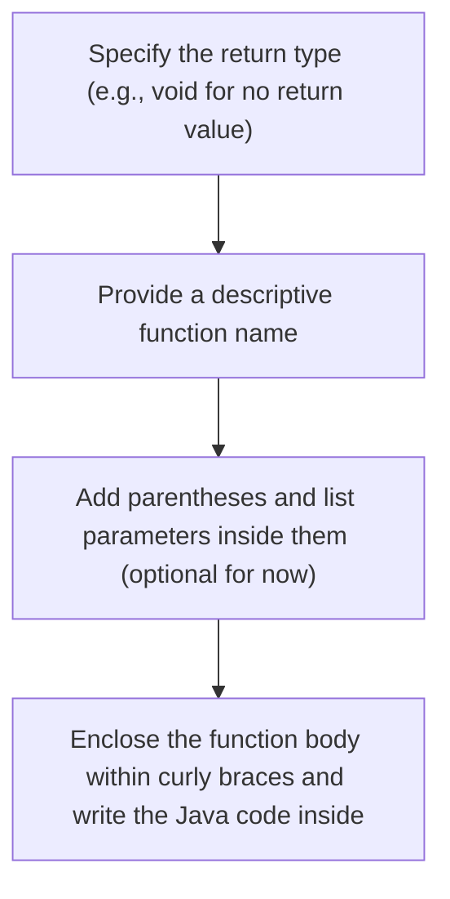
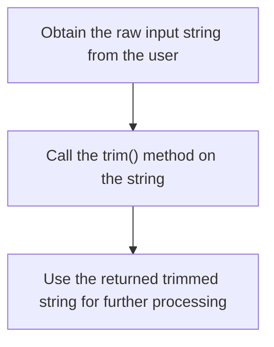
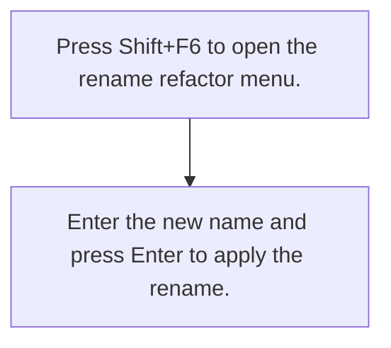
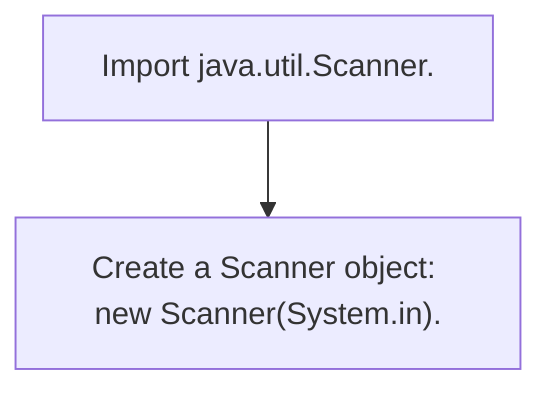

> UNVERIFIED PREVIEW — semantic and educational review required.

# Study notes: java

*Generated from assembled notes*

---

## JDK

> Paraphrase candidate: semantic support remains unresolved; this is not a verified factual claim.

### JDK

JDK stands for Java Development Kit, a software development environment for building Java applications that includes a compiler, a Java Runtime Environment, and other tools.

*[Knowledge ID: DEF_0001 | Sources: T0001]*

> Paraphrase candidate: semantic support remains unresolved; this is not a verified factual claim.

### Java SE

Java SE stands for Java Standard Edition.

*[Knowledge ID: DEF_0002 | Sources: T0001]*

> Paraphrase candidate: semantic support remains unresolved; this is not a verified factual claim.

JDK includes a compiler, a Java Runtime Environment, and other reusable code components.

*[Knowledge ID: FCT_0003 | Sources: T0001]*

> Paraphrase candidate: semantic support remains unresolved; this is not a verified factual claim.

The JDK can be downloaded for various platforms such as Linux, macOS, and Windows.

*[Knowledge ID: FCT_0004 | Sources: T0001]*

## function

### function

a block of code that performs a task

*[Knowledge ID: DEF_0032 | Sources: T0002]*

> Paraphrase candidate: semantic support remains unresolved; this is not a verified factual claim.

### return type

the type of value a function returns; if a function does not return a value the return type is void

*[Knowledge ID: DEF_0033 | Sources: T0002]*

> Paraphrase candidate: semantic support remains unresolved; this is not a verified factual claim.

### void

a reserved keyword in Java indicating that a function does not return a value

*[Knowledge ID: DEF_0003 | Sources: T0002]*

> Unavailable or unresolved source information: PARTIALLY\_SUPPORTED. Original candidates remain in the audit.

Available source excerpt: ones are NetBeans Eclipse and IntelliJ in this Java course I'm gonna use IntelliJ but if you have a favorite editor feel free to use that to take this course that's perfectly fine so let's search for IntelliJ download all right you can see download IntelliJ IDEA click on this link over here download the community edition which is absolutely free and it's more than enough for this course so download all right now let's drag and drop this onto the Applications folder beautiful alright we've

*[Knowledge ID: FCT_0180 | Sources: T0002]*

> Procedure correctness not reviewed; do not assume this is a correct solution.
> Unavailable or unresolved source information: PARTIALLY\_SUPPORTED. Original candidates remain in the audit.

Available source excerpt: ones are NetBeans Eclipse and IntelliJ in this Java course I'm gonna use IntelliJ but if you have a favorite editor feel free to use that to take this course that's perfectly fine so let's search for IntelliJ download all right you can see download IntelliJ IDEA click on this link over here download the community edition which is absolutely free and it's more than enough for this course so download all right now let's drag and drop this onto the Applications folder beautiful alright we've

*[Knowledge ID: PRC_0005 | Sources: T0002]*

> Procedure correctness not reviewed; do not assume this is a correct solution.
> Paraphrase candidate: semantic support remains unresolved; this is not a verified factual claim.

#### Flowchart: Create a basic function in Java



*[Knowledge ID: PRC_0006 | Sources: T0002]*

## class

> Paraphrase candidate: semantic support remains unresolved; this is not a verified factual claim.

### class

a container for one or more related functions; it is used to organize code similar to sections in a supermarket that contain related products

*[Knowledge ID: DEF_0034 | Sources: T0003]*

### method

a function that is part of a class

*[Knowledge ID: DEF_0035 | Sources: T0003]*

> Paraphrase candidate: semantic support remains unresolved; this is not a verified factual claim.

### access modifier

a special keyword that determines if other classes and methods in the program can access these classes and methods (e.g., public, private)

*[Knowledge ID: DEF_0036 | Sources: T0003]*

> Paraphrase candidate: semantic support remains unresolved; this is not a verified factual claim.

### Pascal naming convention

a convention for naming classes where the first letter of every word is uppercase

*[Knowledge ID: DEF_0004 | Sources: T0003]*

> Paraphrase candidate: semantic support remains unresolved; this is not a verified factual claim.

### camel naming convention

a convention for naming methods where the first letter of the first word is lowercase and the first letter of each subsequent word is uppercase

*[Knowledge ID: DEF_0005 | Sources: T0003]*

> Paraphrase candidate: semantic support remains unresolved; this is not a verified factual claim.

In Java the left brace is placed on the same line as the function definition.

*[Knowledge ID: FCT_0006 | Sources: T0003]*

> Paraphrase candidate: semantic support remains unresolved; this is not a verified factual claim.

Every Java program must have at least one function called main, which is the entry point.

*[Knowledge ID: FCT_0007 | Sources: T0003]*

> Paraphrase candidate: semantic support remains unresolved; this is not a verified factual claim.

Functions in Java must belong to a class; they cannot exist independently.

*[Knowledge ID: FCT_0008 | Sources: T0003]*

> Paraphrase candidate: semantic support remains unresolved; this is not a verified factual claim.

Every Java program must have at least one class that contains the main function.

*[Knowledge ID: FCT_0009 | Sources: T0003]*

> Unavailable or unresolved source information: PARTIALLY\_SUPPORTED. Original candidates remain in the audit.

Available source excerpt: programming languages like Python we can have a function that exists outside of a class so we call it a function but when a function belongs to a class we refer to it as a method of that class okay now in Java all these classes and methods should have an access modifier an access modifier is a special keyword that determines if other classes and methods in this program can access these classes and methods we have various access modifiers like public private and so on now most of the time we use

*[Knowledge ID: FCT_0010 | Sources: T0003]*

## package statement

> Paraphrase candidate: semantic support remains unresolved; this is not a verified factual claim.

### package statement

specifies what package this class belongs to

*[Knowledge ID: DEF_0037 | Sources: T0005]*

> Paraphrase candidate: semantic support remains unresolved; this is not a verified factual claim.

### main method

a public static method with return type void that may take a parameter for passing values to the program

*[Knowledge ID: DEF_0038 | Sources: T0005]*

> Paraphrase candidate: semantic support remains unresolved; this is not a verified factual claim.

lines that start with // are comments; they are used to explain code and are not executed

*[Knowledge ID: EXP_0003 | Sources: T0005]*

> Paraphrase candidate: semantic support remains unresolved; this is not a verified factual claim.

All Java files should have the .java extension

*[Knowledge ID: FCT_0181 | Sources: T0005]*

> Paraphrase candidate: semantic support remains unresolved; this is not a verified factual claim.

In Java, statements must be terminated with a semicolon

*[Knowledge ID: FCT_0005 | Sources: T0005]*

> Paraphrase candidate: semantic support remains unresolved; this is not a verified factual claim.

The System class is defined in the java.lang package

*[Knowledge ID: FCT_0182 | Sources: T0005]*

## String

> Paraphrase candidate: semantic support remains unresolved; this is not a verified factual claim.

### String

a string is a sequence of characters

*[Knowledge ID: DEF_0039 | Sources: T0006]*

> Paraphrase candidate: semantic support remains unresolved; this is not a verified factual claim.
> Unavailable or unresolved source information: PARTIALLY\_SUPPORTED. Original candidates remain in the audit.

Available source excerpt: best to create the best possible Java course and I would really appreciate it if you support me by liking and sharing this video on the social networks that you use often also be sure to subscribe and enable the notifications so next time I upload a video you'll get notified thank you so much and let's continue watching all right now let's see what exactly happens under the hood the moment we run a Java program in IntelliJ there are basically two steps involved here compilation and execution in

When we run a Java program in IntelliJ there are basically two steps involved: compilation and execution.

*[Knowledge ID: EXP_0002 | Sources: T0006]*

> Paraphrase candidate: semantic support remains unresolved; this is not a verified factual claim.

IntelliJ uses the Java compiler to compile our code into a different format called Java bytecode.

*[Knowledge ID: EXP_0076 | Sources: T0006]*

> Paraphrase candidate: semantic support remains unresolved; this is not a verified factual claim.

The dot operator is used to access members of a class.

*[Knowledge ID: FCT_0183 | Sources: T0006]*

> Paraphrase candidate: semantic support remains unresolved; this is not a verified factual claim.

The icon 'F' indicates a field member.

*[Knowledge ID: FCT_0184 | Sources: T0006]*

> Paraphrase candidate: semantic support remains unresolved; this is not a verified factual claim.

The icon 'M' indicates a method member.

*[Knowledge ID: FCT_0185 | Sources: T0006]*

> Paraphrase candidate: semantic support remains unresolved; this is not a verified factual claim.

The method 'println' (short for line) is used to print a line of text.

*[Knowledge ID: FCT_0186 | Sources: T0006]*

> Paraphrase candidate: semantic support remains unresolved; this is not a verified factual claim.

Textual data in Java should be surrounded by double quotes.

*[Knowledge ID: FCT_0187 | Sources: T0006]*

> Paraphrase candidate: semantic support remains unresolved; this is not a verified factual claim.

Pressing Ctrl+R runs the program in IntelliJ.

*[Knowledge ID: FCT_0188 | Sources: T0006]*

> Unavailable or unresolved source information: PARTIALLY\_SUPPORTED. Original candidates remain in the audit.

Available source excerpt: because they're faster so ctrl + R now IntelliJ is building our application and we can see the result in this little terminal window so here's our hello work message so that was our first Java program next I'm going to explain how Java code gets executed under the hood hey Marsh here I just wanted to let you know that you really don't have to memorize anything in this course I've put together a comprehensive cheat sheet with summary notes that you can download below this video so I've done my

*[Knowledge ID: FCT_0189 | Sources: T0006]*

> Procedure correctness not reviewed; do not assume this is a correct solution.
> Paraphrase candidate: semantic support remains unresolved; this is not a verified factual claim.
> Unavailable or unresolved source information: PARTIALLY\_SUPPORTED. Original candidates remain in the audit.

Available source excerpt: here we want to print the hello word on the terminal so let's type double quotes and inside these quotes right hello world so hello word is textual data in Java whenever we deal with textual data we should always surround them with double quotes now we say we have his string so a string is a sequence of characters all right so we're done with our first program now to execute this we can click on this icon on the toolbar look at the shortcut on Mac it's ctrl + R I always prefer to use shortcuts

Available source excerpt: because they're faster so ctrl + R now IntelliJ is building our application and we can see the result in this little terminal window so here's our hello work message so that was our first Java program next I'm going to explain how Java code gets executed under the hood hey Marsh here I just wanted to let you know that you really don't have to memorize anything in this course I've put together a comprehensive cheat sheet with summary notes that you can download below this video so I've done my

Available source excerpt: the compilation step IntelliJ uses the Java compiler to compile our code into a different format called Java bytecode this Java compiler comes with the Java development kit that

Run a Java program in IntelliJ

Press Ctrl+R to start the run process.

IntelliJ compiles the code into Java bytecode.

*[Knowledge ID: PRC_0011 | Sources: T0006]*

## Java bytecode

> Unavailable or unresolved source information: PARTIALLY\_SUPPORTED. Original candidates remain in the audit.

Available source excerpt: here we have our main dat class file so this was the compilation step now this Java bytecode that we have in this file is platform independent and that means it can run on Windows Mac Linux or any operating systems that has a Java runtime environment if you go to java.com slash download we can download java or more accurately java runtime environment for various operating systems this Java Runtime environment has a software component called Java Virtual Machine or JVM this JVM takes our Java

Java bytecode

*[Knowledge ID: EXP_0001 | Sources: T0007]*

> Unavailable or unresolved source information: PARTIALLY\_SUPPORTED. Original candidates remain in the audit.

Available source excerpt: here we have our main dat class file so this was the compilation step now this Java bytecode that we have in this file is platform independent and that means it can run on Windows Mac Linux or any operating systems that has a Java runtime environment if you go to java.com slash download we can download java or more accurately java runtime environment for various operating systems this Java Runtime environment has a software component called Java Virtual Machine or JVM this JVM takes our Java

Available source excerpt: bytecode and translates it to the native code for the underlying operating system so if you're on Windows machine this Java Virtual Machine converts or Java bytecode into the native code that windows can understand this architecture is the reason why Java applications are portable or platform independent we can write a Java program on a Windows machine and execute it on Linux Mac or any other operating systems that have a Java runtime environment c-sharp and python also have the same

*[Knowledge ID: EXP_0077 | Sources: T0007]*

> Unavailable or unresolved source information: PARTIALLY\_SUPPORTED. Original candidates remain in the audit.

Available source excerpt: file now we can invoke the Java compiler like this Java C and pass the name or Java file as an argument so main the Java if you're on Mac or Linux make sure to spell this with a capital M because these operating systems are case-sensitive so enter now let's look at the content of this folder on Mac or Linux we can type LS on windows we type dir so let's take a look in this folder now we have a new file main class this is the bytecode representation of this Java file now let me use IntelliJ to

*[Knowledge ID: EXP_0078 | Sources: T0007]*

> Paraphrase candidate: semantic support remains unresolved; this is not a verified factual claim.

The compiled class file (bytecode) is stored in an output folder separate from the source folder.

*[Knowledge ID: FCT_0190 | Sources: T0007]*

> Unavailable or unresolved source information: PARTIALLY\_SUPPORTED. Original candidates remain in the audit.

Available source excerpt: here we have our main dat class file so this was the compilation step now this Java bytecode that we have in this file is platform independent and that means it can run on Windows Mac Linux or any operating systems that has a Java runtime environment if you go to java.com slash download we can download java or more accurately java runtime environment for various operating systems this Java Runtime environment has a software component called Java Virtual Machine or JVM this JVM takes our Java

*[Knowledge ID: FCT_0191 | Sources: T0007]*

> Unavailable or unresolved source information: PARTIALLY\_SUPPORTED. Original candidates remain in the audit.

Available source excerpt: bytecode and translates it to the native code for the underlying operating system so if you're on Windows machine this Java Virtual Machine converts or Java bytecode into the native code that windows can understand this architecture is the reason why Java applications are portable or platform independent we can write a Java program on a Windows machine and execute it on Linux Mac or any other operating systems that have a Java runtime environment c-sharp and python also have the same

*[Knowledge ID: FCT_0192 | Sources: T0007]*

> Procedure correctness not reviewed; do not assume this is a correct solution.
> Paraphrase candidate: semantic support remains unresolved; this is not a verified factual claim.
> Unavailable or unresolved source information: PARTIALLY\_SUPPORTED. Original candidates remain in the audit.

Available source excerpt: file now we can invoke the Java compiler like this Java C and pass the name or Java file as an argument so main the Java if you're on Mac or Linux make sure to spell this with a capital M because these operating systems are case-sensitive so enter now let's look at the content of this folder on Mac or Linux we can type LS on windows we type dir so let's take a look in this folder now we have a new file main class this is the bytecode representation of this Java file now let me use IntelliJ to

Open a terminal (or command prompt) in the folder containing the source file.

*[Knowledge ID: PRC_0007 | Sources: T0007]*

> Procedure correctness not reviewed; do not assume this is a correct solution.
> Paraphrase candidate: semantic support remains unresolved; this is not a verified factual claim.

**Run a compiled Java program:**

- In the terminal, execute the JVM with the class name: `java Main`.

*[Knowledge ID: PRC_0008 | Sources: T0007]*

## Source T0008

Java was developed by James Gosling in 1995 at Sun Microsystems

*[Knowledge ID: FCT_0001 | Sources: T0008]*

> Paraphrase candidate: semantic support remains unresolved; this is not a verified factual claim.

Sun Microsystems was later acquired by Oracle in 2010

*[Knowledge ID: FCT_0002 | Sources: T0008]*

> Paraphrase candidate: semantic support remains unresolved; this is not a verified factual claim.

It was originally called Oak after an oak tree that stood outside Gosling's office

*[Knowledge ID: FCT_0193 | Sources: T0008]*

> Paraphrase candidate: semantic support remains unresolved; this is not a verified factual claim.

It was later renamed to Green and was finally renamed to Java inspired by Java coffee

*[Knowledge ID: FCT_0194 | Sources: T0008]*

> Paraphrase candidate: semantic support remains unresolved; this is not a verified factual claim.

Java Standard Edition 12 was released in March 2019

*[Knowledge ID: FCT_0195 | Sources: T0008]*

Java has close to 9 million developers worldwide

*[Knowledge ID: FCT_0196 | Sources: T0008]*

> Paraphrase candidate: semantic support remains unresolved; this is not a verified factual claim.

About 3 billion mobile phones run Java

*[Knowledge ID: FCT_0197 | Sources: T0008]*

> Paraphrase candidate: semantic support remains unresolved; this is not a verified factual claim.

120 million TV sets and every Blu-ray player run Java

*[Knowledge ID: FCT_0198 | Sources: T0008]*

> Paraphrase candidate: semantic support remains unresolved; this is not a verified factual claim.

The average salary of a Java developer in the US is just over $100,000 per year

*[Knowledge ID: FCT_0199 | Sources: T0008]*

> Paraphrase candidate: semantic support remains unresolved; this is not a verified factual claim.

Java Standard Edition is the core Java platform used in this course and contains all libraries every Java developer must learn

*[Knowledge ID: FCT_0200 | Sources: T0008]*

> Paraphrase candidate: semantic support remains unresolved; this is not a verified factual claim.

Java Enterprise Edition is built on top of Java Standard Edition and provides additional libraries for building fault tolerant distributed multi-tiered software

*[Knowledge ID: FCT_0011 | Sources: T0008]*

> Paraphrase candidate: semantic support remains unresolved; this is not a verified factual claim.

Java Micro Edition is a subset of Java Standard Edition designed for mobile devices with specific libraries

*[Knowledge ID: FCT_0012 | Sources: T0008]*

> Paraphrase candidate: semantic support remains unresolved; this is not a verified factual claim.

Java Card is used in smart cards

*[Knowledge ID: FCT_0013 | Sources: T0008]*

## Source T0009

> Unavailable or unresolved source information: PARTIALLY\_SUPPORTED. Original candidates remain in the audit.

Available source excerpt: the most out of it this course is the first part of my complete four-part Java series each part is about three to four hours long so it can easily complete it in a day or two in the first part which is what you're watching you're gonna learn the fundamentals of programming with Java in the next section you'll learn about the type system in Java you will learn how to work with various types such as purrs strings boolean's and arrays by the end of this section you will build a mortgage calculator

*[Knowledge ID: FCT_0201 | Sources: T0009]*

> Paraphrase candidate: semantic support remains unresolved; this is not a verified factual claim.

The first part teaches fundamentals of programming with Java.

*[Knowledge ID: FCT_0202 | Sources: T0009]*

> Paraphrase candidate: semantic support remains unresolved; this is not a verified factual claim.

Subsequent sections cover the Java type system, including primitives, strings, booleans, and arrays, and culminate in building a mortgage calculator.

*[Knowledge ID: FCT_0203 | Sources: T0009]*

> Paraphrase candidate: semantic support remains unresolved; this is not a verified factual claim.

The second part introduces control flow statements, such as conditional statements and loops, and adds data validation to the mortgage calculator.

*[Knowledge ID: FCT_0204 | Sources: T0009]*

> Paraphrase candidate: semantic support remains unresolved; this is not a verified factual claim.

Clean and expressive code distinguishes outstanding programmers; the course teaches clean coding techniques for maintainable code.

*[Knowledge ID: FCT_0205 | Sources: T0009]*

> Paraphrase candidate: semantic support remains unresolved; this is not a verified factual claim.

The final section covers finding and fixing errors in Java programs and packaging them for deployment.

*[Knowledge ID: FCT_0206 | Sources: T0009]*

> Unavailable or unresolved source information: PARTIALLY\_SUPPORTED. Original candidates remain in the audit.

Available source excerpt: foundation on how to start programming in Java in the second part we'll talk about object oriented programming which is a style of programming use in most if not all Java applications whether you want to use Java to build web mobile or desktop applications you need to understand object-oriented programming well because otherwise you're going to constantly hit obstacles in the third part we're going to talk about core Java API is or application programming interfaces you'll learn about many of

*[Knowledge ID: FCT_0207 | Sources: T0009]*

> Unavailable or unresolved source information: PARTIALLY\_SUPPORTED. Original candidates remain in the audit.

Available source excerpt: foundation on how to start programming in Java in the second part we'll talk about object oriented programming which is a style of programming use in most if not all Java applications whether you want to use Java to build web mobile or desktop applications you need to understand object-oriented programming well because otherwise you're going to constantly hit obstacles in the third part we're going to talk about core Java API is or application programming interfaces you'll learn about many of

*[Knowledge ID: FCT_0208 | Sources: T0009]*

> Paraphrase candidate: semantic support remains unresolved; this is not a verified factual claim.

The fourth part explores advanced Java features such as streams, threads, and database programming.

*[Knowledge ID: FCT_0209 | Sources: T0009]*

> Paraphrase candidate: semantic support remains unresolved; this is not a verified factual claim.

Learners will study variables, constants, primitive and reference types, casting/type conversion, and how to work with numbers, strings, arrays, and user input.

*[Knowledge ID: FCT_0210 | Sources: T0009]*

> Paraphrase candidate: semantic support remains unresolved; this is not a verified factual claim.

A project assignment requires building a mortgage calculator independently.

*[Knowledge ID: FCT_0211 | Sources: T0009]*

## variable

> Unavailable or unresolved source information: PARTIALLY\_SUPPORTED. Original candidates remain in the audit.

Available source excerpt: are you ready now let's jump in and get started in this tutorial we're gonna talk about variables in Java we use variables to temporarily store data in computer's memory here is an example imagine in this program you want to store someone's age in the memory so we declare a variable like this ant age equals 30 so int or integer is the type of this variable so in this variable we can only store integers which are whole numbers like 1 2 3 4 numbers that don't have a decimal point now in Java we

variable

*[Knowledge ID: DEF_0040 | Sources: T0010]*

> Paraphrase candidate: semantic support remains unresolved; this is not a verified factual claim.

### identifier

the name or label given to a variable so it can be identified in code

*[Knowledge ID: DEF_0041 | Sources: T0010]*

> Paraphrase candidate: semantic support remains unresolved; this is not a verified factual claim.

### assignment operator

the equal sign (=) used to assign an initial value to a variable

*[Knowledge ID: DEF_0042 | Sources: T0010]*

> Paraphrase candidate: semantic support remains unresolved; this is not a verified factual claim.

### initialization

the act of giving a variable its first value at the time of declaration

*[Knowledge ID: DEF_0043 | Sources: T0010]*

> Paraphrase candidate: semantic support remains unresolved; this is not a verified factual claim.

### camelCase

a naming convention where the first word is lowercase and each subsequent word starts with a capital letter

*[Knowledge ID: DEF_0044 | Sources: T0010]*

> Unavailable or unresolved source information: PARTIALLY\_SUPPORTED. Original candidates remain in the audit.

Available source excerpt: are you ready now let's jump in and get started in this tutorial we're gonna talk about variables in Java we use variables to temporarily store data in computer's memory here is an example imagine in this program you want to store someone's age in the memory so we declare a variable like this ant age equals 30 so int or integer is the type of this variable so in this variable we can only store integers which are whole numbers like 1 2 3 4 numbers that don't have a decimal point now in Java we

*[Knowledge ID: EXP_0006 | Sources: T0010]*

> Paraphrase candidate: semantic support remains unresolved; this is not a verified factual claim.

A variable must be initialized (given an initial value) before it is used in Java.

*[Knowledge ID: EXP_0007 | Sources: T0010]*

> Paraphrase candidate: semantic support remains unresolved; this is not a verified factual claim.

Declaring multiple variables on the same line makes code harder to read and is therefore not recommended.

*[Knowledge ID: EXP_0008 | Sources: T0010]*

> Paraphrase candidate: semantic support remains unresolved; this is not a verified factual claim.

Variable names should follow camelCase: capitalize the first letter of each word except the first.

*[Knowledge ID: EXP_0009 | Sources: T0010]*

> Claim review: NOT\_REVIEWED — Generated declaration/snippet/comment is not literal text in the source. This confirms lack of literal-source fidelity, not that its behavior is necessarily wrong.
> Literal source code unavailable. Original generated snippet retained in the audit only.
> Unavailable or unresolved source information: PARTIALLY\_SUPPORTED, SOURCE\_MISSING. Original candidates remain in the audit.

Available source excerpt: are you ready now let's jump in and get started in this tutorial we're gonna talk about variables in Java we use variables to temporarily store data in computer's memory here is an example imagine in this program you want to store someone's age in the memory so we declare a variable like this ant age equals 30 so int or integer is the type of this variable so in this variable we can only store integers which are whole numbers like 1 2 3 4 numbers that don't have a decimal point now in Java we have several different types I'm gonna talk about them in the next tutorial so first we specify the type of our variable then we give it a name or a label this is also called an identifier because we use it to identify our variable this equal sign is called the assignment operator and 30 is the initial value that we are assigning to this variable so we say on line 6 we're initializing this variable which means we're giving it an initial value you always have to initialize our variables before reading them so with this line we're storing number 30 somewhere in computer's memory and we're assigning this label to that memory location now on line 7 instead of printing hello world we can print the value of the age variable take a look so I'm gonna run this program using ctrl + R there you go now we see 30 on the terminal beautiful we can also change the value of our variable so after we initialize it per house we can change it to 35 now when we run this program again we see it 35 beautiful we can also initialize multiple variables on the same line but this is something that I don't recommend because it makes your code ugly and hard to read here is an example we can declare another variable like temperature and set it to 20 so using a comma we can declare multiple variables on the same line now even though this is technically possible it's not something that I recommend so it's always better to declare one variable on each line like this we can also copy the value of one variable into another here is an example let me delete these variables and declare a new variable called my age we set it to 30 and then we declare another variable like her age and we set it to my age so now when we print her age we're gonna see 30 take a look so on line seven recapping the value of this variable into this other variable now one thing I want you to pay attention to here is the convention I have used for naming our variables as I told you before this is called the camelcase notation so we should capitalize the first letter of every word except the first word so in this case the first

Available source excerpt: are you ready now let's jump in and get started in this tutorial we're gonna talk about variables in Java we use variables to temporarily store data in computer's memory here is an example imagine in this program you want to store someone's age in the memory so we declare a variable like this ant age equals 30 so int or integer is the type of this variable so in this variable we can only store integers which are whole numbers like 1 2 3 4 numbers that don't have a decimal point now in Java we

*[Knowledge ID: EXM_0010 | Sources: T0010]*

> Claim review: NOT\_REVIEWED — Generated declaration/snippet/comment is not literal text in the source. This confirms lack of literal-source fidelity, not that its behavior is necessarily wrong.
> Literal source code unavailable. Original generated snippet retained in the audit only.
> Paraphrase candidate: semantic support remains unresolved; this is not a verified factual claim.
> Unavailable or unresolved source information: SOURCE\_MISSING. Original candidates remain in the audit.

Available source excerpt: are you ready now let's jump in and get started in this tutorial we're gonna talk about variables in Java we use variables to temporarily store data in computer's memory here is an example imagine in this program you want to store someone's age in the memory so we declare a variable like this ant age equals 30 so int or integer is the type of this variable so in this variable we can only store integers which are whole numbers like 1 2 3 4 numbers that don't have a decimal point now in Java we have several different types I'm gonna talk about them in the next tutorial so first we specify the type of our variable then we give it a name or a label this is also called an identifier because we use it to identify our variable this equal sign is called the assignment operator and 30 is the initial value that we are assigning to this variable so we say on line 6 we're initializing this variable which means we're giving it an initial value you always have to initialize our variables before reading them so with this line we're storing number 30 somewhere in computer's memory and we're assigning this label to that memory location now on line 7 instead of printing hello world we can print the value of the age variable take a look so I'm gonna run this program using ctrl + R there you go now we see 30 on the terminal beautiful we can also change the value of our variable so after we initialize it per house we can change it to 35 now when we run this program again we see it 35 beautiful we can also initialize multiple variables on the same line but this is something that I don't recommend because it makes your code ugly and hard to read here is an example we can declare another variable like temperature and set it to 20 so using a comma we can declare multiple variables on the same line now even though this is technically possible it's not something that I recommend so it's always better to declare one variable on each line like this we can also copy the value of one variable into another here is an example let me delete these variables and declare a new variable called my age we set it to 30 and then we declare another variable like her age and we set it to my age so now when we print her age we're gonna see 30 take a look so on line seven recapping the value of this variable into this other variable now one thing I want you to pay attention to here is the convention I have used for naming our variables as I told you before this is called the camelcase notation so we should capitalize the first letter of every word except the first word so in this case the first

printing the value of a variable

*[Knowledge ID: EXM_0011 | Sources: T0010]*

> Claim review: NOT\_REVIEWED — Generated declaration/snippet/comment is not literal text in the source. This confirms lack of literal-source fidelity, not that its behavior is necessarily wrong.
> Literal source code unavailable. Original generated snippet retained in the audit only.
> Paraphrase candidate: semantic support remains unresolved; this is not a verified factual claim.
> Unavailable or unresolved source information: SOURCE\_MISSING. Original candidates remain in the audit.

Available source excerpt: are you ready now let's jump in and get started in this tutorial we're gonna talk about variables in Java we use variables to temporarily store data in computer's memory here is an example imagine in this program you want to store someone's age in the memory so we declare a variable like this ant age equals 30 so int or integer is the type of this variable so in this variable we can only store integers which are whole numbers like 1 2 3 4 numbers that don't have a decimal point now in Java we have several different types I'm gonna talk about them in the next tutorial so first we specify the type of our variable then we give it a name or a label this is also called an identifier because we use it to identify our variable this equal sign is called the assignment operator and 30 is the initial value that we are assigning to this variable so we say on line 6 we're initializing this variable which means we're giving it an initial value you always have to initialize our variables before reading them so with this line we're storing number 30 somewhere in computer's memory and we're assigning this label to that memory location now on line 7 instead of printing hello world we can print the value of the age variable take a look so I'm gonna run this program using ctrl + R there you go now we see 30 on the terminal beautiful we can also change the value of our variable so after we initialize it per house we can change it to 35 now when we run this program again we see it 35 beautiful we can also initialize multiple variables on the same line but this is something that I don't recommend because it makes your code ugly and hard to read here is an example we can declare another variable like temperature and set it to 20 so using a comma we can declare multiple variables on the same line now even though this is technically possible it's not something that I recommend so it's always better to declare one variable on each line like this we can also copy the value of one variable into another here is an example let me delete these variables and declare a new variable called my age we set it to 30 and then we declare another variable like her age and we set it to my age so now when we print her age we're gonna see 30 take a look so on line seven recapping the value of this variable into this other variable now one thing I want you to pay attention to here is the convention I have used for naming our variables as I told you before this is called the camelcase notation so we should capitalize the first letter of every word except the first word so in this case the first

changing the value of a variable after initialization

*[Knowledge ID: EXM_0012 | Sources: T0010]*

> Claim review: NOT\_REVIEWED — Generated declaration/snippet/comment is not literal text in the source. This confirms lack of literal-source fidelity, not that its behavior is necessarily wrong.
> Literal source code unavailable. Original generated snippet retained in the audit only.
> Paraphrase candidate: semantic support remains unresolved; this is not a verified factual claim.
> Unavailable or unresolved source information: SOURCE\_MISSING. Original candidates remain in the audit.

Available source excerpt: are you ready now let's jump in and get started in this tutorial we're gonna talk about variables in Java we use variables to temporarily store data in computer's memory here is an example imagine in this program you want to store someone's age in the memory so we declare a variable like this ant age equals 30 so int or integer is the type of this variable so in this variable we can only store integers which are whole numbers like 1 2 3 4 numbers that don't have a decimal point now in Java we have several different types I'm gonna talk about them in the next tutorial so first we specify the type of our variable then we give it a name or a label this is also called an identifier because we use it to identify our variable this equal sign is called the assignment operator and 30 is the initial value that we are assigning to this variable so we say on line 6 we're initializing this variable which means we're giving it an initial value you always have to initialize our variables before reading them so with this line we're storing number 30 somewhere in computer's memory and we're assigning this label to that memory location now on line 7 instead of printing hello world we can print the value of the age variable take a look so I'm gonna run this program using ctrl + R there you go now we see 30 on the terminal beautiful we can also change the value of our variable so after we initialize it per house we can change it to 35 now when we run this program again we see it 35 beautiful we can also initialize multiple variables on the same line but this is something that I don't recommend because it makes your code ugly and hard to read here is an example we can declare another variable like temperature and set it to 20 so using a comma we can declare multiple variables on the same line now even though this is technically possible it's not something that I recommend so it's always better to declare one variable on each line like this we can also copy the value of one variable into another here is an example let me delete these variables and declare a new variable called my age we set it to 30 and then we declare another variable like her age and we set it to my age so now when we print her age we're gonna see 30 take a look so on line seven recapping the value of this variable into this other variable now one thing I want you to pay attention to here is the convention I have used for naming our variables as I told you before this is called the camelcase notation so we should capitalize the first letter of every word except the first word so in this case the first

declaring multiple variables on one line (not recommended)

*[Knowledge ID: EXM_0013 | Sources: T0010]*

> Claim review: NOT\_REVIEWED — Generated declaration/snippet/comment is not literal text in the source. This confirms lack of literal-source fidelity, not that its behavior is necessarily wrong.
> Literal source code unavailable. Original generated snippet retained in the audit only.
> Paraphrase candidate: semantic support remains unresolved; this is not a verified factual claim.
> Unavailable or unresolved source information: SOURCE\_MISSING. Original candidates remain in the audit.

Available source excerpt: are you ready now let's jump in and get started in this tutorial we're gonna talk about variables in Java we use variables to temporarily store data in computer's memory here is an example imagine in this program you want to store someone's age in the memory so we declare a variable like this ant age equals 30 so int or integer is the type of this variable so in this variable we can only store integers which are whole numbers like 1 2 3 4 numbers that don't have a decimal point now in Java we have several different types I'm gonna talk about them in the next tutorial so first we specify the type of our variable then we give it a name or a label this is also called an identifier because we use it to identify our variable this equal sign is called the assignment operator and 30 is the initial value that we are assigning to this variable so we say on line 6 we're initializing this variable which means we're giving it an initial value you always have to initialize our variables before reading them so with this line we're storing number 30 somewhere in computer's memory and we're assigning this label to that memory location now on line 7 instead of printing hello world we can print the value of the age variable take a look so I'm gonna run this program using ctrl + R there you go now we see 30 on the terminal beautiful we can also change the value of our variable so after we initialize it per house we can change it to 35 now when we run this program again we see it 35 beautiful we can also initialize multiple variables on the same line but this is something that I don't recommend because it makes your code ugly and hard to read here is an example we can declare another variable like temperature and set it to 20 so using a comma we can declare multiple variables on the same line now even though this is technically possible it's not something that I recommend so it's always better to declare one variable on each line like this we can also copy the value of one variable into another here is an example let me delete these variables and declare a new variable called my age we set it to 30 and then we declare another variable like her age and we set it to my age so now when we print her age we're gonna see 30 take a look so on line seven recapping the value of this variable into this other variable now one thing I want you to pay attention to here is the convention I have used for naming our variables as I told you before this is called the camelcase notation so we should capitalize the first letter of every word except the first word so in this case the first

copying the value of one variable into another

*[Knowledge ID: EXM_0014 | Sources: T0010]*

> Paraphrase candidate: semantic support remains unresolved; this is not a verified factual claim.

int (integer) variables can only store whole numbers without decimal points.

*[Knowledge ID: FCT_0015 | Sources: T0010]*

> Paraphrase candidate: semantic support remains unresolved; this is not a verified factual claim.

The equal sign (=) is called the assignment operator in Java.

*[Knowledge ID: FCT_0016 | Sources: T0010]*

> Procedure correctness not reviewed; do not assume this is a correct solution.
> Paraphrase candidate: semantic support remains unresolved; this is not a verified factual claim.
> Unavailable or unresolved source information: PARTIALLY\_SUPPORTED. Original candidates remain in the audit.

Available source excerpt: are you ready now let's jump in and get started in this tutorial we're gonna talk about variables in Java we use variables to temporarily store data in computer's memory here is an example imagine in this program you want to store someone's age in the memory so we declare a variable like this ant age equals 30 so int or integer is the type of this variable so in this variable we can only store integers which are whole numbers like 1 2 3 4 numbers that don't have a decimal point now in Java we

Available source excerpt: reading them so with this line we're storing number 30 somewhere in computer's memory and we're assigning this label to that memory location now on line 7 instead of printing hello world we can print the value of the age variable take a look so I'm gonna run this program using ctrl + R there you go now we see 30 on the terminal beautiful we can also change the value of our variable so after we initialize it per house we can change it to 35 now when we run this program again we see it 35

initialize and use a variable

Print the variable to the terminal, e.g., System.out.println(age);

Assign a new value to the variable, e.g., age = 35;

Print the variable again to see the updated value.

*[Knowledge ID: PRC_0017 | Sources: T0010]*

## Choosing appropriate primitive type based on value range

> Paraphrase candidate: semantic support remains unresolved; this is not a verified factual claim.

> **Example: Choosing appropriate primitive type based on value range**
> 
> We use a byte instead of an int to store someone's age because a byte can store values up to 127, which is sufficient for an age.

*[Knowledge ID: EXM_0001 | Sources: T0011]*

> Claim review: NOT\_REVIEWED — Revised prose removes unsupported illustrative literal or restores the source-stated otherwise condition.
> Paraphrase candidate: semantic support remains unresolved; this is not a verified factual claim.

> **Example: Using underscores in numeric literals for readability**
> 
> Declare an integer viewsCount for a video's view count. Use underscores to group digits in a large integer literal for readability.

*[Knowledge ID: EXM_0002 | Sources: T0011]*

> Paraphrase candidate: semantic support remains unresolved; this is not a verified factual claim.

byte takes one byte of memory and can store values from -128 to 127.

*[Knowledge ID: FCT_0212 | Sources: T0011]*

> Paraphrase candidate: semantic support remains unresolved; this is not a verified factual claim.

short takes two bytes of memory and can store values up to 32,000.

*[Knowledge ID: FCT_0213 | Sources: T0011]*

> Paraphrase candidate: semantic support remains unresolved; this is not a verified factual claim.

int (integer) takes four bytes of memory and can store values up to two billion.

*[Knowledge ID: FCT_0214 | Sources: T0011]*

> Paraphrase candidate: semantic support remains unresolved; this is not a verified factual claim.

long takes eight bytes of memory and can store even larger numbers.

*[Knowledge ID: FCT_0215 | Sources: T0011]*

> Unavailable or unresolved source information: PARTIALLY\_SUPPORTED. Original candidates remain in the audit.

Available source excerpt: have a decimal point if you want to store a number that has a decimal point you have to use float or double float takes four bytes double takes eight bytes so obviously we double we can store larger numbers next we have char for storing a single character like ABC and this chart I've take two bytes so they support international letters and finally we have boolean for storing boolean values which can be true or false just like yes or no in English now let's take a look at a few examples earlier

*[Knowledge ID: FCT_0216 | Sources: T0011]*

> Unavailable or unresolved source information: PARTIALLY\_SUPPORTED. Original candidates remain in the audit.

Available source excerpt: have a decimal point if you want to store a number that has a decimal point you have to use float or double float takes four bytes double takes eight bytes so obviously we double we can store larger numbers next we have char for storing a single character like ABC and this chart I've take two bytes so they support international letters and finally we have boolean for storing boolean values which can be true or false just like yes or no in English now let's take a look at a few examples earlier

*[Knowledge ID: FCT_0217 | Sources: T0011]*

> Unavailable or unresolved source information: PARTIALLY\_SUPPORTED. Original candidates remain in the audit.

Available source excerpt: have a decimal point if you want to store a number that has a decimal point you have to use float or double float takes four bytes double takes eight bytes so obviously we double we can store larger numbers next we have char for storing a single character like ABC and this chart I've take two bytes so they support international letters and finally we have boolean for storing boolean values which can be true or false just like yes or no in English now let's take a look at a few examples earlier

*[Knowledge ID: FCT_0218 | Sources: T0011]*

> Unavailable or unresolved source information: PARTIALLY\_SUPPORTED. Original candidates remain in the audit.

Available source excerpt: have a decimal point if you want to store a number that has a decimal point you have to use float or double float takes four bytes double takes eight bytes so obviously we double we can store larger numbers next we have char for storing a single character like ABC and this chart I've take two bytes so they support international letters and finally we have boolean for storing boolean values which can be true or false just like yes or no in English now let's take a look at a few examples earlier

*[Knowledge ID: FCT_0219 | Sources: T0011]*

> Paraphrase candidate: semantic support remains unresolved; this is not a verified factual claim.

Underscores can be used in numeric literals in Java to separate groups of three digits for readability.

*[Knowledge ID: FCT_0220 | Sources: T0011]*

## primitive type

> Paraphrase candidate: semantic support remains unresolved; this is not a verified factual claim.

primitive types store simple values like numbers, boolean values, or single characters

*[Knowledge ID: CON_0001 | Sources: T0012]*

> Paraphrase candidate: semantic support remains unresolved; this is not a verified factual claim.

reference types store complex objects such as data objects or mail messages

*[Knowledge ID: CON_0002 | Sources: T0012]*

> Paraphrase candidate: semantic support remains unresolved; this is not a verified factual claim.

### long literal

A numeric literal that is interpreted as a long value by appending an uppercase or lowercase L suffix (prefer uppercase L because lowercase l resembles the digit 1).

*[Knowledge ID: DEF_0045 | Sources: T0012]*

> Unavailable or unresolved source information: PARTIALLY\_SUPPORTED. Original candidates remain in the audit.

Available source excerpt: variable is too large for storing the price of a product so we can change this to float that is better but you have a compilation error here take a look incompatible types required float but found double the reason we're seeing this error is that by default Java sees these numbers with a decimal point as double so even though we set the type of this variable to float Java sees this number as a double so just like how we added a suffix to this number to represent it as a long we need to add a

Available source excerpt: suffix here to represent this number as a float and that suffix is F once again we can use an upper case or lower case F so these are examples of numbers now let's store a character so char we call it letter and we set it to a note that we should always surround single characters with single quotes and multiple characters or strings with double quotes okay so char represents only one character string represents a series of characters and finally let's see an example of a boolean so we define a

*[Knowledge ID: DEF_0046 | Sources: T0012]*

> Unavailable or unresolved source information: PARTIALLY\_SUPPORTED. Original candidates remain in the audit.

Available source excerpt: suffix here to represent this number as a float and that suffix is F once again we can use an upper case or lower case F so these are examples of numbers now let's store a character so char we call it letter and we set it to a note that we should always surround single characters with single quotes and multiple characters or strings with double quotes okay so char represents only one character string represents a series of characters and finally let's see an example of a boolean so we define a

*[Knowledge ID: DEF_0047 | Sources: T0012]*

> Unavailable or unresolved source information: PARTIALLY\_SUPPORTED. Original candidates remain in the audit.

Available source excerpt: suffix here to represent this number as a float and that suffix is F once again we can use an upper case or lower case F so these are examples of numbers now let's store a character so char we call it letter and we set it to a note that we should always surround single characters with single quotes and multiple characters or strings with double quotes okay so char represents only one character string represents a series of characters and finally let's see an example of a boolean so we define a

*[Knowledge ID: DEF_0006 | Sources: T0012]*

> Paraphrase candidate: semantic support remains unresolved; this is not a verified factual claim.

### boolean literal

The literals true and false representing boolean values.

*[Knowledge ID: DEF_0007 | Sources: T0012]*

> Paraphrase candidate: semantic support remains unresolved; this is not a verified factual claim.

### reserved keyword

Words such as public, static, void, class, package that cannot be used as identifiers because they have special meaning in Java.

*[Knowledge ID: DEF_0008 | Sources: T0012]*

> Paraphrase candidate: semantic support remains unresolved; this is not a verified factual claim.

By default, Java interprets integer literals without a suffix as type int.

*[Knowledge ID: FCT_0221 | Sources: T0012]*

> Paraphrase candidate: semantic support remains unresolved; this is not a verified factual claim.

By default, Java interprets decimal literals without a suffix as type double.

*[Knowledge ID: FCT_0222 | Sources: T0012]*

> Paraphrase candidate: semantic support remains unresolved; this is not a verified factual claim.

A lowercase l suffix can be confused with the digit 1, so an uppercase L is recommended for long literals.

*[Knowledge ID: FCT_0223 | Sources: T0012]*

> Unavailable or unresolved source information: PARTIALLY\_SUPPORTED. Original candidates remain in the audit.

Available source excerpt: suffix here to represent this number as a float and that suffix is F once again we can use an upper case or lower case F so these are examples of numbers now let's store a character so char we call it letter and we set it to a note that we should always surround single characters with single quotes and multiple characters or strings with double quotes okay so char represents only one character string represents a series of characters and finally let's see an example of a boolean so we define a

*[Knowledge ID: FCT_0224 | Sources: T0012]*

> Paraphrase candidate: semantic support remains unresolved; this is not a verified factual claim.

### primitive type

a basic data type in Java that is allocated and released automatically by the Java Runtime Environment

*[Knowledge ID: DEF_0048 | Sources: T0013]*

> Paraphrase candidate: semantic support remains unresolved; this is not a verified factual claim.

### reference type

a type that refers to an object and requires explicit memory allocation with the new operator

*[Knowledge ID: DEF_0049 | Sources: T0013]*

> Paraphrase candidate: semantic support remains unresolved; this is not a verified factual claim.

### class

a blueprint or template for creating objects (instances)

*[Knowledge ID: DEF_0050 | Sources: T0013]*

### object

an instance of a class

*[Knowledge ID: DEF_0051 | Sources: T0013]*

> Unavailable or unresolved source information: PARTIALLY\_SUPPORTED. Original candidates remain in the audit.

Available source excerpt: us complete our code by suggesting these class names now here we have a date class in this package Java the util so this package contains a lot of utility classes that are useful in a lot of programs you also have a date class in a different package Java SQL or sequel which is used for programming databases so this is the benefit of packages we can have the same class but in different packages they don't conflict so packages create a namespace for our classes okay now in this case if we select

package

*[Knowledge ID: DEF_0052 | Sources: T0013]*

> Paraphrase candidate: semantic support remains unresolved; this is not a verified factual claim.

### import statement

a directive that makes a class from another package available in the current source file

*[Knowledge ID: DEF_0053 | Sources: T0013]*

> Paraphrase candidate: semantic support remains unresolved; this is not a verified factual claim.

### new operator

an operator that allocates memory for a reference type and creates a new object instance

*[Knowledge ID: DEF_0054 | Sources: T0013]*

> Paraphrase candidate: semantic support remains unresolved; this is not a verified factual claim.

### dot operator

the member-access operator used to refer to fields or methods of an object

*[Knowledge ID: DEF_0055 | Sources: T0013]*

> Paraphrase candidate: semantic support remains unresolved; this is not a verified factual claim.

### method

a function defined within a class that can be invoked on an object

*[Knowledge ID: DEF_0009 | Sources: T0013]*

> Paraphrase candidate: semantic support remains unresolved; this is not a verified factual claim.

Primitive types are allocated automatically by the runtime, while reference types require explicit memory allocation with the new operator and are managed by the runtime for deallocation.

*[Knowledge ID: EXP_0010 | Sources: T0013]*

> Unavailable or unresolved source information: PARTIALLY\_SUPPORTED. Original candidates remain in the audit.

Available source excerpt: us complete our code by suggesting these class names now here we have a date class in this package Java the util so this package contains a lot of utility classes that are useful in a lot of programs you also have a date class in a different package Java SQL or sequel which is used for programming databases so this is the benefit of packages we can have the same class but in different packages they don't conflict so packages create a namespace for our classes okay now in this case if we select

*[Knowledge ID: EXP_0011 | Sources: T0013]*

> Claim review: NOT\_REVIEWED — Generated declaration/snippet/comment is not literal text in the source. This confirms lack of literal-source fidelity, not that its behavior is necessarily wrong.
> Literal source code unavailable. Original generated snippet retained in the audit only.
> Paraphrase candidate: semantic support remains unresolved; this is not a verified factual claim.
> Unavailable or unresolved source information: SOURCE\_MISSING. Original candidates remain in the audit.

Available source excerpt: objects now in Java we have eight primitive types that you have seen before all the other types are reference types let me show you an example so here in this program first I'm gonna declare a primitive type let's say white age equals 30 now declaring and initializing a reference type is slightly different from primitive type let me show you so let's type date now here in this tooltip box which is called intellisense we can see various classes that have date in their name so IntelliJ is helping us complete our code by suggesting these class names now here we have a date class in this package Java the util so this package contains a lot of utility classes that are useful in a lot of programs you also have a date class in a different package Java SQL or sequel which is used for programming databases so this is the benefit of packages we can have the same class but in different packages they don't conflict so packages create a namespace for our classes okay now in this case if we select the first date class and press enter or tab IntelliJ automatically adds this line for us import Java that you till the date so because currently we are in this package in order to use a class from a different package we need to import it so here we're importing the date class in this package will talk about packages in more detail in the future so back to our date variable let's give this variable a name collect now now we set this here we need to use the new operator to allocate memory for this variable and this is one of the differences between the primitive and reference types when declaring primitive types we don't need to allocate memory memory is allocated and released by Java Runtime environment but when dealing with reference types we should always allocate memory now we don't have to release this memory Java Runtime environment will automatically take care of that so we use the new operator and then repeat the name of our class in this case date and then we add parentheses followed by a semicolon in this example this variable we have defined here is an instance of the date class so this class is defined template or blueprints for creating new objects new instances as another example we can have a class called human and we can have objects like John Bob Mary and so on so an object is an instance of a class now this object or this class have members that we can access using the dot operator so we can type now dot and these are all the members defined in this class or in this object for example we have a method called get time and this returns the time component of this object this is another difference between primitive types and reference types these primitive types don't

declaring and initializing a primitive type

*[Knowledge ID: EXM_0139 | Sources: T0013]*

> Claim review: NOT\_REVIEWED — Generated declaration/snippet/comment is not literal text in the source. This confirms lack of literal-source fidelity, not that its behavior is necessarily wrong.
> Literal source code unavailable. Original generated snippet retained in the audit only.
> Paraphrase candidate: semantic support remains unresolved; this is not a verified factual claim.
> Unavailable or unresolved source information: SOURCE\_MISSING. Original candidates remain in the audit.

Available source excerpt: objects now in Java we have eight primitive types that you have seen before all the other types are reference types let me show you an example so here in this program first I'm gonna declare a primitive type let's say white age equals 30 now declaring and initializing a reference type is slightly different from primitive type let me show you so let's type date now here in this tooltip box which is called intellisense we can see various classes that have date in their name so IntelliJ is helping us complete our code by suggesting these class names now here we have a date class in this package Java the util so this package contains a lot of utility classes that are useful in a lot of programs you also have a date class in a different package Java SQL or sequel which is used for programming databases so this is the benefit of packages we can have the same class but in different packages they don't conflict so packages create a namespace for our classes okay now in this case if we select the first date class and press enter or tab IntelliJ automatically adds this line for us import Java that you till the date so because currently we are in this package in order to use a class from a different package we need to import it so here we're importing the date class in this package will talk about packages in more detail in the future so back to our date variable let's give this variable a name collect now now we set this here we need to use the new operator to allocate memory for this variable and this is one of the differences between the primitive and reference types when declaring primitive types we don't need to allocate memory memory is allocated and released by Java Runtime environment but when dealing with reference types we should always allocate memory now we don't have to release this memory Java Runtime environment will automatically take care of that so we use the new operator and then repeat the name of our class in this case date and then we add parentheses followed by a semicolon in this example this variable we have defined here is an instance of the date class so this class is defined template or blueprints for creating new objects new instances as another example we can have a class called human and we can have objects like John Bob Mary and so on so an object is an instance of a class now this object or this class have members that we can access using the dot operator so we can type now dot and these are all the members defined in this class or in this object for example we have a method called get time and this returns the time component of this object this is another difference between primitive types and reference types these primitive types don't

declaring a reference type, importing its class, and allocating memory with new

*[Knowledge ID: EXM_0140 | Sources: T0013]*

> Claim review: NOT\_REVIEWED — Generated declaration/snippet/comment is not literal text in the source. This confirms lack of literal-source fidelity, not that its behavior is necessarily wrong.
> Literal source code unavailable. Original generated snippet retained in the audit only.
> Paraphrase candidate: semantic support remains unresolved; this is not a verified factual claim.
> Unavailable or unresolved source information: SOURCE\_MISSING. Original candidates remain in the audit.

Available source excerpt: objects now in Java we have eight primitive types that you have seen before all the other types are reference types let me show you an example so here in this program first I'm gonna declare a primitive type let's say white age equals 30 now declaring and initializing a reference type is slightly different from primitive type let me show you so let's type date now here in this tooltip box which is called intellisense we can see various classes that have date in their name so IntelliJ is helping us complete our code by suggesting these class names now here we have a date class in this package Java the util so this package contains a lot of utility classes that are useful in a lot of programs you also have a date class in a different package Java SQL or sequel which is used for programming databases so this is the benefit of packages we can have the same class but in different packages they don't conflict so packages create a namespace for our classes okay now in this case if we select the first date class and press enter or tab IntelliJ automatically adds this line for us import Java that you till the date so because currently we are in this package in order to use a class from a different package we need to import it so here we're importing the date class in this package will talk about packages in more detail in the future so back to our date variable let's give this variable a name collect now now we set this here we need to use the new operator to allocate memory for this variable and this is one of the differences between the primitive and reference types when declaring primitive types we don't need to allocate memory memory is allocated and released by Java Runtime environment but when dealing with reference types we should always allocate memory now we don't have to release this memory Java Runtime environment will automatically take care of that so we use the new operator and then repeat the name of our class in this case date and then we add parentheses followed by a semicolon in this example this variable we have defined here is an instance of the date class so this class is defined template or blueprints for creating new objects new instances as another example we can have a class called human and we can have objects like John Bob Mary and so on so an object is an instance of a class now this object or this class have members that we can access using the dot operator so we can type now dot and these are all the members defined in this class or in this object for example we have a method called get time and this returns the time component of this object this is another difference between primitive types and reference types these primitive types don't

accessing a method of an object via the dot operator

*[Knowledge ID: EXM_0141 | Sources: T0013]*

> Paraphrase candidate: semantic support remains unresolved; this is not a verified factual claim.

Java has eight primitive types.

*[Knowledge ID: FCT_0225 | Sources: T0013]*

> Paraphrase candidate: semantic support remains unresolved; this is not a verified factual claim.

Memory for primitive variables is allocated and released automatically by the Java Runtime Environment.

*[Knowledge ID: FCT_0226 | Sources: T0013]*

> Paraphrase candidate: semantic support remains unresolved; this is not a verified factual claim.

Memory for reference variables must be allocated explicitly using the new operator.

*[Knowledge ID: FCT_0017 | Sources: T0013]*

> Paraphrase candidate: semantic support remains unresolved; this is not a verified factual claim.

The Java Runtime Environment automatically reclaims memory for objects when they are no longer referenced.

*[Knowledge ID: FCT_0018 | Sources: T0013]*

> Paraphrase candidate: semantic support remains unresolved; this is not a verified factual claim.

The import statement brings a class from another package into the current source file.

*[Knowledge ID: FCT_0019 | Sources: T0013]*

> Procedure correctness not reviewed; do not assume this is a correct solution.
> Paraphrase candidate: semantic support remains unresolved; this is not a verified factual claim.

Identify the fully qualified class name (e.g., java.util.Date). Add an import statement: import java.util.Date; Declare a variable of the class type. Allocate memory with the new operator: Date date = new Date();

*[Knowledge ID: PRC_0020 | Sources: T0013]*

> Technical fields held for source-fidelity review; this is not a confirmed semantic error.
> Unavailable or unresolved source information: PARTIALLY\_SUPPORTED. Original candidates remain in the audit.

Available source excerpt: us complete our code by suggesting these class names now here we have a date class in this package Java the util so this package contains a lot of utility classes that are useful in a lot of programs you also have a date class in a different package Java SQL or sequel which is used for programming databases so this is the benefit of packages we can have the same class but in different packages they don't conflict so packages create a namespace for our classes okay now in this case if we select

contains

*[Knowledge ID: REL_0021 | Sources: T0013]*

> Technical fields held for source-fidelity review; this is not a confirmed semantic error.
> Paraphrase candidate: semantic support remains unresolved; this is not a verified factual claim.
> Unavailable or unresolved source information: INCOMPLETE\_LITERAL. Original candidates remain in the audit.

The variable 'date' is an instance of the Date class.

Available source excerpt: followed by a semicolon in this example this variable we have defined here is an instance of the date class so this class is defined template or blueprints for creating new objects new instances as another example we can have a class called human and we can have objects like John Bob Mary and so on so an object is an instance of a class now this object or this class have members that we can access using the dot operator so we can type now dot and these are all the members defined in this class

instance_of

object date

*[Knowledge ID: REL_0022 | Sources: T0013]*

> Technical fields held for source-fidelity review; this is not a confirmed semantic error.
> Paraphrase candidate: semantic support remains unresolved; this is not a verified factual claim.
> Unavailable or unresolved source information: INCOMPLETE\_LITERAL. Original candidates remain in the audit.

The Date class defines a method getTime() that can be invoked on its objects.

method getTime()

has_member

Available source excerpt: followed by a semicolon in this example this variable we have defined here is an instance of the date class so this class is defined template or blueprints for creating new objects new instances as another example we can have a class called human and we can have objects like John Bob Mary and so on so an object is an instance of a class now this object or this class have members that we can access using the dot operator so we can type now dot and these are all the members defined in this class

*[Knowledge ID: REL_0023 | Sources: T0013]*

> Paraphrase candidate: semantic support remains unresolved; this is not a verified factual claim.

object date accessed_by method getTime()

*[Knowledge ID: REL_0024 | Sources: T0013]*

## Dot operator usage

> Unavailable or unresolved source information: PARTIALLY\_SUPPORTED. Original candidates remain in the audit.

Available source excerpt: have members so if you type age dot we don't see anything these items you see here are not members of age their code snippets which allow us to quickly generate code for example we can select for I and this automatically generates this block of code for us we'll talk about this in the future so this age variable is a primitive type it's not an object it doesn't have any members and that's why when we use the dot operator we don't see anything here now let's delete this line and instead print the

Available source excerpt: value of this data object so once again we can type system this is a class so we can use the dot operator to access its members here we have out which is a field and the type of this field is print string which is another class in Java so once again we can use a dot operator and call the print line function now let me show you a very cool shortcut instead of typing all this we can use one of these code snippets so we type s oh you see and press tab and this generates this piece of code for us

*[Knowledge ID: EXP_0079 | Sources: T0014]*

> Paraphrase candidate: semantic support remains unresolved; this is not a verified factual claim.
> Unavailable or unresolved source information: PARTIALLY\_SUPPORTED. Original candidates remain in the audit.

Available source excerpt: they're completely independent of each other in other words if I change the value of X Y is not going to get affected let me show you so I'm gonna update X to 2 and then print Y so syu t tab y let's take a look so run as you can see Y is not affected because x and y are completely independent of each other however when we use a reference time this behavior is different let's take a look so I'm gonna delete all the code here in Java we have a point class that is defined in this package Java that

When a primitive variable is assigned to another, the two variables occupy separate memory locations, so modifying one does not affect the other.

*[Knowledge ID: EXP_0080 | Sources: T0014]*

> Unavailable or unresolved source information: PARTIALLY\_SUPPORTED. Original candidates remain in the audit.

Available source excerpt: have members so if you type age dot we don't see anything these items you see here are not members of age their code snippets which allow us to quickly generate code for example we can select for I and this automatically generates this block of code for us we'll talk about this in the future so this age variable is a primitive type it's not an object it doesn't have any members and that's why when we use the dot operator we don't see anything here now let's delete this line and instead print the

*[Knowledge ID: FCT_0227 | Sources: T0014]*

> Paraphrase candidate: semantic support remains unresolved; this is not a verified factual claim.

Class types have members that can be accessed with the dot operator, such as System.out.printLine.

*[Knowledge ID: FCT_0228 | Sources: T0014]*

> Paraphrase candidate: semantic support remains unresolved; this is not a verified factual claim.

Primitive types store simple values, while reference types store complex objects.

*[Knowledge ID: FCT_0229 | Sources: T0014]*

> Unavailable or unresolved source information: PARTIALLY\_SUPPORTED. Original candidates remain in the audit.

Available source excerpt: they're completely independent of each other in other words if I change the value of X Y is not going to get affected let me show you so I'm gonna update X to 2 and then print Y so syu t tab y let's take a look so run as you can see Y is not affected because x and y are completely independent of each other however when we use a reference time this behavior is different let's take a look so I'm gonna delete all the code here in Java we have a point class that is defined in this package Java that

*[Knowledge ID: FCT_0230 | Sources: T0014]*

## Reference types in Java store a reference (address) to an object in memory rather than the actual object value.

> Paraphrase candidate: semantic support remains unresolved; this is not a verified factual claim.

When a reference type variable (e.g., a variable of a class type) is declared, the variable holds the address of the object in memory. The actual object resides elsewhere in the heap, and the variable points to that location.

*[Knowledge ID: EXP_0081 | Sources: T0015]*

> Paraphrase candidate: semantic support remains unresolved; this is not a verified factual claim.

When a primitive variable (e.g., a byte) is declared, the value assigned to it is stored directly in the memory location associated with that variable.

*[Knowledge ID: EXP_0082 | Sources: T0015]*

> Paraphrase candidate: semantic support remains unresolved; this is not a verified factual claim.

When `point2 = point1;` is executed, the value copied is the address of the `Point` object, so both `point1` and `point2` refer to the same object in memory.

*[Knowledge ID: EXP_0083 | Sources: T0015]*

> Unavailable or unresolved source information: PARTIALLY\_SUPPORTED. Original candidates remain in the audit.

Available source excerpt: and point two are referencing the exact same point object in memory we only have one point object so these two variables are not independent of each other they're referencing the same object and that means if I update this point object through either of these variables the changes will be visible to the other variable I'm gonna show you so using the first variable point one we're going to update the value of x so we use the dot operator and here we can see the members of this object X on Y are

Available source excerpt: both fields which are variables that exist inside of a class so we said X just like a regular variable to a different value let's say two now because point one and point two are referencing the exact same object if we print point two we're going to see the change that we just made take a look so S or ut tab let's print point to run the program there you go so the change was visible so remember this reference types are copied by the references whereas primitive types are copied by their value and

*[Knowledge ID: EXP_0004 | Sources: T0015]*

> Claim review: NOT\_REVIEWED — Generated declaration/snippet/comment is not literal text in the source. This confirms lack of literal-source fidelity, not that its behavior is necessarily wrong.
> Literal source code unavailable. Original generated snippet retained in the audit only.
> Unavailable or unresolved source information: PARTIALLY\_SUPPORTED, SOURCE\_MISSING. Original candidates remain in the audit.

Available source excerpt: we have this import statement on the top beautiful let's declare a variable like point 1 and set it to new point here we can pass the initial values for x and y so I'm gonna pass 1 and 1 so intelligent automatically adds these labels x and y now just like before I'm gonna declare another variable point 2 and set it to point 1 and this is where things get interesting when Java Runtime environment executes line 8 first it's going to allocate some memory to store this point object let's see if the address of that memory location is 100 then it's going to allocate a separate part of the memory and it's going to attach this label to that memory location point 1 in that memory location it's going to store the address of our point object so this is the critical difference between primitive and reference types when we declare a primitive variable like a byte the value that we assigned to that variable will be stored in that memory location but when we use a reference type like this point class our variable is going to hold the ax of that point object in memory not the actual pointer object now look at line 9 here we're copying the value that we have in this variable into this other variable so that value as you learn is not the point object is the address or the reference to the point object in memory that is why we refer to these tiles as reference types because they don't store the actual values they store a reference to an object somewhere in the memory so in this example point one and point two are referencing the exact same point object in memory we only have one point object so these two variables are not independent of each other they're referencing the same object and that means if I update this point object through either of these variables the changes will be visible to the other variable I'm gonna show you so using the first variable point one we're going to update the value of x so we use the dot operator and here we can see the members of this object X on Y are both fields which are variables that exist inside of a class so we said X just like a regular variable to a different value let's say two now because point one and point two are referencing the exact same object if we print point two we're going to see the change that we just made take a look so S or ut tab let's print point to run the program there you go so the change was visible so remember this reference types are copied by the references whereas primitive types are copied by their value and these values are completely independent of each other in this tutorial we're gonna look at strings in Java so earlier in the course we

Available source excerpt: and point two are referencing the exact same point object in memory we only have one point object so these two variables are not independent of each other they're referencing the same object and that means if I update this point object through either of these variables the changes will be visible to the other variable I'm gonna show you so using the first variable point one we're going to update the value of x so we use the dot operator and here we can see the members of this object X on Y are

Available source excerpt: both fields which are variables that exist inside of a class so we said X just like a regular variable to a different value let's say two now because point one and point two are referencing the exact same object if we print point two we're going to see the change that we just made take a look so S or ut tab let's print point to run the program there you go so the change was visible so remember this reference types are copied by the references whereas primitive types are copied by their value and

*[Knowledge ID: EXM_0005 | Sources: T0015]*

> Unavailable or unresolved source information: PARTIALLY\_SUPPORTED. Original candidates remain in the audit.

Available source excerpt: both fields which are variables that exist inside of a class so we said X just like a regular variable to a different value let's say two now because point one and point two are referencing the exact same object if we print point two we're going to see the change that we just made take a look so S or ut tab let's print point to run the program there you go so the change was visible so remember this reference types are copied by the references whereas primitive types are copied by their value and

*[Knowledge ID: FCT_0231 | Sources: T0015]*

> Unavailable or unresolved source information: PARTIALLY\_SUPPORTED. Original candidates remain in the audit.

Available source excerpt: and point two are referencing the exact same point object in memory we only have one point object so these two variables are not independent of each other they're referencing the same object and that means if I update this point object through either of these variables the changes will be visible to the other variable I'm gonna show you so using the first variable point one we're going to update the value of x so we use the dot operator and here we can see the members of this object X on Y are

*[Knowledge ID: FCT_0232 | Sources: T0015]*

## string literal

> Paraphrase candidate: semantic support remains unresolved; this is not a verified factual claim.

### string literal

a string value written directly in the source code, e.g., "hello world", which the Java compiler treats as an instance of the String class

*[Knowledge ID: DEF_0056 | Sources: T0016]*

> Paraphrase candidate: semantic support remains unresolved; this is not a verified factual claim.

### reference type

a type whose variables hold references to objects rather than the actual primitive data values; in Java, classes such as String are reference types

*[Knowledge ID: DEF_0057 | Sources: T0016]*

> Paraphrase candidate: semantic support remains unresolved; this is not a verified factual claim.

String literals are a shorthand that the compiler translates into a String object, so explicitly calling the String constructor adds no benefit and can be omitted

*[Knowledge ID: EXP_0084 | Sources: T0016]*

> Unavailable or unresolved source information: PARTIALLY\_SUPPORTED. Original candidates remain in the audit.

Available source excerpt: one using the plus operator so here we can combine this with another string with two exclamation marks and here's the result now because string is a class it has members that we can access using the dot operator so we can type message dot and these are all the methods or functions do find in the string class for example we have this method here ends with and with this we can check to see if our string ends with a character or sequence of characters for example here we can pass their string to

*[Knowledge ID: EXP_0085 | Sources: T0016]*

> Claim review: NOT\_REVIEWED — Generated declaration/snippet/comment is not literal text in the source. This confirms lack of literal-source fidelity, not that its behavior is necessarily wrong.
> Literal source code unavailable. Original generated snippet retained in the audit only.
> Paraphrase candidate: semantic support remains unresolved; this is not a verified factual claim.
> Unavailable or unresolved source information: SOURCE\_MISSING. Original candidates remain in the audit.

Available source excerpt: printed the hello world message on a terminal this hello word that we have here is a string or more accurately it's a string literal that means a string value now let's extract this from here and store it in a string variable so cut just before this line we type string now look this string class is defined in Java that Lang package what is interesting is that we don't have an import statement to import this package or import this class because this package is automatically imported so we can use any classes that are defined in this package now let's declare a variable called message and because this is a reference type we should instantiate this variable using the new operator so Neal string and here in parenthesis we type our message hello world however here we have this little warning take a look new string is redundant because in Java there is a shorter way to initialize string variables let me show you so instead of using the new operator we simply set this to our string literal now on the surface this looks like a primitive type because we are not using the new operator but this is just a shorthand to initialize a string variable strings are reference types in Java but because we use them often there is a short way to create them so now let's pass message to the print line method and run our program you get the exact same result as before beautiful now let's look at a few interesting things that you can do with strings we can concatenate or joining a string with another one using the plus operator so here we can combine this with another string with two exclamation marks and here's the result now because string is a class it has members that we can access using the dot operator so we can type message dot and these are all the methods or functions do find in the string class for example we have this method here ends with and with this we can check to see if our string ends with a character or sequence of characters for example here we can pass their string to see if our message ends with two exclamation marks now instead of printing the message let's print this expression here so let's run the program we get true so this method that we have called here returns a boolean value which can be true or false we also have another method starts with let's take a look now in this case we get false because our message doesn't start with two exclamation marks another useful method is length so we can call that to get the length of a string which is the number of characters so message dot length take a look so in this string we have 13 characters and this is useful in situations where you want to check the length of the input

initializing a String variable without the new operator

*[Knowledge ID: EXM_0142 | Sources: T0016]*

> Claim review: NOT\_REVIEWED — Generated declaration/snippet/comment is not literal text in the source. This confirms lack of literal-source fidelity, not that its behavior is necessarily wrong.
> Literal source code unavailable. Original generated snippet retained in the audit only.
> Paraphrase candidate: semantic support remains unresolved; this is not a verified factual claim.
> Unavailable or unresolved source information: SOURCE\_MISSING. Original candidates remain in the audit.

Available source excerpt: printed the hello world message on a terminal this hello word that we have here is a string or more accurately it's a string literal that means a string value now let's extract this from here and store it in a string variable so cut just before this line we type string now look this string class is defined in Java that Lang package what is interesting is that we don't have an import statement to import this package or import this class because this package is automatically imported so we can use any classes that are defined in this package now let's declare a variable called message and because this is a reference type we should instantiate this variable using the new operator so Neal string and here in parenthesis we type our message hello world however here we have this little warning take a look new string is redundant because in Java there is a shorter way to initialize string variables let me show you so instead of using the new operator we simply set this to our string literal now on the surface this looks like a primitive type because we are not using the new operator but this is just a shorthand to initialize a string variable strings are reference types in Java but because we use them often there is a short way to create them so now let's pass message to the print line method and run our program you get the exact same result as before beautiful now let's look at a few interesting things that you can do with strings we can concatenate or joining a string with another one using the plus operator so here we can combine this with another string with two exclamation marks and here's the result now because string is a class it has members that we can access using the dot operator so we can type message dot and these are all the methods or functions do find in the string class for example we have this method here ends with and with this we can check to see if our string ends with a character or sequence of characters for example here we can pass their string to see if our message ends with two exclamation marks now instead of printing the message let's print this expression here so let's run the program we get true so this method that we have called here returns a boolean value which can be true or false we also have another method starts with let's take a look now in this case we get false because our message doesn't start with two exclamation marks another useful method is length so we can call that to get the length of a string which is the number of characters so message dot length take a look so in this string we have 13 characters and this is useful in situations where you want to check the length of the input

concatenating strings using the plus operator

*[Knowledge ID: EXM_0006 | Sources: T0016]*

> Claim review: NOT\_REVIEWED — Generated declaration/snippet/comment is not literal text in the source. This confirms lack of literal-source fidelity, not that its behavior is necessarily wrong.
> Literal source code unavailable. Original generated snippet retained in the audit only.
> Paraphrase candidate: semantic support remains unresolved; this is not a verified factual claim.
> Unavailable or unresolved source information: SOURCE\_MISSING. Original candidates remain in the audit.

Available source excerpt: printed the hello world message on a terminal this hello word that we have here is a string or more accurately it's a string literal that means a string value now let's extract this from here and store it in a string variable so cut just before this line we type string now look this string class is defined in Java that Lang package what is interesting is that we don't have an import statement to import this package or import this class because this package is automatically imported so we can use any classes that are defined in this package now let's declare a variable called message and because this is a reference type we should instantiate this variable using the new operator so Neal string and here in parenthesis we type our message hello world however here we have this little warning take a look new string is redundant because in Java there is a shorter way to initialize string variables let me show you so instead of using the new operator we simply set this to our string literal now on the surface this looks like a primitive type because we are not using the new operator but this is just a shorthand to initialize a string variable strings are reference types in Java but because we use them often there is a short way to create them so now let's pass message to the print line method and run our program you get the exact same result as before beautiful now let's look at a few interesting things that you can do with strings we can concatenate or joining a string with another one using the plus operator so here we can combine this with another string with two exclamation marks and here's the result now because string is a class it has members that we can access using the dot operator so we can type message dot and these are all the methods or functions do find in the string class for example we have this method here ends with and with this we can check to see if our string ends with a character or sequence of characters for example here we can pass their string to see if our message ends with two exclamation marks now instead of printing the message let's print this expression here so let's run the program we get true so this method that we have called here returns a boolean value which can be true or false we also have another method starts with let's take a look now in this case we get false because our message doesn't start with two exclamation marks another useful method is length so we can call that to get the length of a string which is the number of characters so message dot length take a look so in this string we have 13 characters and this is useful in situations where you want to check the length of the input

checking if a string ends with a given suffix

*[Knowledge ID: EXM_0007 | Sources: T0016]*

> Claim review: NOT\_REVIEWED — Generated declaration/snippet/comment is not literal text in the source. This confirms lack of literal-source fidelity, not that its behavior is necessarily wrong.
> Literal source code unavailable. Original generated snippet retained in the audit only.
> Paraphrase candidate: semantic support remains unresolved; this is not a verified factual claim.
> Unavailable or unresolved source information: SOURCE\_MISSING. Original candidates remain in the audit.

Available source excerpt: printed the hello world message on a terminal this hello word that we have here is a string or more accurately it's a string literal that means a string value now let's extract this from here and store it in a string variable so cut just before this line we type string now look this string class is defined in Java that Lang package what is interesting is that we don't have an import statement to import this package or import this class because this package is automatically imported so we can use any classes that are defined in this package now let's declare a variable called message and because this is a reference type we should instantiate this variable using the new operator so Neal string and here in parenthesis we type our message hello world however here we have this little warning take a look new string is redundant because in Java there is a shorter way to initialize string variables let me show you so instead of using the new operator we simply set this to our string literal now on the surface this looks like a primitive type because we are not using the new operator but this is just a shorthand to initialize a string variable strings are reference types in Java but because we use them often there is a short way to create them so now let's pass message to the print line method and run our program you get the exact same result as before beautiful now let's look at a few interesting things that you can do with strings we can concatenate or joining a string with another one using the plus operator so here we can combine this with another string with two exclamation marks and here's the result now because string is a class it has members that we can access using the dot operator so we can type message dot and these are all the methods or functions do find in the string class for example we have this method here ends with and with this we can check to see if our string ends with a character or sequence of characters for example here we can pass their string to see if our message ends with two exclamation marks now instead of printing the message let's print this expression here so let's run the program we get true so this method that we have called here returns a boolean value which can be true or false we also have another method starts with let's take a look now in this case we get false because our message doesn't start with two exclamation marks another useful method is length so we can call that to get the length of a string which is the number of characters so message dot length take a look so in this string we have 13 characters and this is useful in situations where you want to check the length of the input

retrieving the length of a string

*[Knowledge ID: EXM_0008 | Sources: T0016]*

> Paraphrase candidate: semantic support remains unresolved; this is not a verified factual claim.

The String class is defined in the java.lang package, which is automatically imported by the Java compiler

*[Knowledge ID: FCT_0233 | Sources: T0016]*

> Paraphrase candidate: semantic support remains unresolved; this is not a verified factual claim.

String variables can be instantiated without the new operator by assigning a string literal

*[Knowledge ID: FCT_0234 | Sources: T0016]*

> Paraphrase candidate: semantic support remains unresolved; this is not a verified factual claim.

Using "new String" is redundant because the same result is achieved with a string literal

*[Knowledge ID: FCT_0235 | Sources: T0016]*

> Paraphrase candidate: semantic support remains unresolved; this is not a verified factual claim.

The plus (+) operator concatenates two strings

*[Knowledge ID: FCT_0236 | Sources: T0016]*

> Unavailable or unresolved source information: PARTIALLY\_SUPPORTED. Original candidates remain in the audit.

Available source excerpt: one using the plus operator so here we can combine this with another string with two exclamation marks and here's the result now because string is a class it has members that we can access using the dot operator so we can type message dot and these are all the methods or functions do find in the string class for example we have this method here ends with and with this we can check to see if our string ends with a character or sequence of characters for example here we can pass their string to

Available source excerpt: see if our message ends with two exclamation marks now instead of printing the message let's print this expression here so let's run the program we get true so this method that we have called here returns a boolean value which can be true or false we also have another method starts with let's take a look now in this case we get false because our message doesn't start with two exclamation marks another useful method is length so we can call that to get the length of a string which is the number

*[Knowledge ID: FCT_0237 | Sources: T0016]*

> Unavailable or unresolved source information: PARTIALLY\_SUPPORTED. Original candidates remain in the audit.

Available source excerpt: see if our message ends with two exclamation marks now instead of printing the message let's print this expression here so let's run the program we get true so this method that we have called here returns a boolean value which can be true or false we also have another method starts with let's take a look now in this case we get false because our message doesn't start with two exclamation marks another useful method is length so we can call that to get the length of a string which is the number

*[Knowledge ID: FCT_0014 | Sources: T0016]*

> Unavailable or unresolved source information: PARTIALLY\_SUPPORTED. Original candidates remain in the audit.

Available source excerpt: see if our message ends with two exclamation marks now instead of printing the message let's print this expression here so let's run the program we get true so this method that we have called here returns a boolean value which can be true or false we also have another method starts with let's take a look now in this case we get false because our message doesn't start with two exclamation marks another useful method is length so we can call that to get the length of a string which is the number

Available source excerpt: of characters so message dot length take a look so in this string we have 13 characters and this is useful in situations where you want to check the length of the input

*[Knowledge ID: FCT_0238 | Sources: T0016]*

> Procedure correctness not reviewed; do not assume this is a correct solution.
> Technical fields held for source-fidelity review; this is not a confirmed semantic error.
> Paraphrase candidate: semantic support remains unresolved; this is not a verified factual claim.
> Unavailable or unresolved source information: INCOMPLETE\_LITERAL. Original candidates remain in the audit.

Available source excerpt: any classes that are defined in this package now let's declare a variable called message and because this is a reference type we should instantiate this variable using the new operator so Neal string and here in parenthesis we type our message hello world however here we have this little warning take a look new string is redundant because in Java there is a shorter way to initialize string variables let me show you so instead of using the new operator we simply set this to our string literal now

Declare and initialize a String variable

Choose a variable name, e.g., message

Assign a string literal to the variable, e.g., message = "hello world";

*[Knowledge ID: PRC_0016 | Sources: T0016]*

> Procedure correctness not reviewed; do not assume this is a correct solution.
> Technical fields held for source-fidelity review; this is not a confirmed semantic error.
> Paraphrase candidate: semantic support remains unresolved; this is not a verified factual claim.
> Unavailable or unresolved source information: INCOMPLETE\_LITERAL. Original candidates remain in the audit.

Available source excerpt: on the surface this looks like a primitive type because we are not using the new operator but this is just a shorthand to initialize a string variable strings are reference types in Java but because we use them often there is a short way to create them so now let's pass message to the print line method and run our program you get the exact same result as before beautiful now let's look at a few interesting things that you can do with strings we can concatenate or joining a string with another

Concatenate strings using + operator

Take an existing String variable, e.g., message

Use the + operator with another string literal or variable, e.g., message + "!!"

*[Knowledge ID: PRC_0380 | Sources: T0016]*

## parameter

### parameter

the holes that we define in our methods

*[Knowledge ID: DEF_0058 | Sources: T0017]*

### argument

the actual values that we pass to these methods

*[Knowledge ID: DEF_0059 | Sources: T0017]*

> Unavailable or unresolved source information: PARTIALLY\_SUPPORTED. Original candidates remain in the audit.

Available source excerpt: asterisk are arguments now let's run this program and see what happens so our explanation marks are replaced with stars now what is important here is that this method does not modify our original string it returns a new string so if we print our original string right after SRU T tab message you can see the original string is not changed because in Java strings are immutable we cannot mutate them we cannot change them so any methods that modify a string will always return a new string object okay

*[Knowledge ID: DEF_0060 | Sources: T0017]*

> Paraphrase candidate: semantic support remains unresolved; this is not a verified factual claim.
> Unavailable or unresolved source information: PARTIALLY\_SUPPORTED. Original candidates remain in the audit.

indexOf returns the index of the first occurrence of the given character or substring; if the character or substring is not present, it returns -1

Available source excerpt: by the user for example you might have a sign-up form with a username field you can check the length of someone's username and give them an error if the username is longer than let's say 20 characters pretty useful we also have another method that is index of and this returns the index of the first occurrence of the character or the string that we pass here for example if you pass H the index of H is 0 so let's run the program there you go we get 0 if you pass e we get 1 because the index of the

Available source excerpt: first II in this message is 1 now what if you pass a character or a string that doesn't exist in this message let's say Skye we get negative 1 so with this method we can check to see if a string contains certain characters or words or sentences and so on another useful method is replace and with this we can replace one or more characters with something else for example we can replace any exclamation marks with let's say a store so this replace metal has two parameters one is target the other is

*[Knowledge ID: EXP_0086 | Sources: T0017]*

> Unavailable or unresolved source information: PARTIALLY\_SUPPORTED. Original candidates remain in the audit.

Available source excerpt: asterisk are arguments now let's run this program and see what happens so our explanation marks are replaced with stars now what is important here is that this method does not modify our original string it returns a new string so if we print our original string right after SRU T tab message you can see the original string is not changed because in Java strings are immutable we cannot mutate them we cannot change them so any methods that modify a string will always return a new string object okay

Available source excerpt: we also have another useful method to lowercase let's take a look so to lowercase converts all characters to lowercase and once again you can see that the original string is not affected because this method returns a new string okay we also have two uppercase and another useful method is trim trim and with this we can get rid of extra white spaces that can be at the beginning or the end of a string sometimes our users type unnecessary spaces in form fields so using the trim method we can get rid

*[Knowledge ID: EXP_0005 | Sources: T0017]*

> Claim review: NOT\_REVIEWED — Reviewed against full available source passages: behavior is supported; this is prose/synthesis, not a claim of verbatim source syntax.
> Unavailable or unresolved source information: PARTIALLY\_SUPPORTED. Original candidates remain in the audit.

replace('!', '*') changes all exclamation marks in the original string to asterisks, producing a new string while leaving the original unchanged

Available source excerpt: first II in this message is 1 now what if you pass a character or a string that doesn't exist in this message let's say Skye we get negative 1 so with this method we can check to see if a string contains certain characters or words or sentences and so on another useful method is replace and with this we can replace one or more characters with something else for example we can replace any exclamation marks with let's say a store so this replace metal has two parameters one is target the other is

Available source excerpt: replacement and here we're passing two values for these parameters here's the first value here is the second value and we have separated these values using a comma now in programming terms we refer to this values as arguments a lot of programmers don't know the difference between parameters and arguments parameters are the holes that we define in our methods arguments are the actual values that we pass to these methods so in this case target and replacement or parameters but exclamation mark and

Available source excerpt: asterisk are arguments now let's run this program and see what happens so our explanation marks are replaced with stars now what is important here is that this method does not modify our original string it returns a new string so if we print our original string right after SRU T tab message you can see the original string is not changed because in Java strings are immutable we cannot mutate them we cannot change them so any methods that modify a string will always return a new string object okay

*[Knowledge ID: EXM_0143 | Sources: T0017]*

> Claim review: NOT\_REVIEWED — Revised prose removes unsupported illustrative literal or restores the source-stated otherwise condition.

> **Example: trim method**
> 
> The trim method removes extra whitespace at the beginning or end of a string.

*[Knowledge ID: EXM_0144 | Sources: T0017]*

> Paraphrase candidate: semantic support remains unresolved; this is not a verified factual claim.

toLowerCase converts all characters in a string to lowercase and returns a new string

*[Knowledge ID: FCT_0239 | Sources: T0017]*

> Paraphrase candidate: semantic support remains unresolved; this is not a verified factual claim.

toUpperCase converts all characters in a string to uppercase and returns a new string

*[Knowledge ID: FCT_0240 | Sources: T0017]*

> Paraphrase candidate: semantic support remains unresolved; this is not a verified factual claim.

trim removes extra whitespace at the beginning and end of a string and returns a new string

*[Knowledge ID: FCT_0241 | Sources: T0017]*

> Procedure correctness not reviewed; do not assume this is a correct solution.
> Paraphrase candidate: semantic support remains unresolved; this is not a verified factual claim.
> Unavailable or unresolved source information: PARTIALLY\_SUPPORTED. Original candidates remain in the audit.

Available source excerpt: first II in this message is 1 now what if you pass a character or a string that doesn't exist in this message let's say Skye we get negative 1 so with this method we can check to see if a string contains certain characters or words or sentences and so on another useful method is replace and with this we can replace one or more characters with something else for example we can replace any exclamation marks with let's say a store so this replace metal has two parameters one is target the other is

Available source excerpt: replacement and here we're passing two values for these parameters here's the first value here is the second value and we have separated these values using a comma now in programming terms we refer to this values as arguments a lot of programmers don't know the difference between parameters and arguments parameters are the holes that we define in our methods arguments are the actual values that we pass to these methods so in this case target and replacement or parameters but exclamation mark and

Available source excerpt: asterisk are arguments now let's run this program and see what happens so our explanation marks are replaced with stars now what is important here is that this method does not modify our original string it returns a new string so if we print our original string right after SRU T tab message you can see the original string is not changed because in Java strings are immutable we cannot mutate them we cannot change them so any methods that modify a string will always return a new string object okay

Call the replace method with target and replacement as arguments

*[Knowledge ID: PRC_0381 | Sources: T0017]*

> Procedure correctness not reviewed; do not assume this is a correct solution.
> Paraphrase candidate: semantic support remains unresolved; this is not a verified factual claim.

#### Flowchart: Trimming whitespace from user input



*[Knowledge ID: PRC_0012 | Sources: T0017]*

## Escape sequences in Java strings

> Unavailable or unresolved source information: PARTIALLY\_SUPPORTED. Original candidates remain in the audit.

Available source excerpt: so in this tutorial I'm gonna show you how to include these special characters in your strings so here we have the string hello Marsh let's say we want to surround Marsh with double quotes now here's the problem if we add a double quote here Java compiler thinks this is the termination of our string so it doesn't stand what we have after that's why we have a compilation error the fixes problem we need to prefix this double code with a backslash so using this backslash we have escaped the double

Available source excerpt: quote now one more time let's add backslash double code here now let's run the program and see what we get so we get hello Marsh in double quote beautiful so double quote is one of those special characters that you need to be aware of another special character is backslash let's say we want to store the pass to a directory on a Windows machine so that will look like this C Drive backslash windows backslash whatever now if you want to store this in a string we need to escape each backslash let me

Available source excerpt: show you so C Drive backslash now we have a problem Java compiler thinks we're escaping the double code here so it thinks our string is not terminated with another double code but that's not what we want you want to add a backslash here so we need to prefix our backslash with another backslash now we type windows one more time something let's run the program so even though we have two backslashes in our code we actually see one backslash in a terminal window in other escape sequences backslash N

Available source excerpt: and we use that to add a new line to our strings so let's change this to backslash N and run the program to see what happens now our string is broken down onto multiple lines by the first line we have C Drive then we have Windows so wherever we had a backslash n Java will insert a new line we can also add a tab in our strings so if you add backslash T here there will be a tab which means C Drive and windows let's take a look so C Drive here we have a tab and then windows now in Java we have a

*[Knowledge ID: EXP_0087 | Sources: T0018]*

> Claim review: NOT\_REVIEWED — Generated declaration/snippet/comment is not literal text in the source. This confirms lack of literal-source fidelity, not that its behavior is necessarily wrong.
> Literal source code unavailable. Original generated snippet retained in the audit only.
> Unavailable or unresolved source information: PARTIALLY\_SUPPORTED, SOURCE\_MISSING. Original candidates remain in the audit.

Available source excerpt: get removed take a look so here's the original string you can see two white spaces at the beginning and here's our string after trimming so these are some useful methods in the string class but this glass has more methods than we don't have time to cover in this lecture but as we go through the course you're gonna learn more about the string class and other useful classes in Java third times will include special characters in our strings like a tab or a new line or a backslash or double quotes so in this tutorial I'm gonna show you how to include these special characters in your strings so here we have the string hello Marsh let's say we want to surround Marsh with double quotes now here's the problem if we add a double quote here Java compiler thinks this is the termination of our string so it doesn't stand what we have after that's why we have a compilation error the fixes problem we need to prefix this double code with a backslash so using this backslash we have escaped the double quote now one more time let's add backslash double code here now let's run the program and see what we get so we get hello Marsh in double quote beautiful so double quote is one of those special characters that you need to be aware of another special character is backslash let's say we want to store the pass to a directory on a Windows machine so that will look like this C Drive backslash windows backslash whatever now if you want to store this in a string we need to escape each backslash let me show you so C Drive backslash now we have a problem Java compiler thinks we're escaping the double code here so it thinks our string is not terminated with another double code but that's not what we want you want to add a backslash here so we need to prefix our backslash with another backslash now we type windows one more time something let's run the program so even though we have two backslashes in our code we actually see one backslash in a terminal window in other escape sequences backslash N and we use that to add a new line to our strings so let's change this to backslash N and run the program to see what happens now our string is broken down onto multiple lines by the first line we have C Drive then we have Windows so wherever we had a backslash n Java will insert a new line we can also add a tab in our strings so if you add backslash T here there will be a tab which means C Drive and windows let's take a look so C Drive here we have a tab and then windows now in Java we have a few more escape sequences but quite honestly they're hardly used so remember these four escape sequences

Available source excerpt: so in this tutorial I'm gonna show you how to include these special characters in your strings so here we have the string hello Marsh let's say we want to surround Marsh with double quotes now here's the problem if we add a double quote here Java compiler thinks this is the termination of our string so it doesn't stand what we have after that's why we have a compilation error the fixes problem we need to prefix this double code with a backslash so using this backslash we have escaped the double

*[Knowledge ID: EXM_0145 | Sources: T0018]*

> Claim review: NOT\_REVIEWED — Generated declaration/snippet/comment is not literal text in the source. This confirms lack of literal-source fidelity, not that its behavior is necessarily wrong.
> Literal source code unavailable. Original generated snippet retained in the audit only.
> Unavailable or unresolved source information: PARTIALLY\_SUPPORTED, SOURCE\_MISSING. Original candidates remain in the audit.

Available source excerpt: get removed take a look so here's the original string you can see two white spaces at the beginning and here's our string after trimming so these are some useful methods in the string class but this glass has more methods than we don't have time to cover in this lecture but as we go through the course you're gonna learn more about the string class and other useful classes in Java third times will include special characters in our strings like a tab or a new line or a backslash or double quotes so in this tutorial I'm gonna show you how to include these special characters in your strings so here we have the string hello Marsh let's say we want to surround Marsh with double quotes now here's the problem if we add a double quote here Java compiler thinks this is the termination of our string so it doesn't stand what we have after that's why we have a compilation error the fixes problem we need to prefix this double code with a backslash so using this backslash we have escaped the double quote now one more time let's add backslash double code here now let's run the program and see what we get so we get hello Marsh in double quote beautiful so double quote is one of those special characters that you need to be aware of another special character is backslash let's say we want to store the pass to a directory on a Windows machine so that will look like this C Drive backslash windows backslash whatever now if you want to store this in a string we need to escape each backslash let me show you so C Drive backslash now we have a problem Java compiler thinks we're escaping the double code here so it thinks our string is not terminated with another double code but that's not what we want you want to add a backslash here so we need to prefix our backslash with another backslash now we type windows one more time something let's run the program so even though we have two backslashes in our code we actually see one backslash in a terminal window in other escape sequences backslash N and we use that to add a new line to our strings so let's change this to backslash N and run the program to see what happens now our string is broken down onto multiple lines by the first line we have C Drive then we have Windows so wherever we had a backslash n Java will insert a new line we can also add a tab in our strings so if you add backslash T here there will be a tab which means C Drive and windows let's take a look so C Drive here we have a tab and then windows now in Java we have a few more escape sequences but quite honestly they're hardly used so remember these four escape sequences

Available source excerpt: quote now one more time let's add backslash double code here now let's run the program and see what we get so we get hello Marsh in double quote beautiful so double quote is one of those special characters that you need to be aware of another special character is backslash let's say we want to store the pass to a directory on a Windows machine so that will look like this C Drive backslash windows backslash whatever now if you want to store this in a string we need to escape each backslash let me

Available source excerpt: show you so C Drive backslash now we have a problem Java compiler thinks we're escaping the double code here so it thinks our string is not terminated with another double code but that's not what we want you want to add a backslash here so we need to prefix our backslash with another backslash now we type windows one more time something let's run the program so even though we have two backslashes in our code we actually see one backslash in a terminal window in other escape sequences backslash N

*[Knowledge ID: EXM_0003 | Sources: T0018]*

> Claim review: NOT\_REVIEWED — Generated declaration/snippet/comment is not literal text in the source. This confirms lack of literal-source fidelity, not that its behavior is necessarily wrong.
> Literal source code unavailable. Original generated snippet retained in the audit only.
> Unavailable or unresolved source information: PARTIALLY\_SUPPORTED, SOURCE\_MISSING. Original candidates remain in the audit.

Available source excerpt: get removed take a look so here's the original string you can see two white spaces at the beginning and here's our string after trimming so these are some useful methods in the string class but this glass has more methods than we don't have time to cover in this lecture but as we go through the course you're gonna learn more about the string class and other useful classes in Java third times will include special characters in our strings like a tab or a new line or a backslash or double quotes so in this tutorial I'm gonna show you how to include these special characters in your strings so here we have the string hello Marsh let's say we want to surround Marsh with double quotes now here's the problem if we add a double quote here Java compiler thinks this is the termination of our string so it doesn't stand what we have after that's why we have a compilation error the fixes problem we need to prefix this double code with a backslash so using this backslash we have escaped the double quote now one more time let's add backslash double code here now let's run the program and see what we get so we get hello Marsh in double quote beautiful so double quote is one of those special characters that you need to be aware of another special character is backslash let's say we want to store the pass to a directory on a Windows machine so that will look like this C Drive backslash windows backslash whatever now if you want to store this in a string we need to escape each backslash let me show you so C Drive backslash now we have a problem Java compiler thinks we're escaping the double code here so it thinks our string is not terminated with another double code but that's not what we want you want to add a backslash here so we need to prefix our backslash with another backslash now we type windows one more time something let's run the program so even though we have two backslashes in our code we actually see one backslash in a terminal window in other escape sequences backslash N and we use that to add a new line to our strings so let's change this to backslash N and run the program to see what happens now our string is broken down onto multiple lines by the first line we have C Drive then we have Windows so wherever we had a backslash n Java will insert a new line we can also add a tab in our strings so if you add backslash T here there will be a tab which means C Drive and windows let's take a look so C Drive here we have a tab and then windows now in Java we have a few more escape sequences but quite honestly they're hardly used so remember these four escape sequences

Available source excerpt: and we use that to add a new line to our strings so let's change this to backslash N and run the program to see what happens now our string is broken down onto multiple lines by the first line we have C Drive then we have Windows so wherever we had a backslash n Java will insert a new line we can also add a tab in our strings so if you add backslash T here there will be a tab which means C Drive and windows let's take a look so C Drive here we have a tab and then windows now in Java we have a

*[Knowledge ID: EXM_0004 | Sources: T0018]*

> Claim review: NOT\_REVIEWED — Generated declaration/snippet/comment is not literal text in the source. This confirms lack of literal-source fidelity, not that its behavior is necessarily wrong.
> Literal source code unavailable. Original generated snippet retained in the audit only.
> Unavailable or unresolved source information: PARTIALLY\_SUPPORTED, SOURCE\_MISSING. Original candidates remain in the audit.

Available source excerpt: get removed take a look so here's the original string you can see two white spaces at the beginning and here's our string after trimming so these are some useful methods in the string class but this glass has more methods than we don't have time to cover in this lecture but as we go through the course you're gonna learn more about the string class and other useful classes in Java third times will include special characters in our strings like a tab or a new line or a backslash or double quotes so in this tutorial I'm gonna show you how to include these special characters in your strings so here we have the string hello Marsh let's say we want to surround Marsh with double quotes now here's the problem if we add a double quote here Java compiler thinks this is the termination of our string so it doesn't stand what we have after that's why we have a compilation error the fixes problem we need to prefix this double code with a backslash so using this backslash we have escaped the double quote now one more time let's add backslash double code here now let's run the program and see what we get so we get hello Marsh in double quote beautiful so double quote is one of those special characters that you need to be aware of another special character is backslash let's say we want to store the pass to a directory on a Windows machine so that will look like this C Drive backslash windows backslash whatever now if you want to store this in a string we need to escape each backslash let me show you so C Drive backslash now we have a problem Java compiler thinks we're escaping the double code here so it thinks our string is not terminated with another double code but that's not what we want you want to add a backslash here so we need to prefix our backslash with another backslash now we type windows one more time something let's run the program so even though we have two backslashes in our code we actually see one backslash in a terminal window in other escape sequences backslash N and we use that to add a new line to our strings so let's change this to backslash N and run the program to see what happens now our string is broken down onto multiple lines by the first line we have C Drive then we have Windows so wherever we had a backslash n Java will insert a new line we can also add a tab in our strings so if you add backslash T here there will be a tab which means C Drive and windows let's take a look so C Drive here we have a tab and then windows now in Java we have a few more escape sequences but quite honestly they're hardly used so remember these four escape sequences

Available source excerpt: and we use that to add a new line to our strings so let's change this to backslash N and run the program to see what happens now our string is broken down onto multiple lines by the first line we have C Drive then we have Windows so wherever we had a backslash n Java will insert a new line we can also add a tab in our strings so if you add backslash T here there will be a tab which means C Drive and windows let's take a look so C Drive here we have a tab and then windows now in Java we have a

*[Knowledge ID: EXM_0146 | Sources: T0018]*

> Paraphrase candidate: semantic support remains unresolved; this is not a verified factual claim.

The four commonly used escape sequences in Java strings are \" (double quote), \\ (backslash), \n (newline), and \t (tab).

*[Knowledge ID: FCT_0242 | Sources: T0018]*

## Source T0019

> Paraphrase candidate: semantic support remains unresolved; this is not a verified factual claim.

Arrays store a list of items such as numbers, people, or messages.

*[Knowledge ID: FCT_0243 | Sources: T0019]*

> Paraphrase candidate: semantic support remains unresolved; this is not a verified factual claim.

An array is declared by writing the element type followed by square brackets, e.g., int\[\] numbers.

*[Knowledge ID: FCT_0244 | Sources: T0019]*

> Unavailable or unresolved source information: PARTIALLY\_SUPPORTED. Original candidates remain in the audit.

Available source excerpt: use the new operator here then we repeat the type one more time enter a and here in square brackets we specify the size or the length of this array how many items do we want to include in this array let's say five also we should change the name of this variable from number two numbers because we're dealing with a list of items so always pay attention to the name of your variables now you can access individual items in this array using an index so we type numbers square brackets to reference the

*[Knowledge ID: FCT_0245 | Sources: T0019]*

> Unavailable or unresolved source information: PARTIALLY\_SUPPORTED. Original candidates remain in the audit.

Available source excerpt: first element or first item we use zero now we can set this to a value like 1 similarly we can set the second item to 2 now what if we use an invalid index let's say 10 this array doesn't have 10 items so let's see what happens numbers of 10 we said this to 3 when we run this program we get an exception exceptions are Javas way to report errors so in this case an exception was raised and our program crashed we'll talk about exceptions in detail later in the course so now let's remove the last

*[Knowledge ID: FCT_0246 | Sources: T0019]*

> Unavailable or unresolved source information: PARTIALLY\_SUPPORTED. Original candidates remain in the audit.

Available source excerpt: first element or first item we use zero now we can set this to a value like 1 similarly we can set the second item to 2 now what if we use an invalid index let's say 10 this array doesn't have 10 items so let's see what happens numbers of 10 we said this to 3 when we run this program we get an exception exceptions are Javas way to report errors so in this case an exception was raised and our program crashed we'll talk about exceptions in detail later in the course so now let's remove the last

*[Knowledge ID: FCT_0247 | Sources: T0019]*

> Unavailable or unresolved source information: PARTIALLY\_SUPPORTED. Original candidates remain in the audit.

Available source excerpt: line and treinta sorry so sou t tab numbers let's see what we get we get this weird string in sort of the items in our array here's the reason by default when we print an array Java returns the string which is calculated based on the address of this object in memory so if you have another array and we print that we're gonna see something different because each object is gonna be in a different memory space okay now how can we see the actual items in this array well we have a class in Java called

*[Knowledge ID: FCT_0248 | Sources: T0019]*

> Paraphrase candidate: semantic support remains unresolved; this is not a verified factual claim.

The java.util.Arrays class provides a toString method that returns a readable representation of an array’s elements.

*[Knowledge ID: FCT_0249 | Sources: T0019]*

## Create and initialize an array using the concise curly‑brace syntax

> Unavailable or unresolved source information: PARTIALLY\_SUPPORTED. Original candidates remain in the audit.

Available source excerpt: call method overloading now we can call this method and pass our integer array and this will return the string representation of this array so we can cut this from here and pass it to our print method like this now let's run the program one more time and here's our array beautiful so the first two items are initialized the others are set to 0 by default because here we're dealing with an integer array if you had a boolean array all items why default get initialized to false if you have a string

*[Knowledge ID: FCT_0250 | Sources: T0020]*

> Unavailable or unresolved source information: PARTIALLY\_SUPPORTED. Original candidates remain in the audit.

Available source excerpt: call method overloading now we can call this method and pass our integer array and this will return the string representation of this array so we can cut this from here and pass it to our print method like this now let's run the program one more time and here's our array beautiful so the first two items are initialized the others are set to 0 by default because here we're dealing with an integer array if you had a boolean array all items why default get initialized to false if you have a string

*[Knowledge ID: FCT_0251 | Sources: T0020]*

> Unavailable or unresolved source information: PARTIALLY\_SUPPORTED. Original candidates remain in the audit.

Available source excerpt: call method overloading now we can call this method and pass our integer array and this will return the string representation of this array so we can cut this from here and pass it to our print method like this now let's run the program one more time and here's our array beautiful so the first two items are initialized the others are set to 0 by default because here we're dealing with an integer array if you had a boolean array all items why default get initialized to false if you have a string

*[Knowledge ID: FCT_0252 | Sources: T0020]*

> Unavailable or unresolved source information: PARTIALLY\_SUPPORTED. Original candidates remain in the audit.

Available source excerpt: array all items get initialized to an empty string okay now this syntax for creating and initializing an array is a little bit tedious and it's an older syntax there is a newer way to initialize an array if we know the items ahead of time like in this case so I'm going to remove these two lines I'm also gonna remove the new operator here we use curly braces and inside these braces we add all the items in this array let's say 2 3 5 1 &amp; 4 now we have 5 items so the length of this array is gonna be

*[Knowledge ID: FCT_0253 | Sources: T0020]*

> Unavailable or unresolved source information: PARTIALLY\_SUPPORTED. Original candidates remain in the audit.

Available source excerpt: 5 we can read that using the lengths so if we type numbers dot look here we have is filled look at the icon it's an F so this is a field which is like a variable in a class and the type of this field is an integer so this returns the number of items in this array let's get that and printed using our print method like this take a look so we get five now in Java arrays have a fixed size so once we create them we cannot add or remove additional items to them they have a fixed length if you want to

*[Knowledge ID: FCT_0254 | Sources: T0020]*

> Unavailable or unresolved source information: PARTIALLY\_SUPPORTED. Original candidates remain in the audit.

Available source excerpt: 5 we can read that using the lengths so if we type numbers dot look here we have is filled look at the icon it's an F so this is a field which is like a variable in a class and the type of this field is an integer so this returns the number of items in this array let's get that and printed using our print method like this take a look so we get five now in Java arrays have a fixed size so once we create them we cannot add or remove additional items to them they have a fixed length if you want to

Available source excerpt: be able to add or remove additional items from an array you should use one of the collection classes that we'll talk about later in the course for now all I want you to remember is that arrays have a fixed length now currently our array is not sorted these numbers are in some kind of random order we can easily sort this array using the sort method of the arrays class let me show you so I'm gonna remove this line and call arrays dot sort once again you can see this method is overloaded because

*[Knowledge ID: FCT_0255 | Sources: T0020]*

> Paraphrase candidate: semantic support remains unresolved; this is not a verified factual claim.

To obtain a dynamically sized collection, one should use one of the collection classes instead of an array.

*[Knowledge ID: FCT_0256 | Sources: T0020]*

> Paraphrase candidate: semantic support remains unresolved; this is not a verified factual claim.

Arrays can be sorted using the Arrays.sort method, which is overloaded for different parameter types.

*[Knowledge ID: FCT_0257 | Sources: T0020]*

> Paraphrase candidate: semantic support remains unresolved; this is not a verified factual claim.

Multi‑dimensional arrays (e.g., two‑dimensional or three‑dimensional) can be created to store matrices or cube data, useful in scientific computations.

*[Knowledge ID: FCT_0258 | Sources: T0020]*

> Procedure correctness not reviewed; do not assume this is a correct solution.
> Unavailable or unresolved source information: PARTIALLY\_SUPPORTED. Original candidates remain in the audit.

Available source excerpt: array all items get initialized to an empty string okay now this syntax for creating and initializing an array is a little bit tedious and it's an older syntax there is a newer way to initialize an array if we know the items ahead of time like in this case so I'm going to remove these two lines I'm also gonna remove the new operator here we use curly braces and inside these braces we add all the items in this array let's say 2 3 5 1 &amp; 4 now we have 5 items so the length of this array is gonna be

*[Knowledge ID: PRC_0010 | Sources: T0020]*

> Procedure correctness not reviewed; do not assume this is a correct solution.
> Paraphrase candidate: semantic support remains unresolved; this is not a verified factual claim.

Import java.util.Arrays if not already imported. Call Arrays.sort and pass the array variable as the argument. Optionally, print the array after sorting to verify the order.

*[Knowledge ID: PRC_0382 | Sources: T0020]*

## Create a 2 × 3 two‑dimensional array

> Paraphrase candidate: semantic support remains unresolved; this is not a verified factual claim.

A two‑dimensional array requires two pairs of square brackets, one for each dimension (rows and columns).

*[Knowledge ID: FCT_0259 | Sources: T0021]*

> Paraphrase candidate: semantic support remains unresolved; this is not a verified factual claim.

Accessing an element in a two‑dimensional array uses two indexes: the row index followed by the column index.

*[Knowledge ID: FCT_0260 | Sources: T0021]*

> Paraphrase candidate: semantic support remains unresolved; this is not a verified factual claim.

Printing a multi‑dimensional array with `Arrays.toString` yields a unreadable string; `Arrays.deepToString` must be used instead.

*[Knowledge ID: FCT_0261 | Sources: T0021]*

> Paraphrase candidate: semantic support remains unresolved; this is not a verified factual claim.

A two‑dimensional array can be initialized with curly‑brace syntax, where each row is itself an array literal.

*[Knowledge ID: FCT_0262 | Sources: T0021]*

> Unavailable or unresolved source information: PARTIALLY\_SUPPORTED. Original candidates remain in the audit.

Available source excerpt: set it to 3.14 now here we need to add an F to represent this as a float because by default Java compiler sees this number as a decimal okay now you know that we use pi to calculate the area of a circle what if before we calculate the area of a circle I come here and type pi equals 1 then all our calculations are gonna get messed up we don't want this to happen that's when we use constants so if we type final here Java compiler will treat this as a constant so once we initialize this we cannot

*[Knowledge ID: FCT_0263 | Sources: T0021]*

> Unavailable or unresolved source information: PARTIALLY\_SUPPORTED. Original candidates remain in the audit.

Available source excerpt: set it to 3.14 now here we need to add an F to represent this as a float because by default Java compiler sees this number as a decimal okay now you know that we use pi to calculate the area of a circle what if before we calculate the area of a circle I come here and type pi equals 1 then all our calculations are gonna get messed up we don't want this to happen that's when we use constants so if we type final here Java compiler will treat this as a constant so once we initialize this we cannot

*[Knowledge ID: FCT_0264 | Sources: T0021]*

> Procedure correctness not reviewed; do not assume this is a correct solution.
> Paraphrase candidate: semantic support remains unresolved; this is not a verified factual claim.

**Create a 2 × 3 two‑dimensional array:**

- Declare the array with two pairs of brackets, e.g., `int\[\]\[\] matrix = new int\[2\]\[3\];`

*[Knowledge ID: PRC_0383 | Sources: T0021]*

> Procedure correctness not reviewed; do not assume this is a correct solution.
> Paraphrase candidate: semantic support remains unresolved; this is not a verified factual claim.

**Print a multi‑dimensional array:**

- Call `Arrays.deepToString(array)` to obtain a readable string representation.

*[Knowledge ID: PRC_0384 | Sources: T0021]*

> Procedure correctness not reviewed; do not assume this is a correct solution.
> Paraphrase candidate: semantic support remains unresolved; this is not a verified factual claim.
> Unavailable or unresolved source information: PARTIALLY\_SUPPORTED. Original candidates remain in the audit.

The array is created with the specified values without using `new`.

Initialize a two‑dimensional array with curly‑brace syntax

Available source excerpt: dimensional array all we have to do is to add another pair of brackets and specify the length of that dimension pretty easy now what about the curly brace syntax let me show you so let's revert this back to a two dimensional array we're gonna get rid of the new operator and use curly braces now let's say in this matrix we're gonna have two rows and three columns so each row is an array itself because it's a list of items right so we add another array here let's say 1 2 3 then comma now we add

*[Knowledge ID: PRC_0009 | Sources: T0021]*

> Procedure correctness not reviewed; do not assume this is a correct solution.
> Unavailable or unresolved source information: PARTIALLY\_SUPPORTED. Original candidates remain in the audit.

Available source excerpt: set it to 3.14 now here we need to add an F to represent this as a float because by default Java compiler sees this number as a decimal okay now you know that we use pi to calculate the area of a circle what if before we calculate the area of a circle I come here and type pi equals 1 then all our calculations are gonna get messed up we don't want this to happen that's when we use constants so if we type final here Java compiler will treat this as a constant so once we initialize this we cannot

*[Knowledge ID: PRC_0385 | Sources: T0021]*

## final variable

> Paraphrase candidate: semantic support remains unresolved; this is not a verified factual claim.

### final variable

a variable declared with the final keyword that cannot be assigned a new value after its initialization, effectively making it a constant

*[Knowledge ID: DEF_0061 | Sources: T0022]*

> Paraphrase candidate: semantic support remains unresolved; this is not a verified factual claim.

### constant

a value that does not change during program execution; in Java it is typically declared with the final keyword and named using all capital letters

*[Knowledge ID: DEF_0062 | Sources: T0022]*

> Paraphrase candidate: semantic support remains unresolved; this is not a verified factual claim.

### arithmetic expression

a piece of code that combines operands and operators to produce a value

*[Knowledge ID: DEF_0063 | Sources: T0022]*

> Unavailable or unresolved source information: PARTIALLY\_SUPPORTED. Original candidates remain in the audit.

Available source excerpt: expression because it produces a value so to fix this problem we need to change this to double now when we run this program we get this floating point number beautiful so these are the arithmetic operators and these numbers that we have here are called operands we also have increment and decrement operators let me show you so I'm gonna declare a new variable int X we set it to 1 now if you want to increase the value of x by 1 we use the increment operator now let's print this on a terminal so we

operand

*[Knowledge ID: DEF_0064 | Sources: T0022]*

> Paraphrase candidate: semantic support remains unresolved; this is not a verified factual claim.

By convention, constants are named using all capital letters (e.g., PI) to distinguish them from regular variables.

*[Knowledge ID: EXP_0088 | Sources: T0022]*

> Unavailable or unresolved source information: PARTIALLY\_SUPPORTED. Original candidates remain in the audit.

Available source excerpt: multiplication division and modulus which is the remainder of a division let's look at a few examples so I'm gonna declare an integer called result and here we can type 10 plus 3 now when we print result it's gonna be 13 pretty straightforward there you go so this is addition we also have subtraction multiplication division is an interesting one let's take a look so here the result is a whole number because in Java the division of two whole numbers is a whole number if you want to get a

*[Knowledge ID: EXP_0089 | Sources: T0022]*

> Paraphrase candidate: semantic support remains unresolved; this is not a verified factual claim.

To obtain a floating‑point result from division, at least one operand must be cast to a float or double.

*[Knowledge ID: EXP_0090 | Sources: T0022]*

> Unavailable or unresolved source information: PARTIALLY\_SUPPORTED. Original candidates remain in the audit.

Available source excerpt: expression because it produces a value so to fix this problem we need to change this to double now when we run this program we get this floating point number beautiful so these are the arithmetic operators and these numbers that we have here are called operands we also have increment and decrement operators let me show you so I'm gonna declare a new variable int X we set it to 1 now if you want to increase the value of x by 1 we use the increment operator now let's print this on a terminal so we

*[Knowledge ID: EXP_0091 | Sources: T0022]*

> Claim review: NOT\_REVIEWED — Generated declaration/snippet/comment is not literal text in the source. This confirms lack of literal-source fidelity, not that its behavior is necessarily wrong.
> Literal source code unavailable. Original generated snippet retained in the audit only.
> Unavailable or unresolved source information: SOURCE\_MISSING. Original candidates remain in the audit.

Available source excerpt: its value later on you can see here we have a compilation error and it says cannot assign a value to final variable pi so pi is a final variable or a constant now by convention we use all capital letters to name constants so this should be PI beautiful now I tell you a little side story in one of my early courses that I created years ago that was c-sharp basics for beginners there I used the same example to teach the concept of constants but I pronounce this word as P instead of Pi and believe it or not to this day people make fun of me for saying P instead of Pi but that's how we learned this back in Iran we pronounce it as P and I think Greek people also say P but anyway I just thought to share this video to change the mood now you're done with constants next we're gonna talk about arithmetic expressions in this tutorial we're going to talk about arithmetic expressions in Java so in Java we have the same arithmetic operators that we have in math we have addition subtraction multiplication division and modulus which is the remainder of a division let's look at a few examples so I'm gonna declare an integer called result and here we can type 10 plus 3 now when we print result it's gonna be 13 pretty straightforward there you go so this is addition we also have subtraction multiplication division is an interesting one let's take a look so here the result is a whole number because in Java the division of two whole numbers is a whole number if you want to get a floating-point number here you need to convert these numbers to a float or a double let me show you so we prefix this number with parentheses and in parentheses we type double now we are casting or converting this number to a double similarly we should do that here and now we have a compilation error because on the left side we declared an integer but here the result of this expression is a double and by the way an expression is a piece of code that produces a value so what we have here is an expression because it produces a value so to fix this problem we need to change this to double now when we run this program we get this floating point number beautiful so these are the arithmetic operators and these numbers that we have here are called operands we also have increment and decrement operators let me show you so I'm gonna declare a new variable int X we set it to 1 now if you want to increase the value of x by 1 we use the increment operator now let's print this on a terminal so we get 2 there you go we can apply this operator as a postfix or as a prefix and we get

addition

*[Knowledge ID: EXM_0009 | Sources: T0022]*

> Claim review: NOT\_REVIEWED — Generated declaration/snippet/comment is not literal text in the source. This confirms lack of literal-source fidelity, not that its behavior is necessarily wrong.
> Literal source code unavailable. Original generated snippet retained in the audit only.
> Paraphrase candidate: semantic support remains unresolved; this is not a verified factual claim.
> Unavailable or unresolved source information: SOURCE\_MISSING. Original candidates remain in the audit.

Available source excerpt: its value later on you can see here we have a compilation error and it says cannot assign a value to final variable pi so pi is a final variable or a constant now by convention we use all capital letters to name constants so this should be PI beautiful now I tell you a little side story in one of my early courses that I created years ago that was c-sharp basics for beginners there I used the same example to teach the concept of constants but I pronounce this word as P instead of Pi and believe it or not to this day people make fun of me for saying P instead of Pi but that's how we learned this back in Iran we pronounce it as P and I think Greek people also say P but anyway I just thought to share this video to change the mood now you're done with constants next we're gonna talk about arithmetic expressions in this tutorial we're going to talk about arithmetic expressions in Java so in Java we have the same arithmetic operators that we have in math we have addition subtraction multiplication division and modulus which is the remainder of a division let's look at a few examples so I'm gonna declare an integer called result and here we can type 10 plus 3 now when we print result it's gonna be 13 pretty straightforward there you go so this is addition we also have subtraction multiplication division is an interesting one let's take a look so here the result is a whole number because in Java the division of two whole numbers is a whole number if you want to get a floating-point number here you need to convert these numbers to a float or a double let me show you so we prefix this number with parentheses and in parentheses we type double now we are casting or converting this number to a double similarly we should do that here and now we have a compilation error because on the left side we declared an integer but here the result of this expression is a double and by the way an expression is a piece of code that produces a value so what we have here is an expression because it produces a value so to fix this problem we need to change this to double now when we run this program we get this floating point number beautiful so these are the arithmetic operators and these numbers that we have here are called operands we also have increment and decrement operators let me show you so I'm gonna declare a new variable int X we set it to 1 now if you want to increase the value of x by 1 we use the increment operator now let's print this on a terminal so we get 2 there you go we can apply this operator as a postfix or as a prefix and we get

casting to double for floating‑point division

*[Knowledge ID: EXM_0147 | Sources: T0022]*

> Claim review: NOT\_REVIEWED — Generated declaration/snippet/comment is not literal text in the source. This confirms lack of literal-source fidelity, not that its behavior is necessarily wrong.
> Literal source code unavailable. Original generated snippet retained in the audit only.
> Paraphrase candidate: semantic support remains unresolved; this is not a verified factual claim.
> Unavailable or unresolved source information: SOURCE\_MISSING. Original candidates remain in the audit.

Available source excerpt: its value later on you can see here we have a compilation error and it says cannot assign a value to final variable pi so pi is a final variable or a constant now by convention we use all capital letters to name constants so this should be PI beautiful now I tell you a little side story in one of my early courses that I created years ago that was c-sharp basics for beginners there I used the same example to teach the concept of constants but I pronounce this word as P instead of Pi and believe it or not to this day people make fun of me for saying P instead of Pi but that's how we learned this back in Iran we pronounce it as P and I think Greek people also say P but anyway I just thought to share this video to change the mood now you're done with constants next we're gonna talk about arithmetic expressions in this tutorial we're going to talk about arithmetic expressions in Java so in Java we have the same arithmetic operators that we have in math we have addition subtraction multiplication division and modulus which is the remainder of a division let's look at a few examples so I'm gonna declare an integer called result and here we can type 10 plus 3 now when we print result it's gonna be 13 pretty straightforward there you go so this is addition we also have subtraction multiplication division is an interesting one let's take a look so here the result is a whole number because in Java the division of two whole numbers is a whole number if you want to get a floating-point number here you need to convert these numbers to a float or a double let me show you so we prefix this number with parentheses and in parentheses we type double now we are casting or converting this number to a double similarly we should do that here and now we have a compilation error because on the left side we declared an integer but here the result of this expression is a double and by the way an expression is a piece of code that produces a value so what we have here is an expression because it produces a value so to fix this problem we need to change this to double now when we run this program we get this floating point number beautiful so these are the arithmetic operators and these numbers that we have here are called operands we also have increment and decrement operators let me show you so I'm gonna declare a new variable int X we set it to 1 now if you want to increase the value of x by 1 we use the increment operator now let's print this on a terminal so we get 2 there you go we can apply this operator as a postfix or as a prefix and we get

increment operator (postfix)

*[Knowledge ID: EXM_0148 | Sources: T0022]*

> Claim review: NOT\_REVIEWED — Generated declaration/snippet/comment is not literal text in the source. This confirms lack of literal-source fidelity, not that its behavior is necessarily wrong.
> Literal source code unavailable. Original generated snippet retained in the audit only.
> Paraphrase candidate: semantic support remains unresolved; this is not a verified factual claim.
> Unavailable or unresolved source information: SOURCE\_MISSING. Original candidates remain in the audit.

Available source excerpt: its value later on you can see here we have a compilation error and it says cannot assign a value to final variable pi so pi is a final variable or a constant now by convention we use all capital letters to name constants so this should be PI beautiful now I tell you a little side story in one of my early courses that I created years ago that was c-sharp basics for beginners there I used the same example to teach the concept of constants but I pronounce this word as P instead of Pi and believe it or not to this day people make fun of me for saying P instead of Pi but that's how we learned this back in Iran we pronounce it as P and I think Greek people also say P but anyway I just thought to share this video to change the mood now you're done with constants next we're gonna talk about arithmetic expressions in this tutorial we're going to talk about arithmetic expressions in Java so in Java we have the same arithmetic operators that we have in math we have addition subtraction multiplication division and modulus which is the remainder of a division let's look at a few examples so I'm gonna declare an integer called result and here we can type 10 plus 3 now when we print result it's gonna be 13 pretty straightforward there you go so this is addition we also have subtraction multiplication division is an interesting one let's take a look so here the result is a whole number because in Java the division of two whole numbers is a whole number if you want to get a floating-point number here you need to convert these numbers to a float or a double let me show you so we prefix this number with parentheses and in parentheses we type double now we are casting or converting this number to a double similarly we should do that here and now we have a compilation error because on the left side we declared an integer but here the result of this expression is a double and by the way an expression is a piece of code that produces a value so what we have here is an expression because it produces a value so to fix this problem we need to change this to double now when we run this program we get this floating point number beautiful so these are the arithmetic operators and these numbers that we have here are called operands we also have increment and decrement operators let me show you so I'm gonna declare a new variable int X we set it to 1 now if you want to increase the value of x by 1 we use the increment operator now let's print this on a terminal so we get 2 there you go we can apply this operator as a postfix or as a prefix and we get

increment operator (prefix)

*[Knowledge ID: EXM_0149 | Sources: T0022]*

> Paraphrase candidate: semantic support remains unresolved; this is not a verified factual claim.

A final variable cannot be assigned a new value after its initial assignment.

*[Knowledge ID: FCT_0265 | Sources: T0022]*

> Unavailable or unresolved source information: PARTIALLY\_SUPPORTED. Original candidates remain in the audit.

Available source excerpt: multiplication division and modulus which is the remainder of a division let's look at a few examples so I'm gonna declare an integer called result and here we can type 10 plus 3 now when we print result it's gonna be 13 pretty straightforward there you go so this is addition we also have subtraction multiplication division is an interesting one let's take a look so here the result is a whole number because in Java the division of two whole numbers is a whole number if you want to get a

*[Knowledge ID: FCT_0266 | Sources: T0022]*

> Paraphrase candidate: semantic support remains unresolved; this is not a verified factual claim.

When an integer variable is assigned the result of a division between two integers, the result is an integer.

*[Knowledge ID: FCT_0267 | Sources: T0022]*

> Paraphrase candidate: semantic support remains unresolved; this is not a verified factual claim.

Casting an integer to double before division yields a floating‑point result.

*[Knowledge ID: FCT_0268 | Sources: T0022]*

## postfix increment operator behavior

> Paraphrase candidate: semantic support remains unresolved; this is not a verified factual claim.
> Unavailable or unresolved source information: PARTIALLY\_SUPPORTED. Original candidates remain in the audit.

When the increment operator is used as a postfix (e.g., X++), the current value of X is first copied to the target variable, and then X is incremented by 1.

Available source excerpt: the same result take a look too however if we use this on the right side of an assignment operator we get different results let me show you so I'm gonna declare another variable Y we set it to X plus plus in this case because we have applied the increment operator as a postfix first the value of x will get copied to Y so Y would be 1 and then X will be incremented by 1 so if you print x and y x is gonna be 2 and Y is gonna be 1 take a look so X is 2 and Y is 1 beautiful however if you apply this

*[Knowledge ID: EXP_0092 | Sources: T0023]*

> Paraphrase candidate: semantic support remains unresolved; this is not a verified factual claim.
> Unavailable or unresolved source information: PARTIALLY\_SUPPORTED. Original candidates remain in the audit.

When the increment operator is used as a prefix (e.g., ++X), X is first incremented by 1, and then the new value is copied to the target variable.

Available source excerpt: as a prefix first X will be incremented by 1 so it will be 2 and then it will be copied to Y so in this case both X&amp;Y will be to take a look so we get two and two now what if you want to increment X by more than one let's say by two well there are two ways to do this let's remove Y we don't really need it anymore we can write x equals x plus 2 so first we add 2 to X the result will be three and then three will be copied into X the other way is to use the Augmented or compound assignment operator

*[Knowledge ID: EXP_0093 | Sources: T0023]*

> Paraphrase candidate: semantic support remains unresolved; this is not a verified factual claim.

Augmented assignment operators combine an arithmetic operation with assignment, such as `X += 2` which adds 2 to X and stores the result back in X. They provide a shorter syntax equivalent to `X = X + 2`. Similar operators exist for subtraction (`-=`), multiplication (`*=`), and division (`/=`).

*[Knowledge ID: EXP_0094 | Sources: T0023]*

> Unavailable or unresolved source information: PARTIALLY\_SUPPORTED. Original candidates remain in the audit.

Available source excerpt: got a question for you here we have declared this variable X it goes to 10 plus 3 times 2 what do you think is the result of this expression the result is 16 let's run this program and find out so run there you go we got 16 but why well this is a very basic math concept that unfortunately a lot of people don't know in math the multiplication and division operators have a higher priority so they get applied first in this example this expression 3 times 2 is evaluated first the result is 6 and

Available source excerpt: then 6 is added to 10 that's why we get 16 now if you want to change the order of these operators you can always use parentheses for example if you want this expression to be evaluated first we wrap it in parentheses so like this now Java compiler will first evaluate this expression the result will be 13 and then 13 is multiplied by 2 so we get 26 take a look there you go so

*[Knowledge ID: EXP_0095 | Sources: T0023]*

> Claim review: NOT\_REVIEWED — Generated declaration/snippet/comment is not literal text in the source. This confirms lack of literal-source fidelity, not that its behavior is necessarily wrong.
> Literal source code unavailable. Original generated snippet retained in the audit only.
> Unavailable or unresolved source information: PARTIALLY\_SUPPORTED, SOURCE\_MISSING. Original candidates remain in the audit.

Available source excerpt: the same result take a look too however if we use this on the right side of an assignment operator we get different results let me show you so I'm gonna declare another variable Y we set it to X plus plus in this case because we have applied the increment operator as a postfix first the value of x will get copied to Y so Y would be 1 and then X will be incremented by 1 so if you print x and y x is gonna be 2 and Y is gonna be 1 take a look so X is 2 and Y is 1 beautiful however if you apply this as a prefix first X will be incremented by 1 so it will be 2 and then it will be copied to Y so in this case both X&amp;Y will be to take a look so we get two and two now what if you want to increment X by more than one let's say by two well there are two ways to do this let's remove Y we don't really need it anymore we can write x equals x plus 2 so first we add 2 to X the result will be three and then three will be copied into X the other way is to use the Augmented or compound assignment operator so we can write X plus equals two what we have on line eight is exactly identical to what we have on line seven well as you can see it's shorter so this is a better way to write the same code now this is one of the Augmented assignment operators we have the Augmented assignment operator for other arithmetic operators so we can type X minus equals 2 and this would reduce the value of x by 2 we also have multiply and divide so these are the Augmented or compound assignment operators right now I've got a question for you here we have declared this variable X it goes to 10 plus 3 times 2 what do you think is the result of this expression the result is 16 let's run this program and find out so run there you go we got 16 but why well this is a very basic math concept that unfortunately a lot of people don't know in math the multiplication and division operators have a higher priority so they get applied first in this example this expression 3 times 2 is evaluated first the result is 6 and then 6 is added to 10 that's why we get 16 now if you want to change the order of these operators you can always use parentheses for example if you want this expression to be evaluated first we wrap it in parentheses so like this now Java compiler will first evaluate this expression the result will be 13 and then 13 is multiplied by 2 so we get 26 take a look there you go so

Available source excerpt: the same result take a look too however if we use this on the right side of an assignment operator we get different results let me show you so I'm gonna declare another variable Y we set it to X plus plus in this case because we have applied the increment operator as a postfix first the value of x will get copied to Y so Y would be 1 and then X will be incremented by 1 so if you print x and y x is gonna be 2 and Y is gonna be 1 take a look so X is 2 and Y is 1 beautiful however if you apply this

*[Knowledge ID: EXM_0150 | Sources: T0023]*

> Claim review: NOT\_REVIEWED — Generated declaration/snippet/comment is not literal text in the source. This confirms lack of literal-source fidelity, not that its behavior is necessarily wrong.
> Literal source code unavailable. Original generated snippet retained in the audit only.
> Unavailable or unresolved source information: PARTIALLY\_SUPPORTED, SOURCE\_MISSING. Original candidates remain in the audit.

Available source excerpt: the same result take a look too however if we use this on the right side of an assignment operator we get different results let me show you so I'm gonna declare another variable Y we set it to X plus plus in this case because we have applied the increment operator as a postfix first the value of x will get copied to Y so Y would be 1 and then X will be incremented by 1 so if you print x and y x is gonna be 2 and Y is gonna be 1 take a look so X is 2 and Y is 1 beautiful however if you apply this as a prefix first X will be incremented by 1 so it will be 2 and then it will be copied to Y so in this case both X&amp;Y will be to take a look so we get two and two now what if you want to increment X by more than one let's say by two well there are two ways to do this let's remove Y we don't really need it anymore we can write x equals x plus 2 so first we add 2 to X the result will be three and then three will be copied into X the other way is to use the Augmented or compound assignment operator so we can write X plus equals two what we have on line eight is exactly identical to what we have on line seven well as you can see it's shorter so this is a better way to write the same code now this is one of the Augmented assignment operators we have the Augmented assignment operator for other arithmetic operators so we can type X minus equals 2 and this would reduce the value of x by 2 we also have multiply and divide so these are the Augmented or compound assignment operators right now I've got a question for you here we have declared this variable X it goes to 10 plus 3 times 2 what do you think is the result of this expression the result is 16 let's run this program and find out so run there you go we got 16 but why well this is a very basic math concept that unfortunately a lot of people don't know in math the multiplication and division operators have a higher priority so they get applied first in this example this expression 3 times 2 is evaluated first the result is 6 and then 6 is added to 10 that's why we get 16 now if you want to change the order of these operators you can always use parentheses for example if you want this expression to be evaluated first we wrap it in parentheses so like this now Java compiler will first evaluate this expression the result will be 13 and then 13 is multiplied by 2 so we get 26 take a look there you go so

Available source excerpt: as a prefix first X will be incremented by 1 so it will be 2 and then it will be copied to Y so in this case both X&amp;Y will be to take a look so we get two and two now what if you want to increment X by more than one let's say by two well there are two ways to do this let's remove Y we don't really need it anymore we can write x equals x plus 2 so first we add 2 to X the result will be three and then three will be copied into X the other way is to use the Augmented or compound assignment operator

*[Knowledge ID: EXM_0151 | Sources: T0023]*

> Claim review: NOT\_REVIEWED — Generated declaration/snippet/comment is not literal text in the source. This confirms lack of literal-source fidelity, not that its behavior is necessarily wrong.
> Literal source code unavailable. Original generated snippet retained in the audit only.
> Paraphrase candidate: semantic support remains unresolved; this is not a verified factual claim.
> Unavailable or unresolved source information: SOURCE\_MISSING. Original candidates remain in the audit.

Available source excerpt: the same result take a look too however if we use this on the right side of an assignment operator we get different results let me show you so I'm gonna declare another variable Y we set it to X plus plus in this case because we have applied the increment operator as a postfix first the value of x will get copied to Y so Y would be 1 and then X will be incremented by 1 so if you print x and y x is gonna be 2 and Y is gonna be 1 take a look so X is 2 and Y is 1 beautiful however if you apply this as a prefix first X will be incremented by 1 so it will be 2 and then it will be copied to Y so in this case both X&amp;Y will be to take a look so we get two and two now what if you want to increment X by more than one let's say by two well there are two ways to do this let's remove Y we don't really need it anymore we can write x equals x plus 2 so first we add 2 to X the result will be three and then three will be copied into X the other way is to use the Augmented or compound assignment operator so we can write X plus equals two what we have on line eight is exactly identical to what we have on line seven well as you can see it's shorter so this is a better way to write the same code now this is one of the Augmented assignment operators we have the Augmented assignment operator for other arithmetic operators so we can type X minus equals 2 and this would reduce the value of x by 2 we also have multiply and divide so these are the Augmented or compound assignment operators right now I've got a question for you here we have declared this variable X it goes to 10 plus 3 times 2 what do you think is the result of this expression the result is 16 let's run this program and find out so run there you go we got 16 but why well this is a very basic math concept that unfortunately a lot of people don't know in math the multiplication and division operators have a higher priority so they get applied first in this example this expression 3 times 2 is evaluated first the result is 6 and then 6 is added to 10 that's why we get 16 now if you want to change the order of these operators you can always use parentheses for example if you want this expression to be evaluated first we wrap it in parentheses so like this now Java compiler will first evaluate this expression the result will be 13 and then 13 is multiplied by 2 so we get 26 take a look there you go so

augmented assignment example

*[Knowledge ID: EXM_0152 | Sources: T0023]*

> Claim review: NOT\_REVIEWED — Generated declaration/snippet/comment is not literal text in the source. This confirms lack of literal-source fidelity, not that its behavior is necessarily wrong.
> Literal source code unavailable. Original generated snippet retained in the audit only.
> Paraphrase candidate: semantic support remains unresolved; this is not a verified factual claim.
> Unavailable or unresolved source information: SOURCE\_MISSING. Original candidates remain in the audit.

Available source excerpt: the same result take a look too however if we use this on the right side of an assignment operator we get different results let me show you so I'm gonna declare another variable Y we set it to X plus plus in this case because we have applied the increment operator as a postfix first the value of x will get copied to Y so Y would be 1 and then X will be incremented by 1 so if you print x and y x is gonna be 2 and Y is gonna be 1 take a look so X is 2 and Y is 1 beautiful however if you apply this as a prefix first X will be incremented by 1 so it will be 2 and then it will be copied to Y so in this case both X&amp;Y will be to take a look so we get two and two now what if you want to increment X by more than one let's say by two well there are two ways to do this let's remove Y we don't really need it anymore we can write x equals x plus 2 so first we add 2 to X the result will be three and then three will be copied into X the other way is to use the Augmented or compound assignment operator so we can write X plus equals two what we have on line eight is exactly identical to what we have on line seven well as you can see it's shorter so this is a better way to write the same code now this is one of the Augmented assignment operators we have the Augmented assignment operator for other arithmetic operators so we can type X minus equals 2 and this would reduce the value of x by 2 we also have multiply and divide so these are the Augmented or compound assignment operators right now I've got a question for you here we have declared this variable X it goes to 10 plus 3 times 2 what do you think is the result of this expression the result is 16 let's run this program and find out so run there you go we got 16 but why well this is a very basic math concept that unfortunately a lot of people don't know in math the multiplication and division operators have a higher priority so they get applied first in this example this expression 3 times 2 is evaluated first the result is 6 and then 6 is added to 10 that's why we get 16 now if you want to change the order of these operators you can always use parentheses for example if you want this expression to be evaluated first we wrap it in parentheses so like this now Java compiler will first evaluate this expression the result will be 13 and then 13 is multiplied by 2 so we get 26 take a look there you go so

operator precedence example

*[Knowledge ID: EXM_0153 | Sources: T0023]*

> Claim review: NOT\_REVIEWED — Generated declaration/snippet/comment is not literal text in the source. This confirms lack of literal-source fidelity, not that its behavior is necessarily wrong.
> Literal source code unavailable. Original generated snippet retained in the audit only.
> Unavailable or unresolved source information: PARTIALLY\_SUPPORTED, SOURCE\_MISSING. Original candidates remain in the audit.

Available source excerpt: the same result take a look too however if we use this on the right side of an assignment operator we get different results let me show you so I'm gonna declare another variable Y we set it to X plus plus in this case because we have applied the increment operator as a postfix first the value of x will get copied to Y so Y would be 1 and then X will be incremented by 1 so if you print x and y x is gonna be 2 and Y is gonna be 1 take a look so X is 2 and Y is 1 beautiful however if you apply this as a prefix first X will be incremented by 1 so it will be 2 and then it will be copied to Y so in this case both X&amp;Y will be to take a look so we get two and two now what if you want to increment X by more than one let's say by two well there are two ways to do this let's remove Y we don't really need it anymore we can write x equals x plus 2 so first we add 2 to X the result will be three and then three will be copied into X the other way is to use the Augmented or compound assignment operator so we can write X plus equals two what we have on line eight is exactly identical to what we have on line seven well as you can see it's shorter so this is a better way to write the same code now this is one of the Augmented assignment operators we have the Augmented assignment operator for other arithmetic operators so we can type X minus equals 2 and this would reduce the value of x by 2 we also have multiply and divide so these are the Augmented or compound assignment operators right now I've got a question for you here we have declared this variable X it goes to 10 plus 3 times 2 what do you think is the result of this expression the result is 16 let's run this program and find out so run there you go we got 16 but why well this is a very basic math concept that unfortunately a lot of people don't know in math the multiplication and division operators have a higher priority so they get applied first in this example this expression 3 times 2 is evaluated first the result is 6 and then 6 is added to 10 that's why we get 16 now if you want to change the order of these operators you can always use parentheses for example if you want this expression to be evaluated first we wrap it in parentheses so like this now Java compiler will first evaluate this expression the result will be 13 and then 13 is multiplied by 2 so we get 26 take a look there you go so

Available source excerpt: then 6 is added to 10 that's why we get 16 now if you want to change the order of these operators you can always use parentheses for example if you want this expression to be evaluated first we wrap it in parentheses so like this now Java compiler will first evaluate this expression the result will be 13 and then 13 is multiplied by 2 so we get 26 take a look there you go so

*[Knowledge ID: EXM_0154 | Sources: T0023]*

> Unavailable or unresolved source information: PARTIALLY\_SUPPORTED. Original candidates remain in the audit.

Available source excerpt: the same result take a look too however if we use this on the right side of an assignment operator we get different results let me show you so I'm gonna declare another variable Y we set it to X plus plus in this case because we have applied the increment operator as a postfix first the value of x will get copied to Y so Y would be 1 and then X will be incremented by 1 so if you print x and y x is gonna be 2 and Y is gonna be 1 take a look so X is 2 and Y is 1 beautiful however if you apply this

*[Knowledge ID: FCT_0269 | Sources: T0023]*

> Unavailable or unresolved source information: PARTIALLY\_SUPPORTED. Original candidates remain in the audit.

Available source excerpt: as a prefix first X will be incremented by 1 so it will be 2 and then it will be copied to Y so in this case both X&amp;Y will be to take a look so we get two and two now what if you want to increment X by more than one let's say by two well there are two ways to do this let's remove Y we don't really need it anymore we can write x equals x plus 2 so first we add 2 to X the result will be three and then three will be copied into X the other way is to use the Augmented or compound assignment operator

*[Knowledge ID: FCT_0270 | Sources: T0023]*

> Paraphrase candidate: semantic support remains unresolved; this is not a verified factual claim.

`X += 2` adds 2 to X and stores the result back in X.

*[Knowledge ID: FCT_0271 | Sources: T0023]*

> Paraphrase candidate: semantic support remains unresolved; this is not a verified factual claim.

Multiplication and division have higher precedence than addition and subtraction.

*[Knowledge ID: FCT_0272 | Sources: T0023]*

> Paraphrase candidate: semantic support remains unresolved; this is not a verified factual claim.

#### Formula

```
10 + 3 * 2 = 16
```

**Symbols and operands:**
- `10`: first operand
- `3`: second operand
- `2`: third operand

*[Knowledge ID: FRM_0014 | Sources: T0023]*

> Unavailable or unresolved source information: PARTIALLY\_SUPPORTED. Original candidates remain in the audit.

#### Formula

```
(10 + 3) * 2 = 26
```

*[Knowledge ID: FRM_0015 | Sources: T0023]*

## implicit casting

### implicit casting

implicit casting that means automatic casting or automatic conversion

*[Knowledge ID: DEF_0065 | Sources: T0024]*

> Paraphrase candidate: semantic support remains unresolved; this is not a verified factual claim.

Java looks at the short value, allocates an anonymous integer variable, copies the short value into it, then adds the two integers; this automatic conversion is implicit casting

*[Knowledge ID: EXP_0096 | Sources: T0024]*

> Claim review: NOT\_REVIEWED — Reviewed against full available source passages: behavior is supported; this is prose/synthesis, not a claim of verbatim source syntax.
> Unavailable or unresolved source information: PARTIALLY\_SUPPORTED. Original candidates remain in the audit.

declare a short variable X set to 1 and an integer Y set to X plus 2; printing Y yields 3

Available source excerpt: be aware of the order of these operations parentheses always have the highest priority then we have multiplication and division and finally we have addition and subtraction in this tutorial we're going to talk about casting and type conversion so I'm gonna declare a short variable call X and set it to 1 and then I'm gonna declare an integer called Y and set it to X plus 2 in this example we're adding a short to an integer what do you think the result is gonna be well let's take a look so sou t

Available source excerpt: let's print Y we get 3 that is what you were expecting but let me explain what happens under the hood for this expression to get executed because we're dealing with two different types of values one is a short the other is an integer one of these values should be converted to the other type so they are equal now I got a question for you how many bytes do we have in a short variable we have 2 bytes how many bytes do we have in an integer 4 bytes so any values that we store in a short variable can

*[Knowledge ID: EXM_0155 | Sources: T0024]*

> Claim review: NOT\_REVIEWED — Reviewed against full available source passages: behavior is supported; this is prose/synthesis, not a claim of verbatim source syntax.
> Paraphrase candidate: semantic support remains unresolved; this is not a verified factual claim.

> **Example: need for explicit type matching when assigning floating‑point to integer**
> 
> assigning a double literal 1.1 to an int variable causes a compilation error; changing the variable type to double allows the assignment and results in 3.1 when adding 2

*[Knowledge ID: EXM_0156 | Sources: T0024]*

> Paraphrase candidate: semantic support remains unresolved; this is not a verified factual claim.

Parentheses have the highest priority, then multiplication and division, then addition and subtraction.

*[Knowledge ID: FCT_0273 | Sources: T0024]*

> Unavailable or unresolved source information: PARTIALLY\_SUPPORTED. Original candidates remain in the audit.

Available source excerpt: let's print Y we get 3 that is what you were expecting but let me explain what happens under the hood for this expression to get executed because we're dealing with two different types of values one is a short the other is an integer one of these values should be converted to the other type so they are equal now I got a question for you how many bytes do we have in a short variable we have 2 bytes how many bytes do we have in an integer 4 bytes so any values that we store in a short variable can

*[Knowledge ID: FCT_0274 | Sources: T0024]*

> Unavailable or unresolved source information: PARTIALLY\_SUPPORTED. Original candidates remain in the audit.

Available source excerpt: let's print Y we get 3 that is what you were expecting but let me explain what happens under the hood for this expression to get executed because we're dealing with two different types of values one is a short the other is an integer one of these values should be converted to the other type so they are equal now I got a question for you how many bytes do we have in a short variable we have 2 bytes how many bytes do we have in an integer 4 bytes so any values that we store in a short variable can

*[Knowledge ID: FCT_0275 | Sources: T0024]*

> Paraphrase candidate: semantic support remains unresolved; this is not a verified factual claim.

Implicit casting automatically converts a value to a larger data type.

*[Knowledge ID: FCT_0276 | Sources: T0024]*

> Paraphrase candidate: semantic support remains unresolved; this is not a verified factual claim.

Byte can be automatically converted to short, short to int, int to long.

*[Knowledge ID: FCT_0277 | Sources: T0024]*

> Paraphrase candidate: semantic support remains unresolved; this is not a verified factual claim.

Assigning a double literal to an int variable causes a compilation error; the variable must be of type double.

*[Knowledge ID: FCT_0278 | Sources: T0024]*

> Paraphrase candidate: semantic support remains unresolved; this is not a verified factual claim.

When an integer is used with a double, the integer is automatically cast to double.

*[Knowledge ID: FCT_0279 | Sources: T0024]*

> Unavailable or unresolved source information: PARTIALLY\_SUPPORTED. Original candidates remain in the audit.

implicit casting

Available source excerpt: point zero and then two point zero will be added to one point one okay so back to this chain here we're gonna have float and then double so as a general rule of thumb implicit casting happens whenever you're not gonna lose data there is no chance for data loss now what if you want Y to be an integer so in this example we don't care about the digits after the decimal point you want to see three on the terminal how should we do this this is where we should explicitly cast the result so we should

*[Knowledge ID: CON_0025 | Sources: T0025]*

> Unavailable or unresolved source information: PARTIALLY\_SUPPORTED. Original candidates remain in the audit.

explicit casting

Available source excerpt: point zero and then two point zero will be added to one point one okay so back to this chain here we're gonna have float and then double so as a general rule of thumb implicit casting happens whenever you're not gonna lose data there is no chance for data loss now what if you want Y to be an integer so in this example we don't care about the digits after the decimal point you want to see three on the terminal how should we do this this is where we should explicitly cast the result so we should

Available source excerpt: cast X to an integer like this parentheses int this is explicit casting we convert X to an integer so the result would be one without a decimal point one will be added to 2 and Y would be three take a look there you go so this is all about implicit and explicit casting now this explicit casting can only happen between compatible types so all these types are compatible because they're all numbers but we cannot cast a string to a number in other words if X was a string like this let's say 1 we

*[Knowledge ID: CON_0026 | Sources: T0025]*

> Paraphrase candidate: semantic support remains unresolved; this is not a verified factual claim.

a reference type that provides methods to work with primitive types, e.g., java.lang.Integer for int

*[Knowledge ID: CON_0003 | Sources: T0025]*

> Paraphrase candidate: semantic support remains unresolved; this is not a verified factual claim.

Integer.parseInt(String) takes a string and returns an int

*[Knowledge ID: CON_0004 | Sources: T0025]*

> Paraphrase candidate: semantic support remains unresolved; this is not a verified factual claim.

Short.parseShort(String) takes a string and returns a short

*[Knowledge ID: CON_0005 | Sources: T0025]*

> Paraphrase candidate: semantic support remains unresolved; this is not a verified factual claim.

Float.parseFloat(String) takes a string and returns a float

*[Knowledge ID: CON_0006 | Sources: T0025]*

> Paraphrase candidate: semantic support remains unresolved; this is not a verified factual claim.

### implicit casting

conversion that occurs automatically when assigning a value of a smaller or compatible numeric type to a larger type, provided no data loss will occur

*[Knowledge ID: DEF_0066 | Sources: T0025]*

> Unavailable or unresolved source information: PARTIALLY\_SUPPORTED. Original candidates remain in the audit.

Available source excerpt: point zero and then two point zero will be added to one point one okay so back to this chain here we're gonna have float and then double so as a general rule of thumb implicit casting happens whenever you're not gonna lose data there is no chance for data loss now what if you want Y to be an integer so in this example we don't care about the digits after the decimal point you want to see three on the terminal how should we do this this is where we should explicitly cast the result so we should

Available source excerpt: cast X to an integer like this parentheses int this is explicit casting we convert X to an integer so the result would be one without a decimal point one will be added to 2 and Y would be three take a look there you go so this is all about implicit and explicit casting now this explicit casting can only happen between compatible types so all these types are compatible because they're all numbers but we cannot cast a string to a number in other words if X was a string like this let's say 1 we

explicit casting

*[Knowledge ID: DEF_0067 | Sources: T0025]*

> Paraphrase candidate: semantic support remains unresolved; this is not a verified factual claim.

### wrapper class

a reference type that encapsulates a primitive type and provides utility methods such as parsing from strings

*[Knowledge ID: DEF_0068 | Sources: T0025]*

> Paraphrase candidate: semantic support remains unresolved; this is not a verified factual claim.

### parseInt

a static method of the Integer wrapper class that converts a numeric string to an int

*[Knowledge ID: DEF_0010 | Sources: T0025]*

> Unavailable or unresolved source information: PARTIALLY\_SUPPORTED. Original candidates remain in the audit.

Available source excerpt: frameworks for building user interfaces whether you're building a desktop or a mobile application or web application we always receive input from the user as a string so if you have a form with a bunch of text boxes or drop-down lists almost always we get values as a strings so that's why we need to convert these strings to their numeric representation ok now what if X is a floating-point number here what will happen when we try to parse this as an integer let's take a look once again we get an

*[Knowledge ID: EXP_0097 | Sources: T0025]*

> Claim review: NOT\_REVIEWED — Reviewed against full available source passages: behavior is supported; this is prose/synthesis, not a claim of verbatim source syntax.

> **Example: explicit casting**
> 
> (int) X converts X to an integer, yielding 1 when X is 1.1; adding 2 results in Y = 3

*[Knowledge ID: EXM_0157 | Sources: T0025]*

> Claim review: NOT\_REVIEWED — Reviewed against full available source passages: behavior is supported; this is prose/synthesis, not a claim of verbatim source syntax.
> Paraphrase candidate: semantic support remains unresolved; this is not a verified factual claim.

> **Example: parseInt method**
> 
> Integer.parseInt("1") returns the int 1, which can then be added to other numbers

*[Knowledge ID: EXM_0158 | Sources: T0025]*

> Unavailable or unresolved source information: PARTIALLY\_SUPPORTED. Original candidates remain in the audit.

Available source excerpt: cast X to an integer like this parentheses int this is explicit casting we convert X to an integer so the result would be one without a decimal point one will be added to 2 and Y would be three take a look there you go so this is all about implicit and explicit casting now this explicit casting can only happen between compatible types so all these types are compatible because they're all numbers but we cannot cast a string to a number in other words if X was a string like this let's say 1 we

*[Knowledge ID: FCT_0280 | Sources: T0025]*

> Unavailable or unresolved source information: PARTIALLY\_SUPPORTED. Original candidates remain in the audit.

Available source excerpt: frameworks for building user interfaces whether you're building a desktop or a mobile application or web application we always receive input from the user as a string so if you have a form with a bunch of text boxes or drop-down lists almost always we get values as a strings so that's why we need to convert these strings to their numeric representation ok now what if X is a floating-point number here what will happen when we try to parse this as an integer let's take a look once again we get an

*[Knowledge ID: FCT_0281 | Sources: T0025]*

## round method rounds a floating-point number to a whole number; overloaded: takes a float and returns an int

> Claim review: NOT\_REVIEWED — Generated declaration/snippet/comment is not literal text in the source. This confirms lack of literal-source fidelity, not that its behavior is necessarily wrong.
> Literal source code unavailable. Original generated snippet retained in the audit only.
> Paraphrase candidate: semantic support remains unresolved; this is not a verified factual claim.
> Unavailable or unresolved source information: SOURCE\_MISSING. Original candidates remain in the audit.

Available source excerpt: Java reports errors to our programs we're going to talk about exceptions in detail in the future so if the user enters one point one we cannot use this method instead we should use float or double let's say double because that's easier double parse double so we parse this number as a double add two to it and then store the result in a double and then we will get 3.1 beautiful next we're gonna look at the math class for performing mathematical operations in this tutorial we're going to look at the math class for performing mathematical operations so in Java we have this math class that is defined in Java that Lang package so it's always there we don't need to explicitly import it now this class has a number of useful methods the first method I'm gonna show you is the round method and with this we can round a floating-point number to a whole number so as you can see this method is overloaded which means it's implemented twice in the first implementation it takes a float and returns an int and a second implementation it takes a double and returns a log so let's pass 1.1 as a float to this method and store the result in an integer like this now we print the result and we get one beautiful another useful method is seal or sealing which returns the smallest integer that is greater than or equal to this number so the ceiling of 1.1 is 2 now here we have a compilation error because this method returns a double but we're storing the result in an integer so here we need to explicitly cast this to an integer and now you can see the ceiling of this number is 2 we have another useful method that is floor so the floor of a number is the largest integer that is smaller or equal to this number in this case it's gonna be 1 let's take a look there you go another useful method is max which returns the greater of two values and once again this method is overloaded so in the first implementation we get two integers we have other implementations for longs floats and doubles so let's pass two integers here one and two this will return the greater number which is 2 there you go similar to this we have min is pretty straightforward in the useful method is random for generating a random value between 0 and 1 once again we get a compilation error because this method returns a double so let's change that to double now every time we run this program we get a different number and this number is a floating-point number between 0 to 1 now what if you want a number between 0 to let's say 100 instead of 0 to 1 well we simply multiply this by 100 take a look so every time we run this we get a

round method rounds a floating-point number to a whole number; overloaded: takes a float and returns an int

*[Knowledge ID: EXM_0159 | Sources: T0026]*

> Claim review: NOT\_REVIEWED — Generated declaration/snippet/comment is not literal text in the source. This confirms lack of literal-source fidelity, not that its behavior is necessarily wrong.
> Literal source code unavailable. Original generated snippet retained in the audit only.
> Paraphrase candidate: semantic support remains unresolved; this is not a verified factual claim.
> Unavailable or unresolved source information: SOURCE\_MISSING. Original candidates remain in the audit.

Available source excerpt: Java reports errors to our programs we're going to talk about exceptions in detail in the future so if the user enters one point one we cannot use this method instead we should use float or double let's say double because that's easier double parse double so we parse this number as a double add two to it and then store the result in a double and then we will get 3.1 beautiful next we're gonna look at the math class for performing mathematical operations in this tutorial we're going to look at the math class for performing mathematical operations so in Java we have this math class that is defined in Java that Lang package so it's always there we don't need to explicitly import it now this class has a number of useful methods the first method I'm gonna show you is the round method and with this we can round a floating-point number to a whole number so as you can see this method is overloaded which means it's implemented twice in the first implementation it takes a float and returns an int and a second implementation it takes a double and returns a log so let's pass 1.1 as a float to this method and store the result in an integer like this now we print the result and we get one beautiful another useful method is seal or sealing which returns the smallest integer that is greater than or equal to this number so the ceiling of 1.1 is 2 now here we have a compilation error because this method returns a double but we're storing the result in an integer so here we need to explicitly cast this to an integer and now you can see the ceiling of this number is 2 we have another useful method that is floor so the floor of a number is the largest integer that is smaller or equal to this number in this case it's gonna be 1 let's take a look there you go another useful method is max which returns the greater of two values and once again this method is overloaded so in the first implementation we get two integers we have other implementations for longs floats and doubles so let's pass two integers here one and two this will return the greater number which is 2 there you go similar to this we have min is pretty straightforward in the useful method is random for generating a random value between 0 and 1 once again we get a compilation error because this method returns a double so let's change that to double now every time we run this program we get a different number and this number is a floating-point number between 0 to 1 now what if you want a number between 0 to let's say 100 instead of 0 to 1 well we simply multiply this by 100 take a look so every time we run this we get a

ceil method returns the smallest integer greater than or equal to the argument

*[Knowledge ID: EXM_0160 | Sources: T0026]*

> Claim review: NOT\_REVIEWED — Generated declaration/snippet/comment is not literal text in the source. This confirms lack of literal-source fidelity, not that its behavior is necessarily wrong.
> Literal source code unavailable. Original generated snippet retained in the audit only.
> Paraphrase candidate: semantic support remains unresolved; this is not a verified factual claim.
> Unavailable or unresolved source information: SOURCE\_MISSING. Original candidates remain in the audit.

Available source excerpt: Java reports errors to our programs we're going to talk about exceptions in detail in the future so if the user enters one point one we cannot use this method instead we should use float or double let's say double because that's easier double parse double so we parse this number as a double add two to it and then store the result in a double and then we will get 3.1 beautiful next we're gonna look at the math class for performing mathematical operations in this tutorial we're going to look at the math class for performing mathematical operations so in Java we have this math class that is defined in Java that Lang package so it's always there we don't need to explicitly import it now this class has a number of useful methods the first method I'm gonna show you is the round method and with this we can round a floating-point number to a whole number so as you can see this method is overloaded which means it's implemented twice in the first implementation it takes a float and returns an int and a second implementation it takes a double and returns a log so let's pass 1.1 as a float to this method and store the result in an integer like this now we print the result and we get one beautiful another useful method is seal or sealing which returns the smallest integer that is greater than or equal to this number so the ceiling of 1.1 is 2 now here we have a compilation error because this method returns a double but we're storing the result in an integer so here we need to explicitly cast this to an integer and now you can see the ceiling of this number is 2 we have another useful method that is floor so the floor of a number is the largest integer that is smaller or equal to this number in this case it's gonna be 1 let's take a look there you go another useful method is max which returns the greater of two values and once again this method is overloaded so in the first implementation we get two integers we have other implementations for longs floats and doubles so let's pass two integers here one and two this will return the greater number which is 2 there you go similar to this we have min is pretty straightforward in the useful method is random for generating a random value between 0 and 1 once again we get a compilation error because this method returns a double so let's change that to double now every time we run this program we get a different number and this number is a floating-point number between 0 to 1 now what if you want a number between 0 to let's say 100 instead of 0 to 1 well we simply multiply this by 100 take a look so every time we run this we get a

floor method returns the largest integer less than or equal to the argument

*[Knowledge ID: EXM_0161 | Sources: T0026]*

> Claim review: NOT\_REVIEWED — Generated declaration/snippet/comment is not literal text in the source. This confirms lack of literal-source fidelity, not that its behavior is necessarily wrong.
> Literal source code unavailable. Original generated snippet retained in the audit only.
> Paraphrase candidate: semantic support remains unresolved; this is not a verified factual claim.
> Unavailable or unresolved source information: SOURCE\_MISSING. Original candidates remain in the audit.

Available source excerpt: Java reports errors to our programs we're going to talk about exceptions in detail in the future so if the user enters one point one we cannot use this method instead we should use float or double let's say double because that's easier double parse double so we parse this number as a double add two to it and then store the result in a double and then we will get 3.1 beautiful next we're gonna look at the math class for performing mathematical operations in this tutorial we're going to look at the math class for performing mathematical operations so in Java we have this math class that is defined in Java that Lang package so it's always there we don't need to explicitly import it now this class has a number of useful methods the first method I'm gonna show you is the round method and with this we can round a floating-point number to a whole number so as you can see this method is overloaded which means it's implemented twice in the first implementation it takes a float and returns an int and a second implementation it takes a double and returns a log so let's pass 1.1 as a float to this method and store the result in an integer like this now we print the result and we get one beautiful another useful method is seal or sealing which returns the smallest integer that is greater than or equal to this number so the ceiling of 1.1 is 2 now here we have a compilation error because this method returns a double but we're storing the result in an integer so here we need to explicitly cast this to an integer and now you can see the ceiling of this number is 2 we have another useful method that is floor so the floor of a number is the largest integer that is smaller or equal to this number in this case it's gonna be 1 let's take a look there you go another useful method is max which returns the greater of two values and once again this method is overloaded so in the first implementation we get two integers we have other implementations for longs floats and doubles so let's pass two integers here one and two this will return the greater number which is 2 there you go similar to this we have min is pretty straightforward in the useful method is random for generating a random value between 0 and 1 once again we get a compilation error because this method returns a double so let's change that to double now every time we run this program we get a different number and this number is a floating-point number between 0 to 1 now what if you want a number between 0 to let's say 100 instead of 0 to 1 well we simply multiply this by 100 take a look so every time we run this we get a

max method returns the greater of two values; overloaded for int, long, float, double

*[Knowledge ID: EXM_0162 | Sources: T0026]*

> Claim review: NOT\_REVIEWED — Generated declaration/snippet/comment is not literal text in the source. This confirms lack of literal-source fidelity, not that its behavior is necessarily wrong.
> Literal source code unavailable. Original generated snippet retained in the audit only.
> Unavailable or unresolved source information: PARTIALLY\_SUPPORTED, SOURCE\_MISSING. Original candidates remain in the audit.

Available source excerpt: Java reports errors to our programs we're going to talk about exceptions in detail in the future so if the user enters one point one we cannot use this method instead we should use float or double let's say double because that's easier double parse double so we parse this number as a double add two to it and then store the result in a double and then we will get 3.1 beautiful next we're gonna look at the math class for performing mathematical operations in this tutorial we're going to look at the math class for performing mathematical operations so in Java we have this math class that is defined in Java that Lang package so it's always there we don't need to explicitly import it now this class has a number of useful methods the first method I'm gonna show you is the round method and with this we can round a floating-point number to a whole number so as you can see this method is overloaded which means it's implemented twice in the first implementation it takes a float and returns an int and a second implementation it takes a double and returns a log so let's pass 1.1 as a float to this method and store the result in an integer like this now we print the result and we get one beautiful another useful method is seal or sealing which returns the smallest integer that is greater than or equal to this number so the ceiling of 1.1 is 2 now here we have a compilation error because this method returns a double but we're storing the result in an integer so here we need to explicitly cast this to an integer and now you can see the ceiling of this number is 2 we have another useful method that is floor so the floor of a number is the largest integer that is smaller or equal to this number in this case it's gonna be 1 let's take a look there you go another useful method is max which returns the greater of two values and once again this method is overloaded so in the first implementation we get two integers we have other implementations for longs floats and doubles so let's pass two integers here one and two this will return the greater number which is 2 there you go similar to this we have min is pretty straightforward in the useful method is random for generating a random value between 0 and 1 once again we get a compilation error because this method returns a double so let's change that to double now every time we run this program we get a different number and this number is a floating-point number between 0 to 1 now what if you want a number between 0 to let's say 100 instead of 0 to 1 well we simply multiply this by 100 take a look so every time we run this we get a

Available source excerpt: pass two integers here one and two this will return the greater number which is 2 there you go similar to this we have min is pretty straightforward in the useful method is random for generating a random value between 0 and 1 once again we get a compilation error because this method returns a double so let's change that to double now every time we run this program we get a different number and this number is a floating-point number between 0 to 1 now what if you want a number between 0 to let's

*[Knowledge ID: EXM_0163 | Sources: T0026]*

> Claim review: NOT\_REVIEWED — Generated declaration/snippet/comment is not literal text in the source. This confirms lack of literal-source fidelity, not that its behavior is necessarily wrong.
> Literal source code unavailable. Original generated snippet retained in the audit only.
> Unavailable or unresolved source information: PARTIALLY\_SUPPORTED, SOURCE\_MISSING. Original candidates remain in the audit.

Available source excerpt: Java reports errors to our programs we're going to talk about exceptions in detail in the future so if the user enters one point one we cannot use this method instead we should use float or double let's say double because that's easier double parse double so we parse this number as a double add two to it and then store the result in a double and then we will get 3.1 beautiful next we're gonna look at the math class for performing mathematical operations in this tutorial we're going to look at the math class for performing mathematical operations so in Java we have this math class that is defined in Java that Lang package so it's always there we don't need to explicitly import it now this class has a number of useful methods the first method I'm gonna show you is the round method and with this we can round a floating-point number to a whole number so as you can see this method is overloaded which means it's implemented twice in the first implementation it takes a float and returns an int and a second implementation it takes a double and returns a log so let's pass 1.1 as a float to this method and store the result in an integer like this now we print the result and we get one beautiful another useful method is seal or sealing which returns the smallest integer that is greater than or equal to this number so the ceiling of 1.1 is 2 now here we have a compilation error because this method returns a double but we're storing the result in an integer so here we need to explicitly cast this to an integer and now you can see the ceiling of this number is 2 we have another useful method that is floor so the floor of a number is the largest integer that is smaller or equal to this number in this case it's gonna be 1 let's take a look there you go another useful method is max which returns the greater of two values and once again this method is overloaded so in the first implementation we get two integers we have other implementations for longs floats and doubles so let's pass two integers here one and two this will return the greater number which is 2 there you go similar to this we have min is pretty straightforward in the useful method is random for generating a random value between 0 and 1 once again we get a compilation error because this method returns a double so let's change that to double now every time we run this program we get a different number and this number is a floating-point number between 0 to 1 now what if you want a number between 0 to let's say 100 instead of 0 to 1 well we simply multiply this by 100 take a look so every time we run this we get a

Available source excerpt: pass two integers here one and two this will return the greater number which is 2 there you go similar to this we have min is pretty straightforward in the useful method is random for generating a random value between 0 and 1 once again we get a compilation error because this method returns a double so let's change that to double now every time we run this program we get a different number and this number is a floating-point number between 0 to 1 now what if you want a number between 0 to let's

*[Knowledge ID: EXM_0164 | Sources: T0026]*

> Claim review: NOT\_REVIEWED — Generated declaration/snippet/comment is not literal text in the source. This confirms lack of literal-source fidelity, not that its behavior is necessarily wrong.
> Literal source code unavailable. Original generated snippet retained in the audit only.
> Paraphrase candidate: semantic support remains unresolved; this is not a verified factual claim.
> Unavailable or unresolved source information: SOURCE\_MISSING. Original candidates remain in the audit.

Available source excerpt: Java reports errors to our programs we're going to talk about exceptions in detail in the future so if the user enters one point one we cannot use this method instead we should use float or double let's say double because that's easier double parse double so we parse this number as a double add two to it and then store the result in a double and then we will get 3.1 beautiful next we're gonna look at the math class for performing mathematical operations in this tutorial we're going to look at the math class for performing mathematical operations so in Java we have this math class that is defined in Java that Lang package so it's always there we don't need to explicitly import it now this class has a number of useful methods the first method I'm gonna show you is the round method and with this we can round a floating-point number to a whole number so as you can see this method is overloaded which means it's implemented twice in the first implementation it takes a float and returns an int and a second implementation it takes a double and returns a log so let's pass 1.1 as a float to this method and store the result in an integer like this now we print the result and we get one beautiful another useful method is seal or sealing which returns the smallest integer that is greater than or equal to this number so the ceiling of 1.1 is 2 now here we have a compilation error because this method returns a double but we're storing the result in an integer so here we need to explicitly cast this to an integer and now you can see the ceiling of this number is 2 we have another useful method that is floor so the floor of a number is the largest integer that is smaller or equal to this number in this case it's gonna be 1 let's take a look there you go another useful method is max which returns the greater of two values and once again this method is overloaded so in the first implementation we get two integers we have other implementations for longs floats and doubles so let's pass two integers here one and two this will return the greater number which is 2 there you go similar to this we have min is pretty straightforward in the useful method is random for generating a random value between 0 and 1 once again we get a compilation error because this method returns a double so let's change that to double now every time we run this program we get a different number and this number is a floating-point number between 0 to 1 now what if you want a number between 0 to let's say 100 instead of 0 to 1 well we simply multiply this by 100 take a look so every time we run this we get a

Scaling Math.random() to a range 0‑100 by multiplying by 100

*[Knowledge ID: EXM_0165 | Sources: T0026]*

> Unavailable or unresolved source information: PARTIALLY\_SUPPORTED. Original candidates remain in the audit.

Available source excerpt: Java reports errors to our programs we're going to talk about exceptions in detail in the future so if the user enters one point one we cannot use this method instead we should use float or double let's say double because that's easier double parse double so we parse this number as a double add two to it and then store the result in a double and then we will get 3.1 beautiful next we're gonna look at the math class for performing mathematical operations in this tutorial we're going to look at

*[Knowledge ID: FCT_0282 | Sources: T0026]*

> Paraphrase candidate: semantic support remains unresolved; this is not a verified factual claim.

Math.round is overloaded: one version takes a float and returns an int, another takes a double and returns a long

*[Knowledge ID: FCT_0283 | Sources: T0026]*

> Paraphrase candidate: semantic support remains unresolved; this is not a verified factual claim.

Math.ceil returns the smallest integer greater than or equal to the argument; it returns a double

*[Knowledge ID: FCT_0284 | Sources: T0026]*

> Paraphrase candidate: semantic support remains unresolved; this is not a verified factual claim.

Math.floor returns the largest integer less than or equal to the argument; it returns a double

*[Knowledge ID: FCT_0285 | Sources: T0026]*

> Paraphrase candidate: semantic support remains unresolved; this is not a verified factual claim.

Math.max returns the greater of two values and is overloaded for int, long, float, and double

*[Knowledge ID: FCT_0286 | Sources: T0026]*

> Unavailable or unresolved source information: PARTIALLY\_SUPPORTED. Original candidates remain in the audit.

Available source excerpt: pass two integers here one and two this will return the greater number which is 2 there you go similar to this we have min is pretty straightforward in the useful method is random for generating a random value between 0 and 1 once again we get a compilation error because this method returns a double so let's change that to double now every time we run this program we get a different number and this number is a floating-point number between 0 to 1 now what if you want a number between 0 to let's

*[Knowledge ID: FCT_0287 | Sources: T0026]*

> Unavailable or unresolved source information: PARTIALLY\_SUPPORTED. Original candidates remain in the audit.

Available source excerpt: pass two integers here one and two this will return the greater number which is 2 there you go similar to this we have min is pretty straightforward in the useful method is random for generating a random value between 0 and 1 once again we get a compilation error because this method returns a double so let's change that to double now every time we run this program we get a different number and this number is a floating-point number between 0 to 1 now what if you want a number between 0 to let's

*[Knowledge ID: FCT_0288 | Sources: T0026]*

## Rounding and casting numbers in Java

> Unavailable or unresolved source information: PARTIALLY\_SUPPORTED. Original candidates remain in the audit.

Available source excerpt: different number between 0 to 100 now if we don't want these digits after the decimal point we can either round this number or cast it to an integer let me show you so we can call math that round and pass the result of this expression so I'm gonna cut this add parenthesis to call the round method and then paste that expression now let's run this code so every time we get a double we still have the fraction here so we can change the type to an INT now we have a compilation error because the round

Available source excerpt: method returns a long but here we have declared an integer this is one of those cases where implicit casting cannot happen because we have a value that is represented in 8 bytes of memory and you want to store that in a variable that has only 4 bytes of memory so implicit casting doesn't work but we can use explicit casting because we know the result of this expression is a number between 0 to 100 so we can definitely store it in an integer so let's add int here now let's run this again there

*[Knowledge ID: EXP_0098 | Sources: T0027]*

> Unavailable or unresolved source information: PARTIALLY\_SUPPORTED. Original candidates remain in the audit.

Available source excerpt: you go now what if we don't use the round method here let's see what happens so I'm gonna remove the call to the round method and simply I apply this casting over here let's see what we get now every time we run this program we get 0 do you know why because here we're applying this casting to the result of this method call not this entire expression as you saw earlier every time we call the random method it generates a number between 0 to one so when we cast that number to an integer we'll lose

Available source excerpt: the fraction we always get zero and zero times 100 is zero to solve this problem we need to wrap this entire expression in parenthesis so we add parentheses around this and now let me run this we get an integer between 0 and 100 quite often when we worked with numbers we need to format them as currency values for example we might have a number like this imagine this is the price of a product to display this to the user you want to add a dollar sign here and separate every three digits with a

*[Knowledge ID: EXP_0099 | Sources: T0027]*

> Unavailable or unresolved source information: PARTIALLY\_SUPPORTED. Original candidates remain in the audit.

Available source excerpt: comma or if you might have a number like 0.1 and we want to represent this as a percentage value so instead of 0.1 you want to display 10% so in this tutorial I'm gonna show you how to format numbers in Java we have this class number format that is defined in Java the text package in this package we have a lot of classes for handling text dates numbers and so on so let's press ENTER here it's important on the top beautiful now I want to declare a variable so let's give this variable a name

Available source excerpt: currency now we need to instantiate

*[Knowledge ID: EXP_0100 | Sources: T0027]*

> Unavailable or unresolved source information: PARTIALLY\_SUPPORTED. Original candidates remain in the audit.

Available source excerpt: different number between 0 to 100 now if we don't want these digits after the decimal point we can either round this number or cast it to an integer let me show you so we can call math that round and pass the result of this expression so I'm gonna cut this add parenthesis to call the round method and then paste that expression now let's run this code so every time we get a double we still have the fraction here so we can change the type to an INT now we have a compilation error because the round

*[Knowledge ID: FCT_0289 | Sources: T0027]*

> Unavailable or unresolved source information: PARTIALLY\_SUPPORTED. Original candidates remain in the audit.

Available source excerpt: method returns a long but here we have declared an integer this is one of those cases where implicit casting cannot happen because we have a value that is represented in 8 bytes of memory and you want to store that in a variable that has only 4 bytes of memory so implicit casting doesn't work but we can use explicit casting because we know the result of this expression is a number between 0 to 100 so we can definitely store it in an integer so let's add int here now let's run this again there

*[Knowledge ID: FCT_0290 | Sources: T0027]*

> Unavailable or unresolved source information: PARTIALLY\_SUPPORTED. Original candidates remain in the audit.

Available source excerpt: you go now what if we don't use the round method here let's see what happens so I'm gonna remove the call to the round method and simply I apply this casting over here let's see what we get now every time we run this program we get 0 do you know why because here we're applying this casting to the result of this method call not this entire expression as you saw earlier every time we call the random method it generates a number between 0 to one so when we cast that number to an integer we'll lose

*[Knowledge ID: FCT_0291 | Sources: T0027]*

> Procedure correctness not reviewed; do not assume this is a correct solution.
> Paraphrase candidate: semantic support remains unresolved; this is not a verified factual claim.
> Unavailable or unresolved source information: PARTIALLY\_SUPPORTED. Original candidates remain in the audit.

This procedure yields an integer between 0 and 100 inclusive.

Available source excerpt: different number between 0 to 100 now if we don't want these digits after the decimal point we can either round this number or cast it to an integer let me show you so we can call math that round and pass the result of this expression so I'm gonna cut this add parenthesis to call the round method and then paste that expression now let's run this code so every time we get a double we still have the fraction here so we can change the type to an INT now we have a compilation error because the round

Available source excerpt: method returns a long but here we have declared an integer this is one of those cases where implicit casting cannot happen because we have a value that is represented in 8 bytes of memory and you want to store that in a variable that has only 4 bytes of memory so implicit casting doesn't work but we can use explicit casting because we know the result of this expression is a number between 0 to 100 so we can definitely store it in an integer so let's add int here now let's run this again there

Available source excerpt: the fraction we always get zero and zero times 100 is zero to solve this problem we need to wrap this entire expression in parenthesis so we add parentheses around this and now let me run this we get an integer between 0 and 100 quite often when we worked with numbers we need to format them as currency values for example we might have a number like this imagine this is the price of a product to display this to the user you want to add a dollar sign here and separate every three digits with a

Wrap the multiplication in parentheses and pass it to Math.round().

*[Knowledge ID: PRC_0386 | Sources: T0027]*

> Procedure correctness not reviewed; do not assume this is a correct solution.
> Unavailable or unresolved source information: PARTIALLY\_SUPPORTED. Original candidates remain in the audit.

Available source excerpt: comma or if you might have a number like 0.1 and we want to represent this as a percentage value so instead of 0.1 you want to display 10% so in this tutorial I'm gonna show you how to format numbers in Java we have this class number format that is defined in Java the text package in this package we have a lot of classes for handling text dates numbers and so on so let's press ENTER here it's important on the top beautiful now I want to declare a variable so let's give this variable a name

Available source excerpt: currency now we need to instantiate

*[Knowledge ID: PRC_0387 | Sources: T0027]*

## abstract class

> Paraphrase candidate: semantic support remains unresolved; this is not a verified factual claim.

An abstract class is a class that cannot be instantiated with the new operator; it serves as a partial implementation that must be subclassed or accessed via other means.

*[Knowledge ID: CON_0027 | Sources: T0028]*

> Paraphrase candidate: semantic support remains unresolved; this is not a verified factual claim.

A factory method is a static method that creates and returns an instance of a class, allowing object creation without using the new operator directly.

*[Knowledge ID: CON_0028 | Sources: T0028]*

> Paraphrase candidate: semantic support remains unresolved; this is not a verified factual claim.

Method overloading is the provision of multiple method signatures with the same name but different parameter types or counts, enabling the method to handle different argument types.

*[Knowledge ID: CON_0029 | Sources: T0028]*

> Unavailable or unresolved source information: PARTIALLY\_SUPPORTED. Original candidates remain in the audit.

Available source excerpt: this new number format however we get a compilation error here let's take a look number format is abstract it cannot be instantiated so in Java we have this concept of abstract classes so some classes are abstract and they're basically like a half-baked cake we cannot use the new operator to create an instance of them we're going to talk about abstract classes and why they exist later in the course for now remember that we cannot create an instance of the number format class because it's

Available source excerpt: abstract so there is another way let me show you this class has a bunch of methods that start with get so we have get currency instance and when we call this method this will create an instance of the number format class and return it so instead of using the new operator we're gonna use this method here this is what we call a factory method because it's like a factory it creates new are jects now look at the return type of this method it's a number format object okay so we call this method now

Available source excerpt: get this dollar sign every three digits are separated using a comma and we only have two digits after the decimal point so this class is very handy in formatting numbers as currencies we have another method for formatting a number as a percent and that is get percent instance right now it returns an instance of the number format class specialized for formatting numbers as a percent so we need to rename this variable from currency to percent now we don't want to manually change this because there

*[Knowledge ID: CON_0030 | Sources: T0028]*

> Paraphrase candidate: semantic support remains unresolved; this is not a verified factual claim.

### abstract class

A class declared with the abstract keyword; it cannot be instantiated directly with new.

*[Knowledge ID: DEF_0069 | Sources: T0028]*

> Paraphrase candidate: semantic support remains unresolved; this is not a verified factual claim.

### factory method

A static method that creates and returns an instance of a class, acting as a “factory” for objects.

*[Knowledge ID: DEF_0070 | Sources: T0028]*

> Paraphrase candidate: semantic support remains unresolved; this is not a verified factual claim.

### method overloading

Having multiple methods with the same name but different parameter lists within the same class.

*[Knowledge ID: DEF_0071 | Sources: T0028]*

> Paraphrase candidate: semantic support remains unresolved; this is not a verified factual claim.

NumberFormat provides a common API for different locale‑specific formatting strategies; the actual implementation is supplied by concrete subclasses created by the factory methods.

*[Knowledge ID: EXP_0101 | Sources: T0028]*

> Paraphrase candidate: semantic support remains unresolved; this is not a verified factual claim.
> Unavailable or unresolved source information: PARTIALLY\_SUPPORTED. Original candidates remain in the audit.

When a variable name is changed, the IDE can update all references automatically to avoid mismatched names.

Available source excerpt: are multiple references to this variable this other reference was not updated so let me show you the proper way to rename objects in intellij if you right click here you

*[Knowledge ID: EXP_0102 | Sources: T0028]*

> Claim review: NOT\_REVIEWED — Generated declaration/snippet/comment is not literal text in the source. This confirms lack of literal-source fidelity, not that its behavior is necessarily wrong.
> Literal source code unavailable. Original generated snippet retained in the audit only.
> Paraphrase candidate: semantic support remains unresolved; this is not a verified factual claim.
> Unavailable or unresolved source information: SOURCE\_MISSING. Original candidates remain in the audit.

Available source excerpt: this new number format however we get a compilation error here let's take a look number format is abstract it cannot be instantiated so in Java we have this concept of abstract classes so some classes are abstract and they're basically like a half-baked cake we cannot use the new operator to create an instance of them we're going to talk about abstract classes and why they exist later in the course for now remember that we cannot create an instance of the number format class because it's abstract so there is another way let me show you this class has a bunch of methods that start with get so we have get currency instance and when we call this method this will create an instance of the number format class and return it so instead of using the new operator we're gonna use this method here this is what we call a factory method because it's like a factory it creates new are jects now look at the return type of this method it's a number format object okay so we call this method now we get the return value and store it in a variable of type number format called currency okay let me say improperly zoom out so you can see all the code there you go so on the right side of the assignment operator we're calling the get currency instance method we get the result which is a number from an object and store it in this variable okay now I'm gonna zoom in so you can see clear a name alright that's better now this object has a method for formatting values once again you can see this method is overloaded we have multiple implementations we can give it a long or a double or whatever so I'm gonna call this method and pass a value like one two three four five six seven point eight nine one so we have three digits after decimal and a few other digits here now this method will return a string representation of this number formatted as a currency so let's get that and store it in a string variable like result and then we're gonna print result on a terminal see what we get so we get this dollar sign every three digits are separated using a comma and we only have two digits after the decimal point so this class is very handy in formatting numbers as currencies we have another method for formatting a number as a percent and that is get percent instance right now it returns an instance of the number format class specialized for formatting numbers as a percent so we need to rename this variable from currency to percent now we don't want to manually change this because there are multiple references to this variable this other reference was not updated so let me show you the proper way to rename objects in intellij if you right click here you

Using a factory method to obtain a NumberFormat instance and formatting a number as currency.

*[Knowledge ID: EXM_0166 | Sources: T0028]*

> Claim review: NOT\_REVIEWED — Generated declaration/snippet/comment is not literal text in the source. This confirms lack of literal-source fidelity, not that its behavior is necessarily wrong.
> Literal source code unavailable. Original generated snippet retained in the audit only.
> Unavailable or unresolved source information: PARTIALLY\_SUPPORTED, SOURCE\_MISSING. Original candidates remain in the audit.

Available source excerpt: this new number format however we get a compilation error here let's take a look number format is abstract it cannot be instantiated so in Java we have this concept of abstract classes so some classes are abstract and they're basically like a half-baked cake we cannot use the new operator to create an instance of them we're going to talk about abstract classes and why they exist later in the course for now remember that we cannot create an instance of the number format class because it's abstract so there is another way let me show you this class has a bunch of methods that start with get so we have get currency instance and when we call this method this will create an instance of the number format class and return it so instead of using the new operator we're gonna use this method here this is what we call a factory method because it's like a factory it creates new are jects now look at the return type of this method it's a number format object okay so we call this method now we get the return value and store it in a variable of type number format called currency okay let me say improperly zoom out so you can see all the code there you go so on the right side of the assignment operator we're calling the get currency instance method we get the result which is a number from an object and store it in this variable okay now I'm gonna zoom in so you can see clear a name alright that's better now this object has a method for formatting values once again you can see this method is overloaded we have multiple implementations we can give it a long or a double or whatever so I'm gonna call this method and pass a value like one two three four five six seven point eight nine one so we have three digits after decimal and a few other digits here now this method will return a string representation of this number formatted as a currency so let's get that and store it in a string variable like result and then we're gonna print result on a terminal see what we get so we get this dollar sign every three digits are separated using a comma and we only have two digits after the decimal point so this class is very handy in formatting numbers as currencies we have another method for formatting a number as a percent and that is get percent instance right now it returns an instance of the number format class specialized for formatting numbers as a percent so we need to rename this variable from currency to percent now we don't want to manually change this because there are multiple references to this variable this other reference was not updated so let me show you the proper way to rename objects in intellij if you right click here you

Available source excerpt: get this dollar sign every three digits are separated using a comma and we only have two digits after the decimal point so this class is very handy in formatting numbers as currencies we have another method for formatting a number as a percent and that is get percent instance right now it returns an instance of the number format class specialized for formatting numbers as a percent so we need to rename this variable from currency to percent now we don't want to manually change this because there

*[Knowledge ID: EXM_0167 | Sources: T0028]*

> Paraphrase candidate: semantic support remains unresolved; this is not a verified factual claim.

NumberFormat cannot be instantiated directly because it is abstract.

*[Knowledge ID: FCT_0292 | Sources: T0028]*

> Paraphrase candidate: semantic support remains unresolved; this is not a verified factual claim.

getCurrencyInstance() returns a NumberFormat object configured for currency formatting.

*[Knowledge ID: FCT_0293 | Sources: T0028]*

> Unavailable or unresolved source information: PARTIALLY\_SUPPORTED. Original candidates remain in the audit.

Available source excerpt: get this dollar sign every three digits are separated using a comma and we only have two digits after the decimal point so this class is very handy in formatting numbers as currencies we have another method for formatting a number as a percent and that is get percent instance right now it returns an instance of the number format class specialized for formatting numbers as a percent so we need to rename this variable from currency to percent now we don't want to manually change this because there

*[Knowledge ID: FCT_0294 | Sources: T0028]*

> Paraphrase candidate: semantic support remains unresolved; this is not a verified factual claim.

NumberFormat.format() can be overloaded to accept long, double, etc., and returns a formatted string.

*[Knowledge ID: FCT_0295 | Sources: T0028]*

## Method chaining

> Paraphrase candidate: semantic support remains unresolved; this is not a verified factual claim.

Method chaining is calling multiple methods in a single expression by using the dot operator on the result of each method call.

*[Knowledge ID: EXP_0103 | Sources: T0029]*

> Paraphrase candidate: semantic support remains unresolved; this is not a verified factual claim.

The format method of NumberFormat returns a string representation of the formatted number.

*[Knowledge ID: EXP_0104 | Sources: T0029]*

> Paraphrase candidate: semantic support remains unresolved; this is not a verified factual claim.

System.in is a field in the System class used to read input from the terminal; System.out is used to print output to the terminal.

*[Knowledge ID: EXP_0105 | Sources: T0029]*

> Paraphrase candidate: semantic support remains unresolved; this is not a verified factual claim.

The Scanner class (in java.util) can be used to read data from the terminal by creating a Scanner object with System.in as the source.

*[Knowledge ID: EXP_0106 | Sources: T0029]*

> Paraphrase candidate: semantic support remains unresolved; this is not a verified factual claim.

On macOS, the shortcut Shift+F6 triggers the rename refactor menu in the IDE.

*[Knowledge ID: FCT_0296 | Sources: T0029]*

> Paraphrase candidate: semantic support remains unresolved; this is not a verified factual claim.

Calling NumberFormat.getInstance().format(0.1) returns the string "10%" when the format is set for percent style.

*[Knowledge ID: FCT_0297 | Sources: T0029]*

> Paraphrase candidate: semantic support remains unresolved; this is not a verified factual claim.

Methods in the Scanner class that read data start with the prefix "next" (e.g., nextInt, nextLine).

*[Knowledge ID: FCT_0298 | Sources: T0029]*

> Procedure correctness not reviewed; do not assume this is a correct solution.
> Paraphrase candidate: semantic support remains unresolved; this is not a verified factual claim.

#### Flowchart: Rename refactor using shortcut



*[Knowledge ID: PRC_0388 | Sources: T0029]*

> Procedure correctness not reviewed; do not assume this is a correct solution.
> Paraphrase candidate: semantic support remains unresolved; this is not a verified factual claim.

**Format a number as percent using method chaining:**

- Call NumberFormat.getPercentInstance().format(value) directly without storing the NumberFormat object.

*[Knowledge ID: PRC_0389 | Sources: T0029]*

> Procedure correctness not reviewed; do not assume this is a correct solution.
> Paraphrase candidate: semantic support remains unresolved; this is not a verified factual claim.

#### Flowchart: Read input from the terminal using Scanner



*[Knowledge ID: PRC_0390 | Sources: T0029]*

## Scanner input methods in Java

> Unavailable or unresolved source information: PARTIALLY\_SUPPORTED. Original candidates remain in the audit.

Available source excerpt: byte for reading a byte we have next line for reading a line we have next boolean for ending a boolean and so on so let's call the next byte method and see what we get this returns a byte value so we can store it in a byte variable let's say someone's age and then we print it on a terminal saying you are plus h so here we're concatenating a string with a byte and in this scenario we're gonna have implicit casting or implicit type conversion so Java will automatically convert this byte variable

Available source excerpt: here tray string so they can be added together okay now let's run this program and see what happens so here in the terminal window we can type 20 enter and it says your 20 beautiful but this is pretty boring let's add a label here and ask the user to type something for example before reading data we're gonna call the print line method and say age : now let's run the program so we get this label here however whatever we type will appear on the next line this is because the print line method adds

Available source excerpt: a new line after this label the Soviets issue recall the print method now let's run the program one more time we get this popup box because our program hasn't finished execution so we need to tell IntelliJ that you want to stop and rerun this program all right now whatever we type appears right in front of this label beautiful ENTER we are 20 now what if we type a floating-point number like 20 point 1 we get an exception because this method can only parse white values if you want to get a

Available source excerpt: floating-point number we need to call next float or next double what if you want to read our string we don't have next string we have next and next line let's look at the differences so first I'm going to call the next method here we have a compilation issue because this method returns a string I'm gonna change this to a string let me collapse this that's better we should also rename this variable so what was the shortcut Shift + f6 now let's train just a name enter beautiful and one last time

Available source excerpt: we should also update the label name run the program so I'm gonna type my name here Marsh it says your Amash pretty under for one more time this time I'm gonna type my full-name maha Madani but we don't get the last name here's the reason these wars that we have here these are called tokens every time we call the next method it reads one token so here we have a space we have two tokens and we need to call the next method two times to get the full name the first time we call it it returns Marsh

Available source excerpt: the second time we call it it returns Hamid ani then we need

*[Knowledge ID: EXP_0107 | Sources: T0030]*

> Paraphrase candidate: semantic support remains unresolved; this is not a verified factual claim.

`nextByte()` returns a byte value that can be stored in a byte variable.

*[Knowledge ID: FCT_0299 | Sources: T0030]*

> Paraphrase candidate: semantic support remains unresolved; this is not a verified factual claim.

When concatenating a string with a byte, Java performs implicit casting of the byte to a string.

*[Knowledge ID: FCT_0300 | Sources: T0030]*

> Paraphrase candidate: semantic support remains unresolved; this is not a verified factual claim.

`print()` does not add a newline after the output, while `println()` does.

*[Knowledge ID: FCT_0301 | Sources: T0030]*

> Unavailable or unresolved source information: PARTIALLY\_SUPPORTED. Original candidates remain in the audit.

Available source excerpt: a new line after this label the Soviets issue recall the print method now let's run the program one more time we get this popup box because our program hasn't finished execution so we need to tell IntelliJ that you want to stop and rerun this program all right now whatever we type appears right in front of this label beautiful ENTER we are 20 now what if we type a floating-point number like 20 point 1 we get an exception because this method can only parse white values if you want to get a

*[Knowledge ID: FCT_0302 | Sources: T0030]*

> Unavailable or unresolved source information: PARTIALLY\_SUPPORTED. Original candidates remain in the audit.

Available source excerpt: floating-point number we need to call next float or next double what if you want to read our string we don't have next string we have next and next line let's look at the differences so first I'm going to call the next method here we have a compilation issue because this method returns a string I'm gonna change this to a string let me collapse this that's better we should also rename this variable so what was the shortcut Shift + f6 now let's train just a name enter beautiful and one last time

*[Knowledge ID: FCT_0303 | Sources: T0030]*

> Unavailable or unresolved source information: PARTIALLY\_SUPPORTED. Original candidates remain in the audit.

Available source excerpt: floating-point number we need to call next float or next double what if you want to read our string we don't have next string we have next and next line let's look at the differences so first I'm going to call the next method here we have a compilation issue because this method returns a string I'm gonna change this to a string let me collapse this that's better we should also rename this variable so what was the shortcut Shift + f6 now let's train just a name enter beautiful and one last time

*[Knowledge ID: FCT_0304 | Sources: T0030]*

> Paraphrase candidate: semantic support remains unresolved; this is not a verified factual claim.

When reading a full name with a space, two calls to `next()` are required to obtain both tokens.

*[Knowledge ID: FCT_0305 | Sources: T0030]*

## trim method

> Unavailable or unresolved source information: PARTIALLY\_SUPPORTED. Original candidates remain in the audit.

Available source excerpt: to combine this suit together this is not ideal so that's when we use the next line method with this method we get the in turn line that the user enters no matter how many spaces or tabs are there take a look so Marsh comma Donny and we get the full name now what if I type a few spaces before my name let's see what happens so those spaces also appear here and this looks a little bit odd this is where we use the trim method remember we trim we can get rid of all these white spaces before or after

trim method

*[Knowledge ID: EXP_0108 | Sources: T0031]*

> Unavailable or unresolved source information: PARTIALLY\_SUPPORTED. Original candidates remain in the audit.

Available source excerpt: to combine this suit together this is not ideal so that's when we use the next line method with this method we get the in turn line that the user enters no matter how many spaces or tabs are there take a look so Marsh comma Donny and we get the full name now what if I type a few spaces before my name let's see what happens so those spaces also appear here and this looks a little bit odd this is where we use the trim method remember we trim we can get rid of all these white spaces before or after

next line method

*[Knowledge ID: EXP_0109 | Sources: T0031]*

> Unavailable or unresolved source information: PARTIALLY\_SUPPORTED. Original candidates remain in the audit.

Available source excerpt: to combine this suit together this is not ideal so that's when we use the next line method with this method we get the in turn line that the user enters no matter how many spaces or tabs are there take a look so Marsh comma Donny and we get the full name now what if I type a few spaces before my name let's see what happens so those spaces also appear here and this looks a little bit odd this is where we use the trim method remember we trim we can get rid of all these white spaces before or after

*[Knowledge ID: FCT_0306 | Sources: T0031]*

> Unavailable or unresolved source information: PARTIALLY\_SUPPORTED. Original candidates remain in the audit.

Available source excerpt: to combine this suit together this is not ideal so that's when we use the next line method with this method we get the in turn line that the user enters no matter how many spaces or tabs are there take a look so Marsh comma Donny and we get the full name now what if I type a few spaces before my name let's see what happens so those spaces also appear here and this looks a little bit odd this is where we use the trim method remember we trim we can get rid of all these white spaces before or after

*[Knowledge ID: FCT_0307 | Sources: T0031]*

> Paraphrase candidate: semantic support remains unresolved; this is not a verified factual claim.

An annual interest rate expressed as a percent must be divided by 100 to obtain the actual interest rate.

*[Knowledge ID: FCT_0308 | Sources: T0031]*

> Unavailable or unresolved source information: PARTIALLY\_SUPPORTED. Original candidates remain in the audit.

Available source excerpt: take into account that this number is represented as a percent to calculate the actual interest rate you need to divide this number by 100 so in this example the interest rate is zero point zero three nine two so whatever the user enters divided by 100 and then divided by twelve to get to the monthly interest rate now we have this monthly interest rate we need to multiply this by this expression here we need to add 1 to this interest rate and raise it to the power of n where n is the number of

*[Knowledge ID: FCT_0309 | Sources: T0031]*

> Claim review: NOT\_REVIEWED — P times R omits further expression, exponent and division. Original visual equation unavailable.
> Formula fragment: VISUAL\_CONTEXT\_REQUIRED. Do not use as a complete equation.
> Paraphrase candidate: semantic support remains unresolved; this is not a verified factual claim.

mortgage = P * R

*[Knowledge ID: FRM_0007 | Sources: T0031]*

> Procedure correctness not reviewed; do not assume this is a correct solution.
> Paraphrase candidate: semantic support remains unresolved; this is not a verified factual claim.
> Unavailable or unresolved source information: PARTIALLY\_SUPPORTED. Original candidates remain in the audit.

A program that asks for loan details, computes the monthly interest rate, applies the mortgage formula, and outputs the payment as currency.

Mortgage calculator program

Prompt the user for the principal (loan amount).

Prompt the user for the annual interest rate (as a percent).

Prompt the user for the loan period in years.

Available source excerpt: take into account that this number is represented as a percent to calculate the actual interest rate you need to divide this number by 100 so in this example the interest rate is zero point zero three nine two so whatever the user enters divided by 100 and then divided by twelve to get to the monthly interest rate now we have this monthly interest rate we need to multiply this by this expression here we need to add 1 to this interest rate and raise it to the power of n where n is the number of

Calculate the monthly payment using the formula mortgage = P * R (where R is the monthly interest rate).

Display the monthly payment formatted as currency.

*[Knowledge ID: PRC_0391 | Sources: T0031]*

## Source T0032

> Unavailable or unresolved source information: PARTIALLY\_SUPPORTED. Original candidates remain in the audit.

Available source excerpt: code is different just look at my coat see what I've done here and see if there are ways you can improve your coat that's what matters okay so here in our main method first I've declared two final variables or constants the first one is months in year which I've set to 12 and the second one is percent which I've set to 100 the reason I declared this constant is that I didn't want to have magic numbers in this code so over here where we calculate the monthly interest we get the annual interest

Available source excerpt: divided by percent and then months in here this code is very self-explanatory someone else reading this code we'll have no problem understanding what's going on here in contrast if you had a magic number here like divided by 12 and then for whatever someone else reading this code would wonder what is this for doing here what is 12 it's quite obvious to you that 12 is the number of months in a year but trust me sometimes other people cannot see this straight away so as a best practice avoid magic

*[Knowledge ID: FCT_0310 | Sources: T0032]*

> Unavailable or unresolved source information: PARTIALLY\_SUPPORTED. Original candidates remain in the audit.

Available source excerpt: code is different just look at my coat see what I've done here and see if there are ways you can improve your coat that's what matters okay so here in our main method first I've declared two final variables or constants the first one is months in year which I've set to 12 and the second one is percent which I've set to 100 the reason I declared this constant is that I didn't want to have magic numbers in this code so over here where we calculate the monthly interest we get the annual interest

*[Knowledge ID: FCT_0311 | Sources: T0032]*

> Paraphrase candidate: semantic support remains unresolved; this is not a verified factual claim.

Use meaningful and descriptive variable names; avoid short or unclear abbreviations.

*[Knowledge ID: FCT_0312 | Sources: T0032]*

> Unavailable or unresolved source information: PARTIALLY\_SUPPORTED. Original candidates remain in the audit.

Available source excerpt: numbers in your code always use constants or final variables to describe them so let's revert this back all right so after declaring this constant I've created this scanner object here we ask the first question principle and we read the answer as an integer I thought integer is a good datatype for storing the principle because short is not enough with short we can store a maximum of $32,000 that's not enough what if someone wants to find us $1,000,000 so int is good and it allows us to store a

Available source excerpt: value up to two billion next we ask the second question annual interest rate we read this as a float here I could use double but the interest rate is a small number so float is sufficient for that we don't really need double so we get the annual interest and then based on that we calculate the monthly interest also see how I have named my variables all variables have a proper meaningful names there are no magic words here like MI as it short for monthly interest or m1 or m2 do not use magic

*[Knowledge ID: FCT_0313 | Sources: T0032]*

## Source T0033

> Paraphrase candidate: semantic support remains unresolved; this is not a verified factual claim.

One byte is sufficient to store numbers up to 30.

*[Knowledge ID: FCT_0314 | Sources: T0033]*

> Paraphrase candidate: semantic support remains unresolved; this is not a verified factual claim.

Camel notation capitalizes the first letter of each word except the first word.

*[Knowledge ID: FCT_0315 | Sources: T0033]*

> Paraphrase candidate: semantic support remains unresolved; this is not a verified factual claim.

Mortgage calculation uses the principal multiplied by an expression and then divided.

*[Knowledge ID: FCT_0316 | Sources: T0033]*

> Unavailable or unresolved source information: PARTIALLY\_SUPPORTED. Original candidates remain in the audit.

Available source excerpt: it by this other expression let's have a quick look here now this looks a little bit complicated so if you're not download my source code look below this video I'm attached it for you to download and finally after we calculate the mortgage we use the number format class to format this value as a currency so we get a result store it in this string mortgage format it and print it over here now here we can also avoid declaring this variable and simply add this expression over here but it decided to

*[Knowledge ID: FCT_0317 | Sources: T0033]*

> Paraphrase candidate: semantic support remains unresolved; this is not a verified factual claim.

If a non‑numeric value is entered, the program crashes due to lack of input validation.

*[Knowledge ID: FCT_0318 | Sources: T0033]*

> Unavailable or unresolved source information: PARTIALLY\_SUPPORTED. Original candidates remain in the audit.

Available source excerpt: do this to increase the readability of this code otherwise this line would be so long but that's just my personal preference you don't have to follow this alright so this was my implementation of the mortgage calculator however this program has a number of problems the first problem is input validation so if we run this and enter a non numeric value like XYZ our program crashes or as another example if we enter a negative value here our program is not gonna behave properly so that's where

*[Knowledge ID: FCT_0319 | Sources: T0033]*

> Paraphrase candidate: semantic support remains unresolved; this is not a verified factual claim.

Conditional statements can be used to validate values entered by the user.

*[Knowledge ID: FCT_0320 | Sources: T0033]*

> Paraphrase candidate: semantic support remains unresolved; this is not a verified factual claim.

The section covers variables and constants.

*[Knowledge ID: FCT_0321 | Sources: T0033]*

> Paraphrase candidate: semantic support remains unresolved; this is not a verified factual claim.

Primitive types store simple values; reference types hold references to complex objects.

*[Knowledge ID: FCT_0322 | Sources: T0033]*

> Paraphrase candidate: semantic support remains unresolved; this is not a verified factual claim.

There are two types of casting: implicit and explicit.

*[Knowledge ID: FCT_0323 | Sources: T0033]*

> Paraphrase candidate: semantic support remains unresolved; this is not a verified factual claim.

The course teaches how to work with numbers, strings, arrays, and how to read input from the terminal.

*[Knowledge ID: FCT_0324 | Sources: T0033]*

## boolean expression

> Unavailable or unresolved source information: PARTIALLY\_SUPPORTED. Original candidates remain in the audit.

Available source excerpt: is a piece of code that produces a value this piece of code produces a boolean value true or false that's why we refer to it as a boolean expression we also have the inequality operator so when we run this program we're gonna see false let's take a look we get false because these two variables are equal so the expression X is not equal to Y returns false we also have greater than greater than or equal to less than and less than or equal to so if I change Y to 2 this expression is gonna evaluate

boolean expression

*[Knowledge ID: DEF_0072 | Sources: T0034]*

> Paraphrase candidate: semantic support remains unresolved; this is not a verified factual claim.

Logical operators (and, or, not) are used for implementing real‑world rules in programs.

*[Knowledge ID: EXP_0110 | Sources: T0034]*

> Claim review: NOT\_REVIEWED — Generated declaration/snippet/comment is not literal text in the source. This confirms lack of literal-source fidelity, not that its behavior is necessarily wrong.
> Literal source code unavailable. Original generated snippet retained in the audit only.
> Paraphrase candidate: semantic support remains unresolved; this is not a verified factual claim.
> Unavailable or unresolved source information: SOURCE\_MISSING. Original candidates remain in the audit.

Available source excerpt: looking for a job as a Java developer I highly encourage you to enroll in my complete Java series it's exactly the same structure the same quality but it has way more content plus you will get a certificate of completion that you can add to your resume so if you're interested I put the link down below you can get the course with a discount and if you're not happy for any reasons you can ask for a refund within the first 30 days so I hope to see you in the course in this section we're going to look at control flow or controlling the flow of execution of our programs you're gonna start off by talking about comparison operators for comparing values then I'm gonna talk about logical operators like the logical and logical or and logical not we use these operators for implementing real world rules and then we're gonna talk about three different types of control flow statements we're going to talk about conditional statements for making decisions in our programs then we're going to talk about loops for executing code repeatedly and finally we're going to revisit our mortgage calculator and add error handling to it so if a user enters an invalid value we keep asking them to try again all right now let's jump in and get started we're gonna start this section by talking about comparison operators we use these operators to compare primitive values for example our x on y equal or not so I'm gonna declare two integers x and y now let's compare this to see if they're equal or not so first I'm gonna add this print line statement now to compare these variables we type x equals y so here we have two equal signs and this is the Equality operator don't confuse this with a single equal sign that we use for assignment that is the operator used over here okay so two equal signs repairs the Equality operator now when we run this program we get true because these values are equal this expression that we have here is called a boolean expression so earlier I told you that an expression is a piece of code that produces a value this piece of code produces a boolean value true or false that's why we refer to it as a boolean expression we also have the inequality operator so when we run this program we're gonna see false let's take a look we get false because these two variables are equal so the expression X is not equal to Y returns false we also have greater than greater than or equal to less than and less than or equal to so if I change Y to 2 this expression is gonna evaluate to true because X is less than or equal to Y take a look there you go next we're going to talk about logical operators in the last tutorial you learn that a

Comparing two integers x and y with the equality operator (==) yields true when the values are equal.

*[Knowledge ID: EXM_0168 | Sources: T0034]*

> Paraphrase candidate: semantic support remains unresolved; this is not a verified factual claim.

The equality operator (==) compares two values for equality.

*[Knowledge ID: FCT_0325 | Sources: T0034]*

> Paraphrase candidate: semantic support remains unresolved; this is not a verified factual claim.

A single equal sign (=) is the assignment operator.

*[Knowledge ID: FCT_0326 | Sources: T0034]*

> Technical fields held for source-fidelity review; this is not a confirmed semantic error.
> Unavailable or unresolved source information: PARTIALLY\_SUPPORTED. Original candidates remain in the audit.

Available source excerpt: is a piece of code that produces a value this piece of code produces a boolean value true or false that's why we refer to it as a boolean expression we also have the inequality operator so when we run this program we're gonna see false let's take a look we get false because these two variables are equal so the expression X is not equal to Y returns false we also have greater than greater than or equal to less than and less than or equal to so if I change Y to 2 this expression is gonna evaluate

*[Knowledge ID: FCT_0327 | Sources: T0034]*

> Procedure correctness not reviewed; do not assume this is a correct solution.
> Paraphrase candidate: semantic support remains unresolved; this is not a verified factual claim.
> Unavailable or unresolved source information: PARTIALLY\_SUPPORTED. Original candidates remain in the audit.

The tutorial revisits the mortgage calculator and adds error handling so that if a user enters an invalid value, the program keeps asking them to try again.

Available source excerpt: about loops for executing code repeatedly and finally we're going to revisit our mortgage calculator and add error handling to it so if a user enters an invalid value we keep asking them to try again all right now let's jump in and get started we're gonna start this section by talking about comparison operators we use these operators to compare primitive values for example our x on y equal or not so I'm gonna declare two integers x and y now let's compare this to see if they're equal or not so

Validate the input; if invalid, display an error message and repeat the prompt.

*[Knowledge ID: PRC_0392 | Sources: T0034]*

## Logical AND operator (&amp;&amp;) in Java

> Paraphrase candidate: semantic support remains unresolved; this is not a verified factual claim.
> Unavailable or unresolved source information: PARTIALLY\_SUPPORTED. Original candidates remain in the audit.

The &amp;&amp; operator evaluates the left-hand condition first; if it is false, Java short‑circuits and does not evaluate the right-hand condition, because the overall expression cannot be true. The result is true only when both conditions are true.

Available source excerpt: boolean expression produces a boolean value now there are times we want to combine multiple boolean expressions let me show you so I'm going to declare an integer called temperature and set it to 22 next we declare a boolean variable is warm now we want to check to see if temperature is greater than 20 and less than 30 so we write a boolean expression like this temperature greater than 20 here we need to use the end operator so these two ampersands represent the logical and operator in Java

Available source excerpt: after this we add our second condition temperature less than 30 now if both these conditions are true the result of this boolean expression is going to be true otherwise if at least one of these is false the result would be false let's take a look so I'm gonna print is warm on a terminal the result is true but if you change the temperature to let's say 12 the result is gonna be false and this is how this works Java will evaluate this expression from left to right first it looks at the first

*[Knowledge ID: EXP_0111 | Sources: T0035]*

> Paraphrase candidate: semantic support remains unresolved; this is not a verified factual claim.
> Unavailable or unresolved source information: PARTIALLY\_SUPPORTED. Original candidates remain in the audit.

The || operator evaluates the left-hand condition first; if it is true, Java short‑circuits and does not evaluate the right-hand condition, because the overall expression is already true. The result is true when at least one of the conditions is true.

Available source excerpt: condition the first condition is false because temperature is not greater than 20 so because this expression is false it doesn't matter what we have after the and operator Java will ignore the other expressions because the and operator will return true if both conditions are true okay now let's look at another operator that is the or operator so I'm going to delete all this code and start with a new example let's declare a boolean has high income we set it to true and another boolean has good

Available source excerpt: credit we set this to true as well so let's say we're building an application for processing loans we want to see if a new applicant is eligible for a loan or not so we declare another boolean is eligible and by the way look at the names I have used for these variables they're very meaningful and descriptive so here's the rule an applicant is eligible if they have high income or good credit if one of these conditions is true they are eligible so we write has high income or so these two vertical

Available source excerpt: bars represent the or operator so if they have high income or good credit then they are eligible so with the or operator if at least one condition is true the result will be true in this example when Java evaluates this expression it starts from the left side this boolean variable is true so it doesn't matter what we have after Java will not evaluate the rest of this expression it simply returns true however if this variable was false Java would continue evaluating this expression hoping that

*[Knowledge ID: EXP_0112 | Sources: T0035]*

> Paraphrase candidate: semantic support remains unresolved; this is not a verified factual claim.

The ! operator reverses the boolean value of its operand: true becomes false and false becomes true.

*[Knowledge ID: EXP_0113 | Sources: T0035]*

> Claim review: NOT\_REVIEWED — Generated declaration/snippet/comment is not literal text in the source. This confirms lack of literal-source fidelity, not that its behavior is necessarily wrong.
> Literal source code unavailable. Original generated snippet retained in the audit only.
> Unavailable or unresolved source information: PARTIALLY\_SUPPORTED, SOURCE\_MISSING. Original candidates remain in the audit.

Available source excerpt: boolean expression produces a boolean value now there are times we want to combine multiple boolean expressions let me show you so I'm going to declare an integer called temperature and set it to 22 next we declare a boolean variable is warm now we want to check to see if temperature is greater than 20 and less than 30 so we write a boolean expression like this temperature greater than 20 here we need to use the end operator so these two ampersands represent the logical and operator in Java after this we add our second condition temperature less than 30 now if both these conditions are true the result of this boolean expression is going to be true otherwise if at least one of these is false the result would be false let's take a look so I'm gonna print is warm on a terminal the result is true but if you change the temperature to let's say 12 the result is gonna be false and this is how this works Java will evaluate this expression from left to right first it looks at the first condition the first condition is false because temperature is not greater than 20 so because this expression is false it doesn't matter what we have after the and operator Java will ignore the other expressions because the and operator will return true if both conditions are true okay now let's look at another operator that is the or operator so I'm going to delete all this code and start with a new example let's declare a boolean has high income we set it to true and another boolean has good credit we set this to true as well so let's say we're building an application for processing loans we want to see if a new applicant is eligible for a loan or not so we declare another boolean is eligible and by the way look at the names I have used for these variables they're very meaningful and descriptive so here's the rule an applicant is eligible if they have high income or good credit if one of these conditions is true they are eligible so we write has high income or so these two vertical bars represent the or operator so if they have high income or good credit then they are eligible so with the or operator if at least one condition is true the result will be true in this example when Java evaluates this expression it starts from the left side this boolean variable is true so it doesn't matter what we have after Java will not evaluate the rest of this expression it simply returns true however if this variable was false Java would continue evaluating this expression hoping that the next boolean value or the next boolean expression is true so this is the or operator and finally we have the not operator that we use to reverse a value let me show you how that

Available source excerpt: boolean expression produces a boolean value now there are times we want to combine multiple boolean expressions let me show you so I'm going to declare an integer called temperature and set it to 22 next we declare a boolean variable is warm now we want to check to see if temperature is greater than 20 and less than 30 so we write a boolean expression like this temperature greater than 20 here we need to use the end operator so these two ampersands represent the logical and operator in Java

Available source excerpt: after this we add our second condition temperature less than 30 now if both these conditions are true the result of this boolean expression is going to be true otherwise if at least one of these is false the result would be false let's take a look so I'm gonna print is warm on a terminal the result is true but if you change the temperature to let's say 12 the result is gonna be false and this is how this works Java will evaluate this expression from left to right first it looks at the first

*[Knowledge ID: EXM_0169 | Sources: T0035]*

> Claim review: NOT\_REVIEWED — Generated declaration/snippet/comment is not literal text in the source. This confirms lack of literal-source fidelity, not that its behavior is necessarily wrong.
> Literal source code unavailable. Original generated snippet retained in the audit only.
> Unavailable or unresolved source information: PARTIALLY\_SUPPORTED, SOURCE\_MISSING. Original candidates remain in the audit.

Available source excerpt: boolean expression produces a boolean value now there are times we want to combine multiple boolean expressions let me show you so I'm going to declare an integer called temperature and set it to 22 next we declare a boolean variable is warm now we want to check to see if temperature is greater than 20 and less than 30 so we write a boolean expression like this temperature greater than 20 here we need to use the end operator so these two ampersands represent the logical and operator in Java after this we add our second condition temperature less than 30 now if both these conditions are true the result of this boolean expression is going to be true otherwise if at least one of these is false the result would be false let's take a look so I'm gonna print is warm on a terminal the result is true but if you change the temperature to let's say 12 the result is gonna be false and this is how this works Java will evaluate this expression from left to right first it looks at the first condition the first condition is false because temperature is not greater than 20 so because this expression is false it doesn't matter what we have after the and operator Java will ignore the other expressions because the and operator will return true if both conditions are true okay now let's look at another operator that is the or operator so I'm going to delete all this code and start with a new example let's declare a boolean has high income we set it to true and another boolean has good credit we set this to true as well so let's say we're building an application for processing loans we want to see if a new applicant is eligible for a loan or not so we declare another boolean is eligible and by the way look at the names I have used for these variables they're very meaningful and descriptive so here's the rule an applicant is eligible if they have high income or good credit if one of these conditions is true they are eligible so we write has high income or so these two vertical bars represent the or operator so if they have high income or good credit then they are eligible so with the or operator if at least one condition is true the result will be true in this example when Java evaluates this expression it starts from the left side this boolean variable is true so it doesn't matter what we have after Java will not evaluate the rest of this expression it simply returns true however if this variable was false Java would continue evaluating this expression hoping that the next boolean value or the next boolean expression is true so this is the or operator and finally we have the not operator that we use to reverse a value let me show you how that

Available source excerpt: condition the first condition is false because temperature is not greater than 20 so because this expression is false it doesn't matter what we have after the and operator Java will ignore the other expressions because the and operator will return true if both conditions are true okay now let's look at another operator that is the or operator so I'm going to delete all this code and start with a new example let's declare a boolean has high income we set it to true and another boolean has good

Available source excerpt: credit we set this to true as well so let's say we're building an application for processing loans we want to see if a new applicant is eligible for a loan or not so we declare another boolean is eligible and by the way look at the names I have used for these variables they're very meaningful and descriptive so here's the rule an applicant is eligible if they have high income or good credit if one of these conditions is true they are eligible so we write has high income or so these two vertical

Available source excerpt: bars represent the or operator so if they have high income or good credit then they are eligible so with the or operator if at least one condition is true the result will be true in this example when Java evaluates this expression it starts from the left side this boolean variable is true so it doesn't matter what we have after Java will not evaluate the rest of this expression it simply returns true however if this variable was false Java would continue evaluating this expression hoping that

*[Knowledge ID: EXM_0170 | Sources: T0035]*

> Paraphrase candidate: semantic support remains unresolved; this is not a verified factual claim.

The &amp;&amp; operator returns true only when both operands are true; otherwise it returns false.

*[Knowledge ID: FCT_0328 | Sources: T0035]*

> Paraphrase candidate: semantic support remains unresolved; this is not a verified factual claim.

The || operator returns true when at least one operand is true; it returns false only when both operands are false.

*[Knowledge ID: FCT_0329 | Sources: T0035]*

> Paraphrase candidate: semantic support remains unresolved; this is not a verified factual claim.

The ! operator inverts a boolean value.

*[Knowledge ID: FCT_0330 | Sources: T0035]*

## Logical operators in Java

> Paraphrase candidate: semantic support remains unresolved; this is not a verified factual claim.
> Unavailable or unresolved source information: PARTIALLY\_SUPPORTED. Original candidates remain in the audit.

The AND operator (&amp;&amp;) combines two boolean expressions so that the result is true only when both expressions are true.

Available source excerpt: works so let's declare another boolean variable has criminal record we set this to false so here's the rule we want to implement in order for someone to be eligible for a loan they should either have high income or good credit and they should not have any criminal records so let's see how we can implement this rule we have implemented the first part they should either have high income or good credit now we want to make sure they don't have any criminal records so we need to combine the result of

Available source excerpt: this expression with this boolean value using the and operator so first we wrap this expression in parentheses then we apply the end operator and here we add has criminal record now you want to make sure they don't have criminal record and this is where we use the not operator so the not operator will reverse the value of this boolean variable or expression in this case this variable is set to false so when we apply the not operator to it the result would be true so if the first condition is

*[Knowledge ID: EXP_0114 | Sources: T0036]*

> Paraphrase candidate: semantic support remains unresolved; this is not a verified factual claim.

An if statement evaluates a boolean expression inside parentheses; if the expression is true, the statement or block of code that follows is executed. Curly braces define a code block that is executed as a unit when the condition is true.

*[Knowledge ID: EXP_0115 | Sources: T0036]*

> Claim review: NOT\_REVIEWED — Reviewed against full available source passages: behavior is supported; this is prose/synthesis, not a claim of verbatim source syntax.
> Unavailable or unresolved source information: PARTIALLY\_SUPPORTED. Original candidates remain in the audit.

If temperature &gt; 30, print "it's a hot day" and "drink plenty of water"; else if temperature is between 20 and 30, print "it's a nice day"; otherwise print "it's a cold day".

Available source excerpt: 30 perhaps you want to display two messages to the user it's a hot day drink plenty of water otherwise if it's between 20 and 30 you want to print it's a nice day and otherwise we want to print it's a cold day so let's see how we can implement these rules in a Java program back to our main file we start by declaring a variable temperature we set it to 32 now we use an if statement followed by a pair of parentheses inside this parenthesis we type an expression or a boolean value so let's say temp

Available source excerpt: is greater than 30 now if this condition is true the statement that we had after this if statement will be executed so let's print it's a hot day let's run the program we get this message because temperature is greater than 30 now what if you want to print another message like drink plenty of water here we should add curly braces to define a code block so if this condition is true all the code that we have inside of this block would be executed let's add another message here drink water okay so

*[Knowledge ID: EXM_0171 | Sources: T0036]*

> Paraphrase candidate: semantic support remains unresolved; this is not a verified factual claim.

A boolean variable named "has criminal record" is initialized to false.

*[Knowledge ID: FCT_0331 | Sources: T0036]*

> Unavailable or unresolved source information: PARTIALLY\_SUPPORTED. Original candidates remain in the audit.

Available source excerpt: this expression with this boolean value using the and operator so first we wrap this expression in parentheses then we apply the end operator and here we add has criminal record now you want to make sure they don't have criminal record and this is where we use the not operator so the not operator will reverse the value of this boolean variable or expression in this case this variable is set to false so when we apply the not operator to it the result would be true so if the first condition is

*[Knowledge ID: FCT_0332 | Sources: T0036]*

> Paraphrase candidate: semantic support remains unresolved; this is not a verified factual claim.

When both the first condition (high income or good credit) and the second condition (no criminal record) are true, the person is eligible for a loan.

*[Knowledge ID: FCT_0333 | Sources: T0036]*

> Unavailable or unresolved source information: PARTIALLY\_SUPPORTED. Original candidates remain in the audit.

Available source excerpt: 30 perhaps you want to display two messages to the user it's a hot day drink plenty of water otherwise if it's between 20 and 30 you want to print it's a nice day and otherwise we want to print it's a cold day so let's see how we can implement these rules in a Java program back to our main file we start by declaring a variable temperature we set it to 32 now we use an if statement followed by a pair of parentheses inside this parenthesis we type an expression or a boolean value so let's say temp

*[Knowledge ID: FCT_0334 | Sources: T0036]*

> Paraphrase candidate: semantic support remains unresolved; this is not a verified factual claim.

If the condition temperature &gt; 30 is true, the code inside the following curly braces is executed.

*[Knowledge ID: FCT_0335 | Sources: T0036]*

> Procedure correctness not reviewed; do not assume this is a correct solution.
> Paraphrase candidate: semantic support remains unresolved; this is not a verified factual claim.
> Unavailable or unresolved source information: PARTIALLY\_SUPPORTED. Original candidates remain in the audit.

The combined boolean expression evaluates to true only when the applicant has high income or good credit **and** does not have a criminal record.

Available source excerpt: works so let's declare another boolean variable has criminal record we set this to false so here's the rule we want to implement in order for someone to be eligible for a loan they should either have high income or good credit and they should not have any criminal records so let's see how we can implement this rule we have implemented the first part they should either have high income or good credit now we want to make sure they don't have any criminal records so we need to combine the result of

Available source excerpt: this expression with this boolean value using the and operator so first we wrap this expression in parentheses then we apply the end operator and here we add has criminal record now you want to make sure they don't have criminal record and this is where we use the not operator so the not operator will reverse the value of this boolean variable or expression in this case this variable is set to false so when we apply the not operator to it the result would be true so if the first condition is

Declare a boolean variable `hasCriminalRecord` and set it to false.

Wrap the existing high‑income‑or‑good‑credit expression in parentheses.

Combine the wrapped expression with `hasCriminalRecord` using the AND operator (`&amp;&amp;`).

*[Knowledge ID: PRC_0393 | Sources: T0036]*

> Procedure correctness not reviewed; do not assume this is a correct solution.
> Paraphrase candidate: semantic support remains unresolved; this is not a verified factual claim.
> Unavailable or unresolved source information: PARTIALLY\_SUPPORTED. Original candidates remain in the audit.

Available source excerpt: 30 perhaps you want to display two messages to the user it's a hot day drink plenty of water otherwise if it's between 20 and 30 you want to print it's a nice day and otherwise we want to print it's a cold day so let's see how we can implement these rules in a Java program back to our main file we start by declaring a variable temperature we set it to 32 now we use an if statement followed by a pair of parentheses inside this parenthesis we type an expression or a boolean value so let's say temp

Available source excerpt: is greater than 30 now if this condition is true the statement that we had after this if statement will be executed so let's print it's a hot day let's run the program we get this message because temperature is greater than 30 now what if you want to print another message like drink plenty of water here we should add curly braces to define a code block so if this condition is true all the code that we have inside of this block would be executed let's add another message here drink water okay so

Create temperature‑based if‑statement with multiple messages

Write an if statement: `if (temperature &gt; 30) { ... }`.

Add an `else if` clause for the range 20‑30 and an `else` clause for colder temperatures (not shown in excerpts but implied by the description).

*[Knowledge ID: PRC_0394 | Sources: T0036]*

## if statement

> Paraphrase candidate: semantic support remains unresolved; this is not a verified factual claim.

### if statement

a conditional statement that has three clauses or sections: the if clause, the else‑if clause, and the else clause

*[Knowledge ID: DEF_0073 | Sources: T0037]*

> Paraphrase candidate: semantic support remains unresolved; this is not a verified factual claim.
> Unavailable or unresolved source information: PARTIALLY\_SUPPORTED. Original candidates remain in the audit.

a pair of curly brackets { } that delimit a block of one or more statements; required only when there are multiple statements in a clause

Available source excerpt: and inside these parentheses we type a boolean expression if 10 is greater than 20 and it's less than or equal to 30 you want to print a different message like beautiful day now here I haven't added the braces because we have a single statement so braces are only required if we have multiple statements now this is a little bit controversial some people believe we should always add braces whether we have a single statement or not other people like myself believe this creates unnecessary noise in

*[Knowledge ID: DEF_0074 | Sources: T0037]*

> Paraphrase candidate: semantic support remains unresolved; this is not a verified factual claim.
> Unavailable or unresolved source information: PARTIALLY\_SUPPORTED. Original candidates remain in the audit.

braces are only required if a clause contains multiple statements; some developers always add them for consistency, while others omit them for single‑statement clauses to reduce visual noise

Available source excerpt: and inside these parentheses we type a boolean expression if 10 is greater than 20 and it's less than or equal to 30 you want to print a different message like beautiful day now here I haven't added the braces because we have a single statement so braces are only required if we have multiple statements now this is a little bit controversial some people believe we should always add braces whether we have a single statement or not other people like myself believe this creates unnecessary noise in

*[Knowledge ID: EXP_0116 | Sources: T0037]*

> Paraphrase candidate: semantic support remains unresolved; this is not a verified factual claim.
> Unavailable or unresolved source information: PARTIALLY\_SUPPORTED. Original candidates remain in the audit.

after removing unnecessary braces, the else‑if and else clauses should be placed on new lines at the same indentation level as the if clause to keep the code readable and symmetrical

Available source excerpt: here's the second Clause and here's the third Clause pay attention to how a formatted this if statement so first we have the if Clause the else if and else clauses are placed after these right braces so we have some kind of hierarchy here here we have a parent followed by two children now let's get rid of these unnecessary braces and reformat our code to see the difference so I'm gonna remove the braces for the else clause and also one more time here that's better now we can simplify this

Available source excerpt: boolean expression basically we don't need this piece of code here here's the reason if the first condition is not true what does it mean that means the temperature is less than or equal to 30 so this expression here is unnecessary let's delete this and simplify our code that's better now look at how this code is formatted on the top we have if the else if Clause is a little bit indented but the else Clause is not indented it's at the same level as the if Clause and this looks a little bit ugly

*[Knowledge ID: EXP_0117 | Sources: T0037]*

> Unavailable or unresolved source information: PARTIALLY\_SUPPORTED. Original candidates remain in the audit.

Available source excerpt: and inside these parentheses we type a boolean expression if 10 is greater than 20 and it's less than or equal to 30 you want to print a different message like beautiful day now here I haven't added the braces because we have a single statement so braces are only required if we have multiple statements now this is a little bit controversial some people believe we should always add braces whether we have a single statement or not other people like myself believe this creates unnecessary noise in

*[Knowledge ID: FCT_0336 | Sources: T0037]*

> Unavailable or unresolved source information: PARTIALLY\_SUPPORTED. Original candidates remain in the audit.

Available source excerpt: here's the second Clause and here's the third Clause pay attention to how a formatted this if statement so first we have the if Clause the else if and else clauses are placed after these right braces so we have some kind of hierarchy here here we have a parent followed by two children now let's get rid of these unnecessary braces and reformat our code to see the difference so I'm gonna remove the braces for the else clause and also one more time here that's better now we can simplify this

*[Knowledge ID: FCT_0337 | Sources: T0037]*

> Paraphrase candidate: semantic support remains unresolved; this is not a verified factual claim.

the else‑if clause is typically indented slightly more than the if clause, while the else clause is at the same level as the if clause, which can look uneven

*[Knowledge ID: FCT_0338 | Sources: T0037]*

## Variable scope in Java code blocks

> Unavailable or unresolved source information: PARTIALLY\_SUPPORTED. Original candidates remain in the audit.

Available source excerpt: code block now we have a different problem this variable that we have defined is scoped to this code block so it's only available here we cannot access it outside of this block let me show you so if we print has high income you can see we have a compilation error cannot resolve symbol has high income because this variable is not available outside of the block in which it's declared so to solve this problem we can declare this variable after setup this block boolean has high income and then we

*[Knowledge ID: EXP_0118 | Sources: T0038]*

> Unavailable or unresolved source information: PARTIALLY\_SUPPORTED. Original candidates remain in the audit.

Available source excerpt: the income is more than $100,000 you want to set this to true otherwise we want to set this to false so here we can write an if statement like this if income is greater than $100,000 we want to set has high income to true however we get a compilation error here let's take a look declaration not allowed here so we cannot declare a variable here we can only declare variables inside code blocks like this code block over here so to declare this variable we need to add curly braces to define a new

*[Knowledge ID: EXP_0119 | Sources: T0038]*

> Paraphrase candidate: semantic support remains unresolved; this is not a verified factual claim.
> Unavailable or unresolved source information: PARTIALLY\_SUPPORTED. Original candidates remain in the audit.

Instead of using an if‑else statement to set a boolean based on a condition, you can assign the result of the boolean expression directly to the variable; the expression evaluates to true or false automatically.

Available source excerpt: false initially and then we implement this condition so if the income is more than $100,000 then we set this variable to true with this we no longer need is else Clause so that was one improvement but it's still not ideal in situations like this we can completely get rid of this if statement here let me show you instead of hard-coding false here we type our expression income is greater than $100,000 so here we have a boolean expression if this boolean expression evaluates to true this boolean

Available source excerpt: variable is going to be true otherwise it's going to be false so this is the simplest the most elegant and the most professional way to implement this scenario now one more improvement before we finish this tutorial I personally prefer to wrap this expression in parentheses even though technically we don't need parentheses here but these parentheses make our code more clear more readable let me show you so I'm gonna wrap this inside these parentheses now it's very clear we're obviously on the

*[Knowledge ID: EXP_0120 | Sources: T0038]*

> Unavailable or unresolved source information: PARTIALLY\_SUPPORTED. Original candidates remain in the audit.

Available source excerpt: the income is more than $100,000 you want to set this to true otherwise we want to set this to false so here we can write an if statement like this if income is greater than $100,000 we want to set has high income to true however we get a compilation error here let's take a look declaration not allowed here so we cannot declare a variable here we can only declare variables inside code blocks like this code block over here so to declare this variable we need to add curly braces to define a new

*[Knowledge ID: FCT_0339 | Sources: T0038]*

> Unavailable or unresolved source information: PARTIALLY\_SUPPORTED. Original candidates remain in the audit.

Available source excerpt: code block now we have a different problem this variable that we have defined is scoped to this code block so it's only available here we cannot access it outside of this block let me show you so if we print has high income you can see we have a compilation error cannot resolve symbol has high income because this variable is not available outside of the block in which it's declared so to solve this problem we can declare this variable after setup this block boolean has high income and then we

*[Knowledge ID: FCT_0340 | Sources: T0038]*

> Paraphrase candidate: semantic support remains unresolved; this is not a verified factual claim.

Giving a boolean variable an initial value (e.g., false) allows later assignment without needing an else clause.

*[Knowledge ID: FCT_0341 | Sources: T0038]*

> Paraphrase candidate: semantic support remains unresolved; this is not a verified factual claim.

Wrapping a boolean expression in parentheses improves readability but is not required for correctness.

*[Knowledge ID: FCT_0342 | Sources: T0038]*

> Procedure correctness not reviewed; do not assume this is a correct solution.
> Paraphrase candidate: semantic support remains unresolved; this is not a verified factual claim.
> Unavailable or unresolved source information: PARTIALLY\_SUPPORTED. Original candidates remain in the audit.

This procedure replaces an if‑else statement with a concise boolean assignment, ensuring correct variable scope and improving code readability.

Available source excerpt: the income is more than $100,000 you want to set this to true otherwise we want to set this to false so here we can write an if statement like this if income is greater than $100,000 we want to set has high income to true however we get a compilation error here let's take a look declaration not allowed here so we cannot declare a variable here we can only declare variables inside code blocks like this code block over here so to declare this variable we need to add curly braces to define a new

Available source excerpt: code block now we have a different problem this variable that we have defined is scoped to this code block so it's only available here we cannot access it outside of this block let me show you so if we print has high income you can see we have a compilation error cannot resolve symbol has high income because this variable is not available outside of the block in which it's declared so to solve this problem we can declare this variable after setup this block boolean has high income and then we

Available source excerpt: can simply set it to true in this block now we don't need these braces anymore so let's simplify the code we add an else clause otherwise we said has high income to false let's remove this print method we don't need it anymore so this is one way to implement this scenario but this code looks very amateurish a professional programmer doesn't write code like this let's improve it step by step one way to improve this is to give this boolean variable an initial value for example we can set it to

Available source excerpt: false initially and then we implement this condition so if the income is more than $100,000 then we set this variable to true with this we no longer need is else Clause so that was one improvement but it's still not ideal in situations like this we can completely get rid of this if statement here let me show you instead of hard-coding false here we type our expression income is greater than $100,000 so here we have a boolean expression if this boolean expression evaluates to true this boolean

Available source excerpt: variable is going to be true otherwise it's going to be false so this is the simplest the most elegant and the most professional way to implement this scenario now one more improvement before we finish this tutorial I personally prefer to wrap this expression in parentheses even though technically we don't need parentheses here but these parentheses make our code more clear more readable let me show you so I'm gonna wrap this inside these parentheses now it's very clear we're obviously on the

*[Knowledge ID: PRC_0395 | Sources: T0038]*

## Using the ternary operator to assign a class name based on income

> Paraphrase candidate: semantic support remains unresolved; this is not a verified factual claim.
> Unavailable or unresolved source information: PARTIALLY\_SUPPORTED. Original candidates remain in the audit.

First give the variable an initial value (e.g., "economy") and then use a ternary expression: if the income is greater than $100,000, the expression returns "first"; otherwise it returns "economy". This replaces the if‑else statement and eliminates the else clause.

Available source excerpt: is the income or customers now depending on their income you want to put these customers in different classes if their income is more than $100,000 you want to put them in the first class otherwise we want to put them in the economy class so here's one way to implement the scenario we declare this string variable class name note that we cannot call this class because class is a reserved keyword so class name now we write our first condition if income is greater than $100,000 we said class name

Available source excerpt: to first otherwise we set it to economy now as you learn in the last tutorial this code looks very amateurish a professional programmer doesn't write code like this so one way to simplify this is to give this variable an initial value so we assume they are in the economy class and then we check this condition if this condition is true we put them in the first class so with this we can get rid of this else clause that is better now in the last tutorial I showed you how to simplify this even

Available source excerpt: further but the technique you learned there cannot be used here in other words we cannot add income greater than $100,000 here because here we have a boolean expression but on the left side we have declared a string variable so we want to set this to a different string depending on the result of this expression and this is where we use the ternary operator so we start with our condition then we type a question mark if this condition is true we add this value here otherwise we add the other value

*[Knowledge ID: EXP_0121 | Sources: T0039]*

> Paraphrase candidate: semantic support remains unresolved; this is not a verified factual claim.
> Unavailable or unresolved source information: PARTIALLY\_SUPPORTED. Original candidates remain in the audit.

The ternary operator consists of three parts: a condition, a question mark, the value to return if the condition is true, a colon, and the value to return if the condition is false. It can replace an if‑statement that assigns a value based on a boolean condition.

Available source excerpt: further but the technique you learned there cannot be used here in other words we cannot add income greater than $100,000 here because here we have a boolean expression but on the left side we have declared a string variable so we want to set this to a different string depending on the result of this expression and this is where we use the ternary operator so we start with our condition then we type a question mark if this condition is true we add this value here otherwise we add the other value

Available source excerpt: so this question mark and colon is the ternary operator in Java it has three pieces first we have a condition if this condition is true this value will be returned and assigned to our class named variable otherwise this other value will be returned now we can completely get rid of this if statement so put the ternary operator in your tool box it's very helpful next we're going to look at switch statements in Java in this tutorial we're going to look at switch statements in Java we use three

*[Knowledge ID: EXP_0122 | Sources: T0039]*

> Paraphrase candidate: semantic support remains unresolved; this is not a verified factual claim.
> Unavailable or unresolved source information: PARTIALLY\_SUPPORTED. Original candidates remain in the audit.

A switch statement can execute different code blocks depending on the value of an expression, similar to if statements.

Switch statements as an alternative to if statements for role checking

*[Knowledge ID: EXP_0123 | Sources: T0039]*

> Claim review: NOT\_REVIEWED — Generated declaration/snippet/comment is not literal text in the source. This confirms lack of literal-source fidelity, not that its behavior is necessarily wrong.
> Literal source code unavailable. Original generated snippet retained in the audit only.
> Unavailable or unresolved source information: PARTIALLY\_SUPPORTED, SOURCE\_MISSING. Original candidates remain in the audit.

Available source excerpt: is the income or customers now depending on their income you want to put these customers in different classes if their income is more than $100,000 you want to put them in the first class otherwise we want to put them in the economy class so here's one way to implement the scenario we declare this string variable class name note that we cannot call this class because class is a reserved keyword so class name now we write our first condition if income is greater than $100,000 we said class name to first otherwise we set it to economy now as you learn in the last tutorial this code looks very amateurish a professional programmer doesn't write code like this so one way to simplify this is to give this variable an initial value so we assume they are in the economy class and then we check this condition if this condition is true we put them in the first class so with this we can get rid of this else clause that is better now in the last tutorial I showed you how to simplify this even further but the technique you learned there cannot be used here in other words we cannot add income greater than $100,000 here because here we have a boolean expression but on the left side we have declared a string variable so we want to set this to a different string depending on the result of this expression and this is where we use the ternary operator so we start with our condition then we type a question mark if this condition is true we add this value here otherwise we add the other value so this question mark and colon is the ternary operator in Java it has three pieces first we have a condition if this condition is true this value will be returned and assigned to our class named variable otherwise this other value will be returned now we can completely get rid of this if statement so put the ternary operator in your tool box it's very helpful next we're going to look at switch statements in Java in this tutorial we're going to look at switch statements in Java we use three statements to execute different parts of code depending on the value of an expression kind of similar to if statements let me show you so let's say we're gonna write a program and check the role of the current user and then we're gonna print different messages or give them different features depending on their row so let's declare a string variable called role and here we set this to admin now to check the role of the user we can write an if statement like this if role equals admin then perhaps we want to print you are an admin now you might be wondering why we have this condition here it's obvious that this condition is always true because we have set roll

Available source excerpt: further but the technique you learned there cannot be used here in other words we cannot add income greater than $100,000 here because here we have a boolean expression but on the left side we have declared a string variable so we want to set this to a different string depending on the result of this expression and this is where we use the ternary operator so we start with our condition then we type a question mark if this condition is true we add this value here otherwise we add the other value

*[Knowledge ID: EXM_0172 | Sources: T0039]*

> Claim review: NOT\_REVIEWED — Generated declaration/snippet/comment is not literal text in the source. This confirms lack of literal-source fidelity, not that its behavior is necessarily wrong.
> Literal source code unavailable. Original generated snippet retained in the audit only.
> Paraphrase candidate: semantic support remains unresolved; this is not a verified factual claim.
> Unavailable or unresolved source information: SOURCE\_MISSING. Original candidates remain in the audit.

Available source excerpt: is the income or customers now depending on their income you want to put these customers in different classes if their income is more than $100,000 you want to put them in the first class otherwise we want to put them in the economy class so here's one way to implement the scenario we declare this string variable class name note that we cannot call this class because class is a reserved keyword so class name now we write our first condition if income is greater than $100,000 we said class name to first otherwise we set it to economy now as you learn in the last tutorial this code looks very amateurish a professional programmer doesn't write code like this so one way to simplify this is to give this variable an initial value so we assume they are in the economy class and then we check this condition if this condition is true we put them in the first class so with this we can get rid of this else clause that is better now in the last tutorial I showed you how to simplify this even further but the technique you learned there cannot be used here in other words we cannot add income greater than $100,000 here because here we have a boolean expression but on the left side we have declared a string variable so we want to set this to a different string depending on the result of this expression and this is where we use the ternary operator so we start with our condition then we type a question mark if this condition is true we add this value here otherwise we add the other value so this question mark and colon is the ternary operator in Java it has three pieces first we have a condition if this condition is true this value will be returned and assigned to our class named variable otherwise this other value will be returned now we can completely get rid of this if statement so put the ternary operator in your tool box it's very helpful next we're going to look at switch statements in Java in this tutorial we're going to look at switch statements in Java we use three statements to execute different parts of code depending on the value of an expression kind of similar to if statements let me show you so let's say we're gonna write a program and check the role of the current user and then we're gonna print different messages or give them different features depending on their row so let's declare a string variable called role and here we set this to admin now to check the role of the user we can write an if statement like this if role equals admin then perhaps we want to print you are an admin now you might be wondering why we have this condition here it's obvious that this condition is always true because we have set roll

Checking user role with if statement

*[Knowledge ID: EXM_0173 | Sources: T0039]*

> Unavailable or unresolved source information: PARTIALLY\_SUPPORTED. Original candidates remain in the audit.

Available source excerpt: further but the technique you learned there cannot be used here in other words we cannot add income greater than $100,000 here because here we have a boolean expression but on the left side we have declared a string variable so we want to set this to a different string depending on the result of this expression and this is where we use the ternary operator so we start with our condition then we type a question mark if this condition is true we add this value here otherwise we add the other value

Available source excerpt: so this question mark and colon is the ternary operator in Java it has three pieces first we have a condition if this condition is true this value will be returned and assigned to our class named variable otherwise this other value will be returned now we can completely get rid of this if statement so put the ternary operator in your tool box it's very helpful next we're going to look at switch statements in Java in this tutorial we're going to look at switch statements in Java we use three

*[Knowledge ID: FCT_0343 | Sources: T0039]*

> Unavailable or unresolved source information: PARTIALLY\_SUPPORTED. Original candidates remain in the audit.

Available source excerpt: further but the technique you learned there cannot be used here in other words we cannot add income greater than $100,000 here because here we have a boolean expression but on the left side we have declared a string variable so we want to set this to a different string depending on the result of this expression and this is where we use the ternary operator so we start with our condition then we type a question mark if this condition is true we add this value here otherwise we add the other value

*[Knowledge ID: FCT_0344 | Sources: T0039]*

## switch statement versus if statement for role-based messages

> Paraphrase candidate: semantic support remains unresolved; this is not a verified factual claim.

A switch statement can be used instead of an if statement to compare the value of a variable (e.g., role) against multiple constant cases, which may look cleaner.

*[Knowledge ID: EXP_0124 | Sources: T0040]*

> Unavailable or unresolved source information: PARTIALLY\_SUPPORTED. Original candidates remain in the audit.

Available source excerpt: admin so I'm gonna copy this line from here and then paste it over here now after this line we need to add a break statement to jump out of this switch block okay then we add another case Clause so case moderator once again you got a colon and here we're gonna print this other message so we paste it here and then we're gonna break now optionally we can have a default clause here so if none of these previous cases apply the code that we write in this section will be executed so here we want to

Available source excerpt: print you are a guest now here we don't need to use a break statement because we're at the end of the switch block so will automatically jump out of this block in contrast if we didn't use this break statement here Java will continue executing these other lines here so if the role is admin first it will execute this line and then it will jump to this case block it will execute this other line and then after it executes this break statement it will jump out of this switch block okay so this is

*[Knowledge ID: EXP_0125 | Sources: T0040]*

> Paraphrase candidate: semantic support remains unresolved; this is not a verified factual claim.
> Unavailable or unresolved source information: PARTIALLY\_SUPPORTED. Original candidates remain in the audit.

Available source excerpt: admin so I'm gonna copy this line from here and then paste it over here now after this line we need to add a break statement to jump out of this switch block okay then we add another case Clause so case moderator once again you got a colon and here we're gonna print this other message so we paste it here and then we're gonna break now optionally we can have a default clause here so if none of these previous cases apply the code that we write in this section will be executed so here we want to

A default clause executes when none of the preceding case values match the variable.

*[Knowledge ID: EXP_0126 | Sources: T0040]*

> Paraphrase candidate: semantic support remains unresolved; this is not a verified factual claim.

If the role is "admin", the program should print "you are an admin".

*[Knowledge ID: FCT_0345 | Sources: T0040]*

> Paraphrase candidate: semantic support remains unresolved; this is not a verified factual claim.

If the role is "moderator", the program should print "you are a moderator".

*[Knowledge ID: FCT_0346 | Sources: T0040]*

> Paraphrase candidate: semantic support remains unresolved; this is not a verified factual claim.

If the role matches none of the specified cases, the program should print "you are a guest".

*[Knowledge ID: FCT_0347 | Sources: T0040]*

> Paraphrase candidate: semantic support remains unresolved; this is not a verified factual claim.

When using a switch statement with string values, a compilation error occurs if the variable type does not match the case label types.

*[Knowledge ID: FCT_0348 | Sources: T0040]*

> Procedure correctness not reviewed; do not assume this is a correct solution.
> Paraphrase candidate: semantic support remains unresolved; this is not a verified factual claim.
> Unavailable or unresolved source information: PARTIALLY\_SUPPORTED. Original candidates remain in the audit.

This procedure demonstrates how to replace multiple if‑else checks with a switch statement for role handling.

Available source excerpt: implement this scenario using an if statement we can also implement this using a switch statement and sometimes that looks a little bit cleaner let me show you so we start with a switch statement then we add parentheses and inside this parenthesis we add our variable in this case row next we define a block of code and in this block we add one or more case clauses so we have a case for an admin we add a colon here now what do we want to do here if the role is admin you want to print you are an

Available source excerpt: admin so I'm gonna copy this line from here and then paste it over here now after this line we need to add a break statement to jump out of this switch block okay then we add another case Clause so case moderator once again you got a colon and here we're gonna print this other message so we paste it here and then we're gonna break now optionally we can have a default clause here so if none of these previous cases apply the code that we write in this section will be executed so here we want to

Available source excerpt: print you are a guest now here we don't need to use a break statement because we're at the end of the switch block so will automatically jump out of this block in contrast if we didn't use this break statement here Java will continue executing these other lines here so if the role is admin first it will execute this line and then it will jump to this case block it will execute this other line and then after it executes this break statement it will jump out of this switch block okay so this is

*[Knowledge ID: PRC_0396 | Sources: T0040]*

## Incorrect ordering of conditional statements causes numbers divisible by both 5 and 3 to output only 'fizz'

> Instructional role: deliberately incorrect demonstration
> explained by: EXP\_0127
> corrected by: EXM\_0175
> corrected by: PRC\_0397
> Claim review: NOT\_REVIEWED — Reviewed against full available source passages: behavior is supported; this is prose/synthesis, not a claim of verbatim source syntax.
> Unavailable or unresolved source information: PARTIALLY\_SUPPORTED. Original candidates remain in the audit.

Input 5 → fizz; Input 10 → fizz; Input 3 → buzz; Input 15 → fizz (incorrect; should be fizzbuzz)

Available source excerpt: here all right here we enter five we get fizz utiful what if you enter ten ten is also divisible by 5 so we get fits so far so good what about a number that is divisible by 3 we get buzz good what if we enter a number that is divisible by both 5 &amp; 3 like 15 we get physican why is that here's the reason with this implementation if we enter 15 this first condition will evaluate to true so we get fizz these other else clauses will be ignored and that is

*[Knowledge ID: EXM_0174 | Sources: T0041]*

> Paraphrase candidate: semantic support remains unresolved; this is not a verified factual claim.

When the first condition checks only divisibility by 5 and is placed before the combined check for 5 and 3, a number like 15 satisfies the first condition, so 'fizz' is printed and the later else‑if branches are skipped.

*[Knowledge ID: EXP_0127 | Sources: T0041]*

> Paraphrase candidate: semantic support remains unresolved; this is not a verified factual claim.

A number is divisible by 5 if the remainder of the number divided by 5 is zero.

*[Knowledge ID: FCT_0349 | Sources: T0041]*

> Paraphrase candidate: semantic support remains unresolved; this is not a verified factual claim.

A number is divisible by 3 if the remainder of the number divided by 3 is zero.

*[Knowledge ID: FCT_0350 | Sources: T0041]*

> Unavailable or unresolved source information: PARTIALLY\_SUPPORTED. Original candidates remain in the audit.

Available source excerpt: both five and three like fifteen or thirty or whatever we get fizzbuzz and if this number is not divisible by five or three like two we get the same number printed on the terminal so go ahead and spend five to ten minutes on this exercise you'll see my solution next all right to read the number first we need to use the scanner object so scanner we import this and instantiate it and as you know here we need to pass system that in to read data from the terminal now we print a message so we're

*[Knowledge ID: FCT_0351 | Sources: T0041]*

> Instructional role: corrected approach
> Unavailable or unresolved source information: PARTIALLY\_SUPPORTED. Original candidates remain in the audit.

Available source excerpt: gonna use the print method instead of print line here we add a label like number and then we call scanner the next int to read a number we store it in this variable number okay so the first part is done now we need to check to see if this number is divisible by five or not so we can write an if statement like this if number here we use the modulus operator which returns the remainder of a division so we divide this by five and if the remainder equals zero that means this number is divisible by 5

Available source excerpt: so we print fizz now otherwise if this number is divisible by 3 we print buzz we need another condition if this number is divisible by 5 and 3 so here we use the and operator number divisible by 3 equals 0 in this case we want to print fizz buzz otherwise you want to print the same number like this now this is not the right solution as I will show you in a second this program has a book but it's a very common solution that I see amongst my students so let's run this program and see what is wrong

Import java.util.Scanner and instantiate a Scanner object to read from System.in.

Print a prompt asking the user to enter a number.

Read the integer using scanner.nextInt() and store it in a variable (e.g., number).

Check if number % 5 == 0 and number % 3 == 0; if true, print "fizzbuzz".

Else if number % 5 == 0, print "fizz".

Else if number % 3 == 0, print "buzz".

Else, print the number itself.

*[Knowledge ID: PRC_0397 | Sources: T0041, T0042, T0029]*

> Instructional role: corrected approach
> Claim review: NOT\_REVIEWED — Reviewed against full available source passages: behavior is supported; this is prose/synthesis, not a claim of verbatim source syntax.
> Unavailable or unresolved source information: PARTIALLY\_SUPPORTED. Original candidates remain in the audit.

If the number is divisible by 5 and 3, print fizzbuzz; otherwise if divisible by 5, print fizz; else if divisible by 3, print buzz; else print the number.

Available source excerpt: why this line will not be executed so in situations like this you should have the most specific conditions on the top and the most generic ones on the bottom in this case we want to move this condition to the top so if the number is divisible by 5 &amp; 3 we're gonna print fizzbuzz so this is very specific otherwise if the number is only divisible by 5 we print fizz else if it's divisible by 3 we print buzz and finally if none of his conditions is true then we print the same number now let's run the

*[Knowledge ID: EXM_0175 | Sources: T0042]*

## DRY

> Claim review: NOT\_REVIEWED — Restored contextual advice instead of an absolute rule.
> Paraphrase candidate: semantic support remains unresolved; this is not a verified factual claim.

### DRY

DRY means don't repeat yourself. The source discusses duplication as a trade-off, rather than a universal ban on every repeated expression.

*[Knowledge ID: DEF_0075 | Sources: T0042]*

> Unavailable or unresolved source information: PARTIALLY\_SUPPORTED. Original candidates remain in the audit.

Available source excerpt: why this line will not be executed so in situations like this you should have the most specific conditions on the top and the most generic ones on the bottom in this case we want to move this condition to the top so if the number is divisible by 5 &amp; 3 we're gonna print fizzbuzz so this is very specific otherwise if the number is only divisible by 5 we print fizz else if it's divisible by 3 we print buzz and finally if none of his conditions is true then we print the same number now let's run the

*[Knowledge ID: EXP_0128 | Sources: T0042]*

> Paraphrase candidate: semantic support remains unresolved; this is not a verified factual claim.
> Unavailable or unresolved source information: PARTIALLY\_SUPPORTED. Original candidates remain in the audit.

Nested if-else statements can make code harder to read, while a flat structure may involve some repetition but is cleaner and easier to understand.

Available source excerpt: problem but in my opinion this approach is kind of amateurish and ugly because these nested if-else statements are considered a bad practice now this is not terribly bad but the more you nest these L statements the more confusing your code is going to be to other people so I personally prefer the previous solution even though we had a bit of repetition in the code the more you program the more you build software the more you realize that there is no way to build ideal software programming and

Available source excerpt: problem solving is all about trade-offs every solution has certain strengths and certain weaknesses this solution doesn't have any repetition or duplication in the code but it has a nested structure and these nested structures make our code hard to read and understand the previous solution had a bit of repetition but it had a flat structure there is no nesting here and this code is cleaner and easier to read there are times that we want to repeat one or more statements for example let's say we

*[Knowledge ID: EXP_0129 | Sources: T0042]*

> Claim review: NOT\_REVIEWED — Revised prose removes unsupported illustrative literal or restores the source-stated otherwise condition.
> Paraphrase candidate: semantic support remains unresolved; this is not a verified factual claim.

> **Example: Alternative FizzBuzz solution using nested if-else to avoid repetition**
> 
> If the number is divisible by 5, check whether it is also divisible by 3 and print fizzbuzz or fizz accordingly. Otherwise, check divisibility by 3 and print buzz; if neither applies, print the number.

*[Knowledge ID: EXM_0176 | Sources: T0042]*

> Paraphrase candidate: semantic support remains unresolved; this is not a verified factual claim.

> **Example: Demonstration of repetition for repeated actions**
> 
> Printing a hello world message five times without repeating the print statement.

*[Knowledge ID: EXM_0177 | Sources: T0042]*

> Claim review: NOT\_REVIEWED — Restored contextual advice instead of an absolute rule.

Nested if-else statements can make code harder to read; the source prefers a flatter solution in this example despite some repetition.

*[Knowledge ID: FCT_0352 | Sources: T0042]*

> Paraphrase candidate: semantic support remains unresolved; this is not a verified factual claim.

A flat if-else structure without nesting is cleaner and easier to read, even if it includes some repetition.

*[Knowledge ID: FCT_0353 | Sources: T0042]*

> Paraphrase candidate: semantic support remains unresolved; this is not a verified factual claim.

Repeating code to perform the same action multiple times (e.g., printing a message five times) can be avoided by using loops or other constructs.

*[Knowledge ID: FCT_0354 | Sources: T0042]*

## Execution flow of a Java for loop

> Paraphrase candidate: semantic support remains unresolved; this is not a verified factual claim.
> Unavailable or unresolved source information: PARTIALLY\_SUPPORTED. Original candidates remain in the audit.

When Java encounters a for loop, it first executes the initialization statement (e.g., initializing the counter variable to zero). Then it evaluates the loop condition; if true, it executes the loop body.

Available source excerpt: message here like here we have a single statement so we don't need braces but if you have multiple statements that we want to repeat we need to define a code block here now I'm gonna remove this because you don't really need them so let's run this code and see what we get you get hello world printed five times on the terminal beautiful now let me explain how this code gets executed when Java sees this for loop first it will execute this statement so here we are initializing I to zero then Java

Available source excerpt: evaluates this condition is this condition true obviously it is because zero is less than five so the control moves to line seven this line gets executed now at the end of this iteration or at the end of this loop the control moves here so I is incremented by one now we are at the beginning of the second iteration once again this condition is evaluated is one less than five obviously it is so once again the body of this loop gets executed now fast forward at the end of the fifth iteration I will

Available source excerpt: become five five is not less than five so the loop condition will be false and control moves outside of this for loop now here's one thing you need to remember if you want to execute something five times you can initialize your loop counter or loop variable to zero and use the less than operator here another way is to initialize this to one and then use the less than or equal to operator here now to make this more interesting let's print I over here so here we add a space and then concatenate

*[Knowledge ID: EXP_0130 | Sources: T0043]*

> Unavailable or unresolved source information: PARTIALLY\_SUPPORTED. Original candidates remain in the audit.

hello world printed five times on the terminal

Available source excerpt: message here like here we have a single statement so we don't need braces but if you have multiple statements that we want to repeat we need to define a code block here now I'm gonna remove this because you don't really need them so let's run this code and see what we get you get hello world printed five times on the terminal beautiful now let me explain how this code gets executed when Java sees this for loop first it will execute this statement so here we are initializing I to zero then Java

*[Knowledge ID: EXM_0178 | Sources: T0043]*

> Paraphrase candidate: semantic support remains unresolved; this is not a verified factual claim.

A Java for loop consists of three parts inside parentheses: initialization of a counter variable, a boolean condition that determines loop continuation, and an increment/decrement operation.

*[Knowledge ID: FCT_0355 | Sources: T0043]*

> Paraphrase candidate: semantic support remains unresolved; this is not a verified factual claim.

Common counter variable names for loops are i, j, and k.

*[Knowledge ID: FCT_0356 | Sources: T0043]*

> Paraphrase candidate: semantic support remains unresolved; this is not a verified factual claim.

If the loop body contains a single statement, braces are optional; for multiple statements, a code block with braces is required.

*[Knowledge ID: FCT_0357 | Sources: T0043]*

> Unavailable or unresolved source information: PARTIALLY\_SUPPORTED. Original candidates remain in the audit.

Available source excerpt: become five five is not less than five so the loop condition will be false and control moves outside of this for loop now here's one thing you need to remember if you want to execute something five times you can initialize your loop counter or loop variable to zero and use the less than operator here another way is to initialize this to one and then use the less than or equal to operator here now to make this more interesting let's print I over here so here we add a space and then concatenate

*[Knowledge ID: FCT_0358 | Sources: T0043]*

> Procedure correctness not reviewed; do not assume this is a correct solution.
> Paraphrase candidate: semantic support remains unresolved; this is not a verified factual claim.
> Unavailable or unresolved source information: PARTIALLY\_SUPPORTED. Original candidates remain in the audit.

Available source excerpt: code like this this looks very ugly that's where we use loops in Java we have a few different types of loops the first one that I'm going to talk about in this tutorial is for loops so let's see how we can use a for loop here I'm going to delete all this code you start by typing the for keyword followed by parentheses and inside these parentheses we need to do three things first we need to declare a loop or counter variable so let's declare a variable called I and initialize it to 0 quit often

Available source excerpt: use variable names like I J and K for loop counters next we add a semicolon to terminate the first statement then we write a boolean expression that determines how many times this loop is gonna get executed so I than five as long as I is less than five this loop will be executed once again we add a semicolon and finally we increment I by one like this so this is the basic structure for a for loop now here we can repeat one or more statements using this for loop so we can add our hello world

Available source excerpt: message here like here we have a single statement so we don't need braces but if you have multiple statements that we want to repeat we need to define a code block here now I'm gonna remove this because you don't really need them so let's run this code and see what we get you get hello world printed five times on the terminal beautiful now let me explain how this code gets executed when Java sees this for loop first it will execute this statement so here we are initializing I to zero then Java

Creating a basic for loop in Java

Type the keyword `for` followed by parentheses.

Inside the parentheses, declare and initialize a counter variable (e.g., `int i = 0`).

Add a semicolon to terminate the initialization statement.

Add a semicolon to terminate the condition.

Write the increment expression (e.g., `i++`).

If multiple statements are needed, enclose them in `{}`.

*[Knowledge ID: PRC_0398 | Sources: T0043]*

## while loops

while loops are very similar to for loops in terms of their functionality but they're different in terms of syntax

*[Knowledge ID: EXP_0131 | Sources: T0044]*

> Paraphrase candidate: semantic support remains unresolved; this is not a verified factual claim.

for loops are lighter and cleaner when the number of iterations is known ahead of time; while loops are better when the number of repetitions is not known

*[Knowledge ID: EXP_0132 | Sources: T0044]*

> Unavailable or unresolved source information: PARTIALLY\_SUPPORTED. Original candidates remain in the audit.

Available source excerpt: variable in this example instead we want to check to see if the user entered quit or not so here we can declare a string called input and initialize it to an empty string then we can write a while loop like this while input does not equal to quit now this code is not gonna work because input is a string which is a reference type and we cannot use comparison operators between reference types because these operators will compare the address or a string objects not their value so if you have two

Available source excerpt: strings quit and quit but stored in different memory locations to have different addresses so we can use the inequality operator

*[Knowledge ID: EXP_0133 | Sources: T0044]*

> Paraphrase candidate: semantic support remains unresolved; this is not a verified factual claim.

> **Example: reading user input until the user types "quit"**
> 
> while loop that repeatedly prompts the user for input and terminates when the entered string equals "quit"

*[Knowledge ID: EXM_0179 | Sources: T0044]*

> Unavailable or unresolved source information: PARTIALLY\_SUPPORTED. Original candidates remain in the audit.

Available source excerpt: one two three four five in contrast if we initialize I to zero and use the less than operator we will get hello word zero one two three four we can also print these numbers in reverse order so we initialize I to five and execute this loop as long as I is greater than zero but here instead of incrementing I we decrement it now we get hello world five four three two one so this is all about for loops next we're gonna look at while loops in this tutorial we're gonna talk about while loops in Java

*[Knowledge ID: FCT_0359 | Sources: T0044]*

> Unavailable or unresolved source information: PARTIALLY\_SUPPORTED. Original candidates remain in the audit.

Available source excerpt: one two three four five in contrast if we initialize I to zero and use the less than operator we will get hello word zero one two three four we can also print these numbers in reverse order so we initialize I to five and execute this loop as long as I is greater than zero but here instead of incrementing I we decrement it now we get hello world five four three two one so this is all about for loops next we're gonna look at while loops in this tutorial we're gonna talk about while loops in Java

*[Knowledge ID: FCT_0360 | Sources: T0044]*

> Paraphrase candidate: semantic support remains unresolved; this is not a verified factual claim.

While loops require an explicit loop variable and a condition evaluated before each iteration

*[Knowledge ID: FCT_0361 | Sources: T0044]*

> Paraphrase candidate: semantic support remains unresolved; this is not a verified factual claim.

In a while loop, the loop variable must be updated inside the loop body to avoid infinite loops

*[Knowledge ID: FCT_0362 | Sources: T0044]*

> Procedure correctness not reviewed; do not assume this is a correct solution.
> Paraphrase candidate: semantic support remains unresolved; this is not a verified factual claim.
> Unavailable or unresolved source information: PARTIALLY\_SUPPORTED. Original candidates remain in the audit.

A while loop that continuously prompts the user for input and stops when the entered string equals "quit"

Using a while loop to read input until "quit" is entered

Available source excerpt: variable in this example instead we want to check to see if the user entered quit or not so here we can declare a string called input and initialize it to an empty string then we can write a while loop like this while input does not equal to quit now this code is not gonna work because input is a string which is a reference type and we cannot use comparison operators between reference types because these operators will compare the address or a string objects not their value so if you have two

Inside the loop, read user input and assign it to input

The loop will repeat until the user types "quit"

*[Knowledge ID: PRC_0399 | Sources: T0044]*

## Break and continue statements in loops

> Paraphrase candidate: semantic support remains unresolved; this is not a verified factual claim.
> Unavailable or unresolved source information: PARTIALLY\_SUPPORTED. Original candidates remain in the audit.

When Java encounters a `break` statement inside a loop, it exits the loop immediately, ignoring any remaining statements in the current iteration. When it encounters a `continue` statement, it skips the remaining statements of the current iteration and jumps to the next iteration by moving control to the beginning of the loop.

Available source excerpt: the nut operator if the user types quit we're gonna break out of the loop otherwise we're gonna continue execution and print this input on a terminal so when Java sees the break statement it will ignore everything else after and it will terminate the loop let's run the program once again we enter a couple numbers followed by quit beautiful so this is the break statement we also have the continuous statement that moves control to the beginning of a loop let me show you so let's imagine if the

Available source excerpt: user types pass we don't want to echo that but also we don't want to terminate the loop you want to ask the user to try one more time so after we read the input we can check to see if input equals pass this is where we use the continuous statement when Java sees this it would move control to the beginning of the loop so all these other statements are gonna get ignored and what the user types is not gonna get printed on the terminal let's run the program and see this in action so we type 1 2 pass

*[Knowledge ID: EXP_0134 | Sources: T0046]*

> Paraphrase candidate: semantic support remains unresolved; this is not a verified factual claim.

The break statement terminates a loop.

*[Knowledge ID: FCT_0363 | Sources: T0046]*

> Paraphrase candidate: semantic support remains unresolved; this is not a verified factual claim.

The continue statement moves control to the beginning of a loop.

*[Knowledge ID: FCT_0364 | Sources: T0046]*

> Paraphrase candidate: semantic support remains unresolved; this is not a verified factual claim.

A loop condition can be simplified to `true` so the loop runs forever until a break statement ends it.

*[Knowledge ID: FCT_0365 | Sources: T0046]*

> Procedure correctness not reviewed; do not assume this is a correct solution.
> Paraphrase candidate: semantic support remains unresolved; this is not a verified factual claim.
> Unavailable or unresolved source information: PARTIALLY\_SUPPORTED. Original candidates remain in the audit.

Available source excerpt: cases for that so just be aware of them but most of the time prefer to use wire loops we're gonna continue with the example from the last tutorial this program we have written has a tiny problem let me show you so I'm gonna run this enter a couple numbers these numbers get echo back beautiful if we type quit the program terminates but the word quit also gets echoed back this is a bit weird so let's look at a couple ideas for solving this problem back to our code one way to solve this problem is

Available source excerpt: to check the input before printing it so here we can type an if statement if the input does not equal quit then we're print it so not equal input dot equals quit if this condition is true then we're going to print the input let's take a look so one to quit beautiful we solved the problem there is another way to solve this problem as well let me show you we can reverse this condition so if the user types quit you can immediately jump out of the loop using the break statement so I'm gonna remove

Available source excerpt: the nut operator if the user types quit we're gonna break out of the loop otherwise we're gonna continue execution and print this input on a terminal so when Java sees the break statement it will ignore everything else after and it will terminate the loop let's run the program once again we enter a couple numbers followed by quit beautiful so this is the break statement we also have the continuous statement that moves control to the beginning of a loop let me show you so let's imagine if the

Available source excerpt: user types pass we don't want to echo that but also we don't want to terminate the loop you want to ask the user to try one more time so after we read the input we can check to see if input equals pass this is where we use the continuous statement when Java sees this it would move control to the beginning of the loop so all these other statements are gonna get ignored and what the user types is not gonna get printed on the terminal let's run the program and see this in action so we type 1 2 pass

If the input equals "quit", execute a `break` statement to terminate the loop.

Else if the input equals "pass", execute a `continue` statement to skip the rest of the loop body and start the next iteration.

*[Knowledge ID: PRC_0400 | Sources: T0046]*

## Print each element of a string array using a for‑each loop

> Unavailable or unresolved source information: PARTIALLY\_SUPPORTED. Original candidates remain in the audit.

Available source excerpt: amongst professional programmers just remember if you're using this technique make sure to have a break statement otherwise you will end up with an infinite loop that executes forever it never terminates and that can be very dangerous in terms of memory consumption so if you're using while true make sure you have a break statement in your loop the last type of loop we want to look at is the for each loop in Java we use for each loops to iterate over arrays or collections let me show you so I'm

*[Knowledge ID: FCT_0366 | Sources: T0047]*

> Unavailable or unresolved source information: PARTIALLY\_SUPPORTED. Original candidates remain in the audit.

Available source excerpt: going to start by declaring a string array called fruit and we initialize this with three items let's say Apple mango and orange now let's say we want to iterate over this array and print each item on a terminal we can use any of the loops you learn about earlier like a for loop or a while loop but we can also use the for each loop which is a bit easier let me show you first I'm going to use the for loop to iterate over this array so we type for here we declare our loop variable or loop counter

Available source excerpt: into I we set it to zero as long as I is less than fruits that length we're going to increment I by one after each iteration and here we simply print fruits of I let's run the program and see what we get so we get each item on a new line beautiful now there is another way to write the same code using the for each loop here we type for in parentheses with declare and loop variable but the type of this variable should be based on the type of items in our array so here we have a string array and

Available source excerpt: that means every item in this array is a string so here we should declare a string variable we call it fruit here we type a colon and then the name of our array fruits now in each iteration fruit will hold the value of one item in this array so here we don't have to declare a numeric counter we don't have to write a boolean expression like this we don't have to increment our counter it's much easier to iterate over an array now if we print fruit we get the exact same result as before take a look

*[Knowledge ID: FCT_0367 | Sources: T0047]*

> Paraphrase candidate: semantic support remains unresolved; this is not a verified factual claim.

A Java for‑each loop can only iterate forward; it cannot iterate from the end of an array to the beginning.

*[Knowledge ID: FCT_0368 | Sources: T0047]*

> Procedure correctness not reviewed; do not assume this is a correct solution.
> Paraphrase candidate: semantic support remains unresolved; this is not a verified factual claim.
> Unavailable or unresolved source information: PARTIALLY\_SUPPORTED. Original candidates remain in the audit.

Available source excerpt: that means every item in this array is a string so here we should declare a string variable we call it fruit here we type a colon and then the name of our array fruits now in each iteration fruit will hold the value of one item in this array so here we don't have to declare a numeric counter we don't have to write a boolean expression like this we don't have to increment our counter it's much easier to iterate over an array now if we print fruit we get the exact same result as before take a look

Available source excerpt: going to start by declaring a string array called fruit and we initialize this with three items let's say Apple mango and orange now let's say we want to iterate over this array and print each item on a terminal we can use any of the loops you learn about earlier like a for loop or a while loop but we can also use the for each loop which is a bit easier let me show you first I'm going to use the for loop to iterate over this array so we type for here we declare our loop variable or loop counter

Available source excerpt: into I we set it to zero as long as I is less than fruits that length we're going to increment I by one after each iteration and here we simply print fruits of I let's run the program and see what we get so we get each item on a new line beautiful now there is another way to write the same code using the for each loop here we type for in parentheses with declare and loop variable but the type of this variable should be based on the type of items in our array so here we have a string array and

Declare and initialise a string array, e.g. `String\[\] fruits = {"Apple", "mango", "orange"};`

*[Knowledge ID: PRC_0004 | Sources: T0047]*

> Procedure correctness not reviewed; do not assume this is a correct solution.
> Paraphrase candidate: semantic support remains unresolved; this is not a verified factual claim.
> Unavailable or unresolved source information: PARTIALLY\_SUPPORTED. Original candidates remain in the audit.

With a break statement, the while‑true loop will terminate when the break condition is met, avoiding an infinite loop and uncontrolled memory use.

Available source excerpt: amongst professional programmers just remember if you're using this technique make sure to have a break statement otherwise you will end up with an infinite loop that executes forever it never terminates and that can be very dangerous in terms of memory consumption so if you're using while true make sure you have a break statement in your loop the last type of loop we want to look at is the for each loop in Java we use for each loops to iterate over arrays or collections let me show you so I'm

Include a conditional `if` inside the loop that, when satisfied, executes `break;` to exit the loop.

Place the remaining loop logic after the conditional, ensuring the break can be reached.

*[Knowledge ID: PRC_0401 | Sources: T0047]*

## Validate mortgage input using an infinite loop

> Unavailable or unresolved source information: PARTIALLY\_SUPPORTED. Original candidates remain in the audit.

Available source excerpt: than zero we're going to decrement I the second limitation of the for each loop is that here we don't have access to the index of each item all we have is this loop variable which holds the value of each item in this array in contrast in our for loops we can access both the index and the actual item so I represents the index of each item and fruits of I returns the item at the given index so if you need the index then you'll have to use the for loop otherwise it's much easier to use the for each

*[Knowledge ID: FCT_0369 | Sources: T0048]*

> Unavailable or unresolved source information: PARTIALLY\_SUPPORTED. Original candidates remain in the audit.

Available source excerpt: loop all right now let's get back to our mortgage calculator and implement some basic error handling so here I've changed this question by adding this label that identifies the range of values we can enter so the minimum amount of loan we can get is $1,000 and maximum is 1 million dollars so if I enter 1 here I get this message enter a number between one thousand and one million and now we are asked this question one more time if I keep entering invalid values I get asked the same question now

*[Knowledge ID: FCT_0370 | Sources: T0048]*

> Unavailable or unresolved source information: PARTIALLY\_SUPPORTED. Original candidates remain in the audit.

Available source excerpt: let's enter a valid value like 1 million dollars next we'll have to enter the annual interest rate now here we need to enter a value that is greater than 0 and less than or equal to 30 so if I enter 0 we get this message enter a value greater than 0 and less than or equal to 30 once again we're asked this question one more time so let's enter a valid value like 3.9 to here we need to enter a value between 1 and 30 so if you enter 0 we get an error message and we're asked the same question so

*[Knowledge ID: FCT_0371 | Sources: T0048]*

> Unavailable or unresolved source information: PARTIALLY\_SUPPORTED. Original candidates remain in the audit.

Available source excerpt: here's our first question principal I'm gonna wrap these two lines inside an infinite loop while true so we're gonna keep asking the same question until the user enters a valid value so here after we read the principle we can write an if statement like this if principle is greater than or equal to 1000 and it is less than or equal to 1 million and here we can use an underscore to separate these digits to make our code more readable so if the user enters a valid value then we can break out of

Available source excerpt: this infinite loop

*[Knowledge ID: FCT_0372 | Sources: T0048]*

> Procedure correctness not reviewed; do not assume this is a correct solution.
> Paraphrase candidate: semantic support remains unresolved; this is not a verified factual claim.
> Unavailable or unresolved source information: PARTIALLY\_SUPPORTED. Original candidates remain in the audit.

Available source excerpt: let's enter 30 and finally we get the result here's our mortgage or monthly payments so go ahead and spend five to ten minutes on extending this mortgage calculator by adding error-handling to it you'll see my solution X all right let me show you how I'm gonna solve this problem step by step so for each question we want to validate the value that the user enters if the value is invalid you want to keep asking the same question so this is where we can use an infinite loop let me show you so

Available source excerpt: here's our first question principal I'm gonna wrap these two lines inside an infinite loop while true so we're gonna keep asking the same question until the user enters a valid value so here after we read the principle we can write an if statement like this if principle is greater than or equal to 1000 and it is less than or equal to 1 million and here we can use an underscore to separate these digits to make our code more readable so if the user enters a valid value then we can break out of

Check if the input satisfies the required range (e.g., loan amount between 1,000 and 1,000,000; interest rate &gt;0 and ≤30).

If the input is valid, `break` out of the loop.

If the input is invalid, display an error message and the loop repeats, asking the same question again.

*[Knowledge ID: PRC_0402 | Sources: T0048]*

## Variable scope in loops

> Paraphrase candidate: semantic support remains unresolved; this is not a verified factual claim.

When a variable is declared inside a block (e.g., inside a while loop), its scope is limited to that block and it cannot be accessed outside of it, which leads to a compilation error such as "cannot resolve symbol".

*[Knowledge ID: EXP_0135 | Sources: T0049]*

> Paraphrase candidate: semantic support remains unresolved; this is not a verified factual claim.
> Unavailable or unresolved source information: PARTIALLY\_SUPPORTED. Original candidates remain in the audit.

If a variable (e.g., principal) is used outside the block where it was declared, the compiler reports an error "cannot resolve symbol principal" because the name is not in scope at that point.

Available source excerpt: otherwise we're gonna print an error message so enter a value between 1001 million like this ok now if you look on the right side here you can see this red bar this indicates an error and here in this preview window you can see exactly where we have an error it's down below on line 30 where we calculate the mortgage so if you click on this red bar we jump over here principal is highlighted in red so here we have a compilation error cannot resolve symbol principle here is the reason because we've

*[Knowledge ID: EXP_0136 | Sources: T0049]*

> Paraphrase candidate: semantic support remains unresolved; this is not a verified factual claim.

A variable declared inside a while loop is scoped only to that loop block.

*[Knowledge ID: FCT_0373 | Sources: T0049]*

> Unavailable or unresolved source information: PARTIALLY\_SUPPORTED. Original candidates remain in the audit.

Available source excerpt: wrapped these few lines inside this while loop and earlier I told you that whenever you declare a variable that variable scope to the Block in which it's defined so this is where we have declared the principal variable and it's scoped to this block it's not available outside of this block that's why we get this compilation error so to solve this problem we need to declare this outside of this while loop we can do it right here after radicular our constants so let's say int principle and we can

Available source excerpt: initialize it to 0 now we remove the declaration from here and the error is gone now we need to repeat the same pattern with other questions so real quick here's our second question where we read the annual interest once again we add an infinite loop now the moment we read the annual interests invalidate the data so if annual interest is greater than or equal to let's say one and it is less than or equal to 30 then we're gonna break out of this infinite loop now here we should also calculate the

*[Knowledge ID: FCT_0374 | Sources: T0049]*

> Unavailable or unresolved source information: PARTIALLY\_SUPPORTED. Original candidates remain in the audit.

Available source excerpt: initialize it to 0 now we remove the declaration from here and the error is gone now we need to repeat the same pattern with other questions so real quick here's our second question where we read the annual interest once again we add an infinite loop now the moment we read the annual interests invalidate the data so if annual interest is greater than or equal to let's say one and it is less than or equal to 30 then we're gonna break out of this infinite loop now here we should also calculate the

*[Knowledge ID: FCT_0375 | Sources: T0049]*

> Unavailable or unresolved source information: PARTIALLY\_SUPPORTED. Original candidates remain in the audit.

Available source excerpt: monthly interest so the proper way to do this is like this if the user enters a valid value we add a code block here first we calculate the monthly interest and then break out of the loop otherwise we print an error message enter a value between 1 and 30 okay now if you look to the right side again we have two compilation errors monthly interest is not resolved because we have declared it inside of this block so let's move the declaration to the top here we remove the float keyword and declare

*[Knowledge ID: FCT_0376 | Sources: T0049]*

> Unavailable or unresolved source information: PARTIALLY\_SUPPORTED. Original candidates remain in the audit.

Available source excerpt: monthly interest over here that's better and finally for the last question one more time we're to wrap it in this infinite loop this is where we read the number of years and right after this line we need to do our data validation so if yours is greater than or equal to one and it's less than or equal to 30 here we add a code block this is where we calculate the number of payments and then we break actually I forgot to type an S here otherwise if the user enters an invalid value will simply print

*[Knowledge ID: FCT_0377 | Sources: T0049]*

> Procedure correctness not reviewed; do not assume this is a correct solution.
> Paraphrase candidate: semantic support remains unresolved; this is not a verified factual claim.
> Unavailable or unresolved source information: PARTIALLY\_SUPPORTED. Original candidates remain in the audit.

Available source excerpt: wrapped these few lines inside this while loop and earlier I told you that whenever you declare a variable that variable scope to the Block in which it's defined so this is where we have declared the principal variable and it's scoped to this block it's not available outside of this block that's why we get this compilation error so to solve this problem we need to declare this outside of this while loop we can do it right here after radicular our constants so let's say int principle and we can

Available source excerpt: monthly interest so the proper way to do this is like this if the user enters a valid value we add a code block here first we calculate the monthly interest and then break out of the loop otherwise we print an error message enter a value between 1 and 30 okay now if you look to the right side again we have two compilation errors monthly interest is not resolved because we have declared it inside of this block so let's move the declaration to the top here we remove the float keyword and declare

Available source excerpt: monthly interest over here that's better and finally for the last question one more time we're to wrap it in this infinite loop this is where we read the number of years and right after this line we need to do our data validation so if yours is greater than or equal to one and it's less than or equal to 30 here we add a code block this is where we calculate the number of payments and then we break actually I forgot to type an S here otherwise if the user enters an invalid value will simply print

Available source excerpt: otherwise we're gonna print an error message so enter a value between 1001 million like this ok now if you look on the right side here you can see this red bar this indicates an error and here in this preview window you can see exactly where we have an error it's down below on line 30 where we calculate the mortgage so if you click on this red bar we jump over here principal is highlighted in red so here we have a compilation error cannot resolve symbol principle here is the reason because we've

Available source excerpt: initialize it to 0 now we remove the declaration from here and the error is gone now we need to repeat the same pattern with other questions so real quick here's our second question where we read the annual interest once again we add an infinite loop now the moment we read the annual interests invalidate the data so if annual interest is greater than or equal to let's say one and it is less than or equal to 30 then we're gonna break out of this infinite loop now here we should also calculate the

Add input validation inside the loop: if the entered value is outside the allowed range, print an error message (e.g., "Enter a value between 1 and 30") and continue looping; otherwise, perform calculations and break out of the loop.

*[Knowledge ID: PRC_0403 | Sources: T0049]*

## clean code

> Unavailable or unresolved source information: PARTIALLY\_SUPPORTED. Original candidates remain in the audit.

clean code

Available source excerpt: can understand I can't agree more if you have seen any of my courses you probably know that I've put a lot of emphasis on writing clean code so I have dedicated this entire section on clean coding we're going to continue extending our mortgage calculator and add new features to it along the way you will see our code starts to get messy and hard to maintain so I will show you a few techniques for changing the structure of the code and make it clean and beautiful are you ready let's jump in and

*[Knowledge ID: CON_0031 | Sources: T0050]*

> Paraphrase candidate: semantic support remains unresolved; this is not a verified factual claim.
> Unavailable or unresolved source information: PARTIALLY\_SUPPORTED. Original candidates remain in the audit.

Control flow statements include conditional statements such as if and switch for making decisions, and loops such as for, while, do‑while, and foreach for executing code repeatedly.

control flow statements

*[Knowledge ID: EXP_0137 | Sources: T0050]*

> Paraphrase candidate: semantic support remains unresolved; this is not a verified factual claim.

When a method becomes too long, it hurts maintainability because readers must scan many statements to understand the logic. Breaking the code into smaller, well‑named chunks improves readability and maintainability.

*[Knowledge ID: EXP_0138 | Sources: T0050]*

> Paraphrase candidate: semantic support remains unresolved; this is not a verified factual claim.

Dividing code into smaller, logical sections makes it easier to read and understand.

*[Knowledge ID: FCT_0378 | Sources: T0050]*

> Unavailable or unresolved source information: PARTIALLY\_SUPPORTED. Original candidates remain in the audit.

Available source excerpt: statements like if and switch for making decisions in our programs then you learn about loops for executing code repeatedly we looked at four types of loops for loops while loops do-while loops and for each loops and finally we looked at the break and continue statements for breaking or jumping to the beginning of a loop I hope you learned a lot and been enjoying the course so far as Martin Fowler said any fool can write code that a computer can understand good programmers write code that humans

*[Knowledge ID: FCT_0379 | Sources: T0050]*

---

*Render complete: 458 items from 46 sections*

### Additional details: CON_0005
**Concept name:**
parseShort method
Sources: T0025

### Additional details: CON_0006
**Concept name:**
parseFloat method
Sources: T0025

### Additional details: EXP_0003
**Topic:**
comments in Java
Sources: T0005

### Additional details: EXP_0076
**Topic:**
Compilation step details
Sources: T0006

### Additional details: EXP_0007
**Topic:**
initialization requirement
Sources: T0010

### Additional details: EXP_0008
**Topic:**
code readability recommendation
Sources: T0010

### Additional details: EXP_0010
**Topic:**
Difference between primitive and reference types
Sources: T0013

### Additional details: EXP_0082
**Topic:**
Primitive types in Java store the actual value directly in the variable's memory location.
Sources: T0015

### Additional details: EXP_0083
**Topic:**
Assigning one reference variable to another copies the reference, not the object.
Sources: T0015

### Additional details: EXP_0084
**Topic:**
Why "new String" is redundant
Sources: T0016

### Additional details: EXP_0088
**Topic:**
naming convention for constants
Sources: T0022

### Additional details: EXP_0090
**Topic:**
floating‑point division requirement
Sources: T0022

### Additional details: EXP_0094
**Topic:**
augmented (compound) assignment operators
Sources: T0023

### Additional details: EXP_0096
**Topic:**
how Java performs implicit casting in arithmetic
Sources: T0024

### Additional details: EXP_0101
**Topic:**
Why NumberFormat is abstract
Sources: T0028

### Additional details: EXP_0104
**Topic:**
NumberFormat.format method
Sources: T0029

### Additional details: EXP_0105
**Topic:**
System.in and System.out
Sources: T0029

### Additional details: EXP_0106
**Topic:**
Scanner class for reading input
Sources: T0029

### Additional details: EXP_0111
**Content:**
The &amp;&amp; operator evaluates the left-hand condition first; if it is false, Java short‑circuits and does not evaluate the right-hand condition, because the overall expression cannot be true. The result is true only when both conditions are true.
Sources: T0035

### Additional details: EXP_0113
**Topic:**
Logical NOT operator (!) in Java
Sources: T0035

### Additional details: EXP_0115
**Topic:**
If statements in Java
Sources: T0036

### Additional details: EXP_0132
**Topic:**
for loops vs while loops
Sources: T0044

### Additional details: EXP_0138
**Topic:**
code maintainability
Sources: T0050

### Additional details: EXM_0171
**Content:**
If temperature &gt; 30, print "it's a hot day" and "drink plenty of water"; else if temperature is between 20 and 30, print "it's a nice day"; otherwise print "it's a cold day".
Sources: T0036

### Additional details: FCT_0244
**Content:**
An array is declared by writing the element type followed by square brackets, e.g., int\[\] numbers.
Sources: T0019

### Additional details: FCT_0328
**Content:**
The &amp;&amp; operator returns true only when both operands are true; otherwise it returns false.
Sources: T0035

### Additional details: FCT_0335
**Content:**
If the condition temperature &gt; 30 is true, the code inside the following curly braces is executed.
Sources: T0036

### Additional details: FRM_0014
**Variables:**
- 10: first operand
- 3: second operand
- 2: third operand
Sources: T0023

### Additional details: FRM_0007
**Variables:**
- P: principal or the amount of the loan
- R: monthly interest rate
Sources: T0031

### Additional details: PRC_0006
**Content:**
Steps to code a function in Java
**Steps:**
- Specify the return type (e.g., void for no return value)
- Provide a descriptive function name
- Add parentheses and list parameters inside them (optional for now)
- Enclose the function body within curly braces and write the Java code inside
Sources: T0002

### Additional details: PRC_0008
**Content:**
Invokes the Java Virtual Machine to run the compiled bytecode.
**Steps:**
- In the terminal, execute the JVM with the class name: `java Main`.
Sources: T0007

### Additional details: PRC_0020
**Content:**
Procedure to import a class and create an instance.
**Procedure name:**
Importing and using a class from another package
**Steps:**
- Identify the fully qualified class name (e.g., java.util.Date).
- Add an import statement: import java.util.Date;
- Declare a variable of the class type.
- Allocate memory with the new operator: Date date = new Date();
Sources: T0013

### Additional details: PRC_0016
**Steps:**
- Choose a variable name, e.g., message
- Assign a string literal to the variable, e.g., message = "hello world";
Sources: T0016

### Additional details: PRC_0380
**Steps:**
- Take an existing String variable, e.g., message
- Use the + operator with another string literal or variable, e.g., message + "!!"
Sources: T0016

### Additional details: PRC_0012
**Content:**
trim method usage to remove leading/trailing spaces
**Steps:**
- Obtain the raw input string from the user
- Call the trim() method on the string
- Use the returned trimmed string for further processing
Sources: T0017

### Additional details: PRC_0382
**Content:**
The array elements are rearranged into ascending order.
**Procedure name:**
Sort an array using Arrays.sort
**Steps:**
- Import java.util.Arrays if not already imported.
- Call Arrays.sort and pass the array variable as the argument.
- Optionally, print the array after sorting to verify the order.
Sources: T0020

### Additional details: PRC_0383
**Content:**
The array now has 2 rows and 3 columns, accessible via `matrix\[row\]\[col\]`.
**Steps:**
- Declare the array with two pairs of brackets, e.g., `int\[\]\[\] matrix = new int\[2\]\[3\];`
Sources: T0021

### Additional details: PRC_0384
**Content:**
The printed output shows the nested array structure.
**Steps:**
- Call `Arrays.deepToString(array)` to obtain a readable string representation.
Sources: T0021

### Additional details: PRC_0388
**Content:**
Renaming a variable using the IDE shortcut.
**Steps:**
- Press Shift+F6 to open the rename refactor menu.
- Enter the new name and press Enter to apply the rename.
Sources: T0029

### Additional details: PRC_0389
**Content:**
Using method chaining to format a number as a percent string.
**Steps:**
- Call NumberFormat.getPercentInstance().format(value) directly without storing the NumberFormat object.
Sources: T0029

### Additional details: PRC_0390
**Content:**
Setting up a Scanner to read user input from the console.
**Steps:**
- Import java.util.Scanner.
- Create a Scanner object: new Scanner(System.in).
Sources: T0029

### Additional details: PRC_0397
**Steps:**
- Import java.util.Scanner and instantiate a Scanner object to read from System.in.
- Print a prompt asking the user to enter a number.
- Read the integer using scanner.nextInt() and store it in a variable (e.g., number).
- Check if number % 5 == 0 and number % 3 == 0; if true, print "fizzbuzz".
- Else if number % 5 == 0, print "fizz".
- Else if number % 3 == 0, print "buzz".
- Else, print the number itself.
Sources: T0041, T0042, T0029

### Additional details: REL_0024
**Content:**
The getTime() method is accessed using the dot operator (date.getTime()).
Sources: T0013
