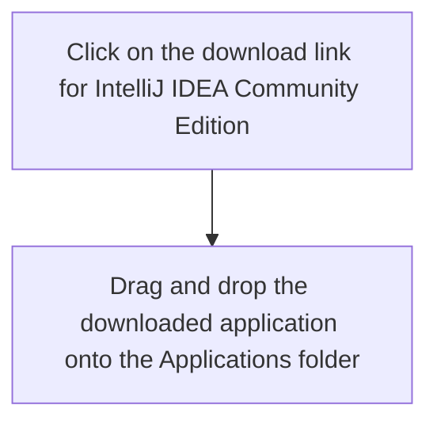
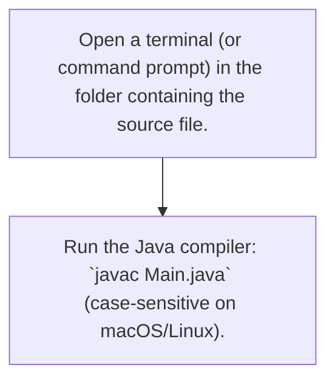
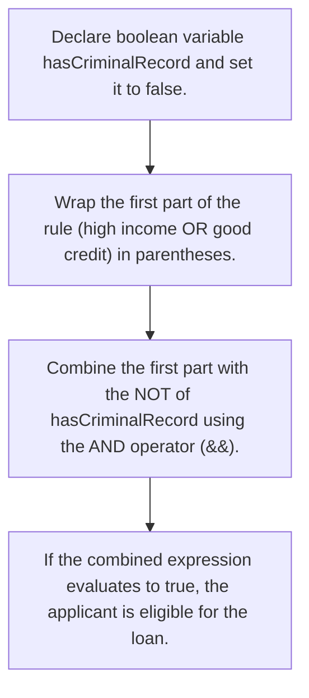
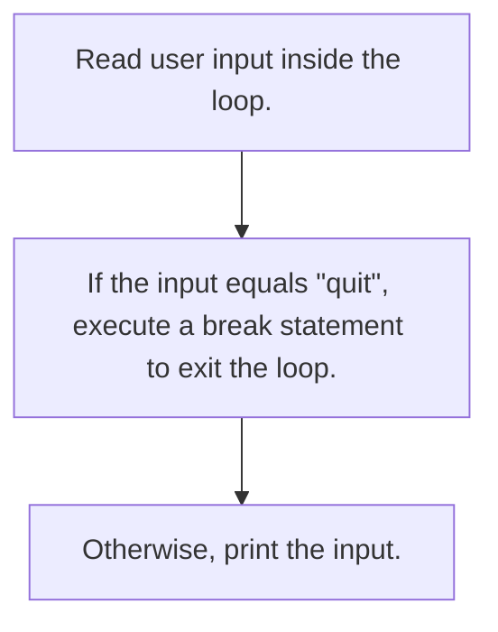
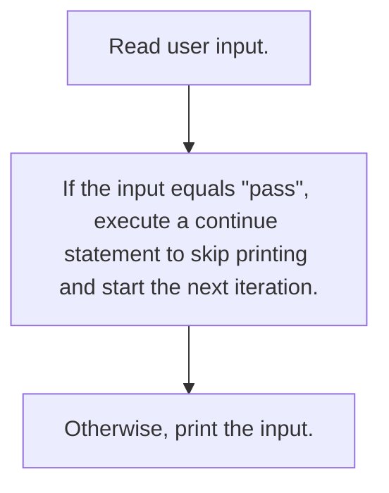

> UNVERIFIED PREVIEW — semantic and educational review required.

# Study notes: java

*Generated from assembled notes*

---

## JDK

### JDK

JDK stands for Java Development Kit and is a software development environment for building Java applications. It includes a compiler, a Java Runtime Environment, and other tools.

*[Knowledge ID: DEF_0001 | Sources: T0001]*

The Java Development Kit (JDK) can be downloaded for various platforms such as Linux, macOS, and Windows.

*[Knowledge ID: FCT_0002 | Sources: T0001]*

The course will cover installing the necessary tools to build Java applications, basics of Java, how Java code is executed, and building simple algorithms.

*[Knowledge ID: FCT_0003 | Sources: T0001]*

The instructor, Mosh, has two decades of experience as a software engineer and has taught over 3 million people how to code.

*[Knowledge ID: FCT_0004 | Sources: T0001]*

## function

### function

functions are a block of code that performs a task

*[Knowledge ID: DEF_0020 | Sources: T0002]*

> **Example: we can have a function for sending emails to people**
> 
> we can have a function for sending emails to people

*[Knowledge ID: EXM_0002 | Sources: T0002]*

> **Example: we can have a function for converting someone's weight in pounds to kilograms**
> 
> we can have a function for converting someone's weight in pounds to kilograms

*[Knowledge ID: EXM_0003 | Sources: T0002]*

The smallest building block in Java programs are functions.

*[Knowledge ID: FCT_0135 | Sources: T0002]*

Void is a reserved keyword in Java used as a return type for functions that do not return a value.

*[Knowledge ID: FCT_0005 | Sources: T0002]*

> Procedure correctness not reviewed; do not assume this is a correct solution.

#### Flowchart: Download and install IntelliJ IDEA

*[Knowledge ID: PRC_0006 | Sources: T0002]*

## Class

### Class

a container for one or more related functions

*[Knowledge ID: DEF_0021 | Sources: T0003]*

### Method

a function that is part of a class

*[Knowledge ID: DEF_0002 | Sources: T0003]*

### Pascal naming convention

the first letter of every word should be uppercase in class names

*[Knowledge ID: DEF_0003 | Sources: T0003]*

> Claim review: INCONCLUSIVE — The claim that every word is lowercase is not established by its truncated/ambiguous source segment. Continuation and later camel-notation explanation require review; do not certify this rule.

### Camel naming convention

the first letter of every word should be lowercase in method names

*[Knowledge ID: DEF_0004 | Sources: T0003]*

In Java, the left brace is placed on the same line where the function is defined.

*[Knowledge ID: FCT_0136 | Sources: T0003]*

Every Java program should have at least one function called main, which is the entry point.

*[Knowledge ID: FCT_0006 | Sources: T0003]*

Functions in Java must belong to a class.

*[Knowledge ID: FCT_0007 | Sources: T0003]*

Every Java program should have at least one class that contains the main function.

*[Knowledge ID: FCT_0008 | Sources: T0003]*

Java classes and methods have access modifiers such as public and private.

*[Knowledge ID: FCT_0009 | Sources: T0003]*

The public access modifier is most commonly used for classes and methods.

*[Knowledge ID: FCT_0010 | Sources: T0003]*

A minimal Java program consists of a main class and a main method inside that class.

*[Knowledge ID: FCT_0011 | Sources: T0003]*

## command line application

> Technical fields held for source-fidelity review; this is not a confirmed semantic error.

Content: \[requires source review\]
Definition text: \[requires source review\]
command line application

*[Knowledge ID: DEF_0022 | Sources: T0004]*

> Technical fields held for source-fidelity review; this is not a confirmed semantic error.

Content: \[requires source review\]
Definition text: \[requires source review\]
package

*[Knowledge ID: DEF_0023 | Sources: T0004]*

JDK version 12 is selected for the project

*[Knowledge ID: FCT_0137 | Sources: T0004]*

The base package for the project is set to com.codewithmarsh

*[Knowledge ID: FCT_0138 | Sources: T0004]*

## package statement

> Technical fields held for source-fidelity review; this is not a confirmed semantic error.

Content: \[requires source review\]
Definition text: \[requires source review\]
package statement

*[Knowledge ID: DEF_0024 | Sources: T0005]*

> Technical fields held for source-fidelity review; this is not a confirmed semantic error.

Content: \[requires source review\]
Definition text: \[requires source review\]
main method

*[Knowledge ID: DEF_0025 | Sources: T0005]*

### comment

Text prefixed with // that explains code and is not executed.

*[Knowledge ID: DEF_0026 | Sources: T0005]*

### System class

A class defined in the java.lang package that provides access to system resources such as standard output.

*[Knowledge ID: DEF_0027 | Sources: T0005]*

All Java files should have the .java extension.

*[Knowledge ID: FCT_0139 | Sources: T0005]*

Every statement in Java must be terminated with a semicolon.

*[Knowledge ID: FCT_0140 | Sources: T0005]*

The main method must be declared static and have a void return type.

*[Knowledge ID: FCT_0141 | Sources: T0005]*

Comments in Java start with // and are ignored by the compiler.

*[Knowledge ID: FCT_0142 | Sources: T0005]*

The System class resides in the java.lang package.

*[Knowledge ID: FCT_0143 | Sources: T0005]*

## Source T0006

The dot operator is used to access members (fields, methods, etc.) of a class in Java.

*[Knowledge ID: FCT_0001 | Sources: T0006]*

In IntelliJ, a field is indicated by the icon "F" and a method is indicated by the icon "M".

*[Knowledge ID: FCT_0144 | Sources: T0006]*

A string literal in Java must be surrounded by double quotes.

*[Knowledge ID: FCT_0145 | Sources: T0006]*

When a Java program is run in IntelliJ, the code is first compiled into Java bytecode by the Java compiler that comes with the Java Development Kit.

*[Knowledge ID: FCT_0146 | Sources: T0006]*

After compilation, the bytecode is executed to produce the program's output.

*[Knowledge ID: FCT_0147 | Sources: T0006]*

## Java bytecode is platform independent

The compiled Java bytecode can run on Windows, macOS, Linux, or any operating system that has a Java Runtime Environment because it is not tied to a specific hardware architecture.

*[Knowledge ID: EXP_0001 | Sources: T0007]*

The JVM takes Java bytecode and converts it into the native code required by the underlying operating system, enabling the same bytecode to execute on different platforms.

*[Knowledge ID: EXP_0002 | Sources: T0007]*

Java bytecode is platform independent and can run on any OS with a Java Runtime Environment.

*[Knowledge ID: FCT_0148 | Sources: T0007]*

The JVM translates Java bytecode into native code for the host operating system.

*[Knowledge ID: FCT_0149 | Sources: T0007]*

> Procedure correctness not reviewed; do not assume this is a correct solution.

#### Flowchart: Compile a Java source file

*[Knowledge ID: PRC_0005 | Sources: T0007]*

> Procedure correctness not reviewed; do not assume this is a correct solution.

**Run a compiled Java program:**

- In the terminal, execute the JVM with the class name: `java Main`.

*[Knowledge ID: PRC_0328 | Sources: T0007]*

> Procedure correctness not reviewed; do not assume this is a correct solution.

**Locate compiled class files:**

- In the project panel, open the `out` folder to see the compiled `.class` files under the package hierarchy.

*[Knowledge ID: PRC_0007 | Sources: T0007]*

## Source T0008

Java was developed by James Gosling in 1995 at Sun Microsystems which was later acquired by Oracle in 2010.

*[Knowledge ID: FCT_0150 | Sources: T0008]*

It was originally called oke after an oak tree that stood outside Gosling's office later it was renamed to green and was finally renamed to Java inspired by Java coffee that's why its logo looks like this.

*[Knowledge ID: FCT_0151 | Sources: T0008]*

We have four editions of Java for building different kinds of applications.

*[Knowledge ID: FCT_0152 | Sources: T0008]*

Java standard edition is the core Java platform which is what we're using in this course it contains all of the libraries that every Java developer must learn.

*[Knowledge ID: FCT_0153 | Sources: T0008]*

Java Enterprise Edition is used for building very large-scale and distributed systems it is built on top of java standard edition and provides additional libraries for building fault tolerant distributed multi-tiered software.

*[Knowledge ID: FCT_0154 | Sources: T0008]*

Java micro Edition is a subset of Java standard edition designed for mobile devices so it has libraries specific to mobile devices.

*[Knowledge ID: FCT_0155 | Sources: T0008]*

Java card is used in smart cards.

*[Knowledge ID: FCT_0156 | Sources: T0008]*

The latest version of Java is Java standard edition 12 which was released just a few months ago in March 2019.

*[Knowledge ID: FCT_0157 | Sources: T0008]*

Java has close to 9 million developers worldwide.

*[Knowledge ID: FCT_0158 | Sources: T0008]*

Currently about 3 billion mobile phones run Java as well as 120 million TV sets and every blu-ray player according to indeed.com.

*[Knowledge ID: FCT_0159 | Sources: T0008]*

The average salary of a Java developer is just over $100,000 per year in the US.

*[Knowledge ID: FCT_0160 | Sources: T0008]*

## object-oriented programming

### object-oriented programming

a style of programming used in most if not all Java applications

*[Knowledge ID: DEF_0028 | Sources: T0009]*

### control flow statements

statements that are used to build algorithms, including various types of conditional statements and loops

*[Knowledge ID: DEF_0029 | Sources: T0009]*

The course is a four-part Java series, each part about three to four hours long.

*[Knowledge ID: FCT_0161 | Sources: T0009]*

The first part teaches the fundamentals of programming with Java.

*[Knowledge ID: FCT_0162 | Sources: T0009]*

The type system in Java includes primitives, strings, booleans, and arrays.

*[Knowledge ID: FCT_0163 | Sources: T0009]*

By the end of the first part, you will build a mortgage calculator.

*[Knowledge ID: FCT_0164 | Sources: T0009]*

The second part covers control flow statements, conditional statements, loops, and adds data validation to the mortgage calculator.

*[Knowledge ID: FCT_0165 | Sources: T0009]*

Clean coding techniques are taught to make code clean and maintainable.

*[Knowledge ID: FCT_0166 | Sources: T0009]*

The course teaches how to find and fix errors in Java programs and how to package them for deployment.

*[Knowledge ID: FCT_0167 | Sources: T0009]*

The third part covers core Java API useful classes in the standard Java library.

*[Knowledge ID: FCT_0168 | Sources: T0009]*

The fourth part covers advanced Java features such as streams, threads, and database programming.

*[Knowledge ID: FCT_0169 | Sources: T0009]*

A final project involves building a mortgage calculator on your own using the learned material.

*[Knowledge ID: FCT_0012 | Sources: T0009]*

## camelCase notation

we should capitalize the first letter of every word except the first word

*[Knowledge ID: CON_0001 | Sources: T0010]*

### variable

variables are used to temporarily store data in computer's memory

*[Knowledge ID: DEF_0030 | Sources: T0010]*

### type

the type of our variable then we give it a name or a label this is also called an identifier

*[Knowledge ID: DEF_0031 | Sources: T0010]*

### assignment operator

this equal sign is called the assignment operator

*[Knowledge ID: DEF_0032 | Sources: T0010]*

### initialization

we're initializing this variable which means we're giving it an initial value

*[Knowledge ID: DEF_0005 | Sources: T0010]*

int or integer is the type of this variable so in this variable we can only store integers which are whole numbers like 1 2 3 4 numbers that don't have a decimal point

*[Knowledge ID: EXP_0006 | Sources: T0010]*

we give it a name or a label this is also called an identifier because we use it to identify our variable

*[Knowledge ID: EXP_0007 | Sources: T0010]*

you always have to initialize our variables before reading them

*[Knowledge ID: EXP_0008 | Sources: T0010]*

this is called the camelCase notation so we should capitalize the first letter of every word except the first word

*[Knowledge ID: EXP_0009 | Sources: T0010]*

> **Example: variable initialization**
> 
> int age = 30

*[Knowledge ID: EXM_0010 | Sources: T0010]*

> Literal source code unavailable. Original generated snippet retained in the audit only.

Example held for source-fidelity review. The original generated text and supporting passages remain in the evidence artifact.

*[Knowledge ID: EXM_0011 | Sources: T0010]*

> Literal source code unavailable. Original generated snippet retained in the audit only.

Example held for source-fidelity review. The original generated text and supporting passages remain in the evidence artifact.

*[Knowledge ID: EXM_0012 | Sources: T0010]*

> Literal source code unavailable. Original generated snippet retained in the audit only.

Example held for source-fidelity review. The original generated text and supporting passages remain in the evidence artifact.

*[Knowledge ID: EXM_0013 | Sources: T0010]*

> Literal source code unavailable. Original generated snippet retained in the audit only.

Example held for source-fidelity review. The original generated text and supporting passages remain in the evidence artifact.

*[Knowledge ID: EXM_0014 | Sources: T0010]*

variables must be initialized before they can be read

*[Knowledge ID: FCT_0015 | Sources: T0010]*

declaring multiple variables on the same line makes code harder to read and is not recommended

*[Knowledge ID: FCT_0016 | Sources: T0010]*

## meaningful variable names help understand code

Using meaningful and descriptive names for variables improves code readability and comprehension.

*[Knowledge ID: EXP_0072 | Sources: T0011]*

byte takes one byte of memory and stores values from -128 to 127

*[Knowledge ID: FCT_0170 | Sources: T0011]*

short takes two bytes of memory and stores values up to 32,000

*[Knowledge ID: FCT_0171 | Sources: T0011]*

int (integer) takes four bytes of memory and allows storing values up to two billion

*[Knowledge ID: FCT_0172 | Sources: T0011]*

long takes eight bytes of memory and can store even larger numbers

*[Knowledge ID: FCT_0173 | Sources: T0011]*

float takes four bytes for storing decimal numbers

*[Knowledge ID: FCT_0174 | Sources: T0011]*

double takes eight bytes for storing decimal numbers

*[Knowledge ID: FCT_0175 | Sources: T0011]*

char takes two bytes and stores a single character, supporting international letters

*[Knowledge ID: FCT_0176 | Sources: T0011]*

boolean stores true or false values

*[Knowledge ID: FCT_0177 | Sources: T0011]*

Underscores can be used in numeric literals to improve readability, separating groups of three digits

*[Knowledge ID: FCT_0178 | Sources: T0011]*

## int

### int

by default Java sees whole numbers as integers

*[Knowledge ID: DEF_0033 | Sources: T0012]*

> Technical fields held for source-fidelity review; this is not a confirmed semantic error.

Content: \[requires source review\]
Definition text: \[requires source review\]
long

*[Knowledge ID: DEF_0034 | Sources: T0012]*

> Technical fields held for source-fidelity review; this is not a confirmed semantic error.

Content: \[requires source review\]
Definition text: \[requires source review\]
float

*[Knowledge ID: DEF_0035 | Sources: T0012]*

### double

default type for numbers with a decimal point in Java

*[Knowledge ID: DEF_0036 | Sources: T0012]*

> Technical fields held for source-fidelity review; this is not a confirmed semantic error.

Content: \[requires source review\]
Definition text: \[requires source review\]
char

*[Knowledge ID: DEF_0037 | Sources: T0012]*

> Technical fields held for source-fidelity review; this is not a confirmed semantic error.

Content: \[requires source review\]
Definition text: \[requires source review\]
String

*[Knowledge ID: DEF_0006 | Sources: T0012]*

### boolean

stores a true or false value

*[Knowledge ID: DEF_0007 | Sources: T0012]*

### reserved keywords

words that are part of the Java language syntax (e.g., public, static, void, class, package) and cannot be used as identifiers for variables, classes, or methods

*[Knowledge ID: DEF_0008 | Sources: T0012]*

> **Example: long literal**
> 
> 3L

*[Knowledge ID: EXM_0009 | Sources: T0012]*

> **Example: float literal**
> 
> 3.5F

*[Knowledge ID: EXM_0107 | Sources: T0012]*

> Literal source code unavailable. Original generated snippet retained in the audit only.

Example held for source-fidelity review. The original generated text and supporting passages remain in the evidence artifact.

*[Knowledge ID: EXM_0108 | Sources: T0012]*

integer number too large

*[Knowledge ID: FCT_0179 | Sources: T0012]*

incompatible types required float but found double

*[Knowledge ID: FCT_0013 | Sources: T0012]*

## primitive type

### primitive type

primitive types are the eight basic data types built into Java that are not reference types

*[Knowledge ID: DEF_0038 | Sources: T0013]*

### reference type

reference types are all types other than the eight primitive types and represent objects created from classes

*[Knowledge ID: DEF_0039 | Sources: T0013]*

### package

a package is a namespace that groups related classes and allows the same class name to exist in different packages without conflict

*[Knowledge ID: DEF_0040 | Sources: T0013]*

### import

import is a statement that makes a class from another package available in the current source file

*[Knowledge ID: DEF_0041 | Sources: T0013]*

### object

an object is an instance of a class

*[Knowledge ID: DEF_0042 | Sources: T0013]*

### class

a class is a blueprint or template for creating objects

*[Knowledge ID: DEF_0043 | Sources: T0013]*

primitive types are allocated and released automatically by the Java Runtime Environment, whereas reference types require explicit memory allocation with the new operator and are reclaimed automatically later

*[Knowledge ID: EXP_0073 | Sources: T0013]*

Java has eight primitive types

*[Knowledge ID: FCT_0180 | Sources: T0013]*

All other types in Java are reference types

*[Knowledge ID: FCT_0181 | Sources: T0013]*

To use a class from a different package you must import it

*[Knowledge ID: FCT_0182 | Sources: T0013]*

Packages create a namespace that prevents class name conflicts

*[Knowledge ID: FCT_0183 | Sources: T0013]*

The new operator allocates memory for a reference type object

*[Knowledge ID: FCT_0184 | Sources: T0013]*

Objects are instances of classes

*[Knowledge ID: FCT_0185 | Sources: T0013]*

Members of an object are accessed using the dot operator

*[Knowledge ID: FCT_0014 | Sources: T0013]*

The getTime method returns the time component of a Date object

*[Knowledge ID: FCT_0186 | Sources: T0013]*

## Source T0014

A primitive type does not have members, so using the dot operator on a primitive variable shows nothing.

*[Knowledge ID: FCT_0187 | Sources: T0014]*

Reference types are classes that have members (fields and methods) which can be accessed with the dot operator.

*[Knowledge ID: FCT_0188 | Sources: T0014]*

Primitive types store simple values, while reference types store complex objects.

*[Knowledge ID: FCT_0189 | Sources: T0014]*

> Technical fields held for source-fidelity review; this is not a confirmed semantic error.

Content: \[requires source review\]
Fact text: \[requires source review\]

*[Knowledge ID: FCT_0190 | Sources: T0014]*

> Technical fields held for source-fidelity review; this is not a confirmed semantic error.

Content: \[requires source review\]
Fact text: \[requires source review\]

*[Knowledge ID: FCT_0191 | Sources: T0014]*

## Reference types in Java store a reference (address) to an object in memory rather than the actual object value.

When a variable of a reference type is declared, it holds the address of the object in memory. Assigning one reference variable to another copies the reference, so both variables point to the same object. Updating the object through any reference is reflected when accessed via the other reference.

*[Knowledge ID: EXP_0074 | Sources: T0015]*

Primitive variables store the actual value in their memory location, while reference variables store the address of an object.

*[Knowledge ID: FCT_0192 | Sources: T0015]*

Assigning one reference variable to another copies the reference, causing both variables to refer to the same object.

*[Knowledge ID: FCT_0193 | Sources: T0015]*

Changes made to an object via one reference variable are visible through any other reference variable that points to the same object.

*[Knowledge ID: FCT_0194 | Sources: T0015]*

## Accessing members of a String object

String is a class, its members are accessed using the dot operator.

*[Knowledge ID: EXP_0075 | Sources: T0016]*

> **Example: String concatenation using the plus operator**
> 
> message + "!!"

*[Knowledge ID: EXM_0109 | Sources: T0016]*

> Literal source code unavailable. Original generated snippet retained in the audit only.

Example held for source-fidelity review. The original generated text and supporting passages remain in the evidence artifact.

*[Knowledge ID: EXM_0110 | Sources: T0016]*

> Literal source code unavailable. Original generated snippet retained in the audit only.

Example held for source-fidelity review. The original generated text and supporting passages remain in the evidence artifact.

*[Knowledge ID: EXM_0004 | Sources: T0016]*

String class is defined in the java.lang package and is automatically imported.

*[Knowledge ID: FCT_0195 | Sources: T0016]*

> Technical fields held for source-fidelity review; this is not a confirmed semantic error.

Content: \[requires source review\]
Fact text: \[requires source review\]

*[Knowledge ID: FCT_0196 | Sources: T0016]*

> Technical fields held for source-fidelity review; this is not a confirmed semantic error.

Content: \[requires source review\]
Fact text: \[requires source review\]

*[Knowledge ID: FCT_0197 | Sources: T0016]*

String concatenation can be done using the plus operator.

*[Knowledge ID: FCT_0198 | Sources: T0016]*

String class has method endsWith that returns a boolean indicating if the string ends with a given suffix.

*[Knowledge ID: FCT_0199 | Sources: T0016]*

String class has method startsWith that returns a boolean indicating if the string starts with a given prefix.

*[Knowledge ID: FCT_0200 | Sources: T0016]*

String class has method length that returns the number of characters in the string.

*[Knowledge ID: FCT_0201 | Sources: T0016]*

## parameter

### parameter

Parameters are the placeholders defined in a method signature.

*[Knowledge ID: DEF_0044 | Sources: T0017]*

### argument

Arguments are the actual values passed to a method when it is called.

*[Knowledge ID: DEF_0045 | Sources: T0017]*

> Technical fields held for source-fidelity review; this is not a confirmed semantic error.

Content: \[requires source review\]
Definition text: \[requires source review\]
immutable string

*[Knowledge ID: DEF_0046 | Sources: T0017]*

> Literal source code unavailable. Original generated snippet retained in the audit only.

Example held for source-fidelity review. The original generated text and supporting passages remain in the evidence artifact.

*[Knowledge ID: EXM_0111 | Sources: T0017]*

> Literal source code unavailable. Original generated snippet retained in the audit only.

Example held for source-fidelity review. The original generated text and supporting passages remain in the evidence artifact.

*[Knowledge ID: EXM_0005 | Sources: T0017]*

> Literal source code unavailable. Original generated snippet retained in the audit only.

Example held for source-fidelity review. The original generated text and supporting passages remain in the evidence artifact.

*[Knowledge ID: EXM_0006 | Sources: T0017]*

The length of a username can be checked and an error shown if it exceeds a specified limit (e.g., 20 characters).

*[Knowledge ID: FCT_0202 | Sources: T0017]*

indexOf returns the index of the first occurrence of a character or substring, or -1 if it does not exist.

*[Knowledge ID: FCT_0203 | Sources: T0017]*

replace takes two arguments: the target to be replaced and the replacement value.

*[Knowledge ID: FCT_0204 | Sources: T0017]*

String methods such as replace, toLowerCase, toUpperCase, and trim return new string objects and do not modify the original string.

*[Knowledge ID: FCT_0205 | Sources: T0017]*

toLowerCase converts all characters in a string to lowercase.

*[Knowledge ID: FCT_0206 | Sources: T0017]*

toUpperCase converts all characters in a string to uppercase.

*[Knowledge ID: FCT_0207 | Sources: T0017]*

trim removes extra whitespace at the beginning and end of a string.

*[Knowledge ID: FCT_0208 | Sources: T0017]*

## escape sequence

### escape sequence

An escape sequence is a combination of characters that starts with a backslash (\) and represents a special character in a Java string, such as a double quote, backslash, newline, or tab.

*[Knowledge ID: DEF_0047 | Sources: T0018]*

> Literal source code unavailable. Original generated snippet retained in the audit only.

Example held for source-fidelity review. The original generated text and supporting passages remain in the evidence artifact.

*[Knowledge ID: EXM_0112 | Sources: T0018]*

> Literal source code unavailable. Original generated snippet retained in the audit only.

Example held for source-fidelity review. The original generated text and supporting passages remain in the evidence artifact.

*[Knowledge ID: EXM_0113 | Sources: T0018]*

> Literal source code unavailable. Original generated snippet retained in the audit only.

Example held for source-fidelity review. The original generated text and supporting passages remain in the evidence artifact.

*[Knowledge ID: EXM_0114 | Sources: T0018]*

In Java strings, a backslash (\) is used to escape special characters such as double quote (\"), backslash (\\), newline (\n), and tab (\t).

*[Knowledge ID: FCT_0209 | Sources: T0018]*

Four commonly used escape sequences in Java are \" (double quote), \\ (backslash), \n (newline), and \t (tab).

*[Knowledge ID: FCT_0210 | Sources: T0018]*

## array

### array

an array is a reference type used to store a list of items such as numbers, people, or messages

*[Knowledge ID: DEF_0048 | Sources: T0019]*

to declare an array of integers you write int\[\] followed by the variable name

*[Knowledge ID: FCT_0211 | Sources: T0019]*

arrays are reference types and must be created with the new operator

*[Knowledge ID: FCT_0212 | Sources: T0019]*

the size (length) of an array is specified in square brackets after the new operator

*[Knowledge ID: FCT_0213 | Sources: T0019]*

> Technical fields held for source-fidelity review; this is not a confirmed semantic error.

Content: \[requires source review\]
Fact text: \[requires source review\]

*[Knowledge ID: FCT_0214 | Sources: T0019]*

accessing an index outside the array bounds (e.g., index 10 in a length‑5 array) throws an exception and crashes the program

*[Knowledge ID: FCT_0215 | Sources: T0019]*

> Technical fields held for source-fidelity review; this is not a confirmed semantic error.

Content: \[requires source review\]
Fact text: \[requires source review\]

*[Knowledge ID: FCT_0216 | Sources: T0019]*

the java.util.Arrays class provides a toString method that returns a readable representation of an array's items

*[Knowledge ID: FCT_0217 | Sources: T0019]*

the Arrays.toString method is overloaded for each primitive type and for reference types

*[Knowledge ID: FCT_0218 | Sources: T0019]*

## Source T0020

In an integer array, elements not explicitly initialized are set to 0 by default.

*[Knowledge ID: FCT_0219 | Sources: T0020]*

In a boolean array, elements default to false.

*[Knowledge ID: FCT_0220 | Sources: T0020]*

In a string array, elements default to an empty string.

*[Knowledge ID: FCT_0221 | Sources: T0020]*

> Technical fields held for source-fidelity review; this is not a confirmed semantic error.

Content: \[requires source review\]
Fact text: \[requires source review\]

*[Knowledge ID: FCT_0222 | Sources: T0020]*

The length of an array can be read using the array.length property.

*[Knowledge ID: FCT_0223 | Sources: T0020]*

> Technical fields held for source-fidelity review; this is not a confirmed semantic error.

Content: \[requires source review\]
Fact text: \[requires source review\]

*[Knowledge ID: FCT_0224 | Sources: T0020]*

To add or remove items dynamically, one should use collection classes instead of arrays.

*[Knowledge ID: FCT_0225 | Sources: T0020]*

Arrays can be sorted using the Arrays.sort method, which is overloaded with different parameter types.

*[Knowledge ID: FCT_0226 | Sources: T0020]*

Java supports multi‑dimensional arrays (e.g., two‑dimensional for matrices, three‑dimensional for cubes) useful in scientific computations.

*[Knowledge ID: FCT_0227 | Sources: T0020]*

## constant

### constant

A variable declared with the `final` keyword in Java, which cannot be changed after it is initialized.

*[Knowledge ID: DEF_0049 | Sources: T0021]*

A two‑dimensional array in Java requires two pairs of square brackets, one for each dimension.

*[Knowledge ID: FCT_0228 | Sources: T0021]*

To access an element in a two‑dimensional array you must supply two indexes: the row index followed by the column index.

*[Knowledge ID: FCT_0229 | Sources: T0021]*

`Arrays.deepToString` should be used to print the contents of a multi‑dimensional array, otherwise `toString` yields an unreadable string.

*[Knowledge ID: FCT_0230 | Sources: T0021]*

A two‑dimensional array can be initialized with curly‑brace syntax, where each row is itself an array literal.

*[Knowledge ID: FCT_0231 | Sources: T0021]*

When assigning a floating‑point literal to a `float` variable in Java, an `F` suffix is required (e.g., `3.14F`).

*[Knowledge ID: FCT_0232 | Sources: T0021]*

## final variable

### final variable

a variable declared with the keyword final, meaning its value cannot be changed after initialization

*[Knowledge ID: DEF_0050 | Sources: T0022]*

### constant

a final variable whose name is written in all capital letters by convention

*[Knowledge ID: DEF_0051 | Sources: T0022]*

### arithmetic expression

a piece of code that produces a value

*[Knowledge ID: DEF_0052 | Sources: T0022]*

### operand

a number or variable on which an arithmetic operator acts

*[Knowledge ID: DEF_0053 | Sources: T0022]*

### increment operator

operator (++) that increases the value of a numeric variable by 1

*[Knowledge ID: DEF_0054 | Sources: T0022]*

### decrement operator

operator (--) that decreases the value of a numeric variable by 1

*[Knowledge ID: DEF_0055 | Sources: T0022]*

Constants are written in all capital letters to distinguish them from regular variables

*[Knowledge ID: EXP_0076 | Sources: T0022]*

When two integers are divided, Java returns an integer result, discarding any fractional part

*[Knowledge ID: EXP_0077 | Sources: T0022]*

Casting one operand to double (or float) causes the division to be performed in floating‑point arithmetic

*[Knowledge ID: EXP_0078 | Sources: T0022]*

> Technical fields held for source-fidelity review; this is not a confirmed semantic error.

Content: \[requires source review\]
Explanation text: \[requires source review\]
prefix vs postfix increment

*[Knowledge ID: EXP_0010 | Sources: T0022]*

> Literal source code unavailable. Original generated snippet retained in the audit only.

Example held for source-fidelity review. The original generated text and supporting passages remain in the evidence artifact.

*[Knowledge ID: EXM_0115 | Sources: T0022]*

> Literal source code unavailable. Original generated snippet retained in the audit only.

Example held for source-fidelity review. The original generated text and supporting passages remain in the evidence artifact.

*[Knowledge ID: EXM_0116 | Sources: T0022]*

> Claim review: PARTIALLY\_SUPPORTED — Spoken casting demonstration does not supply the generated exact declaration and result comment. Show source explanation, retain generated snippet in audit.
> Literal source code unavailable. Original generated snippet retained in the audit only.

Example held for source-fidelity review. The original generated text and supporting passages remain in the evidence artifact.

*[Knowledge ID: EXM_0117 | Sources: T0022]*

> Literal source code unavailable. Original generated snippet retained in the audit only.

Example held for source-fidelity review. The original generated text and supporting passages remain in the evidence artifact.

*[Knowledge ID: EXM_0118 | Sources: T0022]*

> Literal source code unavailable. Original generated snippet retained in the audit only.

Example held for source-fidelity review. The original generated text and supporting passages remain in the evidence artifact.

*[Knowledge ID: EXM_0015 | Sources: T0022]*

pi is a final variable (constant) in the example

*[Knowledge ID: FCT_0233 | Sources: T0022]*

division of two whole numbers yields a whole number in Java

*[Knowledge ID: FCT_0017 | Sources: T0022]*

casting an int to double allows floating‑point division

*[Knowledge ID: FCT_0018 | Sources: T0022]*

## Source T0023

When using the postfix increment operator (x++) in an assignment, the original value of x is assigned first and then x is incremented.

*[Knowledge ID: FCT_0234 | Sources: T0023]*

When using the prefix increment operator (++x) in an assignment, x is incremented first and then the new value is assigned.

*[Knowledge ID: FCT_0235 | Sources: T0023]*

The augmented assignment operator X += 2 is equivalent to X = X + 2.

*[Knowledge ID: FCT_0236 | Sources: T0023]*

> Technical fields held for source-fidelity review; this is not a confirmed semantic error.

Content: \[requires source review\]
Fact text: \[requires source review\]

*[Knowledge ID: FCT_0237 | Sources: T0023]*

> Technical fields held for source-fidelity review; this is not a confirmed semantic error.

Content: \[requires source review\]
Fact text: \[requires source review\]

*[Knowledge ID: FCT_0238 | Sources: T0023]*

Order of operations priority: parentheses first, then multiplication/division, then addition/subtraction.

*[Knowledge ID: FCT_0239 | Sources: T0024]*

Implicit casting automatically converts a short value to an int when assigned to an int variable.

*[Knowledge ID: FCT_0240 | Sources: T0024]*

Assigning a double literal to an int variable without an explicit cast causes a compilation error.

*[Knowledge ID: FCT_0241 | Sources: T0024]*

When an int is used in an expression with a double, the int is automatically cast to double.

*[Knowledge ID: FCT_0242 | Sources: T0024]*

## implicit casting

> Technical fields held for source-fidelity review; this is not a confirmed semantic error.

Content: \[requires source review\]
Definition text: \[requires source review\]
implicit casting

*[Knowledge ID: DEF_0056 | Sources: T0025]*

### explicit casting

explicit casting converts a value to a specified type, such as casting a floating‑point number to an integer to discard the fractional part

*[Knowledge ID: DEF_0057 | Sources: T0025]*

### wrapper class

a reference type that provides methods for converting between strings and primitive types, e.g., java.lang.Integer for the int primitive

*[Knowledge ID: DEF_0058 | Sources: T0025]*

> Literal source code unavailable. Original generated snippet retained in the audit only.

Example held for source-fidelity review. The original generated text and supporting passages remain in the evidence artifact.

*[Knowledge ID: EXM_0119 | Sources: T0025]*

> Literal source code unavailable. Original generated snippet retained in the audit only.

Example held for source-fidelity review. The original generated text and supporting passages remain in the evidence artifact.

*[Knowledge ID: EXM_0120 | Sources: T0025]*

> Technical fields held for source-fidelity review; this is not a confirmed semantic error.

Content: \[requires source review\]
Fact text: \[requires source review\]

*[Knowledge ID: FCT_0243 | Sources: T0025]*

the Integer class provides a parseInt method that takes a string and returns an int

*[Knowledge ID: FCT_0244 | Sources: T0025]*

the Short class provides a parseShort method that takes a string and returns a short

*[Knowledge ID: FCT_0245 | Sources: T0025]*

user input from UI components is typically received as strings, requiring conversion to numeric types for arithmetic

*[Knowledge ID: FCT_0246 | Sources: T0025]*

## Math class

### Math class

The Math class is defined in the java.lang package, is always available without explicit import, and provides static methods for performing mathematical operations.

*[Knowledge ID: DEF_0059 | Sources: T0026]*

> **Example: round method with float**
> 
> Passing 1.1 as a float to Math.round returns 1 (stored in an int).

*[Knowledge ID: EXM_0121 | Sources: T0026]*

> Literal source code unavailable. Original generated snippet retained in the audit only.

Example held for source-fidelity review. The original generated text and supporting passages remain in the evidence artifact.

*[Knowledge ID: EXM_0122 | Sources: T0026]*

> Literal source code unavailable. Original generated snippet retained in the audit only.

Example held for source-fidelity review. The original generated text and supporting passages remain in the evidence artifact.

*[Knowledge ID: EXM_0123 | Sources: T0026]*

> Literal source code unavailable. Original generated snippet retained in the audit only.

Example held for source-fidelity review. The original generated text and supporting passages remain in the evidence artifact.

*[Knowledge ID: EXM_0124 | Sources: T0026]*

> Literal source code unavailable. Original generated snippet retained in the audit only.

Example held for source-fidelity review. The original generated text and supporting passages remain in the evidence artifact.

*[Knowledge ID: EXM_0125 | Sources: T0026]*

> Literal source code unavailable. Original generated snippet retained in the audit only.

Example held for source-fidelity review. The original generated text and supporting passages remain in the evidence artifact.

*[Knowledge ID: EXM_0007 | Sources: T0026]*

> Technical fields held for source-fidelity review; this is not a confirmed semantic error.

Content: \[requires source review\]
Fact text: \[requires source review\]

*[Knowledge ID: FCT_0247 | Sources: T0026]*

Math.ceil returns the smallest integer greater than or equal to the argument (as a double).

*[Knowledge ID: FCT_0248 | Sources: T0026]*

Math.floor returns the largest integer less than or equal to the argument (as a double).

*[Knowledge ID: FCT_0249 | Sources: T0026]*

Math.max returns the greater of two values and is overloaded for int, long, float, and double.

*[Knowledge ID: FCT_0250 | Sources: T0026]*

Math.min returns the smaller of two values and is overloaded for int, long, float, and double.

*[Knowledge ID: FCT_0251 | Sources: T0026]*

Math.random returns a double value uniformly distributed between 0.0 (inclusive) and 1.0 (exclusive).

*[Knowledge ID: FCT_0252 | Sources: T0026]*

## Implicit casting cannot convert a long value to an int because the long occupies 8 bytes while the int occupies 4 bytes.

> Technical fields held for source-fidelity review; this is not a confirmed semantic error.

Content: \[requires source review\]
Explanation text: \[requires source review\]
Implicit casting cannot convert a long value to an int because the long occupies 8 bytes while the int occupies 4 bytes.

*[Knowledge ID: EXP_0079 | Sources: T0027]*

> Technical fields held for source-fidelity review; this is not a confirmed semantic error.

Content: \[requires source review\]
Explanation text: \[requires source review\]
Topic: \[requires source review\]

*[Knowledge ID: EXP_0080 | Sources: T0027]*

> Technical fields held for source-fidelity review; this is not a confirmed semantic error.

Content: \[requires source review\]
Explanation text: \[requires source review\]
Topic: \[requires source review\]

*[Knowledge ID: EXP_0003 | Sources: T0027]*

Java provides the NumberFormat class (in java.text) to format numbers with currency symbols, grouping separators, or as percentages.

*[Knowledge ID: EXP_0004 | Sources: T0027]*

Math.round returns a long value.

*[Knowledge ID: FCT_0253 | Sources: T0027]*

Casting a long to an int requires explicit casting.

*[Knowledge ID: FCT_0254 | Sources: T0027]*

> Technical fields held for source-fidelity review; this is not a confirmed semantic error.

Content: \[requires source review\]
Fact text: \[requires source review\]

*[Knowledge ID: FCT_0255 | Sources: T0027]*

## Source T0028

NumberFormat is an abstract class and cannot be instantiated with the new operator.

*[Knowledge ID: FCT_0256 | Sources: T0028]*

A factory method (e.g., getCurrencyInstance) creates and returns an instance of NumberFormat.

*[Knowledge ID: FCT_0257 | Sources: T0028]*

The returned NumberFormat object can be stored in a variable of type NumberFormat.

*[Knowledge ID: FCT_0258 | Sources: T0028]*

NumberFormat.format is an overloaded method that can accept long, double, etc., and returns a formatted string.

*[Knowledge ID: FCT_0259 | Sources: T0028]*

When formatting as currency, the result includes a dollar sign, commas as thousand separators, and two decimal digits.

*[Knowledge ID: FCT_0260 | Sources: T0028]*

NumberFormat.getPercentInstance returns a NumberFormat instance specialized for formatting percentages.

*[Knowledge ID: FCT_0261 | Sources: T0028]*

## Source T0029

Shift+F6 is the shortcut for the Rename refactor menu on Mac.

*[Knowledge ID: FCT_0262 | Sources: T0029]*

Method chaining allows calling multiple methods in a single statement by using the dot operator on the returned object.

*[Knowledge ID: FCT_0263 | Sources: T0029]*

In Java, System.in is used to read input from the terminal window.

*[Knowledge ID: FCT_0264 | Sources: T0029]*

The Scanner class (java.util.Scanner) is used to read input from the user in Java.

*[Knowledge ID: FCT_0265 | Sources: T0029]*

Methods of the Scanner class for reading data start with the prefix "next" (e.g., nextInt, nextLine).

*[Knowledge ID: FCT_0266 | Sources: T0029]*

## Source T0030

> Technical fields held for source-fidelity review; this is not a confirmed semantic error.

Content: \[requires source review\]
Fact text: \[requires source review\]

*[Knowledge ID: FCT_0267 | Sources: T0030]*

When concatenating a String with a byte, Java performs implicit casting (implicit type conversion) of the byte to a String.

*[Knowledge ID: FCT_0268 | Sources: T0030]*

> Technical fields held for source-fidelity review; this is not a confirmed semantic error.

Content: \[requires source review\]
Fact text: \[requires source review\]

*[Knowledge ID: FCT_0269 | Sources: T0030]*

> Technical fields held for source-fidelity review; this is not a confirmed semantic error.

Content: \[requires source review\]
Fact text: \[requires source review\]

*[Knowledge ID: FCT_0270 | Sources: T0030]*

> Technical fields held for source-fidelity review; this is not a confirmed semantic error.

Content: \[requires source review\]
Fact text: \[requires source review\]

*[Knowledge ID: FCT_0271 | Sources: T0030]*

> Technical fields held for source-fidelity review; this is not a confirmed semantic error.

Content: \[requires source review\]
Fact text: \[requires source review\]

*[Knowledge ID: FCT_0272 | Sources: T0030]*

> Technical fields held for source-fidelity review; this is not a confirmed semantic error.

Content: \[requires source review\]
Fact text: \[requires source review\]

*[Knowledge ID: FCT_0273 | Sources: T0030]*

> Technical fields held for source-fidelity review; this is not a confirmed semantic error.

Content: \[requires source review\]
Fact text: \[requires source review\]

*[Knowledge ID: FCT_0274 | Sources: T0030]*

## Source T0031

The trim method removes leading and trailing whitespace from a string.

*[Knowledge ID: FCT_0275 | Sources: T0031]*

The next line method returns a string entered by the user, preserving spaces and tabs.

*[Knowledge ID: FCT_0276 | Sources: T0031]*

> Claim review: PARTIALLY\_SUPPORTED — Only a fragment was extracted. Source continues with another expression and exponent, partly referring to unavailable visuals; no full formula reconstructed.
> Formula fragment: VISUAL\_CONTEXT\_REQUIRED. Do not use as a complete equation.

mortgage equals principal multiplied by monthly interest rate

*[Knowledge ID: FRM_0003 | Sources: T0031]*

## Avoiding magic numbers

Using constants or final variables instead of literal numbers makes code more understandable for others, as literals like 12 may not be immediately clear.

*[Knowledge ID: EXP_0081 | Sources: T0032]*

> Technical fields held for source-fidelity review; this is not a confirmed semantic error.

Content: \[requires source review\]
Explanation text: \[requires source review\]
Choosing appropriate data types

*[Knowledge ID: EXP_0082 | Sources: T0032]*

> Technical fields held for source-fidelity review; this is not a confirmed semantic error.

Content: \[requires source review\]
Explanation text: \[requires source review\]
Using meaningful variable names

*[Knowledge ID: EXP_0083 | Sources: T0032]*

Declaring constants for months in a year (12) and percent (100) prevents magic numbers.

*[Knowledge ID: FCT_0277 | Sources: T0032]*

A scanner object can be used to read user input for principal, interest rate, and period.

*[Knowledge ID: FCT_0278 | Sources: T0032]*

## camel notation

### camel notation

capitalizing the first letter of every word except the first word in a variable name

*[Knowledge ID: DEF_0060 | Sources: T0033]*

The maximum number we want to support is 30, so one byte is sufficient to store the number 30 or anything smaller.

*[Knowledge ID: FCT_0279 | Sources: T0033]*

If a non‑numeric value (e.g., "XYZ") is entered, the mortgage calculator program crashes.

*[Knowledge ID: FCT_0280 | Sources: T0033]*

If a negative value is entered, the mortgage calculator program does not behave properly.

*[Knowledge ID: FCT_0281 | Sources: T0033]*

Conditional statements can be used to validate user‑entered values.

*[Knowledge ID: FCT_0282 | Sources: T0033]*

Primitive types store simple values, while reference types hold references to complex objects.

*[Knowledge ID: FCT_0283 | Sources: T0033]*

Two types of casting exist: implicit and explicit.

*[Knowledge ID: FCT_0284 | Sources: T0033]*

## boolean expression

### boolean expression

a piece of code that produces a boolean value true or false

*[Knowledge ID: DEF_0061 | Sources: T0034]*

### comparison operators

operators used to compare primitive values such as equality (==), inequality (!=), greater than (&gt;), greater than or equal (&gt;=), less than (&lt;), and less than or equal (&lt;=)

*[Knowledge ID: DEF_0062 | Sources: T0034]*

### logical operators

operators such as logical AND (&amp;&amp;), logical OR (||), and logical NOT (!) used for implementing real‑world rules

*[Knowledge ID: DEF_0063 | Sources: T0034]*

Control flow statements include conditional statements for making decisions, loops for repeated execution, and error handling constructs.

*[Knowledge ID: EXP_0084 | Sources: T0034]*

Logical operators (&amp;&amp;, ||, !) are used to combine or invert boolean expressions to implement complex decision rules.

*[Knowledge ID: EXP_0005 | Sources: T0034]*

> **Example: x == y**
> 
> When x and y have the same value, the expression x == y evaluates to true.

*[Knowledge ID: EXM_0126 | Sources: T0034]*

> **Example: x != y**
> 
> When x and y are equal, the expression x != y evaluates to false.

*[Knowledge ID: EXM_0127 | Sources: T0034]*

> **Example: x &lt;= y**
> 
> If X is less than or equal to Y, the expression evaluates to true.

*[Knowledge ID: EXM_0008 | Sources: T0034]*

The equality operator (==) compares two values and returns true if they are equal, otherwise false.

*[Knowledge ID: FCT_0285 | Sources: T0034]*

The inequality operator (!=) returns false when the two compared values are equal.

*[Knowledge ID: FCT_0286 | Sources: T0034]*

The expression X &lt;= Y evaluates to true when X is less than or equal to Y.

*[Knowledge ID: FCT_0287 | Sources: T0034]*

## Source T0035

> Technical fields held for source-fidelity review; this is not a confirmed semantic error.

Content: \[requires source review\]
Fact text: \[requires source review\]

*[Knowledge ID: FCT_0288 | Sources: T0035]*

> Technical fields held for source-fidelity review; this is not a confirmed semantic error.

Content: \[requires source review\]
Fact text: \[requires source review\]

*[Knowledge ID: FCT_0289 | Sources: T0035]*

> Technical fields held for source-fidelity review; this is not a confirmed semantic error.

Content: \[requires source review\]
Fact text: \[requires source review\]

*[Knowledge ID: FCT_0290 | Sources: T0035]*

## Using the NOT operator to invert a boolean value

> Technical fields held for source-fidelity review; this is not a confirmed semantic error.

Content: \[requires source review\]
Explanation text: \[requires source review\]
Using the NOT operator to invert a boolean value

*[Knowledge ID: EXP_0085 | Sources: T0036]*

Wrap the first condition in parentheses, then use the AND operator (&amp;&amp;) to combine it with the second condition, e.g., (highIncome || goodCredit) &amp;&amp; !hasCriminalRecord.

*[Knowledge ID: EXP_0086 | Sources: T0036]*

> Literal source code unavailable. Original generated snippet retained in the audit only.

Example held for source-fidelity review. The original generated text and supporting passages remain in the evidence artifact.

*[Knowledge ID: EXM_0128 | Sources: T0036]*

A boolean variable "hasCriminalRecord" is initially set to false.

*[Knowledge ID: FCT_0291 | Sources: T0036]*

If the first condition and the second condition are both true, the person is eligible for a new loan.

*[Knowledge ID: FCT_0292 | Sources: T0036]*

> Procedure correctness not reviewed; do not assume this is a correct solution.

#### Flowchart: Implement loan eligibility rule using boolean logic

*[Knowledge ID: PRC_0329 | Sources: T0036]*

> Procedure correctness not reviewed; do not assume this is a correct solution.
> Technical fields held for source-fidelity review; this is not a confirmed semantic error.

The if statement evaluates the temperature condition and executes the code block when true.
Use if statement to display messages based on temperature
Declare an integer variable temperature and assign a value (e.g., 32).
Write an if statement with the condition (temperature &gt; 30).
Step 3: \[requires source review\]
Inside the block, print "it's a hot day" and "drink plenty of water".

*[Knowledge ID: PRC_0330 | Sources: T0036]*

## if statement

### if statement

we have an if statement and this statement has three clauses or three sections here's the first Clause

*[Knowledge ID: DEF_0064 | Sources: T0037]*

### clause

the if Clause, the else if and else clauses are placed after these right braces forming a hierarchy with a parent followed by two children

*[Knowledge ID: DEF_0065 | Sources: T0037]*

> Technical fields held for source-fidelity review; this is not a confirmed semantic error.

Content: \[requires source review\]
Explanation text: \[requires source review\]
use of braces in single-statement if

*[Knowledge ID: EXP_0087 | Sources: T0037]*

> Technical fields held for source-fidelity review; this is not a confirmed semantic error.

Content: \[requires source review\]
Explanation text: \[requires source review\]
formatting of if‑else chains

*[Knowledge ID: EXP_0088 | Sources: T0037]*

braces are only required if we have multiple statements

*[Knowledge ID: FCT_0293 | Sources: T0037]*

## Variable scope in Java code blocks

> Technical fields held for source-fidelity review; this is not a confirmed semantic error.

Content: \[requires source review\]
Explanation text: \[requires source review\]
Variable scope in Java code blocks

*[Knowledge ID: EXP_0089 | Sources: T0038]*

> Technical fields held for source-fidelity review; this is not a confirmed semantic error.

Content: \[requires source review\]
Explanation text: \[requires source review\]
Declaration location restriction

*[Knowledge ID: EXP_0090 | Sources: T0038]*

> Technical fields held for source-fidelity review; this is not a confirmed semantic error.

Content: \[requires source review\]
Explanation text: \[requires source review\]
Simplifying boolean assignment

*[Knowledge ID: EXP_0091 | Sources: T0038]*

> Technical fields held for source-fidelity review; this is not a confirmed semantic error.

Content: \[requires source review\]
Fact text: \[requires source review\]

*[Knowledge ID: FCT_0294 | Sources: T0038]*

Adding curly braces creates a new code block for variable declaration.

*[Knowledge ID: FCT_0295 | Sources: T0038]*

Wrapping a boolean expression in parentheses improves readability but is not required for correctness.

*[Knowledge ID: FCT_0296 | Sources: T0038]*

## ternary operator

> Technical fields held for source-fidelity review; this is not a confirmed semantic error.

Content: \[requires source review\]
Definition text: \[requires source review\]
ternary operator

*[Knowledge ID: DEF_0066 | Sources: T0039]*

### switch statement

a switch statement executes different parts of code depending on the value of an expression, similar to if statements

*[Knowledge ID: DEF_0067 | Sources: T0039]*

> Literal source code unavailable. Original generated snippet retained in the audit only.

Example held for source-fidelity review. The original generated text and supporting passages remain in the evidence artifact.

*[Knowledge ID: EXM_0129 | Sources: T0039]*

> Literal source code unavailable. Original generated snippet retained in the audit only.

Example held for source-fidelity review. The original generated text and supporting passages remain in the evidence artifact.

*[Knowledge ID: EXM_0130 | Sources: T0039]*

The ternary operator can replace an if‑else statement for assigning a value based on a condition.

*[Knowledge ID: FCT_0297 | Sources: T0039]*

A switch statement selects code to execute based on the value of an expression.

*[Knowledge ID: FCT_0298 | Sources: T0039]*

## switch statement versus if statement for role-based messages

A switch statement can be used instead of multiple if/else statements to compare a variable (e.g., role) against constant values (e.g., admin, moderator, guest) and execute the matching case block.

*[Knowledge ID: EXP_0092 | Sources: T0040]*

> Technical fields held for source-fidelity review; this is not a confirmed semantic error.

Content: \[requires source review\]
Explanation text: \[requires source review\]
purpose of break statement in a switch block

*[Knowledge ID: EXP_0093 | Sources: T0040]*

If role equals "admin", the program should print "you are an admin".

*[Knowledge ID: FCT_0299 | Sources: T0040]*

If role equals "moderator", the program should print "you are a moderator".

*[Knowledge ID: FCT_0300 | Sources: T0040]*

If role matches none of the specified cases, the default case prints "you are a guest".

*[Knowledge ID: FCT_0301 | Sources: T0040]*

> Technical fields held for source-fidelity review; this is not a confirmed semantic error.

Content: \[requires source review\]
Fact text: \[requires source review\]

*[Knowledge ID: FCT_0302 | Sources: T0040]*

> Procedure correctness not reviewed; do not assume this is a correct solution.

A switch statement evaluates the role variable and executes the matching case block, printing the corresponding message and using break statements to prevent fall‑through.

*[Knowledge ID: PRC_0331 | Sources: T0040]*

## FizzBuzz program logic and common error

> Instructional role: deliberately incorrect demonstration
> explained by: EXP\_0094
> corrected by: EXM\_0131
> alternative: EXM\_0132
> Claim review: CONTRADICTED — Source explicitly calls the ordering wrong. For 15 the divisible-by-5 branch wins before the combined condition. Retained only as a labeled incorrect demonstration.
> INCORRECT DEMONSTRATION — not instructions to follow.
> Technical fields held for source-fidelity review; this is not a confirmed semantic error.

A simple console program that reads a number and prints "fizz", "buzz", "fizzbuzz", or the number based on divisibility rules.
Read integer input and determine FizzBuzz output
Import and instantiate a Scanner object to read from the terminal.
Step 2: \[requires source review\]
Step 3: \[requires source review\]
Step 4: \[requires source review\]
Step 5: \[requires source review\]
Else print the number itself.

*[Knowledge ID: PRC_0332 | Sources: T0041]*

When the first condition checks only divisibility by 5, numbers divisible by both 5 and 3 (e.g., 15) satisfy that condition and the subsequent else‑if clauses are skipped, resulting in only "fizz" being printed instead of "fizzbuzz".

*[Knowledge ID: EXP_0094 | Sources: T0041]*

If a number is divisible by 5 (remainder zero when using the modulus operator), the program should print "fizz".

*[Knowledge ID: FCT_0303 | Sources: T0041]*

If a number is divisible by 3 (remainder zero when using the modulus operator), the program should print "buzz".

*[Knowledge ID: FCT_0304 | Sources: T0041]*

If a number is divisible by both 5 and 3, the program should print "fizzbuzz".

*[Knowledge ID: FCT_0305 | Sources: T0041]*

If a number is not divisible by 5 or 3, the program should print the number itself.

*[Knowledge ID: FCT_0306 | Sources: T0041]*

> Instructional role: corrected approach
> Literal source code unavailable. Original generated snippet retained in the audit only.

Example held for source-fidelity review. The original generated text and supporting passages remain in the evidence artifact.

*[Knowledge ID: EXM_0131 | Sources: T0042]*

> Literal source code unavailable. Original generated snippet retained in the audit only.

Example held for source-fidelity review. The original generated text and supporting passages remain in the evidence artifact.

*[Knowledge ID: EXM_0132 | Sources: T0042]*

## DRY

### DRY

DRY stands for "don't repeat yourself".

*[Knowledge ID: DEF_0068 | Sources: T0042]*

> Technical fields held for source-fidelity review; this is not a confirmed semantic error.

Content: \[requires source review\]
Explanation text: \[requires source review\]
Trade‑offs between code repetition and nesting

*[Knowledge ID: EXP_0095 | Sources: T0042]*

Place the most specific conditions at the top of an if‑else chain and the most generic ones at the bottom.

*[Knowledge ID: FCT_0307 | Sources: T0042]*

Repeated expressions in code violate the DRY principle.

*[Knowledge ID: FCT_0308 | Sources: T0042]*

Nested if‑else statements are considered bad practice because they reduce code readability.

*[Knowledge ID: FCT_0309 | Sources: T0042]*

## Print "Hello World" five times using a for loop

A for loop in Java consists of three parts: an initialization of a counter variable, a boolean condition that determines how many times the loop executes, and an increment operation.

*[Knowledge ID: FCT_0310 | Sources: T0043]*

> Technical fields held for source-fidelity review; this is not a confirmed semantic error.

Content: \[requires source review\]
Fact text: \[requires source review\]

*[Knowledge ID: FCT_0311 | Sources: T0043]*

> Procedure correctness not reviewed; do not assume this is a correct solution.
> Technical fields held for source-fidelity review; this is not a confirmed semantic error.

The loop prints "Hello World" five times on the terminal.
Print "Hello World" five times using a for loop
Start with the for keyword and an opening parenthesis.
Initialize a counter variable, e.g., int i = 0.
Add a semicolon to terminate the initialization statement.
Write a boolean condition, e.g., i &lt; 5, that determines how many times the loop runs.
Add a semicolon to terminate the condition.
Write the increment expression, e.g., i++.
Step 7: \[requires source review\]
Step 8: \[requires source review\]
Optionally, add a space and concatenate the counter variable to the output if desired.
Close the loop with a closing brace if a block was opened.

*[Knowledge ID: PRC_0003 | Sources: T0043]*

## for loop

A for loop iterates a known number of times, using an initialization, a loop condition, and an increment/decrement operation.

*[Knowledge ID: CON_0019 | Sources: T0044]*

A while loop repeats as long as a condition remains true, with the loop variable typically updated inside the loop body.

*[Knowledge ID: CON_0002 | Sources: T0044]*

> Literal source code unavailable. Original generated snippet retained in the audit only.

Example held for source-fidelity review. The original generated text and supporting passages remain in the evidence artifact.

*[Knowledge ID: EXM_0133 | Sources: T0044]*

> Literal source code unavailable. Original generated snippet retained in the audit only.

Example held for source-fidelity review. The original generated text and supporting passages remain in the evidence artifact.

*[Knowledge ID: EXM_0134 | Sources: T0044]*

For loops are preferable when the number of iterations is known ahead of time.

*[Knowledge ID: FCT_0312 | Sources: T0044]*

While loops are better suited for situations where the number of iterations is not known in advance.

*[Knowledge ID: FCT_0313 | Sources: T0044]*

> Technical fields held for source-fidelity review; this is not a confirmed semantic error.

Content: \[requires source review\]
Fact text: \[requires source review\]

*[Knowledge ID: FCT_0314 | Sources: T0044]*

## while loop vs do-while loop

A while loop checks its condition before each iteration, so if the condition is false the loop body may never execute. A do-while loop checks its condition after the loop body, guaranteeing that the body executes at least once even if the condition is false.

*[Knowledge ID: EXP_0096 | Sources: T0045]*

> Technical fields held for source-fidelity review; this is not a confirmed semantic error.

Content: \[requires source review\]
Explanation text: \[requires source review\]
String comparison in Java

*[Knowledge ID: EXP_0097 | Sources: T0045]*

> Technical fields held for source-fidelity review; this is not a confirmed semantic error.

Content: \[requires source review\]
Explanation text: \[requires source review\]
Case‑insensitive input handling

*[Knowledge ID: EXP_0098 | Sources: T0045]*

> Technical fields held for source-fidelity review; this is not a confirmed semantic error.

Content: \[requires source review\]
Explanation text: \[requires source review\]
Scanner object usage

*[Knowledge ID: EXP_0099 | Sources: T0045]*

While loops may never execute if their condition is false at the start.

*[Knowledge ID: FCT_0315 | Sources: T0045]*

Do‑while loops always execute their body at least once.

*[Knowledge ID: FCT_0316 | Sources: T0045]*

Instantiating a Scanner inside a loop creates a new object each iteration, which is unnecessary and bad practice.

*[Knowledge ID: FCT_0317 | Sources: T0045]*

> Technical fields held for source-fidelity review; this is not a confirmed semantic error.

Content: \[requires source review\]
Fact text: \[requires source review\]

*[Knowledge ID: FCT_0318 | Sources: T0045]*

> Technical fields held for source-fidelity review; this is not a confirmed semantic error.

Content: \[requires source review\]
Fact text: \[requires source review\]

*[Knowledge ID: FCT_0319 | Sources: T0045]*

> Procedure correctness not reviewed; do not assume this is a correct solution.
> Technical fields held for source-fidelity review; this is not a confirmed semantic error.

A loop that continuously prompts the user, reads input, normalizes case, echoes the input, and terminates when the user enters "quit".
Read user input in a loop until "quit" is entered
Step 1: \[requires source review\]
Step 2: \[requires source review\]
Step 3: \[requires source review\]
Step 4: \[requires source review\]
Loop repeats until the user types "quit" (any case).

*[Knowledge ID: PRC_0010 | Sources: T0045]*

> Procedure correctness not reviewed; do not assume this is a correct solution.
> Technical fields held for source-fidelity review; this is not a confirmed semantic error.

A do‑while loop that guarantees the body runs at least once before checking the quit condition.
Implement the same logic using a do‑while loop
Create a Scanner object before the loop.
Start a do block, read input, convert to lowercase, and echo it.
Step 3: \[requires source review\]

*[Knowledge ID: PRC_0011 | Sources: T0045]*

## break statement

When Java sees the break statement it will ignore everything else after and it will terminate the loop.

*[Knowledge ID: EXP_0100 | Sources: T0046]*

When Java sees the continue statement it moves control to the beginning of the loop, causing the remaining statements in the current iteration to be ignored.

*[Knowledge ID: EXP_0101 | Sources: T0046]*

The break statement terminates a loop.

*[Knowledge ID: FCT_0320 | Sources: T0046]*

The continue statement moves control to the beginning of a loop.

*[Knowledge ID: FCT_0321 | Sources: T0046]*

> Procedure correctness not reviewed; do not assume this is a correct solution.

#### Flowchart: Handling quit input in a loop

*[Knowledge ID: PRC_0333 | Sources: T0046]*

> Procedure correctness not reviewed; do not assume this is a correct solution.

#### Flowchart: Skipping echo for "pass" input

*[Knowledge ID: PRC_0334 | Sources: T0046]*

## for each loop

### for each loop

A loop construct in Java used to iterate over arrays or collections without needing an explicit index or counter.

*[Knowledge ID: DEF_0069 | Sources: T0047]*

> Technical fields held for source-fidelity review; this is not a confirmed semantic error.

Content: \[requires source review\]
Explanation text: \[requires source review\]
limitations of the for each loop

*[Knowledge ID: EXP_0102 | Sources: T0047, T0048]*

Using a while true loop without a break statement creates an infinite loop that never terminates, which can be dangerous in terms of memory consumption.

*[Knowledge ID: EXP_0103 | Sources: T0047]*

In a for each loop, the loop variable holds the value of each item in the array during each iteration.

*[Knowledge ID: FCT_0322 | Sources: T0047]*

When validating user input, an infinite loop (while true) can be used to repeatedly ask the same question until a valid value is entered.

*[Knowledge ID: FCT_0323 | Sources: T0048]*

> Procedure correctness not reviewed; do not assume this is a correct solution.
> Technical fields held for source-fidelity review; this is not a confirmed semantic error.

Use an infinite loop to repeatedly ask for input until a valid value is entered, breaking out when the condition is satisfied.
Validate user input with an infinite loop
Wrap the input prompt inside a while true loop.
Read the user input.
Step 3: \[requires source review\]

*[Knowledge ID: PRC_0335 | Sources: T0048]*

## Variable scope in loops

> Technical fields held for source-fidelity review; this is not a confirmed semantic error.

Content: \[requires source review\]
Explanation text: \[requires source review\]
Variable scope in loops

*[Knowledge ID: EXP_0104 | Sources: T0049]*

An infinite loop can be used to repeatedly prompt for input until the entered value satisfies the required range, after which the loop is broken.

*[Knowledge ID: EXP_0105 | Sources: T0049]*

The principal variable is scoped to the block in which it is defined and is not available outside that block, causing a compilation error when referenced elsewhere.

*[Knowledge ID: FCT_0324 | Sources: T0049]*

> Technical fields held for source-fidelity review; this is not a confirmed semantic error.

Content: \[requires source review\]
Fact text: \[requires source review\]

*[Knowledge ID: FCT_0325 | Sources: T0049]*

When user input is outside the allowed range, the program prints an error message prompting the user to enter a value within the specified limits.

*[Knowledge ID: FCT_0326 | Sources: T0049]*

## control flow statements

### control flow statements

control flow statements include conditional statements like if and switch for making decisions in programs, as well as loops for executing code repeatedly such as for loops, while loops, do-while loops, and for-each loops, and also break and continue statements for breaking or jumping to the beginning of a loop.

*[Knowledge ID: DEF_0070 | Sources: T0050]*

### clean code

clean code is code that is easy for humans to read, understand, and maintain, achieved by structuring code into smaller, well‑named chunks and applying techniques that improve its readability and maintainability.

*[Knowledge ID: DEF_0071 | Sources: T0050]*

> Technical fields held for source-fidelity review; this is not a confirmed semantic error.

Content: \[requires source review\]
Explanation text: \[requires source review\]
maintainability of code

*[Knowledge ID: EXP_0106 | Sources: T0050]*

break and continue statements are used for breaking or jumping to the beginning of a loop.

*[Knowledge ID: FCT_0327 | Sources: T0050]*

---

*Render complete: 376 items from 48 sections*

### Additional details: DEF_0062
**Content:**
operators used to compare primitive values such as equality (==), inequality (!=), greater than (&gt;), greater than or equal (&gt;=), less than (&lt;), and less than or equal (&lt;=)
Sources: T0034

### Additional details: DEF_0063
**Content:**
operators such as logical AND (&amp;&amp;), logical OR (||), and logical NOT (!) used for implementing real‑world rules
Sources: T0034

### Additional details: EXP_0002
**Topic:**
Java Virtual Machine (JVM) translates bytecode to native code
Sources: T0007

### Additional details: EXP_0006
**Topic:**
int type stores whole numbers
Sources: T0010

### Additional details: EXP_0008
**Topic:**
initializing variables before use
Sources: T0010

### Additional details: EXP_0009
**Topic:**
variable naming convention
Sources: T0010

### Additional details: EXP_0073
**Topic:**
difference between primitive and reference types
Sources: T0013

### Additional details: EXP_0076
**Topic:**
naming convention for constants
Sources: T0022

### Additional details: EXP_0077
**Topic:**
integer division behavior in Java
Sources: T0022

### Additional details: EXP_0078
**Topic:**
casting to obtain floating‑point results
Sources: T0022

### Additional details: EXP_0004
**Topic:**
Formatting numbers as currency or percentages in Java.
Sources: T0027

### Additional details: EXP_0005
**Content:**
Logical operators (&amp;&amp;, ||, !) are used to combine or invert boolean expressions to implement complex decision rules.
**Topic:**
logical operators usage
Sources: T0034

### Additional details: EXP_0086
**Content:**
Wrap the first condition in parentheses, then use the AND operator (&amp;&amp;) to combine it with the second condition, e.g., (highIncome || goodCredit) &amp;&amp; !hasCriminalRecord.
**Topic:**
Combining conditions with AND operator
Sources: T0036

### Additional details: EXP_0103
**Topic:**
danger of while true without a break
Sources: T0047

### Additional details: EXP_0105
**Topic:**
Input validation with infinite loops
Sources: T0049

### Additional details: EXM_0011
**Exemplifies:**
printing a variable
Sources: T0010

### Additional details: EXM_0012
**Exemplifies:**
changing a variable's value
Sources: T0010

### Additional details: EXM_0013
**Exemplifies:**
multiple variable declaration on one line (not recommended)
Sources: T0010

### Additional details: EXM_0014
**Exemplifies:**
copying variable value
Sources: T0010

### Additional details: EXM_0108
**Exemplifies:**
boolean variable assignment
Sources: T0012

### Additional details: EXM_0110
**Exemplifies:**
Using endsWith method to test suffix
Sources: T0016

### Additional details: EXM_0004
**Exemplifies:**
Using length method to get string length
Sources: T0016

### Additional details: EXM_0111
**Exemplifies:**
replace method
Sources: T0017

### Additional details: EXM_0005
**Exemplifies:**
indexOf method
Sources: T0017

### Additional details: EXM_0112
**Exemplifies:**
Including double quotes in a string
Sources: T0018

### Additional details: EXM_0113
**Exemplifies:**
Escaping backslashes in a Windows file path
Sources: T0018

### Additional details: EXM_0114
**Exemplifies:**
Using newline and tab escape sequences
Sources: T0018

### Additional details: EXM_0116
**Exemplifies:**
division of whole numbers
Sources: T0022

### Additional details: EXM_0117
**Exemplifies:**
casting to double for floating‑point division
Sources: T0022

### Additional details: EXM_0118
**Exemplifies:**
increment operator as postfix
Sources: T0022

### Additional details: EXM_0015
**Exemplifies:**
increment operator as prefix
Sources: T0022

### Additional details: EXM_0119
**Exemplifies:**
casting a floating‑point value 1.1 to an int results in 1
Sources: T0025

### Additional details: EXM_0120
**Exemplifies:**
parsing a string "1" to an int using Integer.parseInt
Sources: T0025

### Additional details: EXM_0122
**Exemplifies:**
ceil method
Sources: T0026

### Additional details: EXM_0123
**Exemplifies:**
floor method
Sources: T0026

### Additional details: EXM_0124
**Exemplifies:**
max method with integers
Sources: T0026

### Additional details: EXM_0125
**Exemplifies:**
min method with integers
Sources: T0026

### Additional details: EXM_0007
**Exemplifies:**
random method
Sources: T0026

### Additional details: EXM_0008
**Exemplifies:**
x &lt;= y
Sources: T0034

### Additional details: EXM_0128
**Exemplifies:**
If temperature is greater than 30, print "it's a hot day" and "drink plenty of water".
Sources: T0036

### Additional details: EXM_0129
**Exemplifies:**
ternary operator usage for class assignment based on income
Sources: T0039

### Additional details: EXM_0130
**Exemplifies:**
switch statement checking user role
Sources: T0039

### Additional details: EXM_0131
**Exemplifies:**
ordering of specific to generic conditions in an if‑else chain
Sources: T0042

### Additional details: EXM_0132
**Exemplifies:**
alternative implementation that reduces repetition by nesting conditions
Sources: T0042

### Additional details: EXM_0133
**Exemplifies:**
for loop example
Sources: T0044

### Additional details: EXM_0134
**Exemplifies:**
while loop example
Sources: T0044

### Additional details: FCT_0211
**Content:**
to declare an array of integers you write int\[\] followed by the variable name
Sources: T0019

### Additional details: FCT_0287
**Content:**
The expression X &lt;= Y evaluates to true when X is less than or equal to Y.
Sources: T0034

### Additional details: FRM_0003
**Variables:**
- P: principal or the amount of loan
- R: monthly interest rate (annual rate divided by 100 then by 12)
- n: number of payments (months)
Sources: T0031

### Additional details: PRC_0006
**Steps:**
- Click on the download link for IntelliJ IDEA Community Edition
- Drag and drop the downloaded application onto the Applications folder
Sources: T0002

### Additional details: PRC_0005
**Content:**
Compiling creates a .class file (bytecode) in the output folder.
**Steps:**
- Open a terminal (or command prompt) in the folder containing the source file.
- Run the Java compiler: `javac Main.java` (case‑sensitive on macOS/Linux).
Sources: T0007

### Additional details: PRC_0328
**Content:**
The JVM loads the bytecode and translates it to native code for execution.
**Steps:**
- In the terminal, execute the JVM with the class name: `java Main`.
Sources: T0007

### Additional details: PRC_0007
**Content:**
Compiled class files are stored in the output directory mirroring the source package structure.
**Steps:**
- In the project panel, open the `out` folder to see the compiled `.class` files under the package hierarchy.
Sources: T0007

### Additional details: PRC_0329
**Content:**
The procedure combines logical operators to enforce loan eligibility criteria.
**Steps:**
- Declare boolean variable hasCriminalRecord and set it to false.
- Wrap the first part of the rule (high income OR good credit) in parentheses.
- Combine the first part with the NOT of hasCriminalRecord using the AND operator (&amp;&amp;).
- If the combined expression evaluates to true, the applicant is eligible for the loan.
Sources: T0036

### Additional details: PRC_0331
**Procedure name:**
Implement role-based messaging with a switch statement
**Steps:**
- Write the switch keyword followed by parentheses containing the variable to test (e.g., role).
- Open a block with braces and add case clauses for each role value (admin, moderator, etc.), ending each case label with a colon.
- Inside each case block, add the code to print the appropriate message.
- Add a break statement after each case (except the final default case) to exit the switch.
- Optionally add a default case to handle any unmatched role values.
Sources: T0040

### Additional details: PRC_0333
**Content:**
A loop that reads input, breaks on "quit", and prints other inputs.
**Steps:**
- Read user input inside the loop.
- If the input equals "quit", execute a break statement to exit the loop.
- Otherwise, print the input.
Sources: T0046

### Additional details: PRC_0334
**Content:**
A loop that ignores "pass" inputs using continue, while printing other inputs.
**Steps:**
- Read user input.
- If the input equals "pass", execute a continue statement to skip printing and start the next iteration.
- Otherwise, print the input.
Sources: T0046
