> UNVERIFIED PREVIEW — semantic and educational review required.

# Study notes: java

*Generated from assembled notes*

---

## JDK

### JDK

JDK stands for Java Development Kit, a software development environment for building Java applications that includes a compiler, a Java Runtime Environment, and other tools.

*[Knowledge ID: DEF_0001 | Sources: T0001]*

### Java SE

Java SE stands for Java Standard Edition.

*[Knowledge ID: DEF_0002 | Sources: T0001]*

JDK includes a compiler, a Java Runtime Environment, and other reusable code components.

*[Knowledge ID: FCT_0003 | Sources: T0001]*

The JDK can be downloaded for various platforms such as Linux, macOS, and Windows.

*[Knowledge ID: FCT_0004 | Sources: T0001]*

## function

### function

a block of code that performs a task

*[Knowledge ID: DEF_0032 | Sources: T0002]*

### return type

the type of value a function returns; if a function does not return a value the return type is void

*[Knowledge ID: DEF_0033 | Sources: T0002]*

### void

a reserved keyword in Java indicating that a function does not return a value

*[Knowledge ID: DEF_0003 | Sources: T0002]*

IntelliJ IDEA Community Edition is free and sufficient for this Java course

*[Knowledge ID: FCT_0180 | Sources: T0002]*

> Procedure correctness not reviewed; do not assume this is a correct solution.

#### Flowchart: Install IntelliJ IDEA Community Edition on macOS

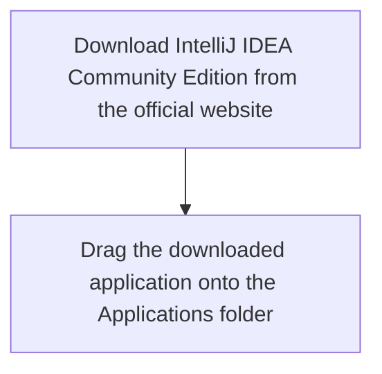

*[Knowledge ID: PRC_0005 | Sources: T0002]*

> Procedure correctness not reviewed; do not assume this is a correct solution.

#### Flowchart: Create a basic function in Java

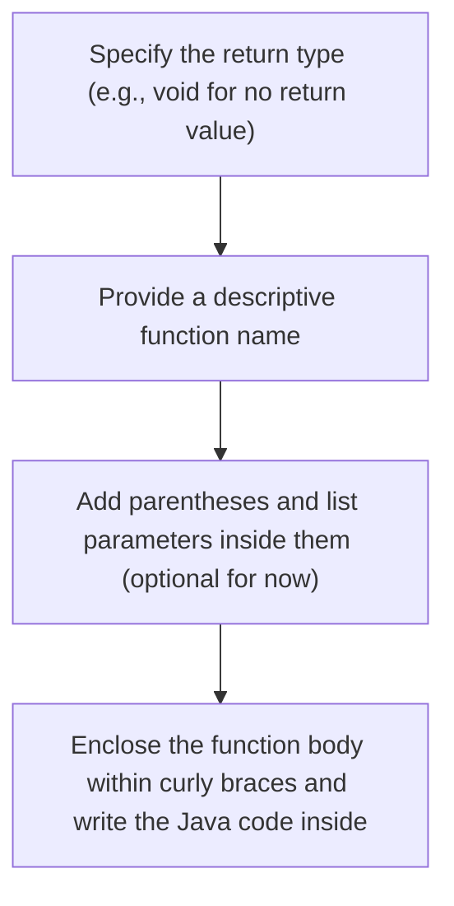

*[Knowledge ID: PRC_0006 | Sources: T0002]*

## class

### class

a container for one or more related functions; it is used to organize code similar to sections in a supermarket that contain related products

*[Knowledge ID: DEF_0034 | Sources: T0003]*

### method

a function that is part of a class

*[Knowledge ID: DEF_0035 | Sources: T0003]*

### access modifier

a special keyword that determines if other classes and methods in the program can access these classes and methods (e.g., public, private)

*[Knowledge ID: DEF_0036 | Sources: T0003]*

### Pascal naming convention

a convention for naming classes where the first letter of every word is uppercase

*[Knowledge ID: DEF_0004 | Sources: T0003]*

### camel naming convention

a convention for naming methods where the first letter of the first word is lowercase and the first letter of each subsequent word is uppercase

*[Knowledge ID: DEF_0005 | Sources: T0003]*

In Java the left brace is placed on the same line as the function definition.

*[Knowledge ID: FCT_0006 | Sources: T0003]*

Every Java program must have at least one function called main, which is the entry point.

*[Knowledge ID: FCT_0007 | Sources: T0003]*

Functions in Java must belong to a class; they cannot exist independently.

*[Knowledge ID: FCT_0008 | Sources: T0003]*

Every Java program must have at least one class that contains the main function.

*[Knowledge ID: FCT_0009 | Sources: T0003]*

The public access modifier is most commonly used for class and method declarations in Java.

*[Knowledge ID: FCT_0010 | Sources: T0003]*

## package statement

### package statement

specifies what package this class belongs to

*[Knowledge ID: DEF_0037 | Sources: T0005]*

### main method

a public static method with return type void that may take a parameter for passing values to the program

*[Knowledge ID: DEF_0038 | Sources: T0005]*

lines that start with // are comments; they are used to explain code and are not executed

*[Knowledge ID: EXP_0003 | Sources: T0005]*

All Java files should have the .java extension

*[Knowledge ID: FCT_0181 | Sources: T0005]*

In Java, statements must be terminated with a semicolon

*[Knowledge ID: FCT_0005 | Sources: T0005]*

The System class is defined in the java.lang package

*[Knowledge ID: FCT_0182 | Sources: T0005]*

## String

### String

a string is a sequence of characters

*[Knowledge ID: DEF_0039 | Sources: T0006]*

When we run a Java program in IntelliJ there are basically two steps involved: compilation and execution.

*[Knowledge ID: EXP_0002 | Sources: T0006]*

IntelliJ uses the Java compiler to compile our code into a different format called Java bytecode.

*[Knowledge ID: EXP_0076 | Sources: T0006]*

The dot operator is used to access members of a class.

*[Knowledge ID: FCT_0183 | Sources: T0006]*

The icon 'F' indicates a field member.

*[Knowledge ID: FCT_0184 | Sources: T0006]*

The icon 'M' indicates a method member.

*[Knowledge ID: FCT_0185 | Sources: T0006]*

The method 'println' (short for line) is used to print a line of text.

*[Knowledge ID: FCT_0186 | Sources: T0006]*

Textual data in Java should be surrounded by double quotes.

*[Knowledge ID: FCT_0187 | Sources: T0006]*

Pressing Ctrl+R runs the program in IntelliJ.

*[Knowledge ID: FCT_0188 | Sources: T0006]*

IntelliJ builds the application and shows the result in the terminal window.

*[Knowledge ID: FCT_0189 | Sources: T0006]*

> Procedure correctness not reviewed; do not assume this is a correct solution.

#### Flowchart: Run a Java program in IntelliJ

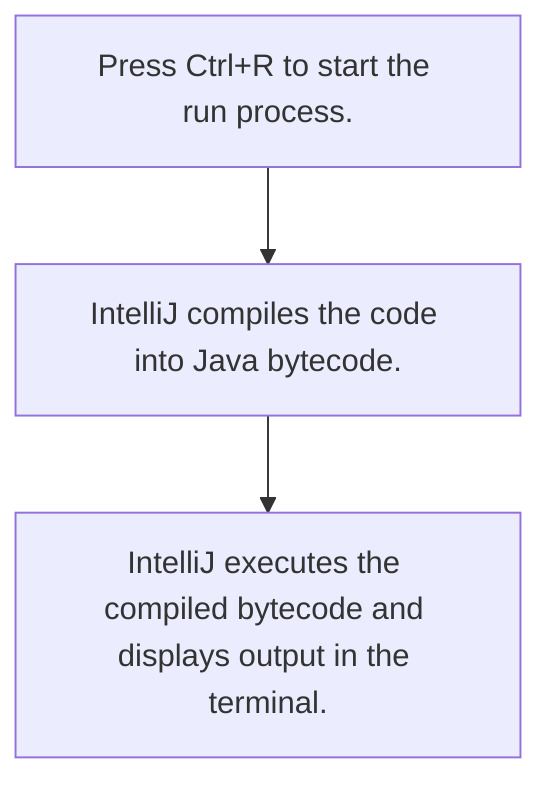

*[Knowledge ID: PRC_0011 | Sources: T0006]*

## Java bytecode

Java bytecode is platform independent and can run on Windows, macOS, Linux, or any operating system that has a Java Runtime Environment (JRE).

*[Knowledge ID: EXP_0001 | Sources: T0007]*

The JVM takes Java bytecode and translates it to native code for the underlying operating system, enabling the same bytecode to run on different platforms.

*[Knowledge ID: EXP_0077 | Sources: T0007]*

On macOS and Linux, file names are case‑sensitive, so the class name must be spelled with a capital ‘M’ (Main.java).

*[Knowledge ID: EXP_0078 | Sources: T0007]*

The compiled class file (bytecode) is stored in an output folder separate from the source folder.

*[Knowledge ID: FCT_0190 | Sources: T0007]*

The Java Runtime Environment includes the JVM, which executes Java bytecode.

*[Knowledge ID: FCT_0191 | Sources: T0007]*

C# and Python also have architectures that make them platform independent.

*[Knowledge ID: FCT_0192 | Sources: T0007]*

> Procedure correctness not reviewed; do not assume this is a correct solution.

#### Flowchart: Compile a Java source file

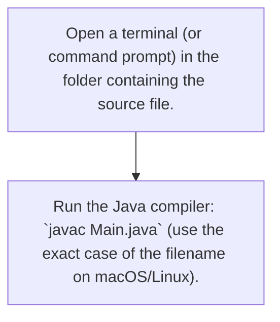

*[Knowledge ID: PRC_0007 | Sources: T0007]*

> Procedure correctness not reviewed; do not assume this is a correct solution.

**Run a compiled Java program:**

- In the terminal, execute the JVM with the class name: `java Main`.

*[Knowledge ID: PRC_0008 | Sources: T0007]*

## Source T0008

Java was developed by James Gosling in 1995 at Sun Microsystems

*[Knowledge ID: FCT_0001 | Sources: T0008]*

Sun Microsystems was later acquired by Oracle in 2010

*[Knowledge ID: FCT_0002 | Sources: T0008]*

It was originally called Oak after an oak tree that stood outside Gosling's office

*[Knowledge ID: FCT_0193 | Sources: T0008]*

It was later renamed to Green and was finally renamed to Java inspired by Java coffee

*[Knowledge ID: FCT_0194 | Sources: T0008]*

Java Standard Edition 12 was released in March 2019

*[Knowledge ID: FCT_0195 | Sources: T0008]*

Java has close to 9 million developers worldwide

*[Knowledge ID: FCT_0196 | Sources: T0008]*

About 3 billion mobile phones run Java

*[Knowledge ID: FCT_0197 | Sources: T0008]*

120 million TV sets and every Blu-ray player run Java

*[Knowledge ID: FCT_0198 | Sources: T0008]*

The average salary of a Java developer in the US is just over $100,000 per year

*[Knowledge ID: FCT_0199 | Sources: T0008]*

Java Standard Edition is the core Java platform used in this course and contains all libraries every Java developer must learn

*[Knowledge ID: FCT_0200 | Sources: T0008]*

Java Enterprise Edition is built on top of Java Standard Edition and provides additional libraries for building fault tolerant distributed multi-tiered software

*[Knowledge ID: FCT_0011 | Sources: T0008]*

Java Micro Edition is a subset of Java Standard Edition designed for mobile devices with specific libraries

*[Knowledge ID: FCT_0012 | Sources: T0008]*

Java Card is used in smart cards

*[Knowledge ID: FCT_0013 | Sources: T0008]*

## Source T0009

The course is a four-part Java series, each part 3-4 hours long.

*[Knowledge ID: FCT_0201 | Sources: T0009]*

The first part teaches fundamentals of programming with Java.

*[Knowledge ID: FCT_0202 | Sources: T0009]*

Subsequent sections cover the Java type system, including primitives, strings, booleans, and arrays, and culminate in building a mortgage calculator.

*[Knowledge ID: FCT_0203 | Sources: T0009]*

The second part introduces control flow statements, such as conditional statements and loops, and adds data validation to the mortgage calculator.

*[Knowledge ID: FCT_0204 | Sources: T0009]*

Clean and expressive code distinguishes outstanding programmers; the course teaches clean coding techniques for maintainable code.

*[Knowledge ID: FCT_0205 | Sources: T0009]*

The final section covers finding and fixing errors in Java programs and packaging them for deployment.

*[Knowledge ID: FCT_0206 | Sources: T0009]*

Object‑oriented programming concepts are covered in the second part of the series.

*[Knowledge ID: FCT_0207 | Sources: T0009]*

The third part teaches core Java APIs and useful classes in the standard Java library.

*[Knowledge ID: FCT_0208 | Sources: T0009]*

The fourth part explores advanced Java features such as streams, threads, and database programming.

*[Knowledge ID: FCT_0209 | Sources: T0009]*

Learners will study variables, constants, primitive and reference types, casting/type conversion, and how to work with numbers, strings, arrays, and user input.

*[Knowledge ID: FCT_0210 | Sources: T0009]*

A project assignment requires building a mortgage calculator independently.

*[Knowledge ID: FCT_0211 | Sources: T0009]*

## variable

### variable

a named storage location in a computer's memory that holds data temporarily

*[Knowledge ID: DEF_0040 | Sources: T0010]*

### identifier

the name or label given to a variable so it can be identified in code

*[Knowledge ID: DEF_0041 | Sources: T0010]*

### assignment operator

the equal sign (=) used to assign an initial value to a variable

*[Knowledge ID: DEF_0042 | Sources: T0010]*

### initialization

the act of giving a variable its first value at the time of declaration

*[Knowledge ID: DEF_0043 | Sources: T0010]*

### camelCase

a naming convention where the first word is lowercase and each subsequent word starts with a capital letter

*[Knowledge ID: DEF_0044 | Sources: T0010]*

Variables are used to temporarily store data in a computer's memory so that programs can manipulate and retrieve that data.

*[Knowledge ID: EXP_0006 | Sources: T0010]*

A variable must be initialized (given an initial value) before it is used in Java.

*[Knowledge ID: EXP_0007 | Sources: T0010]*

Declaring multiple variables on the same line makes code harder to read and is therefore not recommended.

*[Knowledge ID: EXP_0008 | Sources: T0010]*

Variable names should follow camelCase: capitalize the first letter of each word except the first.

*[Knowledge ID: EXP_0009 | Sources: T0010]*

> Claim review: NOT\_REVIEWED — Generated declaration/snippet/comment is not literal text in the source. This confirms lack of literal-source fidelity, not that its behavior is necessarily wrong.
> Literal source code unavailable. Original generated snippet retained in the audit only.

Example held for source-fidelity review. The original generated text and supporting passages remain in the evidence artifact.

*[Knowledge ID: EXM_0010 | Sources: T0010]*

> Claim review: NOT\_REVIEWED — Generated declaration/snippet/comment is not literal text in the source. This confirms lack of literal-source fidelity, not that its behavior is necessarily wrong.
> Literal source code unavailable. Original generated snippet retained in the audit only.

Example held for source-fidelity review. The original generated text and supporting passages remain in the evidence artifact.

*[Knowledge ID: EXM_0011 | Sources: T0010]*

> Claim review: NOT\_REVIEWED — Generated declaration/snippet/comment is not literal text in the source. This confirms lack of literal-source fidelity, not that its behavior is necessarily wrong.
> Literal source code unavailable. Original generated snippet retained in the audit only.

Example held for source-fidelity review. The original generated text and supporting passages remain in the evidence artifact.

*[Knowledge ID: EXM_0012 | Sources: T0010]*

> Claim review: NOT\_REVIEWED — Generated declaration/snippet/comment is not literal text in the source. This confirms lack of literal-source fidelity, not that its behavior is necessarily wrong.
> Literal source code unavailable. Original generated snippet retained in the audit only.

Example held for source-fidelity review. The original generated text and supporting passages remain in the evidence artifact.

*[Knowledge ID: EXM_0013 | Sources: T0010]*

> Claim review: NOT\_REVIEWED — Generated declaration/snippet/comment is not literal text in the source. This confirms lack of literal-source fidelity, not that its behavior is necessarily wrong.
> Literal source code unavailable. Original generated snippet retained in the audit only.

Example held for source-fidelity review. The original generated text and supporting passages remain in the evidence artifact.

*[Knowledge ID: EXM_0014 | Sources: T0010]*

int (integer) variables can only store whole numbers without decimal points.

*[Knowledge ID: FCT_0015 | Sources: T0010]*

The equal sign (=) is called the assignment operator in Java.

*[Knowledge ID: FCT_0016 | Sources: T0010]*

> Procedure correctness not reviewed; do not assume this is a correct solution.

Demonstrates declaring, initializing, printing, and updating a variable in Java.

*[Knowledge ID: PRC_0017 | Sources: T0010]*

## Choosing appropriate primitive type based on value range

> **Example: Choosing appropriate primitive type based on value range**
> 
> We use a byte instead of an int to store someone's age because a byte can store values up to 127, which is sufficient for an age.

*[Knowledge ID: EXM_0001 | Sources: T0011]*

> Claim review: NOT\_REVIEWED — Revised prose removes unsupported illustrative literal or restores the source-stated otherwise condition.

> **Example: Using underscores in numeric literals for readability**
> 
> Declare an integer viewsCount for a video's view count. Use underscores to group digits in a large integer literal for readability.

*[Knowledge ID: EXM_0002 | Sources: T0011]*

byte takes one byte of memory and can store values from -128 to 127.

*[Knowledge ID: FCT_0212 | Sources: T0011]*

short takes two bytes of memory and can store values up to 32,000.

*[Knowledge ID: FCT_0213 | Sources: T0011]*

int (integer) takes four bytes of memory and can store values up to two billion.

*[Knowledge ID: FCT_0214 | Sources: T0011]*

long takes eight bytes of memory and can store even larger numbers.

*[Knowledge ID: FCT_0215 | Sources: T0011]*

float takes four bytes of memory and is used for numbers with a decimal point.

*[Knowledge ID: FCT_0216 | Sources: T0011]*

double takes eight bytes of memory and is used for numbers with a decimal point, allowing larger values than float.

*[Knowledge ID: FCT_0217 | Sources: T0011]*

char takes two bytes of memory and stores a single character, supporting international letters.

*[Knowledge ID: FCT_0218 | Sources: T0011]*

boolean stores true or false values.

*[Knowledge ID: FCT_0219 | Sources: T0011]*

Underscores can be used in numeric literals in Java to separate groups of three digits for readability.

*[Knowledge ID: FCT_0220 | Sources: T0011]*

## primitive type

primitive types store simple values like numbers, boolean values, or single characters

*[Knowledge ID: CON_0001 | Sources: T0012]*

reference types store complex objects such as data objects or mail messages

*[Knowledge ID: CON_0002 | Sources: T0012]*

### long literal

A numeric literal that is interpreted as a long value by appending an uppercase or lowercase L suffix (prefer uppercase L because lowercase l resembles the digit 1).

*[Knowledge ID: DEF_0045 | Sources: T0012]*

### float literal

A numeric literal with a decimal point that is interpreted as a float value by appending an uppercase or lowercase F suffix.

*[Knowledge ID: DEF_0046 | Sources: T0012]*

### char literal

A single character literal enclosed in single quotes.

*[Knowledge ID: DEF_0047 | Sources: T0012]*

### string literal

A sequence of characters enclosed in double quotes.

*[Knowledge ID: DEF_0006 | Sources: T0012]*

### boolean literal

The literals true and false representing boolean values.

*[Knowledge ID: DEF_0007 | Sources: T0012]*

### reserved keyword

Words such as public, static, void, class, package that cannot be used as identifiers because they have special meaning in Java.

*[Knowledge ID: DEF_0008 | Sources: T0012]*

By default, Java interprets integer literals without a suffix as type int.

*[Knowledge ID: FCT_0221 | Sources: T0012]*

By default, Java interprets decimal literals without a suffix as type double.

*[Knowledge ID: FCT_0222 | Sources: T0012]*

A lowercase l suffix can be confused with the digit 1, so an uppercase L is recommended for long literals.

*[Knowledge ID: FCT_0223 | Sources: T0012]*

A lowercase f suffix can be confused with the digit 1, so an uppercase F is recommended for float literals.

*[Knowledge ID: FCT_0224 | Sources: T0012]*

### primitive type

a basic data type in Java that is allocated and released automatically by the Java Runtime Environment

*[Knowledge ID: DEF_0048 | Sources: T0013]*

### reference type

a type that refers to an object and requires explicit memory allocation with the new operator

*[Knowledge ID: DEF_0049 | Sources: T0013]*

### class

a blueprint or template for creating objects (instances)

*[Knowledge ID: DEF_0050 | Sources: T0013]*

### object

an instance of a class

*[Knowledge ID: DEF_0051 | Sources: T0013]*

### package

a namespace that groups related classes and prevents naming conflicts

*[Knowledge ID: DEF_0052 | Sources: T0013]*

### import statement

a directive that makes a class from another package available in the current source file

*[Knowledge ID: DEF_0053 | Sources: T0013]*

### new operator

an operator that allocates memory for a reference type and creates a new object instance

*[Knowledge ID: DEF_0054 | Sources: T0013]*

### dot operator

the member-access operator used to refer to fields or methods of an object

*[Knowledge ID: DEF_0055 | Sources: T0013]*

### method

a function defined within a class that can be invoked on an object

*[Knowledge ID: DEF_0009 | Sources: T0013]*

Primitive types are allocated automatically by the runtime, while reference types require explicit memory allocation with the new operator and are managed by the runtime for deallocation.

*[Knowledge ID: EXP_0010 | Sources: T0013]*

Packages create namespaces that allow classes with the same name to coexist in different packages without conflict.

*[Knowledge ID: EXP_0011 | Sources: T0013]*

> Claim review: NOT\_REVIEWED — Generated declaration/snippet/comment is not literal text in the source. This confirms lack of literal-source fidelity, not that its behavior is necessarily wrong.
> Literal source code unavailable. Original generated snippet retained in the audit only.

Example held for source-fidelity review. The original generated text and supporting passages remain in the evidence artifact.

*[Knowledge ID: EXM_0139 | Sources: T0013]*

> Claim review: NOT\_REVIEWED — Generated declaration/snippet/comment is not literal text in the source. This confirms lack of literal-source fidelity, not that its behavior is necessarily wrong.
> Literal source code unavailable. Original generated snippet retained in the audit only.

Example held for source-fidelity review. The original generated text and supporting passages remain in the evidence artifact.

*[Knowledge ID: EXM_0140 | Sources: T0013]*

> Claim review: NOT\_REVIEWED — Generated declaration/snippet/comment is not literal text in the source. This confirms lack of literal-source fidelity, not that its behavior is necessarily wrong.
> Literal source code unavailable. Original generated snippet retained in the audit only.

Example held for source-fidelity review. The original generated text and supporting passages remain in the evidence artifact.

*[Knowledge ID: EXM_0141 | Sources: T0013]*

Java has eight primitive types.

*[Knowledge ID: FCT_0225 | Sources: T0013]*

Memory for primitive variables is allocated and released automatically by the Java Runtime Environment.

*[Knowledge ID: FCT_0226 | Sources: T0013]*

Memory for reference variables must be allocated explicitly using the new operator.

*[Knowledge ID: FCT_0017 | Sources: T0013]*

The Java Runtime Environment automatically reclaims memory for objects when they are no longer referenced.

*[Knowledge ID: FCT_0018 | Sources: T0013]*

The import statement brings a class from another package into the current source file.

*[Knowledge ID: FCT_0019 | Sources: T0013]*

> Procedure correctness not reviewed; do not assume this is a correct solution.

Procedure to import a class and create an instance.

*[Knowledge ID: PRC_0020 | Sources: T0013]*

> Technical fields held for source-fidelity review; this is not a confirmed semantic error.

The java.util package contains the Date class.
Object: \[requires source review\]
contains
package java.util

*[Knowledge ID: REL_0021 | Sources: T0013]*

> Technical fields held for source-fidelity review; this is not a confirmed semantic error.

The variable 'date' is an instance of the Date class.
Object: \[requires source review\]
instance_of
object date

*[Knowledge ID: REL_0022 | Sources: T0013]*

> Technical fields held for source-fidelity review; this is not a confirmed semantic error.

The Date class defines a method getTime() that can be invoked on its objects.
method getTime()
has_member
Subject: \[requires source review\]

*[Knowledge ID: REL_0023 | Sources: T0013]*

object date accessed_by method getTime()

*[Knowledge ID: REL_0024 | Sources: T0013]*

## Dot operator usage

The dot operator accesses members of an object; for primitive types it yields nothing because they have no members, whereas for class types it allows access to fields and methods.

*[Knowledge ID: EXP_0079 | Sources: T0014]*

When a primitive variable is assigned to another, the two variables occupy separate memory locations, so modifying one does not affect the other.

*[Knowledge ID: EXP_0080 | Sources: T0014]*

Primitive type variables do not have members, so using the dot operator shows nothing.

*[Knowledge ID: FCT_0227 | Sources: T0014]*

Class types have members that can be accessed with the dot operator, such as System.out.printLine.

*[Knowledge ID: FCT_0228 | Sources: T0014]*

Primitive types store simple values, while reference types store complex objects.

*[Knowledge ID: FCT_0229 | Sources: T0014]*

Variables of primitive types are independent; changing the value of one does not affect another copy.

*[Knowledge ID: FCT_0230 | Sources: T0014]*

## Reference types in Java store a reference (address) to an object in memory rather than the actual object value.

When a reference type variable (e.g., a variable of a class type) is declared, the variable holds the address of the object in memory. The actual object resides elsewhere in the heap, and the variable points to that location.

*[Knowledge ID: EXP_0081 | Sources: T0015]*

When a primitive variable (e.g., a byte) is declared, the value assigned to it is stored directly in the memory location associated with that variable.

*[Knowledge ID: EXP_0082 | Sources: T0015]*

When `point2 = point1;` is executed, the value copied is the address of the `Point` object, so both `point1` and `point2` refer to the same object in memory.

*[Knowledge ID: EXP_0083 | Sources: T0015]*

Changing a field (e.g., `point1.x = 2;`) updates the single underlying object. Since `point2` references the same object, reading `point2.x` will reflect the updated value.

*[Knowledge ID: EXP_0004 | Sources: T0015]*

> Claim review: NOT\_REVIEWED — Generated declaration/snippet/comment is not literal text in the source. This confirms lack of literal-source fidelity, not that its behavior is necessarily wrong.
> Literal source code unavailable. Original generated snippet retained in the audit only.

Example held for source-fidelity review. The original generated text and supporting passages remain in the evidence artifact.

*[Knowledge ID: EXM_0005 | Sources: T0015]*

Reference types are copied by reference (address), while primitive types are copied by value.

*[Knowledge ID: FCT_0231 | Sources: T0015]*

Two reference variables that are assigned to the same object are not independent; they share the same underlying object.

*[Knowledge ID: FCT_0232 | Sources: T0015]*

## string literal

### string literal

a string value written directly in the source code, e.g., "hello world", which the Java compiler treats as an instance of the String class

*[Knowledge ID: DEF_0056 | Sources: T0016]*

### reference type

a type whose variables hold references to objects rather than the actual primitive data values; in Java, classes such as String are reference types

*[Knowledge ID: DEF_0057 | Sources: T0016]*

String literals are a shorthand that the compiler translates into a String object, so explicitly calling the String constructor adds no benefit and can be omitted

*[Knowledge ID: EXP_0084 | Sources: T0016]*

Because String is a class, its instance methods (e.g., endsWith, startsWith, length) are invoked using the dot (.) syntax on a String variable

*[Knowledge ID: EXP_0085 | Sources: T0016]*

> Claim review: NOT\_REVIEWED — Generated declaration/snippet/comment is not literal text in the source. This confirms lack of literal-source fidelity, not that its behavior is necessarily wrong.
> Literal source code unavailable. Original generated snippet retained in the audit only.

Example held for source-fidelity review. The original generated text and supporting passages remain in the evidence artifact.

*[Knowledge ID: EXM_0142 | Sources: T0016]*

> Claim review: NOT\_REVIEWED — Generated declaration/snippet/comment is not literal text in the source. This confirms lack of literal-source fidelity, not that its behavior is necessarily wrong.
> Literal source code unavailable. Original generated snippet retained in the audit only.

Example held for source-fidelity review. The original generated text and supporting passages remain in the evidence artifact.

*[Knowledge ID: EXM_0006 | Sources: T0016]*

> Claim review: NOT\_REVIEWED — Generated declaration/snippet/comment is not literal text in the source. This confirms lack of literal-source fidelity, not that its behavior is necessarily wrong.
> Literal source code unavailable. Original generated snippet retained in the audit only.

Example held for source-fidelity review. The original generated text and supporting passages remain in the evidence artifact.

*[Knowledge ID: EXM_0007 | Sources: T0016]*

> Claim review: NOT\_REVIEWED — Generated declaration/snippet/comment is not literal text in the source. This confirms lack of literal-source fidelity, not that its behavior is necessarily wrong.
> Literal source code unavailable. Original generated snippet retained in the audit only.

Example held for source-fidelity review. The original generated text and supporting passages remain in the evidence artifact.

*[Knowledge ID: EXM_0008 | Sources: T0016]*

The String class is defined in the java.lang package, which is automatically imported by the Java compiler

*[Knowledge ID: FCT_0233 | Sources: T0016]*

String variables can be instantiated without the new operator by assigning a string literal

*[Knowledge ID: FCT_0234 | Sources: T0016]*

Using "new String" is redundant because the same result is achieved with a string literal

*[Knowledge ID: FCT_0235 | Sources: T0016]*

The plus (+) operator concatenates two strings

*[Knowledge ID: FCT_0236 | Sources: T0016]*

The method endsWith returns a boolean indicating whether a string ends with the specified suffix

*[Knowledge ID: FCT_0237 | Sources: T0016]*

The method startsWith returns a boolean indicating whether a string starts with the specified prefix

*[Knowledge ID: FCT_0014 | Sources: T0016]*

The method length returns the number of characters in the string

*[Knowledge ID: FCT_0238 | Sources: T0016]*

> Procedure correctness not reviewed; do not assume this is a correct solution.
> Technical fields held for source-fidelity review; this is not a confirmed semantic error.

Content: \[requires source review\]
Declare and initialize a String variable
Choose a variable name, e.g., message
Assign a string literal to the variable, e.g., message = "hello world";

*[Knowledge ID: PRC_0016 | Sources: T0016]*

> Procedure correctness not reviewed; do not assume this is a correct solution.
> Technical fields held for source-fidelity review; this is not a confirmed semantic error.

Content: \[requires source review\]
Concatenate strings using + operator
Take an existing String variable, e.g., message
Use the + operator with another string literal or variable, e.g., message + "!!"

*[Knowledge ID: PRC_0380 | Sources: T0016]*

## parameter

### parameter

the holes that we define in our methods

*[Knowledge ID: DEF_0058 | Sources: T0017]*

### argument

the actual values that we pass to these methods

*[Knowledge ID: DEF_0059 | Sources: T0017]*

### immutable string

a string that cannot be changed after it is created; any method that appears to modify a string actually returns a new string object

*[Knowledge ID: DEF_0060 | Sources: T0017]*

indexOf returns the index of the first occurrence of the given character or substring; if the character or substring is not present, it returns -1

*[Knowledge ID: EXP_0086 | Sources: T0017]*

Java strings cannot be altered after creation; methods like replace, toLowerCase, toUpperCase, and trim produce new string objects rather than modifying the original

*[Knowledge ID: EXP_0005 | Sources: T0017]*

> Claim review: NOT\_REVIEWED — Reviewed against full available source passages: behavior is supported; this is prose/synthesis, not a claim of verbatim source syntax.

> **Example: replace method**
> 
> replace('!', '*') changes all exclamation marks in the original string to asterisks, producing a new string while leaving the original unchanged

*[Knowledge ID: EXM_0143 | Sources: T0017]*

> Claim review: NOT\_REVIEWED — Revised prose removes unsupported illustrative literal or restores the source-stated otherwise condition.

> **Example: trim method**
> 
> The trim method removes extra whitespace at the beginning or end of a string.

*[Knowledge ID: EXM_0144 | Sources: T0017]*

toLowerCase converts all characters in a string to lowercase and returns a new string

*[Knowledge ID: FCT_0239 | Sources: T0017]*

toUpperCase converts all characters in a string to uppercase and returns a new string

*[Knowledge ID: FCT_0240 | Sources: T0017]*

trim removes extra whitespace at the beginning and end of a string and returns a new string

*[Knowledge ID: FCT_0241 | Sources: T0017]*

> Procedure correctness not reviewed; do not assume this is a correct solution.

#### Flowchart: Using the replace method

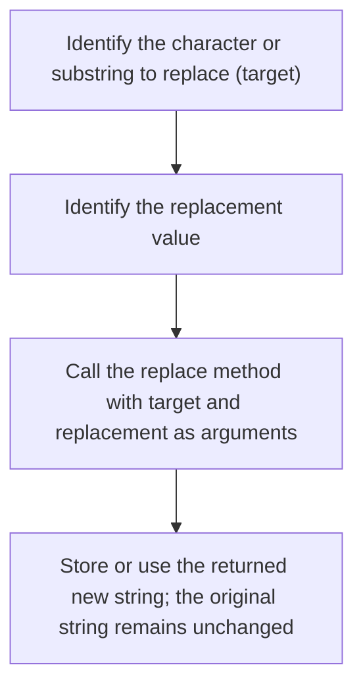

*[Knowledge ID: PRC_0381 | Sources: T0017]*

> Procedure correctness not reviewed; do not assume this is a correct solution.

#### Flowchart: Trimming whitespace from user input

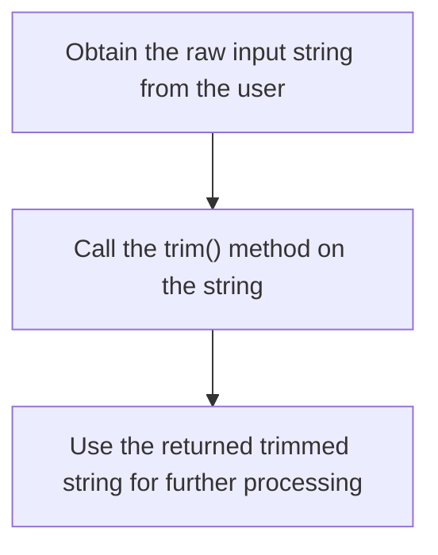

*[Knowledge ID: PRC_0012 | Sources: T0017]*

## Escape sequences in Java strings

In Java, certain characters like double quotes, backslashes, newlines, and tabs cannot be placed directly inside string literals because the compiler interprets them specially. To include them, you must prefix the character with a backslash (\) which tells the compiler to treat the following character as a literal part of the string.

*[Knowledge ID: EXP_0087 | Sources: T0018]*

> Claim review: NOT\_REVIEWED — Generated declaration/snippet/comment is not literal text in the source. This confirms lack of literal-source fidelity, not that its behavior is necessarily wrong.
> Literal source code unavailable. Original generated snippet retained in the audit only.

Example held for source-fidelity review. The original generated text and supporting passages remain in the evidence artifact.

*[Knowledge ID: EXM_0145 | Sources: T0018]*

> Claim review: NOT\_REVIEWED — Generated declaration/snippet/comment is not literal text in the source. This confirms lack of literal-source fidelity, not that its behavior is necessarily wrong.
> Literal source code unavailable. Original generated snippet retained in the audit only.

Example held for source-fidelity review. The original generated text and supporting passages remain in the evidence artifact.

*[Knowledge ID: EXM_0003 | Sources: T0018]*

> Claim review: NOT\_REVIEWED — Generated declaration/snippet/comment is not literal text in the source. This confirms lack of literal-source fidelity, not that its behavior is necessarily wrong.
> Literal source code unavailable. Original generated snippet retained in the audit only.

Example held for source-fidelity review. The original generated text and supporting passages remain in the evidence artifact.

*[Knowledge ID: EXM_0004 | Sources: T0018]*

> Claim review: NOT\_REVIEWED — Generated declaration/snippet/comment is not literal text in the source. This confirms lack of literal-source fidelity, not that its behavior is necessarily wrong.
> Literal source code unavailable. Original generated snippet retained in the audit only.

Example held for source-fidelity review. The original generated text and supporting passages remain in the evidence artifact.

*[Knowledge ID: EXM_0146 | Sources: T0018]*

The four commonly used escape sequences in Java strings are \" (double quote), \\ (backslash), \n (newline), and \t (tab).

*[Knowledge ID: FCT_0242 | Sources: T0018]*

## Source T0019

Arrays store a list of items such as numbers, people, or messages.

*[Knowledge ID: FCT_0243 | Sources: T0019]*

An array is declared by writing the element type followed by square brackets, e.g., int\[\] numbers.

*[Knowledge ID: FCT_0244 | Sources: T0019]*

To create an array you use the new operator and specify the size in square brackets, e.g., new int\[5\].

*[Knowledge ID: FCT_0245 | Sources: T0019]*

Array indices start at zero; the first element is accessed with index 0.

*[Knowledge ID: FCT_0246 | Sources: T0019]*

Accessing an invalid index (e.g., index 10 in a five‑element array) causes a runtime exception and crashes the program.

*[Knowledge ID: FCT_0247 | Sources: T0019]*

Printing an array directly (e.g., System.out.println(array)) yields a string based on the array's memory address, not its contents.

*[Knowledge ID: FCT_0248 | Sources: T0019]*

The java.util.Arrays class provides a toString method that returns a readable representation of an array’s elements.

*[Knowledge ID: FCT_0249 | Sources: T0019]*

## Create and initialize an array using the concise curly‑brace syntax

In an integer array, elements that are not explicitly initialized are set to 0 by default.

*[Knowledge ID: FCT_0250 | Sources: T0020]*

In a boolean array, elements default to false.

*[Knowledge ID: FCT_0251 | Sources: T0020]*

In a String array, elements default to an empty string.

*[Knowledge ID: FCT_0252 | Sources: T0020]*

The newer syntax for creating and initializing an array uses curly braces with the items listed inside, eliminating the need for the new operator.

*[Knowledge ID: FCT_0253 | Sources: T0020]*

An array’s length can be read using the .length field.

*[Knowledge ID: FCT_0254 | Sources: T0020]*

Java arrays have a fixed size; once created, items cannot be added or removed.

*[Knowledge ID: FCT_0255 | Sources: T0020]*

To obtain a dynamically sized collection, one should use one of the collection classes instead of an array.

*[Knowledge ID: FCT_0256 | Sources: T0020]*

Arrays can be sorted using the Arrays.sort method, which is overloaded for different parameter types.

*[Knowledge ID: FCT_0257 | Sources: T0020]*

Multi‑dimensional arrays (e.g., two‑dimensional or three‑dimensional) can be created to store matrices or cube data, useful in scientific computations.

*[Knowledge ID: FCT_0258 | Sources: T0020]*

> Procedure correctness not reviewed; do not assume this is a correct solution.

#### Flowchart: Create and initialize an array using the concise curly‑brace syntax

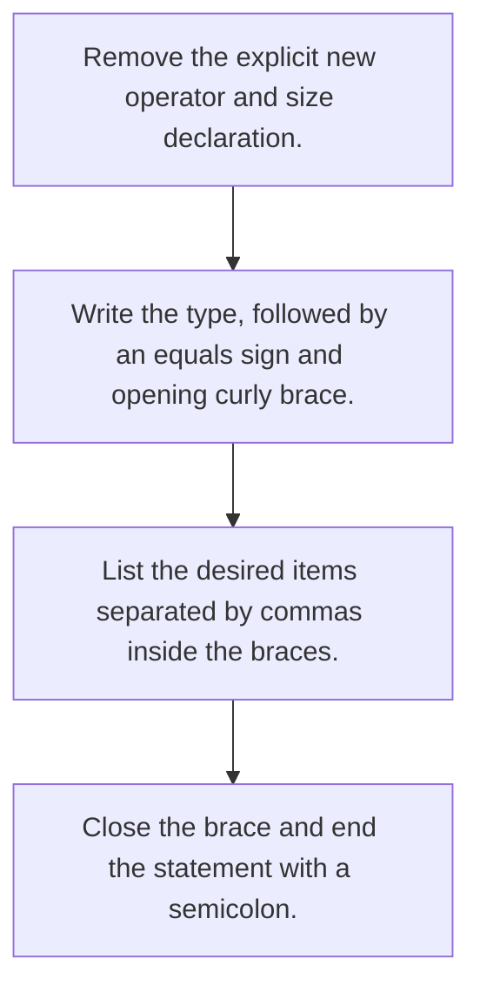

*[Knowledge ID: PRC_0010 | Sources: T0020]*

> Procedure correctness not reviewed; do not assume this is a correct solution.

The array elements are rearranged into ascending order.

*[Knowledge ID: PRC_0382 | Sources: T0020]*

## Create a 2 × 3 two‑dimensional array

A two‑dimensional array requires two pairs of square brackets, one for each dimension (rows and columns).

*[Knowledge ID: FCT_0259 | Sources: T0021]*

Accessing an element in a two‑dimensional array uses two indexes: the row index followed by the column index.

*[Knowledge ID: FCT_0260 | Sources: T0021]*

Printing a multi‑dimensional array with `Arrays.toString` yields a unreadable string; `Arrays.deepToString` must be used instead.

*[Knowledge ID: FCT_0261 | Sources: T0021]*

A two‑dimensional array can be initialized with curly‑brace syntax, where each row is itself an array literal.

*[Knowledge ID: FCT_0262 | Sources: T0021]*

In Java, a floating‑point literal requires an `F` suffix to be treated as a `float` (e.g., `3.14F`).

*[Knowledge ID: FCT_0263 | Sources: T0021]*

Declaring a variable with the `final` keyword makes it a constant; its value cannot be changed after initialization.

*[Knowledge ID: FCT_0264 | Sources: T0021]*

> Procedure correctness not reviewed; do not assume this is a correct solution.

**Create a 2 × 3 two‑dimensional array:**

- Declare the array with two pairs of brackets, e.g., `int\[\]\[\] matrix = new int\[2\]\[3\];`

*[Knowledge ID: PRC_0383 | Sources: T0021]*

> Procedure correctness not reviewed; do not assume this is a correct solution.

**Print a multi‑dimensional array:**

- Call `Arrays.deepToString(array)` to obtain a readable string representation.

*[Knowledge ID: PRC_0384 | Sources: T0021]*

> Procedure correctness not reviewed; do not assume this is a correct solution.

**Initialize a two‑dimensional array with curly‑brace syntax:**

- Write the array literal with each row as a nested brace list, e.g., `int\[\]\[\] matrix = { {1,2,3}, {4,5,6} };`

*[Knowledge ID: PRC_0009 | Sources: T0021]*

> Procedure correctness not reviewed; do not assume this is a correct solution.

**Declare a constant for π:**

- Use `final double PI = 3.14;` (or `final float PI = 3.14F;` for a float).

*[Knowledge ID: PRC_0385 | Sources: T0021]*

## final variable

### final variable

a variable declared with the final keyword that cannot be assigned a new value after its initialization, effectively making it a constant

*[Knowledge ID: DEF_0061 | Sources: T0022]*

### constant

a value that does not change during program execution; in Java it is typically declared with the final keyword and named using all capital letters

*[Knowledge ID: DEF_0062 | Sources: T0022]*

### arithmetic expression

a piece of code that combines operands and operators to produce a value

*[Knowledge ID: DEF_0063 | Sources: T0022]*

### operand

a value or variable that an operator works on within an expression

*[Knowledge ID: DEF_0064 | Sources: T0022]*

By convention, constants are named using all capital letters (e.g., PI) to distinguish them from regular variables.

*[Knowledge ID: EXP_0088 | Sources: T0022]*

In Java, dividing two whole numbers yields a whole number (the fractional part is discarded).

*[Knowledge ID: EXP_0089 | Sources: T0022]*

To obtain a floating‑point result from division, at least one operand must be cast to a float or double.

*[Knowledge ID: EXP_0090 | Sources: T0022]*

The ++ operator increases a variable's value by 1; it can be used as a prefix (e.g., ++x) or postfix (e.g., x++).

*[Knowledge ID: EXP_0091 | Sources: T0022]*

> Claim review: NOT\_REVIEWED — Generated declaration/snippet/comment is not literal text in the source. This confirms lack of literal-source fidelity, not that its behavior is necessarily wrong.
> Literal source code unavailable. Original generated snippet retained in the audit only.

Example held for source-fidelity review. The original generated text and supporting passages remain in the evidence artifact.

*[Knowledge ID: EXM_0009 | Sources: T0022]*

> Claim review: NOT\_REVIEWED — Generated declaration/snippet/comment is not literal text in the source. This confirms lack of literal-source fidelity, not that its behavior is necessarily wrong.
> Literal source code unavailable. Original generated snippet retained in the audit only.

Example held for source-fidelity review. The original generated text and supporting passages remain in the evidence artifact.

*[Knowledge ID: EXM_0147 | Sources: T0022]*

> Claim review: NOT\_REVIEWED — Generated declaration/snippet/comment is not literal text in the source. This confirms lack of literal-source fidelity, not that its behavior is necessarily wrong.
> Literal source code unavailable. Original generated snippet retained in the audit only.

Example held for source-fidelity review. The original generated text and supporting passages remain in the evidence artifact.

*[Knowledge ID: EXM_0148 | Sources: T0022]*

> Claim review: NOT\_REVIEWED — Generated declaration/snippet/comment is not literal text in the source. This confirms lack of literal-source fidelity, not that its behavior is necessarily wrong.
> Literal source code unavailable. Original generated snippet retained in the audit only.

Example held for source-fidelity review. The original generated text and supporting passages remain in the evidence artifact.

*[Knowledge ID: EXM_0149 | Sources: T0022]*

A final variable cannot be assigned a new value after its initial assignment.

*[Knowledge ID: FCT_0265 | Sources: T0022]*

The arithmetic operators in Java are addition (+), subtraction (‑), multiplication (*), division (/), and modulus (%).

*[Knowledge ID: FCT_0266 | Sources: T0022]*

When an integer variable is assigned the result of a division between two integers, the result is an integer.

*[Knowledge ID: FCT_0267 | Sources: T0022]*

Casting an integer to double before division yields a floating‑point result.

*[Knowledge ID: FCT_0268 | Sources: T0022]*

## postfix increment operator behavior

When the increment operator is used as a postfix (e.g., X++), the current value of X is first copied to the target variable, and then X is incremented by 1. Thus after `Y = X++`, Y receives the original value of X and X becomes the original value plus one.

*[Knowledge ID: EXP_0092 | Sources: T0023]*

When the increment operator is used as a prefix (e.g., ++X), X is first incremented by 1, and then the new value is copied to the target variable. Thus after `Y = ++X`, both X and Y contain the incremented value.

*[Knowledge ID: EXP_0093 | Sources: T0023]*

Augmented assignment operators combine an arithmetic operation with assignment, such as `X += 2` which adds 2 to X and stores the result back in X. They provide a shorter syntax equivalent to `X = X + 2`. Similar operators exist for subtraction (`-=`), multiplication (`*=`), and division (`/=`).

*[Knowledge ID: EXP_0094 | Sources: T0023]*

In arithmetic expressions, multiplication and division have higher precedence than addition and subtraction, so they are evaluated first. Parentheses can be used to override the default precedence and force a different evaluation order.

*[Knowledge ID: EXP_0095 | Sources: T0023]*

> Claim review: NOT\_REVIEWED — Generated declaration/snippet/comment is not literal text in the source. This confirms lack of literal-source fidelity, not that its behavior is necessarily wrong.
> Literal source code unavailable. Original generated snippet retained in the audit only.

Example held for source-fidelity review. The original generated text and supporting passages remain in the evidence artifact.

*[Knowledge ID: EXM_0150 | Sources: T0023]*

> Claim review: NOT\_REVIEWED — Generated declaration/snippet/comment is not literal text in the source. This confirms lack of literal-source fidelity, not that its behavior is necessarily wrong.
> Literal source code unavailable. Original generated snippet retained in the audit only.

Example held for source-fidelity review. The original generated text and supporting passages remain in the evidence artifact.

*[Knowledge ID: EXM_0151 | Sources: T0023]*

> Claim review: NOT\_REVIEWED — Generated declaration/snippet/comment is not literal text in the source. This confirms lack of literal-source fidelity, not that its behavior is necessarily wrong.
> Literal source code unavailable. Original generated snippet retained in the audit only.

Example held for source-fidelity review. The original generated text and supporting passages remain in the evidence artifact.

*[Knowledge ID: EXM_0152 | Sources: T0023]*

> Claim review: NOT\_REVIEWED — Generated declaration/snippet/comment is not literal text in the source. This confirms lack of literal-source fidelity, not that its behavior is necessarily wrong.
> Literal source code unavailable. Original generated snippet retained in the audit only.

Example held for source-fidelity review. The original generated text and supporting passages remain in the evidence artifact.

*[Knowledge ID: EXM_0153 | Sources: T0023]*

> Claim review: NOT\_REVIEWED — Generated declaration/snippet/comment is not literal text in the source. This confirms lack of literal-source fidelity, not that its behavior is necessarily wrong.
> Literal source code unavailable. Original generated snippet retained in the audit only.

Example held for source-fidelity review. The original generated text and supporting passages remain in the evidence artifact.

*[Knowledge ID: EXM_0154 | Sources: T0023]*

Using `X++` as a postfix increments X after its current value is used.

*[Knowledge ID: FCT_0269 | Sources: T0023]*

Using `++X` as a prefix increments X before its value is used.

*[Knowledge ID: FCT_0270 | Sources: T0023]*

`X += 2` adds 2 to X and stores the result back in X.

*[Knowledge ID: FCT_0271 | Sources: T0023]*

Multiplication and division have higher precedence than addition and subtraction.

*[Knowledge ID: FCT_0272 | Sources: T0023]*

#### Formula

```
10 + 3 * 2 = 16
```

**Variables:**
- `10`: first operand
- `3`: second operand
- `2`: third operand

*[Knowledge ID: FRM_0014 | Sources: T0023]*

#### Formula

```
(10 + 3) * 2 = 26
```

**Variables:**
- `10`: first operand
- `3`: second operand
- `2`: multiplier after parentheses

*[Knowledge ID: FRM_0015 | Sources: T0023]*

## implicit casting

### implicit casting

implicit casting that means automatic casting or automatic conversion

*[Knowledge ID: DEF_0065 | Sources: T0024]*

Java looks at the short value, allocates an anonymous integer variable, copies the short value into it, then adds the two integers; this automatic conversion is implicit casting

*[Knowledge ID: EXP_0096 | Sources: T0024]*

> Claim review: NOT\_REVIEWED — Reviewed against full available source passages: behavior is supported; this is prose/synthesis, not a claim of verbatim source syntax.

> **Example: implicit casting of short to int in arithmetic expression**
> 
> declare a short variable X set to 1 and an integer Y set to X plus 2; printing Y yields 3

*[Knowledge ID: EXM_0155 | Sources: T0024]*

> Claim review: NOT\_REVIEWED — Reviewed against full available source passages: behavior is supported; this is prose/synthesis, not a claim of verbatim source syntax.

> **Example: need for explicit type matching when assigning floating‑point to integer**
> 
> assigning a double literal 1.1 to an int variable causes a compilation error; changing the variable type to double allows the assignment and results in 3.1 when adding 2

*[Knowledge ID: EXM_0156 | Sources: T0024]*

Parentheses have the highest priority, then multiplication and division, then addition and subtraction.

*[Knowledge ID: FCT_0273 | Sources: T0024]*

A short variable occupies 2 bytes.

*[Knowledge ID: FCT_0274 | Sources: T0024]*

An integer variable occupies 4 bytes.

*[Knowledge ID: FCT_0275 | Sources: T0024]*

Implicit casting automatically converts a value to a larger data type.

*[Knowledge ID: FCT_0276 | Sources: T0024]*

Byte can be automatically converted to short, short to int, int to long.

*[Knowledge ID: FCT_0277 | Sources: T0024]*

Assigning a double literal to an int variable causes a compilation error; the variable must be of type double.

*[Knowledge ID: FCT_0278 | Sources: T0024]*

When an integer is used with a double, the integer is automatically cast to double.

*[Knowledge ID: FCT_0279 | Sources: T0024]*

implicit casting happens whenever you're not gonna lose data; there is no chance for data loss

*[Knowledge ID: CON_0025 | Sources: T0025]*

explicit casting converts a value to a specified type, e.g., (int) X, and can only happen between compatible numeric types

*[Knowledge ID: CON_0026 | Sources: T0025]*

a reference type that provides methods to work with primitive types, e.g., java.lang.Integer for int

*[Knowledge ID: CON_0003 | Sources: T0025]*

Integer.parseInt(String) takes a string and returns an int

*[Knowledge ID: CON_0004 | Sources: T0025]*

Short.parseShort(String) takes a string and returns a short

*[Knowledge ID: CON_0005 | Sources: T0025]*

Float.parseFloat(String) takes a string and returns a float

*[Knowledge ID: CON_0006 | Sources: T0025]*

### implicit casting

conversion that occurs automatically when assigning a value of a smaller or compatible numeric type to a larger type, provided no data loss will occur

*[Knowledge ID: DEF_0066 | Sources: T0025]*

### explicit casting

manual conversion of a value to a specified type using parentheses, e.g., (int) X, allowed only between compatible numeric types

*[Knowledge ID: DEF_0067 | Sources: T0025]*

### wrapper class

a reference type that encapsulates a primitive type and provides utility methods such as parsing from strings

*[Knowledge ID: DEF_0068 | Sources: T0025]*

### parseInt

a static method of the Integer wrapper class that converts a numeric string to an int

*[Knowledge ID: DEF_0010 | Sources: T0025]*

Frameworks for building user interfaces receive input as strings; converting these strings to numeric representations allows arithmetic operations

*[Knowledge ID: EXP_0097 | Sources: T0025]*

> Claim review: NOT\_REVIEWED — Reviewed against full available source passages: behavior is supported; this is prose/synthesis, not a claim of verbatim source syntax.

> **Example: explicit casting**
> 
> (int) X converts X to an integer, yielding 1 when X is 1.1; adding 2 results in Y = 3

*[Knowledge ID: EXM_0157 | Sources: T0025]*

> Claim review: NOT\_REVIEWED — Reviewed against full available source passages: behavior is supported; this is prose/synthesis, not a claim of verbatim source syntax.

> **Example: parseInt method**
> 
> Integer.parseInt("1") returns the int 1, which can then be added to other numbers

*[Knowledge ID: EXM_0158 | Sources: T0025]*

explicit casting can only happen between compatible numeric types; you cannot cast a string to a number directly

*[Knowledge ID: FCT_0280 | Sources: T0025]*

User input from UI components is typically received as strings, requiring conversion to numeric types for arithmetic

*[Knowledge ID: FCT_0281 | Sources: T0025]*

## round method rounds a floating-point number to a whole number; overloaded: takes a float and returns an int

> Claim review: NOT\_REVIEWED — Generated declaration/snippet/comment is not literal text in the source. This confirms lack of literal-source fidelity, not that its behavior is necessarily wrong.
> Literal source code unavailable. Original generated snippet retained in the audit only.

Example held for source-fidelity review. The original generated text and supporting passages remain in the evidence artifact.

*[Knowledge ID: EXM_0159 | Sources: T0026]*

> Claim review: NOT\_REVIEWED — Generated declaration/snippet/comment is not literal text in the source. This confirms lack of literal-source fidelity, not that its behavior is necessarily wrong.
> Literal source code unavailable. Original generated snippet retained in the audit only.

Example held for source-fidelity review. The original generated text and supporting passages remain in the evidence artifact.

*[Knowledge ID: EXM_0160 | Sources: T0026]*

> Claim review: NOT\_REVIEWED — Generated declaration/snippet/comment is not literal text in the source. This confirms lack of literal-source fidelity, not that its behavior is necessarily wrong.
> Literal source code unavailable. Original generated snippet retained in the audit only.

Example held for source-fidelity review. The original generated text and supporting passages remain in the evidence artifact.

*[Knowledge ID: EXM_0161 | Sources: T0026]*

> Claim review: NOT\_REVIEWED — Generated declaration/snippet/comment is not literal text in the source. This confirms lack of literal-source fidelity, not that its behavior is necessarily wrong.
> Literal source code unavailable. Original generated snippet retained in the audit only.

Example held for source-fidelity review. The original generated text and supporting passages remain in the evidence artifact.

*[Knowledge ID: EXM_0162 | Sources: T0026]*

> Claim review: NOT\_REVIEWED — Generated declaration/snippet/comment is not literal text in the source. This confirms lack of literal-source fidelity, not that its behavior is necessarily wrong.
> Literal source code unavailable. Original generated snippet retained in the audit only.

Example held for source-fidelity review. The original generated text and supporting passages remain in the evidence artifact.

*[Knowledge ID: EXM_0163 | Sources: T0026]*

> Claim review: NOT\_REVIEWED — Generated declaration/snippet/comment is not literal text in the source. This confirms lack of literal-source fidelity, not that its behavior is necessarily wrong.
> Literal source code unavailable. Original generated snippet retained in the audit only.

Example held for source-fidelity review. The original generated text and supporting passages remain in the evidence artifact.

*[Knowledge ID: EXM_0164 | Sources: T0026]*

> Claim review: NOT\_REVIEWED — Generated declaration/snippet/comment is not literal text in the source. This confirms lack of literal-source fidelity, not that its behavior is necessarily wrong.
> Literal source code unavailable. Original generated snippet retained in the audit only.

Example held for source-fidelity review. The original generated text and supporting passages remain in the evidence artifact.

*[Knowledge ID: EXM_0165 | Sources: T0026]*

The Math class is defined in the java.lang package and does not need to be explicitly imported

*[Knowledge ID: FCT_0282 | Sources: T0026]*

Math.round is overloaded: one version takes a float and returns an int, another takes a double and returns a long

*[Knowledge ID: FCT_0283 | Sources: T0026]*

Math.ceil returns the smallest integer greater than or equal to the argument; it returns a double

*[Knowledge ID: FCT_0284 | Sources: T0026]*

Math.floor returns the largest integer less than or equal to the argument; it returns a double

*[Knowledge ID: FCT_0285 | Sources: T0026]*

Math.max returns the greater of two values and is overloaded for int, long, float, and double

*[Knowledge ID: FCT_0286 | Sources: T0026]*

Math.min returns the smaller of two values and is overloaded for various primitive types

*[Knowledge ID: FCT_0287 | Sources: T0026]*

Math.random returns a double value uniformly distributed between 0.0 (inclusive) and 1.0 (exclusive)

*[Knowledge ID: FCT_0288 | Sources: T0026]*

## Rounding and casting numbers in Java

Calling Math.round on a double returns a long value; to store it in an int you must explicitly cast because implicit casting cannot reduce the size from 8 bytes to 4 bytes.

*[Knowledge ID: EXP_0098 | Sources: T0027]*

Casting the result of Math.random() directly to int truncates the fractional part, yielding zero; the cast must be applied after multiplying by 100 and rounding the entire expression.

*[Knowledge ID: EXP_0099 | Sources: T0027]*

Java's NumberFormat class (in java.text) provides methods to format numbers with locale‑specific symbols such as dollar signs, commas for thousands, and percent signs.

*[Knowledge ID: EXP_0100 | Sources: T0027]*

Math.round returns a long value.

*[Knowledge ID: FCT_0289 | Sources: T0027]*

Implicit casting from long to int is not allowed because it would lose data; explicit casting is required.

*[Knowledge ID: FCT_0290 | Sources: T0027]*

Casting a double value between 0 and 1 directly to int yields 0.

*[Knowledge ID: FCT_0291 | Sources: T0027]*

> Procedure correctness not reviewed; do not assume this is a correct solution.

#### Flowchart: Round a random double to an integer between 0 and 100

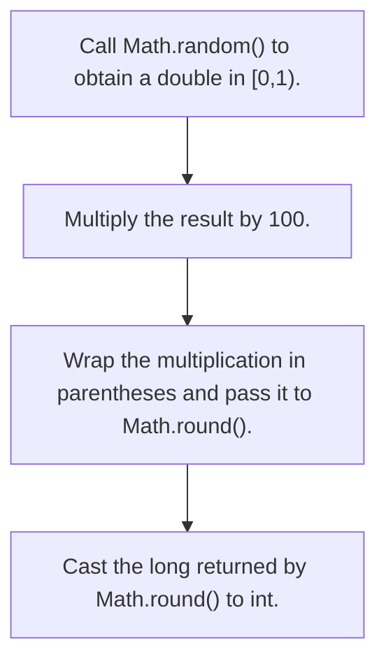

*[Knowledge ID: PRC_0386 | Sources: T0027]*

> Procedure correctness not reviewed; do not assume this is a correct solution.

#### Flowchart: Format a number as currency using NumberFormat

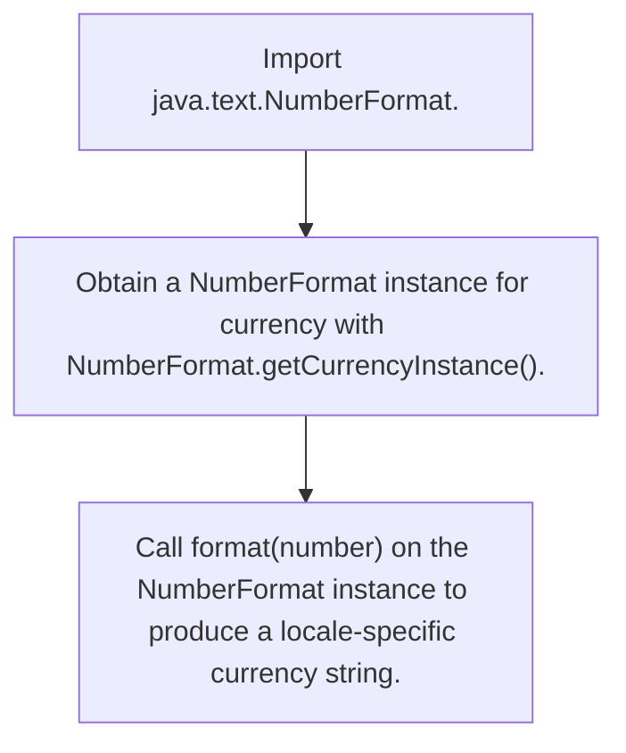

*[Knowledge ID: PRC_0387 | Sources: T0027]*

## abstract class

An abstract class is a class that cannot be instantiated with the new operator; it serves as a partial implementation that must be subclassed or accessed via other means.

*[Knowledge ID: CON_0027 | Sources: T0028]*

A factory method is a static method that creates and returns an instance of a class, allowing object creation without using the new operator directly.

*[Knowledge ID: CON_0028 | Sources: T0028]*

Method overloading is the provision of multiple method signatures with the same name but different parameter types or counts, enabling the method to handle different argument types.

*[Knowledge ID: CON_0029 | Sources: T0028]*

NumberFormat is an abstract class in Java that provides methods for formatting numbers as currency, percent, etc., and must be obtained via factory methods such as getCurrencyInstance() or getPercentInstance().

*[Knowledge ID: CON_0030 | Sources: T0028]*

### abstract class

A class declared with the abstract keyword; it cannot be instantiated directly with new.

*[Knowledge ID: DEF_0069 | Sources: T0028]*

### factory method

A static method that creates and returns an instance of a class, acting as a “factory” for objects.

*[Knowledge ID: DEF_0070 | Sources: T0028]*

### method overloading

Having multiple methods with the same name but different parameter lists within the same class.

*[Knowledge ID: DEF_0071 | Sources: T0028]*

NumberFormat provides a common API for different locale‑specific formatting strategies; the actual implementation is supplied by concrete subclasses created by the factory methods.

*[Knowledge ID: EXP_0101 | Sources: T0028]*

When a variable name is changed, the IDE can update all references automatically to avoid mismatched names.

*[Knowledge ID: EXP_0102 | Sources: T0028]*

> Claim review: NOT\_REVIEWED — Generated declaration/snippet/comment is not literal text in the source. This confirms lack of literal-source fidelity, not that its behavior is necessarily wrong.
> Literal source code unavailable. Original generated snippet retained in the audit only.

Example held for source-fidelity review. The original generated text and supporting passages remain in the evidence artifact.

*[Knowledge ID: EXM_0166 | Sources: T0028]*

> Claim review: NOT\_REVIEWED — Generated declaration/snippet/comment is not literal text in the source. This confirms lack of literal-source fidelity, not that its behavior is necessarily wrong.
> Literal source code unavailable. Original generated snippet retained in the audit only.

Example held for source-fidelity review. The original generated text and supporting passages remain in the evidence artifact.

*[Knowledge ID: EXM_0167 | Sources: T0028]*

NumberFormat cannot be instantiated directly because it is abstract.

*[Knowledge ID: FCT_0292 | Sources: T0028]*

getCurrencyInstance() returns a NumberFormat object configured for currency formatting.

*[Knowledge ID: FCT_0293 | Sources: T0028]*

getPercentInstance() returns a NumberFormat object configured for percent formatting.

*[Knowledge ID: FCT_0294 | Sources: T0028]*

NumberFormat.format() can be overloaded to accept long, double, etc., and returns a formatted string.

*[Knowledge ID: FCT_0295 | Sources: T0028]*

## Method chaining

Method chaining is calling multiple methods in a single expression by using the dot operator on the result of each method call.

*[Knowledge ID: EXP_0103 | Sources: T0029]*

The format method of NumberFormat returns a string representation of the formatted number.

*[Knowledge ID: EXP_0104 | Sources: T0029]*

System.in is a field in the System class used to read input from the terminal; System.out is used to print output to the terminal.

*[Knowledge ID: EXP_0105 | Sources: T0029]*

The Scanner class (in java.util) can be used to read data from the terminal by creating a Scanner object with System.in as the source.

*[Knowledge ID: EXP_0106 | Sources: T0029]*

On macOS, the shortcut Shift+F6 triggers the rename refactor menu in the IDE.

*[Knowledge ID: FCT_0296 | Sources: T0029]*

Calling NumberFormat.getInstance().format(0.1) returns the string "10%" when the format is set for percent style.

*[Knowledge ID: FCT_0297 | Sources: T0029]*

Methods in the Scanner class that read data start with the prefix "next" (e.g., nextInt, nextLine).

*[Knowledge ID: FCT_0298 | Sources: T0029]*

> Procedure correctness not reviewed; do not assume this is a correct solution.

#### Flowchart: Rename refactor using shortcut

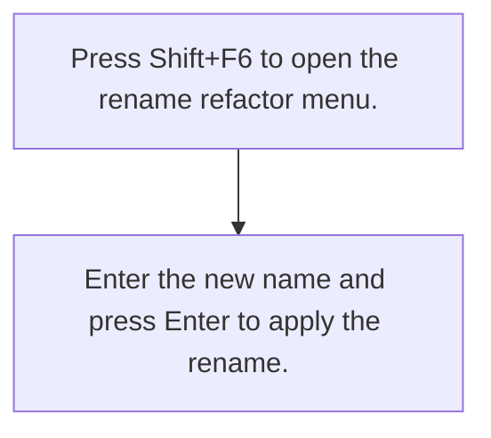

*[Knowledge ID: PRC_0388 | Sources: T0029]*

> Procedure correctness not reviewed; do not assume this is a correct solution.

**Format a number as percent using method chaining:**

- Call NumberFormat.getPercentInstance().format(value) directly without storing the NumberFormat object.

*[Knowledge ID: PRC_0389 | Sources: T0029]*

> Procedure correctness not reviewed; do not assume this is a correct solution.

#### Flowchart: Read input from the terminal using Scanner

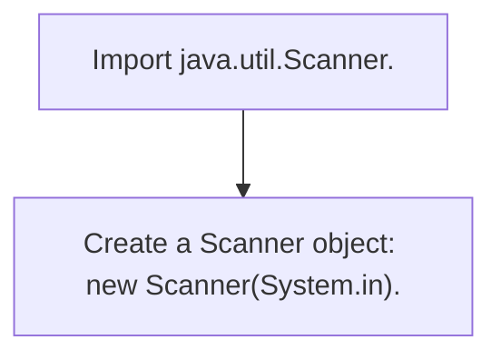

*[Knowledge ID: PRC_0390 | Sources: T0029]*

## Scanner input methods in Java

The Scanner class provides several methods for reading different types of input: `nextByte()` reads a byte value, `nextInt()` reads an int, `nextFloat()`/`nextDouble()` read floating‑point numbers, `next()` reads the next token (delimited by whitespace), and `nextLine()` reads the remainder of the current line including the line‑separator. `next()` returns a token, so when a user enters a full name separated by a space, two calls to `next()` are needed to obtain both parts. `nextLine()` consumes the line‑separator that `print()` leaves, which is why output appears on the next line after a `print` call.

*[Knowledge ID: EXP_0107 | Sources: T0030]*

`nextByte()` returns a byte value that can be stored in a byte variable.

*[Knowledge ID: FCT_0299 | Sources: T0030]*

When concatenating a string with a byte, Java performs implicit casting of the byte to a string.

*[Knowledge ID: FCT_0300 | Sources: T0030]*

`print()` does not add a newline after the output, while `println()` does.

*[Knowledge ID: FCT_0301 | Sources: T0030]*

If a floating‑point number (e.g., 20.1) is entered when `nextInt()` is expected, a `InputMismatchException` is thrown because the method can only parse integer values.

*[Knowledge ID: FCT_0302 | Sources: T0030]*

`nextFloat()` or `nextDouble()` must be used to read floating‑point numbers.

*[Knowledge ID: FCT_0303 | Sources: T0030]*

`next()` returns a token; each call reads up to the next whitespace delimiter.

*[Knowledge ID: FCT_0304 | Sources: T0030]*

When reading a full name with a space, two calls to `next()` are required to obtain both tokens.

*[Knowledge ID: FCT_0305 | Sources: T0030]*

## trim method

The trim method can get rid of all these white spaces before or after a string.

*[Knowledge ID: EXP_0108 | Sources: T0031]*

The next line method returns a string that can be stored in a variable, and its members can be accessed with the dot operator.

*[Knowledge ID: EXP_0109 | Sources: T0031]*

The trim method can get rid of all these white spaces before or after a string.

*[Knowledge ID: FCT_0306 | Sources: T0031]*

The next line method returns a string.

*[Knowledge ID: FCT_0307 | Sources: T0031]*

An annual interest rate expressed as a percent must be divided by 100 to obtain the actual interest rate.

*[Knowledge ID: FCT_0308 | Sources: T0031]*

The monthly interest rate is obtained by dividing the annual interest rate (as a decimal) by 12.

*[Knowledge ID: FCT_0309 | Sources: T0031]*

> Claim review: NOT\_REVIEWED — P times R omits further expression, exponent and division. Original visual equation unavailable.
> Formula fragment: VISUAL\_CONTEXT\_REQUIRED. Do not use as a complete equation.
> Technical fields held for source-fidelity review; this is not a confirmed semantic error.

Content: \[requires source review\]
Formula text: \[requires source review\]
principal or the amount of the loan
monthly interest rate

*[Knowledge ID: FRM_0007 | Sources: T0031]*

> Procedure correctness not reviewed; do not assume this is a correct solution.

A program that asks for loan details, computes the monthly interest rate, applies the mortgage formula, and outputs the payment as currency.

*[Knowledge ID: PRC_0391 | Sources: T0031]*

## Source T0032

Avoid magic numbers in code; use constants or final variables to describe them.

*[Knowledge ID: FCT_0310 | Sources: T0032]*

Declare constants for months in a year (12) and percent (100) to avoid magic numbers.

*[Knowledge ID: FCT_0311 | Sources: T0032]*

Use meaningful and descriptive variable names; avoid short or unclear abbreviations.

*[Knowledge ID: FCT_0312 | Sources: T0032]*

Choose appropriate data types: int for principal amounts up to two billion, float for small interest rates.

*[Knowledge ID: FCT_0313 | Sources: T0032]*

## Source T0033

One byte is sufficient to store numbers up to 30.

*[Knowledge ID: FCT_0314 | Sources: T0033]*

Camel notation capitalizes the first letter of each word except the first word.

*[Knowledge ID: FCT_0315 | Sources: T0033]*

Mortgage calculation uses the principal multiplied by an expression and then divided.

*[Knowledge ID: FCT_0316 | Sources: T0033]*

The NumberFormat class can format a value as currency.

*[Knowledge ID: FCT_0317 | Sources: T0033]*

If a non‑numeric value is entered, the program crashes due to lack of input validation.

*[Knowledge ID: FCT_0318 | Sources: T0033]*

Entering a negative value causes the program to behave improperly.

*[Knowledge ID: FCT_0319 | Sources: T0033]*

Conditional statements can be used to validate values entered by the user.

*[Knowledge ID: FCT_0320 | Sources: T0033]*

The section covers variables and constants.

*[Knowledge ID: FCT_0321 | Sources: T0033]*

Primitive types store simple values; reference types hold references to complex objects.

*[Knowledge ID: FCT_0322 | Sources: T0033]*

There are two types of casting: implicit and explicit.

*[Knowledge ID: FCT_0323 | Sources: T0033]*

The course teaches how to work with numbers, strings, arrays, and how to read input from the terminal.

*[Knowledge ID: FCT_0324 | Sources: T0033]*

## boolean expression

### boolean expression

a piece of code that produces a boolean value true or false

*[Knowledge ID: DEF_0072 | Sources: T0034]*

Logical operators (and, or, not) are used for implementing real‑world rules in programs.

*[Knowledge ID: EXP_0110 | Sources: T0034]*

> Claim review: NOT\_REVIEWED — Generated declaration/snippet/comment is not literal text in the source. This confirms lack of literal-source fidelity, not that its behavior is necessarily wrong.
> Literal source code unavailable. Original generated snippet retained in the audit only.

Example held for source-fidelity review. The original generated text and supporting passages remain in the evidence artifact.

*[Knowledge ID: EXM_0168 | Sources: T0034]*

The equality operator (==) compares two values for equality.

*[Knowledge ID: FCT_0325 | Sources: T0034]*

A single equal sign (=) is the assignment operator.

*[Knowledge ID: FCT_0326 | Sources: T0034]*

> Technical fields held for source-fidelity review; this is not a confirmed semantic error.

Content: \[requires source review\]
Fact text: \[requires source review\]

*[Knowledge ID: FCT_0327 | Sources: T0034]*

> Procedure correctness not reviewed; do not assume this is a correct solution.

The tutorial revisits the mortgage calculator and adds error handling so that if a user enters an invalid value, the program keeps asking them to try again.

*[Knowledge ID: PRC_0392 | Sources: T0034]*

## Logical AND operator (&amp;&amp;) in Java

The &amp;&amp; operator evaluates the left-hand condition first; if it is false, Java short‑circuits and does not evaluate the right-hand condition, because the overall expression cannot be true. The result is true only when both conditions are true.

*[Knowledge ID: EXP_0111 | Sources: T0035]*

The || operator evaluates the left-hand condition first; if it is true, Java short‑circuits and does not evaluate the right-hand condition, because the overall expression is already true. The result is true when at least one of the conditions is true.

*[Knowledge ID: EXP_0112 | Sources: T0035]*

The ! operator reverses the boolean value of its operand: true becomes false and false becomes true.

*[Knowledge ID: EXP_0113 | Sources: T0035]*

> Claim review: NOT\_REVIEWED — Generated declaration/snippet/comment is not literal text in the source. This confirms lack of literal-source fidelity, not that its behavior is necessarily wrong.
> Literal source code unavailable. Original generated snippet retained in the audit only.

Example held for source-fidelity review. The original generated text and supporting passages remain in the evidence artifact.

*[Knowledge ID: EXM_0169 | Sources: T0035]*

> Claim review: NOT\_REVIEWED — Generated declaration/snippet/comment is not literal text in the source. This confirms lack of literal-source fidelity, not that its behavior is necessarily wrong.
> Literal source code unavailable. Original generated snippet retained in the audit only.

Example held for source-fidelity review. The original generated text and supporting passages remain in the evidence artifact.

*[Knowledge ID: EXM_0170 | Sources: T0035]*

The &amp;&amp; operator returns true only when both operands are true; otherwise it returns false.

*[Knowledge ID: FCT_0328 | Sources: T0035]*

The || operator returns true when at least one operand is true; it returns false only when both operands are false.

*[Knowledge ID: FCT_0329 | Sources: T0035]*

The ! operator inverts a boolean value.

*[Knowledge ID: FCT_0330 | Sources: T0035]*

## Logical operators in Java

The AND operator (&amp;&amp;) combines two boolean expressions so that the result is true only when both expressions are true. The NOT operator (!) reverses the boolean value of an expression, turning true into false and vice‑versa.

*[Knowledge ID: EXP_0114 | Sources: T0036]*

An if statement evaluates a boolean expression inside parentheses; if the expression is true, the statement or block of code that follows is executed. Curly braces define a code block that is executed as a unit when the condition is true.

*[Knowledge ID: EXP_0115 | Sources: T0036]*

> Claim review: NOT\_REVIEWED — Reviewed against full available source passages: behavior is supported; this is prose/synthesis, not a claim of verbatim source syntax.

> **Example: Temperature‑based messaging**
> 
> If temperature &gt; 30, print "it's a hot day" and "drink plenty of water"; else if temperature is between 20 and 30, print "it's a nice day"; otherwise print "it's a cold day".

*[Knowledge ID: EXM_0171 | Sources: T0036]*

A boolean variable named "has criminal record" is initialized to false.

*[Knowledge ID: FCT_0331 | Sources: T0036]*

Applying the NOT operator to a false boolean yields true.

*[Knowledge ID: FCT_0332 | Sources: T0036]*

When both the first condition (high income or good credit) and the second condition (no criminal record) are true, the person is eligible for a loan.

*[Knowledge ID: FCT_0333 | Sources: T0036]*

In the example, the variable temperature is set to 32.

*[Knowledge ID: FCT_0334 | Sources: T0036]*

If the condition temperature &gt; 30 is true, the code inside the following curly braces is executed.

*[Knowledge ID: FCT_0335 | Sources: T0036]*

> Procedure correctness not reviewed; do not assume this is a correct solution.

#### Flowchart: Implement loan eligibility rule with criminal‑record check

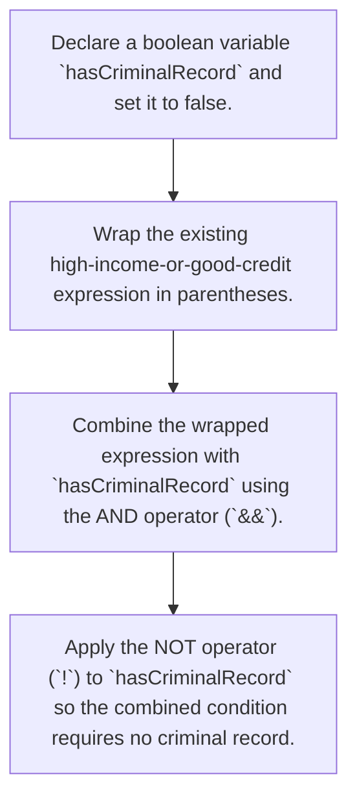

*[Knowledge ID: PRC_0393 | Sources: T0036]*

> Procedure correctness not reviewed; do not assume this is a correct solution.

The program prints messages appropriate to the temperature range based on the evaluated condition.

*[Knowledge ID: PRC_0394 | Sources: T0036]*

## if statement

### if statement

a conditional statement that has three clauses or sections: the if clause, the else‑if clause, and the else clause

*[Knowledge ID: DEF_0073 | Sources: T0037]*

### brace (curly brace)

a pair of curly brackets { } that delimit a block of one or more statements; required only when there are multiple statements in a clause

*[Knowledge ID: DEF_0074 | Sources: T0037]*

braces are only required if a clause contains multiple statements; some developers always add them for consistency, while others omit them for single‑statement clauses to reduce visual noise

*[Knowledge ID: EXP_0116 | Sources: T0037]*

after removing unnecessary braces, the else‑if and else clauses should be placed on new lines at the same indentation level as the if clause to keep the code readable and symmetrical

*[Knowledge ID: EXP_0117 | Sources: T0037]*

if a clause contains a single statement, braces may be omitted

*[Knowledge ID: FCT_0336 | Sources: T0037]*

removing unnecessary braces can simplify code formatting

*[Knowledge ID: FCT_0337 | Sources: T0037]*

the else‑if clause is typically indented slightly more than the if clause, while the else clause is at the same level as the if clause, which can look uneven

*[Knowledge ID: FCT_0338 | Sources: T0037]*

## Variable scope in Java code blocks

A variable declared inside a code block is scoped to that block and cannot be accessed outside of it, resulting in a compilation error if referenced elsewhere.

*[Knowledge ID: EXP_0118 | Sources: T0038]*

Variables can only be declared inside code blocks (enclosed by curly braces). Declaring a variable outside a block causes a compilation error.

*[Knowledge ID: EXP_0119 | Sources: T0038]*

Instead of using an if‑else statement to set a boolean based on a condition, you can assign the result of the boolean expression directly to the variable; the expression evaluates to true or false automatically.

*[Knowledge ID: EXP_0120 | Sources: T0038]*

Variables must be declared inside a code block (curly braces) in Java.

*[Knowledge ID: FCT_0339 | Sources: T0038]*

A variable declared inside a code block is only available within that block.

*[Knowledge ID: FCT_0340 | Sources: T0038]*

Giving a boolean variable an initial value (e.g., false) allows later assignment without needing an else clause.

*[Knowledge ID: FCT_0341 | Sources: T0038]*

Wrapping a boolean expression in parentheses improves readability but is not required for correctness.

*[Knowledge ID: FCT_0342 | Sources: T0038]*

> Procedure correctness not reviewed; do not assume this is a correct solution.

This procedure replaces an if‑else statement with a concise boolean assignment, ensuring correct variable scope and improving code readability.

*[Knowledge ID: PRC_0395 | Sources: T0038]*

## Using the ternary operator to assign a class name based on income

First give the variable an initial value (e.g., "economy") and then use a ternary expression: if the income is greater than $100,000, the expression returns "first"; otherwise it returns "economy". This replaces the if‑else statement and eliminates the else clause.

*[Knowledge ID: EXP_0121 | Sources: T0039]*

The ternary operator consists of three parts: a condition, a question mark, the value to return if the condition is true, a colon, and the value to return if the condition is false. It can replace an if‑statement that assigns a value based on a boolean condition.

*[Knowledge ID: EXP_0122 | Sources: T0039]*

A switch statement can execute different code blocks depending on the value of an expression, similar to if statements. For example, checking a string variable "role" against values like "admin" can be done with a switch to print role‑specific messages.

*[Knowledge ID: EXP_0123 | Sources: T0039]*

> Claim review: NOT\_REVIEWED — Generated declaration/snippet/comment is not literal text in the source. This confirms lack of literal-source fidelity, not that its behavior is necessarily wrong.
> Literal source code unavailable. Original generated snippet retained in the audit only.

Example held for source-fidelity review. The original generated text and supporting passages remain in the evidence artifact.

*[Knowledge ID: EXM_0172 | Sources: T0039]*

> Claim review: NOT\_REVIEWED — Generated declaration/snippet/comment is not literal text in the source. This confirms lack of literal-source fidelity, not that its behavior is necessarily wrong.
> Literal source code unavailable. Original generated snippet retained in the audit only.

Example held for source-fidelity review. The original generated text and supporting passages remain in the evidence artifact.

*[Knowledge ID: EXM_0173 | Sources: T0039]*

In Java, the ternary operator is written as condition ? valueIfTrue : valueIfFalse.

*[Knowledge ID: FCT_0343 | Sources: T0039]*

A string variable cannot be used on the left side of a boolean expression; instead, a ternary operator can assign a string based on a boolean condition.

*[Knowledge ID: FCT_0344 | Sources: T0039]*

## switch statement versus if statement for role-based messages

A switch statement can be used instead of an if statement to compare the value of a variable (e.g., role) against multiple constant cases, which may look cleaner.

*[Knowledge ID: EXP_0124 | Sources: T0040]*

A break statement is required after each case clause to exit the switch block; without it, execution falls through to subsequent cases.

*[Knowledge ID: EXP_0125 | Sources: T0040]*

A default clause executes when none of the preceding case values match the variable.

*[Knowledge ID: EXP_0126 | Sources: T0040]*

If the role is "admin", the program should print "you are an admin".

*[Knowledge ID: FCT_0345 | Sources: T0040]*

If the role is "moderator", the program should print "you are a moderator".

*[Knowledge ID: FCT_0346 | Sources: T0040]*

If the role matches none of the specified cases, the program should print "you are a guest".

*[Knowledge ID: FCT_0347 | Sources: T0040]*

When using a switch statement with string values, a compilation error occurs if the variable type does not match the case label types.

*[Knowledge ID: FCT_0348 | Sources: T0040]*

> Procedure correctness not reviewed; do not assume this is a correct solution.

This procedure demonstrates how to replace multiple if‑else checks with a switch statement for role handling.

*[Knowledge ID: PRC_0396 | Sources: T0040]*

## Incorrect ordering of conditional statements causes numbers divisible by both 5 and 3 to output only 'fizz'

> Instructional role: deliberately incorrect demonstration
> explained by: EXP\_0127
> corrected by: EXM\_0175
> corrected by: PRC\_0397
> Claim review: NOT\_REVIEWED — Reviewed against full available source passages: behavior is supported; this is prose/synthesis, not a claim of verbatim source syntax.

> **Example: Program output for various inputs**
> 
> Input 5 → fizz; Input 10 → fizz; Input 3 → buzz; Input 15 → fizz (incorrect; should be fizzbuzz)

*[Knowledge ID: EXM_0174 | Sources: T0041]*

When the first condition checks only divisibility by 5 and is placed before the combined check for 5 and 3, a number like 15 satisfies the first condition, so 'fizz' is printed and the later else‑if branches are skipped.

*[Knowledge ID: EXP_0127 | Sources: T0041]*

A number is divisible by 5 if the remainder of the number divided by 5 is zero.

*[Knowledge ID: FCT_0349 | Sources: T0041]*

A number is divisible by 3 if the remainder of the number divided by 3 is zero.

*[Knowledge ID: FCT_0350 | Sources: T0041]*

If a number is divisible by both 5 and 3, the correct output should be 'fizzbuzz'.

*[Knowledge ID: FCT_0351 | Sources: T0041]*

> Instructional role: corrected approach
> Claim review: PARTIALLY\_SUPPORTED — Ordering citation repaired, but java.util package name in first step is not stated by T0041.
> Technical fields held for source-fidelity review; this is not a confirmed semantic error.

Step 1: \[requires source review\]
A simple console program that reads an integer and prints fizz, buzz, fizzbuzz, or the number based on divisibility rules.
FizzBuzz program implementation
Print a prompt asking the user to enter a number.
Read the integer using scanner.nextInt() and store it in a variable (e.g., number).
Check if number % 5 == 0 and number % 3 == 0; if true, print "fizzbuzz".
Else if number % 5 == 0, print "fizz".
Else if number % 3 == 0, print "buzz".
Else, print the number itself.

*[Knowledge ID: PRC_0397 | Sources: T0041, T0042]*

> Instructional role: corrected approach
> Claim review: NOT\_REVIEWED — Reviewed against full available source passages: behavior is supported; this is prose/synthesis, not a claim of verbatim source syntax.

> **Example: FizzBuzz problem solution with specific conditions first**
> 
> If the number is divisible by 5 and 3, print fizzbuzz; otherwise if divisible by 5, print fizz; else if divisible by 3, print buzz; else print the number.

*[Knowledge ID: EXM_0175 | Sources: T0042]*

## DRY

> Claim review: NOT\_REVIEWED — Restored contextual advice instead of an absolute rule.

### DRY

DRY means don't repeat yourself. The source discusses duplication as a trade-off, rather than a universal ban on every repeated expression.

*[Knowledge ID: DEF_0075 | Sources: T0042]*

Place the most specific conditions at the top and the most generic ones at the bottom to ensure correct execution.

*[Knowledge ID: EXP_0128 | Sources: T0042]*

Nested if-else statements can make code harder to read, while a flat structure may involve some repetition but is cleaner and easier to understand.

*[Knowledge ID: EXP_0129 | Sources: T0042]*

> Claim review: NOT\_REVIEWED — Revised prose removes unsupported illustrative literal or restores the source-stated otherwise condition.

> **Example: Alternative FizzBuzz solution using nested if-else to avoid repetition**
> 
> If the number is divisible by 5, check whether it is also divisible by 3 and print fizzbuzz or fizz accordingly. Otherwise, check divisibility by 3 and print buzz; if neither applies, print the number.

*[Knowledge ID: EXM_0176 | Sources: T0042]*

> **Example: Demonstration of repetition for repeated actions**
> 
> Printing a hello world message five times without repeating the print statement.

*[Knowledge ID: EXM_0177 | Sources: T0042]*

> Claim review: NOT\_REVIEWED — Restored contextual advice instead of an absolute rule.

Nested if-else statements can make code harder to read; the source prefers a flatter solution in this example despite some repetition.

*[Knowledge ID: FCT_0352 | Sources: T0042]*

A flat if-else structure without nesting is cleaner and easier to read, even if it includes some repetition.

*[Knowledge ID: FCT_0353 | Sources: T0042]*

Repeating code to perform the same action multiple times (e.g., printing a message five times) can be avoided by using loops or other constructs.

*[Knowledge ID: FCT_0354 | Sources: T0042]*

## Execution flow of a Java for loop

When Java encounters a for loop, it first executes the initialization statement (e.g., initializing the counter variable to zero). Then it evaluates the loop condition; if true, it executes the loop body. After the body, it performs the increment step, then re-evaluates the condition. This repeats until the condition is false, at which point control moves outside the loop.

*[Knowledge ID: EXP_0130 | Sources: T0043]*

> **Example: Hello world printed five times on the terminal**
> 
> hello world printed five times on the terminal

*[Knowledge ID: EXM_0178 | Sources: T0043]*

A Java for loop consists of three parts inside parentheses: initialization of a counter variable, a boolean condition that determines loop continuation, and an increment/decrement operation.

*[Knowledge ID: FCT_0355 | Sources: T0043]*

Common counter variable names for loops are i, j, and k.

*[Knowledge ID: FCT_0356 | Sources: T0043]*

If the loop body contains a single statement, braces are optional; for multiple statements, a code block with braces is required.

*[Knowledge ID: FCT_0357 | Sources: T0043]*

To execute a loop exactly five times, you can initialize the counter to 0 and use the condition i &lt; 5, or initialize to 1 and use i &lt;= 5.

*[Knowledge ID: FCT_0358 | Sources: T0043]*

> Procedure correctness not reviewed; do not assume this is a correct solution.

The procedure outlines the exact syntax and steps required to construct and execute a for loop in Java.

*[Knowledge ID: PRC_0398 | Sources: T0043]*

## while loops

while loops are very similar to for loops in terms of their functionality but they're different in terms of syntax

*[Knowledge ID: EXP_0131 | Sources: T0044]*

for loops are lighter and cleaner when the number of iterations is known ahead of time; while loops are better when the number of repetitions is not known

*[Knowledge ID: EXP_0132 | Sources: T0044]*

String variables are reference types and cannot be compared with == or != because those operators compare object addresses, not their textual values

*[Knowledge ID: EXP_0133 | Sources: T0044]*

> **Example: reading user input until the user types "quit"**
> 
> while loop that repeatedly prompts the user for input and terminates when the entered string equals "quit"

*[Knowledge ID: EXM_0179 | Sources: T0044]*

A for loop can count upwards by initializing the loop variable to zero and incrementing it while the variable is less than a limit

*[Knowledge ID: FCT_0359 | Sources: T0044]*

A for loop can count downwards by initializing the loop variable to a positive value and decrementing it while the variable is greater than zero

*[Knowledge ID: FCT_0360 | Sources: T0044]*

While loops require an explicit loop variable and a condition evaluated before each iteration

*[Knowledge ID: FCT_0361 | Sources: T0044]*

In a while loop, the loop variable must be updated inside the loop body to avoid infinite loops

*[Knowledge ID: FCT_0362 | Sources: T0044]*

> Procedure correctness not reviewed; do not assume this is a correct solution.

A while loop that continuously prompts the user for input and stops when the entered string equals "quit"

*[Knowledge ID: PRC_0399 | Sources: T0044]*

## Break and continue statements in loops

When Java encounters a `break` statement inside a loop, it exits the loop immediately, ignoring any remaining statements in the current iteration. When it encounters a `continue` statement, it skips the remaining statements of the current iteration and jumps to the next iteration by moving control to the beginning of the loop.

*[Knowledge ID: EXP_0134 | Sources: T0046]*

The break statement terminates a loop.

*[Knowledge ID: FCT_0363 | Sources: T0046]*

The continue statement moves control to the beginning of a loop.

*[Knowledge ID: FCT_0364 | Sources: T0046]*

A loop condition can be simplified to `true` so the loop runs forever until a break statement ends it.

*[Knowledge ID: FCT_0365 | Sources: T0046]*

> Procedure correctness not reviewed; do not assume this is a correct solution.

#### Flowchart: Handle user input with break and continue statements

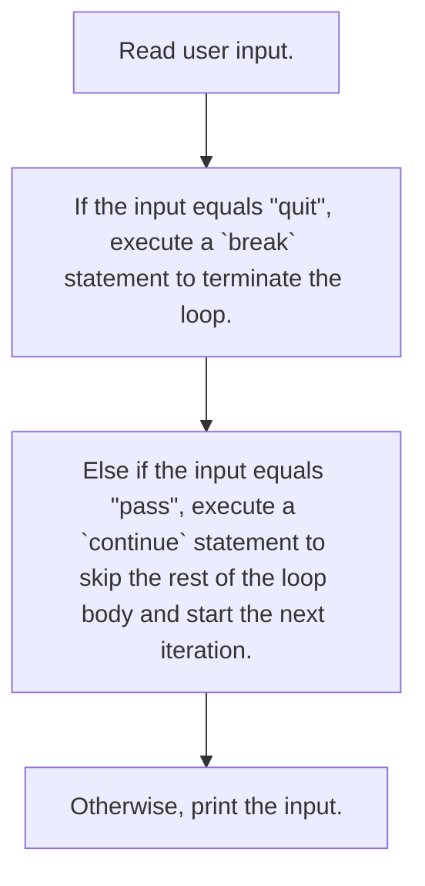

*[Knowledge ID: PRC_0400 | Sources: T0046]*

## Print each element of a string array using a for‑each loop

Using a while‑true loop without a break statement creates an infinite loop that never terminates and can dangerously consume memory.

*[Knowledge ID: FCT_0366 | Sources: T0047]*

A Java for‑each loop iterates over all elements of an array or collection without needing an explicit index or boolean condition.

*[Knowledge ID: FCT_0367 | Sources: T0047]*

A Java for‑each loop can only iterate forward; it cannot iterate from the end of an array to the beginning.

*[Knowledge ID: FCT_0368 | Sources: T0047]*

> Procedure correctness not reviewed; do not assume this is a correct solution.

#### Flowchart: Print each element of a string array using a for‑each loop

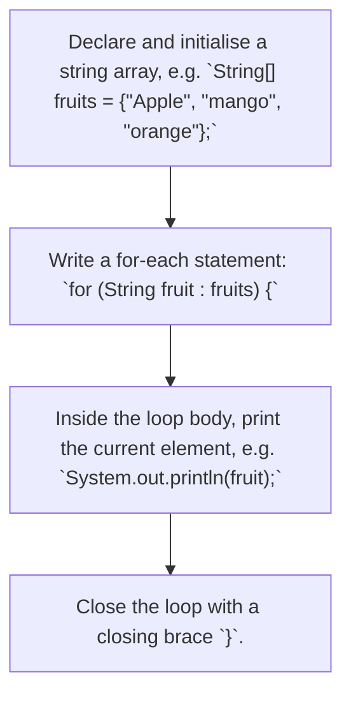

*[Knowledge ID: PRC_0004 | Sources: T0047]*

> Procedure correctness not reviewed; do not assume this is a correct solution.

With a break statement, the while‑true loop will terminate when the break condition is met, avoiding an infinite loop and uncontrolled memory use.

*[Knowledge ID: PRC_0401 | Sources: T0047]*

## Validate mortgage input using an infinite loop

A for‑each loop does not provide access to the index of each item; it only supplies the loop variable that holds the value of each item.

*[Knowledge ID: FCT_0369 | Sources: T0048]*

The mortgage loan amount must be between $1,000 and $1,000,000 inclusive.

*[Knowledge ID: FCT_0370 | Sources: T0048]*

The annual interest rate must be greater than 0 and less than or equal to 30.

*[Knowledge ID: FCT_0371 | Sources: T0048]*

An infinite loop (e.g., `while true`) can be used to repeatedly ask the same question until the user enters a valid value.

*[Knowledge ID: FCT_0372 | Sources: T0048]*

> Procedure correctness not reviewed; do not assume this is a correct solution.

This procedure ensures that the program only proceeds once the user provides values that meet the specified constraints.

*[Knowledge ID: PRC_0402 | Sources: T0048]*

## Variable scope in loops

When a variable is declared inside a block (e.g., inside a while loop), its scope is limited to that block and it cannot be accessed outside of it, which leads to a compilation error such as "cannot resolve symbol".

*[Knowledge ID: EXP_0135 | Sources: T0049]*

If a variable (e.g., principal) is used outside the block where it was declared, the compiler reports an error "cannot resolve symbol principal" because the name is not in scope at that point.

*[Knowledge ID: EXP_0136 | Sources: T0049]*

A variable declared inside a while loop is scoped only to that loop block.

*[Knowledge ID: FCT_0373 | Sources: T0049]*

Declaring a variable outside the loop and initializing it (e.g., int principal = 0;) resolves the "cannot resolve symbol" compilation error.

*[Knowledge ID: FCT_0374 | Sources: T0049]*

If user input for annual interest is not between 1 and 30, an error message should be printed and the loop should continue.

*[Knowledge ID: FCT_0375 | Sources: T0049]*

Monthly interest must be declared outside its calculation block to avoid a compilation error.

*[Knowledge ID: FCT_0376 | Sources: T0049]*

Number of years must be validated (1 ≤ years ≤ 30) before calculating number of payments.

*[Knowledge ID: FCT_0377 | Sources: T0049]*

> Procedure correctness not reviewed; do not assume this is a correct solution.

Procedure to correct scope‑related compilation errors in a mortgage‑calculation program.

*[Knowledge ID: PRC_0403 | Sources: T0049]*

## clean code

Writing clean code involves structuring code to be readable, maintainable, and understandable by humans, not just computers.

*[Knowledge ID: CON_0031 | Sources: T0050]*

Control flow statements include conditional statements such as if and switch for making decisions, and loops such as for, while, do‑while, and foreach for executing code repeatedly. Break and continue statements can alter loop execution.

*[Knowledge ID: EXP_0137 | Sources: T0050]*

When a method becomes too long, it hurts maintainability because readers must scan many statements to understand the logic. Breaking the code into smaller, well‑named chunks improves readability and maintainability.

*[Knowledge ID: EXP_0138 | Sources: T0050]*

Dividing code into smaller, logical sections makes it easier to read and understand.

*[Knowledge ID: FCT_0378 | Sources: T0050]*

Good programmers write code that humans can understand, not just code that a computer can execute.

*[Knowledge ID: FCT_0379 | Sources: T0050]*

---

*Render complete: 458 items from 46 sections*

### Additional details: CON_0005
**Concept name:**
parseShort method
Sources: T0025

### Additional details: CON_0006
**Concept name:**
parseFloat method
Sources: T0025

### Additional details: EXP_0003
**Topic:**
comments in Java
Sources: T0005

### Additional details: EXP_0002
**Topic:**
Java program execution process
Sources: T0006

### Additional details: EXP_0076
**Topic:**
Compilation step details
Sources: T0006

### Additional details: EXP_0077
**Topic:**
Java Virtual Machine (JVM)
Sources: T0007

### Additional details: EXP_0078
**Topic:**
Case sensitivity of file names
Sources: T0007

### Additional details: EXP_0006
**Topic:**
purpose of variables
Sources: T0010

### Additional details: EXP_0007
**Topic:**
initialization requirement
Sources: T0010

### Additional details: EXP_0008
**Topic:**
code readability recommendation
Sources: T0010

### Additional details: EXP_0010
**Topic:**
Difference between primitive and reference types
Sources: T0013

### Additional details: EXP_0011
**Topic:**
Purpose of packages in Java
Sources: T0013

### Additional details: EXP_0080
**Topic:**
Memory independence of primitive variables
Sources: T0014

### Additional details: EXP_0082
**Topic:**
Primitive types in Java store the actual value directly in the variable's memory location.
Sources: T0015

### Additional details: EXP_0083
**Topic:**
Assigning one reference variable to another copies the reference, not the object.
Sources: T0015

### Additional details: EXP_0004
**Topic:**
Modifying an object through one reference variable affects all other references to the same object.
Sources: T0015

### Additional details: EXP_0084
**Topic:**
Why "new String" is redundant
Sources: T0016

### Additional details: EXP_0085
**Topic:**
String methods accessed via dot operator
Sources: T0016

### Additional details: EXP_0086
**Topic:**
indexOf method behavior
Sources: T0017

### Additional details: EXP_0005
**Topic:**
string immutability in Java
Sources: T0017

### Additional details: EXP_0088
**Topic:**
naming convention for constants
Sources: T0022

### Additional details: EXP_0089
**Topic:**
integer division behavior
Sources: T0022

### Additional details: EXP_0090
**Topic:**
floating‑point division requirement
Sources: T0022

### Additional details: EXP_0091
**Topic:**
increment/decrement operators
Sources: T0022

### Additional details: EXP_0093
**Topic:**
prefix increment operator behavior
Sources: T0023

### Additional details: EXP_0094
**Topic:**
augmented (compound) assignment operators
Sources: T0023

### Additional details: EXP_0095
**Topic:**
operator precedence in arithmetic expressions
Sources: T0023

### Additional details: EXP_0096
**Topic:**
how Java performs implicit casting in arithmetic
Sources: T0024

### Additional details: EXP_0097
**Topic:**
why parsing strings to numbers is needed
Sources: T0025

### Additional details: EXP_0099
**Topic:**
Effect of casting before rounding
Sources: T0027

### Additional details: EXP_0100
**Topic:**
Formatting numbers as currency or percentages in Java
Sources: T0027

### Additional details: EXP_0101
**Topic:**
Why NumberFormat is abstract
Sources: T0028

### Additional details: EXP_0102
**Topic:**
Renaming variables in IDE
Sources: T0028

### Additional details: EXP_0104
**Topic:**
NumberFormat.format method
Sources: T0029

### Additional details: EXP_0105
**Topic:**
System.in and System.out
Sources: T0029

### Additional details: EXP_0106
**Topic:**
Scanner class for reading input
Sources: T0029

### Additional details: EXP_0110
**Topic:**
logical operators
Sources: T0034

### Additional details: EXP_0111
**Content:**
The &amp;&amp; operator evaluates the left-hand condition first; if it is false, Java short‑circuits and does not evaluate the right-hand condition, because the overall expression cannot be true. The result is true only when both conditions are true.
**Topic:**
Logical AND operator (&amp;&amp;) in Java
Sources: T0035

### Additional details: EXP_0112
**Topic:**
Logical OR operator (||) in Java
Sources: T0035

### Additional details: EXP_0113
**Topic:**
Logical NOT operator (!) in Java
Sources: T0035

### Additional details: EXP_0114
**Content:**
The AND operator (&amp;&amp;) combines two boolean expressions so that the result is true only when both expressions are true. The NOT operator (!) reverses the boolean value of an expression, turning true into false and vice‑versa.
Sources: T0036

### Additional details: EXP_0115
**Topic:**
If statements in Java
Sources: T0036

### Additional details: EXP_0116
**Topic:**
when to use braces in an if statement
Sources: T0037

### Additional details: EXP_0117
**Topic:**
formatting of clauses after removing braces
Sources: T0037

### Additional details: EXP_0119
**Topic:**
Declaration location for variables in Java
Sources: T0038

### Additional details: EXP_0120
**Topic:**
Simplifying boolean assignment
Sources: T0038

### Additional details: EXP_0122
**Topic:**
Structure of the ternary operator in Java
Sources: T0039

### Additional details: EXP_0123
**Topic:**
Switch statements as an alternative to if statements for role checking
Sources: T0039

### Additional details: EXP_0125
**Topic:**
break statement in a switch block
Sources: T0040

### Additional details: EXP_0126
**Topic:**
default clause in a switch statement
Sources: T0040

### Additional details: EXP_0128
**Topic:**
Ordering of conditions in if-else chains
Sources: T0042

### Additional details: EXP_0129
**Topic:**
Trade-offs in code structure
Sources: T0042

### Additional details: EXP_0132
**Topic:**
for loops vs while loops
Sources: T0044

### Additional details: EXP_0133
**Topic:**
string comparison in Java
Sources: T0044

### Additional details: EXP_0136
**Topic:**
Compilation error caused by out‑of‑scope variable
Sources: T0049

### Additional details: EXP_0138
**Topic:**
code maintainability
Sources: T0050

### Additional details: EXM_0010
**Exemplifies:**
declaring an integer variable and initializing it
Sources: T0010

### Additional details: EXM_0011
**Exemplifies:**
printing the value of a variable
Sources: T0010

### Additional details: EXM_0012
**Exemplifies:**
changing the value of a variable after initialization
Sources: T0010

### Additional details: EXM_0013
**Exemplifies:**
declaring multiple variables on one line (not recommended)
Sources: T0010

### Additional details: EXM_0014
**Exemplifies:**
copying the value of one variable into another
Sources: T0010

### Additional details: EXM_0139
**Exemplifies:**
declaring and initializing a primitive type
Sources: T0013

### Additional details: EXM_0140
**Exemplifies:**
declaring a reference type, importing its class, and allocating memory with new
Sources: T0013

### Additional details: EXM_0141
**Exemplifies:**
accessing a method of an object via the dot operator
Sources: T0013

### Additional details: EXM_0005
**Exemplifies:**
Demonstration of two reference variables pointing to the same `Point` object and showing that a change via one variable is visible through the other.
Sources: T0015

### Additional details: EXM_0142
**Exemplifies:**
initializing a String variable without the new operator
Sources: T0016

### Additional details: EXM_0006
**Exemplifies:**
concatenating strings using the plus operator
Sources: T0016

### Additional details: EXM_0007
**Exemplifies:**
checking if a string ends with a given suffix
Sources: T0016

### Additional details: EXM_0008
**Exemplifies:**
retrieving the length of a string
Sources: T0016

### Additional details: EXM_0145
**Exemplifies:**
Including double quotes in a string
Sources: T0018

### Additional details: EXM_0003
**Exemplifies:**
Including a backslash in a Windows file path
Sources: T0018

### Additional details: EXM_0004
**Exemplifies:**
Adding a newline character
Sources: T0018

### Additional details: EXM_0146
**Exemplifies:**
Adding a tab character
Sources: T0018

### Additional details: EXM_0147
**Exemplifies:**
casting to double for floating‑point division
Sources: T0022

### Additional details: EXM_0148
**Exemplifies:**
increment operator (postfix)
Sources: T0022

### Additional details: EXM_0149
**Exemplifies:**
increment operator (prefix)
Sources: T0022

### Additional details: EXM_0150
**Exemplifies:**
postfix increment example
Sources: T0023

### Additional details: EXM_0151
**Exemplifies:**
prefix increment example
Sources: T0023

### Additional details: EXM_0152
**Exemplifies:**
augmented assignment example
Sources: T0023

### Additional details: EXM_0153
**Exemplifies:**
operator precedence example
Sources: T0023

### Additional details: EXM_0154
**Exemplifies:**
parentheses to change precedence example
Sources: T0023

### Additional details: EXM_0160
**Exemplifies:**
ceil method returns the smallest integer greater than or equal to the argument
Sources: T0026

### Additional details: EXM_0161
**Exemplifies:**
floor method returns the largest integer less than or equal to the argument
Sources: T0026

### Additional details: EXM_0162
**Exemplifies:**
max method returns the greater of two values; overloaded for int, long, float, double
Sources: T0026

### Additional details: EXM_0163
**Exemplifies:**
min method returns the smaller of two values
Sources: T0026

### Additional details: EXM_0164
**Exemplifies:**
random method generates a double between 0.0 (inclusive) and 1.0 (exclusive)
Sources: T0026

### Additional details: EXM_0165
**Exemplifies:**
Scaling Math.random() to a range 0‑100 by multiplying by 100
Sources: T0026

### Additional details: EXM_0166
**Exemplifies:**
Using a factory method to obtain a NumberFormat instance and formatting a number as currency.
Sources: T0028

### Additional details: EXM_0167
**Exemplifies:**
Obtaining a NumberFormat for percent formatting via a factory method.
Sources: T0028

### Additional details: EXM_0168
**Exemplifies:**
Comparing two integers x and y with the equality operator (==) yields true when the values are equal.
Sources: T0034

### Additional details: EXM_0169
**Exemplifies:**
AND operator with temperature range
Sources: T0035

### Additional details: EXM_0170
**Exemplifies:**
OR operator with loan eligibility
Sources: T0035

### Additional details: EXM_0171
**Content:**
If temperature &gt; 30, print "it's a hot day" and "drink plenty of water"; else if temperature is between 20 and 30, print "it's a nice day"; otherwise print "it's a cold day".
Sources: T0036

### Additional details: EXM_0172
**Exemplifies:**
Assigning class name based on income using ternary operator
Sources: T0039

### Additional details: EXM_0173
**Exemplifies:**
Checking user role with if statement
Sources: T0039

### Additional details: FCT_0244
**Content:**
An array is declared by writing the element type followed by square brackets, e.g., int\[\] numbers.
Sources: T0019

### Additional details: FCT_0245
**Content:**
To create an array you use the new operator and specify the size in square brackets, e.g., new int\[5\].
Sources: T0019

### Additional details: FCT_0328
**Content:**
The &amp;&amp; operator returns true only when both operands are true; otherwise it returns false.
Sources: T0035

### Additional details: FCT_0335
**Content:**
If the condition temperature &gt; 30 is true, the code inside the following curly braces is executed.
Sources: T0036

### Additional details: FCT_0358
**Content:**
To execute a loop exactly five times, you can initialize the counter to 0 and use the condition i &lt; 5, or initialize to 1 and use i &lt;= 5.
Sources: T0043

### Additional details: FRM_0014
**Variables:**
- 10: first operand
- 3: second operand
- 2: third operand
Sources: T0023

### Additional details: FRM_0015
**Variables:**
- 10: first operand
- 3: second operand
- 2: multiplier after parentheses
Sources: T0023

### Additional details: FRM_0007
**Variables:**
- P: principal or the amount of the loan
- R: monthly interest rate
Sources: T0031

### Additional details: PRC_0005
**Content:**
Installation of IntelliJ IDEA Community Edition
**Steps:**
- Download IntelliJ IDEA Community Edition from the official website
- Drag the downloaded application onto the Applications folder
Sources: T0002

### Additional details: PRC_0006
**Content:**
Steps to code a function in Java
**Steps:**
- Specify the return type (e.g., void for no return value)
- Provide a descriptive function name
- Add parentheses and list parameters inside them (optional for now)
- Enclose the function body within curly braces and write the Java code inside
Sources: T0002

### Additional details: PRC_0011
**Content:**
Running a Java program involves pressing Ctrl+R, which triggers compilation to bytecode followed by execution, showing results in the terminal.
**Steps:**
- Press Ctrl+R to start the run process.
- IntelliJ compiles the code into Java bytecode.
- IntelliJ executes the compiled bytecode and displays output in the terminal.
Sources: T0006

### Additional details: PRC_0007
**Content:**
Compiles the Java source file into a .class bytecode file.
**Steps:**
- Open a terminal (or command prompt) in the folder containing the source file.
- Run the Java compiler: `javac Main.java` (use the exact case of the filename on macOS/Linux).
Sources: T0007

### Additional details: PRC_0008
**Content:**
Invokes the Java Virtual Machine to run the compiled bytecode.
**Steps:**
- In the terminal, execute the JVM with the class name: `java Main`.
Sources: T0007

### Additional details: PRC_0017
**Procedure name:**
initialize and use a variable
**Steps:**
- Declare the variable with a type and an initial value, e.g., int age = 30;
- Print the variable to the terminal, e.g., System.out.println(age);
- Assign a new value to the variable, e.g., age = 35;
- Print the variable again to see the updated value.
Sources: T0010

### Additional details: PRC_0020
**Procedure name:**
Importing and using a class from another package
**Steps:**
- Identify the fully qualified class name (e.g., java.util.Date).
- Add an import statement: import java.util.Date;
- Declare a variable of the class type.
- Allocate memory with the new operator: Date date = new Date();
Sources: T0013

### Additional details: PRC_0016
**Steps:**
- Choose a variable name, e.g., message
- Assign a string literal to the variable, e.g., message = "hello world";
Sources: T0016

### Additional details: PRC_0380
**Steps:**
- Take an existing String variable, e.g., message
- Use the + operator with another string literal or variable, e.g., message + "!!"
Sources: T0016

### Additional details: PRC_0381
**Content:**
replace method usage example and behavior
**Steps:**
- Identify the character or substring to replace (target)
- Identify the replacement value
- Call the replace method with target and replacement as arguments
- Store or use the returned new string; the original string remains unchanged
Sources: T0017

### Additional details: PRC_0012
**Content:**
trim method usage to remove leading/trailing spaces
**Steps:**
- Obtain the raw input string from the user
- Call the trim() method on the string
- Use the returned trimmed string for further processing
Sources: T0017

### Additional details: PRC_0010
**Content:**
The array is created with the specified items and its length is automatically set to the number of items.
**Steps:**
- Remove the explicit new operator and size declaration.
- Write the type, followed by an equals sign and opening curly brace.
- List the desired items separated by commas inside the braces.
- Close the brace and end the statement with a semicolon.
Sources: T0020

### Additional details: PRC_0382
**Procedure name:**
Sort an array using Arrays.sort
**Steps:**
- Import java.util.Arrays if not already imported.
- Call Arrays.sort and pass the array variable as the argument.
- Optionally, print the array after sorting to verify the order.
Sources: T0020

### Additional details: PRC_0383
**Content:**
The array now has 2 rows and 3 columns, accessible via `matrix\[row\]\[col\]`.
**Steps:**
- Declare the array with two pairs of brackets, e.g., `int\[\]\[\] matrix = new int\[2\]\[3\];`
Sources: T0021

### Additional details: PRC_0384
**Content:**
The printed output shows the nested array structure.
**Steps:**
- Call `Arrays.deepToString(array)` to obtain a readable string representation.
Sources: T0021

### Additional details: PRC_0009
**Content:**
The array is created with the specified values without using `new`.
**Steps:**
- Write the array literal with each row as a nested brace list, e.g., `int\[\]\[\] matrix = { {1,2,3}, {4,5,6} };`
Sources: T0021

### Additional details: PRC_0385
**Content:**
The value of `PI` cannot be changed after initialization, preventing accidental modification.
**Steps:**
- Use `final double PI = 3.14;` (or `final float PI = 3.14F;` for a float).
Sources: T0021

### Additional details: PRC_0386
**Content:**
This procedure yields an integer between 0 and 100 inclusive.
**Steps:**
- Call Math.random() to obtain a double in \[0,1).
- Multiply the result by 100.
- Wrap the multiplication in parentheses and pass it to Math.round().
- Cast the long returned by Math.round() to int.
Sources: T0027

### Additional details: PRC_0387
**Content:**
The resulting string includes a dollar sign and appropriate grouping separators.
**Steps:**
- Import java.text.NumberFormat.
- Obtain a NumberFormat instance for currency with NumberFormat.getCurrencyInstance().
- Call format(number) on the NumberFormat instance to produce a locale‑specific currency string.
Sources: T0027

### Additional details: PRC_0388
**Content:**
Renaming a variable using the IDE shortcut.
**Steps:**
- Press Shift+F6 to open the rename refactor menu.
- Enter the new name and press Enter to apply the rename.
Sources: T0029

### Additional details: PRC_0389
**Content:**
Using method chaining to format a number as a percent string.
**Steps:**
- Call NumberFormat.getPercentInstance().format(value) directly without storing the NumberFormat object.
Sources: T0029

### Additional details: PRC_0390
**Content:**
Setting up a Scanner to read user input from the console.
**Steps:**
- Import java.util.Scanner.
- Create a Scanner object: new Scanner(System.in).
Sources: T0029

### Additional details: PRC_0391
**Procedure name:**
Mortgage calculator program
**Steps:**
- Prompt the user for the principal (loan amount).
- Prompt the user for the annual interest rate (as a percent).
- Prompt the user for the loan period in years.
- Convert the annual interest rate to a monthly rate by dividing by 100 and then by 12.
- Calculate the monthly payment using the formula mortgage = P * R (where R is the monthly interest rate).
- Display the monthly payment formatted as currency.
Sources: T0031

### Additional details: PRC_0392
**Procedure name:**
Add error handling to mortgage calculator
**Steps:**
- Prompt the user for input.
- Validate the input; if invalid, display an error message and repeat the prompt.
- Proceed with the calculation once a valid value is entered.
Sources: T0034

### Additional details: PRC_0393
**Content:**
The combined boolean expression evaluates to true only when the applicant has high income or good credit **and** does not have a criminal record.
**Steps:**
- Declare a boolean variable `hasCriminalRecord` and set it to false.
- Wrap the existing high‑income‑or‑good‑credit expression in parentheses.
- Combine the wrapped expression with `hasCriminalRecord` using the AND operator (`&amp;&amp;`).
- Apply the NOT operator (`!`) to `hasCriminalRecord` so the combined condition requires no criminal record.
Sources: T0036

### Additional details: PRC_0394
**Procedure name:**
Create temperature‑based if‑statement with multiple messages
**Steps:**
- Declare an integer variable `temperature` and assign it a value (e.g., 32).
- Write an if statement: `if (temperature &gt; 30) { ... }`.
- Inside the curly braces, place the statements to print "it's a hot day" and "drink plenty of water".
- Add an `else if` clause for the range 20‑30 and an `else` clause for colder temperatures (not shown in excerpts but implied by the description).
Sources: T0036

### Additional details: PRC_0395
**Procedure name:**
Implement high‑income boolean check
**Steps:**
- Declare the boolean variable before the code block, e.g., `boolean hasHighIncome;`.
- Assign the variable based on the income condition using a direct boolean expression: `hasHighIncome = income &gt; 100000;`.
- Optionally, wrap the expression in parentheses for clarity: `hasHighIncome = (income &gt; 100000);`.
Sources: T0038

### Additional details: PRC_0396
**Procedure name:**
Implement role-based messaging with a switch statement
**Steps:**
- Write the switch keyword followed by parentheses containing the variable (e.g., role).
- Open a block and add case clauses for each role value (admin, moderator, etc.) ending each with a colon.
- Inside each case, add the print statement for the corresponding message.
- Add a break statement after each case to exit the switch block.
- Optionally add a default clause to handle any unmatched role values and print a guest message.
Sources: T0040

### Additional details: PRC_0398
**Procedure name:**
Creating a basic for loop in Java
**Steps:**
- Type the keyword `for` followed by parentheses.
- Inside the parentheses, declare and initialize a counter variable (e.g., `int i = 0`).
- Add a semicolon to terminate the initialization statement.
- Write a boolean expression that determines how many times the loop will execute (e.g., `i &lt; 5`).
- Add a semicolon to terminate the condition.
- Write the increment expression (e.g., `i++`).
- Provide the loop body: a single statement or a block of statements enclosed in braces.
- If multiple statements are needed, enclose them in `{}`.
- Run the program to observe the loop execution.
Sources: T0043

### Additional details: PRC_0399
**Procedure name:**
Using a while loop to read input until "quit" is entered
**Steps:**
- Declare a String variable named input and initialize it to an empty string
- Write a while loop with the condition "!input.equals(\"quit\")"
- Inside the loop, read user input and assign it to input
- The loop will repeat until the user types "quit"
Sources: T0044

### Additional details: PRC_0400
**Content:**
This procedure ensures that the word "quit" ends the program without being echoed, "pass" causes the loop to restart without echoing, and all other inputs are echoed back.
**Steps:**
- Read user input.
- If the input equals "quit", execute a `break` statement to terminate the loop.
- Else if the input equals "pass", execute a `continue` statement to skip the rest of the loop body and start the next iteration.
- Otherwise, print the input.
Sources: T0046

### Additional details: PRC_0004
**Content:**
The for‑each loop iterates over the array, assigning each element in turn to the variable `fruit`, and prints each element, producing the same output as an equivalent indexed for loop.
**Steps:**
- Declare and initialise a string array, e.g. `String\[\] fruits = {"Apple", "mango", "orange"};`
- Write a for‑each statement: `for (String fruit : fruits) {`
- Inside the loop body, print the current element, e.g. `System.out.println(fruit);`
- Close the loop with a closing brace `}`.
Sources: T0047

### Additional details: PRC_0401
**Procedure name:**
Prevent an infinite while‑true loop by adding a break statement
**Steps:**
- Start a loop with `while (true) {`.
- Include a conditional `if` inside the loop that, when satisfied, executes `break;` to exit the loop.
- Place the remaining loop logic after the conditional, ensuring the break can be reached.
- Close the loop with a closing brace `}`.
Sources: T0047

### Additional details: PRC_0402
**Steps:**
- Wrap the input prompt for a question inside `while true` to create an infinite loop.
- Read the user's input.
- Check if the input satisfies the required range (e.g., loan amount between 1,000 and 1,000,000; interest rate &gt;0 and ≤30).
- If the input is valid, `break` out of the loop.
- If the input is invalid, display an error message and the loop repeats, asking the same question again.
Sources: T0048

### Additional details: PRC_0403
**Procedure name:**
Fix variable‑scope compilation errors in mortgage calculator
**Steps:**
- Identify variables declared inside loops (e.g., principal, monthly interest).
- Move each variable declaration to a position before the loop so it is in the outer block.
- Initialize the moved variables (e.g., int principal = 0; float monthlyInterest = 0;).
- Remove the original declarations from inside the loops.
- Add input validation inside the loop: if the entered value is outside the allowed range, print an error message (e.g., "Enter a value between 1 and 30") and continue looping; otherwise, perform calculations and break out of the loop.
- Compile and verify that the "cannot resolve symbol" errors are gone.
Sources: T0049

### Additional details: REL_0024
**Content:**
The getTime() method is accessed using the dot operator (date.getTime()).
Sources: T0013
