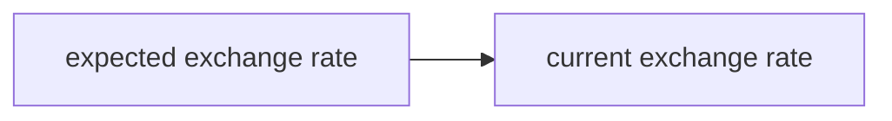

# Study notes

## exchange rate

- Two exchange rates are shown, one for euro‑dollar quoted in the usual way and one quoted opposite to the normal convention.
- When the exchange rate goes up, it means the local currency (e.g., the dollar) appreciates, i.e., you get more foreign currency per unit of domestic currency.
- When the exchange rate goes down, it indicates a depreciation of the local currency.

| Item | Description |
| --- | --- |
| exchange rate goes up | When the exchange rate goes up, it means the local currency (e.g., the dollar) appreciates, i.e., you get more foreign currency per unit of domestic currency. |
| exchange rate goes down | When the exchange rate goes down, it indicates a depreciation of the local currency. |

- The exchange rate can be quoted opposite to the normal market convention.
- the price of one currency relative to another, which moves in response to monetary policies in different countries
- a framework that connects monetary policies across countries to exchange‑rate movements and their short‑run impact on real activity
- the traditional macroeconomic model used for very short‑run analysis, here adapted to an open economy with a floating exchange rate
- the period in which nominal prices are assumed fixed and monetary policy effects on output are examined

## policy rate path

- policy rate path
- Rising interest rates in the US led to an appreciation of the dollar.
- The US began tightening interest rates before the rest of the world.
- The market cares more about what it expects to happen than what actually happens.

## Interest rate hike frequency in Japan

- Japan hasn't had hikes in interest rates for three decades, but even now, you begin to see some.
- Not to say that the interest rate in the US will be lower than the interest rate in Japan, but the direction of the change is in that way.
- So relative to where we're at now, the direction of the change is towards the US loosening monetary policy before the rest of the world does.
- Because again, the yen has been against the zero overbound for a very long time.

## net exports

- Net exports are the difference between foreign demand for domestic goods and domestic demand for foreign goods, and they appear as an extra term in the goods‑market equilibrium.
- Net exports are a decreasing function of domestic output and domestic income because higher domestic income leads to more imports.

## real exchange rate

- The real exchange rate reflects how expensive domestic goods are relative to foreign goods.
- Net exports increase when foreign income rises.
- A rise in the real exchange rate makes domestic goods more expensive relative to foreign goods.
- Exports increase when foreign income rises.
- exports
- real exchange rate causal net exports

## nominal interest rate

- equal to the real interest rate when inflation is zero
- moves the real exchange rate
- inflation is zero
- nominal interest rate equals real interest rate
- two endogenous variables: output and interest rate

## exchange rate equation

- The exchange rate is equal to that (the expression derived from the uncovered interest parity condition).

### uncovered interest parity condition

- the uncovered interest parity condition
- An extra equation is needed to deal with the new endogenous variable.

## expected return equilibrium

- In equilibrium, assets with higher expected returns attract capital until expected returns are equalized across assets.
- If one asset offers a higher expected return, investors will shift portfolios toward that asset.
- Risk adjustment is present in real markets.
- When other factors are removed, returns must be similar in both places.
- Dividing both sides of an equation by the exchange rate yields a relationship involving nominal exchange rate, expected currency appreciation, and interest rates.

## Exchange rate equation

- An equation for the exchange rate that is a function of the domestic interest rate, the international interest rate, and the expected exchange rate.
- Fixed parameter
- An increase in the domestic interest rate, other things equal, appreciates the exchange rate.

## exchange rate appreciation

- When the domestic interest rate rises relative to the foreign interest rate, the exchange rate appreciates (the domestic currency becomes more expensive).
- If domestic and foreign interest rates are equal, the current exchange rate equals the expected future exchange rate.
- Once the currency appreciates enough, the return advantage of the higher‑interest bond disappears.

## exchange rate depreciation

- the exchange rate is depreciating
- the dollar is depreciating
- the exchange rate will fall
- the dollar is depreciating

## expected exchange rate

- treated as a fixed parameter and not endogenized
- immediately rises when the expected exchange rate is moved up

#### Cause and Effect

## expected capital gain

- expected capital gain
- Go short massively the foreign bond and go very long the US bond.
- The two bonds are paying the same interest rate.

## positive relationship

- The exchange rate and domestic interest rate move together positively.
- Only the exchange rate can move to restore indifference after a change.
- Exchange rate is plotted on the x‑axis and domestic interest rate on the y‑axis.
- The speaker is plotting the UI p and covering the interest parity condition.
- exchange rate positive_relationship domestic interest rate
- when the domestic interest rate, if i is equal to international interest rate, then the exchange rate has to be equal to the expected exchange rate.

## uncovered interest parity

- When the domestic interest rate exceeds the international interest rate, the current exchange rate must be above the expected future exchange rate so that the expected depreciation of the domestic currency offsets the higher domestic interest rate; conversely, if the domestic interest rate is lower, the current exchange rate is very depreciated because the currency is expected to appreciate to compensate for the interest rate differential.

## Mandel Fleming model

- This is the Mandel Fleming model.
- I have one equation and two unknowns.
- The two unknowns are its output and the domestic interest rate.
- extra equation is monetary policy (LM)

## Interest rate increase reduces aggregate demand via two channels: investment fall and exchange‑rate appreciation.

- Interest rate increase reduces aggregate demand via two channels: investment fall and exchange‑rate appreciation.
- In a closed economy the interest‑rate channel operated only through reduced investment. In an open economy a second channel appears: a higher interest rate raises the exchange rate, making exports more expensive and imports cheaper, so net exports fall.

| Item | Description |
| --- | --- |
| closed economy | In a closed economy the interest‑rate channel operated only through reduced investment. |
| open economy | In an open economy a second channel appears: a higher interest rate raises the exchange rate, making exports more expensive and imports cheaper, so net exports fall. |

## domestic consumption diversion

- More of the domestic consumption is diverted to foreign goods.
- A foreign demand must be allocated to our exports for the channel to operate.
- In an open economy, the more important the term, the more powerful the channel.
- The US cares very little about this effect.

## equilibrium interest rate

- This is the interest rate that is consistent with equilibrium in financial markets.
- The interest rate is set by the Fed, not by the ECB.
- And then we can go to the UIP condition you see I'm plotting here and figure out what the exchange rate is. Because for this interest rate here, there's going to be some point in the UIP, and that tells me exactly what the exchange rate is.

## interest rate

- When I increase interest rate from here to there, then my exchange rate has to appreciate.
- my exchange rate has to appreciate
- will lead to a contraction in output and an appreciation of the currency
- interest rate differential
- compensation will come through an expected capital loss through the currency
- Increasing the domestic interest rate, when the rest of the world does not follow, forces the exchange rate to appreciate; the higher differential is offset by an expected capital loss on the currency.
- the precision is already built in here, which is what makes monetary policy more powerful than the closed economy, because you get the next export channel.
- It has no effect on the interest rate.
- It doesn't move the exchange rate.
- It has no implication for the exchange rate.
- In an open economy, the currency will tend to appreciate.

## UAP

- UAP has nothing to do with government expenditure.
- Government expenditure is unrelated to the UAP in this discussion.
- The discussion emphasizes that outcomes are driven by financial markets.
- Expected returns are a key factor in the analysis.
- Fiscal policy only affects exchange rates if it influences interest rates.
- A smaller variable has no impact on the exchange rate in the discussed scenario.
- If fiscal policy affects interest rates, it can influence exchange rates.
- Expansionary fiscal packages tend to lead to currency appreciation in practice.

## LEM

- The LEM is controlled by the domestic central bank.
- Increasing the expected exchange rate is examined to see how output changes.
- When asking if something moves, you should always fix something else.

## expected exchange rate curve

- The expected exchange rate curve moves to the right.
- The net exports curve shifts left, reducing output.
- Only one curve can move at a time in the given scenario.
- If the central bank does not react, the movement will not occur.
