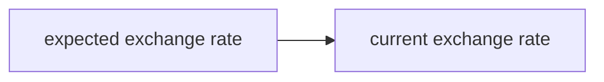

> UNVERIFIED PREVIEW — semantic and educational review required.

# Study notes: multimodal transcript

*Generated from assembled notes*

---

## exchange rate

> Paraphrase candidate: semantic support remains unresolved; this is not a verified factual claim.

Two exchange rates are shown, one for euro‑dollar quoted in the usual way and one quoted opposite to the normal convention.

*[Knowledge ID: CON_0001 | Sources: G00001]*

> Paraphrase candidate: semantic support remains unresolved; this is not a verified factual claim.

When the exchange rate goes up, it means the local currency (e.g., the dollar) appreciates, i.e., you get more foreign currency per unit of domestic currency.

*[Knowledge ID: CON_0002 | Sources: G00001, G00002]*

> Paraphrase candidate: semantic support remains unresolved; this is not a verified factual claim.

When the exchange rate goes down, it indicates a depreciation of the local currency.

*[Knowledge ID: CON_0003 | Sources: G00001, G00002]*

| Item | Description |
| --- | --- |
| exchange rate goes up | When the exchange rate goes up, it means the local currency (e.g., the dollar) appreciates, i.e., you get more foreign currency per unit of domestic currency. |
| exchange rate goes down | When the exchange rate goes down, it indicates a depreciation of the local currency. |

*Source: CON_0002, CON_0003 · 77.62–79.44s, 79.74–82.76s, 82.92–84.50s, 84.50–87.20s, 88.48–91.18s, 91.18–93.70s, 94.36–95.72s*

> Paraphrase candidate: semantic support remains unresolved; this is not a verified factual claim.

The exchange rate can be quoted opposite to the normal market convention.

*[Knowledge ID: CON_0004 | Sources: G00001]*

> Paraphrase candidate: semantic support remains unresolved; this is not a verified factual claim.

the price of one currency relative to another, which moves in response to monetary policies in different countries

*[Knowledge ID: CON_0014 | Sources: G00006]*

> Paraphrase candidate: semantic support remains unresolved; this is not a verified factual claim.

a framework that connects monetary policies across countries to exchange‑rate movements and their short‑run impact on real activity

*[Knowledge ID: CON_0015 | Sources: G00006]*

> Paraphrase candidate: semantic support remains unresolved; this is not a verified factual claim.

the traditional macroeconomic model used for very short‑run analysis, here adapted to an open economy with a floating exchange rate

*[Knowledge ID: CON_0016 | Sources: G00006]*

> Paraphrase candidate: semantic support remains unresolved; this is not a verified factual claim.

the period in which nominal prices are assumed fixed and monetary policy effects on output are examined

*[Knowledge ID: CON_0017 | Sources: G00006]*

## policy rate path

> Unavailable or unresolved source information: PARTIALLY\_SUPPORTED. Original candidates remain in the audit.

policy rate path

Available source excerpt: So you look, for example, at the expected policy rate path
 In the case of the US nowadays, it looks like this.

Available source excerpt: Well, if you look at the same picture in Europe,
 it looks like that.

Available source excerpt: It's clear that there is more ahead.

*[Knowledge ID: CON_0009 | Sources: G00003, G00004]*

> Paraphrase candidate: semantic support remains unresolved; this is not a verified factual claim.

Rising interest rates in the US led to an appreciation of the dollar.

*[Knowledge ID: FCT_0002 | Sources: G00003]*

> Paraphrase candidate: semantic support remains unresolved; this is not a verified factual claim.

The US began tightening interest rates before the rest of the world.

*[Knowledge ID: FCT_0005 | Sources: G00003]*

> Paraphrase candidate: semantic support remains unresolved; this is not a verified factual claim.

The market cares more about what it expects to happen than what actually happens.

*[Knowledge ID: FCT_0003 | Sources: G00004]*

> Unavailable or unresolved source information: PARTIALLY\_SUPPORTED. Original candidates remain in the audit.

Available source excerpt: Well, if you look at the same picture in Europe,
 it looks like that.

Available source excerpt: It's clear that there is more ahead.

Available source excerpt: What you expect is what matters, not what
 actually happens, and at this moment,
 the market expects the euro area to go
 through a more prolonged period of hiking, interest rate
 hiking.

*[Knowledge ID: FCT_0004 | Sources: G00004]*

## Interest rate hike frequency in Japan

> Paraphrase candidate: semantic support remains unresolved; this is not a verified factual claim.

Japan hasn't had hikes in interest rates for three decades, but even now, you begin to see some.

*[Knowledge ID: CON_0010 | Sources: G00005]*

> Paraphrase candidate: semantic support remains unresolved; this is not a verified factual claim.

Not to say that the interest rate in the US will be lower than the interest rate in Japan, but the direction of the change is in that way.

*[Knowledge ID: CON_0011 | Sources: G00005]*

> Paraphrase candidate: semantic support remains unresolved; this is not a verified factual claim.

So relative to where we're at now, the direction of the change is towards the US loosening monetary policy before the rest of the world does.

*[Knowledge ID: CON_0012 | Sources: G00005]*

> Paraphrase candidate: semantic support remains unresolved; this is not a verified factual claim.

Because again, the yen has been against the zero overbound for a very long time.

*[Knowledge ID: CON_0013 | Sources: G00005]*

## net exports

> Paraphrase candidate: semantic support remains unresolved; this is not a verified factual claim.

Net exports are the difference between foreign demand for domestic goods and domestic demand for foreign goods, and they appear as an extra term in the goods‑market equilibrium.

*[Knowledge ID: CON_0018 | Sources: G00007]*

> Paraphrase candidate: semantic support remains unresolved; this is not a verified factual claim.

Net exports are a decreasing function of domestic output and domestic income because higher domestic income leads to more imports.

*[Knowledge ID: CON_0019 | Sources: G00007, G00008]*

## real exchange rate

> Paraphrase candidate: semantic support remains unresolved; this is not a verified factual claim.

The real exchange rate reflects how expensive domestic goods are relative to foreign goods.

*[Knowledge ID: CON_0020 | Sources: G00009]*

> Paraphrase candidate: semantic support remains unresolved; this is not a verified factual claim.

Net exports increase when foreign income rises.

*[Knowledge ID: FCT_0061 | Sources: G00009]*

> Paraphrase candidate: semantic support remains unresolved; this is not a verified factual claim.

A rise in the real exchange rate makes domestic goods more expensive relative to foreign goods.

*[Knowledge ID: FCT_0062 | Sources: G00009]*

> Paraphrase candidate: semantic support remains unresolved; this is not a verified factual claim.
> Unavailable or unresolved source information: PARTIALLY\_SUPPORTED. Original candidates remain in the audit.

Exports increase when foreign income rises.

exports

Available source excerpt: So if the income in the other country goes up,
 then their imports will go up, which
 is our exports that go up.

*[Knowledge ID: REL_0004 | Sources: G00009]*

> Paraphrase candidate: semantic support remains unresolved; this is not a verified factual claim.

real exchange rate causal net exports

*[Knowledge ID: REL_0005 | Sources: G00009]*

## nominal interest rate

> Paraphrase candidate: semantic support remains unresolved; this is not a verified factual claim.

equal to the real interest rate when inflation is zero

*[Knowledge ID: CON_0021 | Sources: G00011]*

> Paraphrase candidate: semantic support remains unresolved; this is not a verified factual claim.

moves the real exchange rate

*[Knowledge ID: CON_0022 | Sources: G00011]*

> Paraphrase candidate: semantic support remains unresolved; this is not a verified factual claim.

inflation is zero

*[Knowledge ID: FCT_0063 | Sources: G00011]*

> Paraphrase candidate: semantic support remains unresolved; this is not a verified factual claim.

nominal interest rate equals real interest rate

*[Knowledge ID: REL_0006 | Sources: G00011]*

## Source G00012

> Unavailable or unresolved source information: PARTIALLY\_SUPPORTED. Original candidates remain in the audit.

Available source excerpt: Remember, if the consumer confidence goes up,
 then aggregate demand goes up.

*[Knowledge ID: FCT_0064 | Sources: G00012]*

> Paraphrase candidate: semantic support remains unresolved; this is not a verified factual claim.

two endogenous variables: output and interest rate

*[Knowledge ID: FCT_0065 | Sources: G00012]*

## exchange rate equation

> Paraphrase candidate: semantic support remains unresolved; this is not a verified factual claim.

The exchange rate is equal to that (the expression derived from the uncovered interest parity condition).

*[Knowledge ID: CON_0023 | Sources: G00013]*

### uncovered interest parity condition

the uncovered interest parity condition

*[Knowledge ID: DEF_0002 | Sources: G00013]*

> Paraphrase candidate: semantic support remains unresolved; this is not a verified factual claim.

An extra equation is needed to deal with the new endogenous variable.

*[Knowledge ID: FCT_0066 | Sources: G00013]*

## expected return equilibrium

> Paraphrase candidate: semantic support remains unresolved; this is not a verified factual claim.

In equilibrium, assets with higher expected returns attract capital until expected returns are equalized across assets.

*[Knowledge ID: CON_0024 | Sources: G00014]*

> Paraphrase candidate: semantic support remains unresolved; this is not a verified factual claim.

If one asset offers a higher expected return, investors will shift portfolios toward that asset.

*[Knowledge ID: FCT_0067 | Sources: G00014]*

> Paraphrase candidate: semantic support remains unresolved; this is not a verified factual claim.

Risk adjustment is present in real markets.

*[Knowledge ID: FCT_0068 | Sources: G00014]*

> Paraphrase candidate: semantic support remains unresolved; this is not a verified factual claim.

When other factors are removed, returns must be similar in both places.

*[Knowledge ID: FCT_0069 | Sources: G00014]*

> Paraphrase candidate: semantic support remains unresolved; this is not a verified factual claim.

Dividing both sides of an equation by the exchange rate yields a relationship involving nominal exchange rate, expected currency appreciation, and interest rates.

*[Knowledge ID: FCT_0070 | Sources: G00014]*

## Exchange rate equation

> Paraphrase candidate: semantic support remains unresolved; this is not a verified factual claim.

An equation for the exchange rate that is a function of the domestic interest rate, the international interest rate, and the expected exchange rate.

*[Knowledge ID: CON_0025 | Sources: G00016]*

> Paraphrase candidate: semantic support remains unresolved; this is not a verified factual claim.
> Unavailable or unresolved source information: PARTIALLY\_SUPPORTED. Original candidates remain in the audit.

Available source excerpt: We may move it as a parameter, but I'm
 going to say I'm not going to endogenize that.

Available source excerpt: I'm going to take it as fixed, and I
 may move it around to show you what happens when that changes,
 but I'm not going to endogenize it.

Fixed parameter

*[Knowledge ID: CON_0026 | Sources: G00016]*

> Paraphrase candidate: semantic support remains unresolved; this is not a verified factual claim.

An increase in the domestic interest rate, other things equal, appreciates the exchange rate.

*[Knowledge ID: FCT_0071 | Sources: G00016]*

## exchange rate appreciation

> Paraphrase candidate: semantic support remains unresolved; this is not a verified factual claim.

When the domestic interest rate rises relative to the foreign interest rate, the exchange rate appreciates (the domestic currency becomes more expensive).

*[Knowledge ID: CON_0027 | Sources: G00017, G00018]*

> Paraphrase candidate: semantic support remains unresolved; this is not a verified factual claim.

If domestic and foreign interest rates are equal, the current exchange rate equals the expected future exchange rate.

*[Knowledge ID: FCT_0072 | Sources: G00017, G00018]*

## Source G00021

> Unavailable or unresolved source information: PARTIALLY\_SUPPORTED. Original candidates remain in the audit.

Available source excerpt: So if I am now telling you that one bond is paying a higher interest than the other one,
 I need to offset that somehow.

Available source excerpt: How do I offset it by expecting a depreciation of the bond that is
 denominated in the currency that is expected to depreciate?

Available source excerpt: So what I need to do is compensate
 say, for the interest rate differential
 with an expected depreciation of the currency that's
 paying a higher interest rate.

*[Knowledge ID: FCT_0001 | Sources: G00021]*

> Unavailable or unresolved source information: PARTIALLY\_SUPPORTED. Original candidates remain in the audit.

Available source excerpt: So that's what, in this model, when
 I fix the expected exchange rate,
 the only way I can do that is by appreciating the currency today
 so I can expect it to depreciate in the future.

*[Knowledge ID: FCT_0073 | Sources: G00021]*

## Source G00022

> Paraphrase candidate: semantic support remains unresolved; this is not a verified factual claim.

Once the currency appreciates enough, the return advantage of the higher‑interest bond disappears.

*[Knowledge ID: FCT_0074 | Sources: G00022]*

> Unavailable or unresolved source information: PARTIALLY\_SUPPORTED. Original candidates remain in the audit.

Available source excerpt: So what is typically wrong is that then an analyst
 comes and tells you, explains the story,
 why the changes, if you want to continue to appreciate,
 well, that's just way too late.

*[Knowledge ID: FCT_0075 | Sources: G00022]*

## exchange rate depreciation

> Paraphrase candidate: semantic support remains unresolved; this is not a verified factual claim.

the exchange rate is depreciating

*[Knowledge ID: CON_0028 | Sources: G00023]*

> Paraphrase candidate: semantic support remains unresolved; this is not a verified factual claim.

the dollar is depreciating

*[Knowledge ID: CON_0029 | Sources: G00023]*

> Paraphrase candidate: semantic support remains unresolved; this is not a verified factual claim.

the exchange rate will fall

*[Knowledge ID: FCT_0076 | Sources: G00023]*

the dollar is depreciating

*[Knowledge ID: FCT_0077 | Sources: G00023]*

## expected exchange rate

> Paraphrase candidate: semantic support remains unresolved; this is not a verified factual claim.

treated as a fixed parameter and not endogenized

*[Knowledge ID: CON_0030 | Sources: G00025]*

> Paraphrase candidate: semantic support remains unresolved; this is not a verified factual claim.

immediately rises when the expected exchange rate is moved up

*[Knowledge ID: CON_0031 | Sources: G00025]*

> Paraphrase candidate: semantic support remains unresolved; this is not a verified factual claim.

#### Cause and Effect

*[Knowledge ID: REL_0003 | Sources: G00025]*

## expected capital gain

> Unavailable or unresolved source information: PARTIALLY\_SUPPORTED. Original candidates remain in the audit.

expected capital gain

Available source excerpt: Of course, because you have a 10% expected capital gain
 from buying that bond, if that doesn't happen.

*[Knowledge ID: CON_0032 | Sources: G00028]*

> Paraphrase candidate: semantic support remains unresolved; this is not a verified factual claim.

Go short massively the foreign bond and go very long the US bond.

*[Knowledge ID: CON_0033 | Sources: G00028]*

The two bonds are paying the same interest rate.

*[Knowledge ID: FCT_0078 | Sources: G00028]*

> Unavailable or unresolved source information: PARTIALLY\_SUPPORTED. Original candidates remain in the audit.

Available source excerpt: And in this particular case, if the interests are the same,
 that will happen only if the exchange rate
 jumps exactly by the same amount as the expected value
 of the dollar change in the future.

*[Knowledge ID: FCT_0079 | Sources: G00028]*

## positive relationship

> Paraphrase candidate: semantic support remains unresolved; this is not a verified factual claim.

The exchange rate and domestic interest rate move together positively.

*[Knowledge ID: CON_0034 | Sources: G00029]*

> Unavailable or unresolved source information: PARTIALLY\_SUPPORTED. Original candidates remain in the audit.

Available source excerpt: In equilibrium, you have to be indifferent.

Available source excerpt: So the only thing that can move is exchange rate.

*[Knowledge ID: CON_0035 | Sources: G00029]*

> Paraphrase candidate: semantic support remains unresolved; this is not a verified factual claim.
> Unavailable or unresolved source information: PARTIALLY\_SUPPORTED. Original candidates remain in the audit.

Available source excerpt: So the only thing that can move is exchange rate.

Available source excerpt: And exchange rate has to move until you're indifferent again
 after you have done some argument
 on the right-hand side.

Only the exchange rate can move to restore indifference after a change.

*[Knowledge ID: CON_0036 | Sources: G00029]*

> Paraphrase candidate: semantic support remains unresolved; this is not a verified factual claim.

Exchange rate is plotted on the x‑axis and domestic interest rate on the y‑axis.

*[Knowledge ID: CON_0037 | Sources: G00029]*

## Source G00030

> Paraphrase candidate: semantic support remains unresolved; this is not a verified factual claim.

The speaker is plotting the UI p and covering the interest parity condition.

*[Knowledge ID: FCT_0080 | Sources: G00030]*

> Paraphrase candidate: semantic support remains unresolved; this is not a verified factual claim.

exchange rate positive_relationship domestic interest rate

*[Knowledge ID: REL_0002 | Sources: G00030]*

> Paraphrase candidate: semantic support remains unresolved; this is not a verified factual claim.
> Unavailable or unresolved source information: PARTIALLY\_SUPPORTED. Original candidates remain in the audit.

when the domestic interest rate, if i is equal to international interest rate, then the exchange rate has to be equal to the expected exchange rate.

Available source excerpt: This point tells you that when the domestic interest rate,
 if i is equal to international interest rate,
 then the exchange rate has to be equal to the expected
 exchange rate, which is the question I asked before.

*[Knowledge ID: REL_0089 | Sources: G00030]*

## uncovered interest parity

> Paraphrase candidate: semantic support remains unresolved; this is not a verified factual claim.
> Unavailable or unresolved source information: PARTIALLY\_SUPPORTED. Original candidates remain in the audit.

Available source excerpt: If the domestic interest rate is above that,
 the international interest rate, then the exchange rate today
 has to be above the expected exchange rate,
 because that will give you a expected depreciation
 of the currency, which will compensate for the fact
 that the domestic bond is paying a higher interest
 rate than international bond.

Available source excerpt: Conversely, if the domestic bond is paying a lower interest
 rate, then the exchange rate today is very depreciated,
 because you have to expect it to appreciate in order
 to compensate for the interest rate differential.

When the domestic interest rate exceeds the international interest rate, the current exchange rate must be above the expected future exchange rate so that the expected depreciation of the domestic currency offsets the higher domestic interest rate; conversely, if the domestic interest rate is lower, the current exchange rate is very depreciated because the currency is expected to appreciate to compensate for the interest rate differential.

*[Knowledge ID: CON_0038 | Sources: G00031]*

## Mandel Fleming model

This is the Mandel Fleming model.

*[Knowledge ID: CON_0039 | Sources: G00032]*

I have one equation and two unknowns.

*[Knowledge ID: FCT_0081 | Sources: G00032]*

The two unknowns are its output and the domestic interest rate.

*[Knowledge ID: FCT_0082 | Sources: G00032]*

> Paraphrase candidate: semantic support remains unresolved; this is not a verified factual claim.

extra equation is monetary policy (LM)

*[Knowledge ID: REL_0090 | Sources: G00032]*

## Interest rate increase reduces aggregate demand via two channels: investment fall and exchange‑rate appreciation.

> Paraphrase candidate: semantic support remains unresolved; this is not a verified factual claim.
> Unavailable or unresolved source information: PARTIALLY\_SUPPORTED. Original candidates remain in the audit.

Available source excerpt: So when the interest rate goes up,
 it's contractionary for two reasons.

Available source excerpt: One, for the reason we had before,
 which is that investment falls.

Available source excerpt: But there is a second reason, it's contractionary.

Available source excerpt: To raise the exchange rate.

Available source excerpt: Because it appreciates the exchange rate.

Available source excerpt: And when you appreciate the exchange rate,
 net exports decline.

Interest rate increase reduces aggregate demand via two channels: investment fall and exchange‑rate appreciation.

*[Knowledge ID: CON_0040 | Sources: G00033]*

> Paraphrase candidate: semantic support remains unresolved; this is not a verified factual claim.

In a closed economy the interest‑rate channel operated only through reduced investment. In an open economy a second channel appears: a higher interest rate raises the exchange rate, making exports more expensive and imports cheaper, so net exports fall.

*[Knowledge ID: EXP_0002 | Sources: G00033]*

| Item | Description |
| --- | --- |
| closed economy | In a closed economy the interest‑rate channel operated only through reduced investment. |
| open economy | In an open economy a second channel appears: a higher interest rate raises the exchange rate, making exports more expensive and imports cheaper, so net exports fall. |

*Source: EXP_0002 · 2144.54–2148.84s, 2150.24–2152.46s, 2181.66–2182.64s, 2183.26–2184.74s, 2184.90–2185.96s, 2186.08–2187.02s*

## domestic consumption diversion

> Paraphrase candidate: semantic support remains unresolved; this is not a verified factual claim.

More of the domestic consumption is diverted to foreign goods.

*[Knowledge ID: CON_0041 | Sources: G00034]*

> Paraphrase candidate: semantic support remains unresolved; this is not a verified factual claim.

A foreign demand must be allocated to our exports for the channel to operate.

*[Knowledge ID: CON_0042 | Sources: G00034]*

> Paraphrase candidate: semantic support remains unresolved; this is not a verified factual claim.

In an open economy, the more important the term, the more powerful the channel.

*[Knowledge ID: CON_0043 | Sources: G00034]*

> Paraphrase candidate: semantic support remains unresolved; this is not a verified factual claim.

The US cares very little about this effect.

*[Knowledge ID: CON_0044 | Sources: G00034]*

## equilibrium interest rate

> Paraphrase candidate: semantic support remains unresolved; this is not a verified factual claim.

This is the interest rate that is consistent with equilibrium in financial markets.

*[Knowledge ID: CON_0045 | Sources: G00035]*

> Paraphrase candidate: semantic support remains unresolved; this is not a verified factual claim.

The interest rate is set by the Fed, not by the ECB.

*[Knowledge ID: CON_0046 | Sources: G00035]*

> Paraphrase candidate: semantic support remains unresolved; this is not a verified factual claim.

And then we can go to the UIP condition you see I'm plotting here and figure out what the exchange rate is. Because for this interest rate here, there's going to be some point in the UIP, and that tells me exactly what the exchange rate is.

*[Knowledge ID: CON_0047 | Sources: G00035]*

## interest rate

> Paraphrase candidate: semantic support remains unresolved; this is not a verified factual claim.

When I increase interest rate from here to there, then my exchange rate has to appreciate.

*[Knowledge ID: CON_0048 | Sources: G00037]*

> Paraphrase candidate: semantic support remains unresolved; this is not a verified factual claim.

my exchange rate has to appreciate

*[Knowledge ID: CON_0049 | Sources: G00037]*

> Paraphrase candidate: semantic support remains unresolved; this is not a verified factual claim.

will lead to a contraction in output and an appreciation of the currency

*[Knowledge ID: CON_0050 | Sources: G00037]*

> Unavailable or unresolved source information: PARTIALLY\_SUPPORTED. Original candidates remain in the audit.

interest rate differential

Available source excerpt: If I move the domestic interest rate,
 and the rest of the world does not follow me,
 so we move interest rate dead on,
 then now I need to compensate for this increase
 in the interest rate differential.

*[Knowledge ID: CON_0051 | Sources: G00037]*

> Paraphrase candidate: semantic support remains unresolved; this is not a verified factual claim.

compensation will come through an expected capital loss through the currency

*[Knowledge ID: CON_0005 | Sources: G00037]*

> Paraphrase candidate: semantic support remains unresolved; this is not a verified factual claim.
> Unavailable or unresolved source information: PARTIALLY\_SUPPORTED. Original candidates remain in the audit.

Increasing the domestic interest rate, when the rest of the world does not follow, forces the exchange rate to appreciate; the higher differential is offset by an expected capital loss on the currency.

Available source excerpt: When I increase interest rate from here to there,
 then my exchange rate has to appreciate.

Available source excerpt: So an expansionary domestic monetary policy will lead
 to a contraction in output, which is what we get
 out of monetary policy, but it will also
 lead to an appreciation of the currency.

Available source excerpt: If I move the domestic interest rate,
 and the rest of the world does not follow me,
 so we move interest rate dead on,
 then now I need to compensate for this increase
 in the interest rate differential.

Available source excerpt: And the compensation will come through an expected capital
 loss through the currency.

*[Knowledge ID: EXP_0006 | Sources: G00037]*

> Paraphrase candidate: semantic support remains unresolved; this is not a verified factual claim.

the precision is already built in here, which is what makes monetary policy more powerful than the closed economy, because you get the next export channel.

*[Knowledge ID: EXP_0007 | Sources: G00037]*

## Source G00038

It has no effect on the interest rate.

*[Knowledge ID: FCT_0083 | Sources: G00038]*

It doesn't move the exchange rate.

*[Knowledge ID: FCT_0084 | Sources: G00038]*

It has no implication for the exchange rate.

*[Knowledge ID: FCT_0085 | Sources: G00038]*

> Paraphrase candidate: semantic support remains unresolved; this is not a verified factual claim.

In an open economy, the currency will tend to appreciate.

*[Knowledge ID: FCT_0086 | Sources: G00038]*

## UAP

UAP has nothing to do with government expenditure.

*[Knowledge ID: CON_0052 | Sources: G00039]*

> Paraphrase candidate: semantic support remains unresolved; this is not a verified factual claim.

Government expenditure is unrelated to the UAP in this discussion.

*[Knowledge ID: CON_0053 | Sources: G00039]*

> Paraphrase candidate: semantic support remains unresolved; this is not a verified factual claim.

The discussion emphasizes that outcomes are driven by financial markets.

*[Knowledge ID: CON_0054 | Sources: G00039]*

> Paraphrase candidate: semantic support remains unresolved; this is not a verified factual claim.

Expected returns are a key factor in the analysis.

*[Knowledge ID: CON_0055 | Sources: G00039]*

> Paraphrase candidate: semantic support remains unresolved; this is not a verified factual claim.

Fiscal policy only affects exchange rates if it influences interest rates.

*[Knowledge ID: CON_0056 | Sources: G00039]*

> Paraphrase candidate: semantic support remains unresolved; this is not a verified factual claim.

A smaller variable has no impact on the exchange rate in the discussed scenario.

*[Knowledge ID: CON_0006 | Sources: G00039]*

> Paraphrase candidate: semantic support remains unresolved; this is not a verified factual claim.

If fiscal policy affects interest rates, it can influence exchange rates.

*[Knowledge ID: CON_0007 | Sources: G00039]*

> Paraphrase candidate: semantic support remains unresolved; this is not a verified factual claim.

Expansionary fiscal packages tend to lead to currency appreciation in practice.

*[Knowledge ID: CON_0008 | Sources: G00039]*

## LEM

> Paraphrase candidate: semantic support remains unresolved; this is not a verified factual claim.

The LEM is controlled by the domestic central bank.

*[Knowledge ID: CON_0057 | Sources: G00040]*

> Paraphrase candidate: semantic support remains unresolved; this is not a verified factual claim.

Increasing the expected exchange rate is examined to see how output changes.

*[Knowledge ID: CON_0058 | Sources: G00040]*

> Paraphrase candidate: semantic support remains unresolved; this is not a verified factual claim.

When asking if something moves, you should always fix something else.

*[Knowledge ID: EXP_0003 | Sources: G00040]*

## expected exchange rate curve

> Paraphrase candidate: semantic support remains unresolved; this is not a verified factual claim.

The expected exchange rate curve moves to the right.

*[Knowledge ID: CON_0059 | Sources: G00042]*

> Paraphrase candidate: semantic support remains unresolved; this is not a verified factual claim.

The net exports curve shifts left, reducing output.

*[Knowledge ID: CON_0060 | Sources: G00042]*

> Paraphrase candidate: semantic support remains unresolved; this is not a verified factual claim.

Only one curve can move at a time in the given scenario.

*[Knowledge ID: FCT_0087 | Sources: G00042]*

> Paraphrase candidate: semantic support remains unresolved; this is not a verified factual claim.

If the central bank does not react, the movement will not occur.

*[Knowledge ID: FCT_0088 | Sources: G00042]*

---

*Render complete: 105 items from 28 sections*

### Additional details: CON_0004
**Concept name:**
FX quoting convention
Sources: G00001

### Additional details: CON_0011
**Concept name:**
US interest rate direction relative to Japan
Sources: G00005

### Additional details: CON_0012
**Concept name:**
Cause of big swings in interest rates
Sources: G00005

### Additional details: CON_0013
**Concept name:**
Yen's long‑term position relative to zero bound
Sources: G00005

### Additional details: CON_0015
**Concept name:**
Mandela Fleming model
Sources: G00006

### Additional details: CON_0016
**Concept name:**
ISLM model
Sources: G00006

### Additional details: CON_0017
**Concept name:**
short run
Sources: G00006

### Additional details: CON_0019
**Concept name:**
net exports function
Sources: G00007, G00008

### Additional details: CON_0029
**Concept name:**
dollar depreciation
Sources: G00023

### Additional details: CON_0033
**Concept name:**
short foreign bond, long US bond
Sources: G00028

### Additional details: CON_0037
**Concept name:**
graphing variables
Sources: G00029

### Additional details: CON_0042
**Concept name:**
foreign demand allocation
Sources: G00034

### Additional details: CON_0043
**Concept name:**
open economy channel importance
Sources: G00034

### Additional details: CON_0044
**Concept name:**
US sensitivity to the effect
Sources: G00034

### Additional details: CON_0046
**Concept name:**
Federal Reserve sets US interest rate
Sources: G00035

### Additional details: CON_0047
**Concept name:**
UIP condition determines exchange rate
Sources: G00035

### Additional details: EXP_0002
**Topic:**
Channels of monetary policy in an open economy
Sources: G00033

### Additional details: EXP_0007
**Topic:**
monetary policy power in an open economy
Sources: G00037

### Additional details: EXP_0003
**Topic:**
asking whether a variable moves
Sources: G00040

### Additional details: REL_0005
**Content:**
Net exports decline when the real exchange rate rises.
Sources: G00009

### Additional details: REL_0006
**Content:**
Nominal interest rate equals real interest rate because inflation is zero
Sources: G00011

### Additional details: REL_0003
**Content:**
moving the expected exchange rate up makes the current exchange rate rise immediately
**Relationship type:**
causes
Sources: G00025

### Additional details: REL_0002
**Content:**
as they move the exchange rate up, then the domestic interest rate has to go up.
Sources: G00030

### Additional details: REL_0090
**Content:**
The extra equation was monetary policy, the LM.
Sources: G00032

Source information not completed:

- definitions: SOURCE_MISSING (sources: G00007, G00008).
- formulas: SOURCE_MISSING (sources: G00007, G00008).
- definitions: SOURCE_MISSING (sources: G00014).
- formulas: SOURCE_MISSING (sources: G00014).
- procedures: SOURCE_MISSING (sources: G00014).
- definitions: SOURCE_MISSING (sources: G00017, G00018).
- formulas: SOURCE_MISSING (sources: G00017, G00018).
- procedures: SOURCE_MISSING (sources: G00017, G00018).
- concepts: SOURCE_MISSING (sources: G00021, G00022).
- definitions: SOURCE_MISSING (sources: G00021, G00022).
