# Study notes

## exchange rate

- Two exchange rates are shown, one quoted as euro‑dollar and the other quoted opposite to the usual market convention.
- When the exchange rate goes up, it means an appreciation of the local currency (the dollar).
- the dollar becomes more expensive (appreciation) when the domestic interest rate rises
- If domestic and international interest rates are equal, the expected exchange rate equals the current exchange rate and no capital gain or loss is expected
- the relationship linking interest rate differentials to expected changes in exchange rates

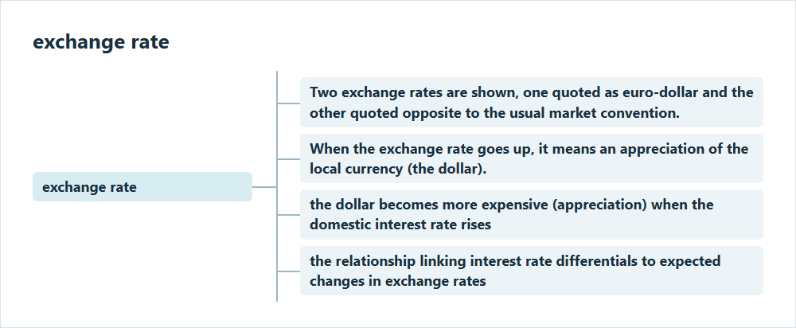

- Only thing that can move is exchange rate; exchange rate moves until you are indifferent again.
- domestic interest rate
- In equilibrium you have to be indifferent; exchange rate moves until indifference is restored.
- Exchange rate and interest rate have a positive relationship; as one rises, the other rises.
- You can determine the exchange rate by plotting and using the interest rate through UIP.
- The interest rate is used together with UIP to find the exchange rate.
- UIP provides a point that links the interest rate to the exchange rate.
- Output can be determined from the diagrams together with interest rate and exchange rate.
- The policy itself concerns the exchange rate and can affect output and the interest rate.
- The interest rate is set by the Fed, not by the ECB.
- This is the interest rate that is consistent with equilibrium in financial markets.
- That point is where both markets are in equilibrium.

## appreciation

- When the exchange rate goes down, it indicates a depreciation of the local currency.
- Perceptions about interest‑rate policy in different regions are a main driver of exchange‑rate fluctuations.

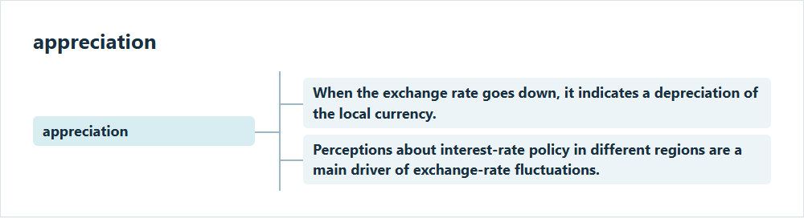

## interest rate tightening

- The process of raising policy interest rates, which began before the rest of the world.
- Rising US interest rates led to an appreciation of the dollar.

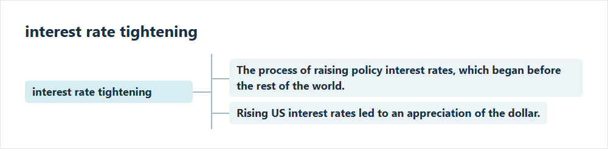

## expected policy rate path

- The market's forecast of future policy interest rates over upcoming FOMC meetings.
- Asset prices depend more on market expectations than on actual future outcomes.
- European markets anticipate a more prolonged period of interest‑rate hikes than the US.

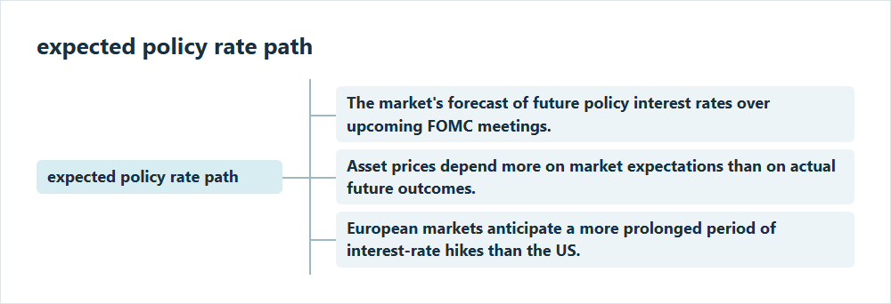

- Japan hasn't had hikes in interest rates for three decades.
- The scale here is very small.
- These are a few basis points.
- People expect interest rates in the US to go down relative to interest rates in Japan.
- The direction of change is towards the US loosening monetary policy before the rest of the world does.

## Mandela Fleming model

- A framework that connects monetary policies in different countries to exchange‑rate movements and examines how those movements affect short‑run real activity.
- The price of one currency relative to another, whose movements are driven by monetary policy differences and affect aggregate demand and output in the short run.
- A short‑run macroeconomic model that fixes nominal prices and analyzes the interaction of the goods market (IS) and money market (LM).

## net exports

- Net exports is a term added to the model representing the difference between exports and imports, functioning as a component of demand.
- Net exports are a decreasing function of domestic output and domestic income.
- Because higher domestic income leads to higher imports, part of the extra demand goes to foreign goods, reducing net exports.
- Net exports increase when foreign (rest‑of‑the‑world) income rises and decline when the real exchange rate rises.

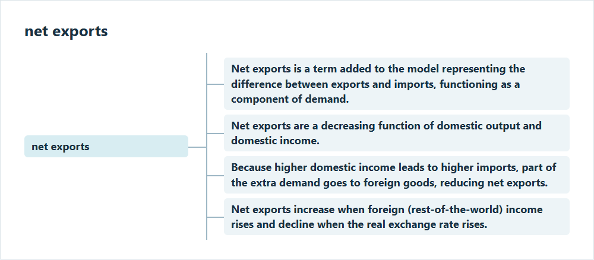

- foreign income
- When the real exchange rate rises, domestic goods become relatively more expensive, reducing net exports.
- Our goods become more expensive relative to foreign goods.
- Exports tend to decline because our goods are more expensive, and imports tend to increase because foreign goods are cheaper.
- An extra equation is needed because we have an extra endogenous variable.
- Both the domestic and foreign prices are assumed to be completely fixed.

## Nominal interest rate equals real interest rate when inflation is zero

- Because inflation is zero, there is no need to differentiate between real and nominal interest rates, so nominal interest equals real interest.
- The speaker assumes expected inflation and actual inflation are zero.

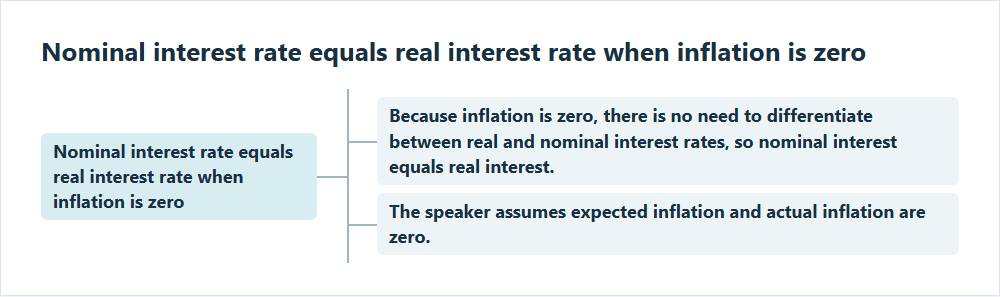

- Real exchange rate moves only with nominal exchange rate when prices are fixed

## Higher consumer confidence raises aggregate demand

- When consumer confidence goes up, aggregate demand goes up.

## uncovered interest parity

- The uncovered interest parity is the extra equation needed when an endogenous variable such as a floating exchange rate is introduced.
- The exchange rate is floating.

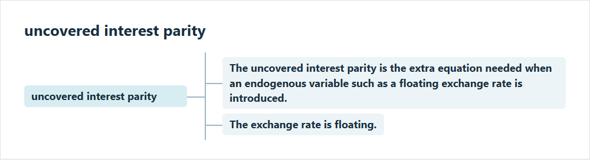

- And in the denominator, you have the foreign interest rate.
- Well, remember, I can divide this by the exchange rate on both sides.
- And then what you get is 1 equal to a numerator that has the nominal exchange rate times the expected appreciation of the currency plus.
- And so when you compare the two, you have to compare one base interest rate, the domestic of the foreign, plus expected appreciation of the appreciation of that currency.

## fixed parameter

- I'm going to take it as fixed, and I may move it around to show you what happens when that changes, but I'm not going to endogenize it.
- If the parameter is taken as fixed, then an equation for the exchange rate can be written as a function of the domestic interest rate, the international interest rate, and the expected exchange rate.
- An increase in the domestic interest rate, other things equal, appreciates the exchange rate.

## interest rate differential

- When one bond pays a higher interest rate than another, the higher return must be offset by an expected depreciation of the currency of the higher‑interest bond.
- The anticipated fall in the value of a currency that is used to offset a higher interest rate on a bond denominated in that currency.

## Effect of currency appreciation on return advantage

- When the currency appreciates enough, the higher‑interest advantage disappears because the expected depreciation component is reduced.

## exchange rate depreciation

- the exchange rate is depreciating
- the dollar is depreciating
- the exchange rate will fall

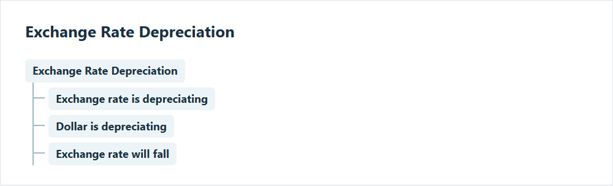

## expected appreciation of the dollar

- The only way I can do that is by having an expected appreciation of the dollar.
- So it's the same mechanism, the same logic, it's symmetric.
- It happens very quickly. So this equation shows you what happens after all that mess has already clear, which happens in milliseconds now.

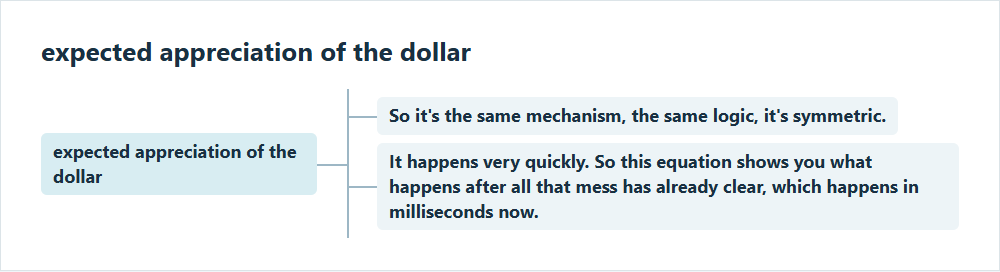

## expected exchange rate as a parameter

- The expected exchange rate is treated as an exogenous parameter that is not endogenized.
- If we expect the dollar to appreciate in the future, it appreciates today. Moving the expected exchange rate up causes the current exchange rate to rise immediately. Fixing the expected exchange rate prevents it from becoming an endogenous variable.

## arbitrage

- Arbitrage-type relationship; consider asking what would happen if the arbitrage did not occur.
- The two bonds are paying the same interest rate.
- One bond will appreciate by 10% relative to the other.
- You should short the foreign bond massively and go very long the US bond.
- When the exchange rate moves up, the domestic interest rate has to go up.
- There is a positive relationship between the exchange rate and the domestic interest rate.
- If the domestic interest rate equals the international interest rate, the exchange rate must equal the expected exchange rate.

## Interest rate parity

- If the domestic interest rate is above the international interest rate, then the exchange rate today has to be above the expected exchange rate, because that will give an expected depreciation of the currency, which will compensate for the fact that the domestic bond is paying a higher interest rate than the international bond. Conversely, if the domestic bond is paying a lower interest rate, then the exchange rate today is very depreciated, because you have to expect it to appreciate in order to compensate for the interest rate differential.
- When the domestic interest rate is lower, the current exchange rate must be undervalued (depreciated) so that the currency is expected to appreciate, compensating for the lower return on domestic bonds.

## unknowns

- The two unknowns are its output and the domestic interest rate.
- The extra equation was monetary policy, the LM.
- Now we have the ISLM model in the open economy.
- This is the Mandel Fleming model.

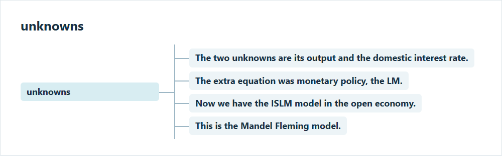

## interest rate

- An increase in the interest rate reduces aggregate demand because investment falls and the exchange rate appreciates, lowering net exports.
- In an open economy, monetary policy affects aggregate demand through two channels: investment reduction and exchange‑rate appreciation.

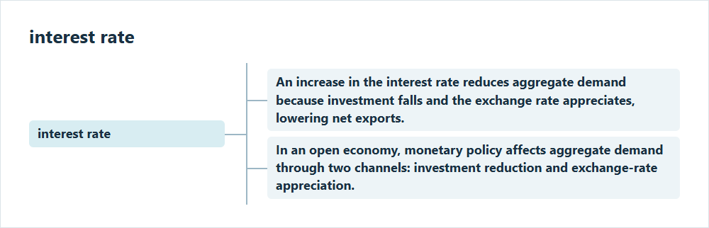

## Interest rate increase leads to exchange rate appreciation

- When I increase interest rate from here to there, then my exchange rate has to appreciate.
- So an expansionary domestic monetary policy will lead to a contraction in output, which is what we get out of monetary policy, but it will also lead to an appreciation of the currency.
- And the compensation will come through an expected capital loss through the currency.

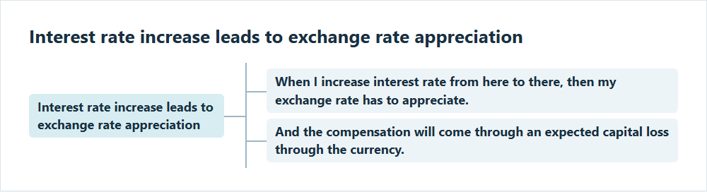

- And of course, the precision is already built in here, which is what makes monetary policy more powerful than the closed economy, because you get the next export channel.
- Expansionary fiscal policy has no effect on the exchange rate.
- In an open economy the currency tends to appreciate.
- Raising interest rates requires a domestic reason.
- treasury becomes very expansionary, and this output becomes too large for what is consistent with a zero output gap or no inflation. And then the Fed may react and raise interest rate, and that will lead to a conversation of exchanges and so on. And that's the reason why, in practice, when countries have sort of expansionary fiscal packages, the currency tends to appreciate it. It's because investors expect the Fed to react to that, or the central bank to react to that and raise interest rates.

## expected exchange rate

- Suppose we increase the expected exchange rate, what moves in this diagram?
- The LEM is controlled by the domestic central bank; does it move?
- Does the IES move?
- When asking whether a variable moves, you should always fix something.

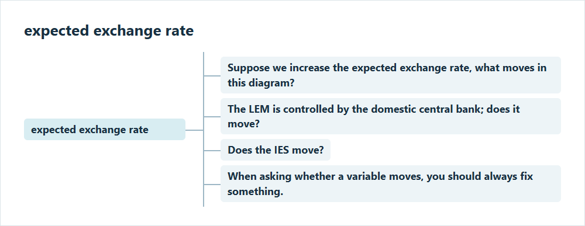

- If the same output is obtained after moving the expected exchange rate, the S has moved.
- If a different equilibrium output is obtained, the S did move.

## Appreciation

- Appreciation
- Net exports decline.
- The expected exchange rate moved to the right. To avoid generating expected capital gain or loss, the current exchange rate must be moved by the same amount. The curve will shift to the right. Only one curve can move. The curve will move to the left because net exports will decline. For any given level of the interest rate, net exports will be lower. The US moves to the left, causing output to fall. There is no movement in this case. If the Fed or the central bank does not react, the movement will not happen.
