> UNVERIFIED PREVIEW — semantic and educational review required.

# Study notes: multimodal transcript

*Generated from assembled notes*

---

## exchange rate

> Paraphrase candidate: semantic support remains unresolved; this is not a verified factual claim.

Two exchange rates are shown, one quoted as euro‑dollar and the other quoted opposite to the usual market convention.

*[Knowledge ID: CON_0001 | Sources: G00001]*

> Paraphrase candidate: semantic support remains unresolved; this is not a verified factual claim.

When the exchange rate goes up, it means an appreciation of the local currency (the dollar).

*[Knowledge ID: CON_0002 | Sources: G00001, G00002]*

> Paraphrase candidate: semantic support remains unresolved; this is not a verified factual claim.

the dollar becomes more expensive (appreciation) when the domestic interest rate rises

*[Knowledge ID: CON_0023 | Sources: G00017, G00018]*

> Paraphrase candidate: semantic support remains unresolved; this is not a verified factual claim.

If domestic and international interest rates are equal, the expected exchange rate equals the current exchange rate and no capital gain or loss is expected

*[Knowledge ID: FCT_0072 | Sources: G00017, G00018]*

> Paraphrase candidate: semantic support remains unresolved; this is not a verified factual claim.

the relationship linking interest rate differentials to expected changes in exchange rates

*[Knowledge ID: CON_0024 | Sources: G00018]*

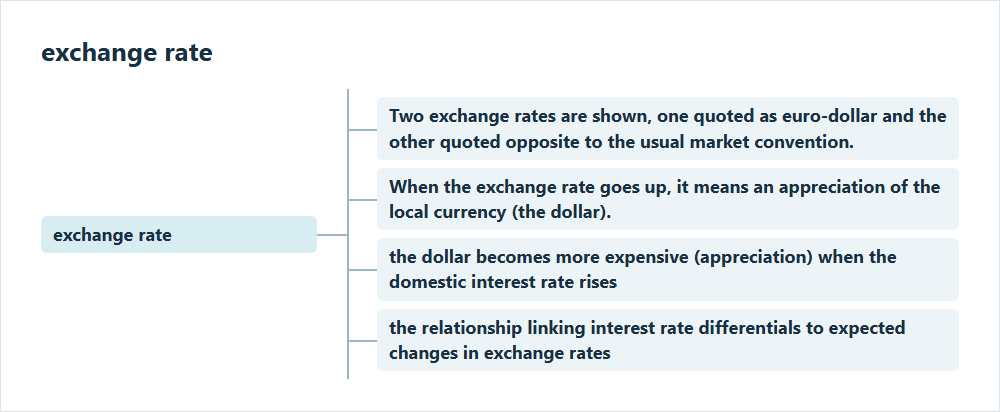

*Source: CON_0001, CON_0002, CON_0023, CON_0024 · 60.64–64.64s, 65.72–73.46s, 74.36–77.50s, 77.62–79.44s, 79.74–82.76s, 82.92–84.50s, 84.50–87.20s, 88.48–91.18s, 91.18–93.70s, 1043.42–1045.02s, 1045.64–1046.58s, 1047.74–1051.98s, 1112.63–1118.31s, 1118.31–1125.59s, 1141.38–1148.00s, 1148.00–1150.24s*

> Paraphrase candidate: semantic support remains unresolved; this is not a verified factual claim.

Only thing that can move is exchange rate; exchange rate moves until you are indifferent again.

*[Knowledge ID: CON_0034 | Sources: G00029]*

> Unavailable or unresolved source information: PARTIALLY\_SUPPORTED. Original candidates remain in the audit.

Available source excerpt: So here, I'm just plotting this relationship
 in the space of exchange rate in the x-axis
 and the domestic interest rate here.

Available source excerpt: But anyways, if I move the interest rate up,
 the exchange rate is going up.

domestic interest rate

*[Knowledge ID: CON_0035 | Sources: G00029]*

> Paraphrase candidate: semantic support remains unresolved; this is not a verified factual claim.

In equilibrium you have to be indifferent; exchange rate moves until indifference is restored.

*[Knowledge ID: CON_0036 | Sources: G00029]*

> Paraphrase candidate: semantic support remains unresolved; this is not a verified factual claim.

Exchange rate and interest rate have a positive relationship; as one rises, the other rises.

*[Knowledge ID: CON_0037 | Sources: G00029]*

> Paraphrase candidate: semantic support remains unresolved; this is not a verified factual claim.

You can determine the exchange rate by plotting and using the interest rate through UIP.

*[Knowledge ID: CON_0045 | Sources: G00035]*

> Paraphrase candidate: semantic support remains unresolved; this is not a verified factual claim.

The interest rate is used together with UIP to find the exchange rate.

*[Knowledge ID: CON_0046 | Sources: G00035]*

> Paraphrase candidate: semantic support remains unresolved; this is not a verified factual claim.

UIP provides a point that links the interest rate to the exchange rate.

*[Knowledge ID: CON_0047 | Sources: G00035]*

> Paraphrase candidate: semantic support remains unresolved; this is not a verified factual claim.

Output can be determined from the diagrams together with interest rate and exchange rate.

*[Knowledge ID: CON_0048 | Sources: G00035]*

> Paraphrase candidate: semantic support remains unresolved; this is not a verified factual claim.

The policy itself concerns the exchange rate and can affect output and the interest rate.

*[Knowledge ID: CON_0005 | Sources: G00035]*

The interest rate is set by the Fed, not by the ECB.

*[Knowledge ID: FCT_0083 | Sources: G00035]*

> Paraphrase candidate: semantic support remains unresolved; this is not a verified factual claim.

This is the interest rate that is consistent with equilibrium in financial markets.

*[Knowledge ID: FCT_0084 | Sources: G00035]*

That point is where both markets are in equilibrium.

*[Knowledge ID: FCT_0085 | Sources: G00035]*

## appreciation

> Paraphrase candidate: semantic support remains unresolved; this is not a verified factual claim.

When the exchange rate goes down, it indicates a depreciation of the local currency.

*[Knowledge ID: CON_0003 | Sources: G00002]*

> Paraphrase candidate: semantic support remains unresolved; this is not a verified factual claim.

Perceptions about interest‑rate policy in different regions are a main driver of exchange‑rate fluctuations.

*[Knowledge ID: CON_0004 | Sources: G00002]*

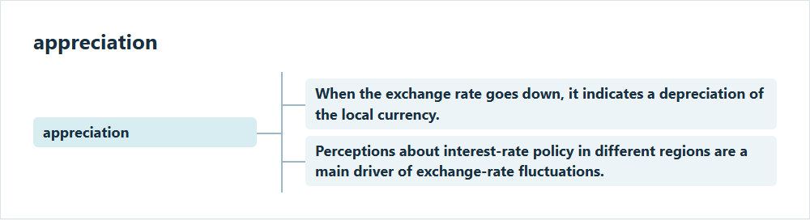

*Source: CON_0003, CON_0004 · 94.36–95.72s, 137.68–144.96s, 144.96–146.22s*

## interest rate tightening

> Paraphrase candidate: semantic support remains unresolved; this is not a verified factual claim.

The process of raising policy interest rates, which began before the rest of the world.

*[Knowledge ID: CON_0007 | Sources: G00003]*

> Paraphrase candidate: semantic support remains unresolved; this is not a verified factual claim.

Rising US interest rates led to an appreciation of the dollar.

*[Knowledge ID: FCT_0003 | Sources: G00003]*

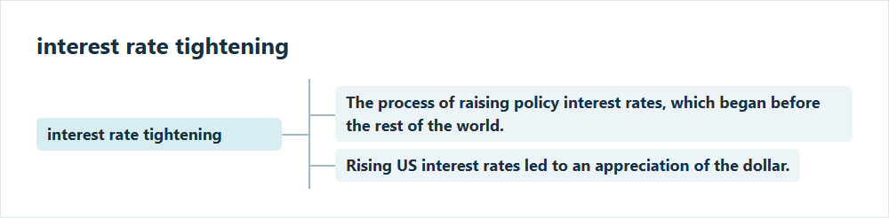

*Source: CON_0007, FCT_0003 · 162.70–163.98s, 163.98–165.24s, 166.06–168.98s, 169.38–171.14s, 171.78–174.04s, 174.56–175.64s*

## expected policy rate path

> Paraphrase candidate: semantic support remains unresolved; this is not a verified factual claim.

The market's forecast of future policy interest rates over upcoming FOMC meetings.

*[Knowledge ID: CON_0008 | Sources: G00004]*

> Paraphrase candidate: semantic support remains unresolved; this is not a verified factual claim.

Asset prices depend more on market expectations than on actual future outcomes.

*[Knowledge ID: FCT_0004 | Sources: G00004]*

> Paraphrase candidate: semantic support remains unresolved; this is not a verified factual claim.

European markets anticipate a more prolonged period of interest‑rate hikes than the US.

*[Knowledge ID: FCT_0005 | Sources: G00004]*

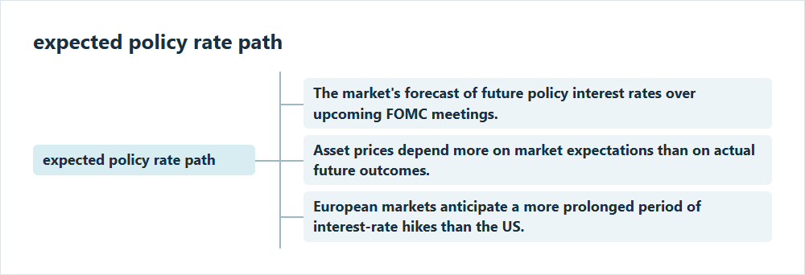

*Source: CON_0008, FCT_0004, FCT_0005 · 228.20–230.14s, 230.14–232.88s, 232.98–237.86s, 259.92–262.58s, 262.82–264.52s, 265.70–267.74s, 267.74–269.16s, 269.68–273.78s, 273.78–277.42s, 277.42–277.80s*

## Source G00005

> Paraphrase candidate: semantic support remains unresolved; this is not a verified factual claim.

Japan hasn't had hikes in interest rates for three decades.

*[Knowledge ID: FCT_0001 | Sources: G00005]*

The scale here is very small.

*[Knowledge ID: FCT_0002 | Sources: G00005]*

These are a few basis points.

*[Knowledge ID: FCT_0059 | Sources: G00005]*

> Paraphrase candidate: semantic support remains unresolved; this is not a verified factual claim.

People expect interest rates in the US to go down relative to interest rates in Japan.

*[Knowledge ID: FCT_0060 | Sources: G00005]*

> Paraphrase candidate: semantic support remains unresolved; this is not a verified factual claim.

The direction of change is towards the US loosening monetary policy before the rest of the world does.

*[Knowledge ID: FCT_0061 | Sources: G00005]*

## Mandela Fleming model

> Paraphrase candidate: semantic support remains unresolved; this is not a verified factual claim.

A framework that connects monetary policies in different countries to exchange‑rate movements and examines how those movements affect short‑run real activity.

*[Knowledge ID: CON_0009 | Sources: G00006]*

> Paraphrase candidate: semantic support remains unresolved; this is not a verified factual claim.

The price of one currency relative to another, whose movements are driven by monetary policy differences and affect aggregate demand and output in the short run.

*[Knowledge ID: CON_0010 | Sources: G00006]*

> Paraphrase candidate: semantic support remains unresolved; this is not a verified factual claim.

A short‑run macroeconomic model that fixes nominal prices and analyzes the interaction of the goods market (IS) and money market (LM).

*[Knowledge ID: CON_0011 | Sources: G00006]*

## net exports

> Paraphrase candidate: semantic support remains unresolved; this is not a verified factual claim.

Net exports is a term added to the model representing the difference between exports and imports, functioning as a component of demand.

*[Knowledge ID: CON_0012 | Sources: G00007]*

> Paraphrase candidate: semantic support remains unresolved; this is not a verified factual claim.

Net exports are a decreasing function of domestic output and domestic income.

*[Knowledge ID: CON_0013 | Sources: G00008]*

> Paraphrase candidate: semantic support remains unresolved; this is not a verified factual claim.

Because higher domestic income leads to higher imports, part of the extra demand goes to foreign goods, reducing net exports.

*[Knowledge ID: EXP_0002 | Sources: G00008]*

> Paraphrase candidate: semantic support remains unresolved; this is not a verified factual claim.

Net exports increase when foreign (rest‑of‑the‑world) income rises and decline when the real exchange rate rises.

*[Knowledge ID: CON_0014 | Sources: G00009]*

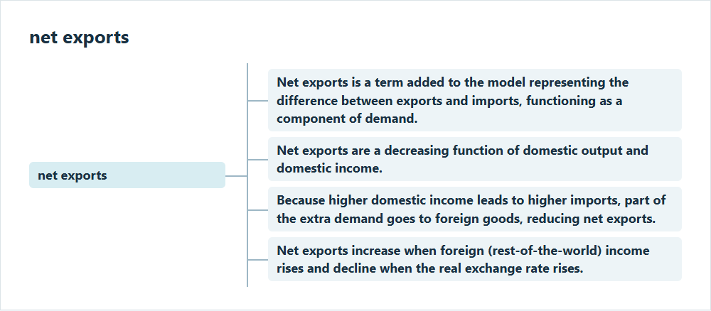

*Source: CON_0012, CON_0013, EXP_0002, CON_0014 · 432.91–439.73s, 440.21–446.71s, 456.63–461.07s, 461.07–464.17s, 464.55–470.70s, 470.70–471.62s, 477.65–479.45s, 480.13–482.43s, 497.46–498.56s, 498.64–501.04s, 501.04–508.18s, 548.18–550.22s, 550.22–551.02s, 577.70–580.00s, 580.64–583.38s, 583.38–585.22s, 589.84–593.92s, 593.92–605.69s, 605.69–610.31s*

> Unavailable or unresolved source information: PARTIALLY\_SUPPORTED. Original candidates remain in the audit.

foreign income

Available source excerpt: That is demand for domestically produced goods
 rises when foreign income goes up.

Available source excerpt: So if the income in the other country goes up,
 then their imports will go up, which
 is our exports that go up.

*[Knowledge ID: CON_0015 | Sources: G00009]*

> Paraphrase candidate: semantic support remains unresolved; this is not a verified factual claim.

When the real exchange rate rises, domestic goods become relatively more expensive, reducing net exports.

*[Knowledge ID: CON_0016 | Sources: G00009]*

## Source G00010

> Paraphrase candidate: semantic support remains unresolved; this is not a verified factual claim.

Our goods become more expensive relative to foreign goods.

*[Knowledge ID: FCT_0062 | Sources: G00010]*

> Paraphrase candidate: semantic support remains unresolved; this is not a verified factual claim.

Exports tend to decline because our goods are more expensive, and imports tend to increase because foreign goods are cheaper.

*[Knowledge ID: FCT_0063 | Sources: G00010]*

> Paraphrase candidate: semantic support remains unresolved; this is not a verified factual claim.

An extra equation is needed because we have an extra endogenous variable.

*[Knowledge ID: FCT_0064 | Sources: G00010]*

> Paraphrase candidate: semantic support remains unresolved; this is not a verified factual claim.

Both the domestic and foreign prices are assumed to be completely fixed.

*[Knowledge ID: FCT_0065 | Sources: G00010]*

## Nominal interest rate equals real interest rate when inflation is zero

> Paraphrase candidate: semantic support remains unresolved; this is not a verified factual claim.

Because inflation is zero, there is no need to differentiate between real and nominal interest rates, so nominal interest equals real interest.

*[Knowledge ID: CON_0017 | Sources: G00011]*

> Paraphrase candidate: semantic support remains unresolved; this is not a verified factual claim.

The speaker assumes expected inflation and actual inflation are zero.

*[Knowledge ID: CON_0018 | Sources: G00011]*

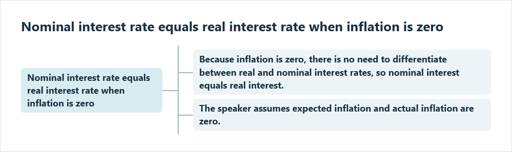

*Source: CON_0017, CON_0018 · 664.69–665.89s, 666.57–668.61s, 676.07–679.09s, 679.09–681.23s, 681.53–682.43s, 683.19–685.09s*

> Paraphrase candidate: semantic support remains unresolved; this is not a verified factual claim.
> Unavailable or unresolved source information: PARTIALLY\_SUPPORTED. Original candidates remain in the audit.

Real exchange rate moves only with nominal exchange rate when prices are fixed

Available source excerpt: Second, I really don't need to differentiate
 between real exchange rate and nominal exchange rate,
 because the prices themselves are not changing.

Available source excerpt: And so all that will move the real exchange rate
 is the nominal exchange rate.

Available source excerpt: So as a reason, I'm going to write here
 that the nominal exchange rate is
 because it's the only thing that will move this variable around,
 given the price that I fixed.

*[Knowledge ID: CON_0019 | Sources: G00011]*

## Higher consumer confidence raises aggregate demand

> Paraphrase candidate: semantic support remains unresolved; this is not a verified factual claim.
> Unavailable or unresolved source information: PARTIALLY\_SUPPORTED. Original candidates remain in the audit.

Available source excerpt: Remember, if the consumer confidence goes up,
 then aggregate demand goes up.

When consumer confidence goes up, aggregate demand goes up.

*[Knowledge ID: CON_0020 | Sources: G00012]*

## uncovered interest parity

> Paraphrase candidate: semantic support remains unresolved; this is not a verified factual claim.

The uncovered interest parity is the extra equation needed when an endogenous variable such as a floating exchange rate is introduced.

*[Knowledge ID: CON_0021 | Sources: G00013]*

> Paraphrase candidate: semantic support remains unresolved; this is not a verified factual claim.

The exchange rate is floating.

*[Knowledge ID: FCT_0066 | Sources: G00013]*

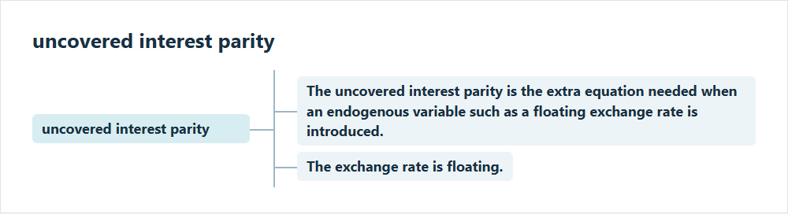

*Source: CON_0021, FCT_0066 · 771.27–773.13s, 773.33–775.85s, 776.37–779.25s, 781.03–783.55s, 787.65–789.87s*

## Source G00014

And in the denominator, you have the foreign interest rate.

*[Knowledge ID: FCT_0067 | Sources: G00014]*

> Paraphrase candidate: semantic support remains unresolved; this is not a verified factual claim.

Well, remember, I can divide this by the exchange rate on both sides.

*[Knowledge ID: FCT_0068 | Sources: G00014]*

> Paraphrase candidate: semantic support remains unresolved; this is not a verified factual claim.

And then what you get is 1 equal to a numerator that has the nominal exchange rate times the expected appreciation of the currency plus.

*[Knowledge ID: FCT_0069 | Sources: G00014]*

> Paraphrase candidate: semantic support remains unresolved; this is not a verified factual claim.

And so when you compare the two, you have to compare one base interest rate, the domestic of the foreign, plus expected appreciation of the appreciation of that currency.

*[Knowledge ID: FCT_0070 | Sources: G00014]*

## fixed parameter

> Paraphrase candidate: semantic support remains unresolved; this is not a verified factual claim.
> Unavailable or unresolved source information: PARTIALLY\_SUPPORTED. Original candidates remain in the audit.

Available source excerpt: I'm going to take it as fixed, and I
 may move it around to show you what happens when that changes,
 but I'm not going to endogenize it.

I'm going to take it as fixed, and I may move it around to show you what happens when that changes, but I'm not going to endogenize it.

*[Knowledge ID: CON_0022 | Sources: G00016]*

> Paraphrase candidate: semantic support remains unresolved; this is not a verified factual claim.

If the parameter is taken as fixed, then an equation for the exchange rate can be written as a function of the domestic interest rate, the international interest rate, and the expected exchange rate.

*[Knowledge ID: EXP_0057 | Sources: G00016]*

> Paraphrase candidate: semantic support remains unresolved; this is not a verified factual claim.

An increase in the domestic interest rate, other things equal, appreciates the exchange rate.

*[Knowledge ID: FCT_0071 | Sources: G00016]*

## interest rate differential

> Paraphrase candidate: semantic support remains unresolved; this is not a verified factual claim.
> Unavailable or unresolved source information: PARTIALLY\_SUPPORTED. Original candidates remain in the audit.

Available source excerpt: So if I am now telling you that one bond is paying a higher interest than the other one,
 I need to offset that somehow.

When one bond pays a higher interest rate than another, the higher return must be offset by an expected depreciation of the currency of the higher‑interest bond.

*[Knowledge ID: CON_0025 | Sources: G00021]*

> Paraphrase candidate: semantic support remains unresolved; this is not a verified factual claim.

The anticipated fall in the value of a currency that is used to offset a higher interest rate on a bond denominated in that currency.

*[Knowledge ID: CON_0026 | Sources: G00021]*

> Unavailable or unresolved source information: PARTIALLY\_SUPPORTED. Original candidates remain in the audit.

Available source excerpt: So if I am now telling you that one bond is paying a higher interest than the other one,
 I need to offset that somehow.

Available source excerpt: How do I offset it by expecting a depreciation of the bond that is
 denominated in the currency that is expected to depreciate?

Available source excerpt: So what I need to do is compensate
 say, for the interest rate differential
 with an expected depreciation of the currency that's
 paying a higher interest rate.

*[Knowledge ID: EXP_0003 | Sources: G00021]*

## Effect of currency appreciation on return advantage

> Paraphrase candidate: semantic support remains unresolved; this is not a verified factual claim.

When the currency appreciates enough, the higher‑interest advantage disappears because the expected depreciation component is reduced.

*[Knowledge ID: EXP_0004 | Sources: G00022]*

## exchange rate depreciation

> Paraphrase candidate: semantic support remains unresolved; this is not a verified factual claim.

the exchange rate is depreciating

*[Knowledge ID: CON_0027 | Sources: G00023]*

> Paraphrase candidate: semantic support remains unresolved; this is not a verified factual claim.

the dollar is depreciating

*[Knowledge ID: CON_0028 | Sources: G00023]*

> Paraphrase candidate: semantic support remains unresolved; this is not a verified factual claim.

the exchange rate will fall

*[Knowledge ID: FCT_0073 | Sources: G00023]*

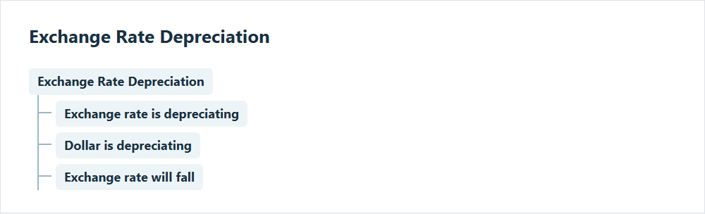

*Source: CON_0027, CON_0028, FCT_0073 · 1451.44–1454.92s, 1454.92–1457.98s, 1458.06–1461.12s, 1461.12–1462.32s*

## expected appreciation of the dollar

> Paraphrase candidate: semantic support remains unresolved; this is not a verified factual claim.
> Unavailable or unresolved source information: PARTIALLY\_SUPPORTED. Original candidates remain in the audit.

Available source excerpt: The only way I can do that is by having an expected
 appreciation of the dollar.

The only way I can do that is by having an expected appreciation of the dollar.

*[Knowledge ID: CON_0029 | Sources: G00024]*

> Paraphrase candidate: semantic support remains unresolved; this is not a verified factual claim.

So it's the same mechanism, the same logic, it's symmetric.

*[Knowledge ID: CON_0030 | Sources: G00024]*

> Paraphrase candidate: semantic support remains unresolved; this is not a verified factual claim.

It happens very quickly. So this equation shows you what happens after all that mess has already clear, which happens in milliseconds now.

*[Knowledge ID: CON_0031 | Sources: G00024]*

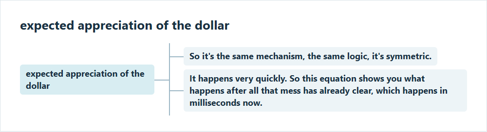

*Source: CON_0030, CON_0031 · 1518.22–1520.34s, 1539.74–1541.18s, 1543.49–1545.95s, 1546.37–1549.43s*

## expected exchange rate as a parameter

> Paraphrase candidate: semantic support remains unresolved; this is not a verified factual claim.

The expected exchange rate is treated as an exogenous parameter that is not endogenized.

*[Knowledge ID: CON_0032 | Sources: G00025]*

> Paraphrase candidate: semantic support remains unresolved; this is not a verified factual claim.

If we expect the dollar to appreciate in the future, it appreciates today. Moving the expected exchange rate up causes the current exchange rate to rise immediately. Fixing the expected exchange rate prevents it from becoming an endogenous variable.

*[Knowledge ID: FCT_0074 | Sources: G00025]*

## arbitrage

> Paraphrase candidate: semantic support remains unresolved; this is not a verified factual claim.

Arbitrage-type relationship; consider asking what would happen if the arbitrage did not occur.

*[Knowledge ID: CON_0033 | Sources: G00026]*

## Source G00028

> Unavailable or unresolved source information: PARTIALLY\_SUPPORTED. Original candidates remain in the audit.

Available source excerpt: Of course, because you have a 10% expected capital gain
 from buying that bond, if that doesn't happen.

*[Knowledge ID: FCT_0075 | Sources: G00028]*

The two bonds are paying the same interest rate.

*[Knowledge ID: FCT_0076 | Sources: G00028]*

> Paraphrase candidate: semantic support remains unresolved; this is not a verified factual claim.

One bond will appreciate by 10% relative to the other.

*[Knowledge ID: FCT_0077 | Sources: G00028]*

> Paraphrase candidate: semantic support remains unresolved; this is not a verified factual claim.

You should short the foreign bond massively and go very long the US bond.

*[Knowledge ID: FCT_0078 | Sources: G00028]*

> Unavailable or unresolved source information: PARTIALLY\_SUPPORTED. Original candidates remain in the audit.

Available source excerpt: And in this particular case, if the interests are the same,
 that will happen only if the exchange rate
 jumps exactly by the same amount as the expected value
 of the dollar change in the future.

*[Knowledge ID: FCT_0079 | Sources: G00028]*

## Source G00030

> Paraphrase candidate: semantic support remains unresolved; this is not a verified factual claim.

When the exchange rate moves up, the domestic interest rate has to go up.

*[Knowledge ID: FCT_0080 | Sources: G00030]*

> Paraphrase candidate: semantic support remains unresolved; this is not a verified factual claim.

There is a positive relationship between the exchange rate and the domestic interest rate.

*[Knowledge ID: FCT_0081 | Sources: G00030]*

> Paraphrase candidate: semantic support remains unresolved; this is not a verified factual claim.

If the domestic interest rate equals the international interest rate, the exchange rate must equal the expected exchange rate.

*[Knowledge ID: FCT_0082 | Sources: G00030]*

## Interest rate parity

> Paraphrase candidate: semantic support remains unresolved; this is not a verified factual claim.
> Unavailable or unresolved source information: PARTIALLY\_SUPPORTED. Original candidates remain in the audit.

Available source excerpt: If the domestic interest rate is above that,
 the international interest rate, then the exchange rate today
 has to be above the expected exchange rate,
 because that will give you a expected depreciation
 of the currency, which will compensate for the fact
 that the domestic bond is paying a higher interest
 rate than international bond.

If the domestic interest rate is above the international interest rate, then the exchange rate today has to be above the expected exchange rate, because that will give an expected depreciation of the currency, which will compensate for the fact that the domestic bond is paying a higher interest rate than the international bond. Conversely, if the domestic bond is paying a lower interest rate, then the exchange rate today is very depreciated, because you have to expect it to appreciate in order to compensate for the interest rate differential.

*[Knowledge ID: CON_0038 | Sources: G00031]*

> Paraphrase candidate: semantic support remains unresolved; this is not a verified factual claim.
> Unavailable or unresolved source information: PARTIALLY\_SUPPORTED. Original candidates remain in the audit.

When the domestic interest rate is lower, the current exchange rate must be undervalued (depreciated) so that the currency is expected to appreciate, compensating for the lower return on domestic bonds.

Available source excerpt: If the domestic interest rate is above that,
 the international interest rate, then the exchange rate today
 has to be above the expected exchange rate,
 because that will give you a expected depreciation
 of the currency, which will compensate for the fact
 that the domestic bond is paying a higher interest
 rate than international bond.

Available source excerpt: Conversely, if the domestic bond is paying a lower interest
 rate, then the exchange rate today is very depreciated,
 because you have to expect it to appreciate in order
 to compensate for the interest rate differential.

*[Knowledge ID: EXP_0058 | Sources: G00031]*

## unknowns

The two unknowns are its output and the domestic interest rate.

*[Knowledge ID: CON_0039 | Sources: G00032]*

The extra equation was monetary policy, the LM.

*[Knowledge ID: CON_0040 | Sources: G00032]*

Now we have the ISLM model in the open economy.

*[Knowledge ID: CON_0041 | Sources: G00032]*

This is the Mandel Fleming model.

*[Knowledge ID: CON_0042 | Sources: G00032]*

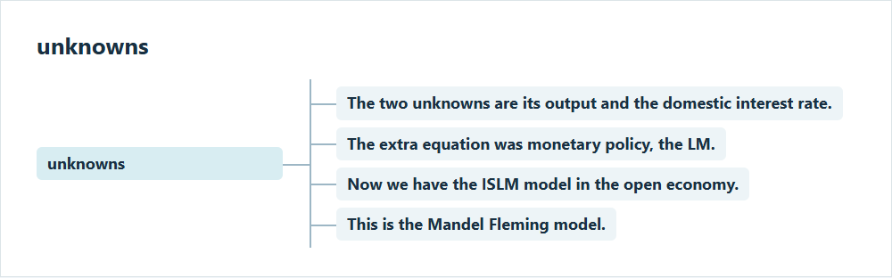

*Source: CON_0039, CON_0040, CON_0041, CON_0042 · 2051.69–2054.65s, 2064.47–2067.47s, 2077.65–2080.67s, 2081.29–2082.51s*

## interest rate

> Paraphrase candidate: semantic support remains unresolved; this is not a verified factual claim.

An increase in the interest rate reduces aggregate demand because investment falls and the exchange rate appreciates, lowering net exports.

*[Knowledge ID: CON_0043 | Sources: G00033]*

> Paraphrase candidate: semantic support remains unresolved; this is not a verified factual claim.

In an open economy, monetary policy affects aggregate demand through two channels: investment reduction and exchange‑rate appreciation.

*[Knowledge ID: CON_0044 | Sources: G00033]*

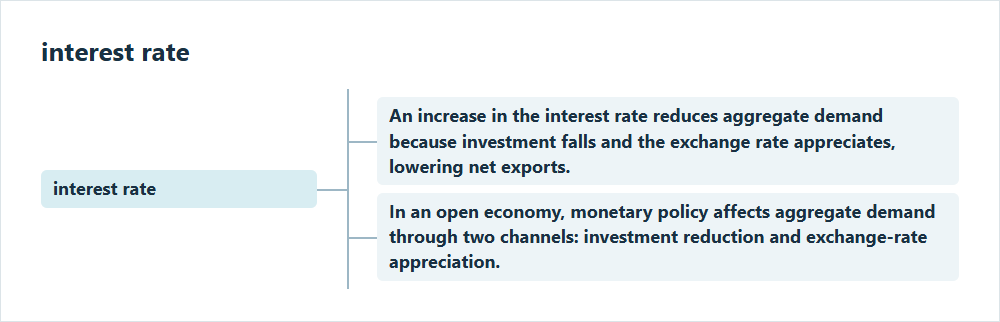

*Source: CON_0043, CON_0044 · 2121.86–2129.76s, 2133.44–2141.16s, 2154.93–2156.23s, 2157.09–2158.45s, 2158.67–2160.55s, 2160.71–2162.07s, 2181.66–2182.64s, 2184.90–2185.96s, 2186.08–2187.02s*

## Interest rate increase leads to exchange rate appreciation

> Paraphrase candidate: semantic support remains unresolved; this is not a verified factual claim.

When I increase interest rate from here to there, then my exchange rate has to appreciate.

*[Knowledge ID: CON_0049 | Sources: G00037]*

> Paraphrase candidate: semantic support remains unresolved; this is not a verified factual claim.

So an expansionary domestic monetary policy will lead to a contraction in output, which is what we get out of monetary policy, but it will also lead to an appreciation of the currency.

*[Knowledge ID: CON_0050 | Sources: G00037]*

> Paraphrase candidate: semantic support remains unresolved; this is not a verified factual claim.

And the compensation will come through an expected capital loss through the currency.

*[Knowledge ID: CON_0051 | Sources: G00037]*

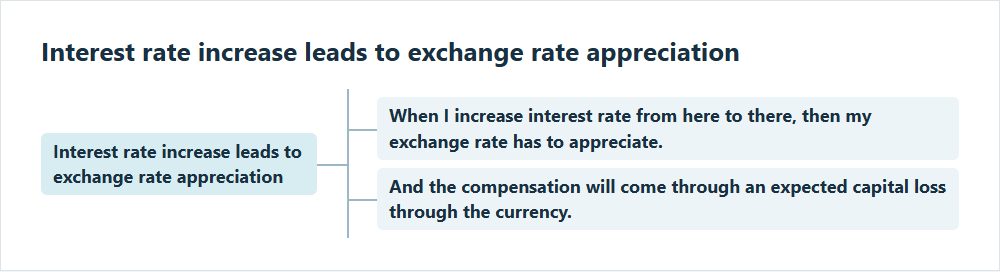

*Source: CON_0049, CON_0051 · 2385.26–2387.72s, 2388.22–2389.90s, 2427.36–2430.38s, 2430.38–2432.18s*

> Paraphrase candidate: semantic support remains unresolved; this is not a verified factual claim.

And of course, the precision is already built in here, which is what makes monetary policy more powerful than the closed economy, because you get the next export channel.

*[Knowledge ID: CON_0052 | Sources: G00037]*

## Source G00038

> Paraphrase candidate: semantic support remains unresolved; this is not a verified factual claim.

Expansionary fiscal policy has no effect on the exchange rate.

*[Knowledge ID: FCT_0086 | Sources: G00038]*

> Paraphrase candidate: semantic support remains unresolved; this is not a verified factual claim.

In an open economy the currency tends to appreciate.

*[Knowledge ID: FCT_0087 | Sources: G00038]*

> Paraphrase candidate: semantic support remains unresolved; this is not a verified factual claim.

Raising interest rates requires a domestic reason.

*[Knowledge ID: FCT_0088 | Sources: G00038]*

## Source G00039

> Paraphrase candidate: semantic support remains unresolved; this is not a verified factual claim.

treasury becomes very expansionary, and this output becomes too large for what is consistent with a zero output gap or no inflation. And then the Fed may react and raise interest rate, and that will lead to a conversation of exchanges and so on. And that's the reason why, in practice, when countries have sort of expansionary fiscal packages, the currency tends to appreciate it. It's because investors expect the Fed to react to that, or the central bank to react to that and raise interest rates.

*[Knowledge ID: FCT_0089 | Sources: G00039]*

## expected exchange rate

> Paraphrase candidate: semantic support remains unresolved; this is not a verified factual claim.

Suppose we increase the expected exchange rate, what moves in this diagram?

*[Knowledge ID: CON_0053 | Sources: G00040]*

> Paraphrase candidate: semantic support remains unresolved; this is not a verified factual claim.

The LEM is controlled by the domestic central bank; does it move?

*[Knowledge ID: CON_0054 | Sources: G00040]*

Does the IES move?

*[Knowledge ID: CON_0055 | Sources: G00040]*

> Paraphrase candidate: semantic support remains unresolved; this is not a verified factual claim.

When asking whether a variable moves, you should always fix something.

*[Knowledge ID: FCT_0090 | Sources: G00040]*

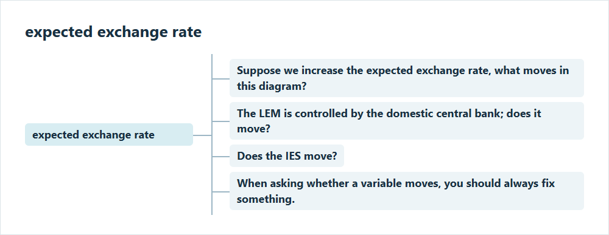

*Source: CON_0053, CON_0054, CON_0055, FCT_0090 · 2627.96–2634.12s, 2634.12–2659.73s, 2660.73–2671.02s*

> Paraphrase candidate: semantic support remains unresolved; this is not a verified factual claim.

If the same output is obtained after moving the expected exchange rate, the S has moved.

*[Knowledge ID: FCT_0091 | Sources: G00040]*

> Paraphrase candidate: semantic support remains unresolved; this is not a verified factual claim.

If a different equilibrium output is obtained, the S did move.

*[Knowledge ID: FCT_0006 | Sources: G00040]*

## Appreciation

> Paraphrase candidate: semantic support remains unresolved; this is not a verified factual claim.
> Unavailable or unresolved source information: PARTIALLY\_SUPPORTED. Original candidates remain in the audit.

Available source excerpt: Appreciate.

Available source excerpt: What happens when there's an appreciation?

Appreciation

*[Knowledge ID: CON_0056 | Sources: G00041]*

Net exports decline.

*[Knowledge ID: FCT_0092 | Sources: G00041]*

## Source G00042

> Paraphrase candidate: semantic support remains unresolved; this is not a verified factual claim.

The expected exchange rate moved to the right. To avoid generating expected capital gain or loss, the current exchange rate must be moved by the same amount. The curve will shift to the right. Only one curve can move. The curve will move to the left because net exports will decline. For any given level of the interest rate, net exports will be lower. The US moves to the left, causing output to fall. There is no movement in this case. If the Fed or the central bank does not react, the movement will not happen.

*[Knowledge ID: FCT_0093 | Sources: G00042]*

---

*Render complete: 101 items from 30 sections*

### Additional details: CON_0004
**Concept name:**
interest‑rate perception
Sources: G00002

### Additional details: CON_0011
**Concept name:**
IS‑LM model
Sources: G00006

### Additional details: CON_0018
**Concept name:**
Inflation is assumed to be zero
Sources: G00011

### Additional details: CON_0028
**Concept name:**
dollar depreciation
Sources: G00023

### Additional details: CON_0030
**Concept name:**
symmetry of the mechanism
Sources: G00024

### Additional details: CON_0031
**Concept name:**
quick adjustment of exchange rates
Sources: G00024

### Additional details: CON_0036
**Concept name:**
equilibrium indifference
Sources: G00029

### Additional details: CON_0044
**Concept name:**
monetary policy channels
Sources: G00033

### Additional details: CON_0047
**Concept name:**
uncovered interest parity (UIP)
Sources: G00035

### Additional details: CON_0050
**Concept name:**
Expansionary domestic monetary policy causes output contraction and currency appreciation
Sources: G00037

### Additional details: CON_0051
**Concept name:**
Compensation for higher domestic interest rate comes via expected capital loss on the currency
Sources: G00037

### Additional details: CON_0052
**Concept name:**
Monetary policy is more powerful in an open economy because it includes an export channel
Sources: G00037

### Additional details: EXP_0002
**Topic:**
Why net exports decline when domestic income rises
Sources: G00008

### Additional details: EXP_0057
**Topic:**
exchange rate equation
Sources: G00016

Source information not completed:

- definitions: SOURCE_MISSING (sources: G00003, G00004).
- formulas: SOURCE_MISSING (sources: G00003, G00004).
- procedures: SOURCE_MISSING (sources: G00003, G00004).
